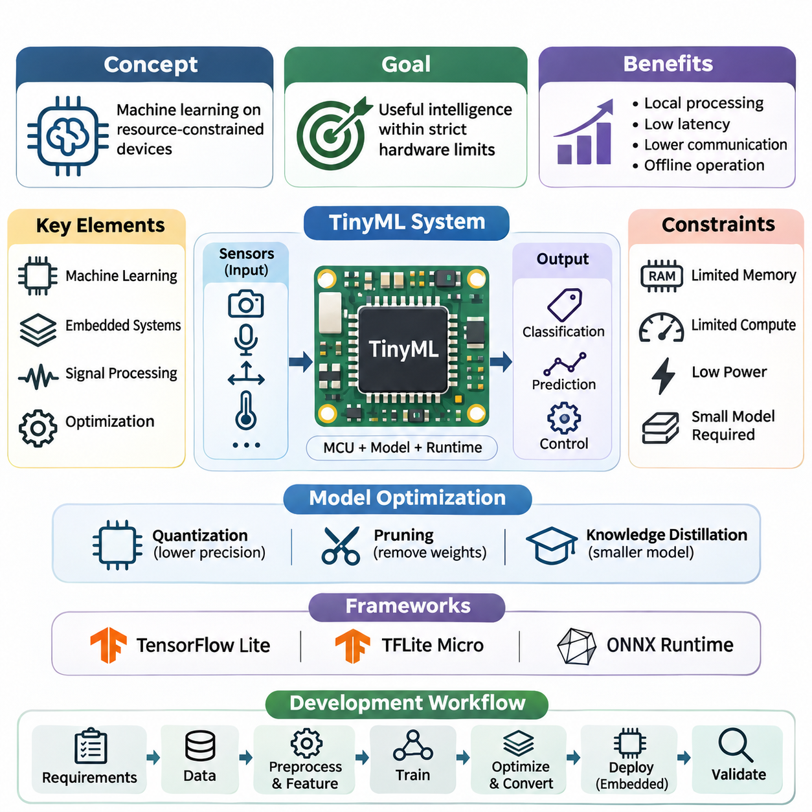
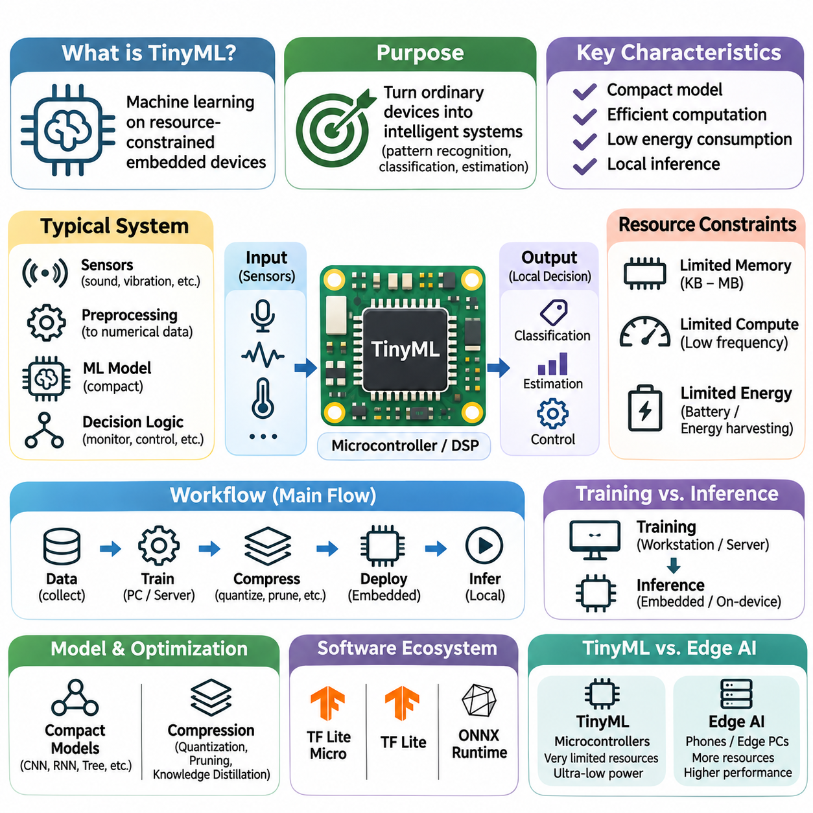
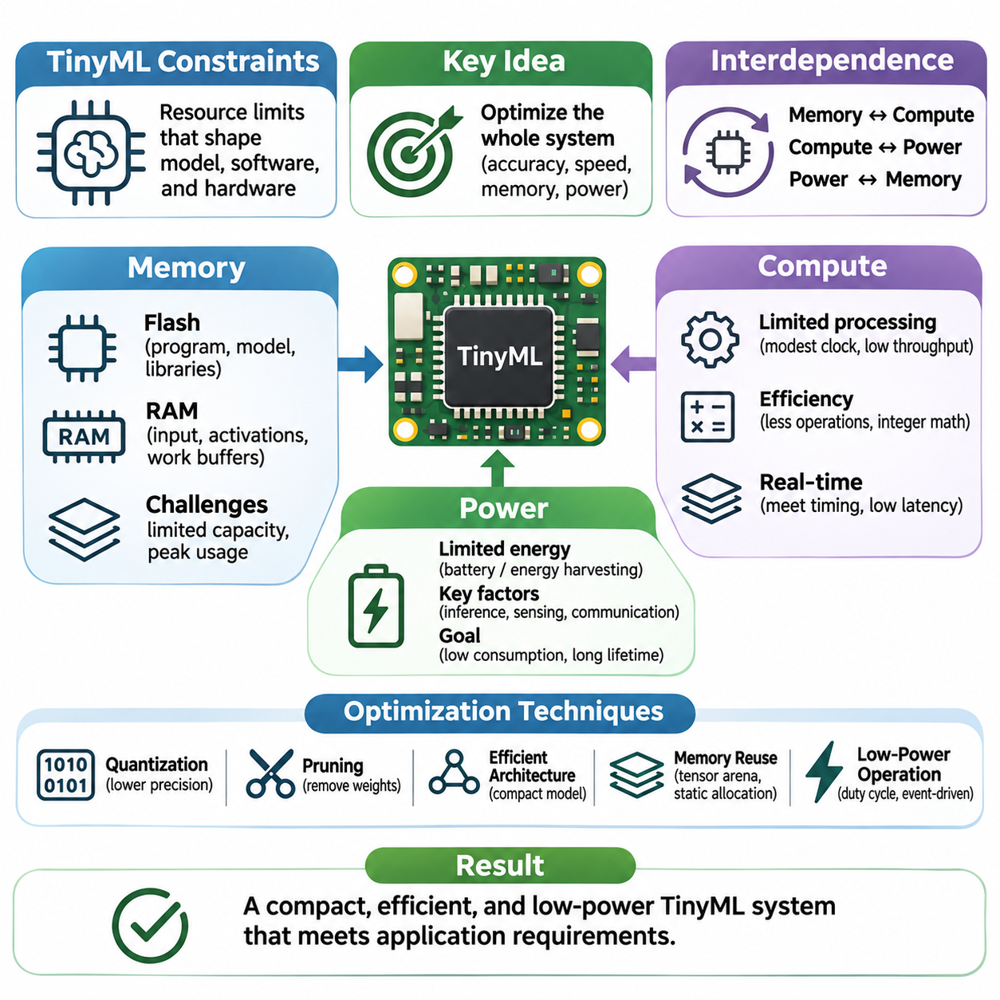
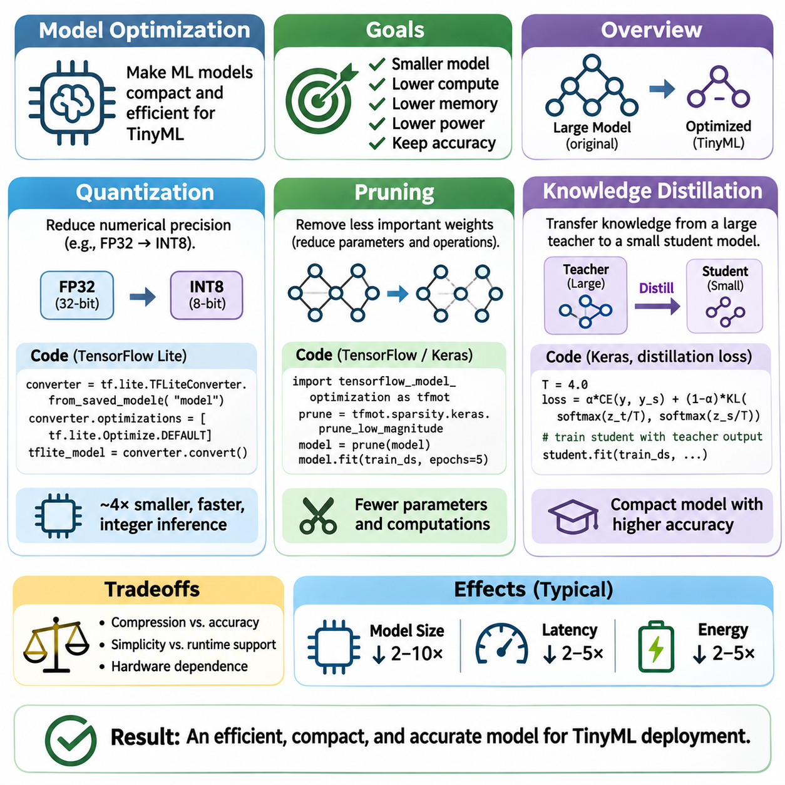
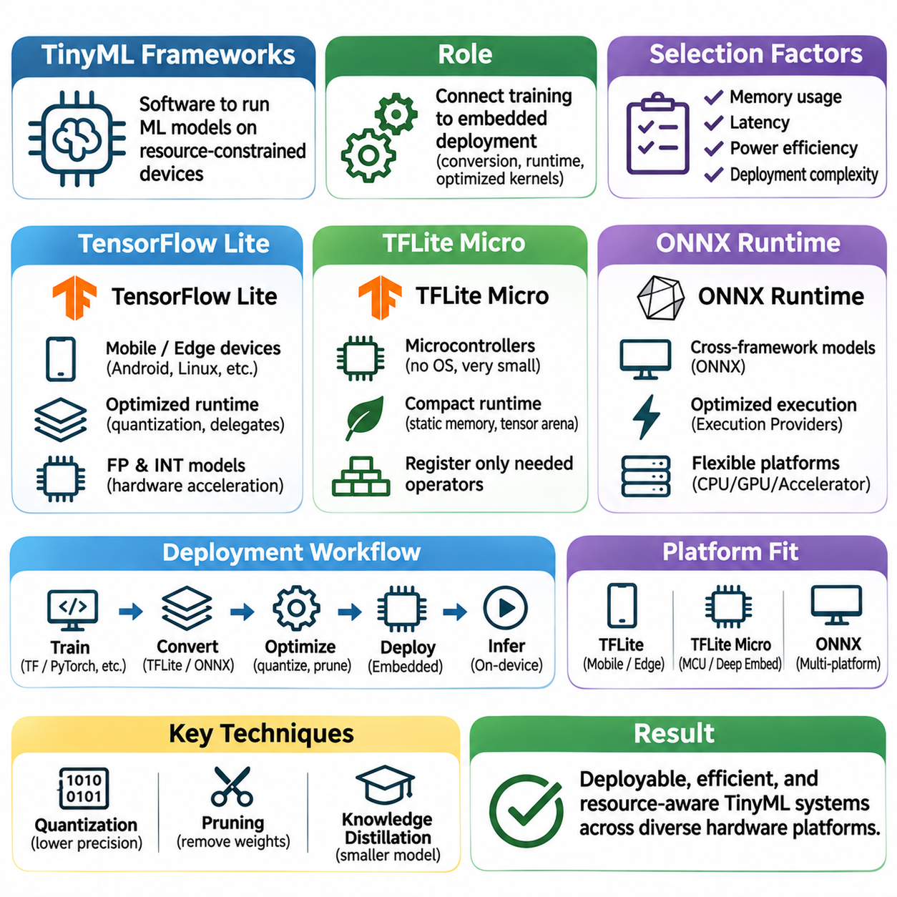
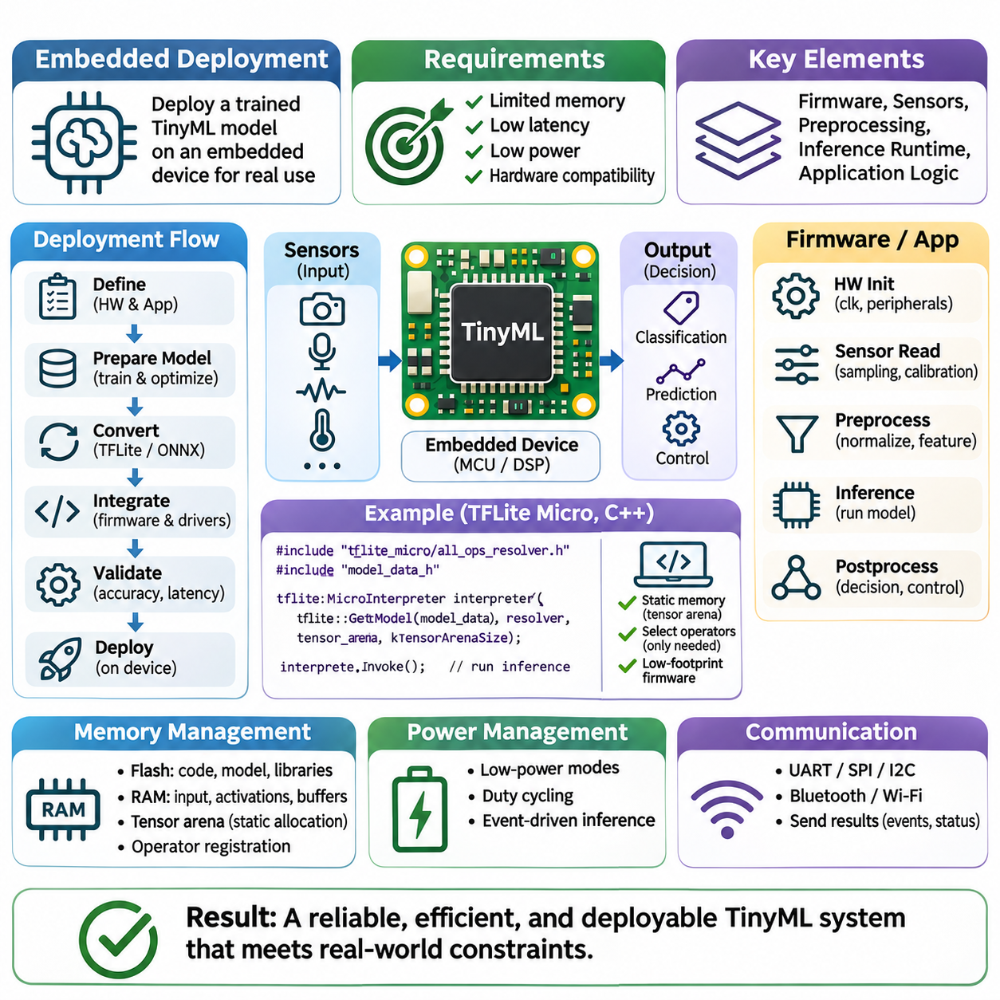
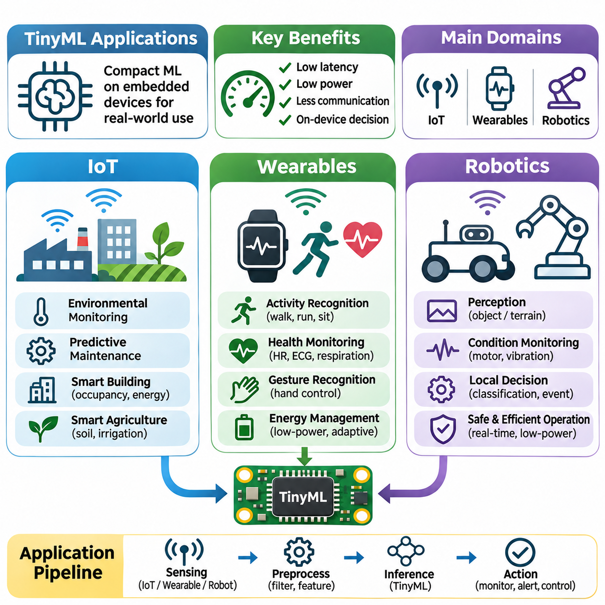

**Volume 40.** **TinyML and Federated Learning**

# 01. TinyML

## 01.00 Overview

{width="7.268055555555556in" height="7.268055555555556in"}

Tiny Machine Learning (TinyML) represents a specialized approach to artificial intelligence that enables machine learning models to operate directly on resource-constrained embedded devices. Unlike conventional AI systems that depend on powerful processors or cloud infrastructure, TinyML emphasizes compact models, efficient computation, and minimal energy consumption. Its primary objective is to deliver useful intelligence within strict hardware limitations.

The emergence of TinyML reflects the growing demand for intelligent sensing and autonomous decision-making at the edge of computing networks. Billions of connected devices continuously generate information from cameras, microphones, accelerometers, temperature sensors, and industrial instruments. Processing these signals locally can reduce communication overhead, improve responsiveness, and enable applications to function without continuous network connectivity.

TinyML combines principles from machine learning, embedded systems, digital signal processing, and hardware-aware optimization. A typical implementation integrates a trained model with a microcontroller, sensor interface, memory subsystem, and lightweight inference runtime. The resulting system transforms raw measurements into classifications, predictions, or control signals while operating within tightly constrained computational and electrical budgets.

A defining characteristic of TinyML is its emphasis on resource efficiency rather than maximizing predictive accuracy alone. Embedded processors may provide only kilobytes or megabytes of memory, limited arithmetic throughput, and restricted energy availability. Consequently, successful model development requires balancing accuracy, latency, memory consumption, computational complexity, and power requirements throughout the engineering process.

Memory limitations are particularly important because embedded inference requires storage for model parameters, intermediate activations, input buffers, and runtime operations. Flash memory commonly stores executable code and model weights, while static random-access memory supports temporary computations. A model that fits within flash storage may still fail during execution if its intermediate tensors exceed available working memory.

Computational constraints introduce additional challenges because many microcontrollers lack the parallel processing capabilities available in GPUs and dedicated AI accelerators. Neural network operations must therefore be selected according to processor architecture, supported numerical instructions, and execution efficiency. Hardware-aware model design helps ensure that theoretical reductions in operation counts translate into measurable improvements on actual devices.

Power consumption is equally fundamental, especially for battery-operated and energy-harvesting systems. Inference frequency, processor utilization, sensor sampling, and wireless communication all contribute to overall energy demand. TinyML applications frequently employ event-driven execution, duty cycling, and low-power operating states to extend deployment lifetime without sacrificing essential monitoring or decision-making capabilities.

Model optimization provides the technical foundation for adapting conventional neural networks to embedded environments. Quantization reduces numerical precision, often converting floating-point parameters and computations into integer representations. Pruning removes selected weights or structures, while knowledge distillation transfers useful predictive behavior from a larger teacher model into a smaller student model suitable for constrained hardware.

These optimization techniques involve important tradeoffs between compression efficiency, numerical stability, inference speed, and predictive quality. Quantization may introduce approximation errors, while pruning can require specialized execution support to deliver practical acceleration. Knowledge distillation depends on appropriate training objectives and representative data. Effective optimization therefore requires systematic evaluation rather than assuming that smaller models automatically perform better.

TinyML development also depends on specialized software frameworks that connect model training environments with embedded execution platforms. TensorFlow Lite, TensorFlow Lite for Microcontrollers, and selected ONNX Runtime configurations illustrate different approaches to model representation and inference. Their suitability depends on device capabilities, operator availability, runtime memory requirements, and integration constraints.

TensorFlow Lite supports optimized inference across various edge computing platforms, whereas TensorFlow Lite for Microcontrollers targets highly constrained microcontroller environments. ONNX Runtime provides an alternative execution ecosystem, including configurations intended for embedded and resource-limited platforms. Framework selection should account for actual target support, conversion compatibility, supported operators, and the complete memory footprint of the deployed runtime.

The TinyML development workflow typically begins with application requirements and representative sensor data collection. Data preprocessing and feature extraction establish the numerical inputs required by the model. Training generally occurs on a more capable development system, followed by optimization, model conversion, embedded integration, and validation. Each stage must preserve consistency between training conditions and deployed execution behavior.

Embedded deployment introduces practical considerations that extend beyond neural network architecture. Engineers must configure sensor drivers, sampling intervals, preprocessing routines, memory allocation, and inference scheduling. Model binaries must be compatible with the target runtime and processor. Reliable execution also requires attention to initialization behavior, numerical overflow, watchdog mechanisms, and recovery from unexpected hardware or software conditions.

Real-time performance is a critical consideration when TinyML participates in monitoring or control systems. End-to-end latency includes sensor acquisition, signal preprocessing, model inference, decision logic, and output generation. Average inference time alone cannot establish whether an application satisfies its timing requirements. Engineers must evaluate worst-case execution behavior, scheduling interference, and responsiveness under representative operating conditions.

TinyML applications extend across the Internet of Things, wearable electronics, and robotics. Connected sensors can recognize equipment anomalies, environmental changes, or acoustic events without continuously transmitting raw measurements. Wearable devices can classify physical activities and interpret physiological signals, while robotic systems can use lightweight perception models to support local awareness and responsive behavior.

In industrial IoT environments, TinyML can support predictive maintenance through vibration analysis, acoustic monitoring, and equipment-state classification. Embedded sensors can detect patterns associated with mechanical wear or abnormal operating conditions. Local inference reduces dependence on centralized infrastructure and can decrease communication requirements, although dependable fault detection still requires representative training data, calibration, and careful evaluation of false alarms.

Wearable applications demonstrate the importance of balancing inference quality with energy efficiency and physical design constraints. Motion recognition, gesture detection, and activity monitoring may rely on accelerometers, gyroscopes, or other compact sensors. Because wearable devices operate close to users and frequently have limited battery capacity, efficient signal processing and selective inference are essential for maintaining practical operating lifetimes.

Robotics applications introduce additional requirements involving environmental variability, sensor synchronization, and interaction with physical systems. TinyML models may provide wake-word detection, terrain classification, simple object recognition, or anomaly monitoring on distributed embedded controllers. These functions can complement more powerful onboard computing systems, allowing lightweight intelligence to operate near sensors while complex planning remains on higher-performance processors.

Local inference can provide privacy and communication advantages because raw sensor information does not always need to leave the device. However, on-device processing does not automatically guarantee privacy or security. Model extraction, insecure firmware updates, exposed debugging interfaces, and unauthorized access remain possible threats. Secure deployment requires appropriate protection of stored models, sensor information, communication interfaces, and firmware integrity.

TinyML also establishes an important foundation for distributed intelligence and federated learning. Individual devices can perform local inference while participating in larger systems that coordinate information across edge nodes and cloud services. Federated learning extends this architecture by enabling collaborative model improvement without routinely centralizing raw training data, although communication, privacy, and heterogeneous hardware constraints remain significant challenges.

Evaluation of TinyML systems requires metrics that reflect both predictive performance and embedded execution characteristics. Accuracy, precision, recall, and robustness describe model behavior, while latency, peak memory utilization, model size, energy per inference, and sustained power consumption characterize deployment feasibility. Standardized benchmarks such as MLPerf Tiny can support comparisons, but application-specific measurements remain necessary.

Reproducibility is essential because performance can vary with processor frequency, compiler settings, optimization libraries, memory placement, and sensor workloads. A credible experiment should document the hardware platform, firmware configuration, model version, input characteristics, and measurement methodology. Comparing models under consistent conditions helps distinguish genuine algorithmic improvements from differences introduced by implementation or hardware configuration.

The future development of TinyML increasingly involves hardware-software co-design, efficient neural architectures, adaptive inference, and closer integration with intelligent sensing platforms. Specialized accelerators and improved numerical kernels may expand the complexity of models that constrained devices can execute. Nevertheless, practical progress will continue to depend on disciplined engineering that balances computational capability against energy, memory, reliability, and cost.

Ultimately, TinyML represents a shift from centralized intelligence toward embedded decision-making distributed throughout physical environments. Its significance lies not merely in shrinking neural networks, but in designing complete systems that deliver dependable machine learning under severe resource constraints. Understanding its foundations, optimization methods, frameworks, deployment processes, and applications provides the basis for developing scalable and energy-efficient edge intelligence.

## 01.01 What is TinyML

{width="7.268055555555556in" height="7.268055555555556in"}

Tiny Machine Learning (TinyML) is a specialized field of machine learning that enables intelligent inference on highly resource-constrained embedded devices. It focuses on executing trained models within limited memory, processing capacity, and energy budgets. Unlike conventional machine learning systems that depend on cloud servers or powerful processors, TinyML brings predictive capabilities directly to microcontrollers and compact sensing platforms.

The fundamental purpose of TinyML is to transform ordinary embedded devices into intelligent systems capable of interpreting sensor information and making localized decisions. Traditional embedded software often relies on predefined thresholds, rules, and deterministic algorithms. TinyML extends these capabilities by introducing data-driven models that can recognize complex patterns, classify observations, and estimate conditions that are difficult to describe through explicit programming.

TinyML typically operates on microcontrollers, digital signal processors, and specialized low-power computing platforms. These devices may contain only tens or hundreds of kilobytes of working memory and relatively limited processing resources. Their operating frequencies, storage capacities, and numerical capabilities are substantially smaller than those of desktop computers, making efficient model representation and execution essential requirements.

A typical TinyML system combines sensors, signal processing, a compact machine learning model, and application-specific decision logic. Sensors acquire measurements such as sound, vibration, acceleration, temperature, or light intensity. Preprocessing transforms these measurements into suitable numerical representations, after which an inference engine evaluates the model and produces predictions that guide monitoring, communication, or control operations.

The distinction between training and inference is particularly important in TinyML. Model training usually occurs on workstations, servers, or other capable computing environments where substantial datasets and optimization algorithms can be processed. The resulting model is then compressed, converted, and deployed onto embedded hardware. Although on-device learning is possible in selected implementations, conventional TinyML primarily emphasizes efficient local inference.

Resource constraints fundamentally influence TinyML model design. Flash memory must accommodate program instructions, model parameters, and supporting libraries, while random-access memory stores input buffers, intermediate activations, and temporary computational data. A model may contain relatively few parameters yet still require excessive working memory because of large intermediate tensors or inefficient execution scheduling.

Computational efficiency is another defining characteristic of TinyML. Embedded processors often lack high-performance floating-point units, extensive parallel execution resources, or large memory caches. Consequently, neural network architectures must minimize expensive operations and exploit supported processor instructions. Integer arithmetic, optimized convolution kernels, and efficient memory access patterns frequently determine whether real-time inference is practical.

Energy efficiency distinguishes TinyML from many other edge artificial intelligence approaches. Numerous embedded devices operate from small batteries or energy-harvesting sources and must remain functional for extended periods. Inference execution therefore competes with sensor acquisition, communication, and background processing for limited energy resources. Efficient scheduling, selective activation, and low-power operating modes are essential design considerations.

TinyML models commonly employ compact neural networks, decision trees, linear classifiers, and other computationally efficient algorithms. Convolutional neural networks can support image and acoustic recognition, while lightweight temporal models can analyze sequential sensor measurements. Model selection depends on input characteristics, task complexity, available memory, and the execution capabilities of the target hardware rather than model accuracy alone.

Model compression techniques enable machine learning algorithms to operate within severe hardware limitations. Quantization reduces numerical precision, commonly representing model parameters and activations using eight-bit integers. Pruning removes selected parameters or computational structures, while knowledge distillation transfers predictive behavior from larger models into compact alternatives. These methods must preserve sufficient accuracy for the intended application.

The software ecosystem surrounding TinyML provides tools for converting trained models into executable embedded representations. TensorFlow Lite for Microcontrollers is a prominent example of a runtime designed for microcontroller environments. Other embedded inference libraries and selected ONNX Runtime configurations support different deployment requirements. Compatibility with target processors, supported operators, and memory allocation mechanisms strongly influences framework selection.

TinyML differs from general edge AI primarily in its emphasis on extremely constrained computing environments. Edge AI encompasses smartphones, industrial computers, embedded GPUs, and dedicated neural accelerators, whereas TinyML commonly targets microcontrollers and similarly limited platforms. This distinction is not absolute, but it highlights the stronger requirements for compact execution, minimal memory consumption, and sustained low-power operation.

A major advantage of TinyML is reduced dependence on network connectivity. Devices can process sensor measurements locally without transmitting every observation to remote infrastructure. This approach decreases communication traffic, reduces network-related latency, and enables continued operation during connectivity interruptions. Local processing can also limit unnecessary exposure of raw data, although additional security mechanisms remain necessary.

Real-time responsiveness is especially valuable in applications involving continuous monitoring or immediate reactions. A TinyML device can recognize an acoustic event, detect unusual vibration, or identify a motion pattern directly after acquiring sensor data. However, achieving predictable response times requires considering the complete processing pipeline, including sampling, preprocessing, inference, scheduling, and application-level decision execution.

TinyML applications include keyword spotting, gesture recognition, environmental monitoring, predictive maintenance, and activity classification. Microphones can identify predefined acoustic patterns, accelerometers can recognize movement characteristics, and vibration sensors can detect abnormal machinery behavior. These applications demonstrate how relatively simple sensing hardware can support sophisticated interpretation when combined with appropriately optimized models.

In industrial environments, TinyML enables distributed monitoring systems that operate close to machines and production equipment. Embedded sensors can evaluate vibration signatures, acoustic characteristics, or operating conditions without continuously streaming raw measurements. Such systems may identify early indications of abnormal behavior and transmit selected events to supervisory platforms, reducing communication requirements while supporting timely maintenance decisions.

Wearable devices represent another important application domain because they combine strict power limitations with continuous sensing requirements. TinyML can interpret motion measurements for activity recognition, gesture detection, and context awareness. Efficient inference allows these functions to operate locally while minimizing battery consumption, although sensor calibration, user variability, and changing operating conditions must be considered during development.

Robotics provides opportunities for TinyML to complement more powerful onboard computing systems. Low-power controllers can perform simple perception, event detection, terrain classification, or equipment monitoring near individual sensors. Higher-performance processors can then handle complex perception, planning, and coordination. This hierarchical arrangement distributes computational responsibilities according to latency, energy, and functional requirements.

Developing reliable TinyML systems requires careful coordination between data preparation, model training, optimization, and embedded software integration. Training data should reflect actual sensor characteristics and environmental conditions. Preprocessing operations must remain consistent between development and deployment environments. Differences in numerical precision, sampling frequency, or feature extraction can otherwise produce significant degradation in predictive performance.

Evaluation must extend beyond conventional machine learning accuracy metrics. Model size, peak memory consumption, inference latency, energy per inference, and sustained power demand are essential indicators of practical feasibility. Measurements should be performed on the intended hardware because desktop simulations cannot fully reproduce processor behavior, memory contention, compiler optimizations, or embedded runtime overhead.

TinyML also introduces engineering challenges involving robustness, maintainability, and lifecycle management. Sensor drift, environmental changes, and differences between hardware units can reduce prediction reliability. Firmware updates and model replacement procedures must preserve system integrity. Applications involving safety-critical decisions require additional validation and independent protective mechanisms rather than relying exclusively on machine learning predictions.

The relationship between TinyML and distributed learning is becoming increasingly important as connected embedded systems expand. Devices may execute local models while participating in broader edge-cloud architectures that coordinate monitoring and model updates. Federated learning can support collaborative model improvement across distributed participants, although training capability, communication efficiency, privacy protection, and device heterogeneity introduce additional constraints.

TinyML ultimately represents an engineering approach to making machine learning practical within the smallest useful computing platforms. Its value emerges from the integration of compact algorithms, efficient software, suitable hardware, and carefully designed sensing workflows. By enabling localized intelligence under strict resource constraints, TinyML establishes an important foundation for scalable, responsive, and energy-efficient intelligent systems.

## 01.02 Constraints

{width="7.268055555555556in" height="7.268055555555556in"}

TinyML systems operate under severe resource constraints that fundamentally influence model architecture, software implementation, and hardware selection. Unlike conventional machine learning platforms, embedded devices must execute inference within limited memory, computational capacity, and energy availability. These constraints are closely interconnected, requiring engineers to optimize the complete system rather than treating model accuracy, execution speed, and power consumption as independent objectives.

Memory constraints represent one of the most immediate challenges in TinyML deployment. Microcontrollers typically provide limited flash storage for program instructions and model parameters, alongside smaller amounts of random-access memory for runtime execution. The available capacity varies significantly across devices, but many practical implementations must operate within kilobytes or a few megabytes of memory, making careful allocation essential.

Flash memory stores executable firmware, model weights, constant lookup tables, and supporting runtime components. Its capacity determines whether the complete application can be installed on the target device. However, model size alone does not represent total storage requirements because inference libraries, preprocessing routines, communication stacks, and device drivers also consume space. Deployment planning must therefore consider the complete firmware image.

Random-access memory introduces additional limitations because inference requires temporary storage for input tensors, intermediate activations, operator workspaces, and output buffers. Activation memory can exceed parameter storage for certain neural network architectures, particularly when processing high-resolution inputs. Memory planning must account for peak simultaneous allocation rather than simply summing the sizes of individual model components.

Static memory allocation is commonly preferred in constrained embedded environments because dynamic allocation can introduce fragmentation and unpredictable execution behavior. Tensor arena mechanisms allow inference runtimes to reuse memory regions across operations whose intermediate values are no longer required. Efficient tensor lifetime analysis and buffer reuse can substantially reduce peak memory requirements without changing the mathematical behavior of the model.

Memory optimization techniques include quantization, structured pruning, compact feature representations, and careful neural network architecture selection. Quantization reduces the storage requirements of parameters and activations by replacing high-precision numerical formats with lower-precision alternatives. Structured pruning can remove complete channels or filters, while reduced input dimensions decrease intermediate tensor sizes. Each technique requires validation of predictive accuracy.

Memory bandwidth and access patterns also influence TinyML performance. Even when a model fits within available storage, repeated transfers between memory regions can increase execution latency and energy consumption. Processor caches, tightly coupled memory, direct memory access mechanisms, and data alignment affect practical efficiency. Hardware-aware implementation seeks to minimize unnecessary data movement while maintaining predictable access behavior.

Computational constraints arise from the limited processing capabilities of microcontrollers and other low-power embedded processors. Many devices operate at modest clock frequencies and provide restricted arithmetic throughput compared with CPUs, GPUs, or dedicated neural accelerators. Neural network execution must therefore minimize computational complexity while satisfying application-specific timing requirements and preserving sufficient predictive performance.

The number of multiply-accumulate operations provides a useful approximation of neural network computational demand, particularly for convolutional and fully connected layers. However, operation counts alone cannot predict inference latency because processor instruction sets, memory access overhead, kernel implementations, and numerical formats strongly affect execution speed. Accurate performance assessment requires measurement on the intended hardware platform.

Integer arithmetic is widely used to improve computational efficiency in TinyML. Quantized neural networks can exploit optimized integer instructions and avoid expensive floating-point operations on processors without efficient floating-point hardware. Nevertheless, integer execution introduces scaling, rounding, and saturation considerations. Quantization parameters must be calibrated carefully to maintain numerical stability and prevent unacceptable degradation in prediction quality.

Model architecture has a direct impact on computational feasibility. Depthwise separable convolutions, compact multilayer perceptrons, and lightweight temporal networks can reduce operation counts relative to larger conventional architectures. However, theoretical efficiency does not always translate into practical acceleration because some operators may lack optimized implementations. Architecture selection must consider available kernels, memory requirements, and processor characteristics.

Real-time execution requirements impose additional computational constraints. Applications such as vibration monitoring, gesture recognition, and robotic event detection must complete sensing, preprocessing, inference, and decision logic within defined timing intervals. Average execution time may be insufficient for systems with strict deadlines. Engineers must examine worst-case latency, scheduling interference, interrupt behavior, and interactions with other embedded software components.

Computational optimization can also involve operator fusion, loop restructuring, fixed-point signal processing, and hardware-specific acceleration. Combining compatible operations reduces intermediate memory traffic, while optimized kernels exploit supported processor instructions. Specialized digital signal processing extensions or neural processing units may provide additional acceleration, although their benefits depend on model compatibility and the overhead of transferring data between processing units.

Power constraints are especially significant for battery-operated, wireless, and energy-harvesting TinyML devices. The energy available for computation may be limited by battery capacity, environmental conditions, or intermittent power generation. Continuous inference can shorten operating lifetime even when individual predictions require relatively little energy. Power-aware design must therefore consider the entire sensing and processing cycle rather than inference execution alone.

Dynamic power consumption depends on operating voltage, switching activity, clock frequency, and hardware utilization. Reducing processor frequency may decrease instantaneous power but increase execution duration, creating tradeoffs between power and total energy consumption. Similarly, higher-performance execution can sometimes reduce energy per inference by allowing the processor to return to a low-power state sooner. These relationships require empirical measurement.

Duty cycling is an important strategy for reducing average energy consumption. A device may remain in a low-power sleep state until a timer, sensor interrupt, or predefined event triggers processing. The processor then acquires measurements, executes inference, performs the required action, and returns to sleep. This approach is particularly effective when meaningful events occur infrequently and continuous high-frequency inference is unnecessary.

Sensor acquisition and wireless communication can consume substantial energy relative to model inference. High-resolution cameras, continuously operating microphones, and frequent radio transmissions may dominate the system power budget. TinyML can reduce communication demand by transmitting classifications or selected events instead of raw measurements. However, sensor operating modes and communication protocols must be optimized alongside the machine learning model.

Energy per inference is a useful metric for comparing TinyML implementations, but it does not fully describe system efficiency. Average power consumption, inference frequency, sleep-state leakage, sensor duty cycles, and communication activity determine practical battery lifetime. Energy measurements should include representative workloads and realistic operating conditions. Short benchmark runs may overlook thermal effects, intermittent communication, and background processing.

Memory, computation, and power constraints interact in ways that complicate optimization. Reducing model precision can decrease storage requirements and accelerate arithmetic, potentially lowering energy consumption simultaneously. Conversely, aggressive compression may require additional decoding operations or irregular memory access, offsetting expected benefits. A successful optimization must evaluate its effects across all three resource dimensions rather than focusing on one metric.

System-level tradeoffs also influence the distribution of processing between embedded devices and external infrastructure. Local inference reduces network dependence and communication energy but requires sufficient onboard computational resources. Remote processing can support more complex models while introducing transmission costs, latency, and connectivity requirements. Hybrid architectures may dynamically allocate tasks according to device capabilities, energy availability, and application priorities.

Reliable engineering requires explicit resource budgets before model deployment. Memory budgets should include firmware, model parameters, activation buffers, and operational reserves. Computational budgets should account for preprocessing, inference, and application logic within required deadlines. Energy budgets must reflect sensing, communication, active processing, and idle operation. These estimates should be verified through measurements on representative hardware.

Benchmarking and profiling tools help identify bottlenecks that are not apparent from model specifications. Peak memory measurements reveal allocation failures, execution traces expose expensive operators, and power measurements identify energy-intensive operating phases. Repeated experiments under controlled conditions support meaningful comparisons between optimization strategies. Hardware configuration, compiler options, inference runtime versions, and measurement procedures should be documented.

Ultimately, TinyML constraints should be treated as fundamental design parameters rather than obstacles addressed only after model training. Memory determines what can be stored and executed, computation determines how quickly predictions can be produced, and power determines how long the system can operate. Coordinated optimization across these dimensions enables compact machine learning systems to deliver reliable intelligence within the physical limitations of embedded hardware.

## 01.03 Model Optimization

{width="7.268055555555556in" height="7.268055555555556in"}

Model optimization is a fundamental requirement for deploying machine learning on resource-constrained TinyML devices. Conventional neural networks often exceed the available memory, computational capacity, and energy budgets of embedded processors. Optimization techniques reduce these demands while preserving useful predictive performance. Quantization, pruning, and knowledge distillation provide complementary approaches to creating compact and efficient models.

Quantization reduces the numerical precision used to represent model parameters, activations, and sometimes intermediate computations. Conventional neural networks commonly use 32-bit floating-point values, whereas embedded implementations frequently employ 8-bit integers. This transformation can reduce parameter storage by approximately four times, although actual memory savings depend on metadata, runtime buffers, and operator implementations.

Post-training quantization converts an already trained model into a lower-precision representation without requiring complete retraining. Calibration data is used to estimate activation ranges and determine appropriate scaling parameters. This approach is relatively simple and computationally economical, making it attractive for embedded deployment. However, accuracy may decline when the model contains outliers or numerically sensitive operations.

Quantization-aware training incorporates the effects of reduced numerical precision into the training process. Simulated quantization operations allow the model to adapt its parameters to rounding and clipping behavior before deployment. This approach can recover accuracy lost through post-training quantization, particularly in sensitive architectures. Nevertheless, it requires access to training data, additional computation, and a compatible training framework.

Integer quantization typically represents real-valued tensors using a scale factor and zero point. These parameters map floating-point values into a finite integer range while approximating the original numerical relationships. Symmetric and asymmetric quantization provide different tradeoffs involving representation accuracy and implementation complexity. Per-channel scaling can improve weight quantization accuracy but requires suitable runtime support.

Quantization effectiveness depends on the target processor and supported inference kernels. Integer arithmetic can accelerate execution on microcontrollers with optimized instructions, but unsupported operators may require floating-point processing or conversion overhead. Mixed-precision execution can preserve higher precision for sensitive layers while compressing others. Practical deployment therefore requires profiling actual latency, memory consumption, and energy use.

Pruning reduces model complexity by removing parameters or computational structures considered less important to predictive performance. The underlying assumption is that trained neural networks often contain redundancy that can be eliminated without substantial accuracy loss. Pruning may reduce parameter count, storage requirements, and arithmetic operations. However, the relationship between theoretical sparsity and actual embedded acceleration depends strongly on implementation.

Unstructured pruning removes individual weights according to criteria such as magnitude, sensitivity, or estimated contribution to the loss function. This process produces sparse weight matrices while preserving the original layer dimensions. Although parameter sparsity can be substantial, conventional dense inference kernels may not exploit it efficiently. Sparse storage formats also introduce indexing overhead that can offset memory savings.

Structured pruning removes complete filters, channels, neurons, or network blocks rather than isolated weights. The resulting architecture generally remains compatible with dense tensor operations, making practical acceleration more achievable on microcontrollers. Channel pruning can reduce both parameter storage and intermediate activation memory. Nevertheless, aggressive structural removal may damage feature representation and require careful retraining.

Pruning strategies can be applied during training, after training, or through iterative optimization cycles. A common procedure identifies low-importance structures, removes them, and fine-tunes the remaining network to restore predictive accuracy. Gradual pruning may provide better stability than removing a large proportion of parameters at once. Evaluation should measure actual model dimensions, runtime behavior, and task performance after optimization.

Pruning decisions must consider the computational structure of the target hardware. Removing operations that dominate execution time can provide greater benefits than eliminating many parameters from inexpensive layers. Layer sensitivity analysis helps identify components that can tolerate compression. Hardware-aware pruning integrates memory limits, supported operators, and measured execution costs into the optimization objective.

Knowledge distillation transfers predictive information from a larger teacher model into a smaller student model. The teacher typically provides stronger representations or higher predictive accuracy, while the student is designed for efficient deployment. Instead of learning exclusively from ground-truth labels, the student also learns from the teacher\'s outputs or internal representations. This additional guidance can improve compact model performance.

Response-based distillation uses the teacher\'s output probabilities or logits as learning targets. Softened probability distributions reveal relationships among classes that are not fully represented by hard labels. A temperature parameter controls the smoothness of these distributions, while a combined objective balances teacher guidance against supervised learning. Appropriate temperature and loss weighting are important for stable training.

Feature-based distillation encourages the student to reproduce selected intermediate representations from the teacher. Because teacher and student architectures may differ, projection layers or feature alignment mechanisms can be necessary. This approach can transfer information about useful patterns and hierarchical representations. However, matching large feature maps may increase training complexity without improving the final embedded inference cost.

Knowledge distillation is particularly valuable when the deployment model must remain extremely small. A compact convolutional network or multilayer perceptron can learn from a more capable teacher while retaining a lightweight inference architecture. The teacher is generally required only during training, so its computational cost does not affect deployed inference. Student performance still depends on architecture capacity and representative training data.

Quantization, pruning, and knowledge distillation can be combined into a coordinated optimization pipeline. Distillation may first improve a compact student model, structured pruning may remove redundant components, and quantization may reduce numerical precision before deployment. Alternative sequences are possible because compression stages interact. Fine-tuning and validation between stages help prevent cumulative accuracy degradation.

The combined optimization process involves tradeoffs among model size, latency, memory consumption, energy efficiency, and predictive quality. A smaller parameter file does not necessarily produce faster inference, and fewer arithmetic operations do not always reduce energy consumption. Additional tensor conversions, irregular memory access, and unsupported kernels can eliminate expected benefits. Optimization must therefore target measurable system-level improvements.

Representative datasets are essential for evaluating optimized TinyML models. Calibration samples should reflect the numerical ranges encountered during deployment, while validation data should cover expected environmental conditions and sensor variations. Accuracy, precision, recall, and robustness must be evaluated alongside memory and execution metrics. Distribution shifts can expose weaknesses that are not apparent in conventional test results.

Embedded deployment requires compatibility between optimized model representations and the selected inference runtime. Quantized operators must support the required numerical formats, while pruned architectures must remain executable within available kernels. TensorFlow Lite for Microcontrollers and other embedded runtimes impose specific operator and memory requirements. Model conversion should therefore be validated before final hardware integration.

Optimization experiments should establish an uncompressed baseline and document each transformation applied to the model. Comparisons should use consistent datasets, hardware platforms, compiler settings, and measurement procedures. Peak RAM usage, flash footprint, inference latency, and energy per inference provide complementary evidence of practical improvement. Reproducibility helps distinguish algorithmic gains from implementation differences.

The optimal compression strategy depends on application requirements and hardware characteristics. Acoustic event detection may prioritize continuous low-power execution, while robotic perception may emphasize latency and robustness. Industrial monitoring may require exceptionally low false-negative rates. These priorities determine acceptable accuracy loss and influence the selection of quantization precision, pruning intensity, and student architecture.

Ultimately, model optimization transforms machine learning architectures into deployable TinyML components through coordinated numerical, structural, and training-based improvements. Quantization reduces representation cost, pruning eliminates unnecessary model structures, and knowledge distillation strengthens compact models through teacher guidance. Their effective integration enables reliable inference within the memory, computation, and power limitations of embedded systems.

## 01.04 TinyML Frameworks

{width="7.268055555555556in" height="7.268055555555556in"}

TinyML frameworks provide the software infrastructure required to execute machine learning models on resource-constrained embedded devices. They connect model training environments with target hardware through conversion tools, inference runtimes, and optimized computational kernels. Framework selection affects memory consumption, execution latency, power efficiency, and deployment complexity, making it a fundamental engineering decision.

A typical TinyML framework separates model development from embedded inference. Training occurs on capable computing platforms, while optimized models are exported into formats supported by lightweight execution engines. The deployment process involves model conversion, operator compatibility checks, memory allocation, and hardware integration. Reliable operation requires consistency between training-time preprocessing and device-side execution.

TensorFlow Lite was developed to support efficient machine learning inference on mobile and edge computing platforms. Its model format represents computational graphs and parameters in a compact serialized structure. The runtime executes supported operators through optimized kernels and can use hardware acceleration where available. Its suitability depends on the target operating system, processor capabilities, and available memory.

The TensorFlow Lite workflow typically begins with a trained TensorFlow model that is converted into a deployment format. Conversion can incorporate quantization and other graph-level transformations to reduce storage and computational requirements. The resulting model is loaded by an interpreter that allocates tensors and executes inference operations. Model compatibility must be verified because not every training operation has an equivalent deployment operator.

TensorFlow Lite supports several numerical representations, including floating-point and integer-quantized models. Integer quantization can substantially reduce model size and improve execution efficiency on supported hardware. However, performance benefits depend on optimized kernel availability and the numerical capabilities of the processor. Calibration and representative validation data are important for preserving predictive accuracy after conversion.

Hardware acceleration can improve TensorFlow Lite inference through specialized execution backends and delegates. These mechanisms may assign supported operations to GPUs, neural accelerators, or other processing units while retaining fallback execution for unsupported operations. The resulting performance depends on operator coverage, data transfer overhead, and runtime configuration. Acceleration must therefore be evaluated on the actual deployment platform.

TensorFlow Lite is particularly appropriate for edge devices with sufficient operating-system and memory resources to support its interpreter and associated libraries. Smartphones, embedded Linux computers, and selected industrial controllers represent common deployment environments. Extremely constrained microcontrollers generally require a smaller runtime architecture. This requirement motivated the development of TensorFlow Lite for Microcontrollers.

TensorFlow Lite for Microcontrollers, commonly called TFLite Micro, targets microcontrollers and deeply embedded systems with limited memory and processing capabilities. It provides a compact inference runtime designed to operate without a conventional operating system. Its implementation emphasizes deterministic memory allocation, reduced software dependencies, and efficient execution of supported operators within tightly constrained hardware environments.

TFLite Micro commonly embeds the model as a constant byte array within firmware rather than loading it from a conventional filesystem. The application initializes an interpreter, registers required operators, and supplies a preallocated tensor arena for runtime memory. This arrangement allows inference to operate with predictable memory requirements. However, the arena must accommodate intermediate activations and operator-specific temporary buffers.

Operator registration is an important mechanism for controlling the memory footprint of TFLite Micro applications. Instead of including every available neural network operation, developers can register only those required by the deployed model. This selective configuration reduces unnecessary code size and simplifies compatibility analysis. Missing or unsupported operators must be identified during integration, and model conversion may need adjustment.

TFLite Micro supports optimized kernels for selected processor architectures, including implementations that exploit digital signal processing instructions. Integer-quantized inference is especially important because many microcontrollers execute integer arithmetic more efficiently than floating-point operations. Nevertheless, actual performance varies with processor architecture, compiler optimization, memory placement, and available kernel implementations.

Memory management distinguishes TFLite Micro from larger inference frameworks. Its tensor arena approach reduces dependence on dynamic allocation during inference and enables reuse of intermediate buffers. Developers must measure peak arena usage alongside firmware storage requirements. A model that fits into flash memory may still fail because its activation tensors or temporary operator workspaces exceed available RAM.

ONNX Runtime provides a general-purpose inference engine for models represented using the Open Neural Network Exchange format. ONNX establishes a standardized representation for computational graphs, operators, and model parameters across supported machine learning frameworks. ONNX Runtime executes compatible models through optimized graph processing and execution providers, supporting deployment across different hardware and software environments.

The ONNX deployment workflow involves exporting a trained model into ONNX format, validating its computational graph, and selecting an appropriate runtime configuration. Graph optimization can simplify operations, eliminate redundant computations, and improve execution efficiency. Quantization may further reduce numerical precision and storage requirements. Successful deployment depends on supported operator versions, tensor formats, and execution backend capabilities.

ONNX Runtime supports configurable execution providers that map model operations to available processing hardware. Depending on the platform, execution may use CPUs, GPUs, or specialized accelerators. Reduced builds can exclude unused operators and features to decrease binary size. However, standard ONNX Runtime deployments generally require more system resources than minimal microcontroller inference engines.

For highly constrained embedded systems, ONNX-based deployment requires careful evaluation of runtime availability and platform support. ONNX Runtime does not automatically provide the same microcontroller-oriented memory model as TFLite Micro. Selected reduced configurations may be suitable for embedded Linux or other capable edge platforms, while deeply constrained devices may require alternative lightweight execution engines or specialized model conversion pipelines.

Framework interoperability is an important consideration when models originate from different training ecosystems. TensorFlow Lite provides a deployment path closely associated with TensorFlow, whereas ONNX offers a framework-neutral exchange representation. Conversion between formats may be possible through additional tools, but operator semantics, numerical behavior, and graph compatibility must be validated. Model portability does not guarantee identical execution results.

Performance comparison between frameworks requires consistent experimental conditions. The same model architecture, input dimensions, numerical precision, and target hardware should be used whenever possible. Measurements should include inference latency, peak RAM consumption, firmware or runtime footprint, and energy per inference. Differences in operator implementations and memory allocation strategies can produce substantial variations despite equivalent model structures.

Deployment reliability extends beyond inference speed and model size. Embedded applications must integrate sensor drivers, preprocessing pipelines, scheduling logic, and fault-handling mechanisms with the selected runtime. Model initialization, numerical consistency, and error recovery should be verified under representative operating conditions. Security considerations also include firmware integrity, model authenticity, and controlled update procedures.

Framework selection should reflect application requirements rather than popularity or model compatibility alone. TensorFlow Lite is suitable for many mobile and capable edge platforms, while TFLite Micro is designed for deeply constrained microcontrollers. ONNX Runtime offers flexibility across supported execution environments and model development ecosystems. Hardware limitations, operator coverage, maintenance requirements, and toolchain compatibility determine practical suitability.

Ultimately, TinyML frameworks transform trained machine learning models into executable embedded intelligence through coordinated model conversion, runtime execution, and hardware integration. TensorFlow Lite emphasizes efficient edge inference, TFLite Micro prioritizes minimal embedded execution, and ONNX Runtime supports portable model deployment across compatible platforms. Understanding their architectural differences enables reliable and resource-efficient TinyML system development.

## 01.05 Embedded Deployment [w/Code]

{width="7.268055555555556in" height="7.268055555555556in"}

Embedded deployment transforms a trained TinyML model into an operational component of a physical computing system. Unlike desktop inference, embedded execution must satisfy strict requirements for memory, processing latency, energy consumption, and hardware compatibility. Successful deployment therefore involves more than converting model files. It requires coordinated integration of firmware, sensors, preprocessing routines, inference engines, and application control logic.

The deployment process begins with a clear definition of hardware capabilities and application requirements. Engineers must identify processor architecture, available flash memory, working RAM, clock frequency, supported arithmetic instructions, and peripheral interfaces. These characteristics determine feasible model architectures and runtime configurations. Application requirements establish acceptable prediction accuracy, inference latency, sampling frequency, and operational lifetime.

Model preparation typically occurs on a development workstation before integration with embedded hardware. A trained neural network is evaluated, optimized, and converted into a representation supported by the selected inference runtime. Quantization may reduce parameter storage and computational requirements, while structural optimization can eliminate unnecessary operations. The resulting model must preserve acceptable predictive performance under deployment conditions.

Model conversion requires careful attention to supported operators, tensor dimensions, numerical formats, and runtime compatibility. A model that executes successfully in its original training framework may contain operations unavailable on the embedded target. Conversion tools can identify certain incompatibilities, but successful conversion does not guarantee correct execution. Validation must compare reference predictions against outputs produced by the deployed inference engine.

Embedded firmware integrates the model with hardware initialization, sensor drivers, memory allocation, and application scheduling. The firmware typically configures peripherals, acquires sensor measurements, performs preprocessing, executes inference, and interprets model outputs. These operations must be organized into a reliable execution sequence. Initialization failures, invalid sensor readings, or memory allocation errors require explicit handling.

Sensor integration is particularly important because inference quality depends on the characteristics of acquired measurements. Microphones, accelerometers, cameras, and environmental sensors differ in sampling behavior, numerical precision, and communication protocols. Developers must configure sampling rates, measurement ranges, calibration parameters, and synchronization mechanisms. Sensor data should remain consistent with the distributions represented during model training.

Preprocessing establishes the connection between physical measurements and model input tensors. Operations may include normalization, filtering, windowing, resampling, and feature extraction. Acoustic applications frequently use spectral representations, while motion recognition systems may process time-series windows. Embedded preprocessing must reproduce the numerical behavior used during training, since inconsistencies can degrade accuracy even when the model itself remains unchanged.

Memory allocation is a central challenge during embedded deployment. Flash memory stores firmware instructions, model parameters, and constant data, while RAM supports input buffers, intermediate activations, and temporary computations. Microcontroller inference runtimes commonly use statically allocated tensor arenas to provide predictable memory usage. Engineers must verify peak memory consumption rather than relying only on serialized model size.

Firmware size optimization can reduce deployment overhead by excluding unnecessary libraries, operators, and debugging components. Selective operator registration limits the inference runtime to functions required by the model. Compiler optimization, link-time elimination, and appropriate data placement may further reduce storage requirements. However, aggressive optimization must not compromise numerical correctness, maintainability, or essential diagnostic capabilities.

Execution scheduling determines how inference interacts with sensing, communication, and other embedded tasks. Simple applications may use sequential processing loops, while more complex systems employ interrupts or real-time operating systems. Scheduling decisions affect latency, processor utilization, and energy consumption. Blocking operations and competing tasks can introduce timing variations that must be evaluated under realistic workloads.

Real-time deployment requires measurement of the complete sensing-to-decision pipeline. End-to-end latency includes sensor acquisition, preprocessing, inference, output interpretation, and actuator or communication response. Average inference time alone is insufficient for applications with strict deadlines. Worst-case execution behavior, interrupt interference, and scheduling jitter must be considered when establishing operational reliability.

Power management is essential for battery-powered and energy-harvesting TinyML devices. The processor may enter low-power states between sensing or inference events, while peripherals can be selectively activated when required. Duty cycling reduces average energy consumption, but wake-up overhead and sensor stabilization time must be considered. Energy optimization should address the complete operating cycle rather than isolated model execution.

Communication integration allows embedded TinyML systems to exchange predictions, events, or diagnostic information with external platforms. Interfaces may include UART, SPI, I2C, Bluetooth, Wi-Fi, or industrial communication networks. Local inference can reduce communication volume by transmitting selected results instead of continuous raw measurements. Protocol selection must balance bandwidth, reliability, latency, security, and energy consumption.

Hardware abstraction layers can improve portability by separating application logic from processor-specific drivers and peripheral configurations. However, complete portability is difficult because inference performance depends on instruction sets, memory architectures, and optimized kernels. Moving a model between microcontroller families may require changes to compilation settings, operator implementations, and memory allocation strategies.

Testing should begin with isolated verification of individual software components before complete system integration. Sensor acquisition, preprocessing, model execution, and output interpretation can be evaluated separately using known reference inputs. Integration tests then examine interactions between components. This staged approach helps distinguish model conversion errors from sensor faults, timing problems, or firmware defects.

Numerical validation is especially important when deploying quantized models. Integer arithmetic introduces scaling, rounding, and saturation behavior that can differ from floating-point reference implementations. Developers should compare representative intermediate values and final predictions when debugging discrepancies. Validation datasets must include realistic operating conditions, boundary cases, and sensor variations to establish dependable behavior.

Reliability engineering addresses failures that may occur during long-term embedded operation. Watchdog timers can detect stalled execution, while diagnostic checks identify invalid sensor readings or corrupted state. Recovery procedures should return the application to a known operating condition. Systems involved in safety-related decisions require independent protective mechanisms and appropriate validation beyond machine learning predictions.

Firmware and model updates introduce additional lifecycle requirements. Deployment systems may support wired programming, removable storage, or over-the-air updates depending on available hardware resources. Update mechanisms should verify authenticity and integrity before activating new software. Version compatibility between models, preprocessing routines, and inference runtimes must be maintained to prevent unexpected behavioral changes.

Security considerations extend across firmware, model storage, sensor interfaces, and communication channels. Secure boot, authenticated updates, access controls, and protected debugging interfaces can reduce exposure to unauthorized modification. Local inference may limit transmission of sensitive measurements, but it does not automatically guarantee privacy. Threat assessment should consider physical access, data extraction, and manipulation of sensor inputs.

Performance profiling provides evidence that an embedded deployment satisfies its resource budgets. Measurements should include flash footprint, peak RAM usage, inference latency, processor utilization, and energy per inference. Repeated testing under representative workloads reveals bottlenecks and timing variability. Compiler settings, hardware revisions, firmware versions, and measurement procedures should be documented for reproducibility.

Deployment architecture should reflect the functional responsibilities of the target device. A simple sensor node may execute a compact classifier and transmit occasional events, while a robotic controller may combine local inference with deterministic control routines. More capable edge processors can handle computationally intensive tasks. Such hierarchical designs distribute intelligence according to latency, memory, energy, and reliability requirements.

Ultimately, embedded deployment completes the transition from machine learning experimentation to practical TinyML operation. Reliable systems emerge from consistent data processing, compatible inference runtimes, disciplined memory management, predictable scheduling, and comprehensive hardware validation. Treating deployment as an integrated engineering process enables compact intelligent devices to operate efficiently and dependably within real-world constraints.

## 01.06 Applications

{width="7.268055555555556in" height="7.268055555555556in"}

TinyML applications extend machine learning capabilities into environments where computing resources, communication bandwidth, and energy availability are limited. By executing compact models directly on embedded devices, TinyML enables intelligent sensing, local decision-making, and autonomous responses. The Internet of Things, wearable electronics, and robotics represent important application domains where low-latency inference and efficient resource utilization provide practical advantages.

Internet of Things systems connect physical sensors, embedded processors, and communication networks to monitor and interact with real-world environments. Traditional IoT architectures frequently transmit raw measurements to centralized servers for analysis. TinyML introduces local intelligence by processing sensor data directly on connected devices. This approach can reduce communication traffic, improve responsiveness, and maintain selected functions during network interruptions.

Smart environmental monitoring demonstrates how TinyML can transform simple sensor nodes into intelligent observation systems. Temperature, humidity, vibration, acoustic, and air-quality measurements can be analyzed locally to identify unusual patterns. Compact classifiers or anomaly detection models distinguish routine variations from potentially significant events. Local processing reduces the need to transmit continuous measurements while preserving timely event detection.

Industrial IoT applications use TinyML to support predictive maintenance and equipment condition monitoring. Embedded sensors attached to motors, pumps, bearings, and rotating machinery capture vibration, acoustic, and electrical signals. Lightweight models identify deviations associated with wear, imbalance, or mechanical faults. Reliable operation requires representative training data, appropriate sensor placement, and validation across different operating loads.

Smart buildings employ TinyML for occupancy detection, environmental control, and energy management. Acoustic sensors, motion detectors, and environmental measurements can provide inputs for local classification models. Intelligent controllers may adjust ventilation, lighting, or monitoring schedules according to detected conditions. Processing information locally can reduce network dependence and limit unnecessary transmission of potentially sensitive measurements.

Agricultural IoT systems can apply TinyML to soil monitoring, irrigation management, and environmental anomaly detection. Distributed sensor nodes measure moisture, temperature, illumination, and other variables associated with crop conditions. Compact models identify patterns that may indicate irrigation requirements or equipment abnormalities. Battery and solar-powered installations benefit from event-driven inference and reduced wireless communication.

Communication efficiency is a major advantage of TinyML-enabled IoT architectures. Instead of transmitting high-frequency raw sensor streams, devices can report classifications, anomaly scores, or summarized events. This reduces bandwidth requirements and may extend battery lifetime. However, local inference must remain accurate under changing environmental conditions, and communication protocols must support reliable reporting of important events.

Wearable devices represent another important application domain because they combine continuous sensing with strict constraints on size, battery capacity, and user comfort. Smartwatches, fitness trackers, medical monitoring devices, and assistive electronics collect physiological or motion-related measurements. TinyML enables local interpretation of these signals without requiring constant cloud connectivity, supporting responsive and energy-efficient applications.

Human activity recognition is a common TinyML application in wearable systems. Accelerometers, gyroscopes, and other inertial sensors capture movement patterns associated with walking, running, sitting, or specific gestures. Compact neural networks process short time-series windows to classify activities. Model performance depends on sensor orientation, sampling frequency, user variation, and the diversity of movements represented during training.

Wearable health monitoring can use TinyML to analyze physiological signals such as heart rate, electrocardiogram measurements, and respiratory patterns. Embedded models may identify signal irregularities or generate preliminary alerts for further assessment. These systems require careful evaluation because sensor noise, motion artifacts, and individual physiological differences affect reliability. Clinical applications additionally require appropriate validation and regulatory consideration.

Gesture recognition enables wearable devices to provide intuitive human-machine interaction. Motion sensors embedded in wristbands, gloves, or other accessories can detect predefined hand movements and control commands. TinyML models distinguish intentional gestures from ordinary motion using temporal features and classification algorithms. Low inference latency is important for responsive interaction, while false activations must be minimized.

Energy management is particularly important in wearable TinyML systems because continuous sensing and inference can shorten battery lifetime. Developers may combine low-power sensor sampling with periodic or event-triggered model execution. Adaptive sampling can increase processing frequency when relevant activity is detected. The resulting design must balance recognition accuracy, response latency, processor activity, and user expectations.

Personalization presents both opportunities and challenges for wearable intelligence. Movement characteristics and physiological measurements differ among users, making generalized models less accurate in some situations. Calibration procedures or lightweight adaptation mechanisms may improve individual performance. However, personalization must respect memory constraints, limited training resources, and the need to protect sensitive information stored on the device.

Robotics applications use TinyML to introduce localized intelligence into sensing, perception, and control subsystems. Robots frequently operate under strict timing requirements while processing information from multiple sensors. Compact embedded models can classify events, recognize operating conditions, or detect abnormalities near the point of measurement. This reduces dependence on centralized processors for selected low-complexity perception tasks.

Mobile robots can employ TinyML for lightweight obstacle classification, terrain recognition, and environmental event detection. Small cameras, proximity sensors, and inertial measurement units provide data for compact inference models. Such models may support higher-level navigation by identifying relevant local conditions. However, safety-critical obstacle avoidance requires independent protective mechanisms and appropriate system-level validation.

Robotic manipulators can benefit from TinyML-based condition monitoring and contact interpretation. Motor current, joint vibration, force measurements, and tactile signals provide information about actuator behavior and physical interaction. Embedded classifiers may detect abnormal friction, unexpected contact, or changes in operating conditions. Local inference can reduce communication delays while supporting supervisory monitoring and maintenance decisions.

Distributed robotic architectures can place TinyML models within intelligent sensor modules rather than executing every perception task on a central computer. A robotic system may contain multiple low-power processors responsible for acoustic monitoring, vibration analysis, or local event classification. These modules transmit compact results to higher-level controllers. Such hierarchical processing can reduce computational concentration and communication overhead.

Robotic deployment introduces additional requirements involving deterministic timing, sensor synchronization, and interaction with control loops. TinyML inference must not interfere with essential motor control or protective functions. Execution priorities and memory allocation should be configured to preserve predictable behavior. Validation must consider environmental variation, mechanical vibration, electrical interference, and changing computational workloads.

Across IoT, wearable, and robotics applications, model selection depends on the relationship between task complexity and available hardware resources. Compact convolutional networks, temporal models, and lightweight anomaly detectors provide different computational characteristics. Quantization and structured optimization can reduce memory and inference costs. Evaluation must consider application-specific accuracy alongside latency, energy consumption, and operational reliability.

Privacy and security are important considerations across these application domains. Local inference can reduce the transmission of raw sensor measurements, but embedded devices remain vulnerable to unauthorized access, malicious firmware, and manipulated inputs. Secure updates, authenticated communication, and controlled data retention support trustworthy deployment. Sensitive wearable information and industrial operational data require particularly careful handling.

Ultimately, TinyML applications demonstrate how compact machine learning models can distribute intelligence throughout physical systems. IoT devices gain efficient environmental awareness, wearables provide continuous personalized sensing, and robots acquire localized perception capabilities. Successful implementation depends on coordinated model optimization, hardware integration, power management, and application-specific validation, enabling dependable intelligence at the embedded edge.
