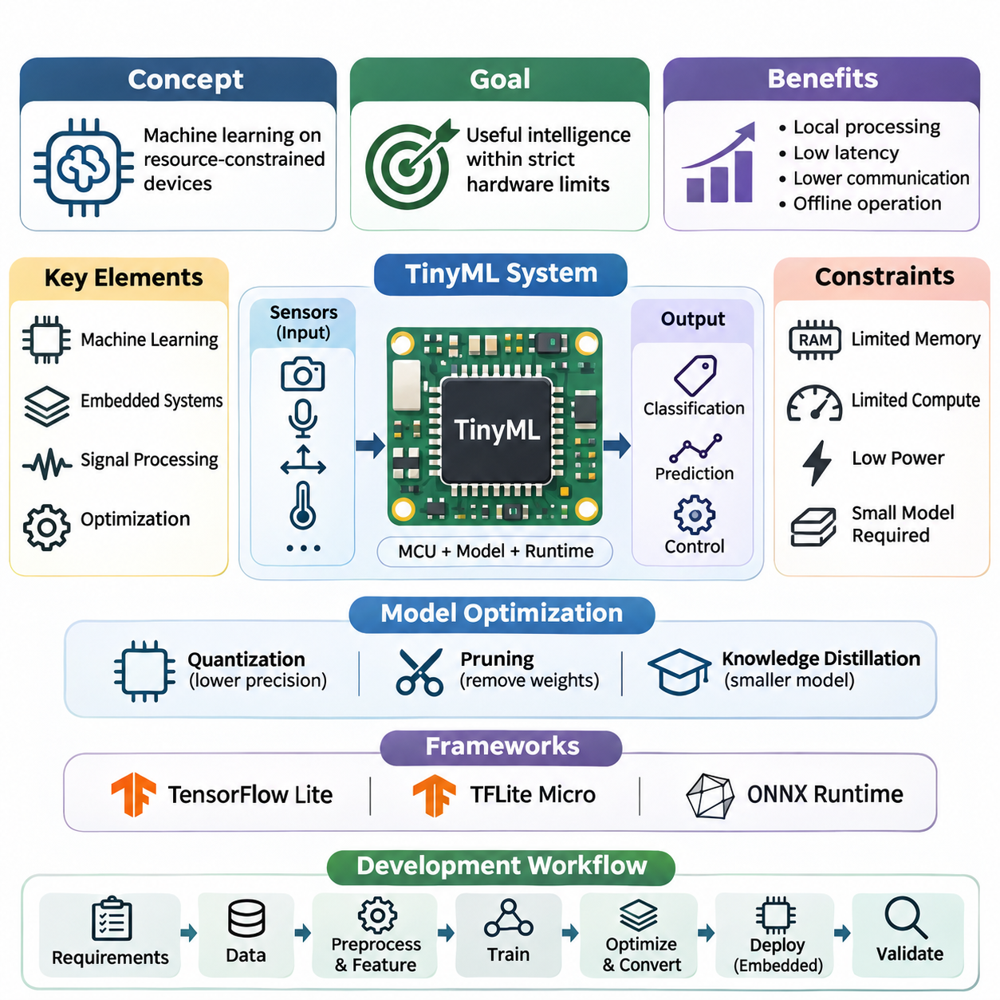
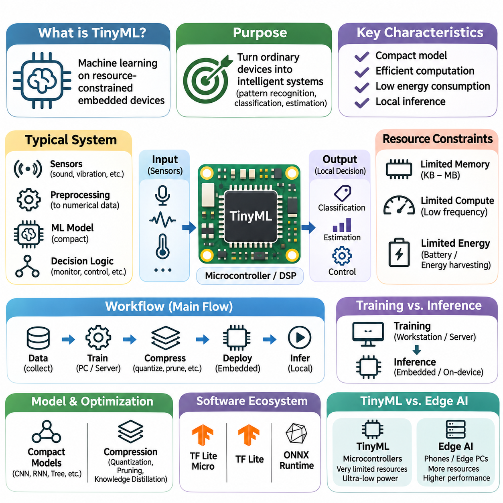
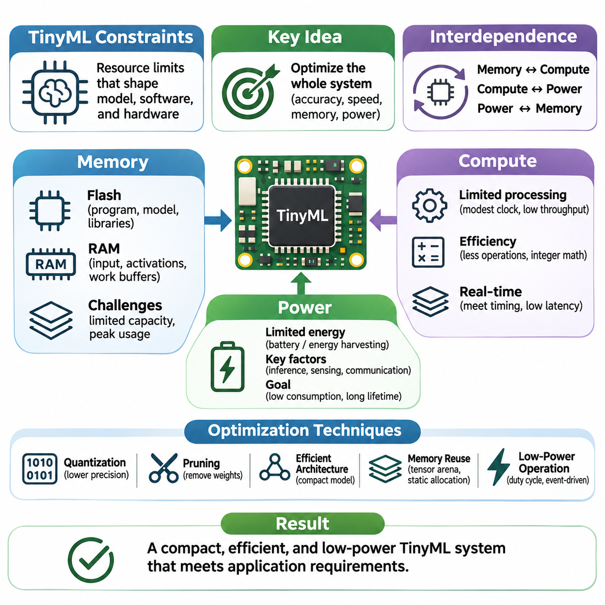
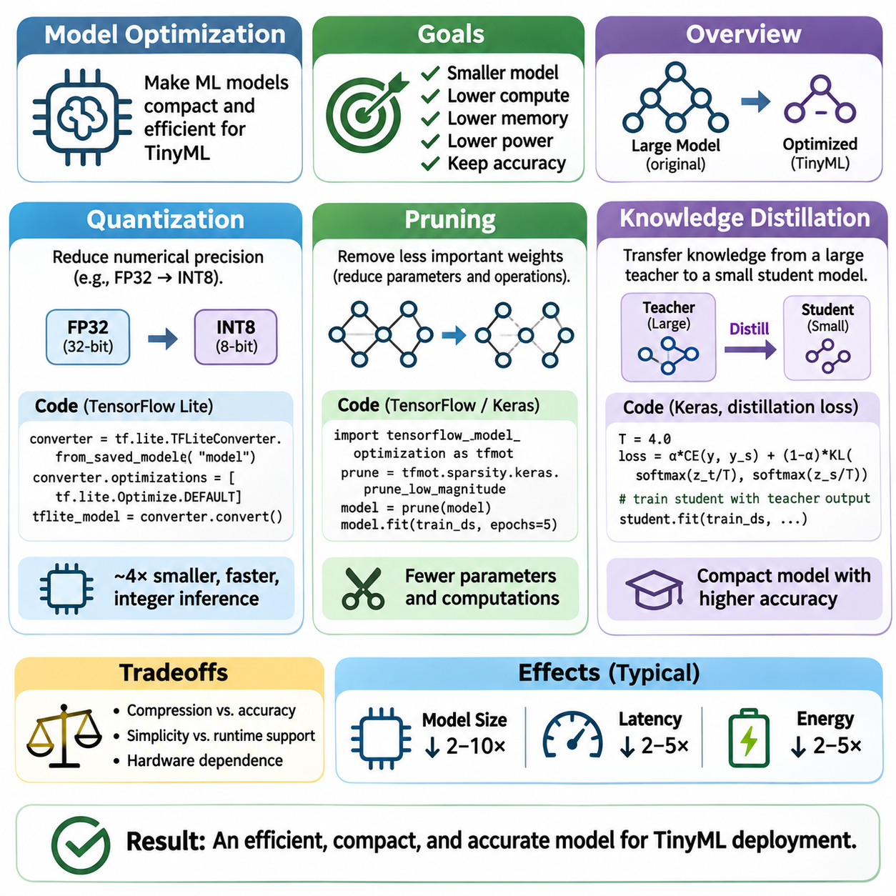
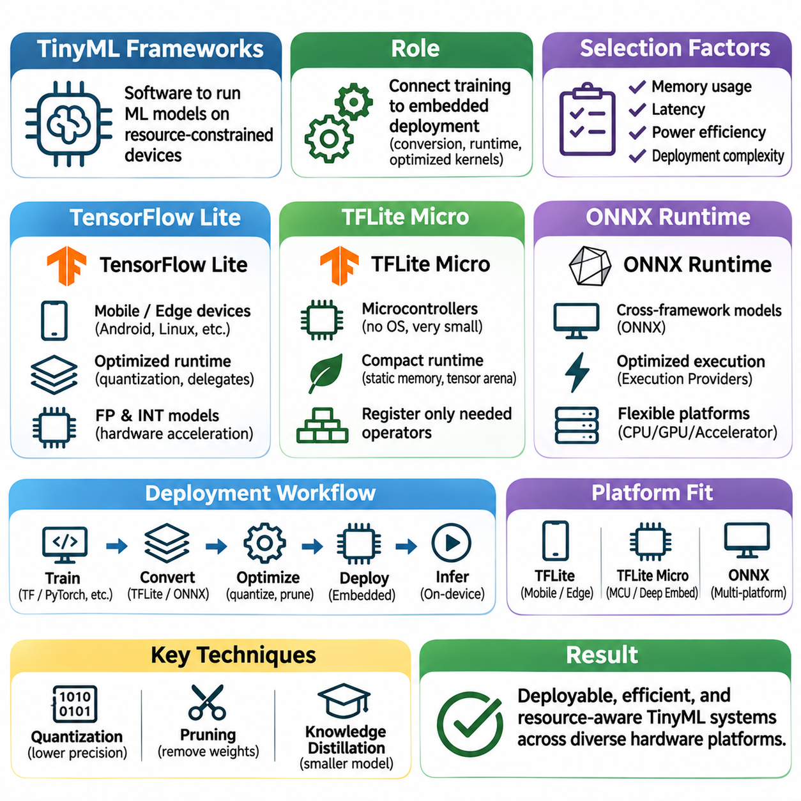
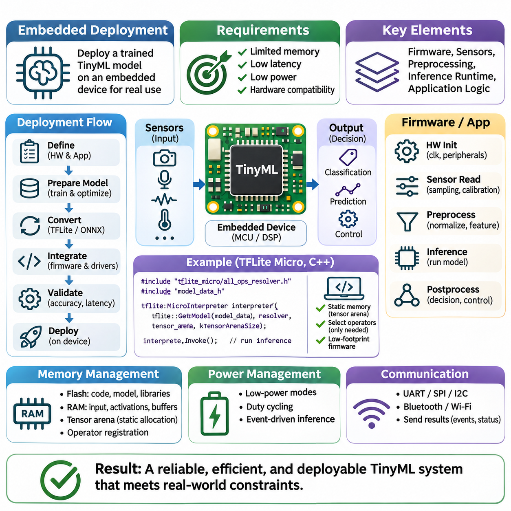
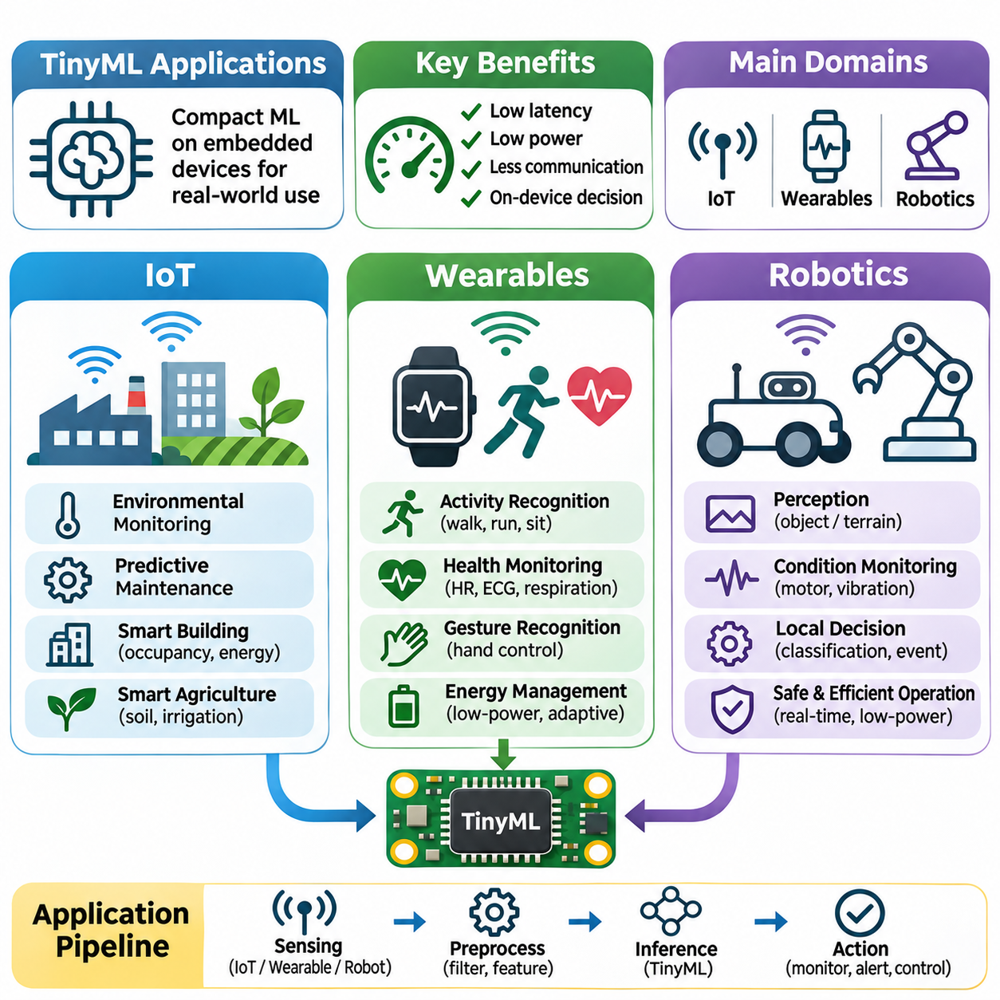

**Volume 40.** **TinyML and Federated Learning**

# 01. TinyML

## 01.00 Overview

{width="7.268055555555556in" height="7.268055555555556in"}

초소형 기계학습(Tiny Machine Learning, TinyML)은 자원이 제한된 임베디드 장치(Embedded Device)에서 기계학습(Machine Learning) 모델을 직접 실행할 수 있도록 하는 특화된 인공지능(Artificial Intelligence) 접근 방식이다. 강력한 프로세서(Processor)나 클라우드 인프라(Cloud Infrastructure)에 의존하는 기존 인공지능 시스템과 달리, TinyML은 소형 모델(Compact Model), 효율적인 연산(Efficient Computation), 최소 에너지 소비(Minimal Energy Consumption)를 강조한다. 주요 목표는 엄격한 하드웨어 제약(Hardware Constraints) 내에서 실용적인 지능형 기능을 제공하는 것이다.

TinyML의 등장은 컴퓨팅 네트워크(Computing Network)의 엣지(Edge)에서 지능형 센싱(Intelligent Sensing)과 자율적 의사결정(Autonomous Decision-Making)에 대한 수요가 증가하고 있음을 반영한다. 수십억 개의 연결 장치(Connected Device)는 카메라(Camera), 마이크로폰(Microphone), 가속도계(Accelerometer), 온도 센서(Temperature Sensor), 산업용 계측기(Industrial Instrument)에서 지속적으로 정보를 생성한다. 이러한 신호를 로컬(Local)에서 처리하면 통신 부담(Communication Overhead)을 줄이고 응답성(Responsiveness)을 향상시키며, 지속적인 네트워크 연결 없이도 애플리케이션(Application)이 작동할 수 있다.

TinyML은 기계학습(Machine Learning), 임베디드 시스템(Embedded Systems), 디지털 신호 처리(Digital Signal Processing), 하드웨어 인식 최적화(Hardware-Aware Optimization)의 원리를 결합한다. 일반적인 구현에서는 학습된 모델(Trained Model)을 마이크로컨트롤러(Microcontroller), 센서 인터페이스(Sensor Interface), 메모리 서브시스템(Memory Subsystem), 경량 추론 런타임(Lightweight Inference Runtime)과 통합한다. 이렇게 구성된 시스템은 엄격하게 제한된 연산 및 전력 예산 내에서 원시 측정값(Raw Measurements)을 분류(Classification), 예측(Prediction), 제어 신호(Control Signals)로 변환한다.

TinyML의 핵심 특징은 예측 정확도(Predictive Accuracy)의 극대화만을 추구하는 것이 아니라 자원 효율성(Resource Efficiency)을 강조한다는 점이다. 임베디드 프로세서(Embedded Processor)는 수 킬로바이트(Kilobytes) 또는 메가바이트(Megabytes)의 메모리(Memory), 제한된 산술 처리량(Arithmetic Throughput), 제한적인 에너지 가용성(Energy Availability)만을 제공할 수 있다. 따라서 성공적인 모델 개발을 위해서는 전체 엔지니어링 과정에서 정확도(Accuracy), 지연시간(Latency), 메모리 사용량(Memory Consumption), 연산 복잡도(Computational Complexity), 전력 요구사항(Power Requirements)의 균형을 유지해야 한다.

메모리 제약(Memory Constraints)은 특히 중요하다. 임베디드 추론(Embedded Inference)에는 모델 매개변수(Model Parameters), 중간 활성화 값(Intermediate Activations), 입력 버퍼(Input Buffers), 런타임 연산(Runtime Operations)을 위한 저장 공간이 필요하기 때문이다. 플래시 메모리(Flash Memory)는 일반적으로 실행 코드(Executable Code)와 모델 가중치(Model Weights)를 저장하며, 정적 랜덤 액세스 메모리(Static Random-Access Memory, SRAM)는 임시 연산을 지원한다. 모델이 플래시 메모리에 저장될 수 있더라도 중간 텐서(Intermediate Tensors)가 사용 가능한 작업 메모리(Working Memory)를 초과하면 실행에 실패할 수 있다.

연산 제약(Computational Constraints)은 추가적인 문제를 발생시킨다. 많은 마이크로컨트롤러에는 그래픽 처리 장치(Graphics Processing Unit, GPU)나 전용 인공지능 가속기(Dedicated AI Accelerator)가 제공하는 병렬 처리 기능(Parallel Processing Capabilities)이 없기 때문이다. 따라서 신경망 연산(Neural Network Operations)은 프로세서 아키텍처(Processor Architecture), 지원되는 수치 연산 명령어(Numerical Instructions), 실행 효율성(Execution Efficiency)에 따라 선택해야 한다. 하드웨어 인식 모델 설계(Hardware-Aware Model Design)는 이론적인 연산량 감소가 실제 장치에서 측정 가능한 성능 향상으로 이어지도록 지원한다.

전력 소비(Power Consumption) 역시 기본적인 고려사항이며, 특히 배터리 구동 시스템(Battery-Powered Systems)과 에너지 하베스팅 시스템(Energy-Harvesting Systems)에서 중요하다. 추론 빈도(Inference Frequency), 프로세서 사용률(Processor Utilization), 센서 샘플링(Sensor Sampling), 무선 통신(Wireless Communication)은 모두 전체 에너지 수요에 영향을 미친다. TinyML 애플리케이션은 필수적인 모니터링(Monitoring) 및 의사결정 기능을 유지하면서 배포 수명(Deployment Lifetime)을 연장하기 위해 이벤트 기반 실행(Event-Driven Execution), 듀티 사이클링(Duty Cycling), 저전력 동작 상태(Low-Power Operating States)를 자주 활용한다.

모델 최적화(Model Optimization)는 기존 신경망(Neural Networks)을 임베디드 환경(Embedded Environments)에 적합하도록 조정하는 기술적 기반을 제공한다. 양자화(Quantization)는 수치 정밀도(Numerical Precision)를 낮추며, 일반적으로 부동소수점 매개변수(Floating-Point Parameters)와 연산을 정수 표현(Integer Representations)으로 변환한다. 가지치기(Pruning)는 선택된 가중치(Weights)나 구조(Structures)를 제거하고, 지식 증류(Knowledge Distillation)는 대규모 교사 모델(Teacher Model)의 유용한 예측 동작(Predictive Behavior)을 제한된 하드웨어에 적합한 소규모 학생 모델(Student Model)로 전달한다.

이러한 최적화 기법(Optimization Techniques)은 압축 효율성(Compression Efficiency), 수치적 안정성(Numerical Stability), 추론 속도(Inference Speed), 예측 품질(Predictive Quality) 사이에서 중요한 절충 관계(Tradeoffs)를 수반한다. 양자화는 근사 오차(Approximation Errors)를 발생시킬 수 있으며, 가지치기는 실제 가속 효과를 얻기 위해 특수한 실행 지원(Execution Support)이 필요할 수 있다. 지식 증류는 적절한 학습 목적함수(Training Objectives)와 대표성 있는 데이터(Representative Data)에 의존한다. 따라서 효과적인 최적화를 위해서는 작은 모델이 자동으로 더 좋은 성능을 제공한다고 가정하기보다 체계적인 평가(Systematic Evaluation)를 수행해야 한다.

TinyML 개발은 모델 학습 환경(Model Training Environment)과 임베디드 실행 플랫폼(Embedded Execution Platform)을 연결하는 특화된 소프트웨어 프레임워크(Software Framework)에도 의존한다. 텐서플로 라이트(TensorFlow Lite), 마이크로컨트롤러용 텐서플로 라이트(TensorFlow Lite for Microcontrollers), 일부 ONNX 런타임 구성(ONNX Runtime Configurations)은 모델 표현(Model Representation)과 추론(Inference)에 대한 서로 다른 접근 방식을 보여준다. 적합성은 장치 성능(Device Capabilities), 연산자 가용성(Operator Availability), 런타임 메모리 요구사항(Runtime Memory Requirements), 통합 제약(Integration Constraints)에 따라 결정된다.

텐서플로 라이트(TensorFlow Lite)는 다양한 엣지 컴퓨팅 플랫폼(Edge Computing Platforms)에서 최적화된 추론(Optimized Inference)을 지원하는 반면, 마이크로컨트롤러용 텐서플로 라이트(TensorFlow Lite for Microcontrollers)는 자원이 매우 제한된 마이크로컨트롤러 환경을 대상으로 한다. ONNX 런타임(ONNX Runtime)은 임베디드 및 자원 제한 플랫폼을 위한 구성을 포함하는 대체 실행 생태계(Execution Ecosystem)를 제공한다. 프레임워크 선택(Framework Selection)에서는 실제 대상 장치 지원(Target Support), 변환 호환성(Conversion Compatibility), 지원 연산자(Supported Operators), 배포된 런타임의 전체 메모리 사용량(Memory Footprint)을 고려해야 한다.

TinyML 개발 워크플로(Development Workflow)는 일반적으로 애플리케이션 요구사항(Application Requirements)과 대표성 있는 센서 데이터 수집(Sensor Data Collection)에서 시작된다. 데이터 전처리(Data Preprocessing)와 특징 추출(Feature Extraction)은 모델에 필요한 수치 입력(Numerical Inputs)을 구성한다. 학습(Training)은 일반적으로 더 높은 성능의 개발 시스템(Development System)에서 수행되며, 이후 최적화(Optimization), 모델 변환(Model Conversion), 임베디드 통합(Embedded Integration), 검증(Validation)이 이어진다. 각 단계에서는 학습 조건(Training Conditions)과 배포된 실행 동작(Deployed Execution Behavior) 사이의 일관성을 유지해야 한다.

임베디드 배포(Embedded Deployment)는 신경망 아키텍처(Neural Network Architecture)를 넘어서는 실질적인 고려사항을 포함한다. 엔지니어는 센서 드라이버(Sensor Drivers), 샘플링 간격(Sampling Intervals), 전처리 루틴(Preprocessing Routines), 메모리 할당(Memory Allocation), 추론 스케줄링(Inference Scheduling)을 설정해야 한다. 모델 바이너리(Model Binaries)는 대상 런타임(Target Runtime)과 프로세서에 호환되어야 한다. 안정적인 실행을 위해서는 초기화 동작(Initialization Behavior), 수치 오버플로(Numerical Overflow), 워치독 메커니즘(Watchdog Mechanisms), 예기치 않은 하드웨어 또는 소프트웨어 상태에서의 복구(Recovery)에도 주의를 기울여야 한다.

실시간 성능(Real-Time Performance)은 TinyML이 모니터링 또는 제어 시스템(Control Systems)에 참여할 때 중요한 고려사항이다. 종단 간 지연시간(End-to-End Latency)에는 센서 데이터 획득(Sensor Acquisition), 신호 전처리(Signal Preprocessing), 모델 추론(Model Inference), 의사결정 로직(Decision Logic), 출력 생성(Output Generation)이 포함된다. 평균 추론 시간(Average Inference Time)만으로는 애플리케이션이 시간 요구사항(Timing Requirements)을 충족하는지 판단할 수 없다. 엔지니어는 대표적인 운영 조건에서 최악 실행시간(Worst-Case Execution Behavior), 스케줄링 간섭(Scheduling Interference), 응답성(Responsiveness)을 평가해야 한다.

TinyML의 응용 분야(Applications)는 사물인터넷(Internet of Things, IoT), 웨어러블 전자기기(Wearable Electronics), 로보틱스(Robotics) 전반으로 확장된다. 연결된 센서(Connected Sensors)는 원시 측정값을 지속적으로 전송하지 않고도 장비 이상(Equipment Anomalies), 환경 변화(Environmental Changes), 음향 이벤트(Acoustic Events)를 인식할 수 있다. 웨어러블 장치는 신체 활동(Physical Activities)을 분류하고 생리학적 신호(Physiological Signals)를 해석할 수 있으며, 로봇 시스템(Robotic Systems)은 경량 인식 모델(Lightweight Perception Models)을 활용하여 로컬 환경 인식(Local Awareness)과 신속한 반응 동작(Responsive Behavior)을 지원할 수 있다.

산업용 사물인터넷(Industrial IoT) 환경에서 TinyML은 진동 분석(Vibration Analysis), 음향 모니터링(Acoustic Monitoring), 장비 상태 분류(Equipment-State Classification)를 통해 예지보전(Predictive Maintenance)을 지원할 수 있다. 임베디드 센서(Embedded Sensors)는 기계적 마모(Mechanical Wear)나 비정상 작동 조건(Abnormal Operating Conditions)과 관련된 패턴을 감지할 수 있다. 로컬 추론(Local Inference)은 중앙 집중식 인프라(Centralized Infrastructure)에 대한 의존성과 통신 요구사항을 줄일 수 있지만, 신뢰할 수 있는 고장 탐지(Fault Detection)를 위해서는 대표성 있는 학습 데이터, 보정(Calibration), 오경보(False Alarms)에 대한 신중한 평가가 필요하다.

웨어러블 애플리케이션(Wearable Applications)은 추론 품질(Inference Quality), 에너지 효율성(Energy Efficiency), 물리적 설계 제약(Physical Design Constraints) 사이의 균형이 얼마나 중요한지를 보여준다. 동작 인식(Motion Recognition), 제스처 감지(Gesture Detection), 활동 모니터링(Activity Monitoring)은 가속도계(Accelerometers), 자이로스코프(Gyroscopes), 기타 소형 센서(Compact Sensors)에 의존할 수 있다. 웨어러블 장치는 사용자와 가까운 위치에서 작동하고 배터리 용량이 제한되는 경우가 많으므로, 실용적인 작동 수명(Operating Lifetime)을 유지하기 위해 효율적인 신호 처리(Signal Processing)와 선택적 추론(Selective Inference)이 필수적이다.

로보틱스 애플리케이션(Robotics Applications)은 환경 변동성(Environmental Variability), 센서 동기화(Sensor Synchronization), 물리 시스템과의 상호작용(Interaction with Physical Systems)에 관한 추가적인 요구사항을 제시한다. TinyML 모델은 분산형 임베디드 제어기(Distributed Embedded Controllers)에서 호출어 감지(Wake-Word Detection), 지형 분류(Terrain Classification), 단순 객체 인식(Simple Object Recognition), 이상 모니터링(Anomaly Monitoring)을 제공할 수 있다. 이러한 기능은 고성능 온보드 컴퓨팅 시스템(Onboard Computing Systems)을 보완하며, 복잡한 계획(Complex Planning)은 고성능 프로세서에서 수행하는 동시에 경량 지능(Lightweight Intelligence)은 센서 가까이에서 실행되도록 한다.

로컬 추론(Local Inference)은 원시 센서 정보(Raw Sensor Information)를 항상 장치 외부로 전송할 필요가 없으므로 개인정보 보호(Privacy)와 통신 측면에서 이점을 제공할 수 있다. 그러나 온디바이스 처리(On-Device Processing)가 개인정보 보호나 보안(Security)을 자동으로 보장하는 것은 아니다. 모델 추출(Model Extraction), 안전하지 않은 펌웨어 업데이트(Insecure Firmware Updates), 노출된 디버깅 인터페이스(Exposed Debugging Interfaces), 무단 접근(Unauthorized Access)은 여전히 잠재적인 위협이다. 안전한 배포(Secure Deployment)를 위해서는 저장된 모델, 센서 정보, 통신 인터페이스, 펌웨어 무결성(Firmware Integrity)에 대한 적절한 보호가 필요하다.

TinyML은 분산 지능(Distributed Intelligence)과 연합학습(Federated Learning)을 위한 중요한 기반도 제공한다. 개별 장치(Individual Devices)는 로컬 추론을 수행하면서 엣지 노드(Edge Nodes)와 클라우드 서비스(Cloud Services) 사이에서 정보를 조정하는 대규모 시스템에 참여할 수 있다. 연합학습은 원시 학습 데이터(Raw Training Data)를 일상적으로 중앙에 집중시키지 않고도 협력적인 모델 개선(Collaborative Model Improvement)을 가능하게 하여 이러한 아키텍처를 확장한다. 다만 통신(Communication), 개인정보 보호(Privacy), 이기종 하드웨어(Heterogeneous Hardware)에 관한 제약은 여전히 중요한 과제로 남는다.

TinyML 시스템의 평가(Evaluation)에는 예측 성능(Predictive Performance)과 임베디드 실행 특성(Embedded Execution Characteristics)을 모두 반영하는 지표가 필요하다. 정확도(Accuracy), 정밀도(Precision), 재현율(Recall), 강건성(Robustness)은 모델 동작을 설명하며, 지연시간(Latency), 최대 메모리 사용량(Peak Memory Utilization), 모델 크기(Model Size), 추론당 에너지(Energy per Inference), 지속 전력 소비(Sustained Power Consumption)는 배포 가능성(Deployment Feasibility)을 나타낸다. MLPerf Tiny와 같은 표준화된 벤치마크(Standardized Benchmarks)는 비교를 지원할 수 있지만, 애플리케이션별 측정(Application-Specific Measurements)은 여전히 필요하다.

재현성(Reproducibility)은 프로세서 주파수(Processor Frequency), 컴파일러 설정(Compiler Settings), 최적화 라이브러리(Optimization Libraries), 메모리 배치(Memory Placement), 센서 작업 부하(Sensor Workloads)에 따라 성능이 달라질 수 있기 때문에 필수적이다. 신뢰할 수 있는 실험(Credible Experiment)에서는 하드웨어 플랫폼(Hardware Platform), 펌웨어 구성(Firmware Configuration), 모델 버전(Model Version), 입력 특성(Input Characteristics), 측정 방법론(Measurement Methodology)을 문서화해야 한다. 일관된 조건에서 모델을 비교하면 실제 알고리즘 개선(Algorithmic Improvements)과 구현 또는 하드웨어 구성 차이에서 발생한 성능 변화를 구분하는 데 도움이 된다.

TinyML의 미래 발전(Future Development)은 하드웨어-소프트웨어 공동 설계(Hardware-Software Co-Design), 효율적인 신경망 아키텍처(Efficient Neural Architectures), 적응형 추론(Adaptive Inference), 지능형 센싱 플랫폼(Intelligent Sensing Platforms)과의 긴밀한 통합을 중심으로 진행되고 있다. 특수 목적 가속기(Specialized Accelerators)와 개선된 수치 연산 커널(Numerical Kernels)은 자원 제한 장치가 실행할 수 있는 모델의 복잡도를 확장할 수 있다. 그러나 실질적인 발전은 연산 능력(Computational Capability)과 에너지(Energy), 메모리(Memory), 신뢰성(Reliability), 비용(Cost) 사이의 균형을 유지하는 체계적인 엔지니어링에 계속 의존할 것이다.

궁극적으로 TinyML은 중앙 집중식 지능(Centralized Intelligence)에서 물리적 환경(Physical Environments) 전반에 분산된 임베디드 의사결정(Embedded Decision-Making)으로의 전환을 의미한다. 그 중요성은 단순히 신경망을 축소하는 데 있는 것이 아니라, 심각한 자원 제약(Resource Constraints) 속에서도 신뢰할 수 있는 기계학습 기능을 제공하는 완전한 시스템(Complete Systems)을 설계하는 데 있다. TinyML의 기본 원리(Foundations), 최적화 방법(Optimization Methods), 프레임워크(Frameworks), 배포 프로세스(Deployment Processes), 응용 분야(Applications)를 이해하는 것은 확장 가능하고 에너지 효율적인 엣지 지능(Scalable and Energy-Efficient Edge Intelligence)을 개발하기 위한 기반이 된다.

## 01.01 What is TinyML

{width="7.268055555555556in" height="7.268055555555556in"}

초소형 기계학습(Tiny Machine Learning, TinyML)은 자원이 매우 제한된 임베디드 장치(Embedded Devices)에서 지능형 추론(Intelligent Inference)을 수행할 수 있도록 하는 특화된 기계학습(Machine Learning) 분야이다. 제한된 메모리(Memory), 처리 능력(Processing Capacity), 에너지 예산(Energy Budget) 내에서 학습된 모델(Trained Models)을 실행하는 데 중점을 둔다. 클라우드 서버(Cloud Servers)나 고성능 프로세서(Powerful Processors)에 의존하는 기존 기계학습 시스템과 달리, TinyML은 마이크로컨트롤러(Microcontrollers)와 소형 센싱 플랫폼(Compact Sensing Platforms)에 예측 기능(Predictive Capabilities)을 직접 제공한다.

TinyML의 근본적인 목적은 일반적인 임베디드 장치를 센서 정보(Sensor Information)를 해석하고 로컬 의사결정(Localized Decisions)을 수행할 수 있는 지능형 시스템(Intelligent Systems)으로 전환하는 것이다. 기존 임베디드 소프트웨어(Embedded Software)는 주로 사전에 정의된 임계값(Predefined Thresholds), 규칙(Rules), 결정론적 알고리즘(Deterministic Algorithms)에 의존한다. TinyML은 복잡한 패턴(Patterns)을 인식하고 관측값(Observations)을 분류하며, 명시적 프로그래밍(Explicit Programming)으로 표현하기 어려운 상태를 추정할 수 있는 데이터 기반 모델(Data-Driven Models)을 도입하여 이러한 기능을 확장한다.

TinyML은 일반적으로 마이크로컨트롤러(Microcontrollers), 디지털 신호 프로세서(Digital Signal Processors), 특수 목적 저전력 컴퓨팅 플랫폼(Specialized Low-Power Computing Platforms)에서 작동한다. 이러한 장치는 수십 또는 수백 킬로바이트(Kilobytes)의 작업 메모리(Working Memory)와 상대적으로 제한된 처리 자원(Processing Resources)만을 보유할 수 있다. 동작 주파수(Operating Frequencies), 저장 용량(Storage Capacities), 수치 연산 능력(Numerical Capabilities)은 데스크톱 컴퓨터(Desktop Computers)보다 상당히 제한적이므로, 효율적인 모델 표현(Model Representation)과 실행(Execution)이 필수적인 요구사항이 된다.

일반적인 TinyML 시스템은 센서(Sensors), 신호 처리(Signal Processing), 소형 기계학습 모델(Compact Machine Learning Model), 애플리케이션별 의사결정 로직(Application-Specific Decision Logic)을 결합한다. 센서는 소리(Sound), 진동(Vibration), 가속도(Acceleration), 온도(Temperature), 광도(Light Intensity)와 같은 측정값을 수집한다. 전처리(Preprocessing)는 이러한 측정값을 적절한 수치 표현(Numerical Representations)으로 변환하며, 이후 추론 엔진(Inference Engine)이 모델을 평가하고 모니터링(Monitoring), 통신(Communication), 제어 작업(Control Operations)을 수행하기 위한 예측 결과를 생성한다.

학습(Training)과 추론(Inference)의 구분은 TinyML에서 특히 중요하다. 모델 학습(Model Training)은 일반적으로 대규모 데이터셋(Datasets)과 최적화 알고리즘(Optimization Algorithms)을 처리할 수 있는 워크스테이션(Workstations), 서버(Servers), 기타 고성능 컴퓨팅 환경(Computing Environments)에서 수행된다. 이후 생성된 모델은 압축(Compression), 변환(Conversion), 배포(Deployment) 과정을 거쳐 임베디드 하드웨어(Embedded Hardware)에 탑재된다. 일부 구현에서는 온디바이스 학습(On-Device Learning)이 가능하지만, 기존 TinyML은 주로 효율적인 로컬 추론(Local Inference)에 중점을 둔다.

자원 제약(Resource Constraints)은 TinyML 모델 설계(Model Design)에 근본적인 영향을 미친다. 플래시 메모리(Flash Memory)는 프로그램 명령어(Program Instructions), 모델 매개변수(Model Parameters), 지원 라이브러리(Supporting Libraries)를 저장해야 하며, 랜덤 액세스 메모리(Random-Access Memory, RAM)는 입력 버퍼(Input Buffers), 중간 활성화 값(Intermediate Activations), 임시 연산 데이터(Temporary Computational Data)를 저장한다. 모델의 매개변수 수(Parameter Count)가 상대적으로 적더라도 중간 텐서(Intermediate Tensors)가 크거나 실행 스케줄링(Execution Scheduling)이 비효율적이면 과도한 작업 메모리가 필요할 수 있다.

연산 효율성(Computational Efficiency)은 TinyML의 또 다른 핵심 특징이다. 임베디드 프로세서(Embedded Processors)는 고성능 부동소수점 연산 장치(Floating-Point Units), 광범위한 병렬 실행 자원(Parallel Execution Resources), 대용량 메모리 캐시(Memory Caches)가 부족한 경우가 많다. 따라서 신경망 아키텍처(Neural Network Architectures)는 비용이 높은 연산(Expensive Operations)을 최소화하고 지원되는 프로세서 명령어(Processor Instructions)를 활용해야 한다. 정수 연산(Integer Arithmetic), 최적화된 합성곱 커널(Optimized Convolution Kernels), 효율적인 메모리 접근 패턴(Efficient Memory Access Patterns)은 실시간 추론(Real-Time Inference)의 실현 가능성을 결정하는 중요한 요소이다.

에너지 효율성(Energy Efficiency)은 TinyML을 다른 많은 엣지 인공지능(Edge Artificial Intelligence) 접근 방식과 구별하는 특징이다. 수많은 임베디드 장치는 소형 배터리(Small Batteries)나 에너지 하베스팅 장치(Energy-Harvesting Sources)를 통해 작동하며, 장기간 기능을 유지해야 한다. 따라서 추론 실행(Inference Execution)은 센서 데이터 획득(Sensor Acquisition), 통신(Communication), 백그라운드 처리(Background Processing)와 제한된 에너지 자원을 공유한다. 효율적인 스케줄링(Efficient Scheduling), 선택적 활성화(Selective Activation), 저전력 동작 모드(Low-Power Operating Modes)는 필수적인 설계 고려사항이다.

TinyML 모델은 일반적으로 소형 신경망(Compact Neural Networks), 의사결정 트리(Decision Trees), 선형 분류기(Linear Classifiers), 기타 연산 효율적인 알고리즘(Computationally Efficient Algorithms)을 사용한다. 합성곱 신경망(Convolutional Neural Networks, CNNs)은 이미지 및 음향 인식(Image and Acoustic Recognition)을 지원할 수 있으며, 경량 시계열 모델(Lightweight Temporal Models)은 순차적 센서 측정값(Sequential Sensor Measurements)을 분석할 수 있다. 모델 선택(Model Selection)은 정확도만이 아니라 입력 특성(Input Characteristics), 작업 복잡도(Task Complexity), 사용 가능한 메모리, 대상 하드웨어(Target Hardware)의 실행 능력에 따라 결정된다.

모델 압축(Model Compression) 기법은 기계학습 알고리즘이 심각한 하드웨어 제약(Hardware Limitations) 내에서 작동할 수 있도록 한다. 양자화(Quantization)는 수치 정밀도(Numerical Precision)를 낮추며, 일반적으로 모델 매개변수(Model Parameters)와 활성화 값(Activations)을 8비트 정수(Eight-Bit Integers)로 표현한다. 가지치기(Pruning)는 선택된 매개변수나 연산 구조(Computational Structures)를 제거하고, 지식 증류(Knowledge Distillation)는 대규모 모델(Larger Models)의 예측 동작(Predictive Behavior)을 소형 모델(Compact Models)로 전달한다. 이러한 방법은 목표 애플리케이션에 필요한 충분한 정확도를 유지해야 한다.

TinyML을 지원하는 소프트웨어 생태계(Software Ecosystem)는 학습된 모델을 실행 가능한 임베디드 표현(Executable Embedded Representations)으로 변환하기 위한 도구를 제공한다. 마이크로컨트롤러용 텐서플로 라이트(TensorFlow Lite for Microcontrollers)는 마이크로컨트롤러 환경을 위해 설계된 대표적인 런타임(Runtime)이다. 다른 임베디드 추론 라이브러리(Embedded Inference Libraries)와 일부 ONNX 런타임 구성(ONNX Runtime Configurations)은 서로 다른 배포 요구사항(Deployment Requirements)을 지원한다. 대상 프로세서(Target Processors)와의 호환성(Compatibility), 지원 연산자(Supported Operators), 메모리 할당 메커니즘(Memory Allocation Mechanisms)은 프레임워크 선택(Framework Selection)에 큰 영향을 미친다.

TinyML은 극도로 제한된 컴퓨팅 환경(Computing Environments)에 중점을 둔다는 점에서 일반적인 엣지 인공지능(Edge AI)과 구별된다. 엣지 인공지능은 스마트폰(Smartphones), 산업용 컴퓨터(Industrial Computers), 임베디드 GPU(Embedded GPUs), 전용 신경망 가속기(Dedicated Neural Accelerators)를 포함하지만, TinyML은 일반적으로 마이크로컨트롤러와 이와 유사하게 제한된 플랫폼을 대상으로 한다. 이러한 구분이 절대적인 것은 아니지만, 소형 실행(Compact Execution), 최소 메모리 소비(Minimal Memory Consumption), 지속적인 저전력 동작(Sustained Low-Power Operation)에 대한 더욱 엄격한 요구사항을 강조한다.

TinyML의 주요 장점 중 하나는 네트워크 연결(Network Connectivity)에 대한 의존도를 줄일 수 있다는 점이다. 장치는 모든 관측값(Observations)을 원격 인프라(Remote Infrastructure)로 전송하지 않고도 센서 측정값(Sensor Measurements)을 로컬에서 처리할 수 있다. 이러한 접근 방식은 통신 트래픽(Communication Traffic)을 감소시키고 네트워크 관련 지연시간(Network-Related Latency)을 줄이며, 연결이 중단된 상황에서도 지속적인 작동을 가능하게 한다. 로컬 처리(Local Processing)는 원시 데이터(Raw Data)의 불필요한 노출을 제한할 수도 있지만, 추가적인 보안 메커니즘(Security Mechanisms)은 여전히 필요하다.

실시간 응답성(Real-Time Responsiveness)은 지속적인 모니터링(Continuous Monitoring)이나 즉각적인 반응(Immediate Reactions)이 필요한 애플리케이션에서 특히 중요하다. TinyML 장치는 센서 데이터를 수집한 직후 음향 이벤트(Acoustic Events)를 인식하거나 비정상적인 진동(Unusual Vibration)을 감지하고 동작 패턴(Motion Patterns)을 식별할 수 있다. 그러나 예측 가능한 응답시간(Predictable Response Times)을 확보하려면 샘플링(Sampling), 전처리(Preprocessing), 추론(Inference), 스케줄링(Scheduling), 애플리케이션 수준의 의사결정 실행(Application-Level Decision Execution)을 포함하는 전체 처리 파이프라인(Processing Pipeline)을 고려해야 한다.

TinyML의 응용 분야(Applications)에는 키워드 감지(Keyword Spotting), 제스처 인식(Gesture Recognition), 환경 모니터링(Environmental Monitoring), 예지보전(Predictive Maintenance), 활동 분류(Activity Classification)가 포함된다. 마이크로폰(Microphones)은 사전에 정의된 음향 패턴(Acoustic Patterns)을 식별할 수 있고, 가속도계(Accelerometers)는 움직임 특성(Movement Characteristics)을 인식할 수 있으며, 진동 센서(Vibration Sensors)는 비정상적인 기계 동작(Abnormal Machinery Behavior)을 감지할 수 있다. 이러한 응용 사례는 비교적 단순한 센싱 하드웨어(Sensing Hardware)도 적절하게 최적화된 모델과 결합하면 정교한 정보 해석(Sophisticated Interpretation)을 지원할 수 있음을 보여준다.

산업 환경(Industrial Environments)에서 TinyML은 기계 및 생산 장비(Production Equipment) 가까이에서 작동하는 분산형 모니터링 시스템(Distributed Monitoring Systems)을 가능하게 한다. 임베디드 센서는 원시 측정값을 지속적으로 스트리밍(Streaming)하지 않고도 진동 특성(Vibration Signatures), 음향 특성(Acoustic Characteristics), 작동 조건(Operating Conditions)을 평가할 수 있다. 이러한 시스템은 비정상적인 동작의 초기 징후(Early Indications of Abnormal Behavior)를 식별하고 선택된 이벤트(Selected Events)를 상위 관리 플랫폼(Supervisory Platforms)으로 전송하여 통신 요구사항을 줄이면서 적시에 유지보수 의사결정(Maintenance Decisions)을 지원할 수 있다.

웨어러블 장치(Wearable Devices)는 엄격한 전력 제한(Power Limitations)과 지속적인 센싱 요구사항(Continuous Sensing Requirements)을 동시에 충족해야 하므로 또 다른 중요한 응용 분야이다. TinyML은 활동 인식(Activity Recognition), 제스처 감지(Gesture Detection), 상황 인식(Context Awareness)을 위해 움직임 측정값(Motion Measurements)을 해석할 수 있다. 효율적인 추론(Efficient Inference)은 배터리 소비(Battery Consumption)를 최소화하면서 이러한 기능을 로컬에서 실행할 수 있도록 하지만, 개발 과정에서는 센서 보정(Sensor Calibration), 사용자 간 변동성(User Variability), 변화하는 작동 조건(Changing Operating Conditions)을 고려해야 한다.

로보틱스(Robotics)는 TinyML이 고성능 온보드 컴퓨팅 시스템(Onboard Computing Systems)을 보완할 수 있는 기회를 제공한다. 저전력 제어기(Low-Power Controllers)는 개별 센서 가까이에서 단순 인식(Simple Perception), 이벤트 감지(Event Detection), 지형 분류(Terrain Classification), 장비 모니터링(Equipment Monitoring)을 수행할 수 있다. 이후 고성능 프로세서(Higher-Performance Processors)는 복잡한 인식(Complex Perception), 계획(Planning), 협조 제어(Coordination)를 처리할 수 있다. 이러한 계층적 구성(Hierarchical Arrangement)은 지연시간(Latency), 에너지(Energy), 기능 요구사항(Functional Requirements)에 따라 연산 책임(Computational Responsibilities)을 분산한다.

신뢰할 수 있는 TinyML 시스템을 개발하려면 데이터 준비(Data Preparation), 모델 학습(Model Training), 최적화(Optimization), 임베디드 소프트웨어 통합(Embedded Software Integration) 사이의 긴밀한 조정이 필요하다. 학습 데이터(Training Data)는 실제 센서 특성(Sensor Characteristics)과 환경 조건(Environmental Conditions)을 반영해야 한다. 전처리 작업(Preprocessing Operations)은 개발 환경(Development Environment)과 배포 환경(Deployment Environment) 사이에서 일관성을 유지해야 한다. 그렇지 않으면 수치 정밀도(Numerical Precision), 샘플링 주파수(Sampling Frequency), 특징 추출(Feature Extraction)의 차이로 인해 예측 성능(Predictive Performance)이 크게 저하될 수 있다.

평가(Evaluation)는 기존 기계학습의 정확도 지표(Accuracy Metrics)를 넘어 확장되어야 한다. 모델 크기(Model Size), 최대 메모리 소비(Peak Memory Consumption), 추론 지연시간(Inference Latency), 추론당 에너지(Energy per Inference), 지속적인 전력 수요(Sustained Power Demand)는 실질적인 구현 가능성(Practical Feasibility)을 판단하는 핵심 지표이다. 데스크톱 시뮬레이션(Desktop Simulations)은 프로세서 동작(Processor Behavior), 메모리 경합(Memory Contention), 컴파일러 최적화(Compiler Optimizations), 임베디드 런타임 오버헤드(Embedded Runtime Overhead)를 완전히 재현할 수 없으므로, 측정은 실제 대상 하드웨어(Intended Hardware)에서 수행해야 한다.

TinyML은 강건성(Robustness), 유지보수성(Maintainability), 수명주기 관리(Lifecycle Management)와 관련된 엔지니어링 과제도 제시한다. 센서 드리프트(Sensor Drift), 환경 변화(Environmental Changes), 하드웨어 개체 간 차이(Differences Between Hardware Units)는 예측 신뢰성(Prediction Reliability)을 저하시킬 수 있다. 펌웨어 업데이트(Firmware Updates)와 모델 교체 절차(Model Replacement Procedures)는 시스템 무결성(System Integrity)을 유지해야 한다. 안전 필수 의사결정(Safety-Critical Decisions)이 포함된 애플리케이션은 기계학습 예측에만 의존하지 않고 추가적인 검증(Validation)과 독립적인 보호 메커니즘(Independent Protective Mechanisms)을 필요로 한다.

연결된 임베디드 시스템(Connected Embedded Systems)이 확장됨에 따라 TinyML과 분산 학습(Distributed Learning)의 관계는 점점 중요해지고 있다. 장치는 로컬 모델(Local Models)을 실행하면서 모니터링과 모델 업데이트(Model Updates)를 조정하는 광범위한 엣지-클라우드 아키텍처(Edge-Cloud Architectures)에 참여할 수 있다. 연합학습(Federated Learning)은 분산된 참여자(Distributed Participants) 사이에서 협력적인 모델 개선(Collaborative Model Improvement)을 지원할 수 있지만, 학습 능력(Training Capability), 통신 효율성(Communication Efficiency), 개인정보 보호(Privacy Protection), 장치 이질성(Device Heterogeneity)은 추가적인 제약을 발생시킨다.

궁극적으로 TinyML은 가장 작은 실용적 컴퓨팅 플랫폼(Computing Platforms)에서도 기계학습을 활용할 수 있도록 하는 엔지니어링 접근 방식(Engineering Approach)을 의미한다. 그 가치는 소형 알고리즘(Compact Algorithms), 효율적인 소프트웨어(Efficient Software), 적절한 하드웨어(Suitable Hardware), 신중하게 설계된 센싱 워크플로(Sensing Workflows)의 통합에서 나타난다. TinyML은 엄격한 자원 제약(Resource Constraints) 내에서 로컬 지능(Localized Intelligence)을 구현함으로써 확장 가능하고(Scalable), 응답성이 높으며(Responsive), 에너지 효율적인(Energy-Efficient) 지능형 시스템(Intelligent Systems)을 위한 중요한 기반을 확립한다.

## 01.02 Constraints

{width="7.268055555555556in" height="7.268055555555556in"}

TinyML 시스템은 모델 아키텍처(Model Architecture), 소프트웨어 구현(Software Implementation), 하드웨어 선택(Hardware Selection)에 근본적인 영향을 미치는 엄격한 자원 제약(Resource Constraints) 아래에서 작동한다. 기존 기계학습 플랫폼(Machine Learning Platforms)과 달리, 임베디드 장치(Embedded Devices)는 제한된 메모리(Memory), 연산 능력(Computational Capacity), 에너지 가용성(Energy Availability) 내에서 추론(Inference)을 실행해야 한다. 이러한 제약은 서로 밀접하게 연결되어 있으므로, 엔지니어는 모델 정확도(Model Accuracy), 실행 속도(Execution Speed), 전력 소비(Power Consumption)를 독립적인 목표로 취급하기보다 전체 시스템(Complete System)을 최적화해야 한다.

메모리 제약(Memory Constraints)은 TinyML 배포(Deployment)에서 가장 직접적인 과제 중 하나이다. 마이크로컨트롤러(Microcontrollers)는 일반적으로 프로그램 명령어(Program Instructions)와 모델 매개변수(Model Parameters)를 저장하기 위한 제한된 플래시 저장 공간(Flash Storage)을 제공하며, 런타임 실행(Runtime Execution)을 위한 랜덤 액세스 메모리(Random-Access Memory, RAM)는 상대적으로 더 적다. 사용 가능한 용량은 장치에 따라 크게 달라지지만, 많은 실제 구현에서는 수 킬로바이트(Kilobytes)에서 수 메가바이트(Megabytes)의 메모리 내에서 작동해야 하므로 신중한 메모리 할당(Memory Allocation)이 필수적이다.

플래시 메모리(Flash Memory)는 실행 가능한 펌웨어(Executable Firmware), 모델 가중치(Model Weights), 상수 조회 테이블(Constant Lookup Tables), 지원 런타임 구성요소(Supporting Runtime Components)를 저장한다. 플래시 메모리의 용량은 전체 애플리케이션(Application)을 대상 장치(Target Device)에 설치할 수 있는지를 결정한다. 그러나 추론 라이브러리(Inference Libraries), 전처리 루틴(Preprocessing Routines), 통신 스택(Communication Stacks), 장치 드라이버(Device Drivers)도 저장 공간을 소비하므로 모델 크기(Model Size)만으로 전체 저장 요구사항(Storage Requirements)을 나타낼 수 없다. 따라서 배포 계획(Deployment Planning)에서는 전체 펌웨어 이미지(Firmware Image)를 고려해야 한다.

랜덤 액세스 메모리(Random-Access Memory)는 추론 과정에서 입력 텐서(Input Tensors), 중간 활성화 값(Intermediate Activations), 연산자 작업 공간(Operator Workspaces), 출력 버퍼(Output Buffers)를 위한 임시 저장 공간이 필요하기 때문에 추가적인 제약을 발생시킨다. 특히 고해상도 입력(High-Resolution Inputs)을 처리하는 특정 신경망 아키텍처(Neural Network Architectures)에서는 활성화 메모리(Activation Memory)가 매개변수 저장 공간(Parameter Storage)을 초과할 수 있다. 따라서 메모리 계획(Memory Planning)은 개별 모델 구성요소의 크기를 단순히 합산하는 것이 아니라 동시에 필요한 최대 메모리 할당량(Peak Simultaneous Allocation)을 고려해야 한다.

정적 메모리 할당(Static Memory Allocation)은 동적 메모리 할당(Dynamic Memory Allocation)이 메모리 단편화(Memory Fragmentation)와 예측하기 어려운 실행 동작(Unpredictable Execution Behavior)을 발생시킬 수 있으므로 자원이 제한된 임베디드 환경에서 일반적으로 선호된다. 텐서 아레나(Tensor Arena) 메커니즘은 중간 값(Intermediate Values)이 더 이상 필요하지 않은 연산 사이에서 메모리 영역(Memory Regions)을 재사용할 수 있도록 한다. 효율적인 텐서 수명 분석(Tensor Lifetime Analysis)과 버퍼 재사용(Buffer Reuse)은 모델의 수학적 동작(Mathematical Behavior)을 변경하지 않으면서 최대 메모리 요구량(Peak Memory Requirements)을 크게 줄일 수 있다.

메모리 최적화(Memory Optimization) 기법에는 양자화(Quantization), 구조적 가지치기(Structured Pruning), 소형 특징 표현(Compact Feature Representations), 신중한 신경망 아키텍처 선택(Neural Network Architecture Selection)이 포함된다. 양자화는 고정밀 수치 형식(High-Precision Numerical Formats)을 저정밀 대안(Lower-Precision Alternatives)으로 대체하여 매개변수와 활성화 값의 저장 요구량을 줄인다. 구조적 가지치기는 전체 채널(Channels)이나 필터(Filters)를 제거할 수 있으며, 입력 차원(Input Dimensions)을 축소하면 중간 텐서의 크기가 감소한다. 각 기법은 예측 정확도(Predictive Accuracy)에 대한 검증(Validation)이 필요하다.

메모리 대역폭(Memory Bandwidth)과 접근 패턴(Access Patterns)도 TinyML 성능에 영향을 미친다. 모델이 사용 가능한 저장 공간에 적합하더라도 메모리 영역 사이에서 반복적으로 데이터를 전송하면 실행 지연시간(Execution Latency)과 에너지 소비(Energy Consumption)가 증가할 수 있다. 프로세서 캐시(Processor Caches), 밀결합 메모리(Tightly Coupled Memory), 직접 메모리 접근(Direct Memory Access, DMA) 메커니즘, 데이터 정렬(Data Alignment)은 실제 효율성에 영향을 미친다. 하드웨어 인식 구현(Hardware-Aware Implementation)은 예측 가능한 메모리 접근 동작(Predictable Access Behavior)을 유지하면서 불필요한 데이터 이동(Data Movement)을 최소화하는 것을 목표로 한다.

연산 제약(Computational Constraints)은 마이크로컨트롤러와 기타 저전력 임베디드 프로세서(Low-Power Embedded Processors)의 제한된 처리 능력에서 발생한다. 많은 장치는 비교적 낮은 클록 주파수(Clock Frequencies)로 작동하며, 중앙처리장치(Central Processing Units, CPUs), 그래픽 처리 장치(Graphics Processing Units, GPUs), 전용 신경망 가속기(Dedicated Neural Accelerators)에 비해 제한된 산술 처리량(Arithmetic Throughput)을 제공한다. 따라서 신경망 실행(Neural Network Execution)은 애플리케이션별 시간 요구사항(Application-Specific Timing Requirements)을 충족하고 충분한 예측 성능(Predictive Performance)을 유지하면서 연산 복잡도(Computational Complexity)를 최소화해야 한다.

곱셈-누산 연산(Multiply-Accumulate Operations, MACs)의 수는 특히 합성곱 계층(Convolutional Layers)과 완전 연결 계층(Fully Connected Layers)의 신경망 연산 요구량(Computational Demand)을 추정하는 데 유용한 지표이다. 그러나 연산 횟수(Operation Counts)만으로는 추론 지연시간(Inference Latency)을 예측할 수 없다. 프로세서 명령어 집합(Processor Instruction Sets), 메모리 접근 오버헤드(Memory Access Overhead), 커널 구현(Kernel Implementations), 수치 형식(Numerical Formats)이 실행 속도에 큰 영향을 미치기 때문이다. 정확한 성능 평가(Performance Assessment)를 위해서는 실제 대상 하드웨어 플랫폼(Intended Hardware Platform)에서 측정해야 한다.

정수 연산(Integer Arithmetic)은 TinyML의 연산 효율성(Computational Efficiency)을 향상시키기 위해 널리 사용된다. 양자화된 신경망(Quantized Neural Networks)은 최적화된 정수 명령어(Optimized Integer Instructions)를 활용하고, 효율적인 부동소수점 하드웨어(Floating-Point Hardware)가 없는 프로세서에서 비용이 높은 부동소수점 연산(Floating-Point Operations)을 피할 수 있다. 그러나 정수 실행(Integer Execution)은 스케일링(Scaling), 반올림(Rounding), 포화 처리(Saturation)에 관한 고려사항을 발생시킨다. 수치적 안정성(Numerical Stability)을 유지하고 예측 품질(Prediction Quality)의 허용할 수 없는 저하를 방지하려면 양자화 매개변수(Quantization Parameters)를 신중하게 보정(Calibration)해야 한다.

모델 아키텍처(Model Architecture)는 연산 실현 가능성(Computational Feasibility)에 직접적인 영향을 미친다. 깊이별 분리 합성곱(Depthwise Separable Convolutions), 소형 다층 퍼셉트론(Compact Multilayer Perceptrons), 경량 시계열 신경망(Lightweight Temporal Networks)은 기존의 대규모 아키텍처에 비해 연산 횟수를 줄일 수 있다. 그러나 일부 연산자(Operators)는 최적화된 구현(Optimized Implementations)을 지원하지 않을 수 있으므로 이론적인 효율성이 항상 실제 가속(Practical Acceleration)으로 이어지는 것은 아니다. 아키텍처 선택에서는 사용 가능한 커널(Available Kernels), 메모리 요구사항(Memory Requirements), 프로세서 특성(Processor Characteristics)을 고려해야 한다.

실시간 실행 요구사항(Real-Time Execution Requirements)은 추가적인 연산 제약을 부과한다. 진동 모니터링(Vibration Monitoring), 제스처 인식(Gesture Recognition), 로봇 이벤트 감지(Robotic Event Detection)와 같은 애플리케이션은 정해진 시간 간격(Timing Intervals) 내에서 센싱(Sensing), 전처리(Preprocessing), 추론(Inference), 의사결정 로직(Decision Logic)을 완료해야 한다. 엄격한 마감시간(Strict Deadlines)이 있는 시스템에서는 평균 실행시간(Average Execution Time)만으로 충분하지 않을 수 있다. 엔지니어는 최악의 경우 지연시간(Worst-Case Latency), 스케줄링 간섭(Scheduling Interference), 인터럽트 동작(Interrupt Behavior), 다른 임베디드 소프트웨어 구성요소와의 상호작용(Interactions)을 검토해야 한다.

연산 최적화(Computational Optimization)에는 연산자 융합(Operator Fusion), 반복문 재구성(Loop Restructuring), 고정소수점 신호 처리(Fixed-Point Signal Processing), 하드웨어별 가속(Hardware-Specific Acceleration)도 포함될 수 있다. 호환 가능한 연산을 결합하면 중간 메모리 트래픽(Intermediate Memory Traffic)이 감소하며, 최적화된 커널(Optimized Kernels)은 지원되는 프로세서 명령어를 활용한다. 특수한 디지털 신호 처리 확장 기능(Digital Signal Processing Extensions)이나 신경망 처리 장치(Neural Processing Units, NPUs)는 추가적인 가속을 제공할 수 있지만, 그 효과는 모델 호환성(Model Compatibility)과 처리 장치 사이의 데이터 전송 오버헤드(Data Transfer Overhead)에 따라 달라진다.

전력 제약(Power Constraints)은 배터리 구동(Battery-Operated), 무선(Wireless), 에너지 하베스팅(Energy-Harvesting) TinyML 장치에서 특히 중요하다. 연산에 사용할 수 있는 에너지는 배터리 용량(Battery Capacity), 환경 조건(Environmental Conditions), 간헐적인 전력 생산(Intermittent Power Generation)에 의해 제한될 수 있다. 개별 예측(Predictions)에 필요한 에너지가 상대적으로 적더라도 지속적인 추론(Continuous Inference)은 작동 수명(Operating Lifetime)을 단축할 수 있다. 따라서 전력 인식 설계(Power-Aware Design)는 추론 실행만이 아니라 전체 센싱 및 처리 주기(Sensing and Processing Cycle)를 고려해야 한다.

동적 전력 소비(Dynamic Power Consumption)는 동작 전압(Operating Voltage), 스위칭 활동(Switching Activity), 클록 주파수(Clock Frequency), 하드웨어 사용률(Hardware Utilization)에 따라 달라진다. 프로세서 주파수를 낮추면 순간 전력(Instantaneous Power)은 감소할 수 있지만 실행 시간(Execution Duration)이 증가하여 전력과 총에너지 소비(Total Energy Consumption) 사이에 절충 관계(Tradeoffs)가 발생한다. 마찬가지로 고성능 실행(Higher-Performance Execution)은 프로세서가 저전력 상태(Low-Power State)로 더 빨리 복귀하도록 하여 추론당 에너지(Energy per Inference)를 줄일 수도 있다. 이러한 관계는 실험적 측정(Empirical Measurement)을 통해 확인해야 한다.

듀티 사이클링(Duty Cycling)은 평균 에너지 소비(Average Energy Consumption)를 줄이기 위한 중요한 전략이다. 장치는 타이머(Timer), 센서 인터럽트(Sensor Interrupt), 사전에 정의된 이벤트(Predefined Event)가 처리를 시작할 때까지 저전력 절전 상태(Low-Power Sleep State)를 유지할 수 있다. 이후 프로세서는 측정값을 수집하고 추론을 실행하며 필요한 작업을 수행한 다음 다시 절전 상태로 돌아간다. 이러한 접근 방식은 의미 있는 이벤트가 드물게 발생하고 지속적인 고주파 추론(High-Frequency Inference)이 필요하지 않은 경우 특히 효과적이다.

센서 데이터 획득(Sensor Acquisition)과 무선 통신(Wireless Communication)은 모델 추론(Model Inference)에 비해 상당한 에너지를 소비할 수 있다. 고해상도 카메라(High-Resolution Cameras), 지속적으로 작동하는 마이크로폰(Continuously Operating Microphones), 빈번한 무선 전송(Frequent Radio Transmissions)은 시스템 전력 예산(System Power Budget)의 대부분을 차지할 수 있다. TinyML은 원시 측정값(Raw Measurements) 대신 분류 결과(Classifications)나 선택된 이벤트(Selected Events)를 전송하여 통신 요구량(Communication Demand)을 줄일 수 있다. 그러나 센서 동작 모드(Sensor Operating Modes)와 통신 프로토콜(Communication Protocols)도 기계학습 모델과 함께 최적화해야 한다.

추론당 에너지(Energy per Inference)는 TinyML 구현을 비교하는 데 유용한 지표이지만, 시스템 효율성(System Efficiency)을 완전히 설명하지는 못한다. 평균 전력 소비(Average Power Consumption), 추론 빈도(Inference Frequency), 절전 상태 누설 전력(Sleep-State Leakage), 센서 듀티 사이클(Sensor Duty Cycles), 통신 활동(Communication Activity)은 실제 배터리 수명(Battery Lifetime)을 결정한다. 에너지 측정(Energy Measurements)에는 대표적인 작업 부하(Representative Workloads)와 현실적인 작동 조건(Realistic Operating Conditions)이 포함되어야 한다. 짧은 벤치마크 실행(Benchmark Runs)은 열적 영향(Thermal Effects), 간헐적 통신(Intermittent Communication), 백그라운드 처리(Background Processing)를 놓칠 수 있다.

메모리(Memory), 연산(Computation), 전력(Power) 제약은 서로 상호작용하여 최적화를 복잡하게 만든다. 모델 정밀도(Model Precision)를 낮추면 저장 요구량(Storage Requirements)을 줄이고 산술 연산(Arithmetic Operations)을 가속하여 에너지 소비를 동시에 감소시킬 수 있다. 반대로 과도한 압축(Aggressive Compression)은 추가적인 복호화 연산(Decoding Operations)이나 불규칙한 메모리 접근(Irregular Memory Access)을 요구하여 예상했던 이점을 상쇄할 수 있다. 성공적인 최적화는 하나의 지표에 집중하기보다 세 가지 자원 차원(Resource Dimensions) 전체에 미치는 영향을 평가해야 한다.

시스템 수준의 절충 관계(System-Level Tradeoffs)는 임베디드 장치와 외부 인프라(External Infrastructure) 사이의 처리 분배(Processing Distribution)에도 영향을 미친다. 로컬 추론(Local Inference)은 네트워크 의존성(Network Dependence)과 통신 에너지(Communication Energy)를 줄이지만 충분한 온보드 연산 자원(Onboard Computational Resources)을 필요로 한다. 원격 처리(Remote Processing)는 더 복잡한 모델을 지원할 수 있지만 전송 비용(Transmission Costs), 지연시간(Latency), 연결 요구사항(Connectivity Requirements)을 발생시킨다. 하이브리드 아키텍처(Hybrid Architectures)는 장치 성능(Device Capabilities), 에너지 가용성(Energy Availability), 애플리케이션 우선순위(Application Priorities)에 따라 작업을 동적으로 할당할 수 있다.

신뢰할 수 있는 엔지니어링(Reliable Engineering)을 위해서는 모델 배포 전에 명시적인 자원 예산(Resource Budgets)을 수립해야 한다. 메모리 예산(Memory Budgets)에는 펌웨어(Firmware), 모델 매개변수(Model Parameters), 활성화 버퍼(Activation Buffers), 운영 예비 자원(Operational Reserves)이 포함되어야 한다. 연산 예산(Computational Budgets)은 요구된 마감시간(Required Deadlines) 내에서 전처리(Preprocessing), 추론(Inference), 애플리케이션 로직(Application Logic)을 고려해야 한다. 에너지 예산(Energy Budgets)은 센싱(Sensing), 통신(Communication), 활성 처리(Active Processing), 유휴 동작(Idle Operation)을 반영해야 한다. 이러한 추정값은 대표적인 하드웨어(Representative Hardware)에서 측정하여 검증해야 한다.

벤치마킹(Benchmarking)과 프로파일링 도구(Profiling Tools)는 모델 사양(Model Specifications)만으로는 드러나지 않는 병목 현상(Bottlenecks)을 식별하는 데 도움이 된다. 최대 메모리 측정(Peak Memory Measurements)은 메모리 할당 실패(Allocation Failures)를 드러내고, 실행 추적(Execution Traces)은 비용이 높은 연산자(Expensive Operators)를 식별하며, 전력 측정(Power Measurements)은 에너지 소비가 많은 동작 단계(Energy-Intensive Operating Phases)를 찾아낸다. 통제된 조건(Controlled Conditions)에서 반복적으로 수행한 실험은 최적화 전략(Optimization Strategies) 사이의 의미 있는 비교를 지원한다. 하드웨어 구성(Hardware Configuration), 컴파일러 옵션(Compiler Options), 추론 런타임 버전(Inference Runtime Versions), 측정 절차(Measurement Procedures)는 문서화해야 한다.

궁극적으로 TinyML의 제약은 모델 학습 이후에 해결해야 할 장애물이 아니라 근본적인 설계 매개변수(Design Parameters)로 취급해야 한다. 메모리(Memory)는 무엇을 저장하고 실행할 수 있는지를 결정하고, 연산(Computation)은 예측 결과(Predictions)를 얼마나 빠르게 생성할 수 있는지를 결정하며, 전력(Power)은 시스템이 얼마나 오랫동안 작동할 수 있는지를 결정한다. 이러한 차원 전반에 걸친 통합 최적화(Coordinated Optimization)는 소형 기계학습 시스템(Compact Machine Learning Systems)이 임베디드 하드웨어(Embedded Hardware)의 물리적 한계(Physical Limitations) 내에서 신뢰할 수 있는 지능형 기능(Reliable Intelligence)을 제공할 수 있도록 한다.

## 01.03 Model Optimization

{width="7.268055555555556in" height="7.268055555555556in"}

모델 최적화(Model Optimization)는 자원이 제한된 TinyML 장치에 기계학습(Machine Learning)을 배포하기 위한 필수 요구사항이다. 기존 신경망(Neural Networks)은 임베디드 프로세서(Embedded Processors)에서 사용 가능한 메모리(Memory), 연산 능력(Computational Capacity), 에너지 예산(Energy Budgets)을 초과하는 경우가 많다. 최적화 기법(Optimization Techniques)은 유용한 예측 성능(Predictive Performance)을 유지하면서 이러한 자원 요구량을 줄인다. 양자화(Quantization), 가지치기(Pruning), 지식 증류(Knowledge Distillation)는 소형화되고 효율적인 모델을 생성하기 위한 상호 보완적인 접근 방식을 제공한다.

양자화(Quantization)는 모델 매개변수(Model Parameters), 활성화 값(Activations), 경우에 따라 중간 연산(Intermediate Computations)을 표현하는 데 사용되는 수치 정밀도(Numerical Precision)를 낮춘다. 기존 신경망은 일반적으로 32비트 부동소수점 값(32-Bit Floating-Point Values)을 사용하는 반면, 임베디드 구현(Embedded Implementations)에서는 8비트 정수(8-Bit Integers)를 자주 활용한다. 이러한 변환은 매개변수 저장 공간(Parameter Storage)을 약 4분의 1로 줄일 수 있지만, 실제 메모리 절감량(Memory Savings)은 메타데이터(Metadata), 런타임 버퍼(Runtime Buffers), 연산자 구현(Operator Implementations)에 따라 달라진다.

학습 후 양자화(Post-Training Quantization)는 완전한 재학습(Retraining) 없이 이미 학습된 모델(Trained Model)을 저정밀 표현(Lower-Precision Representation)으로 변환한다. 보정 데이터(Calibration Data)는 활성화 값의 범위(Activation Ranges)를 추정하고 적절한 스케일링 매개변수(Scaling Parameters)를 결정하는 데 사용된다. 이러한 접근 방식은 비교적 단순하고 연산 비용(Computational Cost)이 낮아 임베디드 배포(Embedded Deployment)에 적합하다. 그러나 모델에 이상치(Outliers)나 수치적으로 민감한 연산(Numerically Sensitive Operations)이 포함된 경우 정확도(Accuracy)가 저하될 수 있다.

양자화 인식 학습(Quantization-Aware Training)은 감소된 수치 정밀도(Reduced Numerical Precision)의 영향을 학습 과정(Training Process)에 반영한다. 모의 양자화 연산(Simulated Quantization Operations)을 통해 모델은 배포 전에 반올림(Rounding)과 클리핑(Clipping) 동작에 맞춰 매개변수를 조정할 수 있다. 이러한 접근 방식은 특히 민감한 아키텍처(Sensitive Architectures)에서 학습 후 양자화로 인해 손실된 정확도를 회복할 수 있다. 그러나 학습 데이터(Training Data)에 대한 접근, 추가 연산(Additional Computation), 호환 가능한 학습 프레임워크(Training Framework)가 필요하다.

정수 양자화(Integer Quantization)는 일반적으로 스케일 계수(Scale Factor)와 영점(Zero Point)을 사용하여 실수 값 텐서(Real-Valued Tensors)를 표현한다. 이러한 매개변수는 원래의 수치적 관계(Numerical Relationships)를 근사적으로 유지하면서 부동소수점 값(Floating-Point Values)을 유한한 정수 범위(Integer Range)로 매핑한다. 대칭 양자화(Symmetric Quantization)와 비대칭 양자화(Asymmetric Quantization)는 표현 정확도(Representation Accuracy)와 구현 복잡도(Implementation Complexity) 사이에서 서로 다른 절충 관계(Tradeoffs)를 제공한다. 채널별 스케일링(Per-Channel Scaling)은 가중치 양자화 정확도(Weight Quantization Accuracy)를 향상시킬 수 있지만 적절한 런타임 지원(Runtime Support)이 필요하다.

양자화의 효과(Quantization Effectiveness)는 대상 프로세서(Target Processor)와 지원되는 추론 커널(Inference Kernels)에 따라 달라진다. 정수 연산(Integer Arithmetic)은 최적화된 명령어(Optimized Instructions)를 갖춘 마이크로컨트롤러에서 실행 속도를 높일 수 있지만, 지원되지 않는 연산자(Unsupported Operators)는 부동소수점 처리(Floating-Point Processing)나 변환 오버헤드(Conversion Overhead)를 요구할 수 있다. 혼합 정밀도 실행(Mixed-Precision Execution)은 일부 계층(Layers)을 압축하면서 민감한 계층에는 높은 정밀도를 유지할 수 있다. 따라서 실제 배포에서는 지연시간(Latency), 메모리 소비(Memory Consumption), 에너지 사용량(Energy Use)을 직접 프로파일링(Profiling)해야 한다.

가지치기(Pruning)는 예측 성능(Predictive Performance)에 대한 중요도가 낮다고 판단되는 매개변수(Parameters)나 연산 구조(Computational Structures)를 제거하여 모델 복잡도(Model Complexity)를 줄인다. 기본적인 가정은 학습된 신경망(Trained Neural Networks)에 상당한 정확도 손실(Accuracy Loss) 없이 제거할 수 있는 중복성(Redundancy)이 존재한다는 것이다. 가지치기는 매개변수 수(Parameter Count), 저장 요구량(Storage Requirements), 산술 연산(Arithmetic Operations)을 줄일 수 있다. 그러나 이론적 희소성(Theoretical Sparsity)과 실제 임베디드 가속(Embedded Acceleration) 사이의 관계는 구현 방식에 크게 의존한다.

비구조적 가지치기(Unstructured Pruning)는 크기(Magnitude), 민감도(Sensitivity), 손실함수(Loss Function)에 대한 추정 기여도(Estimated Contribution) 등의 기준에 따라 개별 가중치(Individual Weights)를 제거한다. 이 과정은 원래 계층의 차원(Layer Dimensions)을 유지하면서 희소 가중치 행렬(Sparse Weight Matrices)을 생성한다. 매개변수 희소성(Parameter Sparsity)은 상당히 높아질 수 있지만, 기존의 밀집 추론 커널(Dense Inference Kernels)은 이를 효율적으로 활용하지 못할 수 있다. 희소 저장 형식(Sparse Storage Formats) 역시 인덱싱 오버헤드(Indexing Overhead)를 발생시켜 메모리 절감 효과를 상쇄할 수 있다.

구조적 가지치기(Structured Pruning)는 개별 가중치 대신 전체 필터(Filters), 채널(Channels), 뉴런(Neurons), 네트워크 블록(Network Blocks)을 제거한다. 그 결과 생성된 아키텍처는 일반적으로 밀집 텐서 연산(Dense Tensor Operations)과 호환성을 유지하므로 마이크로컨트롤러에서 실제 가속(Practical Acceleration)을 달성하기가 더 쉽다. 채널 가지치기(Channel Pruning)는 매개변수 저장 공간(Parameter Storage)과 중간 활성화 메모리(Intermediate Activation Memory)를 동시에 줄일 수 있다. 그러나 과도한 구조 제거(Structural Removal)는 특징 표현(Feature Representation)을 손상시킬 수 있으므로 신중한 재학습(Retraining)이 필요하다.

가지치기 전략(Pruning Strategies)은 학습 중(During Training), 학습 후(After Training), 반복적인 최적화 주기(Iterative Optimization Cycles)를 통해 적용할 수 있다. 일반적인 절차는 중요도가 낮은 구조(Low-Importance Structures)를 식별하고 제거한 다음, 남은 신경망을 미세조정(Fine-Tuning)하여 예측 정확도(Predictive Accuracy)를 회복하는 것이다. 점진적 가지치기(Gradual Pruning)는 한 번에 많은 매개변수를 제거하는 방식보다 높은 안정성(Stability)을 제공할 수 있다. 최적화 이후에는 실제 모델 차원(Model Dimensions), 런타임 동작(Runtime Behavior), 작업 성능(Task Performance)을 측정해야 한다.

가지치기 결정(Pruning Decisions)은 대상 하드웨어(Target Hardware)의 연산 구조(Computational Structure)를 고려해야 한다. 실행시간(Execution Time)의 대부분을 차지하는 연산을 제거하면 비용이 낮은 계층에서 많은 매개변수를 제거하는 것보다 더 큰 효과를 얻을 수 있다. 계층 민감도 분석(Layer Sensitivity Analysis)은 압축(Compression)을 허용할 수 있는 구성요소를 식별하는 데 도움이 된다. 하드웨어 인식 가지치기(Hardware-Aware Pruning)는 메모리 제한(Memory Limits), 지원 연산자(Supported Operators), 측정된 실행 비용(Measured Execution Costs)을 최적화 목적(Optimization Objective)에 통합한다.

지식 증류(Knowledge Distillation)는 대규모 교사 모델(Teacher Model)의 예측 정보(Predictive Information)를 소규모 학생 모델(Student Model)로 전달한다. 교사 모델은 일반적으로 더 강력한 표현 능력(Representation Capability)이나 높은 예측 정확도(Predictive Accuracy)를 제공하며, 학생 모델은 효율적인 배포(Efficient Deployment)를 목표로 설계된다. 학생 모델은 정답 레이블(Ground-Truth Labels)만으로 학습하는 대신 교사 모델의 출력(Outputs)이나 내부 표현(Internal Representations)도 학습한다. 이러한 추가 지도 정보(Additional Guidance)는 소형 모델의 성능을 향상시킬 수 있다.

응답 기반 증류(Response-Based Distillation)는 교사 모델의 출력 확률(Output Probabilities)이나 로짓(Logits)을 학습 목표(Learning Targets)로 사용한다. 부드럽게 조정된 확률 분포(Softened Probability Distributions)는 하드 레이블(Hard Labels)만으로는 충분히 표현되지 않는 클래스 간 관계(Relationships Among Classes)를 드러낸다. 온도 매개변수(Temperature Parameter)는 이러한 분포의 평활도(Smoothness)를 제어하며, 결합 목적함수(Combined Objective)는 교사 모델의 지도 정보(Teacher Guidance)와 지도학습(Supervised Learning) 사이의 균형을 조정한다. 적절한 온도와 손실 가중치(Loss Weighting)는 안정적인 학습(Stable Training)에 중요하다.

특징 기반 증류(Feature-Based Distillation)는 학생 모델이 교사 모델에서 선택된 중간 표현(Intermediate Representations)을 재현하도록 유도한다. 교사 모델과 학생 모델의 아키텍처(Architectures)가 서로 다를 수 있으므로 투영 계층(Projection Layers)이나 특징 정렬 메커니즘(Feature Alignment Mechanisms)이 필요할 수 있다. 이러한 접근 방식은 유용한 패턴(Useful Patterns)과 계층적 표현(Hierarchical Representations)에 관한 정보를 전달할 수 있다. 그러나 대규모 특징 맵(Feature Maps)을 일치시키는 과정은 최종 임베디드 추론 비용(Embedded Inference Cost)을 개선하지 않으면서 학습 복잡도(Training Complexity)만 증가시킬 수 있다.

지식 증류(Knowledge Distillation)는 배포 모델(Deployment Model)이 극도로 작아야 하는 경우 특히 유용하다. 소형 합성곱 신경망(Compact Convolutional Network)이나 다층 퍼셉트론(Multilayer Perceptron)은 경량 추론 아키텍처(Lightweight Inference Architecture)를 유지하면서 더 강력한 교사 모델로부터 학습할 수 있다. 교사 모델은 일반적으로 학습 중에만 필요하므로 해당 모델의 연산 비용(Computational Cost)은 배포된 추론(Deployed Inference)에 영향을 미치지 않는다. 다만 학생 모델의 성능은 여전히 아키텍처 용량(Architecture Capacity)과 대표성 있는 학습 데이터(Representative Training Data)에 따라 달라진다.

양자화(Quantization), 가지치기(Pruning), 지식 증류(Knowledge Distillation)는 통합된 최적화 파이프라인(Coordinated Optimization Pipeline)으로 결합할 수 있다. 먼저 지식 증류를 통해 소형 학생 모델(Compact Student Model)의 성능을 향상시키고, 구조적 가지치기(Structured Pruning)로 중복된 구성요소를 제거한 다음, 배포 전에 양자화를 적용하여 수치 정밀도(Numerical Precision)를 낮출 수 있다. 압축 단계(Compression Stages)는 서로 영향을 미치므로 다른 적용 순서도 가능하다. 단계 사이의 미세조정(Fine-Tuning)과 검증(Validation)은 누적되는 정확도 저하(Cumulative Accuracy Degradation)를 방지하는 데 도움이 된다.

통합 최적화 과정(Combined Optimization Process)은 모델 크기(Model Size), 지연시간(Latency), 메모리 소비(Memory Consumption), 에너지 효율성(Energy Efficiency), 예측 품질(Predictive Quality) 사이의 절충 관계(Tradeoffs)를 수반한다. 매개변수 파일(Parameter File)이 작다고 반드시 추론 속도가 빨라지는 것은 아니며, 산술 연산(Arithmetic Operations)이 적다고 항상 에너지 소비가 감소하는 것도 아니다. 추가적인 텐서 변환(Tensor Conversions), 불규칙한 메모리 접근(Irregular Memory Access), 지원되지 않는 커널(Unsupported Kernels)은 예상했던 이점을 제거할 수 있다. 따라서 최적화는 측정 가능한 시스템 수준의 개선(System-Level Improvements)을 목표로 해야 한다.

대표성 있는 데이터셋(Representative Datasets)은 최적화된 TinyML 모델을 평가하는 데 필수적이다. 보정 샘플(Calibration Samples)은 배포 중 발생하는 수치 범위(Numerical Ranges)를 반영해야 하며, 검증 데이터(Validation Data)는 예상되는 환경 조건(Environmental Conditions)과 센서 변동(Sensor Variations)을 포함해야 한다. 정확도(Accuracy), 정밀도(Precision), 재현율(Recall), 강건성(Robustness)은 메모리 및 실행 지표(Execution Metrics)와 함께 평가해야 한다. 데이터 분포 변화(Distribution Shifts)는 기존 테스트 결과(Conventional Test Results)에서 드러나지 않는 취약점을 노출할 수 있다.

임베디드 배포(Embedded Deployment)에서는 최적화된 모델 표현(Optimized Model Representations)과 선택한 추론 런타임(Inference Runtime) 사이의 호환성(Compatibility)이 필요하다. 양자화된 연산자(Quantized Operators)는 요구되는 수치 형식(Numerical Formats)을 지원해야 하며, 가지치기된 아키텍처(Pruned Architectures)는 사용 가능한 커널(Available Kernels) 내에서 실행 가능해야 한다. 마이크로컨트롤러용 텐서플로 라이트(TensorFlow Lite for Microcontrollers)와 기타 임베디드 런타임(Embedded Runtimes)은 특정 연산자 및 메모리 요구사항(Operator and Memory Requirements)을 부과한다. 따라서 최종 하드웨어 통합(Hardware Integration) 전에 모델 변환(Model Conversion)을 검증해야 한다.

최적화 실험(Optimization Experiments)에서는 압축되지 않은 기준 모델(Uncompressed Baseline)을 설정하고 모델에 적용된 각 변환(Transformation)을 문서화해야 한다. 비교에는 일관된 데이터셋(Datasets), 하드웨어 플랫폼(Hardware Platforms), 컴파일러 설정(Compiler Settings), 측정 절차(Measurement Procedures)를 사용해야 한다. 최대 RAM 사용량(Peak RAM Usage), 플래시 메모리 점유량(Flash Footprint), 추론 지연시간(Inference Latency), 추론당 에너지(Energy per Inference)는 실제 개선 효과를 판단하기 위한 상호 보완적인 근거를 제공한다. 재현성(Reproducibility)은 알고리즘 개선(Algorithmic Gains)과 구현 차이(Implementation Differences)를 구분하는 데 도움이 된다.

최적의 압축 전략(Optimal Compression Strategy)은 애플리케이션 요구사항(Application Requirements)과 하드웨어 특성(Hardware Characteristics)에 따라 달라진다. 음향 이벤트 감지(Acoustic Event Detection)는 지속적인 저전력 실행(Continuous Low-Power Execution)을 우선할 수 있으며, 로봇 인식(Robotic Perception)은 지연시간(Latency)과 강건성(Robustness)을 강조할 수 있다. 산업용 모니터링(Industrial Monitoring)은 매우 낮은 미탐지율(False-Negative Rates)을 요구할 수 있다. 이러한 우선순위는 허용 가능한 정확도 손실(Acceptable Accuracy Loss)을 결정하고 양자화 정밀도(Quantization Precision), 가지치기 강도(Pruning Intensity), 학생 모델 아키텍처(Student Architecture)의 선택에 영향을 미친다.

궁극적으로 모델 최적화(Model Optimization)는 수치적 개선(Numerical Improvements), 구조적 개선(Structural Improvements), 학습 기반 개선(Training-Based Improvements)을 통합하여 기계학습 아키텍처(Machine Learning Architectures)를 배포 가능한 TinyML 구성요소(Deployable TinyML Components)로 변환한다. 양자화(Quantization)는 표현 비용(Representation Cost)을 줄이고, 가지치기(Pruning)는 불필요한 모델 구조(Model Structures)를 제거하며, 지식 증류(Knowledge Distillation)는 교사 모델의 지도 정보(Teacher Guidance)를 통해 소형 모델을 강화한다. 이러한 기법의 효과적인 통합은 임베디드 시스템(Embedded Systems)의 메모리(Memory), 연산(Computation), 전력(Power) 제약 내에서 신뢰할 수 있는 추론(Reliable Inference)을 가능하게 한다.

## 01.04 TinyML Frameworks

{width="7.268055555555556in" height="7.268055555555556in"}

TinyML 프레임워크(TinyML Frameworks)는 자원이 제한된 임베디드 장치(Embedded Devices)에서 기계학습 모델(Machine Learning Models)을 실행하는 데 필요한 소프트웨어 인프라(Software Infrastructure)를 제공한다. 이러한 프레임워크는 변환 도구(Conversion Tools), 추론 런타임(Inference Runtimes), 최적화된 연산 커널(Optimized Computational Kernels)을 통해 모델 학습 환경(Model Training Environments)과 대상 하드웨어(Target Hardware)를 연결한다. 프레임워크 선택(Framework Selection)은 메모리 소비(Memory Consumption), 실행 지연시간(Execution Latency), 전력 효율성(Power Efficiency), 배포 복잡도(Deployment Complexity)에 영향을 미치므로 중요한 엔지니어링 의사결정(Engineering Decision)이 된다.

일반적인 TinyML 프레임워크는 모델 개발(Model Development)과 임베디드 추론(Embedded Inference)을 분리한다. 학습(Training)은 충분한 성능을 갖춘 컴퓨팅 플랫폼(Computing Platforms)에서 수행되며, 최적화된 모델(Optimized Models)은 경량 실행 엔진(Lightweight Execution Engines)이 지원하는 형식으로 내보내진다. 배포 과정(Deployment Process)에는 모델 변환(Model Conversion), 연산자 호환성 검사(Operator Compatibility Checks), 메모리 할당(Memory Allocation), 하드웨어 통합(Hardware Integration)이 포함된다. 신뢰할 수 있는 작동을 위해서는 학습 시 전처리(Training-Time Preprocessing)와 장치 측 실행(Device-Side Execution) 사이의 일관성이 필요하다.

텐서플로 라이트(TensorFlow Lite)는 모바일 및 엣지 컴퓨팅 플랫폼(Mobile and Edge Computing Platforms)에서 효율적인 기계학습 추론(Machine Learning Inference)을 지원하도록 개발되었다. 모델 형식(Model Format)은 연산 그래프(Computational Graphs)와 매개변수(Parameters)를 소형 직렬화 구조(Compact Serialized Structure)로 표현한다. 런타임(Runtime)은 최적화된 커널(Optimized Kernels)을 통해 지원되는 연산자(Operators)를 실행하며, 사용 가능한 경우 하드웨어 가속(Hardware Acceleration)을 활용할 수 있다. 적합성은 대상 운영체제(Target Operating System), 프로세서 성능(Processor Capabilities), 사용 가능한 메모리(Available Memory)에 따라 달라진다.

텐서플로 라이트(TensorFlow Lite)의 작업 흐름(Workflow)은 일반적으로 학습된 텐서플로 모델(Trained TensorFlow Model)을 배포 형식(Deployment Format)으로 변환하는 과정에서 시작된다. 변환(Conversion)에는 저장 공간과 연산 요구량을 줄이기 위한 양자화(Quantization) 및 기타 그래프 수준 변환(Graph-Level Transformations)이 포함될 수 있다. 생성된 모델은 텐서를 할당(Allocate Tensors)하고 추론 연산(Inference Operations)을 실행하는 인터프리터(Interpreter)에 의해 로드된다. 모든 학습 연산(Training Operations)에 대응하는 배포 연산자(Deployment Operators)가 존재하는 것은 아니므로 모델 호환성(Model Compatibility)을 검증해야 한다.

텐서플로 라이트(TensorFlow Lite)는 부동소수점(Floating-Point) 모델과 정수 양자화 모델(Integer-Quantized Models)을 포함한 여러 수치 표현(Numerical Representations)을 지원한다. 정수 양자화(Integer Quantization)는 지원되는 하드웨어에서 모델 크기(Model Size)를 크게 줄이고 실행 효율성(Execution Efficiency)을 향상시킬 수 있다. 그러나 성능 향상(Performance Benefits)은 최적화된 커널(Optimized Kernels)의 가용성과 프로세서의 수치 연산 능력(Numerical Capabilities)에 따라 달라진다. 변환 이후 예측 정확도(Predictive Accuracy)를 유지하려면 보정(Calibration)과 대표성 있는 검증 데이터(Representative Validation Data)가 중요하다.

하드웨어 가속(Hardware Acceleration)은 특수한 실행 백엔드(Execution Backends)와 델리게이트(Delegates)를 통해 텐서플로 라이트(TensorFlow Lite)의 추론 성능을 향상시킬 수 있다. 이러한 메커니즘은 지원되는 연산을 그래픽 처리 장치(Graphics Processing Units, GPUs), 신경망 가속기(Neural Accelerators), 기타 처리 장치(Processing Units)에 할당하면서 지원되지 않는 연산에는 대체 실행(Fallback Execution)을 유지할 수 있다. 결과적인 성능은 연산자 지원 범위(Operator Coverage), 데이터 전송 오버헤드(Data Transfer Overhead), 런타임 구성(Runtime Configuration)에 따라 달라진다. 따라서 실제 배포 플랫폼(Deployment Platform)에서 가속 성능을 평가해야 한다.

텐서플로 라이트(TensorFlow Lite)는 인터프리터(Interpreter)와 관련 라이브러리(Associated Libraries)를 지원할 수 있는 충분한 운영체제 및 메모리 자원(Operating-System and Memory Resources)을 갖춘 엣지 장치(Edge Devices)에 특히 적합하다. 스마트폰(Smartphones), 임베디드 리눅스 컴퓨터(Embedded Linux Computers), 일부 산업용 제어기(Industrial Controllers)가 대표적인 배포 환경(Deployment Environments)이다. 반면 자원이 극도로 제한된 마이크로컨트롤러(Microcontrollers)는 일반적으로 더 작은 런타임 아키텍처(Runtime Architecture)를 필요로 한다. 이러한 요구사항은 마이크로컨트롤러용 텐서플로 라이트(TensorFlow Lite for Microcontrollers)의 개발 배경이 되었다.

마이크로컨트롤러용 텐서플로 라이트(TensorFlow Lite for Microcontrollers)는 일반적으로 TFLite Micro라고 하며, 제한된 메모리(Memory)와 처리 능력(Processing Capabilities)을 가진 마이크로컨트롤러 및 심층 임베디드 시스템(Deeply Embedded Systems)을 대상으로 한다. 이 프레임워크는 일반적인 운영체제(Conventional Operating System) 없이 작동하도록 설계된 소형 추론 런타임(Compact Inference Runtime)을 제공한다. 구현에서는 결정론적 메모리 할당(Deterministic Memory Allocation), 소프트웨어 의존성 감소(Reduced Software Dependencies), 엄격하게 제한된 하드웨어 환경에서 지원 연산자의 효율적인 실행을 강조한다.

TFLite Micro는 일반적인 파일시스템(Conventional Filesystem)에서 모델을 로드하는 대신 펌웨어(Firmware) 내부에 상수 바이트 배열(Constant Byte Array) 형태로 모델을 포함하는 방식을 자주 사용한다. 애플리케이션(Application)은 인터프리터(Interpreter)를 초기화하고 필요한 연산자(Operators)를 등록하며 런타임 메모리(Runtime Memory)를 위한 사전 할당 텐서 아레나(Preallocated Tensor Arena)를 제공한다. 이러한 구성은 예측 가능한 메모리 요구사항(Predictable Memory Requirements)으로 추론을 실행할 수 있도록 한다. 그러나 텐서 아레나는 중간 활성화 값(Intermediate Activations)과 연산자별 임시 버퍼(Operator-Specific Temporary Buffers)를 수용할 수 있어야 한다.

연산자 등록(Operator Registration)은 TFLite Micro 애플리케이션의 메모리 점유량(Memory Footprint)을 제어하기 위한 중요한 메커니즘이다. 개발자는 사용 가능한 모든 신경망 연산(Neural Network Operations)을 포함하는 대신 배포된 모델(Deployed Model)에 필요한 연산자만 등록할 수 있다. 이러한 선택적 구성(Selective Configuration)은 불필요한 코드 크기(Code Size)를 줄이고 호환성 분석(Compatibility Analysis)을 단순화한다. 누락되거나 지원되지 않는 연산자(Missing or Unsupported Operators)는 통합 과정(Integration)에서 식별해야 하며, 모델 변환(Model Conversion)을 조정해야 할 수도 있다.

TFLite Micro는 디지털 신호 처리 명령어(Digital Signal Processing Instructions)를 활용하는 구현을 포함하여 일부 프로세서 아키텍처(Processor Architectures)에 최적화된 커널(Optimized Kernels)을 지원한다. 정수 양자화 추론(Integer-Quantized Inference)은 많은 마이크로컨트롤러가 부동소수점 연산(Floating-Point Operations)보다 정수 연산(Integer Arithmetic)을 효율적으로 실행하기 때문에 특히 중요하다. 그러나 실제 성능(Actual Performance)은 프로세서 아키텍처, 컴파일러 최적화(Compiler Optimization), 메모리 배치(Memory Placement), 사용 가능한 커널 구현(Kernel Implementations)에 따라 달라진다.

메모리 관리(Memory Management)는 TFLite Micro를 대규모 추론 프레임워크(Larger Inference Frameworks)와 구별하는 특징이다. 텐서 아레나(Tensor Arena) 접근 방식은 추론 중 동적 메모리 할당(Dynamic Memory Allocation)에 대한 의존성을 줄이고 중간 버퍼(Intermediate Buffers)의 재사용을 가능하게 한다. 개발자는 펌웨어 저장 요구사항(Firmware Storage Requirements)과 함께 최대 텐서 아레나 사용량(Peak Arena Usage)을 측정해야 한다. 모델이 플래시 메모리(Flash Memory)에 저장될 수 있더라도 활성화 텐서(Activation Tensors)나 임시 연산자 작업 공간(Temporary Operator Workspaces)이 사용 가능한 RAM을 초과하면 실행에 실패할 수 있다.

ONNX 런타임(ONNX Runtime)은 개방형 신경망 교환 형식(Open Neural Network Exchange, ONNX)으로 표현된 모델을 위한 범용 추론 엔진(General-Purpose Inference Engine)을 제공한다. ONNX는 지원되는 기계학습 프레임워크(Machine Learning Frameworks) 사이에서 연산 그래프(Computational Graphs), 연산자(Operators), 모델 매개변수(Model Parameters)를 표현하기 위한 표준화된 형식(Standardized Representation)을 정의한다. ONNX 런타임은 최적화된 그래프 처리(Optimized Graph Processing)와 실행 공급자(Execution Providers)를 통해 호환 가능한 모델을 실행하며, 다양한 하드웨어 및 소프트웨어 환경에서의 배포를 지원한다.

ONNX 배포 작업 흐름(Deployment Workflow)은 학습된 모델(Trained Model)을 ONNX 형식으로 내보내고 연산 그래프(Computational Graph)를 검증한 다음 적절한 런타임 구성(Runtime Configuration)을 선택하는 과정을 포함한다. 그래프 최적화(Graph Optimization)는 연산을 단순화하고 중복 연산(Redundant Computations)을 제거하며 실행 효율성(Execution Efficiency)을 향상시킬 수 있다. 양자화(Quantization)는 수치 정밀도(Numerical Precision)와 저장 요구량(Storage Requirements)을 추가로 줄일 수 있다. 성공적인 배포는 지원되는 연산자 버전(Operator Versions), 텐서 형식(Tensor Formats), 실행 백엔드 기능(Execution Backend Capabilities)에 따라 결정된다.

ONNX 런타임(ONNX Runtime)은 모델 연산(Model Operations)을 사용 가능한 처리 하드웨어(Processing Hardware)에 매핑하는 구성 가능한 실행 공급자(Configurable Execution Providers)를 지원한다. 플랫폼에 따라 중앙처리장치(Central Processing Units, CPUs), 그래픽 처리 장치(Graphics Processing Units, GPUs), 특수 목적 가속기(Specialized Accelerators)를 활용할 수 있다. 축소 빌드(Reduced Builds)는 사용하지 않는 연산자와 기능을 제외하여 바이너리 크기(Binary Size)를 줄일 수 있다. 그러나 표준 ONNX 런타임 배포(Standard ONNX Runtime Deployments)는 일반적으로 최소형 마이크로컨트롤러 추론 엔진(Minimal Microcontroller Inference Engines)보다 더 많은 시스템 자원을 필요로 한다.

자원이 극도로 제한된 임베디드 시스템(Highly Constrained Embedded Systems)에서 ONNX 기반 배포(ONNX-Based Deployment)를 수행하려면 런타임 가용성(Runtime Availability)과 플랫폼 지원(Platform Support)을 신중하게 평가해야 한다. ONNX 런타임이 TFLite Micro와 동일한 마이크로컨트롤러 지향 메모리 모델(Microcontroller-Oriented Memory Model)을 자동으로 제공하는 것은 아니다. 일부 축소 구성(Reduced Configurations)은 임베디드 리눅스(Embedded Linux)나 비교적 높은 성능을 갖춘 엣지 플랫폼(Edge Platforms)에 적합할 수 있지만, 자원이 매우 제한된 장치에서는 대체 경량 실행 엔진(Alternative Lightweight Execution Engines)이나 특수 모델 변환 파이프라인(Specialized Model Conversion Pipelines)이 필요할 수 있다.

프레임워크 상호운용성(Framework Interoperability)은 서로 다른 학습 생태계(Training Ecosystems)에서 모델이 생성되는 경우 중요한 고려사항이다. 텐서플로 라이트(TensorFlow Lite)는 텐서플로(TensorFlow)와 밀접하게 연결된 배포 경로(Deployment Path)를 제공하는 반면, ONNX는 프레임워크 중립적인 교환 표현(Framework-Neutral Exchange Representation)을 제공한다. 추가 도구(Additional Tools)를 통해 형식 간 변환(Format Conversion)이 가능할 수 있지만, 연산자 의미(Operator Semantics), 수치 동작(Numerical Behavior), 그래프 호환성(Graph Compatibility)을 검증해야 한다. 모델 이식성(Model Portability)이 동일한 실행 결과(Identical Execution Results)를 보장하는 것은 아니다.

프레임워크 사이의 성능 비교(Performance Comparison)에는 일관된 실험 조건(Experimental Conditions)이 필요하다. 가능한 경우 동일한 모델 아키텍처(Model Architecture), 입력 차원(Input Dimensions), 수치 정밀도(Numerical Precision), 대상 하드웨어(Target Hardware)를 사용해야 한다. 측정에는 추론 지연시간(Inference Latency), 최대 RAM 소비(Peak RAM Consumption), 펌웨어 또는 런타임 점유량(Firmware or Runtime Footprint), 추론당 에너지(Energy per Inference)가 포함되어야 한다. 연산자 구현(Operator Implementations)과 메모리 할당 전략(Memory Allocation Strategies)의 차이는 모델 구조가 동일하더라도 상당한 성능 차이를 발생시킬 수 있다.

배포 신뢰성(Deployment Reliability)은 추론 속도(Inference Speed)와 모델 크기(Model Size)를 넘어서는 문제이다. 임베디드 애플리케이션(Embedded Applications)은 센서 드라이버(Sensor Drivers), 전처리 파이프라인(Preprocessing Pipelines), 스케줄링 로직(Scheduling Logic), 오류 처리 메커니즘(Fault-Handling Mechanisms)을 선택한 런타임(Runtime)과 통합해야 한다. 모델 초기화(Model Initialization), 수치적 일관성(Numerical Consistency), 오류 복구(Error Recovery)는 대표적인 작동 조건(Representative Operating Conditions)에서 검증해야 한다. 보안 고려사항(Security Considerations)에는 펌웨어 무결성(Firmware Integrity), 모델 진위성(Model Authenticity), 통제된 업데이트 절차(Controlled Update Procedures)도 포함된다.

프레임워크 선택(Framework Selection)은 인기도(Popularity)나 모델 호환성(Model Compatibility)만이 아니라 애플리케이션 요구사항(Application Requirements)을 반영해야 한다. 텐서플로 라이트(TensorFlow Lite)는 다양한 모바일 및 고성능 엣지 플랫폼(Mobile and Capable Edge Platforms)에 적합하며, TFLite Micro는 자원이 매우 제한된 마이크로컨트롤러(Deeply Constrained Microcontrollers)를 위해 설계되었다. ONNX 런타임(ONNX Runtime)은 지원되는 실행 환경(Execution Environments)과 모델 개발 생태계(Model Development Ecosystems) 전반에서 유연성(Flexibility)을 제공한다. 하드웨어 제약(Hardware Limitations), 연산자 지원 범위(Operator Coverage), 유지보수 요구사항(Maintenance Requirements), 도구 체인 호환성(Toolchain Compatibility)이 실제 적합성을 결정한다.

궁극적으로 TinyML 프레임워크(TinyML Frameworks)는 모델 변환(Model Conversion), 런타임 실행(Runtime Execution), 하드웨어 통합(Hardware Integration)을 조정하여 학습된 기계학습 모델(Trained Machine Learning Models)을 실행 가능한 임베디드 지능(Executable Embedded Intelligence)으로 전환한다. 텐서플로 라이트(TensorFlow Lite)는 효율적인 엣지 추론(Edge Inference)을 강조하고, TFLite Micro는 최소 자원 기반 임베디드 실행(Minimal Embedded Execution)을 우선하며, ONNX 런타임(ONNX Runtime)은 호환 가능한 플랫폼 사이에서 이식성 있는 모델 배포(Portable Model Deployment)를 지원한다. 이러한 프레임워크의 아키텍처 차이(Architectural Differences)를 이해하면 신뢰할 수 있고 자원 효율적인 TinyML 시스템(Resource-Efficient TinyML Systems)을 개발할 수 있다.

## 01.05 Embedded Deployment [w/Code]

{width="7.268055555555556in" height="7.268055555555556in"}

임베디드 배포(Embedded Deployment)는 학습된 TinyML 모델(Trained TinyML Model)을 물리적 컴퓨팅 시스템(Physical Computing System)의 실제 작동 구성요소(Operational Component)로 전환하는 과정이다. 데스크톱 추론(Desktop Inference)과 달리 임베디드 실행(Embedded Execution)은 메모리(Memory), 처리 지연시간(Processing Latency), 에너지 소비(Energy Consumption), 하드웨어 호환성(Hardware Compatibility)에 대한 엄격한 요구사항을 충족해야 한다. 따라서 성공적인 배포는 단순히 모델 파일(Model Files)을 변환하는 것 이상의 작업을 포함한다. 펌웨어(Firmware), 센서(Sensors), 전처리 루틴(Preprocessing Routines), 추론 엔진(Inference Engines), 애플리케이션 제어 로직(Application Control Logic)의 체계적인 통합이 필요하다.

배포 과정(Deployment Process)은 하드웨어 성능(Hardware Capabilities)과 애플리케이션 요구사항(Application Requirements)을 명확하게 정의하는 것에서 시작된다. 엔지니어는 프로세서 아키텍처(Processor Architecture), 사용 가능한 플래시 메모리(Flash Memory), 작업용 RAM(Working RAM), 클록 주파수(Clock Frequency), 지원되는 산술 명령어(Arithmetic Instructions), 주변장치 인터페이스(Peripheral Interfaces)를 파악해야 한다. 이러한 특성은 구현 가능한 모델 아키텍처(Model Architectures)와 런타임 구성(Runtime Configurations)을 결정한다. 애플리케이션 요구사항은 허용 가능한 예측 정확도(Prediction Accuracy), 추론 지연시간(Inference Latency), 샘플링 주파수(Sampling Frequency), 작동 수명(Operational Lifetime)을 규정한다.

모델 준비(Model Preparation)는 일반적으로 임베디드 하드웨어(Embedded Hardware)와 통합하기 전에 개발용 워크스테이션(Development Workstation)에서 수행된다. 학습된 신경망(Trained Neural Network)은 평가(Evaluation), 최적화(Optimization), 변환(Conversion)을 거쳐 선택한 추론 런타임(Inference Runtime)이 지원하는 표현 형식(Representation)으로 변경된다. 양자화(Quantization)는 매개변수 저장 공간(Parameter Storage)과 연산 요구량(Computational Requirements)을 줄일 수 있으며, 구조적 최적화(Structural Optimization)는 불필요한 연산(Operations)을 제거할 수 있다. 최종 모델은 실제 배포 조건(Deployment Conditions)에서 허용 가능한 예측 성능(Predictive Performance)을 유지해야 한다.

모델 변환(Model Conversion)에서는 지원되는 연산자(Supported Operators), 텐서 차원(Tensor Dimensions), 수치 형식(Numerical Formats), 런타임 호환성(Runtime Compatibility)을 신중하게 검토해야 한다. 원래의 학습 프레임워크(Training Framework)에서 정상적으로 실행되는 모델이라도 임베디드 대상 장치(Embedded Target)에서 지원하지 않는 연산을 포함할 수 있다. 변환 도구(Conversion Tools)는 일부 비호환성(Incompatibilities)을 식별할 수 있지만, 변환 성공이 올바른 실행(Correct Execution)을 보장하지는 않는다. 검증(Validation) 과정에서는 기준 예측 결과(Reference Predictions)와 배포된 추론 엔진(Deployed Inference Engine)의 출력을 비교해야 한다.

임베디드 펌웨어(Embedded Firmware)는 모델을 하드웨어 초기화(Hardware Initialization), 센서 드라이버(Sensor Drivers), 메모리 할당(Memory Allocation), 애플리케이션 스케줄링(Application Scheduling)과 통합한다. 펌웨어는 일반적으로 주변장치(Peripherals)를 구성하고, 센서 측정값(Sensor Measurements)을 획득하며, 전처리(Preprocessing)를 수행하고, 추론(Inference)을 실행한 다음 모델 출력(Model Outputs)을 해석한다. 이러한 작업은 신뢰할 수 있는 실행 순서(Reliable Execution Sequence)로 구성되어야 한다. 초기화 실패(Initialization Failures), 유효하지 않은 센서 측정값(Invalid Sensor Readings), 메모리 할당 오류(Memory Allocation Errors)는 명시적으로 처리해야 한다.

센서 통합(Sensor Integration)은 추론 품질(Inference Quality)이 획득한 측정값(Acquired Measurements)의 특성에 따라 달라지므로 특히 중요하다. 마이크로폰(Microphones), 가속도계(Accelerometers), 카메라(Cameras), 환경 센서(Environmental Sensors)는 샘플링 동작(Sampling Behavior), 수치 정밀도(Numerical Precision), 통신 프로토콜(Communication Protocols)이 서로 다르다. 개발자는 샘플링 속도(Sampling Rates), 측정 범위(Measurement Ranges), 보정 매개변수(Calibration Parameters), 동기화 메커니즘(Synchronization Mechanisms)을 설정해야 한다. 센서 데이터(Sensor Data)는 모델 학습 과정에서 사용된 데이터 분포(Data Distributions)와 일관성을 유지해야 한다.

전처리(Preprocessing)는 물리적 측정값(Physical Measurements)과 모델 입력 텐서(Model Input Tensors) 사이의 연결을 형성한다. 전처리 연산에는 정규화(Normalization), 필터링(Filtering), 윈도잉(Windowing), 재샘플링(Resampling), 특징 추출(Feature Extraction)이 포함될 수 있다. 음향 애플리케이션(Acoustic Applications)은 주파수 스펙트럼 표현(Spectral Representations)을 자주 사용하며, 동작 인식 시스템(Motion Recognition Systems)은 시계열 윈도(Time-Series Windows)를 처리할 수 있다. 임베디드 전처리는 학습 중 사용된 수치적 동작(Numerical Behavior)을 재현해야 하며, 불일치가 발생하면 모델 자체가 변경되지 않더라도 정확도가 저하될 수 있다.

메모리 할당(Memory Allocation)은 임베디드 배포(Embedded Deployment)에서 핵심적인 과제이다. 플래시 메모리(Flash Memory)는 펌웨어 명령어(Firmware Instructions), 모델 매개변수(Model Parameters), 상수 데이터(Constant Data)를 저장하며, RAM은 입력 버퍼(Input Buffers), 중간 활성화 값(Intermediate Activations), 임시 연산(Temporary Computations)을 지원한다. 마이크로컨트롤러 추론 런타임(Microcontroller Inference Runtimes)은 예측 가능한 메모리 사용량(Predictable Memory Usage)을 제공하기 위해 정적으로 할당된 텐서 아레나(Statically Allocated Tensor Arenas)를 자주 사용한다. 엔지니어는 직렬화된 모델 크기(Serialized Model Size)에만 의존하지 않고 최대 메모리 소비(Peak Memory Consumption)를 검증해야 한다.

펌웨어 크기 최적화(Firmware Size Optimization)는 불필요한 라이브러리(Libraries), 연산자(Operators), 디버깅 구성요소(Debugging Components)를 제외하여 배포 오버헤드(Deployment Overhead)를 줄일 수 있다. 선택적 연산자 등록(Selective Operator Registration)은 추론 런타임(Inference Runtime)을 모델에 필요한 기능으로 제한한다. 컴파일러 최적화(Compiler Optimization), 링크 시 불필요한 코드 제거(Link-Time Elimination), 적절한 데이터 배치(Data Placement)는 저장 요구량(Storage Requirements)을 추가로 줄일 수 있다. 그러나 과도한 최적화(Aggressive Optimization)가 수치적 정확성(Numerical Correctness), 유지보수성(Maintainability), 필수 진단 기능(Essential Diagnostic Capabilities)을 손상시켜서는 안 된다.

실행 스케줄링(Execution Scheduling)은 추론이 센싱(Sensing), 통신(Communication), 기타 임베디드 작업(Embedded Tasks)과 상호작용하는 방식을 결정한다. 단순한 애플리케이션은 순차 처리 루프(Sequential Processing Loops)를 사용할 수 있으며, 복잡한 시스템은 인터럽트(Interrupts)나 실시간 운영체제(Real-Time Operating Systems)를 활용한다. 스케줄링 결정(Scheduling Decisions)은 지연시간(Latency), 프로세서 활용률(Processor Utilization), 에너지 소비(Energy Consumption)에 영향을 미친다. 블로킹 연산(Blocking Operations)과 경쟁 작업(Competing Tasks)은 타이밍 변동(Timing Variations)을 발생시킬 수 있으므로 실제 작업 부하(Realistic Workloads)에서 평가해야 한다.

실시간 배포(Real-Time Deployment)에서는 센싱부터 의사결정까지의 전체 파이프라인(Sensing-to-Decision Pipeline)을 측정해야 한다. 종단 간 지연시간(End-to-End Latency)에는 센서 데이터 획득(Sensor Acquisition), 전처리(Preprocessing), 추론(Inference), 출력 해석(Output Interpretation), 액추에이터 또는 통신 응답(Actuator or Communication Response)이 포함된다. 엄격한 마감시간(Strict Deadlines)이 요구되는 애플리케이션에서는 평균 추론시간(Average Inference Time)만으로 충분하지 않다. 작동 신뢰성(Operational Reliability)을 확보하려면 최악 실행시간 특성(Worst-Case Execution Behavior), 인터럽트 간섭(Interrupt Interference), 스케줄링 지터(Scheduling Jitter)를 고려해야 한다.

전력 관리(Power Management)는 배터리 구동(Battery-Powered) 및 에너지 하베스팅(Energy-Harvesting) TinyML 장치에서 필수적이다. 프로세서(Processor)는 센싱 또는 추론 이벤트(Sensing or Inference Events) 사이에 저전력 상태(Low-Power States)로 전환될 수 있으며, 주변장치(Peripherals)는 필요할 때 선택적으로 활성화할 수 있다. 듀티 사이클링(Duty Cycling)은 평균 에너지 소비(Average Energy Consumption)를 줄이지만, 절전 해제 오버헤드(Wake-Up Overhead)와 센서 안정화 시간(Sensor Stabilization Time)을 고려해야 한다. 에너지 최적화(Energy Optimization)는 개별 모델 실행(Isolated Model Execution)이 아니라 전체 작동 주기(Complete Operating Cycle)를 대상으로 해야 한다.

통신 통합(Communication Integration)을 통해 임베디드 TinyML 시스템은 외부 플랫폼(External Platforms)과 예측 결과(Predictions), 이벤트(Events), 진단 정보(Diagnostic Information)를 교환할 수 있다. 인터페이스(Interfaces)에는 UART, SPI, I2C, 블루투스(Bluetooth), 와이파이(Wi-Fi), 산업용 통신 네트워크(Industrial Communication Networks)가 포함될 수 있다. 로컬 추론(Local Inference)은 연속적인 원시 측정값(Raw Measurements) 대신 선택된 결과만 전송하여 통신량(Communication Volume)을 줄일 수 있다. 프로토콜 선택(Protocol Selection)에서는 대역폭(Bandwidth), 신뢰성(Reliability), 지연시간(Latency), 보안(Security), 에너지 소비(Energy Consumption) 사이의 균형을 고려해야 한다.

하드웨어 추상화 계층(Hardware Abstraction Layers)은 애플리케이션 로직(Application Logic)을 프로세서별 드라이버(Processor-Specific Drivers)와 주변장치 구성(Peripheral Configurations)에서 분리하여 이식성(Portability)을 향상시킬 수 있다. 그러나 추론 성능(Inference Performance)은 명령어 집합(Instruction Sets), 메모리 아키텍처(Memory Architectures), 최적화된 커널(Optimized Kernels)에 의존하므로 완전한 이식성(Complete Portability)을 달성하기는 어렵다. 마이크로컨트롤러 제품군(Microcontroller Families) 사이에서 모델을 이전할 때는 컴파일 설정(Compilation Settings), 연산자 구현(Operator Implementations), 메모리 할당 전략(Memory Allocation Strategies)을 변경해야 할 수 있다.

테스트(Testing)는 전체 시스템 통합(Complete System Integration)에 앞서 개별 소프트웨어 구성요소(Software Components)를 독립적으로 검증하는 것에서 시작해야 한다. 센서 데이터 획득(Sensor Acquisition), 전처리(Preprocessing), 모델 실행(Model Execution), 출력 해석(Output Interpretation)은 알려진 기준 입력(Known Reference Inputs)을 사용하여 개별적으로 평가할 수 있다. 이후 통합 테스트(Integration Tests)를 통해 구성요소 간 상호작용(Interactions Between Components)을 검사한다. 이러한 단계적 접근 방식(Staged Approach)은 모델 변환 오류(Model Conversion Errors)를 센서 결함(Sensor Faults), 타이밍 문제(Timing Problems), 펌웨어 결함(Firmware Defects)과 구분하는 데 도움이 된다.

수치 검증(Numerical Validation)은 양자화된 모델(Quantized Models)을 배포할 때 특히 중요하다. 정수 연산(Integer Arithmetic)은 부동소수점 기준 구현(Floating-Point Reference Implementations)과 다른 스케일링(Scaling), 반올림(Rounding), 포화 연산(Saturation Behavior)을 발생시킬 수 있다. 개발자는 불일치(Discrepancies)를 디버깅(Debugging)할 때 대표적인 중간 값(Intermediate Values)과 최종 예측 결과(Final Predictions)를 비교해야 한다. 검증 데이터셋(Validation Datasets)에는 신뢰할 수 있는 동작(Dependable Behavior)을 확보하기 위해 실제 작동 조건(Realistic Operating Conditions), 경계 사례(Boundary Cases), 센서 변동(Sensor Variations)이 포함되어야 한다.

신뢰성 엔지니어링(Reliability Engineering)은 장기간 임베디드 작동(Long-Term Embedded Operation) 중 발생할 수 있는 장애(Failures)를 다룬다. 워치독 타이머(Watchdog Timers)는 실행 정지(Stalled Execution)를 감지할 수 있으며, 진단 검사(Diagnostic Checks)는 유효하지 않은 센서 측정값(Invalid Sensor Readings)이나 손상된 상태 정보(Corrupted State)를 식별한다. 복구 절차(Recovery Procedures)는 애플리케이션을 알려진 정상 작동 상태(Known Operating Condition)로 복귀시켜야 한다. 안전 관련 의사결정(Safety-Related Decisions)에 관여하는 시스템에는 기계학습 예측(Machine Learning Predictions)과 별도로 독립적인 보호 메커니즘(Independent Protective Mechanisms)과 적절한 검증(Appropriate Validation)이 필요하다.

펌웨어 및 모델 업데이트(Firmware and Model Updates)는 추가적인 수명주기 요구사항(Lifecycle Requirements)을 발생시킨다. 배포 시스템(Deployment Systems)은 사용 가능한 하드웨어 자원(Hardware Resources)에 따라 유선 프로그래밍(Wired Programming), 이동식 저장장치(Removable Storage), 무선 업데이트(Over-the-Air Updates)를 지원할 수 있다. 업데이트 메커니즘(Update Mechanisms)은 새로운 소프트웨어를 활성화하기 전에 진위성(Authenticity)과 무결성(Integrity)을 검증해야 한다. 예상하지 못한 동작 변화(Unexpected Behavioral Changes)를 방지하려면 모델(Models), 전처리 루틴(Preprocessing Routines), 추론 런타임(Inference Runtimes) 사이의 버전 호환성(Version Compatibility)을 유지해야 한다.

보안 고려사항(Security Considerations)은 펌웨어(Firmware), 모델 저장소(Model Storage), 센서 인터페이스(Sensor Interfaces), 통신 채널(Communication Channels) 전반에 적용된다. 보안 부팅(Secure Boot), 인증된 업데이트(Authenticated Updates), 접근 제어(Access Controls), 보호된 디버깅 인터페이스(Protected Debugging Interfaces)는 무단 변경(Unauthorized Modification)에 대한 노출을 줄일 수 있다. 로컬 추론(Local Inference)은 민감한 측정값(Sensitive Measurements)의 전송을 제한할 수 있지만, 개인정보 보호(Privacy)를 자동으로 보장하지는 않는다. 위협 평가(Threat Assessment)에서는 물리적 접근(Physical Access), 데이터 추출(Data Extraction), 센서 입력 조작(Manipulation of Sensor Inputs)을 고려해야 한다.

성능 프로파일링(Performance Profiling)은 임베디드 배포가 자원 예산(Resource Budgets)을 충족하는지 판단하기 위한 근거를 제공한다. 측정 항목에는 플래시 메모리 점유량(Flash Footprint), 최대 RAM 사용량(Peak RAM Usage), 추론 지연시간(Inference Latency), 프로세서 활용률(Processor Utilization), 추론당 에너지(Energy per Inference)가 포함되어야 한다. 대표적인 작업 부하(Representative Workloads)에서 반복 테스트(Repeated Testing)를 수행하면 병목현상(Bottlenecks)과 타이밍 변동성(Timing Variability)을 확인할 수 있다. 재현성(Reproducibility)을 위해 컴파일러 설정(Compiler Settings), 하드웨어 개정판(Hardware Revisions), 펌웨어 버전(Firmware Versions), 측정 절차(Measurement Procedures)를 문서화해야 한다.

배포 아키텍처(Deployment Architecture)는 대상 장치(Target Device)의 기능적 책임(Functional Responsibilities)을 반영해야 한다. 단순한 센서 노드(Sensor Node)는 소형 분류기(Compact Classifier)를 실행하고 간헐적으로 이벤트(Events)를 전송할 수 있으며, 로봇 제어기(Robotic Controller)는 로컬 추론(Local Inference)과 결정론적 제어 루틴(Deterministic Control Routines)을 결합할 수 있다. 더 높은 성능을 갖춘 엣지 프로세서(Edge Processors)는 연산 집약적인 작업(Computationally Intensive Tasks)을 처리할 수 있다. 이러한 계층형 설계(Hierarchical Designs)는 지연시간(Latency), 메모리(Memory), 에너지(Energy), 신뢰성(Reliability) 요구사항에 따라 지능 기능(Intelligence)을 분산한다.

궁극적으로 임베디드 배포(Embedded Deployment)는 기계학습 실험(Machine Learning Experimentation)에서 실제 TinyML 운영(Practical TinyML Operation)으로 전환하는 과정을 완성한다. 신뢰할 수 있는 시스템(Reliable Systems)은 일관된 데이터 처리(Consistent Data Processing), 호환 가능한 추론 런타임(Compatible Inference Runtimes), 체계적인 메모리 관리(Disciplined Memory Management), 예측 가능한 스케줄링(Predictable Scheduling), 포괄적인 하드웨어 검증(Comprehensive Hardware Validation)을 통해 구현된다. 배포를 통합적인 엔지니어링 과정(Integrated Engineering Process)으로 다루면 소형 지능형 장치(Compact Intelligent Devices)가 실제 환경의 제약(Real-World Constraints) 내에서 효율적이고 안정적으로 작동할 수 있다.

## 01.06 Applications

{width="7.268055555555556in" height="7.268055555555556in"}

TinyML 애플리케이션(TinyML Applications)은 컴퓨팅 자원(Computing Resources), 통신 대역폭(Communication Bandwidth), 에너지 가용성(Energy Availability)이 제한된 환경으로 기계학습(Machine Learning) 기능을 확장한다. 소형 모델(Compact Models)을 임베디드 장치(Embedded Devices)에서 직접 실행함으로써 TinyML은 지능형 센싱(Intelligent Sensing), 로컬 의사결정(Local Decision-Making), 자율적 대응(Autonomous Responses)을 가능하게 한다. 사물인터넷(Internet of Things, IoT), 웨어러블 전자기기(Wearable Electronics), 로보틱스(Robotics)는 저지연 추론(Low-Latency Inference)과 효율적인 자원 활용(Resource Utilization)이 실질적인 이점을 제공하는 중요한 응용 분야이다.

사물인터넷(Internet of Things, IoT) 시스템은 물리적 센서(Physical Sensors), 임베디드 프로세서(Embedded Processors), 통신 네트워크(Communication Networks)를 연결하여 실제 환경(Real-World Environments)을 모니터링하고 상호작용한다. 기존 IoT 아키텍처(Traditional IoT Architectures)는 분석을 위해 원시 측정값(Raw Measurements)을 중앙 서버(Centralized Servers)로 전송하는 경우가 많다. TinyML은 연결된 장치(Connected Devices)에서 센서 데이터(Sensor Data)를 직접 처리함으로써 로컬 지능(Local Intelligence)을 도입한다. 이러한 접근 방식은 통신 트래픽(Communication Traffic)을 줄이고 응답성(Responsiveness)을 향상시키며, 네트워크 중단(Network Interruptions) 중에도 일부 기능을 유지할 수 있다.

스마트 환경 모니터링(Smart Environmental Monitoring)은 TinyML이 단순한 센서 노드(Sensor Nodes)를 지능형 관측 시스템(Intelligent Observation Systems)으로 전환하는 방식을 보여준다. 온도(Temperature), 습도(Humidity), 진동(Vibration), 음향(Acoustic), 공기질(Air Quality) 측정값을 로컬에서 분석하여 비정상적인 패턴(Unusual Patterns)을 식별할 수 있다. 소형 분류기(Compact Classifiers)나 이상 탐지 모델(Anomaly Detection Models)은 일상적인 변동(Routine Variations)과 잠재적으로 중요한 이벤트(Potentially Significant Events)를 구분한다. 로컬 처리(Local Processing)는 지속적인 측정값 전송의 필요성을 줄이면서 적시에 이벤트를 탐지(Timely Event Detection)할 수 있도록 한다.

산업용 사물인터넷(Industrial Internet of Things, Industrial IoT) 애플리케이션은 TinyML을 활용하여 예지보전(Predictive Maintenance)과 설비 상태 모니터링(Equipment Condition Monitoring)을 지원한다. 모터(Motors), 펌프(Pumps), 베어링(Bearings), 회전 기계(Rotating Machinery)에 부착된 임베디드 센서(Embedded Sensors)는 진동(Vibration), 음향(Acoustic), 전기 신호(Electrical Signals)를 수집한다. 경량 모델(Lightweight Models)은 마모(Wear), 불균형(Imbalance), 기계적 결함(Mechanical Faults)과 관련된 편차(Deviations)를 식별한다. 신뢰할 수 있는 작동을 위해서는 대표성 있는 학습 데이터(Representative Training Data), 적절한 센서 배치(Sensor Placement), 다양한 운전 부하(Operating Loads)에 대한 검증(Validation)이 필요하다.

스마트 빌딩(Smart Buildings)은 재실 감지(Occupancy Detection), 환경 제어(Environmental Control), 에너지 관리(Energy Management)에 TinyML을 활용한다. 음향 센서(Acoustic Sensors), 동작 감지기(Motion Detectors), 환경 측정값(Environmental Measurements)은 로컬 분류 모델(Local Classification Models)의 입력으로 사용될 수 있다. 지능형 제어기(Intelligent Controllers)는 감지된 조건(Detected Conditions)에 따라 환기(Ventilation), 조명(Lighting), 모니터링 일정(Monitoring Schedules)을 조정할 수 있다. 정보를 로컬에서 처리하면 네트워크 의존성(Network Dependence)을 줄이고 잠재적으로 민감한 측정값(Sensitive Measurements)의 불필요한 전송을 제한할 수 있다.

농업용 사물인터넷(Agricultural IoT) 시스템은 토양 모니터링(Soil Monitoring), 관개 관리(Irrigation Management), 환경 이상 탐지(Environmental Anomaly Detection)에 TinyML을 적용할 수 있다. 분산 센서 노드(Distributed Sensor Nodes)는 수분(Moisture), 온도(Temperature), 조도(Illumination), 기타 작물 상태(Crop Conditions)와 관련된 변수를 측정한다. 소형 모델(Compact Models)은 관개 필요성(Irrigation Requirements)이나 장비 이상(Equipment Abnormalities)을 나타낼 수 있는 패턴을 식별한다. 배터리 및 태양광 구동 설비(Battery and Solar-Powered Installations)는 이벤트 기반 추론(Event-Driven Inference)과 무선 통신 감소(Reduced Wireless Communication)를 통해 이점을 얻는다.

통신 효율성(Communication Efficiency)은 TinyML 기반 IoT 아키텍처(TinyML-Enabled IoT Architectures)의 주요 장점이다. 장치는 고주파 원시 센서 스트림(High-Frequency Raw Sensor Streams)을 전송하는 대신 분류 결과(Classifications), 이상 점수(Anomaly Scores), 요약된 이벤트(Summarized Events)를 보고할 수 있다. 이를 통해 대역폭 요구사항(Bandwidth Requirements)을 줄이고 배터리 수명(Battery Lifetime)을 연장할 수 있다. 그러나 로컬 추론(Local Inference)은 변화하는 환경 조건(Changing Environmental Conditions)에서도 정확성을 유지해야 하며, 통신 프로토콜(Communication Protocols)은 중요한 이벤트의 신뢰할 수 있는 보고(Reliable Reporting)를 지원해야 한다.

웨어러블 장치(Wearable Devices)는 지속적인 센싱(Continuous Sensing)과 크기(Size), 배터리 용량(Battery Capacity), 사용자 착용감(User Comfort)에 대한 엄격한 제약을 결합하므로 또 다른 중요한 응용 분야이다. 스마트워치(Smartwatches), 피트니스 추적기(Fitness Trackers), 의료 모니터링 장치(Medical Monitoring Devices), 보조 전자기기(Assistive Electronics)는 생리학적 또는 동작 관련 측정값(Physiological or Motion-Related Measurements)을 수집한다. TinyML은 지속적인 클라우드 연결(Constant Cloud Connectivity) 없이 이러한 신호를 로컬에서 해석할 수 있도록 하여 응답성이 높고 에너지 효율적인 애플리케이션을 지원한다.

인간 활동 인식(Human Activity Recognition)은 웨어러블 시스템(Wearable Systems)에서 일반적으로 사용되는 TinyML 애플리케이션이다. 가속도계(Accelerometers), 자이로스코프(Gyroscopes), 기타 관성 센서(Inertial Sensors)는 걷기(Walking), 달리기(Running), 앉기(Sitting), 특정 제스처(Specific Gestures)와 관련된 움직임 패턴(Movement Patterns)을 수집한다. 소형 신경망(Compact Neural Networks)은 짧은 시계열 윈도(Short Time-Series Windows)를 처리하여 활동을 분류한다. 모델 성능(Model Performance)은 센서 방향(Sensor Orientation), 샘플링 주파수(Sampling Frequency), 사용자 간 차이(User Variation), 학습에 포함된 움직임의 다양성(Diversity of Movements)에 따라 달라진다.

웨어러블 건강 모니터링(Wearable Health Monitoring)은 TinyML을 사용하여 심박수(Heart Rate), 심전도 측정값(Electrocardiogram Measurements), 호흡 패턴(Respiratory Patterns)과 같은 생리학적 신호(Physiological Signals)를 분석할 수 있다. 임베디드 모델(Embedded Models)은 신호 이상(Signal Irregularities)을 식별하거나 추가 평가(Further Assessment)를 위한 예비 경고(Preliminary Alerts)를 생성할 수 있다. 이러한 시스템은 센서 잡음(Sensor Noise), 움직임 인공물(Motion Artifacts), 개인별 생리학적 차이(Individual Physiological Differences)가 신뢰성(Reliability)에 영향을 미치므로 신중한 평가가 필요하다. 임상 애플리케이션(Clinical Applications)은 추가적으로 적절한 검증(Validation)과 규제 고려사항(Regulatory Consideration)을 요구한다.

제스처 인식(Gesture Recognition)은 웨어러블 장치가 직관적인 인간-기계 상호작용(Human-Machine Interaction)을 제공할 수 있도록 한다. 손목밴드(Wristbands), 장갑(Gloves), 기타 액세서리(Accessories)에 내장된 동작 센서(Motion Sensors)는 사전에 정의된 손동작(Predefined Hand Movements)과 제어 명령(Control Commands)을 감지할 수 있다. TinyML 모델은 시간적 특징(Temporal Features)과 분류 알고리즘(Classification Algorithms)을 사용하여 의도적인 제스처(Intentional Gestures)를 일반적인 움직임(Ordinary Motion)과 구분한다. 응답성 높은 상호작용(Responsive Interaction)을 위해서는 낮은 추론 지연시간(Low Inference Latency)이 중요하며, 잘못된 활성화(False Activations)를 최소화해야 한다.

에너지 관리(Energy Management)는 지속적인 센싱과 추론(Continuous Sensing and Inference)이 배터리 수명(Battery Lifetime)을 단축할 수 있으므로 웨어러블 TinyML 시스템에서 특히 중요하다. 개발자는 저전력 센서 샘플링(Low-Power Sensor Sampling)을 주기적 또는 이벤트 트리거 기반 모델 실행(Periodic or Event-Triggered Model Execution)과 결합할 수 있다. 적응형 샘플링(Adaptive Sampling)은 관련 활동(Relevant Activity)이 감지되었을 때 처리 주파수(Processing Frequency)를 높일 수 있다. 이러한 설계는 인식 정확도(Recognition Accuracy), 응답 지연시간(Response Latency), 프로세서 활동(Processor Activity), 사용자 기대(User Expectations) 사이의 균형을 유지해야 한다.

개인화(Personalization)는 웨어러블 지능(Wearable Intelligence)에 기회와 과제를 동시에 제공한다. 움직임 특성(Movement Characteristics)과 생리학적 측정값(Physiological Measurements)은 사용자마다 다르므로 일부 상황에서는 일반화된 모델(Generalized Models)의 정확도가 낮아질 수 있다. 보정 절차(Calibration Procedures)나 경량 적응 메커니즘(Lightweight Adaptation Mechanisms)은 개인별 성능(Individual Performance)을 향상시킬 수 있다. 그러나 개인화는 메모리 제약(Memory Constraints), 제한된 학습 자원(Limited Training Resources), 장치에 저장된 민감한 정보(Sensitive Information)를 보호해야 할 필요성을 고려해야 한다.

로보틱스 애플리케이션(Robotics Applications)은 TinyML을 활용하여 센싱(Sensing), 인식(Perception), 제어 하위 시스템(Control Subsystems)에 로컬 지능(Localized Intelligence)을 도입한다. 로봇(Robots)은 여러 센서(Multiple Sensors)의 정보를 처리하면서 엄격한 타이밍 요구사항(Strict Timing Requirements) 아래에서 작동하는 경우가 많다. 소형 임베디드 모델(Compact Embedded Models)은 측정 지점(Point of Measurement) 가까이에서 이벤트를 분류하고, 작동 조건(Operating Conditions)을 인식하며, 이상 상태(Abnormalities)를 탐지할 수 있다. 이를 통해 일부 저복잡도 인식 작업(Low-Complexity Perception Tasks)에 대한 중앙 프로세서(Centralized Processors)의 의존성을 줄일 수 있다.

이동 로봇(Mobile Robots)은 경량 장애물 분류(Lightweight Obstacle Classification), 지형 인식(Terrain Recognition), 환경 이벤트 탐지(Environmental Event Detection)에 TinyML을 활용할 수 있다. 소형 카메라(Small Cameras), 근접 센서(Proximity Sensors), 관성 측정 장치(Inertial Measurement Units)는 소형 추론 모델(Compact Inference Models)에 데이터를 제공한다. 이러한 모델은 관련된 로컬 조건(Local Conditions)을 식별하여 상위 수준의 내비게이션(Higher-Level Navigation)을 지원할 수 있다. 그러나 안전 필수 장애물 회피(Safety-Critical Obstacle Avoidance)에는 독립적인 보호 메커니즘(Independent Protective Mechanisms)과 적절한 시스템 수준 검증(System-Level Validation)이 필요하다.

로봇 매니퓰레이터(Robotic Manipulators)는 TinyML 기반 상태 모니터링(Condition Monitoring)과 접촉 해석(Contact Interpretation)을 통해 이점을 얻을 수 있다. 모터 전류(Motor Current), 관절 진동(Joint Vibration), 힘 측정값(Force Measurements), 촉각 신호(Tactile Signals)는 액추에이터 동작(Actuator Behavior)과 물리적 상호작용(Physical Interaction)에 관한 정보를 제공한다. 임베디드 분류기(Embedded Classifiers)는 비정상 마찰(Abnormal Friction), 예상하지 못한 접촉(Unexpected Contact), 작동 조건 변화(Changes in Operating Conditions)를 탐지할 수 있다. 로컬 추론(Local Inference)은 통신 지연(Communication Delays)을 줄이면서 감독 모니터링(Supervisory Monitoring)과 유지보수 의사결정(Maintenance Decisions)을 지원할 수 있다.

분산 로봇 아키텍처(Distributed Robotic Architectures)는 모든 인식 작업(Perception Tasks)을 중앙 컴퓨터(Central Computer)에서 실행하는 대신 지능형 센서 모듈(Intelligent Sensor Modules) 내부에 TinyML 모델을 배치할 수 있다. 로봇 시스템(Robotic System)은 음향 모니터링(Acoustic Monitoring), 진동 분석(Vibration Analysis), 로컬 이벤트 분류(Local Event Classification)를 담당하는 여러 저전력 프로세서(Low-Power Processors)를 포함할 수 있다. 이러한 모듈은 압축된 결과(Compact Results)를 상위 수준 제어기(Higher-Level Controllers)에 전송한다. 이와 같은 계층적 처리(Hierarchical Processing)는 연산 집중(Computational Concentration)과 통신 오버헤드(Communication Overhead)를 줄일 수 있다.

로봇 배포(Robotic Deployment)에서는 결정론적 타이밍(Deterministic Timing), 센서 동기화(Sensor Synchronization), 제어 루프(Control Loops)와의 상호작용에 관한 추가 요구사항이 발생한다. TinyML 추론(Inference)은 필수적인 모터 제어(Essential Motor Control)나 보호 기능(Protective Functions)을 방해해서는 안 된다. 실행 우선순위(Execution Priorities)와 메모리 할당(Memory Allocation)은 예측 가능한 동작(Predictable Behavior)을 유지하도록 구성해야 한다. 검증(Validation)에서는 환경 변화(Environmental Variation), 기계적 진동(Mechanical Vibration), 전기적 간섭(Electrical Interference), 변화하는 연산 작업 부하(Changing Computational Workloads)를 고려해야 한다.

IoT, 웨어러블(Wearables), 로보틱스(Robotics) 애플리케이션 전반에서 모델 선택(Model Selection)은 작업 복잡도(Task Complexity)와 사용 가능한 하드웨어 자원(Available Hardware Resources) 사이의 관계에 따라 결정된다. 소형 합성곱 신경망(Compact Convolutional Networks), 시간적 모델(Temporal Models), 경량 이상 탐지기(Lightweight Anomaly Detectors)는 서로 다른 연산 특성(Computational Characteristics)을 제공한다. 양자화(Quantization)와 구조적 최적화(Structured Optimization)는 메모리 및 추론 비용(Memory and Inference Costs)을 줄일 수 있다. 평가(Evaluation)에서는 애플리케이션별 정확도(Application-Specific Accuracy)와 함께 지연시간(Latency), 에너지 소비(Energy Consumption), 작동 신뢰성(Operational Reliability)을 고려해야 한다.

개인정보 보호(Privacy)와 보안(Security)은 이러한 응용 분야 전반에서 중요한 고려사항이다. 로컬 추론(Local Inference)은 원시 센서 측정값(Raw Sensor Measurements)의 전송을 줄일 수 있지만, 임베디드 장치(Embedded Devices)는 여전히 무단 접근(Unauthorized Access), 악성 펌웨어(Malicious Firmware), 조작된 입력(Manipulated Inputs)에 취약할 수 있다. 보안 업데이트(Secure Updates), 인증된 통신(Authenticated Communication), 통제된 데이터 보존(Controlled Data Retention)은 신뢰할 수 있는 배포(Trustworthy Deployment)를 지원한다. 민감한 웨어러블 정보(Sensitive Wearable Information)와 산업 운영 데이터(Industrial Operational Data)는 특히 신중하게 처리해야 한다.

궁극적으로 TinyML 애플리케이션(TinyML Applications)은 소형 기계학습 모델(Compact Machine Learning Models)이 물리적 시스템(Physical Systems) 전반에 지능(Intelligence)을 분산할 수 있음을 보여준다. IoT 장치는 효율적인 환경 인식(Environmental Awareness) 기능을 확보하고, 웨어러블 장치(Wearable Devices)는 지속적인 개인화 센싱(Continuous Personalized Sensing)을 제공하며, 로봇(Robots)은 로컬 인식 능력(Localized Perception Capabilities)을 갖추게 된다. 성공적인 구현(Successful Implementation)은 체계적인 모델 최적화(Model Optimization), 하드웨어 통합(Hardware Integration), 전력 관리(Power Management), 애플리케이션별 검증(Application-Specific Validation)에 달려 있으며, 이를 통해 임베디드 엣지(Embedded Edge)에서 신뢰할 수 있는 지능(Dependable Intelligence)을 구현할 수 있다.
