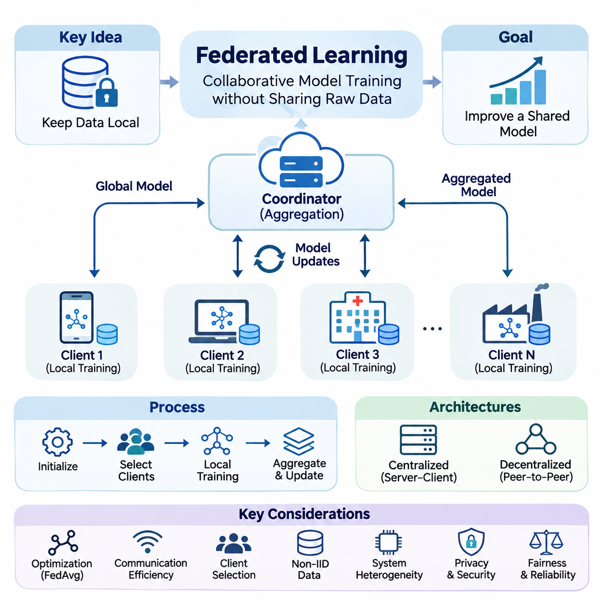
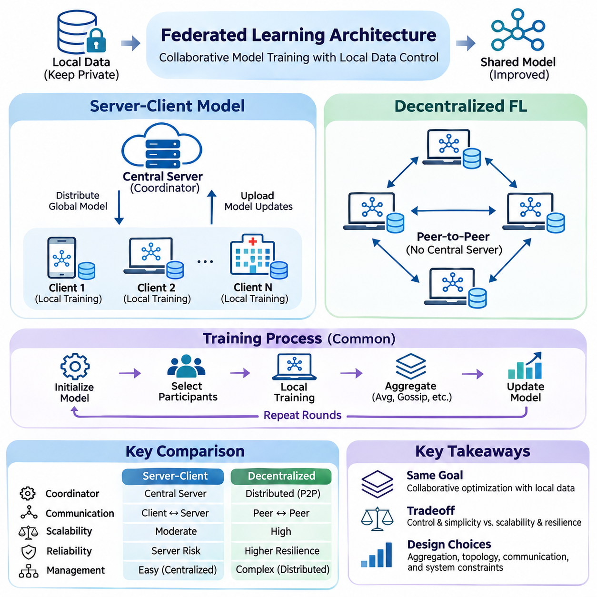
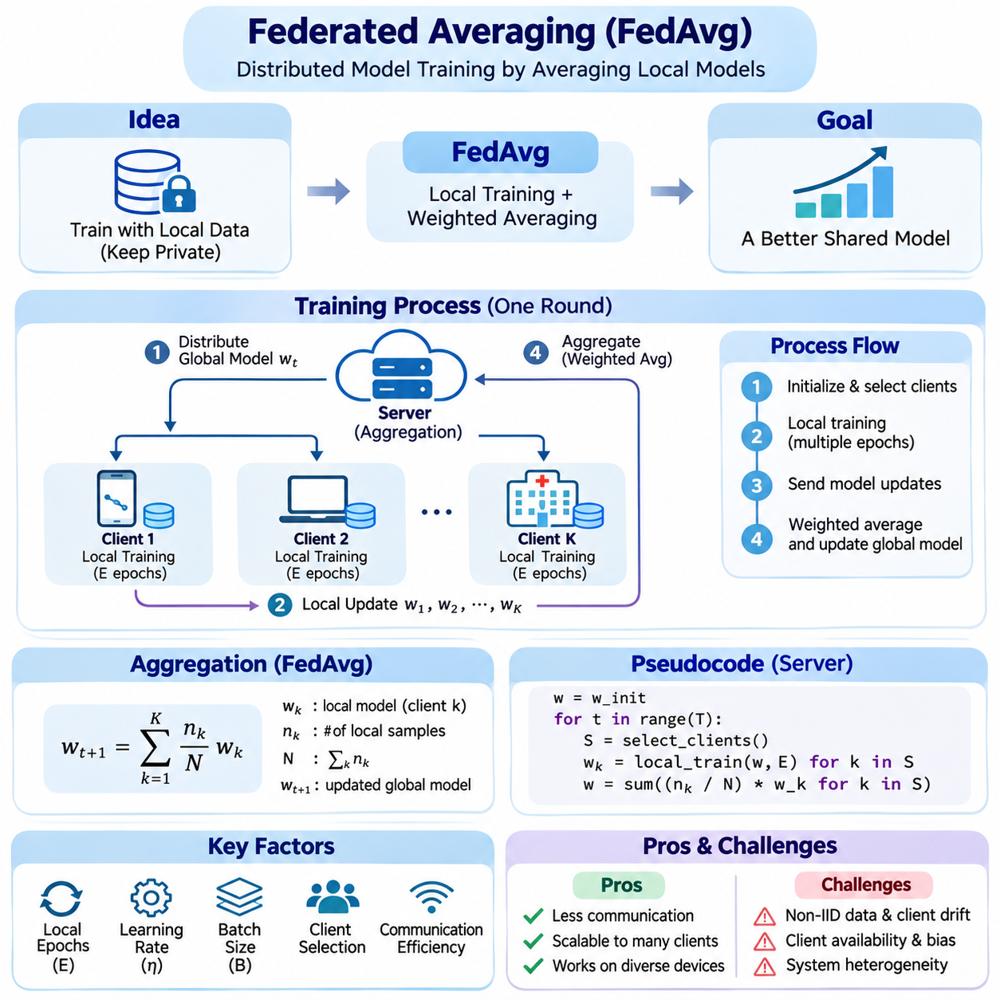
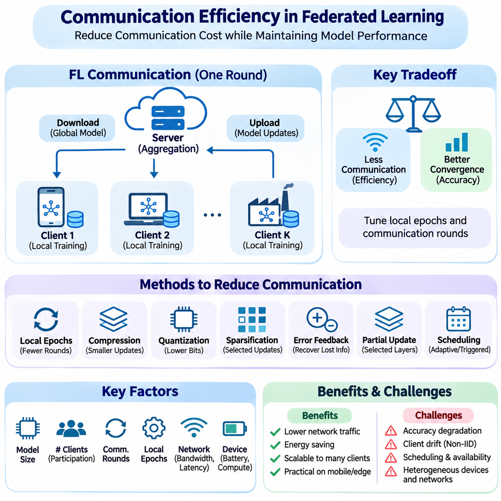
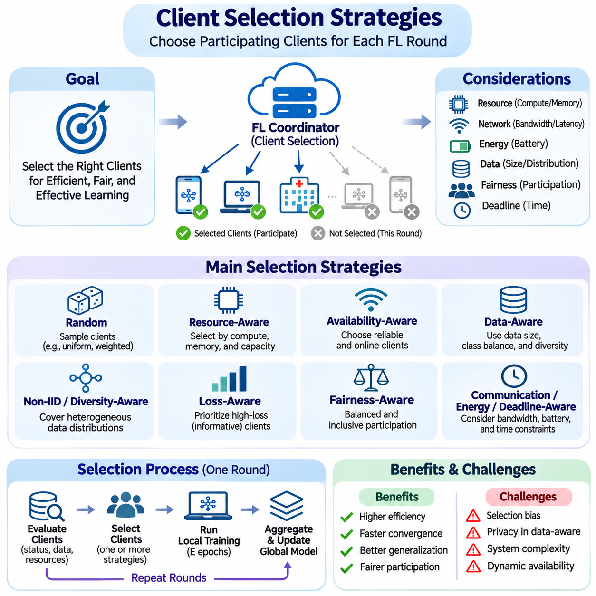
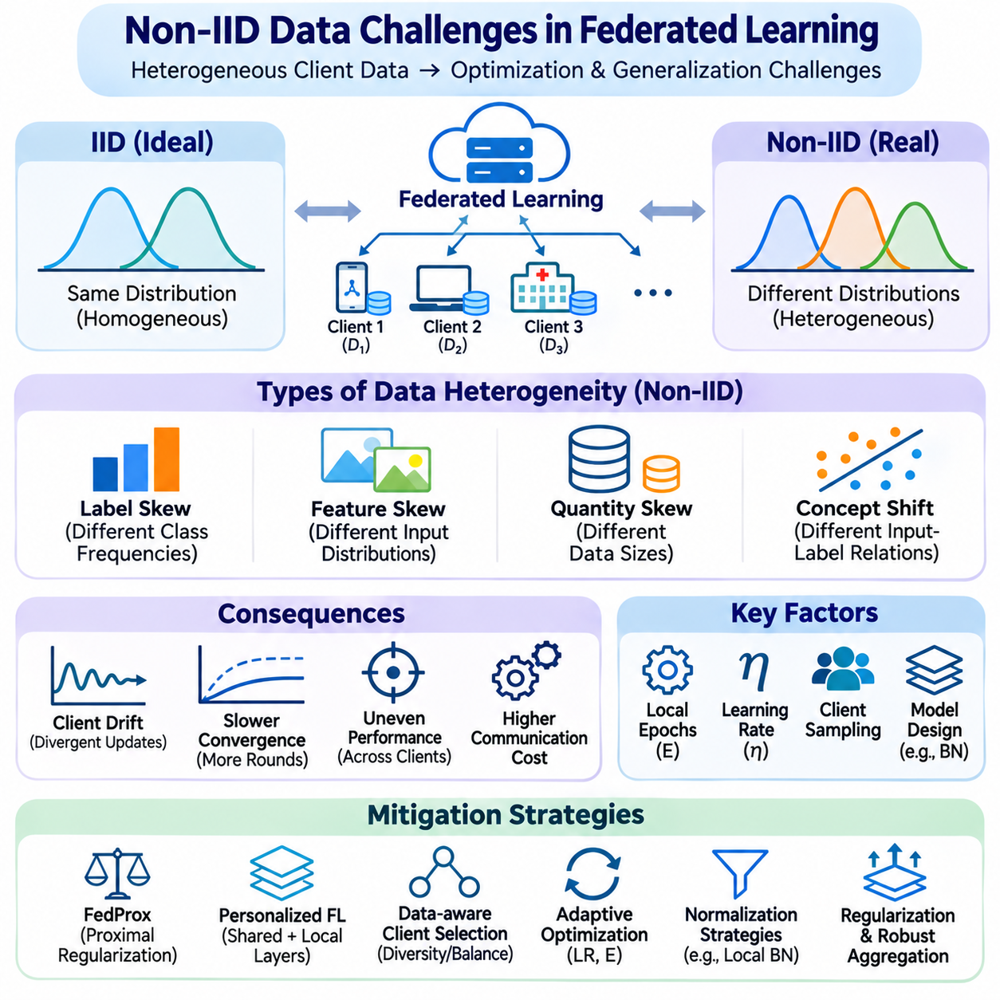
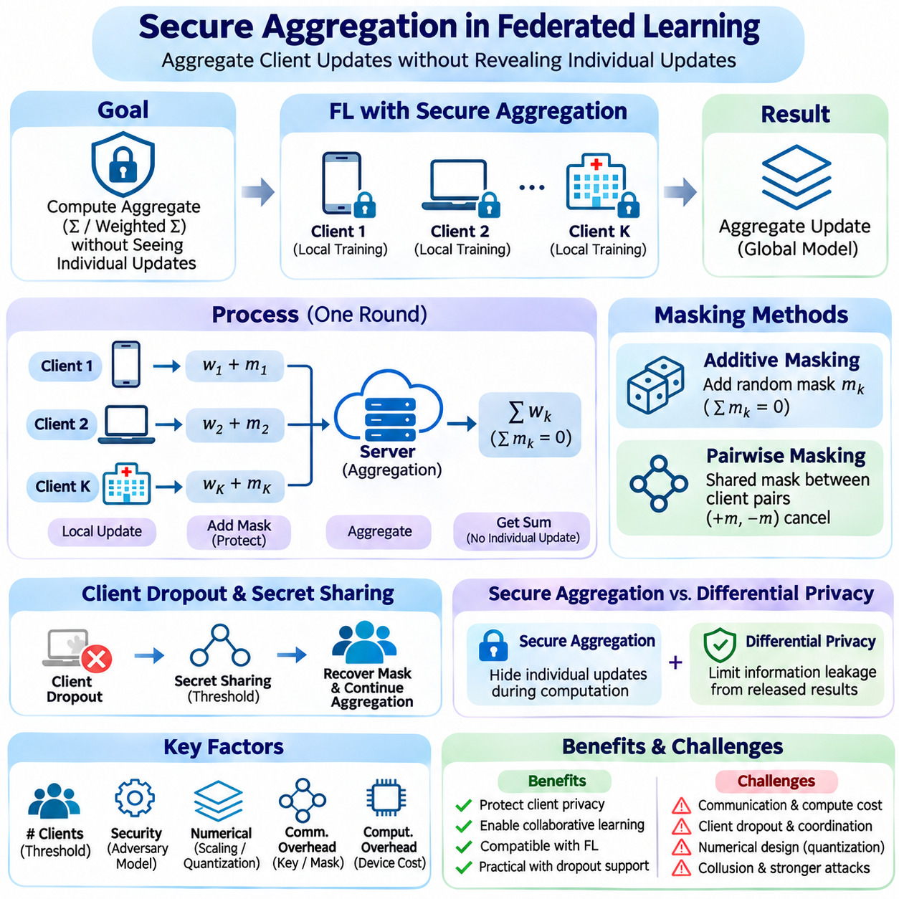
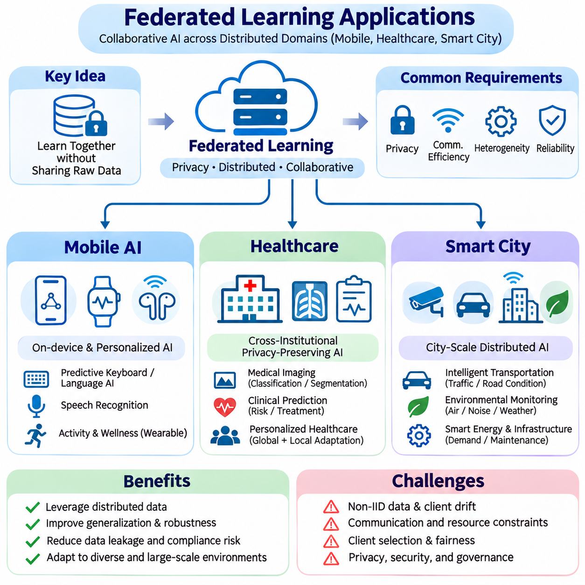

**Volume 40.** **TinyML and Federated Learning**

# 02. Federated Learning

## 02.00 Overview

{width="7.268055555555556in" height="7.268055555555556in"}

Federated Learning (FL) is a distributed machine learning paradigm that enables multiple devices, organizations, or computational nodes to collaboratively train a shared model without transferring their original datasets to a central repository. Instead of collecting raw information, participating clients perform local optimization and exchange model updates with an aggregation mechanism. This approach supports collaborative intelligence while reducing centralized data collection and associated governance challenges.

Traditional centralized machine learning assumes that training datasets can be collected, standardized, and processed within a common computational environment. However, modern AI systems increasingly operate across smartphones, wearable devices, industrial sensors, hospitals, and autonomous machines. Their data may be geographically distributed, commercially sensitive, or subject to regulatory restrictions. Federated Learning addresses these constraints by moving model computation toward distributed data sources.

The fundamental principle of Federated Learning is to separate data ownership from collaborative model optimization. Each participating client maintains its local dataset and receives an initial model or a synchronized representation of model parameters. Local training produces parameter changes or gradients that contribute to a shared learning objective. A coordination mechanism combines these contributions, enabling the global model to improve without requiring direct access to individual training records.

A typical Federated Learning process begins with model initialization and participant registration. A coordinating server distributes the current global model to selected clients, which perform local training using their available computational resources. After completing a specified number of optimization steps, clients transmit model updates to the coordinator. The server aggregates eligible contributions and distributes the resulting global model during subsequent communication rounds.

Federated Learning architectures can be organized around centralized coordination or decentralized collaboration. In the server-client model, a central server manages participant selection, model distribution, aggregation, and training progression. Decentralized Federated Learning replaces the single coordinator with peer-to-peer communication or distributed consensus mechanisms. These alternatives introduce different tradeoffs involving scalability, synchronization, fault tolerance, communication complexity, and operational control.

The mathematical objective of Federated Learning is commonly expressed as minimizing a weighted combination of client-specific loss functions. Each client evaluates its local objective using its own dataset, while the global optimization process seeks parameters that perform effectively across participating populations. Client contributions are often weighted according to local sample counts, although alternative weighting strategies may address fairness, reliability, or differences in application importance.

Federated Averaging, commonly known as FedAvg, provides a foundational optimization strategy for distributed model training. Participating clients perform several local stochastic gradient descent steps before transmitting updated model parameters. The coordinating server then computes a weighted average of the received parameters. This procedure reduces the frequency of communication compared with exchanging gradients after every optimization step, although its convergence depends on data heterogeneity and local training behavior.

Communication efficiency is a central engineering requirement because participating devices frequently operate over wireless, bandwidth-limited, or intermittently available networks. Repeated transmission of large neural network parameters can introduce substantial latency, energy consumption, and operational expense. Techniques such as update compression, quantization, sparsification, reduced communication frequency, and selective parameter exchange help decrease network traffic while attempting to preserve learning effectiveness.

Client selection determines which participants contribute to each training round and strongly influences system performance. Available clients may differ in processing capability, memory capacity, battery level, network connectivity, and dataset characteristics. Random sampling provides a straightforward participation mechanism, whereas resource-aware and availability-aware strategies can improve execution efficiency. Selection policies must also consider whether repeatedly favoring powerful devices creates statistical bias.

One of the most significant challenges in Federated Learning is the presence of non-independent and identically distributed, or Non-IID, data. Client datasets often represent different populations, environments, behaviors, or operational conditions. Consequently, local optimization directions may disagree, producing client drift and unstable convergence. Effective federated optimization must accommodate statistical heterogeneity while preserving useful shared representations and avoiding excessive specialization toward dominant participants.

Data heterogeneity can arise through differences in feature distributions, label frequencies, sample quantities, and relationships between inputs and target outputs. A smartphone may observe language patterns specific to its owner, while an industrial sensor may record conditions associated with a particular machine. These differences complicate the assumption that all local updates contribute equally to global generalization. Personalized training and heterogeneity-aware optimization offer complementary responses.

Federated Learning also introduces systems heterogeneity because clients operate under different hardware and software constraints. Some participants may contain powerful GPUs or dedicated AI accelerators, while others depend on low-power processors and limited memory. Variations in computation speed and network reliability can produce delayed updates, incomplete training rounds, or participant failures. Robust orchestration mechanisms must balance synchronization requirements with practical device availability.

Synchronous Federated Learning typically waits for a designated collection of client updates before completing aggregation. This approach provides relatively clear training-round boundaries but may suffer from slow participants, commonly described as stragglers. Asynchronous approaches accept updates at different times, potentially improving resource utilization and reducing waiting periods. However, stale parameters and inconsistent model versions can introduce optimization instability and complicate reproducibility.

Privacy is an important motivation for Federated Learning, but keeping raw datasets local does not automatically guarantee confidentiality. Model gradients and parameter updates may reveal information about training examples under certain attack conditions. Malicious participants or compromised infrastructure may also attempt inference, reconstruction, or manipulation. Consequently, practical federated systems require additional privacy controls, authenticated communication, access management, and carefully defined threat models.

Secure aggregation provides a mechanism for combining client contributions while limiting the coordinator\'s visibility into individual updates. Cryptographic protocols can allow a server to recover an aggregate result without directly observing each protected contribution. Such techniques strengthen confidentiality under their stated security assumptions, although they introduce computational overhead, communication requirements, and operational complexity. Their effectiveness also depends on participant behavior and protocol implementation.

Federated Learning is closely related to privacy-preserving technologies such as differential privacy, secure multiparty computation, and homomorphic encryption. These techniques address different security objectives and may be combined according to system requirements. Differential privacy can bound selected information-disclosure risks through controlled randomization, while cryptographic methods protect computation or communication. Their integration requires explicit evaluation of privacy guarantees, model accuracy, resource consumption, and threat assumptions.

Security challenges extend beyond confidentiality to include data poisoning, model poisoning, malicious updates, and unauthorized participation. Attackers may attempt to degrade overall accuracy, introduce targeted behaviors, or disrupt aggregation. Defensive mechanisms include participant authentication, update validation, anomaly detection, robust aggregation, and controlled model release procedures. No individual defense guarantees protection against every adversarial strategy, making layered security and continuous evaluation essential.

Mobile AI represents a major application domain because smartphones and personal devices generate large quantities of user-specific information. Federated Learning can support predictive keyboards, recommendation systems, activity recognition, and personalized interaction models while limiting the need to centralize raw user records. Deployment must nevertheless account for battery consumption, background execution restrictions, network availability, and user consent. Training schedules are commonly adapted to device operating conditions.

Healthcare offers another important setting because medical datasets are often distributed among hospitals, laboratories, and research institutions. Federated Learning can enable collaborative development of diagnostic, predictive, or analytical models without requiring every institution to transfer patient records into a shared database. However, differences in clinical populations, acquisition equipment, labeling standards, and institutional practices can substantially affect model reliability. Privacy protection, governance, and external validation remain necessary.

Smart City applications can use Federated Learning to coordinate intelligence across traffic infrastructure, environmental sensors, connected vehicles, and municipal monitoring systems. Distributed participants may contribute information about traffic patterns, energy consumption, equipment conditions, or environmental changes. Collaborative training can improve shared analytical capabilities while reducing dependence on centralized raw-data collection. Practical deployment requires reliable networking, interoperable data representations, and mechanisms for handling changing urban conditions.

The relationship between Federated Learning and TinyML becomes particularly important when participating clients are resource-constrained embedded devices. TinyML emphasizes efficient inference and computation under strict memory, processing, and power budgets, whereas Federated Learning coordinates learning across distributed data sources. Combining these approaches enables selected edge devices to participate in collaborative adaptation, although local training may exceed the capabilities of extremely constrained microcontrollers.

On-device learning provides the computational foundation for many federated applications because model updates must be generated near the original data. Devices may train complete models, selected layers, compact adapters, or other parameter-efficient components depending on available resources. Local adaptation can improve responsiveness to changing conditions, while periodic federation transfers selected knowledge across participants. The balance between global generalization and individual personalization becomes an important architectural decision.

Evaluating Federated Learning requires more than measuring predictive accuracy on a centralized test dataset. Relevant metrics include convergence speed, communication volume, training latency, client participation, energy consumption, and performance variation across clients. Privacy guarantees and resilience to malicious behavior may also require dedicated evaluation procedures. Experimental results should distinguish model-level improvements from system-level efficiency and account for the statistical properties of participating datasets.

Reproducibility presents additional difficulties because federated experiments depend on client sampling, data partitioning, network conditions, random initialization, and heterogeneous execution environments. Two experiments using identical model architectures may produce different outcomes when client availability or local dataset distributions change. Reliable benchmarking therefore requires documented partitioning procedures, controlled random seeds, transparent aggregation settings, and consistent reporting of communication and computational costs.

Successful Federated Learning deployment depends on integrating machine learning algorithms with distributed systems engineering and operational governance. Model versioning, participant identity management, secure update transport, failure recovery, monitoring, and rollback procedures must operate together. Production systems also need policies governing participation eligibility, data retention, software updates, and responsibility for shared models. These requirements make federation an architectural capability rather than merely a training algorithm.

The broader significance of Federated Learning lies in enabling collaborative intelligence across independently controlled computational environments. Its value emerges when distributed data cannot be efficiently or appropriately centralized, yet participating systems can benefit from shared model improvement. Future development will increasingly connect federated optimization with edge foundation models, personalized AI, efficient embedded learning, and decentralized infrastructure, while preserving rigorous attention to security, fairness, scalability, and measurable system performance.

## 02.01 FL Architecture

{width="7.268055555555556in" height="7.268055555555556in"}

Federated Learning architecture defines how distributed participants coordinate model training while maintaining local control over their datasets. Its design determines how models are distributed, how updates are exchanged, and how collaborative optimization progresses. Two fundamental approaches are the server-client model and decentralized Federated Learning, each offering distinct mechanisms for communication, aggregation, synchronization, and operational governance.

The architectural foundation of Federated Learning separates local computation from global knowledge integration. Participating devices or institutions retain their training data and execute optimization using locally available resources. Instead of transmitting raw datasets, they exchange model parameters, gradients, or compressed updates. The coordination structure determines how these contributions are combined and how updated model states propagate throughout the distributed learning environment.

In the server-client model, a central coordinating server manages the overall training process while multiple clients perform local model optimization. The server initializes the global model, selects eligible participants, distributes parameters, and collects training results. Clients independently process their datasets and return updates according to predefined communication protocols. This architecture provides a clear separation between centralized orchestration and decentralized data processing.

A typical server-client training round begins when the coordinator distributes the current global model to selected clients. Each client initializes its local model using the received parameters and performs several optimization steps on private training data. After local computation, participating clients transmit updated parameters or gradients. The server aggregates the contributions and produces a revised global model for subsequent training rounds.

Federated Averaging, or FedAvg, is a widely used aggregation strategy within server-client architectures. It combines locally trained model parameters through weighted averaging, commonly using the number of training samples associated with each client. This approach allows multiple local optimization steps between communication rounds, reducing synchronization frequency. However, differences in client data distributions and training workloads can influence convergence stability.

Centralized coordination simplifies model version management, participant registration, training schedules, and performance monitoring. A coordinating server can enforce consistent aggregation policies and maintain a record of completed training rounds. It can also manage authentication, communication security, and deployment procedures. These capabilities make server-client architectures suitable for environments requiring standardized operations and centralized administrative accountability.

Despite these advantages, the coordinating server introduces potential scalability and reliability limitations. Large client populations may generate substantial communication traffic, aggregation workloads, and synchronization delays. Server outages can interrupt training, while concentrated infrastructure creates an important security target. Practical implementations address these concerns through scalable communication services, redundant coordination components, hierarchical aggregation, and fault recovery mechanisms.

Client availability represents another major challenge in server-client systems. Mobile devices, embedded controllers, and remote sensors may experience changing network conditions, limited battery capacity, or competing computational workloads. Some participants complete training rapidly, while others become unavailable before submitting updates. Client selection, timeout policies, partial participation, and asynchronous aggregation can reduce the operational impact of these variations.

Decentralized Federated Learning removes the requirement for a single central aggregation server by allowing participants to exchange model information directly. Each node maintains its own model state and communicates with selected neighboring nodes through peer-to-peer connections. Collaborative optimization emerges from repeated local training and distributed information exchange. This architecture distributes coordination responsibilities across the network rather than concentrating them within one administrative component.

The communication topology of decentralized Federated Learning determines which participants can exchange updates and how information propagates. Nodes may be connected through ring structures, mesh networks, hierarchical overlays, or dynamically changing communication graphs. Each topology produces different characteristics in communication overhead, convergence speed, fault tolerance, and network resilience. Connectivity patterns therefore become integral components of the learning algorithm rather than merely implementation details.

Decentralized optimization commonly relies on neighborhood averaging, gossip-based communication, or distributed consensus mechanisms. After performing local training, a participant exchanges parameters with neighboring nodes and combines the received information with its own model state. Repeated exchanges gradually propagate learned information throughout the network. The resulting behavior depends on communication frequency, mixing weights, network connectivity, and the statistical properties of local datasets.

Gossip-based learning enables information dissemination without requiring every participant to communicate with every other node. During each exchange, nodes share model updates with a limited number of neighbors selected according to predefined or adaptive policies. Over successive iterations, information spreads across the communication graph. This approach can reduce centralized communication bottlenecks, although incomplete connectivity and irregular exchanges may slow convergence.

Consensus-based approaches seek to align distributed model states while allowing local optimization to continue. Participants repeatedly combine neighboring information to reduce disagreement between their parameters. The effectiveness of this process depends on graph connectivity, consensus weights, synchronization assumptions, and communication reliability. Poorly connected networks may produce slow information propagation, while rapidly changing topologies require algorithms capable of maintaining stable learning behavior.

Decentralized architectures can improve resilience against the failure of an individual coordinating server because no single aggregation component is required. Participants may continue exchanging updates when selected nodes become unavailable, provided the remaining communication graph maintains sufficient connectivity. However, decentralization does not automatically eliminate failure risks. Network partitions, compromised peers, inconsistent model versions, and malicious communication can still disrupt collaborative optimization.

Security and privacy requirements differ between centralized and decentralized arrangements. Server-client systems concentrate aggregation authority within a coordinator, whereas decentralized systems distribute communication and trust relationships among peers. Neither architecture inherently guarantees privacy because exchanged gradients and parameters may expose sensitive information. Secure communication, authenticated participation, privacy-preserving aggregation, and adversarial defenses must be adapted to the selected coordination model.

Non-IID data creates significant optimization challenges in both architectures. In server-client systems, heterogeneous local updates may cause global model drift or unstable aggregation. In decentralized systems, neighboring participants may have substantially different data distributions, causing regional model divergence. Personalized optimization, adaptive mixing, regularization, and topology-aware training strategies can help balance shared knowledge acquisition with local specialization.

Communication efficiency is particularly important when Federated Learning operates across edge devices and constrained networks. Server-client architectures must manage repeated traffic between clients and aggregation infrastructure, while decentralized architectures distribute communication across peer connections. Update compression, quantization, sparsification, and selective communication can reduce transmission requirements. Architectural evaluation must consider total network traffic, device energy consumption, and convergence efficiency together.

Hybrid and hierarchical Federated Learning architectures combine elements of centralized and decentralized coordination. Local clusters may aggregate updates through edge gateways before forwarding summarized information to a higher-level server. Alternatively, neighboring devices may exchange updates directly while periodically synchronizing with a central coordinator. These arrangements support geographically distributed deployments and allow communication structures to reflect organizational boundaries, network conditions, and available computational resources.

Architecture selection depends on operational requirements rather than a universally superior coordination model. Server-client systems provide straightforward administrative control and standardized aggregation, while decentralized approaches offer distributed coordination and alternative resilience characteristics. Hybrid structures can balance these properties when participants are organized into clusters. Decisions should account for network topology, participant scale, data heterogeneity, security assumptions, infrastructure ownership, and maintenance complexity.

Mobile AI applications frequently benefit from server-client coordination because large populations of personal devices can participate in centrally managed training programs. Industrial IoT and robotic systems may benefit from hierarchical aggregation when devices operate within local networks connected to edge gateways. Decentralized collaboration can be relevant to autonomous networks where continuous access to a central server is impractical. Each deployment requires validation against its actual communication and reliability constraints.

The integration of Federated Learning with TinyML introduces additional architectural considerations because embedded participants may have limited memory, processing capacity, and energy reserves. Some devices can execute lightweight local optimization, while others may only support inference or partial parameter updates. Gateways and edge servers can provide intermediate computation and aggregation services. Effective architecture design must match learning responsibilities to the capabilities of each participating hardware platform.

Evaluating Federated Learning architectures requires measurements that extend beyond predictive accuracy. Important indicators include convergence behavior, communication volume, synchronization latency, client participation, computational overhead, and fault recovery performance. Decentralized systems additionally require analysis of graph connectivity and consensus behavior. Security, privacy, fairness, and model consistency should be evaluated under realistic client failures, heterogeneous datasets, and changing network conditions.

Ultimately, Federated Learning architecture determines how collaborative intelligence is organized across distributed computational environments. Server-client coordination emphasizes centralized orchestration with local data processing, while decentralized Federated Learning distributes both computation and coordination among participating nodes. Understanding these architectural differences provides the foundation for designing scalable, privacy-conscious, resource-efficient learning systems that operate across mobile devices, industrial infrastructure, healthcare networks, and autonomous edge platforms.

## 02.02 Federated Averaging (FedAvg) [w/Code]

{width="7.268055555555556in" height="7.268055555555556in"}

Federated Averaging (FedAvg) is a foundational optimization algorithm for Federated Learning that enables multiple clients to collaboratively train a shared machine learning model without transferring their raw datasets to a central server. Each client performs local training using its private data, while a coordinating server combines the resulting model parameters. This separation between local computation and global aggregation supports distributed learning across independently managed devices and institutions.

The central objective of FedAvg is to minimize a global loss function constructed from the local objectives of participating clients. Each client evaluates its model against its own dataset, and the server combines their contributions using predefined aggregation weights. These weights commonly reflect the number of training samples available to each participant. Consequently, the global optimization process approximates learning across the combined distributed dataset without directly collecting the underlying records.

A typical FedAvg training cycle begins with the initialization of a global model containing shared parameters. The coordinating server selects a subset of available clients and distributes the current model to them. Each selected client creates a local copy and performs several optimization steps using stochastic gradient descent or another compatible optimizer. Once local training finishes, clients transmit their updated parameters to the server for aggregation.

The aggregation mechanism calculates a weighted average of the received client models. If client k contains n_k training samples and the selected clients collectively contain N samples, its conventional aggregation weight is n_k divided by N. The updated global parameters are obtained by summing each client\'s trained parameters multiplied by its corresponding weight. This formulation gives clients with larger participating datasets proportionally greater influence on the resulting global model.

FedAvg differs from conventional distributed stochastic gradient descent because clients perform multiple local optimization steps before communicating with the server. Traditional synchronous distributed training often aggregates gradients after each optimization step, whereas FedAvg allows several local epochs between synchronization rounds. This approach can substantially reduce communication frequency, making it attractive for mobile devices, remote sensors, and bandwidth-constrained edge environments.

The number of local epochs is an important hyperparameter that influences both communication efficiency and convergence behavior. Increasing local training reduces the number of synchronization events required for a given amount of computation. However, excessive local optimization may cause client models to move toward different local objectives. This phenomenon, commonly described as client drift, becomes particularly problematic when participating datasets have substantially different statistical distributions.

Non-independent and identically distributed data, commonly called Non-IID data, represents one of the principal challenges for FedAvg. Client datasets may differ in class frequencies, feature distributions, sample quantities, and relationships between inputs and outputs. As a result, local optimization trajectories can diverge significantly. Weighted averaging does not automatically resolve these differences, and the resulting global model may exhibit unstable convergence or uneven performance across participants.

Client participation also affects FedAvg because practical federated systems rarely involve every available device during every communication round. A coordinating server typically samples a subset of eligible clients according to availability, resource constraints, and participation policies. Random sampling provides a straightforward baseline, while resource-aware selection may improve operational efficiency. Nevertheless, systematically excluding certain client populations can introduce bias into the learned global model.

The local learning rate determines how aggressively each client updates its model parameters during training. A large learning rate can accelerate initial progress but may increase divergence between heterogeneous clients. A smaller learning rate generally produces more conservative updates, although convergence may require additional computation or communication rounds. Effective tuning must consider local batch size, optimizer configuration, client participation, and the degree of data heterogeneity.

Local batch size influences the computational characteristics and statistical behavior of FedAvg. Smaller batches generate more frequent parameter updates and introduce stochastic variation into local optimization. Larger batches may improve hardware utilization and reduce the number of optimizer steps per epoch, depending on implementation. However, memory limitations on embedded devices and mobile processors may restrict feasible batch sizes. Batch configuration must therefore balance optimization quality, execution time, and resource consumption.

Communication efficiency is a primary motivation for FedAvg, particularly when model parameters must travel across wireless or geographically distributed networks. Instead of transmitting updates after every minibatch, clients communicate after completing multiple local steps. Additional techniques such as parameter quantization, sparsification, compression, and partial model updates can further reduce transmission costs. Their benefits must be evaluated against possible accuracy degradation and additional processing overhead.

System heterogeneity introduces operational challenges because participating clients may possess different processors, memory capacities, energy budgets, and network connections. Some devices complete local training quickly, while others require substantially more time or become disconnected. Synchronous FedAvg generally waits for a designated set of client updates before aggregation. Timeout mechanisms, partial participation, and adaptive workload allocation can reduce delays caused by slow or unavailable clients.

FedAvg is commonly implemented using a central coordinating server, but its underlying averaging principle can also support hierarchical aggregation architectures. Edge gateways may combine updates from nearby devices before forwarding aggregated parameters to a higher-level coordinator. This arrangement can reduce wide-area communication traffic and support geographically distributed deployments. However, hierarchical aggregation must preserve appropriate weighting and account for differences in client participation.

Privacy is an important consideration because FedAvg keeps raw training datasets on participating clients. Nevertheless, exchanging model parameters does not guarantee confidentiality. Individual updates may reveal information about local training examples through gradient inversion, membership inference, or related attacks. Secure aggregation and differential privacy can provide additional protection under specified assumptions. These mechanisms introduce tradeoffs involving communication complexity, computational overhead, and model utility.

Security threats also include malicious clients that intentionally submit manipulated model parameters. Model poisoning attacks may degrade global accuracy or introduce targeted behaviors into the shared model. Conventional weighted averaging is vulnerable to sufficiently influential adversarial updates because it does not inherently distinguish legitimate optimization from malicious manipulation. Robust aggregation, participant authentication, anomaly detection, and update validation can strengthen system defenses, although their effectiveness depends on the threat model.

FedAvg performance should be evaluated through both machine learning metrics and distributed systems measurements. Predictive accuracy, loss convergence, and generalization across client populations describe model quality. Communication rounds, transmitted bytes, client computation time, energy consumption, and synchronization delays characterize operational efficiency. A configuration that converges in fewer rounds may still consume more total energy or computation, making multidimensional evaluation essential.

Experimental design requires careful control of dataset partitioning because FedAvg behavior depends strongly on how training examples are distributed among clients. Independent and identically distributed partitions provide a useful reference condition, while label-skewed and quantity-skewed partitions reveal sensitivity to heterogeneity. Experiments should document client counts, sampling fractions, local epochs, learning rates, batch sizes, and aggregation weights to support meaningful comparison and reproducibility.

Practical implementations often use PyTorch or TensorFlow to construct local training procedures and server-side aggregation logic. A minimal workflow initializes a shared model, distributes its parameters, trains local copies, collects updated state dictionaries, and computes weighted parameter averages. Production implementations additionally require model version tracking, communication security, failure recovery, and consistent handling of trainable parameters and non-trainable model states.

Numerical correctness is particularly important when aggregating models containing normalization layers, integer-valued counters, or other non-floating-point state variables. Blindly averaging every entry in a model state dictionary may produce invalid results or inconsistent behavior. Implementations should distinguish trainable parameters from auxiliary state and define explicit aggregation policies. These engineering details become increasingly important when moving from simple research examples to complex neural network architectures.

Several optimization methods extend FedAvg to address its limitations under heterogeneous conditions. FedProx introduces a proximal term that discourages excessive deviation from the global model during local training. SCAFFOLD uses control variates to reduce client drift, while adaptive federated optimization methods modify server-side update behavior. These alternatives illustrate that conventional FedAvg provides a useful baseline but does not universally deliver the best convergence or fairness characteristics.

FedAvg is relevant to mobile AI, healthcare collaboration, industrial IoT, and distributed robotics. Mobile devices can contribute user-specific learning signals, hospitals can collaboratively train models across institutional datasets, and industrial sensors can share knowledge about equipment conditions. In robotic fleets, locally collected operational data may support collective model improvement. Each application requires suitable client selection, privacy controls, communication policies, and validation against domain-specific requirements.

Integration with TinyML and on-device learning introduces additional constraints because some embedded devices cannot efficiently perform full neural network training. Parameter-efficient adaptation, selective layer training, and lightweight model architectures can reduce local computational demands. More capable edge gateways may handle aggregation or intermediate processing. The feasibility of FedAvg therefore depends not only on communication efficiency but also on whether participating hardware can sustain repeated local optimization.

Ultimately, Federated Averaging establishes a practical foundation for collaborative model training across distributed data environments. Its simplicity, weighted aggregation mechanism, and reduced synchronization frequency make it an important reference algorithm for Federated Learning research and engineering. Understanding its optimization behavior, communication requirements, privacy limitations, and sensitivity to heterogeneous clients is essential for designing reliable, scalable, and resource-efficient federated AI systems.

## 02.03 Communication Efficiency

{width="7.268055555555556in" height="7.268055555555556in"}

Communication efficiency is a fundamental requirement in Federated Learning because distributed clients repeatedly exchange model information across networks with limited bandwidth, variable latency, and intermittent connectivity. Unlike centralized training, where data is transferred to a common environment, federated systems keep datasets local and communicate model updates. The resulting network overhead can become a major limitation when large models are trained across thousands of devices.

The communication cost of Federated Learning depends on model size, the number of participating clients, synchronization frequency, and the representation of transmitted updates. Each training round typically involves downloading global parameters and uploading locally trained parameters or gradients. Total communication volume therefore increases with both model complexity and participation scale. Efficient architectures must optimize uplink and downlink traffic while preserving acceptable learning accuracy.

Federated Averaging reduces communication frequency by allowing clients to perform multiple local optimization steps before exchanging parameters. Instead of synchronizing after every minibatch, participating devices train locally for several iterations or epochs. This approach decreases the number of communication rounds required for a given amount of local computation. However, excessive local training may increase client drift, particularly when datasets follow heterogeneous statistical distributions.

Communication rounds and local computation form an important optimization tradeoff. Increasing local epochs can reduce network exchanges but also increases processing time, energy consumption, and divergence between client models. Reducing local epochs may improve synchronization consistency while generating additional network traffic. The optimal configuration depends on network bandwidth, device processing capability, data heterogeneity, and the required convergence behavior.

Model update compression is a widely used technique for reducing the number of transmitted bytes. Rather than communicating full-precision parameter values, clients encode updates using compact numerical representations or structured compression schemes. Compression can reduce transmission time and communication energy, especially on wireless networks. Nevertheless, lossy compression introduces approximation errors that may affect optimization stability and final model accuracy.

Quantization reduces communication cost by representing model updates with fewer bits per parameter. A conventional floating-point update may use 32 bits, while compressed representations can use 16, 8, or fewer bits depending on the algorithm. Uniform, stochastic, and adaptive quantization methods offer different accuracy and implementation characteristics. Quantization design must consider numerical precision, communication savings, and the accumulation of errors across training rounds.

Sparsification decreases transmission requirements by communicating only selected model updates rather than every parameter. Threshold-based methods retain values exceeding a specified magnitude, while Top-K approaches transmit the largest updates according to absolute value. Random sparsification selects a subset of coordinates according to a sampling rule. These methods can substantially reduce transmitted elements, although index encoding and reconstruction overhead must be included when calculating actual communication savings.

Error feedback helps compensate for information lost through quantization or sparsification. A client stores the difference between its original update and the compressed representation, then incorporates this residual into subsequent updates. Over repeated communication rounds, previously omitted information can gradually influence global optimization. Error feedback may improve convergence under aggressive compression, but residual storage introduces additional memory requirements for resource-constrained devices.

Partial model communication provides another strategy for reducing network traffic. Instead of exchanging every parameter, clients may transmit selected layers, compact adapters, low-rank updates, or task-specific components. This approach is particularly relevant when large foundation models are adapted across distributed edge devices. However, parameter selection must preserve compatibility with the global model and ensure that locally modified components contribute meaningfully to collaborative learning.

Communication scheduling determines when devices exchange updates and can significantly affect overall system efficiency. Fixed schedules provide predictable synchronization intervals, while adaptive schedules respond to convergence progress, network availability, or update significance. Event-triggered communication may transmit updates only when local model changes exceed a defined threshold. Such strategies reduce unnecessary exchanges but require careful handling of delayed updates and inconsistent client participation.

Client selection and communication efficiency are closely connected because each participating device introduces transmission and aggregation costs. Selecting fewer clients can reduce immediate network load, but insufficient participation may slow convergence or weaken population coverage. Resource-aware selection considers bandwidth, latency, battery state, and computational capability. Effective policies must balance communication savings with statistical representativeness and fairness across client populations.

Wireless communication introduces additional constraints through fluctuating signal quality, packet loss, network congestion, and energy consumption. Mobile clients may move between connectivity conditions or become temporarily disconnected during training. Reliable federated systems require retry policies, transmission timeouts, and mechanisms for resuming interrupted exchanges. Communication optimization should therefore consider successful delivery rates and end-to-end completion time rather than theoretical payload size alone.

Hierarchical Federated Learning can reduce wide-area communication by organizing clients into local groups connected through edge gateways. Nearby devices transmit updates to an intermediate aggregator, which combines contributions before forwarding them to a central coordinator. This structure can decrease repeated long-distance transmissions and distribute aggregation workloads. Its effectiveness depends on cluster organization, gateway capacity, local network reliability, and the frequency of higher-level synchronization.

Decentralized Federated Learning distributes communication across peer-to-peer connections rather than relying exclusively on a central aggregation server. Nodes exchange updates with selected neighbors through gossip-based or consensus-oriented protocols. Local communication may reduce dependence on centralized network infrastructure, particularly when participants are geographically clustered. However, repeated neighbor exchanges can generate substantial aggregate traffic, making topology-aware optimization essential.

Network topology influences communication efficiency because physical distance, routing paths, and connectivity patterns determine transmission cost. Ring, mesh, hierarchical, and dynamically changing network structures exhibit different latency and bandwidth characteristics. A highly connected topology can accelerate information propagation but may require more communication links. Sparse connectivity reduces immediate traffic while potentially increasing the number of exchanges needed to achieve model agreement.

Communication and computation can sometimes overlap to improve resource utilization. While selected clients perform local training, servers or gateways may prepare model distributions, validate received updates, or coordinate subsequent participants. Asynchronous aggregation can reduce waiting periods by processing updates as they arrive. However, overlapping operations introduces version consistency challenges, and stale model updates may reduce optimization effectiveness if their influence is not controlled.

Privacy-preserving communication mechanisms introduce additional overhead that must be included in efficiency analysis. Secure aggregation may require cryptographic masking, key exchange, and additional protocol messages before a protected aggregate can be recovered. Differential privacy may alter update representations or optimization behavior, although its primary purpose is privacy protection rather than compression. System design must evaluate communication efficiency together with security guarantees and computational feasibility.

Energy efficiency is particularly important for battery-powered devices because wireless transmission can consume substantial power. Communication energy depends on radio technology, signal conditions, transmitted data volume, and connection management overhead. Reducing payload size may lower energy consumption, but complex compression algorithms can increase local computation. An effective optimization strategy minimizes total energy expenditure rather than focusing exclusively on transmitted bytes.

Communication efficiency should be evaluated using multiple complementary metrics. Total transmitted bytes, uplink and downlink volume, communication rounds, effective bandwidth utilization, and end-to-end training duration describe different aspects of network performance. Energy per training round and communication cost per accuracy target provide additional insight. Reporting only the number of synchronization rounds may conceal increased payload sizes, retransmissions, or computational overhead.

Experimental comparisons require consistent model architectures, dataset partitions, client populations, and network assumptions. Simulated bandwidth limitations and latency distributions can reveal how communication strategies behave under controlled conditions. Real-device measurements provide additional evidence about protocol overhead, packet loss, and energy consumption. Reproducible evaluation should document compression ratios, client sampling policies, synchronization settings, and the relationship between communication cost and achieved accuracy.

Communication optimization becomes especially important when Federated Learning is integrated with TinyML and resource-constrained embedded platforms. Microcontrollers and low-power processors may lack sufficient memory to store large updates or execute expensive compression procedures. Lightweight encoding, selective parameter exchange, and gateway-assisted aggregation can reduce these requirements. Practical feasibility depends on balancing memory usage, processing time, communication energy, and the device\'s primary operational responsibilities.

Industrial IoT, mobile AI, healthcare networks, and distributed robotics illustrate different communication requirements. Industrial sensors may operate through low-bandwidth wireless links, while smartphones encounter variable connectivity and background execution restrictions. Healthcare institutions often use more stable networks but may exchange large model updates under strict security requirements. Robotic fleets require coordination that does not interfere with real-time control and safety-critical communication.

Ultimately, communication efficiency determines whether Federated Learning can scale from controlled experiments to practical distributed AI deployments. Techniques such as local optimization, quantization, sparsification, adaptive scheduling, hierarchical aggregation, and topology-aware communication reduce network demands through complementary mechanisms. Successful engineering requires joint optimization of bandwidth, latency, computation, energy, privacy, and convergence so that communication savings translate into measurable system-level improvements.

## 02.04 Client Selection Strategies

{width="7.268055555555556in" height="7.268055555555556in"}

Client selection is a fundamental component of Federated Learning because only a subset of distributed participants typically contributes to each training round. Devices differ in computational resources, network availability, energy capacity, and local data characteristics. Selection strategies determine which clients participate, how frequently they contribute, and how their updates influence global optimization. These decisions affect convergence speed, communication efficiency, fairness, and model generalization.

Random client selection provides a simple baseline in which eligible participants are sampled according to predefined probabilities. Uniform random sampling gives clients equal selection opportunities, while weighted sampling assigns different participation probabilities. Randomization can reduce persistent selection bias when eligibility is sufficiently broad. However, it does not guarantee balanced data representation or efficient execution when participating devices exhibit substantial hardware and network differences.

Resource-aware client selection considers the computational and communication capabilities of available devices. A coordinating server may evaluate processor performance, memory availability, battery level, network bandwidth, and estimated training duration. Clients capable of completing local optimization within a designated deadline may receive higher priority. This approach can reduce synchronization delays, although consistently favoring powerful devices may underrepresent resource-constrained populations.

Availability-aware selection focuses on whether clients can reliably participate during a training round. Mobile devices may become disconnected, enter power-saving states, or experience competing workloads. Selection policies can use recent connectivity, charging status, and historical completion rates to estimate participation reliability. Such predictions improve scheduling efficiency but must accommodate changing conditions and avoid permanently excluding intermittently available devices.

Data-aware client selection attempts to improve global learning by considering the statistical characteristics of local datasets. Relevant properties include sample quantity, class distribution, feature diversity, and estimated contribution to model improvement. Clients containing underrepresented examples may provide valuable information beyond their dataset size. However, obtaining detailed distribution statistics can introduce privacy risks, additional communication, and operational complexity.

Non-IID data makes client selection particularly important because participating datasets may represent different populations or environments. Repeatedly selecting clients with similar distributions can produce a global model that performs poorly on excluded groups. Diversity-aware sampling seeks broader coverage across data characteristics, operational conditions, or geographic regions. Its effectiveness depends on reliable diversity estimates and safeguards against revealing sensitive client information.

Loss-aware selection prioritizes clients whose local models exhibit relatively high training loss or potentially informative updates. These participants may contribute useful corrections to the global model, especially when current performance is uneven. Nevertheless, high loss can also indicate noisy labels, corrupted data, or unusual operating conditions. Selection mechanisms must distinguish informative learning opportunities from unreliable contributions to avoid amplifying instability.

Importance sampling assigns participation probabilities according to estimates of each client\'s contribution to optimization. Such estimates may reflect gradient magnitude, loss reduction, sample count, or other statistical indicators. Appropriate probability weighting can improve training efficiency under certain assumptions. However, biased sampling may require correction during aggregation, and inaccurate importance estimates can reduce convergence quality or disproportionately favor selected populations.

Fairness-aware selection seeks to distribute participation opportunities across clients rather than repeatedly prioritizing the fastest or largest contributors. Participation histories, selection frequency, and client-level performance can inform scheduling decisions. Fairness may involve balancing representation, improving performance for disadvantaged clients, or limiting excessive participation burdens. These objectives are related but distinct, requiring explicit definitions and measurable evaluation criteria.

Communication-aware selection accounts for the network costs associated with different participants. Clients with limited bandwidth, high latency, or unstable wireless connections may require longer upload times. Selecting devices with favorable connectivity can shorten training rounds and reduce retransmissions. However, network-efficient scheduling should be balanced against statistical coverage because consistently excluding remote clients can weaken model generalization.

Energy-aware selection is essential for battery-powered mobile and embedded devices. Local training and wireless communication consume energy that may interfere with primary device functions. Selection policies can consider battery state, charging availability, estimated energy consumption, and thermal constraints. Devices may participate preferentially when sufficient resources are available. Practical systems should prevent collaborative learning from compromising operational reliability or user experience.

Deadline-based selection attempts to identify clients capable of completing local training and communication within a specified time window. Estimated completion time includes model download, computation, update preparation, and upload latency. Scheduling decisions can reduce the impact of slow participants, commonly called stragglers. Nevertheless, overly restrictive deadlines may systematically exclude slower devices, making deadline adaptation important for representative participation.

Adaptive client selection modifies participation policies as training progresses. Early rounds may emphasize broad exploration to capture diverse information, while later rounds may prioritize clients expected to improve difficult model behaviors. Adaptive scheduling can incorporate convergence trends, participation history, and changing resource availability. Its effectiveness depends on reliable feedback and mechanisms that prevent short-term efficiency gains from creating persistent statistical bias.

Reinforcement learning and multi-armed bandit methods provide alternative approaches to adaptive selection. A scheduling agent can estimate the utility of choosing particular clients based on observed rewards such as loss reduction or training completion time. Exploration allows less frequently selected participants to contribute, while exploitation favors clients with demonstrated utility. These methods introduce additional complexity and require carefully designed rewards to avoid unfair selection.

Client selection interacts directly with aggregation because participation probabilities affect the statistical interpretation of received updates. Conventional FedAvg weights selected clients according to local sample counts, but this does not automatically correct every bias introduced by nonuniform participation. Probability-aware weighting may be necessary when estimating a specified population objective. Aggregation rules should therefore be designed consistently with the sampling mechanism and intended learning objective.

Security-aware selection evaluates whether participants satisfy authentication, integrity, and operational trust requirements. Compromised clients may submit manipulated updates, while unreliable devices can disrupt aggregation. Eligibility controls, historical anomaly indicators, and secure enrollment procedures can reduce exposure to certain threats. However, reputation-based exclusion may produce false positives or persistent bias, so security decisions require transparent criteria and appropriate recovery mechanisms.

Privacy constraints limit the information available for client selection. Detailed local statistics, device behavior, and participation histories may reveal sensitive characteristics even when raw datasets remain private. Privacy-preserving summaries, coarse resource indicators, and carefully controlled metadata collection can reduce unnecessary disclosure. Selection mechanisms must evaluate whether additional information provides sufficient learning benefits to justify its privacy and communication costs.

Hierarchical Federated Learning introduces selection decisions at multiple architectural levels. Edge gateways may choose local devices for training, while central coordinators select gateways or regional clusters for aggregation. This arrangement can reduce wide-area communication and reflect geographical or organizational boundaries. However, selection bias may accumulate across levels, requiring coordinated policies that preserve representative participation throughout the hierarchy.

Decentralized Federated Learning replaces centralized scheduling with distributed participation and neighbor-selection mechanisms. Nodes may choose communication partners according to network topology, connectivity, trust, or expected learning benefit. Gossip-based exchanges and adaptive peer selection influence how quickly model information propagates. Poorly connected or repeatedly excluded nodes can experience delayed knowledge sharing, making network connectivity and participation diversity important.

Evaluating client selection requires measurements beyond global predictive accuracy. Relevant metrics include convergence speed, communication volume, training-round duration, energy consumption, participation frequency, and performance variation across clients. Statistical fairness and population coverage should be assessed alongside system efficiency. Experiments must distinguish improvements caused by better client selection from those produced by increased computation or unequal access to training data.

Reproducible experiments should document the total client population, eligible client pool, sampling fraction, selection probabilities, and participation constraints. Data partitioning procedures and random seeds must remain controlled when comparing strategies. Simulations can reproduce device heterogeneity and network failures, while real-device testing reveals practical scheduling overhead. Evaluation should include both IID and Non-IID settings to expose differences in statistical behavior.

Client selection is especially relevant to TinyML, industrial IoT, mobile AI, healthcare, and distributed robotics. Resource-constrained sensors may participate only when energy and memory permit, while hospitals may require institution-level participation policies. Robotic fleets must prioritize operational safety and real-time responsibilities over background training. Effective scheduling adapts to these domain constraints without sacrificing essential population representation.

Ultimately, client selection determines how distributed computational resources and local knowledge contribute to collaborative model improvement. Random, resource-aware, data-aware, fairness-aware, and adaptive strategies address different aspects of the same coordination problem. No single policy is optimal across all environments. Reliable Federated Learning requires selection mechanisms that jointly balance convergence, communication, energy, privacy, security, and equitable participation.

## 02.05 Non IID Data Challenges

{width="7.268055555555556in" height="7.268055555555556in"}

Non-independent and identically distributed data, commonly called Non-IID data, represents a fundamental challenge in Federated Learning because participating clients collect information under different conditions. Unlike centralized training, where datasets can be mixed before optimization, federated systems preserve local data boundaries. Differences in user behavior, operating environments, sample quantities, and observation patterns can produce conflicting local learning objectives and unstable global convergence.

The independent and identically distributed assumption implies that training examples originate from a common probability distribution and are sampled independently. In practical federated environments, this assumption rarely holds across all participants. Smartphones reflect individual usage patterns, hospitals serve different patient populations, and industrial sensors observe distinct equipment conditions. These variations create statistical heterogeneity that directly influences collaborative model optimization.

Label distribution skew occurs when clients observe different frequencies of target classes. A mobile device may contain mostly examples associated with a particular language or activity, while another device records different categories. Local models consequently become specialized toward frequently observed labels. When these updates are aggregated, the global model may exhibit uneven class performance, especially when minority classes are represented by relatively few participating clients.

Feature distribution skew arises when clients observe different input characteristics even when their prediction tasks remain similar. Cameras may operate under different lighting conditions, sensors may have distinct calibration properties, and hospitals may use different acquisition equipment. Such differences can shift learned representations and reduce cross-client generalization. Robust optimization must distinguish meaningful environmental diversity from measurement artifacts and systematic acquisition bias.

Quantity skew describes differences in the number of training examples available to individual clients. Some participants may contribute thousands of observations, while others possess only a small collection of samples. Conventional FedAvg assigns aggregation weights according to local sample counts, giving larger datasets greater influence. Although this weighting matches a sample-weighted objective, it can underrepresent smaller clients whose data contains important but uncommon conditions.

Concept shift occurs when the relationship between input features and target labels differs across clients. Similar observations may correspond to different outcomes because of environmental context, operating procedures, or population characteristics. A shared model may struggle to represent these conflicting relationships using a single parameter configuration. Personalized models, contextual features, or specialized prediction components may be necessary when the underlying tasks differ substantially.

Client drift is a major optimization consequence of Non-IID data. During local training, each client updates model parameters according to its own loss landscape rather than the complete global objective. Multiple local optimization steps can amplify differences between client trajectories. When the server averages these divergent parameters, the resulting update may progress inefficiently or oscillate. The severity depends on learning rates, local epochs, and statistical heterogeneity.

Non-IID conditions can slow convergence and increase the number of communication rounds required to achieve a target accuracy. Local gradients may point in conflicting directions, reducing the effectiveness of aggregated updates. Increasing local computation does not necessarily compensate for this disagreement and may worsen divergence. Communication-efficient training therefore requires balancing local optimization intensity against the consistency of global model improvement.

Client sampling introduces another source of variability because each communication round usually includes only a subset of available participants. When selected clients represent similar distributions, the aggregated update may temporarily favor their local objectives. Subsequent rounds involving different populations can shift optimization in another direction. Representative sampling, diversity-aware selection, and participation tracking can reduce these fluctuations without requiring centralized access to raw datasets.

Batch normalization can become problematic under heterogeneous client distributions because normalization statistics reflect local activation patterns. Running means and variances learned on one device may not represent the global population. Aggregating these statistics without considering distribution differences can degrade inference performance. Techniques such as local normalization, alternative normalization layers, or client-specific statistics can improve robustness under suitable architectural assumptions.

Personalized Federated Learning addresses heterogeneity by allowing clients to retain selected model components or adapt a shared model to local conditions. A common feature extractor may capture transferable patterns, while client-specific layers learn individual preferences or environmental characteristics. Personalization can improve local accuracy but may reduce the uniformity of global predictions. System objectives must clarify whether population-wide performance or client-level adaptation has priority.

FedProx extends conventional federated optimization by introducing a proximal regularization term into local training. This term discourages client parameters from moving excessively far from the current global model. The resulting constraint can improve optimization stability under heterogeneous data and computational conditions. However, the proximal coefficient requires tuning, and overly restrictive regularization may prevent useful local adaptation.

SCAFFOLD addresses client drift through control variates that estimate and correct differences between local and global optimization directions. By adjusting client updates, the method seeks to reduce bias introduced by heterogeneous local objectives. This approach can improve convergence in challenging settings but requires additional state management and communication. Its practical suitability depends on memory availability, client participation patterns, and implementation complexity.

Adaptive aggregation offers another approach by modifying how client contributions are combined. Rather than relying exclusively on sample-count weighting, a coordinator may consider update similarity, reliability, fairness, or estimated learning utility. Such strategies can reduce the dominance of particular client groups. However, adaptive weights must be carefully justified because they change the effective optimization objective and may introduce additional statistical bias.

Data sharing and knowledge transfer can reduce heterogeneity when governance requirements permit limited information exchange. Small public reference datasets, synthetic examples, or distilled model outputs may help align representations across clients. Knowledge distillation can transfer predictive behavior without directly pooling all private records. Nevertheless, synthetic information may be unrepresentative, and shared outputs can still create privacy risks requiring explicit evaluation.

Domain adaptation is relevant when Non-IID differences originate from environmental or acquisition shifts. A model trained across different cameras, factories, or geographic regions may require invariant representations that generalize across domains. Feature alignment, domain-specific normalization, and adaptation layers can reduce sensitivity to distribution differences. Their effectiveness depends on whether the observed shifts preserve the underlying prediction task.

Fairness becomes important because global accuracy can conceal substantial performance differences between clients. A model may perform well on large or frequently selected populations while producing poor predictions for minority groups or unusual operating conditions. Client-level accuracy distributions, worst-client performance, and group-specific error rates provide complementary evaluation perspectives. Improving average accuracy alone does not guarantee equitable outcomes.

Temporal distribution shifts further complicate Federated Learning because local data characteristics may change after deployment. User behavior evolves, industrial equipment ages, and environmental conditions vary over time. These changes create nonstationary learning environments where previously effective global parameters may become outdated. Continuous monitoring, adaptive participation, and controlled model updating are necessary to maintain performance without introducing instability.

Benchmarking Non-IID challenges requires controlled dataset partitioning procedures. Label-skewed partitions, quantity-skewed distributions, feature shifts, and naturally separated client datasets reveal different aspects of heterogeneity. Dirichlet-based label allocation is frequently used to generate adjustable class imbalance across clients. Experimental reports should specify partition parameters, client sample counts, random seeds, and the resulting statistical characteristics.

Evaluation should measure convergence speed, global accuracy, client-level performance, communication cost, and robustness to changing participation. Comparisons between FedAvg and heterogeneity-aware algorithms require consistent model architectures, optimization budgets, and dataset partitions. Repeated trials help distinguish systematic improvements from random client-sampling effects. Results should also identify whether observed gains arise from personalization, altered aggregation, or additional computation.

Non-IID challenges become especially significant in TinyML and resource-constrained edge environments because local devices may have limited capacity for sophisticated optimization. Small memory budgets restrict model complexity, while energy limitations constrain local training and communication. Lightweight personalization, selective parameter updates, and gateway-assisted learning may provide practical alternatives. However, reducing computation must not obscure statistical failures caused by heterogeneous data.

Healthcare, mobile AI, industrial IoT, and distributed robotics demonstrate the practical consequences of Non-IID data. Hospitals differ in patient populations and imaging equipment, smartphones reflect personal behavior, and industrial sensors monitor different machines. Robotic fleets encounter varying terrain, weather, payloads, and operational tasks. Effective federated systems must preserve useful shared knowledge while accommodating these local differences and validating performance across operating conditions.

Ultimately, Non-IID data challenges reveal that Federated Learning is not simply centralized optimization performed across separate devices. Statistical heterogeneity changes optimization dynamics, aggregation behavior, fairness, and generalization. Reliable solutions combine appropriate client sampling, heterogeneity-aware optimization, personalization, careful evaluation, and realistic deployment assumptions. The objective is to achieve collaborative learning without allowing differences between local datasets to undermine global reliability.

## 02.06 Secure Aggregation [w/Code]

{width="7.268055555555556in" height="7.268055555555556in"}

Secure aggregation is a privacy-preserving mechanism in Federated Learning that enables a coordinating server to compute an aggregate of client updates without directly observing individual contributions. Although raw training data remains on local devices, model gradients and parameters can reveal sensitive information. Secure aggregation reduces this exposure by protecting updates during collection and combination, allowing collaborative optimization while limiting the server\'s visibility into individual participants.

The fundamental objective of secure aggregation is to reveal only an authorized aggregate, typically the sum or weighted sum of participating clients\' model updates. Each client computes its local contribution and transforms it using a cryptographic protocol before transmission. The server combines protected messages to recover the aggregate without obtaining the underlying updates separately. Security depends on the protocol assumptions, participating population, and permitted adversarial capabilities.

A common construction uses additive masking, where clients add carefully generated random values to their model updates. These masks are designed to cancel when all protected contributions are combined. Consequently, the server obtains the correct aggregate while individual messages remain concealed. Mask generation must follow a coordinated cryptographic procedure because independently chosen random values would otherwise remain in the final result and corrupt the aggregated model.

Pairwise masking allows clients to derive shared random masks through authenticated key agreement. For each client pair, one participant adds a mask while the other subtracts the corresponding value. When the server sums all client messages, the pairwise masks cancel. This technique avoids transmitting unprotected updates, but it introduces key management, participant coordination, and communication overhead that become increasingly important as the client population grows.

Secure aggregation protocols often operate over finite integer domains rather than unrestricted floating-point arithmetic. Model updates must therefore be encoded through scaling, quantization, and modular representation. Clients and servers must agree on numerical precision, vector dimensions, and arithmetic modulus. Incorrect parameter choices can introduce quantization errors or modular wraparound, making numerical design an essential part of cryptographic correctness and model convergence.

Client dropout is a major practical challenge because mobile and edge devices may disconnect before completing a training round. If a participant disappears after establishing pairwise masks, the corresponding masks may no longer cancel automatically. Dropout-resilient protocols use carefully controlled recovery information to remove unmatched masks. Recovery procedures must preserve the confidentiality of surviving clients\' updates while allowing aggregation to continue when the required participation threshold is satisfied.

Secret sharing provides a mechanism for distributing recovery information without entrusting a single participant with complete secrets. In threshold secret-sharing schemes, a specified number of authorized shares is required to reconstruct protected information. Secure aggregation protocols can use this property to recover necessary masking material after client dropout. The threshold must balance fault tolerance against the risk of collusion and unauthorized reconstruction.

The adversarial model determines which threats a secure aggregation protocol is intended to withstand. An honest-but-curious server follows the prescribed computation while attempting to infer private updates from available messages. Stronger models may include malicious clients, protocol deviations, collusion, or manipulated communications. Security claims must specify these assumptions because protection against passive observation does not automatically guarantee resistance to active attacks.

Authentication and secure communication channels complement secure aggregation by preventing unauthorized participation and protecting protocol messages in transit. Digital signatures, authenticated key exchange, and transport encryption can establish participant identity and message integrity. However, transport encryption alone does not conceal individual updates from a server that decrypts received messages. Secure aggregation provides a distinct protection boundary by restricting what the aggregation server can reconstruct.

Secure aggregation should not be confused with differential privacy, although the two mechanisms can be combined. Secure aggregation conceals individual contributions during computation, whereas differential privacy limits information leakage from released results under a defined privacy model. An aggregate may still expose sensitive information when participation is limited or auxiliary knowledge is available. Additional privacy protections may therefore be necessary depending on the threat model and deployment requirements.

The number of participating clients influences both privacy and system efficiency. Larger aggregation groups can make individual contributions harder to isolate, but they increase coordination, cryptographic processing, and communication requirements. Small groups may provide faster execution yet expose more information through aggregate statistics. Protocol designers must consider minimum participation thresholds, client sampling policies, and the consequences of repeated aggregation across overlapping participant groups.

Communication overhead arises from cryptographic setup, key exchange, mask coordination, secret sharing, and recovery procedures. In addition to model updates, clients may exchange metadata and auxiliary protocol messages. Large deployments must account for these costs when estimating bandwidth and training duration. Efficient implementations can reduce overhead through compact encodings, optimized cryptographic primitives, and careful scheduling without weakening the intended security guarantees.

Computational overhead is particularly important for resource-constrained clients running TinyML or embedded AI workloads. Cryptographic operations consume processor time, memory, and energy that may compete with local training and device functions. Hardware acceleration and optimized libraries can improve performance where supported. However, protocol selection should consider complete execution costs rather than assuming that small model updates automatically imply inexpensive secure aggregation.

Secure aggregation interacts with model compression because cryptographic masking typically requires compatible numerical representations across participants. Quantized updates can reduce transmission volume, but sparsification may reveal selected parameter positions or complicate mask cancellation. Structured compression and shared sparsity patterns can improve compatibility when carefully designed. Privacy analysis must account for information disclosed through compression metadata as well as the protected numerical values.

Weighted aggregation requires special consideration because conventional FedAvg combines client updates according to local sample counts. A secure protocol may aggregate preweighted contributions and associated normalization values, provided arithmetic and trust assumptions are satisfied. However, sample counts themselves may be sensitive, and dishonest clients may misreport weights. Implementations must distinguish confidentiality of submitted values from verification that those values are legitimate.

Secure aggregation protects update confidentiality but does not inherently guarantee update correctness. Malicious participants may submit poisoned gradients, extreme parameter values, or otherwise invalid contributions that remain concealed within the aggregate. Robust aggregation methods often require inspecting individual updates, creating tension with confidentiality requirements. Combining privacy protection with integrity validation may require cryptographic proofs, bounded-input verification, or specialized secure computation techniques.

Hierarchical Federated Learning can incorporate secure aggregation at local gateway and central coordination levels. Edge gateways may aggregate protected updates from nearby devices before forwarding regional contributions. This architecture can reduce wide-area communication and distribute processing workloads. Nevertheless, each aggregation boundary introduces distinct trust assumptions, and gateway compromise must be considered when defining end-to-end confidentiality guarantees.

Implementation typically begins by defining a fixed model update format, numerical encoding, participant roster, and communication-round identifier. Clients establish authenticated cryptographic material, construct protected update vectors, and submit them through designated protocol stages. The coordinator tracks successful participation and performs permitted recovery operations before reconstructing the aggregate. A production implementation must also handle message validation, replay protection, timeouts, and secure state cleanup.

Testing secure aggregation requires both functional and adversarial evaluation. Functional tests verify that recovered aggregates match expected sums within numerical precision limits. Dropout tests examine different disconnection stages and participation thresholds. Security testing evaluates unauthorized reconstruction, malformed messages, replay attempts, and collusion assumptions. Reproducible experiments should document protocol parameters, client counts, failure scenarios, and measured communication and computation costs.

Operational monitoring must avoid undermining confidentiality through diagnostic logs or excessive metadata collection. Logging individual protected vectors, secret material, or detailed participation patterns may create additional exposure. Systems should record necessary performance and failure information while enforcing access controls and retention policies. Key rotation, protocol versioning, secure recovery procedures, and incident handling are important for maintaining protection throughout the deployment lifecycle.

Healthcare, mobile AI, industrial IoT, and distributed robotics illustrate different secure aggregation requirements. Healthcare institutions may need strong confidentiality across organizational boundaries, while mobile networks must tolerate frequent device disconnections. Industrial systems may prioritize predictable communication and gateway integration. Robotic fleets must ensure that cryptographic processing does not interfere with real-time control, safety mechanisms, or mission-critical network traffic.

Ultimately, secure aggregation enables Federated Learning to combine distributed model updates while reducing direct exposure of individual contributions. Additive masking, authenticated key exchange, secret sharing, and dropout recovery provide complementary building blocks for practical protocols. Effective deployment requires careful integration of cryptographic security, numerical accuracy, communication efficiency, fault tolerance, and operational governance. Its guarantees must remain explicit, measurable, and consistent with the system\'s threat model.

## 02.07 Applications

{width="7.268055555555556in" height="7.268055555555556in"}

Federated Learning enables distributed artificial intelligence applications to improve shared models without routinely transferring raw training data to centralized servers. Its practical value is especially significant in mobile AI, healthcare, and smart city environments, where information is generated across numerous devices and organizations. These applications require collaboration under constraints involving privacy, communication bandwidth, computational resources, data heterogeneity, and operational reliability.

Mobile AI represents a natural application of Federated Learning because smartphones and wearable devices continuously generate personalized information. Text input, speech interactions, application usage, and sensor measurements provide opportunities for local model adaptation. Rather than uploading complete behavioral datasets, devices can train selected model components locally and contribute protected updates. This approach supports collaborative improvement while reducing unnecessary exposure of personal information.

Predictive keyboards and language assistance systems illustrate how federated optimization can improve user-facing mobile services. Local devices observe typing patterns, word preferences, and contextual interactions that differ substantially between individuals. Federated training can incorporate these variations into shared language models without collecting complete typing histories. However, model design must account for Non-IID data, limited participation, and the possibility that model updates still reveal sensitive information.

Speech recognition and personalized audio processing provide additional mobile applications. Devices encounter different accents, background noise, microphone characteristics, and speaking environments. Local adaptation can improve recognition under individual conditions, while federated aggregation transfers useful knowledge across participants. Communication-efficient training is essential because audio models may contain substantial parameter counts and mobile connectivity can vary throughout the day.

Wearable AI extends federated methods to activity recognition, contextual sensing, and personalized wellness applications. Smartwatches and other wearable devices collect motion, physiological, and environmental signals under highly individualized conditions. Local learning can adapt models to device placement and user behavior while contributing to broader pattern recognition. Energy-aware scheduling and lightweight model updates are necessary because wearable platforms operate under strict battery and memory limitations.

Mobile federated systems must coordinate training around device availability and user experience. Participation may be restricted to periods with suitable connectivity, sufficient battery capacity, and low foreground workload. Client selection policies should avoid consistently favoring high-performance devices because this can reduce population representation. Secure aggregation, update compression, and adaptive scheduling help balance privacy protection, communication efficiency, and reliable background execution.

Healthcare is another important application domain because medical information is distributed across hospitals, laboratories, clinics, and specialized institutions. Centralizing patient records can create legal, organizational, and security challenges. Federated Learning allows institutions to collaborate on model development while retaining clinical datasets within their controlled environments. Nevertheless, keeping records local does not automatically establish regulatory compliance or eliminate privacy risks.

Medical imaging provides a representative example of cross-institutional federated collaboration. Hospitals may train models for image classification, segmentation, or abnormality detection using locally stored radiology and pathology datasets. Aggregated model updates can capture knowledge from multiple institutions and improve robustness across acquisition environments. Differences in scanners, imaging protocols, patient populations, and annotation practices create substantial statistical heterogeneity.

Clinical prediction models can also benefit from distributed training across healthcare organizations. Electronic health records, laboratory measurements, and longitudinal observations may support risk estimation or treatment-related prediction tasks. Federated approaches can expand the diversity of training populations without requiring unrestricted data pooling. However, inconsistent coding systems, missing values, label definitions, and clinical workflows must be addressed before model updates can be meaningfully combined.

Privacy-preserving healthcare collaboration often requires secure aggregation, access control, auditability, and carefully defined institutional responsibilities. Differential privacy may provide additional protection when appropriately configured, although it can affect model utility. Security mechanisms must also address malicious participants and unauthorized model access. Validation should include external clinical evaluation, subgroup performance analysis, calibration, and monitoring for distribution changes after deployment.

Personalized healthcare introduces a distinction between global knowledge and institution-specific adaptation. A common model may learn transferable clinical representations, while local components accommodate differences in equipment, populations, or care procedures. Personalized Federated Learning can improve local performance when a single global model is insufficient. Nevertheless, clinical deployment requires evidence that personalization improves safety and effectiveness rather than merely fitting local biases.

Smart city applications involve distributed sensing and intelligent coordination across transportation networks, public infrastructure, utilities, and environmental monitoring systems. Cameras, roadside units, connected vehicles, and IoT sensors continuously generate information at geographically separated locations. Federated Learning can support collaborative model development without requiring every observation to be transmitted to a central cloud. Edge computing infrastructure can provide local training and aggregation capabilities.

Intelligent transportation systems can apply federated methods to traffic prediction, congestion analysis, and road-condition recognition. Roadside sensors and connected vehicles observe different traffic patterns depending on location, time, and environmental conditions. Shared learning can incorporate information from multiple regions while preserving local processing boundaries. However, rapidly changing traffic distributions require adaptive updating, and model training must not interfere with safety-critical communication.

Environmental monitoring offers applications involving air quality estimation, noise analysis, weather-related sensing, and anomaly detection. Distributed sensors may experience different calibration characteristics, exposure conditions, and data availability. Federated models can combine regional observations to improve generalization while limiting continuous raw-data transmission. Reliable deployment requires sensor-quality monitoring, handling of missing measurements, and mechanisms for identifying corrupted or misleading local updates.

Smart energy infrastructure can use Federated Learning for electricity demand forecasting, equipment condition monitoring, and distributed energy management. Smart meters and grid-connected devices generate operational data that may reveal sensitive consumption patterns. Local training can support collaborative forecasting while reducing centralized collection requirements. Nevertheless, energy systems require strong cybersecurity, dependable communications, and clear separation between model learning and critical control functions.

Public infrastructure maintenance and industrial monitoring provide further smart city opportunities. Distributed cameras, vibration sensors, and embedded controllers can identify abnormal operating patterns across roads, bridges, buildings, and municipal equipment. Federated optimization may improve detection models by combining experience from multiple sites. Because failure conditions are rare and geographically uneven, evaluation must consider class imbalance, client diversity, and false-alarm consequences.

Hierarchical Federated Learning is particularly suitable for large smart city deployments because devices can communicate through local gateways or regional edge servers. Intermediate aggregation reduces repeated wide-area transmissions and distributes computational workloads. Regional models may accommodate local conditions while contributing to broader optimization. This architecture requires coordinated trust management, gateway security, communication scheduling, and consistent model version control.

Across mobile AI, healthcare, and smart city systems, Non-IID data remains a shared engineering challenge. Individual behavior, institutional practices, and geographical conditions generate distinct local distributions. Uniform global optimization may therefore produce unequal performance across participants. Representative client selection, heterogeneity-aware algorithms, personalized adaptation, and subgroup evaluation help ensure that collaborative learning benefits diverse operating environments.

Communication efficiency and fault tolerance are equally important because participating devices may have different connectivity and computational capabilities. Update compression, adaptive client scheduling, asynchronous coordination, and dropout-resilient aggregation can improve practical scalability. However, each technique introduces tradeoffs involving convergence, numerical accuracy, privacy, or implementation complexity. System-level evaluation should measure end-to-end training performance rather than isolated algorithmic improvements.

Successful deployment requires governance covering data ownership, participant authorization, model provenance, security monitoring, and operational accountability. Organizations must define who can initiate training, inspect aggregate results, distribute updated models, and respond to incidents. Model validation should include performance drift, fairness, reliability, and privacy assessments. Federated Learning changes the location of computation but does not remove the need for responsible data and AI governance.

Ultimately, mobile AI, healthcare, and smart city applications demonstrate how Federated Learning can connect distributed knowledge while preserving local data boundaries. Each domain introduces different constraints, but all require coordinated optimization across privacy, efficiency, heterogeneity, and reliability. Practical success depends on matching federated architectures and training protocols to operational requirements, supported by rigorous evaluation and continuous lifecycle management.
