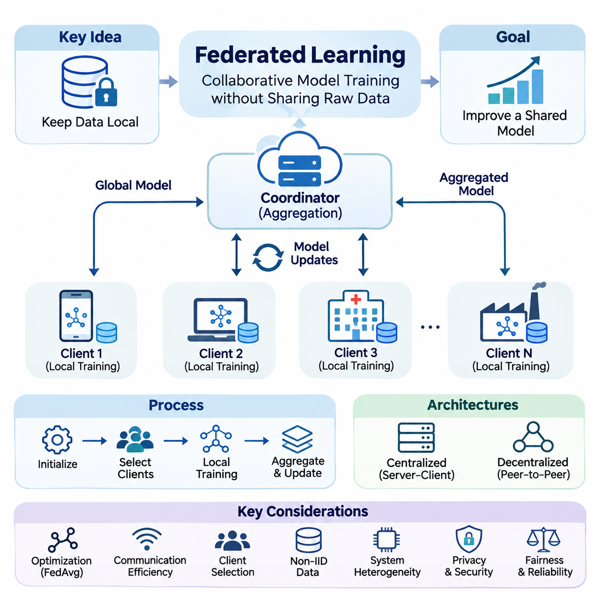
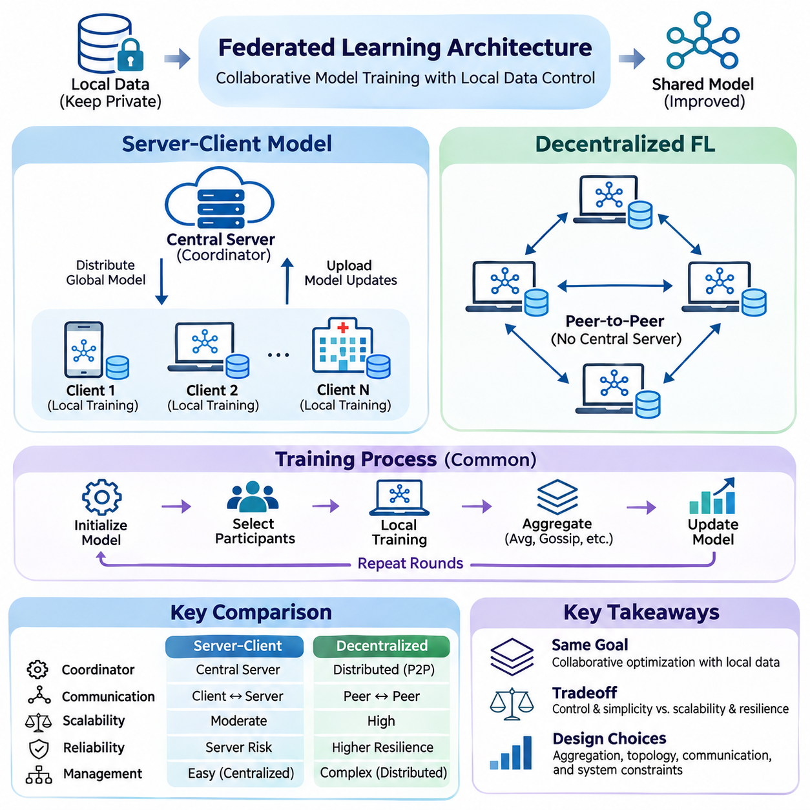
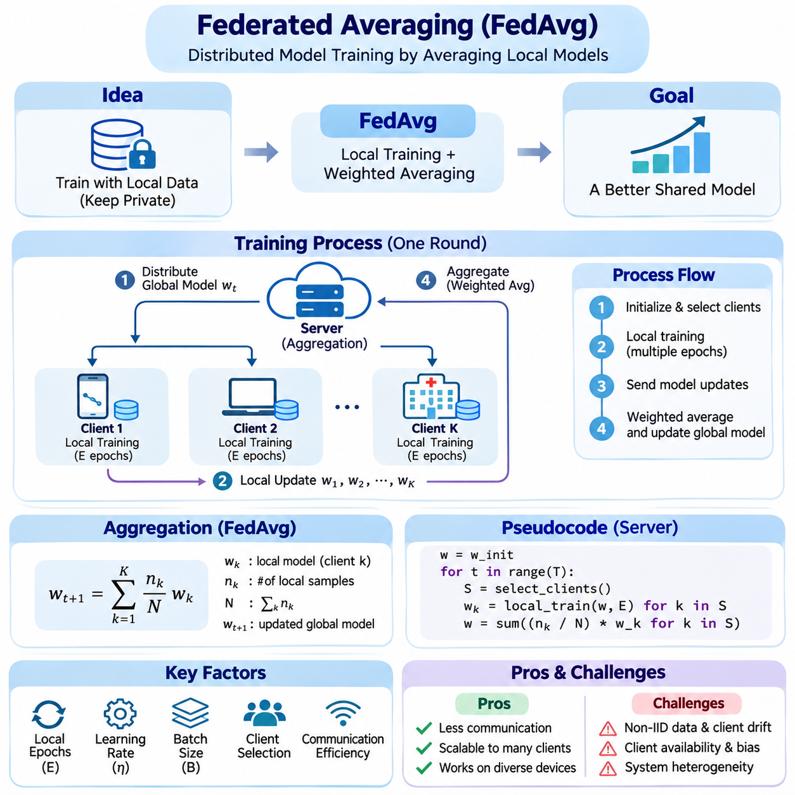
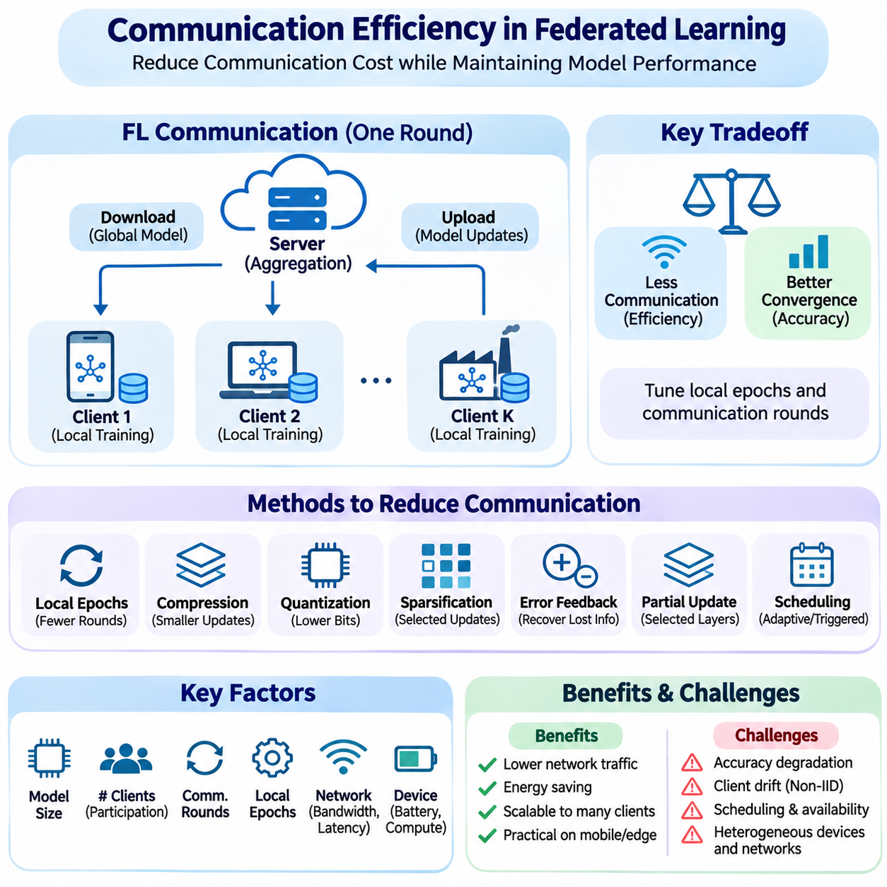
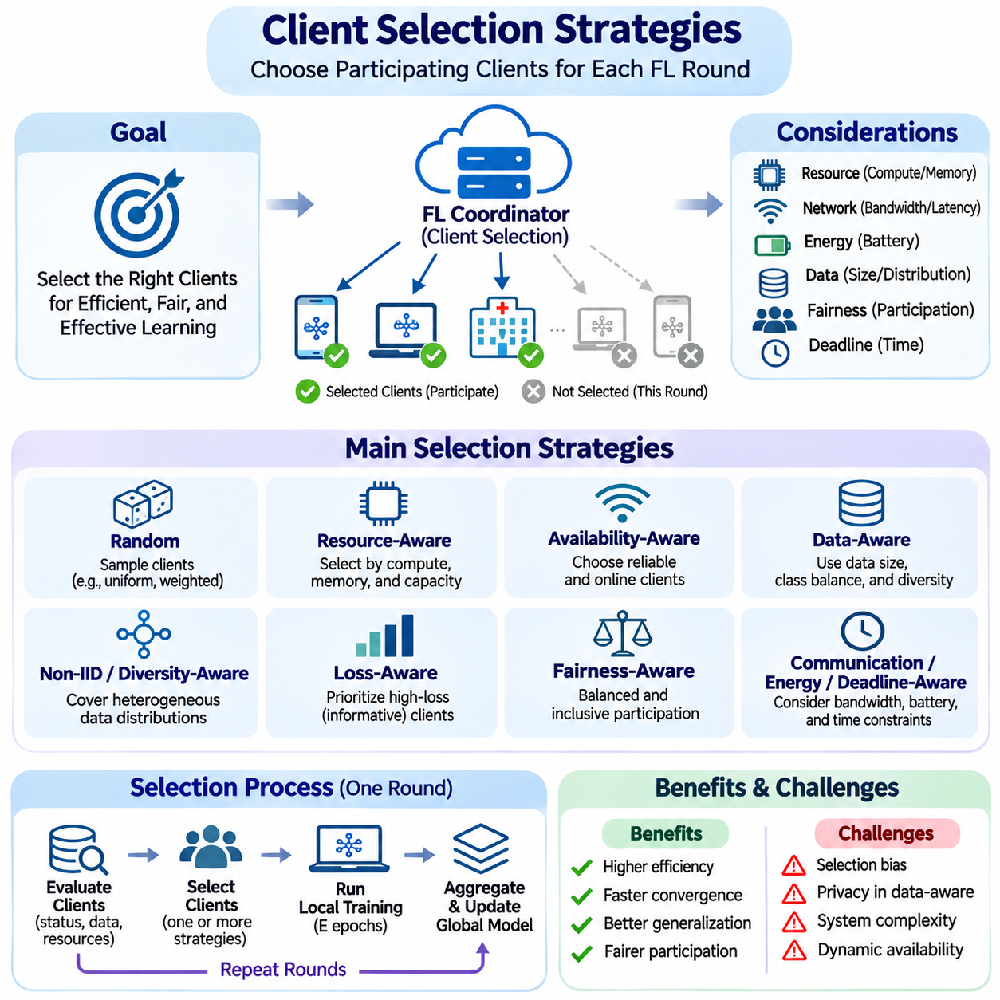
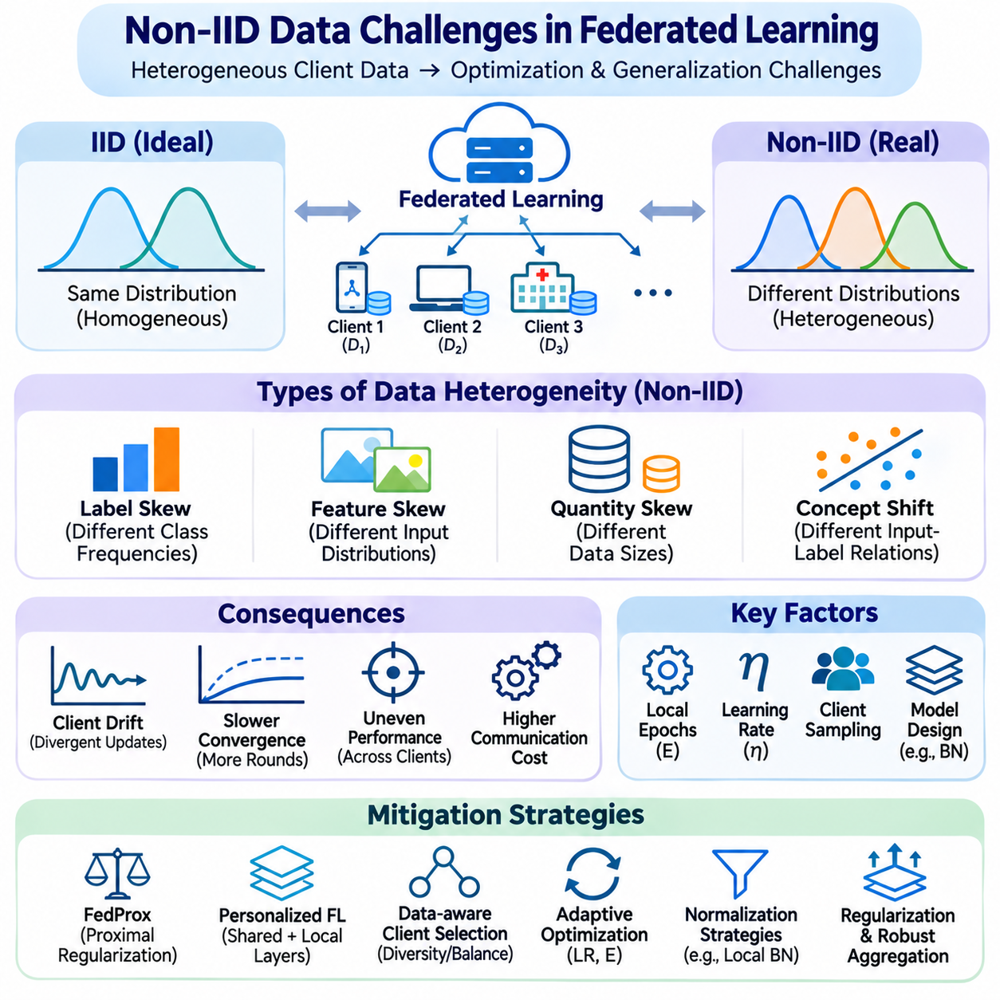
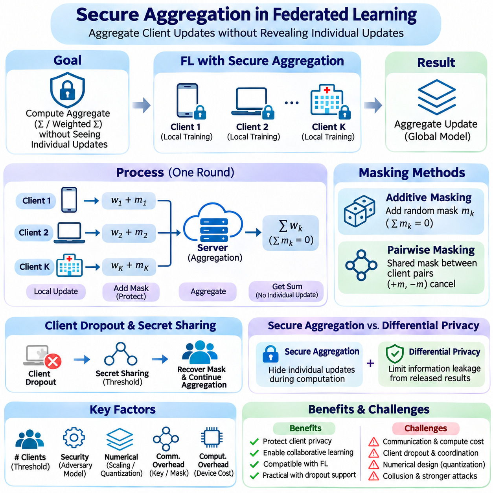
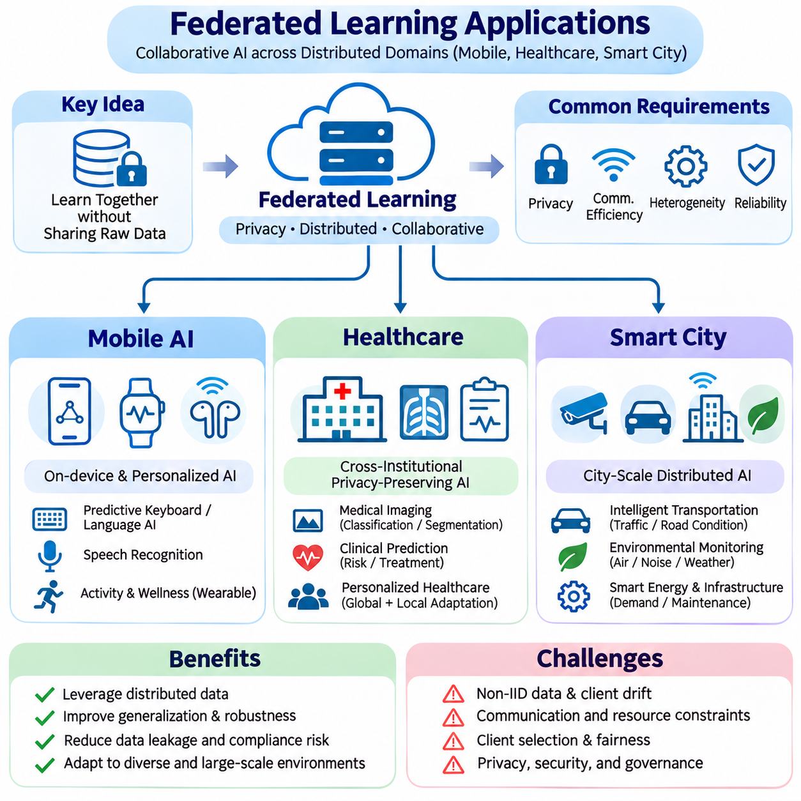

**Volume 40.** **TinyML and Federated Learning**

# 02. Federated Learning

## 02.00 Overview

{width="7.268055555555556in" height="7.268055555555556in"}

연합학습(Federated Learning, FL)은 여러 장치(Device), 조직(Organization) 또는 컴퓨팅 노드(Computational Node)가 원본 데이터셋(Raw Dataset)을 중앙 저장소(Central Repository)로 전송하지 않고 공동으로 공유 모델(Shared Model)을 학습하는 분산 기계학습(Distributed Machine Learning) 패러다임이다. 원본 데이터를 수집하는 대신 참여 클라이언트(Client)가 로컬 최적화(Local Optimization)를 수행하고 모델 업데이트(Model Update)를 집계 메커니즘(Aggregation Mechanism)과 교환한다. 이러한 접근법은 중앙 집중식 데이터 수집과 관련된 거버넌스(Governance) 문제를 줄이면서 협력적 지능(Collaborative Intelligence)을 지원한다.

전통적인 중앙 집중식 기계학습(Centralized Machine Learning)은 학습 데이터셋(Training Dataset)을 공통 컴퓨팅 환경(Common Computing Environment)에 수집하고 표준화하여 처리할 수 있다고 가정한다. 그러나 현대 인공지능(AI) 시스템은 스마트폰(Smartphone), 웨어러블 장치(Wearable Device), 산업용 센서(Industrial Sensor), 병원(Hospital), 자율주행 기계(Autonomous Machine) 등으로 확장되고 있다. 이러한 환경의 데이터는 지리적으로 분산되어 있거나 상업적으로 민감하며 규제상의 제약을 받을 수 있다. 연합학습은 모델 연산(Model Computation)을 분산된 데이터 소스(Data Source) 가까이로 이동시켜 이러한 제약을 해결한다.

연합학습의 기본 원리는 데이터 소유권(Data Ownership)과 협력적 모델 최적화(Collaborative Model Optimization)를 분리하는 것이다. 각 참여 클라이언트는 자체 로컬 데이터셋(Local Dataset)을 유지하면서 초기 모델(Initial Model) 또는 동기화된 모델 매개변수(Model Parameter)를 전달받는다. 로컬 학습(Local Training)은 공유 학습 목표(Shared Learning Objective)에 기여하는 매개변수 변경(Parameter Change)이나 기울기(Gradient)를 생성한다. 조정 메커니즘(Coordination Mechanism)은 이러한 기여를 결합하여 개별 학습 기록에 직접 접근하지 않고도 전역 모델(Global Model)을 개선한다.

일반적인 연합학습 프로세스(Federated Learning Process)는 모델 초기화(Model Initialization)와 참여자 등록(Participant Registration)으로 시작된다. 조정 서버(Coordinating Server)는 선택된 클라이언트에 현재 전역 모델을 배포하며, 각 클라이언트는 사용 가능한 컴퓨팅 자원(Computing Resource)을 활용하여 로컬 학습을 수행한다. 지정된 최적화 단계(Optimization Step)가 완료되면 클라이언트는 모델 업데이트를 조정 서버로 전송한다. 서버는 유효한 기여를 집계하고 이후 통신 라운드(Communication Round)에서 갱신된 전역 모델을 배포한다.

연합학습 아키텍처(Federated Learning Architecture)는 중앙 집중식 조정(Centralized Coordination) 또는 탈중앙화 협력(Decentralized Collaboration)을 중심으로 구성할 수 있다. 서버-클라이언트 모델(Server-Client Model)에서는 중앙 서버가 참여자 선택, 모델 배포, 집계 및 학습 진행을 관리한다. 탈중앙화 연합학습(Decentralized Federated Learning)은 단일 조정 서버를 피어 투 피어 통신(Peer-to-Peer Communication)이나 분산 합의 메커니즘(Distributed Consensus Mechanism)으로 대체한다. 이러한 대안은 확장성(Scalability), 동기화(Synchronization), 장애 허용성(Fault Tolerance), 통신 복잡성(Communication Complexity) 및 운영 제어 측면에서 서로 다른 절충 관계(Tradeoff)를 형성한다.

연합학습의 수학적 목표(Mathematical Objective)는 일반적으로 클라이언트별 손실 함수(Client-Specific Loss Function)의 가중 결합(Weighted Combination)을 최소화하는 것으로 표현된다. 각 클라이언트는 자체 데이터셋을 사용하여 로컬 목적 함수(Local Objective Function)를 평가하며, 전역 최적화(Global Optimization)는 참여 집단 전체에서 효과적으로 작동하는 매개변수를 찾는다. 클라이언트의 기여도는 로컬 샘플 수(Local Sample Count)에 따라 가중되는 경우가 많지만, 공정성(Fairness), 신뢰성(Reliability) 또는 애플리케이션 중요도의 차이를 고려하는 대안적인 가중 전략(Weighting Strategy)도 활용할 수 있다.

연합 평균화(Federated Averaging, FedAvg)는 분산 모델 학습(Distributed Model Training)을 위한 기본적인 최적화 전략(Optimization Strategy)을 제공한다. 참여 클라이언트는 갱신된 모델 매개변수를 전송하기 전에 여러 단계의 로컬 확률적 경사하강법(Stochastic Gradient Descent, SGD)을 수행한다. 이후 조정 서버는 수신된 매개변수의 가중 평균(Weighted Average)을 계산한다. 이 절차는 모든 최적화 단계마다 기울기를 교환하는 방식보다 통신 빈도를 줄이지만, 수렴(Convergence)은 데이터 이질성(Data Heterogeneity)과 로컬 학습 동작(Local Training Behavior)에 영향을 받는다.

통신 효율성(Communication Efficiency)은 참여 장치가 무선 네트워크(Wireless Network), 대역폭 제한 네트워크(Bandwidth-Limited Network) 또는 간헐적으로 연결되는 네트워크에서 작동하는 경우가 많기 때문에 핵심 엔지니어링 요구사항(Engineering Requirement)이 된다. 대규모 신경망(Neural Network) 매개변수를 반복적으로 전송하면 상당한 지연시간(Latency), 에너지 소비(Energy Consumption) 및 운영 비용(Operational Cost)이 발생할 수 있다. 업데이트 압축(Update Compression), 양자화(Quantization), 희소화(Sparsification), 통신 빈도 감소 및 선택적 매개변수 교환(Selective Parameter Exchange)은 학습 성능을 유지하면서 네트워크 트래픽(Network Traffic)을 줄이는 데 활용된다.

클라이언트 선택(Client Selection)은 각 학습 라운드(Training Round)에 참여할 대상을 결정하며 시스템 성능(System Performance)에 큰 영향을 미친다. 사용 가능한 클라이언트는 처리 능력(Processing Capability), 메모리 용량(Memory Capacity), 배터리 수준(Battery Level), 네트워크 연결성(Network Connectivity) 및 데이터셋 특성(Dataset Characteristics)이 서로 다를 수 있다. 무작위 샘플링(Random Sampling)은 간단한 참여 메커니즘을 제공하는 반면, 자원 인식(Resource-Aware) 및 가용성 인식(Availability-Aware) 전략은 실행 효율성(Execution Efficiency)을 개선할 수 있다. 선택 정책(Selection Policy)은 고성능 장치를 반복적으로 우대할 때 통계적 편향(Statistical Bias)이 발생하는지도 고려해야 한다.

연합학습의 가장 중요한 과제 중 하나는 비독립 동일분포(Non-Independent and Identically Distributed, Non-IID) 데이터의 존재이다. 클라이언트 데이터셋은 서로 다른 인구 집단(Population), 환경(Environment), 행동(Behavior) 또는 운영 조건(Operating Condition)을 나타내는 경우가 많다. 따라서 로컬 최적화 방향(Local Optimization Direction)이 서로 충돌하면서 클라이언트 드리프트(Client Drift)와 불안정한 수렴(Unstable Convergence)이 발생할 수 있다. 효과적인 연합 최적화(Federated Optimization)는 통계적 이질성(Statistical Heterogeneity)을 수용하면서 유용한 공유 표현(Shared Representation)을 유지하고 주요 참여자에 대한 과도한 특화(Specialization)를 방지해야 한다.

데이터 이질성(Data Heterogeneity)은 특징 분포(Feature Distribution), 레이블 빈도(Label Frequency), 샘플 수(Sample Quantity), 입력과 목표 출력 사이의 관계 차이에서 발생할 수 있다. 스마트폰은 사용자에게 특화된 언어 패턴(Language Pattern)을 관찰할 수 있으며, 산업용 센서는 특정 기계의 작동 조건과 관련된 데이터를 기록할 수 있다. 이러한 차이는 모든 로컬 업데이트가 전역 일반화(Global Generalization)에 동일하게 기여한다는 가정을 복잡하게 만든다. 개인화 학습(Personalized Learning)과 이질성 인식 최적화(Heterogeneity-Aware Optimization)는 이러한 문제에 대응하는 상호 보완적인 접근법을 제공한다.

연합학습은 클라이언트가 서로 다른 하드웨어(Hardware) 및 소프트웨어(Software) 제약 아래에서 작동하기 때문에 시스템 이질성(Systems Heterogeneity)도 발생시킨다. 일부 참여자는 고성능 그래픽 처리 장치(Graphics Processing Unit, GPU)나 전용 인공지능 가속기(AI Accelerator)를 사용하지만, 다른 참여자는 저전력 프로세서(Low-Power Processor)와 제한된 메모리에 의존한다. 연산 속도와 네트워크 신뢰성의 차이는 업데이트 지연(Delayed Update), 불완전한 학습 라운드(Incomplete Training Round) 또는 참여자 장애(Participant Failure)를 유발할 수 있다. 견고한 오케스트레이션 메커니즘(Orchestration Mechanism)은 동기화 요구사항과 실제 장치 가용성 사이의 균형을 유지해야 한다.

동기식 연합학습(Synchronous Federated Learning)은 일반적으로 지정된 클라이언트 업데이트가 수집될 때까지 기다린 후 집계를 완료한다. 이 접근법은 비교적 명확한 학습 라운드 경계를 제공하지만, 일반적으로 스트래글러(Straggler)라고 불리는 느린 참여자로 인해 성능이 저하될 수 있다. 비동기식 접근법(Asynchronous Approach)은 서로 다른 시점에 업데이트를 수용하여 자원 활용률(Resource Utilization)을 높이고 대기시간(Waiting Time)을 줄일 수 있다. 그러나 오래된 매개변수(Stale Parameter)와 일치하지 않는 모델 버전(Model Version)은 최적화 불안정성을 유발하고 재현성(Reproducibility)을 복잡하게 만들 수 있다.

개인정보 보호(Privacy)는 연합학습의 중요한 도입 동기이지만, 원본 데이터셋을 로컬에 유지하는 것만으로 기밀성(Confidentiality)이 자동으로 보장되지는 않는다. 모델 기울기와 매개변수 업데이트는 특정 공격 조건(Attack Condition)에서 학습 예제(Training Example)에 관한 정보를 노출할 수 있다. 악의적인 참여자(Malicious Participant)나 침해된 인프라(Compromised Infrastructure)는 추론(Inference), 재구성(Reconstruction) 또는 조작(Manipulation)을 시도할 수도 있다. 따라서 실제 연합 시스템에는 추가적인 개인정보 보호 제어(Privacy Control), 인증된 통신(Authenticated Communication), 접근 관리(Access Management) 및 명확하게 정의된 위협 모델(Threat Model)이 필요하다.

보안 집계(Secure Aggregation)는 조정 서버가 개별 업데이트를 확인할 수 있는 범위를 제한하면서 클라이언트의 기여를 결합하는 메커니즘을 제공한다. 암호화 프로토콜(Cryptographic Protocol)을 사용하면 서버가 보호된 개별 기여를 직접 관찰하지 않고 집계 결과(Aggregated Result)를 복원할 수 있다. 이러한 기술은 명시된 보안 가정(Security Assumption) 아래에서 기밀성을 강화하지만, 연산 오버헤드(Computational Overhead), 통신 요구사항 및 운영 복잡성(Operational Complexity)을 증가시킨다. 효과성은 참여자의 행동과 프로토콜 구현(Protocol Implementation)에도 영향을 받는다.

연합학습은 차등 개인정보 보호(Differential Privacy), 보안 다자간 계산(Secure Multiparty Computation), 동형암호(Homomorphic Encryption)와 같은 개인정보 보호 기술(Privacy-Preserving Technology)과 밀접하게 관련되어 있다. 이러한 기술은 서로 다른 보안 목표(Security Objective)를 다루며 시스템 요구사항에 따라 결합할 수 있다. 차등 개인정보 보호는 제어된 무작위화(Controlled Randomization)를 통해 특정 정보 공개 위험(Information Disclosure Risk)에 수학적 한계를 설정할 수 있으며, 암호화 기술은 연산이나 통신을 보호한다. 이들을 통합하려면 개인정보 보호 보장(Privacy Guarantee), 모델 정확도(Model Accuracy), 자원 소비(Resource Consumption) 및 위협 가정(Threat Assumption)을 명시적으로 평가해야 한다.

보안 문제(Security Challenge)는 기밀성을 넘어 데이터 포이즈닝(Data Poisoning), 모델 포이즈닝(Model Poisoning), 악의적 업데이트(Malicious Update), 무단 참여(Unauthorized Participation)까지 확장된다. 공격자는 전체 정확도를 저하시키거나 특정 목표 행동(Targeted Behavior)을 삽입하거나 집계 과정을 방해할 수 있다. 방어 메커니즘(Defensive Mechanism)에는 참여자 인증(Participant Authentication), 업데이트 검증(Update Validation), 이상 탐지(Anomaly Detection), 강건한 집계(Robust Aggregation), 통제된 모델 배포(Controlled Model Release)가 포함된다. 단일 방어 기술이 모든 적대적 전략(Adversarial Strategy)에 대한 보호를 보장하지는 않으므로 계층적 보안(Layered Security)과 지속적인 평가(Continuous Evaluation)가 필수적이다.

모바일 인공지능(Mobile AI)은 스마트폰과 개인용 장치가 대량의 사용자별 정보(User-Specific Information)를 생성하기 때문에 연합학습의 주요 응용 분야(Application Domain)이다. 연합학습은 원본 사용자 기록의 중앙 집중화를 제한하면서 예측 키보드(Predictive Keyboard), 추천 시스템(Recommendation System), 활동 인식(Activity Recognition), 개인화된 상호작용 모델(Personalized Interaction Model)을 지원할 수 있다. 그러나 배포(Deployment) 과정에서는 배터리 소비, 백그라운드 실행 제한(Background Execution Restriction), 네트워크 가용성 및 사용자 동의(User Consent)를 고려해야 한다. 학습 일정(Training Schedule)은 일반적으로 장치의 작동 조건에 맞춰 조정된다.

의료(Healthcare)는 의료 데이터셋(Medical Dataset)이 병원, 연구소 및 연구기관에 분산되어 있는 경우가 많기 때문에 또 다른 중요한 적용 환경이다. 연합학습을 활용하면 모든 기관이 환자 기록(Patient Record)을 공유 데이터베이스(Shared Database)로 전송하지 않고도 진단 모델(Diagnostic Model), 예측 모델(Predictive Model), 분석 모델(Analytical Model)을 공동 개발할 수 있다. 그러나 임상 집단(Clinical Population), 데이터 획득 장비(Acquisition Equipment), 레이블링 표준(Labeling Standard), 기관별 운영 관행(Institutional Practice)의 차이는 모델 신뢰성(Model Reliability)에 상당한 영향을 줄 수 있다. 개인정보 보호, 거버넌스 및 외부 검증(External Validation)은 여전히 필요하다.

스마트 시티(Smart City) 애플리케이션은 연합학습을 활용하여 교통 인프라(Traffic Infrastructure), 환경 센서(Environmental Sensor), 커넥티드 차량(Connected Vehicle), 도시 모니터링 시스템(Municipal Monitoring System) 사이의 지능을 조정할 수 있다. 분산된 참여자는 교통 패턴(Traffic Pattern), 에너지 소비, 장비 상태(Equipment Condition), 환경 변화(Environmental Change)에 관한 정보를 제공할 수 있다. 협력 학습(Collaborative Learning)은 중앙 집중식 원본 데이터 수집에 대한 의존도를 줄이면서 공유 분석 능력(Shared Analytical Capability)을 개선할 수 있다. 실제 배포에는 신뢰할 수 있는 네트워킹(Networking), 상호운용 가능한 데이터 표현(Interoperable Data Representation), 변화하는 도시 환경을 처리하는 메커니즘이 필요하다.

연합학습과 초소형 기계학습(Tiny Machine Learning, TinyML)의 관계는 참여 클라이언트가 자원 제약형 임베디드 장치(Resource-Constrained Embedded Device)일 때 특히 중요해진다. TinyML은 엄격한 메모리, 처리 능력 및 전력 예산(Power Budget) 아래에서 효율적인 추론(Inference)과 연산을 강조하는 반면, 연합학습은 분산 데이터 소스 전반의 학습을 조정한다. 두 접근법을 결합하면 일부 엣지 장치(Edge Device)가 협력적 적응(Collaborative Adaptation)에 참여할 수 있지만, 로컬 학습은 자원이 극도로 제한된 마이크로컨트롤러(Microcontroller)의 처리 능력을 초과할 수 있다.

온디바이스 학습(On-Device Learning)은 모델 업데이트가 원본 데이터 근처에서 생성되어야 하므로 많은 연합학습 애플리케이션의 컴퓨팅 기반(Computational Foundation)을 제공한다. 장치는 사용 가능한 자원에 따라 전체 모델(Complete Model), 선택된 계층(Selected Layer), 경량 어댑터(Compact Adapter) 또는 기타 매개변수 효율적 구성요소(Parameter-Efficient Component)를 학습할 수 있다. 로컬 적응(Local Adaptation)은 변화하는 조건에 대한 대응성을 개선하며, 주기적인 연합 과정(Periodic Federation)은 참여자 사이에서 선택된 지식을 전달한다. 전역 일반화와 개별 개인화(Individual Personalization) 사이의 균형은 중요한 아키텍처 설계 결정(Architectural Decision)이 된다.

연합학습 평가(Federated Learning Evaluation)는 중앙 집중식 테스트 데이터셋(Centralized Test Dataset)에서 예측 정확도(Predictive Accuracy)를 측정하는 것만으로 충분하지 않다. 관련 평가 지표(Evaluation Metric)에는 수렴 속도(Convergence Speed), 통신량(Communication Volume), 학습 지연시간(Training Latency), 클라이언트 참여율(Client Participation), 에너지 소비 및 클라이언트 간 성능 편차(Performance Variation)가 포함된다. 개인정보 보호 보장과 악의적 행동에 대한 복원력(Resilience)도 별도의 평가 절차가 필요할 수 있다. 실험 결과는 모델 수준의 개선(Model-Level Improvement)과 시스템 수준의 효율성(System-Level Efficiency)을 구분하고 참여 데이터셋의 통계적 특성을 반영해야 한다.

재현성(Reproducibility)은 연합학습 실험이 클라이언트 샘플링(Client Sampling), 데이터 분할(Data Partitioning), 네트워크 조건(Network Condition), 무작위 초기화(Random Initialization), 이질적인 실행 환경(Heterogeneous Execution Environment)에 의존하기 때문에 추가적인 어려움을 가진다. 동일한 모델 아키텍처(Model Architecture)를 사용하는 두 실험도 클라이언트 가용성이나 로컬 데이터셋 분포가 달라지면 서로 다른 결과를 생성할 수 있다. 따라서 신뢰할 수 있는 벤치마킹(Benchmarking)에는 문서화된 데이터 분할 절차, 통제된 난수 시드(Random Seed), 투명한 집계 설정(Aggregation Setting), 일관된 통신 및 연산 비용 보고가 필요하다.

성공적인 연합학습 배포는 기계학습 알고리즘(Machine Learning Algorithm)을 분산 시스템 엔지니어링(Distributed Systems Engineering) 및 운영 거버넌스(Operational Governance)와 통합하는 데 달려 있다. 모델 버전 관리(Model Versioning), 참여자 신원 관리(Participant Identity Management), 안전한 업데이트 전송(Secure Update Transport), 장애 복구(Failure Recovery), 모니터링(Monitoring), 롤백 절차(Rollback Procedure)가 함께 작동해야 한다. 운영 시스템(Production System)에는 참여 자격(Participation Eligibility), 데이터 보존(Data Retention), 소프트웨어 업데이트(Software Update), 공유 모델에 대한 책임(Responsibility)을 규정하는 정책도 필요하다. 이러한 요구사항은 연합학습이 단순한 학습 알고리즘을 넘어 아키텍처 차원의 역량(Architectural Capability)임을 보여준다.

연합학습의 더 넓은 의미는 독립적으로 관리되는 컴퓨팅 환경(Computational Environment) 전반에서 협력적 지능을 구현할 수 있다는 데 있다. 분산 데이터를 효율적으로 중앙 집중화하기 어렵거나 중앙 수집이 적절하지 않지만, 참여 시스템이 공유 모델 개선(Shared Model Improvement)을 통해 이점을 얻을 수 있을 때 그 가치가 나타난다. 향후 발전은 연합 최적화를 엣지 기반 모델(Edge Foundation Model), 개인화 인공지능(Personalized AI), 효율적인 임베디드 학습(Efficient Embedded Learning), 탈중앙화 인프라(Decentralized Infrastructure)와 더욱 긴밀하게 연결할 것이다. 동시에 보안(Security), 공정성(Fairness), 확장성(Scalability), 측정 가능한 시스템 성능(Measurable System Performance)에 대한 엄격한 고려가 지속적으로 요구된다.

## 02.01 FL Architecture

{width="7.268055555555556in" height="7.268055555555556in"}

연합학습 아키텍처(Federated Learning Architecture)는 분산된 참여자(Distributed Participant)가 로컬 데이터셋(Local Dataset)에 대한 통제권을 유지하면서 모델 학습(Model Training)을 조정하는 방식을 정의한다. 이러한 설계는 모델이 배포되는 방식, 업데이트가 교환되는 방식, 협력적 최적화(Collaborative Optimization)가 진행되는 방식을 결정한다. 두 가지 기본적인 접근법은 서버-클라이언트 모델(Server-Client Model)과 탈중앙화 연합학습(Decentralized Federated Learning)이며, 각각 통신(Communication), 집계(Aggregation), 동기화(Synchronization), 운영 거버넌스(Operational Governance)에 서로 다른 메커니즘을 제공한다.

연합학습의 아키텍처 기반(Architectural Foundation)은 로컬 연산(Local Computation)과 전역 지식 통합(Global Knowledge Integration)을 분리하는 것이다. 참여 장치나 기관은 자체 학습 데이터(Training Data)를 유지하고 로컬에서 사용 가능한 자원(Local Resource)을 활용하여 최적화를 수행한다. 원본 데이터셋(Raw Dataset)을 전송하는 대신 모델 매개변수(Model Parameter), 기울기(Gradient) 또는 압축된 업데이트(Compressed Update)를 교환한다. 조정 구조(Coordination Structure)는 이러한 기여를 결합하는 방법과 갱신된 모델 상태(Model State)가 분산 학습 환경(Distributed Learning Environment) 전체에 전파되는 방식을 결정한다.

서버-클라이언트 모델(Server-Client Model)에서는 중앙 조정 서버(Central Coordinating Server)가 전체 학습 프로세스(Training Process)를 관리하고 여러 클라이언트(Client)가 로컬 모델 최적화(Local Model Optimization)를 수행한다. 서버는 전역 모델(Global Model)을 초기화하고 적격 참여자를 선택하며 매개변수를 배포하고 학습 결과를 수집한다. 클라이언트는 독립적으로 자체 데이터셋을 처리하고 사전에 정의된 통신 프로토콜(Communication Protocol)에 따라 업데이트를 반환한다. 이러한 아키텍처는 중앙 집중식 오케스트레이션(Centralized Orchestration)과 분산 데이터 처리(Decentralized Data Processing) 사이의 명확한 역할 분리를 제공한다.

일반적인 서버-클라이언트 학습 라운드(Server-Client Training Round)는 조정 서버가 선택된 클라이언트에 현재 전역 모델을 배포하면서 시작된다. 각 클라이언트는 수신한 매개변수를 사용하여 로컬 모델(Local Model)을 초기화하고 비공개 학습 데이터(Private Training Data)에 대해 여러 최적화 단계(Optimization Step)를 수행한다. 로컬 연산이 완료되면 참여 클라이언트는 갱신된 매개변수나 기울기를 전송한다. 서버는 이러한 기여를 집계하여 이후 학습 라운드에 사용할 수정된 전역 모델을 생성한다.

연합 평균화(Federated Averaging, FedAvg)는 서버-클라이언트 아키텍처에서 널리 사용되는 집계 전략(Aggregation Strategy)이다. 이 방법은 일반적으로 각 클라이언트의 학습 샘플 수(Training Sample Count)를 기준으로 가중 평균(Weighted Averaging)을 계산하여 로컬에서 학습된 모델 매개변수를 결합한다. 이러한 접근법은 통신 라운드 사이에 여러 로컬 최적화 단계를 수행할 수 있도록 하여 동기화 빈도(Synchronization Frequency)를 줄인다. 그러나 클라이언트 간 데이터 분포(Data Distribution)와 학습 작업량(Training Workload)의 차이는 수렴 안정성(Convergence Stability)에 영향을 줄 수 있다.

중앙 집중식 조정(Centralized Coordination)은 모델 버전 관리(Model Version Management), 참여자 등록(Participant Registration), 학습 일정(Training Schedule), 성능 모니터링(Performance Monitoring)을 단순화한다. 조정 서버는 일관된 집계 정책(Aggregation Policy)을 적용하고 완료된 학습 라운드의 기록을 유지할 수 있다. 또한 인증(Authentication), 통신 보안(Communication Security), 배포 절차(Deployment Procedure)를 관리할 수 있다. 이러한 기능은 서버-클라이언트 아키텍처를 표준화된 운영(Standardized Operation)과 중앙 집중식 관리 책임(Centralized Administrative Accountability)이 필요한 환경에 적합하게 만든다.

이러한 장점에도 불구하고 조정 서버는 확장성(Scalability)과 신뢰성(Reliability) 측면에서 잠재적인 한계를 발생시킨다. 대규모 클라이언트 집단(Client Population)은 상당한 통신 트래픽(Communication Traffic), 집계 작업량(Aggregation Workload), 동기화 지연(Synchronization Delay)을 유발할 수 있다. 서버 장애(Server Outage)는 학습을 중단시킬 수 있으며, 집중된 인프라(Infrastructure)는 중요한 보안 공격 대상(Security Target)이 된다. 실제 구현에서는 확장 가능한 통신 서비스(Scalable Communication Service), 이중화된 조정 구성요소(Redundant Coordination Component), 계층적 집계(Hierarchical Aggregation), 장애 복구 메커니즘(Fault Recovery Mechanism)을 통해 이러한 문제를 해결한다.

클라이언트 가용성(Client Availability)은 서버-클라이언트 시스템의 또 다른 주요 과제이다. 모바일 장치(Mobile Device), 임베디드 컨트롤러(Embedded Controller), 원격 센서(Remote Sensor)는 변화하는 네트워크 조건(Network Condition), 제한된 배터리 용량(Battery Capacity), 경쟁적인 연산 작업(Computational Workload)의 영향을 받을 수 있다. 일부 참여자는 학습을 빠르게 완료하지만 다른 참여자는 업데이트를 제출하기 전에 연결이 끊어질 수 있다. 클라이언트 선택(Client Selection), 타임아웃 정책(Timeout Policy), 부분 참여(Partial Participation), 비동기 집계(Asynchronous Aggregation)는 이러한 변동이 운영에 미치는 영향을 줄일 수 있다.

탈중앙화 연합학습(Decentralized Federated Learning)은 참여자가 모델 정보를 직접 교환하도록 하여 단일 중앙 집계 서버(Central Aggregation Server)에 대한 요구사항을 제거한다. 각 노드(Node)는 자체 모델 상태(Model State)를 유지하고 피어 투 피어 연결(Peer-to-Peer Connection)을 통해 선택된 인접 노드(Neighboring Node)와 통신한다. 협력적 최적화(Collaborative Optimization)는 반복적인 로컬 학습(Local Training)과 분산 정보 교환(Distributed Information Exchange)을 통해 이루어진다. 이러한 아키텍처는 조정 책임(Coordination Responsibility)을 하나의 관리 구성요소에 집중시키지 않고 네트워크 전체에 분산한다.

탈중앙화 연합학습의 통신 토폴로지(Communication Topology)는 어떤 참여자들이 업데이트를 교환할 수 있는지와 정보가 전파되는 방식을 결정한다. 노드는 링 구조(Ring Structure), 메시 네트워크(Mesh Network), 계층적 오버레이(Hierarchical Overlay) 또는 동적으로 변화하는 통신 그래프(Communication Graph)를 통해 연결될 수 있다. 각 토폴로지는 통신 오버헤드(Communication Overhead), 수렴 속도(Convergence Speed), 장애 허용성(Fault Tolerance), 네트워크 복원력(Network Resilience) 측면에서 서로 다른 특성을 나타낸다. 따라서 연결 패턴(Connectivity Pattern)은 단순한 구현 세부사항이 아니라 학습 알고리즘(Learning Algorithm)의 핵심 구성요소가 된다.

탈중앙화 최적화(Decentralized Optimization)는 일반적으로 이웃 평균화(Neighborhood Averaging), 가십 기반 통신(Gossip-Based Communication) 또는 분산 합의 메커니즘(Distributed Consensus Mechanism)에 의존한다. 참여자는 로컬 학습을 수행한 후 인접 노드와 매개변수를 교환하고 수신한 정보를 자신의 모델 상태와 결합한다. 반복적인 교환은 학습된 정보를 네트워크 전체에 점진적으로 전파한다. 그 결과는 통신 빈도(Communication Frequency), 혼합 가중치(Mixing Weight), 네트워크 연결성(Network Connectivity), 로컬 데이터셋의 통계적 특성(Statistical Property)에 따라 달라진다.

가십 기반 학습(Gossip-Based Learning)은 모든 참여자가 다른 모든 노드와 통신하지 않고도 정보를 전파할 수 있도록 한다. 각 교환 과정에서 노드는 사전 정의되거나 적응형 정책(Adaptive Policy)에 따라 선택된 제한된 수의 인접 노드와 모델 업데이트(Model Update)를 공유한다. 연속적인 반복(Iteration)을 통해 정보는 통신 그래프 전체로 확산된다. 이러한 접근법은 중앙 집중식 통신 병목현상(Centralized Communication Bottleneck)을 줄일 수 있지만, 불완전한 연결성(Incomplete Connectivity)과 불규칙한 정보 교환(Irregular Exchange)은 수렴을 지연시킬 수 있다.

합의 기반 접근법(Consensus-Based Approach)은 로컬 최적화를 지속하면서 분산된 모델 상태를 일치시키는 것을 목표로 한다. 참여자는 인접 노드의 정보를 반복적으로 결합하여 매개변수 사이의 불일치(Disagreement)를 줄인다. 이 과정의 효과는 그래프 연결성(Graph Connectivity), 합의 가중치(Consensus Weight), 동기화 가정(Synchronization Assumption), 통신 신뢰성(Communication Reliability)에 따라 달라진다. 연결성이 낮은 네트워크(Poorly Connected Network)는 정보 전파 속도가 느릴 수 있으며, 빠르게 변화하는 토폴로지에서는 안정적인 학습 동작을 유지할 수 있는 알고리즘이 필요하다.

탈중앙화 아키텍처(Decentralized Architecture)는 단일 집계 구성요소가 필요하지 않기 때문에 개별 조정 서버의 장애에 대한 복원력(Resilience)을 향상시킬 수 있다. 일부 노드를 사용할 수 없게 되더라도 남아 있는 통신 그래프가 충분한 연결성을 유지하면 참여자는 업데이트 교환을 계속할 수 있다. 그러나 탈중앙화가 장애 위험(Failure Risk)을 자동으로 제거하는 것은 아니다. 네트워크 분할(Network Partition), 침해된 피어(Compromised Peer), 일치하지 않는 모델 버전(Inconsistent Model Version), 악의적인 통신(Malicious Communication)은 여전히 협력적 최적화를 방해할 수 있다.

보안(Security)과 개인정보 보호(Privacy) 요구사항은 중앙 집중식 구조와 탈중앙화 구조에서 서로 다르게 나타난다. 서버-클라이언트 시스템은 집계 권한(Aggregation Authority)을 조정 서버에 집중시키는 반면, 탈중앙화 시스템은 통신과 신뢰 관계(Trust Relationship)를 피어 사이에 분산한다. 어느 아키텍처도 개인정보 보호를 본질적으로 보장하지는 않으며, 교환되는 기울기와 매개변수가 민감한 정보(Sensitive Information)를 노출할 수 있다. 보안 통신(Secure Communication), 인증된 참여(Authenticated Participation), 개인정보 보호 집계(Privacy-Preserving Aggregation), 적대적 공격 방어(Adversarial Defense)는 선택된 조정 모델에 맞게 설계되어야 한다.

비독립 동일분포(Non-Independent and Identically Distributed, Non-IID) 데이터는 두 아키텍처 모두에서 중요한 최적화 문제(Optimization Challenge)를 발생시킨다. 서버-클라이언트 시스템에서는 이질적인 로컬 업데이트(Heterogeneous Local Update)가 전역 모델 드리프트(Global Model Drift)나 불안정한 집계(Unstable Aggregation)를 유발할 수 있다. 탈중앙화 시스템에서는 인접 참여자의 데이터 분포가 크게 달라 지역적 모델 발산(Regional Model Divergence)이 발생할 수 있다. 개인화 최적화(Personalized Optimization), 적응형 혼합(Adaptive Mixing), 정규화(Regularization), 토폴로지 인식 학습(Topology-Aware Training)은 공유 지식 획득(Shared Knowledge Acquisition)과 로컬 특화(Local Specialization) 사이의 균형을 유지하는 데 도움이 된다.

통신 효율성(Communication Efficiency)은 연합학습이 엣지 장치(Edge Device)와 자원 제약형 네트워크(Resource-Constrained Network)에서 작동할 때 특히 중요하다. 서버-클라이언트 아키텍처는 클라이언트와 집계 인프라(Aggregation Infrastructure) 사이에서 반복적으로 발생하는 트래픽을 관리해야 하며, 탈중앙화 아키텍처는 피어 연결(Peer Connection)을 통해 통신을 분산한다. 업데이트 압축(Update Compression), 양자화(Quantization), 희소화(Sparsification), 선택적 통신(Selective Communication)은 전송 요구사항을 줄일 수 있다. 아키텍처 평가는 전체 네트워크 트래픽(Total Network Traffic), 장치 에너지 소비(Device Energy Consumption), 수렴 효율성(Convergence Efficiency)을 함께 고려해야 한다.

하이브리드 및 계층적 연합학습 아키텍처(Hybrid and Hierarchical Federated Learning Architecture)는 중앙 집중식 조정과 탈중앙화 조정의 요소를 결합한다. 로컬 클러스터(Local Cluster)는 업데이트를 상위 서버(Higher-Level Server)로 전달하기 전에 엣지 게이트웨이(Edge Gateway)를 통해 집계할 수 있다. 또는 인접 장치가 업데이트를 직접 교환하면서 중앙 조정 서버와 주기적으로 동기화할 수도 있다. 이러한 구조는 지리적으로 분산된 배포(Geographically Distributed Deployment)를 지원하며 통신 구조가 조직 경계(Organizational Boundary), 네트워크 조건, 사용 가능한 컴퓨팅 자원을 반영하도록 한다.

아키텍처 선택(Architecture Selection)은 보편적으로 우수한 조정 모델이 아니라 운영 요구사항(Operational Requirement)에 따라 결정된다. 서버-클라이언트 시스템은 명확한 관리 제어(Administrative Control)와 표준화된 집계(Standardized Aggregation)를 제공하는 반면, 탈중앙화 접근법은 분산 조정(Distributed Coordination)과 대안적인 복원력 특성(Resilience Characteristic)을 제공한다. 하이브리드 구조(Hybrid Structure)는 참여자가 클러스터로 구성된 경우 이러한 특성의 균형을 맞출 수 있다. 설계 결정에는 네트워크 토폴로지(Network Topology), 참여자 규모(Participant Scale), 데이터 이질성(Data Heterogeneity), 보안 가정(Security Assumption), 인프라 소유권(Infrastructure Ownership), 유지관리 복잡성(Maintenance Complexity)을 고려해야 한다.

모바일 인공지능(Mobile AI) 애플리케이션은 대규모 개인 장치 집단이 중앙에서 관리되는 학습 프로그램(Centrally Managed Training Program)에 참여할 수 있기 때문에 서버-클라이언트 조정의 이점을 얻는 경우가 많다. 산업용 사물인터넷(Industrial Internet of Things, Industrial IoT)과 로봇 시스템(Robotic System)은 장치가 엣지 게이트웨이에 연결된 로컬 네트워크(Local Network)에서 작동할 때 계층적 집계(Hierarchical Aggregation)의 이점을 얻을 수 있다. 탈중앙화 협력(Decentralized Collaboration)은 중앙 서버에 지속적으로 접근하기 어려운 자율 네트워크(Autonomous Network)에 적합할 수 있다. 각 배포 환경에서는 실제 통신 및 신뢰성 제약(Communication and Reliability Constraint)에 대한 검증이 필요하다.

연합학습과 초소형 기계학습(Tiny Machine Learning, TinyML)의 통합은 임베디드 참여자(Embedded Participant)가 제한된 메모리, 처리 능력 및 에너지 자원을 가질 수 있기 때문에 추가적인 아키텍처 고려사항(Architectural Consideration)을 발생시킨다. 일부 장치는 경량 로컬 최적화(Lightweight Local Optimization)를 실행할 수 있지만, 다른 장치는 추론(Inference)이나 부분적인 매개변수 업데이트(Partial Parameter Update)만 지원할 수 있다. 게이트웨이(Gateway)와 엣지 서버(Edge Server)는 중간 연산(Intermediate Computation) 및 집계 서비스를 제공할 수 있다. 효과적인 아키텍처 설계는 학습 책임(Learning Responsibility)을 각 참여 하드웨어 플랫폼(Hardware Platform)의 처리 능력에 맞춰 배분해야 한다.

연합학습 아키텍처 평가(Federated Learning Architecture Evaluation)는 예측 정확도(Predictive Accuracy)를 넘어서는 측정이 필요하다. 중요한 지표에는 수렴 동작(Convergence Behavior), 통신량(Communication Volume), 동기화 지연시간(Synchronization Latency), 클라이언트 참여율(Client Participation), 연산 오버헤드(Computational Overhead), 장애 복구 성능(Fault Recovery Performance)이 포함된다. 탈중앙화 시스템에서는 그래프 연결성(Graph Connectivity)과 합의 동작(Consensus Behavior)에 대한 추가 분석이 필요하다. 보안, 개인정보 보호, 공정성(Fairness), 모델 일관성(Model Consistency)은 실제적인 클라이언트 장애(Client Failure), 이질적인 데이터셋(Heterogeneous Dataset), 변화하는 네트워크 조건에서 평가되어야 한다.

궁극적으로 연합학습 아키텍처는 분산 컴퓨팅 환경(Distributed Computing Environment) 전반에서 협력적 지능(Collaborative Intelligence)이 조직되는 방식을 결정한다. 서버-클라이언트 조정(Server-Client Coordination)은 로컬 데이터 처리와 중앙 집중식 오케스트레이션(Centralized Orchestration)을 강조하는 반면, 탈중앙화 연합학습(Decentralized Federated Learning)은 연산과 조정을 참여 노드 전체에 분산한다. 이러한 아키텍처의 차이를 이해하는 것은 모바일 장치(Mobile Device), 산업 인프라(Industrial Infrastructure), 의료 네트워크(Healthcare Network), 자율 엣지 플랫폼(Autonomous Edge Platform)에서 작동하는 확장 가능하고 개인정보 보호를 고려한 자원 효율적 학습 시스템(Resource-Efficient Learning System)을 설계하는 기반이 된다.

## 02.02 Federated Averaging (FedAvg) [w/Code]

{width="7.268055555555556in" height="7.268055555555556in"}

연합 평균화(Federated Averaging, FedAvg)는 여러 클라이언트(Client)가 원본 데이터셋(Raw Dataset)을 중앙 서버(Central Server)로 전송하지 않고 공유 기계학습 모델(Shared Machine Learning Model)을 공동으로 학습할 수 있도록 하는 연합학습(Federated Learning)의 기본적인 최적화 알고리즘(Optimization Algorithm)이다. 각 클라이언트는 자체 비공개 데이터(Private Data)를 사용하여 로컬 학습(Local Training)을 수행하며, 조정 서버(Coordinating Server)는 생성된 모델 매개변수(Model Parameter)를 결합한다. 로컬 연산(Local Computation)과 전역 집계(Global Aggregation)를 분리하는 이러한 구조는 독립적으로 관리되는 장치와 기관 전반에서 분산 학습(Distributed Learning)을 지원한다.

FedAvg의 핵심 목표는 참여 클라이언트의 로컬 목적 함수(Local Objective Function)로 구성된 전역 손실 함수(Global Loss Function)를 최소화하는 것이다. 각 클라이언트는 자체 데이터셋을 기준으로 모델을 평가하며, 서버는 사전에 정의된 집계 가중치(Aggregation Weight)를 사용하여 기여도를 결합한다. 이러한 가중치는 일반적으로 각 참여자가 보유한 학습 샘플(Training Sample)의 수를 반영한다. 따라서 전역 최적화(Global Optimization) 과정은 실제 원본 기록을 직접 수집하지 않고도 결합된 분산 데이터셋(Distributed Dataset)에 대한 학습을 근사적으로 수행한다.

일반적인 FedAvg 학습 주기(Training Cycle)는 공유 매개변수를 포함하는 전역 모델(Global Model)의 초기화(Initialization)로 시작된다. 조정 서버는 사용 가능한 클라이언트 중 일부를 선택하고 현재 모델을 배포한다. 선택된 각 클라이언트는 로컬 모델(Local Model)의 복사본을 생성하고 확률적 경사하강법(Stochastic Gradient Descent, SGD) 또는 호환 가능한 다른 최적화 알고리즘(Optimizer)을 사용하여 여러 최적화 단계(Optimization Step)를 수행한다. 로컬 학습이 완료되면 클라이언트는 갱신된 매개변수를 서버로 전송하여 집계한다.

집계 메커니즘(Aggregation Mechanism)은 수신된 클라이언트 모델(Client Model)의 가중 평균(Weighted Average)을 계산한다. 클라이언트 k가 n_k개의 학습 샘플을 보유하고 선택된 클라이언트가 총 N개의 샘플을 보유한다면, 일반적인 집계 가중치는 n_k를 N으로 나눈 값이다. 갱신된 전역 매개변수(Global Parameter)는 각 클라이언트의 학습된 매개변수에 해당 가중치를 곱한 값을 모두 합산하여 얻는다. 이러한 공식은 참여 데이터셋의 규모가 큰 클라이언트가 결과 전역 모델에 비례적으로 더 큰 영향을 미치도록 한다.

FedAvg는 클라이언트가 서버와 통신하기 전에 여러 로컬 최적화 단계를 수행한다는 점에서 기존 분산 확률적 경사하강법(Distributed Stochastic Gradient Descent)과 차이가 있다. 전통적인 동기식 분산 학습(Synchronous Distributed Training)은 각 최적화 단계 이후 기울기(Gradient)를 집계하는 경우가 많지만, FedAvg는 동기화 라운드(Synchronization Round) 사이에 여러 로컬 에폭(Local Epoch)을 허용한다. 이러한 접근법은 통신 빈도(Communication Frequency)를 크게 줄일 수 있어 모바일 장치(Mobile Device), 원격 센서(Remote Sensor), 대역폭 제약형 엣지 환경(Bandwidth-Constrained Edge Environment)에 적합하다.

로컬 에폭(Local Epoch)의 수는 통신 효율성(Communication Efficiency)과 수렴 동작(Convergence Behavior)에 모두 영향을 미치는 중요한 하이퍼파라미터(Hyperparameter)이다. 로컬 학습량을 늘리면 일정한 연산량에 필요한 동기화 횟수를 줄일 수 있다. 그러나 과도한 로컬 최적화(Local Optimization)는 클라이언트 모델이 서로 다른 로컬 목적 함수 방향으로 이동하게 만들 수 있다. 일반적으로 클라이언트 드리프트(Client Drift)라고 불리는 이러한 현상은 참여 데이터셋의 통계적 분포(Statistical Distribution)가 크게 다를 때 특히 문제가 된다.

일반적으로 비독립 동일분포(Non-Independent and Identically Distributed, Non-IID) 데이터라고 불리는 데이터 특성은 FedAvg의 주요 과제 중 하나이다. 클라이언트 데이터셋은 클래스 빈도(Class Frequency), 특징 분포(Feature Distribution), 샘플 수(Sample Quantity), 입력과 출력 사이의 관계에서 차이를 보일 수 있다. 그 결과 로컬 최적화 경로(Local Optimization Trajectory)가 크게 달라질 수 있다. 가중 평균화(Weighted Averaging)만으로 이러한 차이가 자동으로 해결되지는 않으며, 결과 전역 모델은 불안정한 수렴(Unstable Convergence)이나 참여자 간 불균등한 성능(Uneven Performance)을 나타낼 수 있다.

클라이언트 참여(Client Participation) 역시 FedAvg에 영향을 미친다. 실제 연합학습 시스템에서는 모든 통신 라운드(Communication Round)에 사용 가능한 장치 전체가 참여하는 경우가 드물기 때문이다. 조정 서버는 일반적으로 가용성(Availability), 자원 제약(Resource Constraint), 참여 정책(Participation Policy)에 따라 적격 클라이언트의 일부를 샘플링(Sampling)한다. 무작위 샘플링(Random Sampling)은 간단한 기준 방법(Baseline)을 제공하며, 자원 인식 선택(Resource-Aware Selection)은 운영 효율성(Operational Efficiency)을 개선할 수 있다. 그러나 특정 클라이언트 집단을 지속적으로 제외하면 학습된 전역 모델에 편향(Bias)이 발생할 수 있다.

로컬 학습률(Local Learning Rate)은 각 클라이언트가 학습 과정에서 모델 매개변수를 얼마나 적극적으로 갱신하는지를 결정한다. 높은 학습률(Learning Rate)은 초기 학습 진행을 가속할 수 있지만 이질적인 클라이언트 사이의 발산(Divergence)을 증가시킬 수 있다. 낮은 학습률은 일반적으로 더 보수적인 업데이트를 생성하지만, 수렴을 위해 추가 연산이나 통신 라운드가 필요할 수 있다. 효과적인 하이퍼파라미터 조정(Hyperparameter Tuning)은 로컬 배치 크기(Local Batch Size), 최적화 알고리즘 설정(Optimizer Configuration), 클라이언트 참여 및 데이터 이질성(Data Heterogeneity)의 정도를 함께 고려해야 한다.

로컬 배치 크기(Local Batch Size)는 FedAvg의 연산 특성(Computational Characteristics)과 통계적 동작(Statistical Behavior)에 영향을 미친다. 작은 배치(Small Batch)는 더 빈번한 매개변수 업데이트를 생성하고 로컬 최적화에 확률적 변동(Stochastic Variation)을 도입한다. 큰 배치(Large Batch)는 구현 방식에 따라 하드웨어 활용률(Hardware Utilization)을 높이고 에폭당 최적화 단계 수를 줄일 수 있다. 그러나 임베디드 장치(Embedded Device)와 모바일 프로세서(Mobile Processor)의 메모리 제한(Memory Limitation)은 사용 가능한 배치 크기를 제한할 수 있다. 따라서 배치 설정(Batch Configuration)은 최적화 품질(Optimization Quality), 실행 시간(Execution Time), 자원 소비(Resource Consumption) 사이의 균형을 유지해야 한다.

통신 효율성(Communication Efficiency)은 특히 모델 매개변수를 무선 네트워크(Wireless Network)나 지리적으로 분산된 네트워크(Geographically Distributed Network)를 통해 전송해야 하는 경우 FedAvg를 사용하는 주요 동기가 된다. 클라이언트는 모든 미니배치(Minibatch) 이후 업데이트를 전송하는 대신 여러 로컬 단계를 완료한 후 통신한다. 매개변수 양자화(Parameter Quantization), 희소화(Sparsification), 압축(Compression), 부분 모델 업데이트(Partial Model Update)와 같은 추가 기술은 전송 비용(Transmission Cost)을 더욱 줄일 수 있다. 이러한 기술의 이점은 정확도 저하(Accuracy Degradation) 가능성과 추가 처리 오버헤드(Processing Overhead)를 함께 고려하여 평가해야 한다.

시스템 이질성(System Heterogeneity)은 참여 클라이언트가 서로 다른 프로세서(Processor), 메모리 용량(Memory Capacity), 에너지 예산(Energy Budget), 네트워크 연결(Network Connection)을 보유하기 때문에 운영상의 문제를 발생시킨다. 일부 장치는 로컬 학습을 빠르게 완료하지만 다른 장치는 훨씬 더 많은 시간이 필요하거나 연결이 끊어질 수 있다. 동기식 FedAvg(Synchronous FedAvg)는 일반적으로 지정된 클라이언트 업데이트가 수집될 때까지 기다린 후 집계를 수행한다. 타임아웃 메커니즘(Timeout Mechanism), 부분 참여(Partial Participation), 적응형 작업량 할당(Adaptive Workload Allocation)은 느리거나 사용 불가능한 클라이언트로 인한 지연을 줄일 수 있다.

FedAvg는 일반적으로 중앙 조정 서버(Central Coordinating Server)를 사용하여 구현되지만, 기본적인 평균화 원리(Averaging Principle)는 계층적 집계 아키텍처(Hierarchical Aggregation Architecture)에도 적용할 수 있다. 엣지 게이트웨이(Edge Gateway)는 인접 장치의 업데이트를 결합한 후 집계된 매개변수를 상위 조정 서버(Higher-Level Coordinator)로 전달할 수 있다. 이러한 구성은 광역 통신 트래픽(Wide-Area Communication Traffic)을 줄이고 지리적으로 분산된 배포(Geographically Distributed Deployment)를 지원할 수 있다. 그러나 계층적 집계는 적절한 가중치를 유지하고 클라이언트 참여 차이를 고려해야 한다.

개인정보 보호(Privacy)는 FedAvg가 원본 학습 데이터셋을 참여 클라이언트에 유지하기 때문에 중요한 고려사항이다. 그러나 모델 매개변수를 교환한다고 해서 기밀성(Confidentiality)이 보장되는 것은 아니다. 개별 업데이트(Individual Update)는 기울기 역전(Gradient Inversion), 멤버십 추론(Membership Inference) 또는 관련 공격을 통해 로컬 학습 예제(Local Training Example)에 관한 정보를 노출할 수 있다. 보안 집계(Secure Aggregation)와 차등 개인정보 보호(Differential Privacy)는 명시된 가정 아래에서 추가적인 보호를 제공할 수 있다. 이러한 메커니즘은 통신 복잡성(Communication Complexity), 연산 오버헤드(Computational Overhead), 모델 유용성(Model Utility) 사이의 절충 관계(Tradeoff)를 발생시킨다.

보안 위협(Security Threat)에는 의도적으로 조작된 모델 매개변수를 제출하는 악의적인 클라이언트(Malicious Client)도 포함된다. 모델 포이즈닝 공격(Model Poisoning Attack)은 전역 정확도(Global Accuracy)를 저하시키거나 공유 모델에 특정 목표 행동(Targeted Behavior)을 삽입할 수 있다. 기존 가중 평균화는 정상적인 최적화와 악의적인 조작을 본질적으로 구분하지 않기 때문에 충분한 영향력을 가진 적대적 업데이트(Adversarial Update)에 취약하다. 강건한 집계(Robust Aggregation), 참여자 인증(Participant Authentication), 이상 탐지(Anomaly Detection), 업데이트 검증(Update Validation)은 시스템 방어를 강화할 수 있지만, 효과는 위협 모델(Threat Model)에 따라 달라진다.

FedAvg의 성능은 기계학습 평가 지표(Machine Learning Metric)와 분산 시스템 측정값(Distributed Systems Measurement)을 모두 사용하여 평가해야 한다. 예측 정확도(Predictive Accuracy), 손실 수렴(Loss Convergence), 클라이언트 집단 전반의 일반화(Generalization)는 모델 품질(Model Quality)을 나타낸다. 통신 라운드 수(Communication Round Count), 전송 바이트 수(Transmitted Bytes), 클라이언트 연산 시간(Client Computation Time), 에너지 소비(Energy Consumption), 동기화 지연(Synchronization Delay)은 운영 효율성을 나타낸다. 더 적은 라운드에서 수렴하는 설정이라도 전체 에너지나 연산량을 더 많이 소비할 수 있으므로 다차원 평가(Multidimensional Evaluation)가 필수적이다.

실험 설계(Experimental Design)에서는 FedAvg의 동작이 학습 예제가 클라이언트 사이에 어떻게 분산되는지에 크게 의존하므로 데이터셋 분할(Dataset Partitioning)을 신중하게 제어해야 한다. 독립 동일분포(Independent and Identically Distributed, IID) 분할은 유용한 기준 조건(Reference Condition)을 제공하며, 레이블 편향 분할(Label-Skewed Partition)과 데이터 수량 편향 분할(Quantity-Skewed Partition)은 이질성에 대한 민감도를 보여준다. 의미 있는 비교와 재현성(Reproducibility)을 지원하려면 실험에서 클라이언트 수(Client Count), 샘플링 비율(Sampling Fraction), 로컬 에폭, 학습률, 배치 크기, 집계 가중치를 문서화해야 한다.

실제 구현에서는 로컬 학습 절차(Local Training Procedure)와 서버 측 집계 로직(Server-Side Aggregation Logic)을 구성하기 위해 파이토치(PyTorch) 또는 텐서플로(TensorFlow)를 사용하는 경우가 많다. 최소한의 작업 흐름(Workflow)은 공유 모델 초기화, 매개변수 배포, 로컬 복사본 학습, 갱신된 상태 딕셔너리(State Dictionary) 수집, 가중 매개변수 평균(Weighted Parameter Average) 계산으로 구성된다. 운영 환경 구현(Production Implementation)에는 모델 버전 추적(Model Version Tracking), 통신 보안(Communication Security), 장애 복구(Failure Recovery), 학습 가능한 매개변수(Trainable Parameter)와 학습되지 않는 모델 상태(Non-Trainable Model State)의 일관된 처리도 필요하다.

수치적 정확성(Numerical Correctness)은 정규화 계층(Normalization Layer), 정수형 카운터(Integer-Valued Counter) 또는 기타 부동소수점이 아닌 상태 변수(Non-Floating-Point State Variable)를 포함하는 모델을 집계할 때 특히 중요하다. 모델 상태 딕셔너리의 모든 항목을 무조건 평균화하면 잘못된 결과나 일관되지 않은 동작이 발생할 수 있다. 구현에서는 학습 가능한 매개변수와 보조 상태(Auxiliary State)를 구분하고 명시적인 집계 정책(Aggregation Policy)을 정의해야 한다. 이러한 엔지니어링 세부사항은 단순한 연구 예제(Research Example)에서 복잡한 신경망 아키텍처(Neural Network Architecture)로 확장할 때 더욱 중요해진다.

여러 최적화 방법(Optimization Method)은 이질적인 조건에서 발생하는 FedAvg의 한계를 해결하기 위해 확장되었다. FedProx는 로컬 학습 중 전역 모델에서 과도하게 벗어나는 것을 억제하는 근접 항(Proximal Term)을 도입한다. SCAFFOLD는 제어 변량(Control Variate)을 사용하여 클라이언트 드리프트(Client Drift)를 줄이며, 적응형 연합 최적화(Adaptive Federated Optimization) 방법은 서버 측 업데이트 동작(Server-Side Update Behavior)을 수정한다. 이러한 대안은 기존 FedAvg가 유용한 기준 알고리즘(Baseline Algorithm)이지만 모든 조건에서 최상의 수렴이나 공정성(Fairness)을 제공하지는 않는다는 점을 보여준다.

FedAvg는 모바일 인공지능(Mobile AI), 의료 협력(Healthcare Collaboration), 산업용 사물인터넷(Industrial Internet of Things, Industrial IoT), 분산 로봇공학(Distributed Robotics)과 관련이 있다. 모바일 장치는 사용자별 학습 신호(User-Specific Learning Signal)를 제공하고, 병원은 기관별 데이터셋(Institutional Dataset)을 활용하여 공동으로 모델을 학습하며, 산업용 센서는 장비 상태(Equipment Condition)에 관한 지식을 공유할 수 있다. 로봇 군집(Robotic Fleet)에서는 로컬에서 수집한 운영 데이터(Operational Data)를 통해 공동 모델 개선(Collective Model Improvement)을 지원할 수 있다. 각 응용 분야에는 적절한 클라이언트 선택, 개인정보 보호 제어, 통신 정책, 도메인별 요구사항(Domain-Specific Requirement)에 대한 검증이 필요하다.

초소형 기계학습(Tiny Machine Learning, TinyML) 및 온디바이스 학습(On-Device Learning)과의 통합은 일부 임베디드 장치(Embedded Device)가 전체 신경망 학습(Full Neural Network Training)을 효율적으로 수행할 수 없기 때문에 추가적인 제약을 발생시킨다. 매개변수 효율적 적응(Parameter-Efficient Adaptation), 선택적 계층 학습(Selective Layer Training), 경량 모델 아키텍처(Lightweight Model Architecture)는 로컬 연산 요구량(Local Computational Demand)을 줄일 수 있다. 더 높은 처리 능력을 가진 엣지 게이트웨이(Edge Gateway)는 집계 또는 중간 처리(Intermediate Processing)를 담당할 수 있다. 따라서 FedAvg의 실현 가능성(Feasibility)은 통신 효율성뿐 아니라 참여 하드웨어가 반복적인 로컬 최적화를 지속적으로 수행할 수 있는지에도 달려 있다.

궁극적으로 연합 평균화(Federated Averaging)는 분산 데이터 환경(Distributed Data Environment) 전반에서 협력적 모델 학습(Collaborative Model Training)을 수행하기 위한 실용적인 기반을 제공한다. 단순성(Simplicity), 가중 집계 메커니즘(Weighted Aggregation Mechanism), 낮은 동기화 빈도(Reduced Synchronization Frequency)는 FedAvg를 연합학습 연구 및 엔지니어링의 중요한 기준 알고리즘으로 만든다. 최적화 동작(Optimization Behavior), 통신 요구사항(Communication Requirement), 개인정보 보호의 한계(Privacy Limitation), 이질적인 클라이언트에 대한 민감도(Sensitivity to Heterogeneous Clients)를 이해하는 것은 신뢰할 수 있고 확장 가능하며 자원 효율적인 연합 인공지능 시스템(Resource-Efficient Federated AI System)을 설계하는 데 필수적이다.

## 02.03 Communication Efficiency

{width="7.268055555555556in" height="7.268055555555556in"}

통신 효율성(Communication Efficiency)은 분산된 클라이언트(Distributed Client)가 제한된 대역폭(Bandwidth), 가변적인 지연시간(Latency), 간헐적인 연결성(Intermittent Connectivity)을 가진 네트워크에서 모델 정보를 반복적으로 교환하기 때문에 연합학습(Federated Learning)의 핵심 요구사항이다. 데이터를 공통 환경으로 전송하는 중앙 집중식 학습(Centralized Training)과 달리 연합학습 시스템은 데이터셋(Dataset)을 로컬에 유지하고 모델 업데이트(Model Update)를 통신한다. 이 과정에서 발생하는 네트워크 오버헤드(Network Overhead)는 수천 개의 장치에서 대규모 모델을 학습할 때 주요 제약 요인이 될 수 있다.

연합학습의 통신 비용(Communication Cost)은 모델 크기(Model Size), 참여 클라이언트 수(Number of Participating Clients), 동기화 빈도(Synchronization Frequency), 전송되는 업데이트의 표현 방식(Update Representation)에 따라 결정된다. 각 학습 라운드(Training Round)에서는 일반적으로 전역 매개변수(Global Parameter)를 다운로드하고 로컬에서 학습된 매개변수 또는 기울기(Gradient)를 업로드한다. 따라서 전체 통신량(Total Communication Volume)은 모델 복잡도(Model Complexity)와 참여 규모(Participation Scale)가 증가함에 따라 커진다. 효율적인 아키텍처(Architecture)는 허용 가능한 학습 정확도(Learning Accuracy)를 유지하면서 업링크(Uplink)와 다운링크(Downlink) 트래픽을 최적화해야 한다.

연합 평균화(Federated Averaging, FedAvg)는 클라이언트가 매개변수를 교환하기 전에 여러 로컬 최적화 단계(Local Optimization Step)를 수행하도록 하여 통신 빈도를 줄인다. 참여 장치는 모든 미니배치(Minibatch) 이후 동기화하는 대신 여러 반복(Iteration) 또는 에폭(Epoch) 동안 로컬 학습(Local Training)을 수행한다. 이러한 접근법은 일정한 로컬 연산량에 필요한 통신 라운드 수를 줄인다. 그러나 과도한 로컬 학습은 특히 데이터셋이 이질적인 통계적 분포(Heterogeneous Statistical Distribution)를 따를 때 클라이언트 드리프트(Client Drift)를 증가시킬 수 있다.

통신 라운드(Communication Round)와 로컬 연산(Local Computation)은 중요한 최적화 절충 관계(Optimization Tradeoff)를 형성한다. 로컬 에폭(Local Epoch)을 늘리면 네트워크 교환(Network Exchange)을 줄일 수 있지만 처리 시간(Processing Time), 에너지 소비(Energy Consumption), 클라이언트 모델 간 발산(Divergence)이 증가할 수 있다. 반대로 로컬 에폭을 줄이면 동기화 일관성(Synchronization Consistency)은 개선될 수 있지만 추가적인 네트워크 트래픽(Network Traffic)이 발생한다. 최적의 구성은 네트워크 대역폭(Network Bandwidth), 장치 처리 능력(Device Processing Capability), 데이터 이질성(Data Heterogeneity), 요구되는 수렴 동작(Convergence Behavior)에 따라 달라진다.

모델 업데이트 압축(Model Update Compression)은 전송되는 바이트 수를 줄이기 위해 널리 사용되는 기술이다. 클라이언트는 전체 정밀도(Full Precision)의 매개변수 값을 통신하는 대신 압축된 수치 표현(Compact Numerical Representation)이나 구조화된 압축 방식(Structured Compression Scheme)을 사용하여 업데이트를 인코딩(Encoding)한다. 압축은 특히 무선 네트워크(Wireless Network)에서 전송 시간(Transmission Time)과 통신 에너지(Communication Energy)를 줄일 수 있다. 그러나 손실 압축(Lossy Compression)은 최적화 안정성(Optimization Stability)과 최종 모델 정확도(Final Model Accuracy)에 영향을 줄 수 있는 근사 오차(Approximation Error)를 발생시킨다.

양자화(Quantization)는 모델 업데이트를 매개변수당 더 적은 비트(Bit)로 표현하여 통신 비용을 줄인다. 일반적인 부동소수점 업데이트(Floating-Point Update)는 32비트를 사용할 수 있지만, 압축 표현(Compressed Representation)은 알고리즘에 따라 16비트, 8비트 또는 그보다 적은 비트를 사용할 수 있다. 균일 양자화(Uniform Quantization), 확률적 양자화(Stochastic Quantization), 적응형 양자화(Adaptive Quantization)는 정확도와 구현 특성에서 서로 다른 장단점을 제공한다. 양자화 설계(Quantization Design)는 수치 정밀도(Numerical Precision), 통신 절감 효과(Communication Savings), 학습 라운드 전반에 걸친 오차 누적(Error Accumulation)을 고려해야 한다.

희소화(Sparsification)는 모든 매개변수가 아니라 선택된 모델 업데이트만 통신하여 전송 요구량을 줄인다. 임계값 기반 방법(Threshold-Based Method)은 지정된 크기(Magnitude)를 초과하는 값을 유지하며, 상위 K개 선택 방식(Top-K Approach)은 절댓값(Absolute Value)이 가장 큰 업데이트를 전송한다. 무작위 희소화(Random Sparsification)는 샘플링 규칙(Sampling Rule)에 따라 일부 좌표(Coordinate)를 선택한다. 이러한 방법은 전송되는 요소 수를 크게 줄일 수 있지만 실제 통신 절감량을 계산할 때 인덱스 인코딩(Index Encoding)과 복원 오버헤드(Reconstruction Overhead)를 포함해야 한다.

오차 피드백(Error Feedback)은 양자화 또는 희소화 과정에서 손실된 정보를 보완하는 데 도움이 된다. 클라이언트는 원본 업데이트(Original Update)와 압축된 표현(Compressed Representation)의 차이를 저장하고 이후 업데이트에 이 잔차(Residual)를 반영한다. 반복적인 통신 라운드를 거치면서 이전에 생략된 정보가 전역 최적화(Global Optimization)에 점진적으로 영향을 줄 수 있다. 오차 피드백은 높은 압축률(Aggressive Compression)에서도 수렴을 개선할 수 있지만, 잔차 저장(Residual Storage)은 자원 제약형 장치(Resource-Constrained Device)에 추가적인 메모리 요구사항(Memory Requirement)을 발생시킨다.

부분 모델 통신(Partial Model Communication)은 네트워크 트래픽을 줄이기 위한 또 다른 전략이다. 클라이언트는 모든 매개변수를 교환하는 대신 선택된 계층(Selected Layer), 경량 어댑터(Compact Adapter), 저랭크 업데이트(Low-Rank Update) 또는 작업별 구성요소(Task-Specific Component)를 전송할 수 있다. 이러한 접근법은 대규모 기반 모델(Foundation Model)을 분산된 엣지 장치(Edge Device)에서 적응시키는 경우 특히 중요하다. 그러나 매개변수 선택(Parameter Selection)은 전역 모델(Global Model)과의 호환성(Compatibility)을 유지하고 로컬에서 수정된 구성요소가 협력 학습(Collaborative Learning)에 의미 있게 기여하도록 해야 한다.

통신 스케줄링(Communication Scheduling)은 장치가 업데이트를 교환하는 시점을 결정하며 전체 시스템 효율성(System Efficiency)에 상당한 영향을 미칠 수 있다. 고정 일정(Fixed Schedule)은 예측 가능한 동기화 간격(Synchronization Interval)을 제공하는 반면, 적응형 일정(Adaptive Schedule)은 수렴 진행 상황(Convergence Progress), 네트워크 가용성(Network Availability), 업데이트 중요도(Update Significance)에 대응한다. 이벤트 트리거 통신(Event-Triggered Communication)은 로컬 모델의 변화가 정의된 임계값(Threshold)을 초과할 때만 업데이트를 전송할 수 있다. 이러한 전략은 불필요한 교환을 줄이지만 지연된 업데이트(Delayed Update)와 일관되지 않은 클라이언트 참여(Inconsistent Client Participation)를 신중하게 처리해야 한다.

클라이언트 선택(Client Selection)과 통신 효율성은 각 참여 장치가 전송 및 집계 비용(Transmission and Aggregation Cost)을 발생시키기 때문에 밀접하게 연결되어 있다. 적은 수의 클라이언트를 선택하면 즉각적인 네트워크 부하(Network Load)를 줄일 수 있지만, 참여가 부족하면 수렴이 느려지거나 전체 집단에 대한 대표성(Population Coverage)이 약화될 수 있다. 자원 인식 선택(Resource-Aware Selection)은 대역폭, 지연시간, 배터리 상태(Battery State), 연산 능력(Computational Capability)을 고려한다. 효과적인 정책은 통신 절감 효과와 통계적 대표성(Statistical Representativeness), 클라이언트 집단 간 공정성(Fairness)의 균형을 유지해야 한다.

무선 통신(Wireless Communication)은 변동하는 신호 품질(Signal Quality), 패킷 손실(Packet Loss), 네트워크 혼잡(Network Congestion), 에너지 소비로 인해 추가적인 제약을 발생시킨다. 모바일 클라이언트(Mobile Client)는 연결 조건이 변화하는 환경 사이를 이동하거나 학습 중 일시적으로 연결이 끊어질 수 있다. 신뢰할 수 있는 연합학습 시스템에는 재시도 정책(Retry Policy), 전송 타임아웃(Transmission Timeout), 중단된 교환을 재개하는 메커니즘(Resume Mechanism)이 필요하다. 따라서 통신 최적화(Communication Optimization)는 이론적인 페이로드 크기(Theoretical Payload Size)뿐 아니라 성공적인 전달률(Successful Delivery Rate)과 종단 간 완료 시간(End-to-End Completion Time)을 고려해야 한다.

계층적 연합학습(Hierarchical Federated Learning)은 클라이언트를 엣지 게이트웨이(Edge Gateway)를 통해 연결되는 로컬 그룹(Local Group)으로 구성하여 광역 통신(Wide-Area Communication)을 줄일 수 있다. 인접 장치는 중간 집계기(Intermediate Aggregator)에 업데이트를 전송하고, 집계기는 기여를 결합한 후 중앙 조정 서버(Central Coordinator)로 전달한다. 이러한 구조는 반복적인 장거리 전송(Long-Distance Transmission)을 줄이고 집계 작업량(Aggregation Workload)을 분산할 수 있다. 효과성은 클러스터 구성(Cluster Organization), 게이트웨이 처리 능력(Gateway Capacity), 로컬 네트워크 신뢰성(Local Network Reliability), 상위 수준 동기화 빈도(Higher-Level Synchronization Frequency)에 따라 달라진다.

탈중앙화 연합학습(Decentralized Federated Learning)은 중앙 집계 서버(Central Aggregation Server)에만 의존하는 대신 피어 투 피어 연결(Peer-to-Peer Connection)을 통해 통신을 분산한다. 노드(Node)는 가십 기반 프로토콜(Gossip-Based Protocol) 또는 합의 지향 프로토콜(Consensus-Oriented Protocol)을 통해 선택된 인접 노드(Neighboring Node)와 업데이트를 교환한다. 로컬 통신(Local Communication)은 특히 참여자가 지리적으로 밀집된 경우 중앙 집중식 네트워크 인프라(Centralized Network Infrastructure)에 대한 의존도를 줄일 수 있다. 그러나 반복적인 인접 노드 교환은 상당한 총 트래픽(Aggregate Traffic)을 발생시킬 수 있으므로 토폴로지 인식 최적화(Topology-Aware Optimization)가 필수적이다.

네트워크 토폴로지(Network Topology)는 물리적 거리(Physical Distance), 라우팅 경로(Routing Path), 연결 패턴(Connectivity Pattern)이 전송 비용(Transmission Cost)을 결정하기 때문에 통신 효율성에 영향을 미친다. 링(Ring), 메시(Mesh), 계층적 구조(Hierarchical Structure), 동적으로 변화하는 네트워크 구조(Dynamic Network Structure)는 서로 다른 지연시간과 대역폭 특성을 나타낸다. 연결성이 높은 토폴로지(Highly Connected Topology)는 정보 전파(Information Propagation)를 가속할 수 있지만 더 많은 통신 링크(Communication Link)가 필요할 수 있다. 희소 연결성(Sparse Connectivity)은 즉각적인 트래픽을 줄이지만 모델 합의(Model Agreement)에 도달하는 데 필요한 교환 횟수를 증가시킬 수 있다.

통신과 연산(Communication and Computation)은 경우에 따라 중첩 실행(Overlapping Execution)하여 자원 활용률(Resource Utilization)을 개선할 수 있다. 선택된 클라이언트가 로컬 학습을 수행하는 동안 서버나 게이트웨이는 모델 배포(Model Distribution)를 준비하거나 수신된 업데이트를 검증하고 다음 참여자를 조정할 수 있다. 비동기 집계(Asynchronous Aggregation)는 업데이트가 도착하는 대로 처리하여 대기시간(Waiting Time)을 줄일 수 있다. 그러나 중첩 작업은 버전 일관성(Version Consistency) 문제를 발생시키며, 오래된 모델 업데이트(Stale Model Update)의 영향을 제어하지 않으면 최적화 효과가 저하될 수 있다.

개인정보 보호 통신 메커니즘(Privacy-Preserving Communication Mechanism)은 추가적인 오버헤드를 발생시키므로 효율성 분석(Efficiency Analysis)에 포함해야 한다. 보안 집계(Secure Aggregation)는 보호된 집계 결과(Protected Aggregate)를 복원하기 전에 암호학적 마스킹(Cryptographic Masking), 키 교환(Key Exchange), 추가 프로토콜 메시지(Protocol Message)를 요구할 수 있다. 차등 개인정보 보호(Differential Privacy)는 업데이트 표현(Update Representation)이나 최적화 동작(Optimization Behavior)을 변경할 수 있지만, 주요 목적은 압축이 아니라 개인정보 보호이다. 시스템 설계(System Design)는 보안 보장(Security Guarantee)과 연산 실현 가능성(Computational Feasibility)을 함께 고려하여 통신 효율성을 평가해야 한다.

에너지 효율성(Energy Efficiency)은 무선 전송(Wireless Transmission)이 상당한 전력을 소비할 수 있기 때문에 배터리 구동 장치(Battery-Powered Device)에서 특히 중요하다. 통신 에너지(Communication Energy)는 무선 통신 기술(Radio Technology), 신호 조건(Signal Condition), 전송 데이터량(Transmitted Data Volume), 연결 관리 오버헤드(Connection Management Overhead)에 따라 달라진다. 페이로드 크기(Payload Size)를 줄이면 에너지 소비가 감소할 수 있지만 복잡한 압축 알고리즘(Compression Algorithm)은 로컬 연산량을 증가시킬 수 있다. 효과적인 최적화 전략(Optimization Strategy)은 전송 바이트 수에만 집중하지 않고 전체 에너지 소비량(Total Energy Expenditure)을 최소화해야 한다.

통신 효율성은 상호 보완적인 여러 평가 지표(Evaluation Metric)를 사용하여 평가해야 한다. 전체 전송 바이트 수(Total Transmitted Bytes), 업링크 및 다운링크 통신량(Uplink and Downlink Volume), 통신 라운드 수(Communication Rounds), 유효 대역폭 활용률(Effective Bandwidth Utilization), 종단 간 학습 시간(End-to-End Training Duration)은 네트워크 성능(Network Performance)의 서로 다른 측면을 설명한다. 학습 라운드당 에너지(Energy per Training Round)와 목표 정확도당 통신 비용(Communication Cost per Accuracy Target)은 추가적인 정보를 제공한다. 동기화 라운드 수만 보고하면 증가한 페이로드 크기, 재전송(Retransmission), 연산 오버헤드가 드러나지 않을 수 있다.

실험 비교(Experimental Comparison)에는 일관된 모델 아키텍처(Model Architecture), 데이터셋 분할(Dataset Partition), 클라이언트 집단(Client Population), 네트워크 가정(Network Assumption)이 필요하다. 시뮬레이션된 대역폭 제한(Simulated Bandwidth Limitation)과 지연시간 분포(Latency Distribution)는 통신 전략(Communication Strategy)이 통제된 조건에서 어떻게 작동하는지 보여줄 수 있다. 실제 장치 측정(Real-Device Measurement)은 프로토콜 오버헤드(Protocol Overhead), 패킷 손실, 에너지 소비에 관한 추가적인 근거를 제공한다. 재현 가능한 평가(Reproducible Evaluation)는 압축률(Compression Ratio), 클라이언트 샘플링 정책(Client Sampling Policy), 동기화 설정(Synchronization Setting), 통신 비용과 달성 정확도(Achieved Accuracy) 사이의 관계를 문서화해야 한다.

통신 최적화는 연합학습이 초소형 기계학습(Tiny Machine Learning, TinyML) 및 자원 제약형 임베디드 플랫폼(Resource-Constrained Embedded Platform)과 통합될 때 특히 중요해진다. 마이크로컨트롤러(Microcontroller)와 저전력 프로세서(Low-Power Processor)는 대규모 업데이트를 저장하거나 복잡한 압축 절차(Compression Procedure)를 실행하기에 충분한 메모리가 없을 수 있다. 경량 인코딩(Lightweight Encoding), 선택적 매개변수 교환(Selective Parameter Exchange), 게이트웨이 지원 집계(Gateway-Assisted Aggregation)는 이러한 요구사항을 줄일 수 있다. 실제 구현 가능성(Practical Feasibility)은 메모리 사용량(Memory Usage), 처리 시간, 통신 에너지, 장치의 주요 운영 책임(Primary Operational Responsibility) 사이의 균형에 따라 결정된다.

산업용 사물인터넷(Industrial Internet of Things, Industrial IoT), 모바일 인공지능(Mobile AI), 의료 네트워크(Healthcare Network), 분산 로봇공학(Distributed Robotics)은 서로 다른 통신 요구사항(Communication Requirement)을 보여준다. 산업용 센서(Industrial Sensor)는 저대역폭 무선 링크(Low-Bandwidth Wireless Link)를 통해 작동할 수 있으며, 스마트폰(Smartphone)은 가변적인 연결성과 백그라운드 실행 제한(Background Execution Restriction)을 경험한다. 의료기관(Healthcare Institution)은 상대적으로 안정적인 네트워크를 사용하지만 엄격한 보안 요구사항(Security Requirement) 아래에서 대규모 모델 업데이트를 교환할 수 있다. 로봇 군집(Robotic Fleet)은 실시간 제어(Real-Time Control)와 안전 필수 통신(Safety-Critical Communication)을 방해하지 않는 조정이 필요하다.

궁극적으로 통신 효율성은 연합학습이 통제된 실험(Controlled Experiment)에서 실제 분산 인공지능 배포(Distributed AI Deployment)로 확장될 수 있는지를 결정한다. 로컬 최적화(Local Optimization), 양자화(Quantization), 희소화(Sparsification), 적응형 스케줄링(Adaptive Scheduling), 계층적 집계(Hierarchical Aggregation), 토폴로지 인식 통신(Topology-Aware Communication)과 같은 기술은 상호 보완적인 메커니즘을 통해 네트워크 요구량(Network Demand)을 줄인다. 성공적인 엔지니어링(Engineering)을 위해서는 대역폭, 지연시간, 연산, 에너지, 개인정보 보호, 수렴을 공동으로 최적화하여 통신 절감 효과가 측정 가능한 시스템 수준의 개선(Measurable System-Level Improvement)으로 이어지도록 해야 한다.

## 02.04 Client Selection Strategies

{width="7.268055555555556in" height="7.268055555555556in"}

클라이언트 선택(Client Selection)은 분산된 참여자(Distributed Participant) 중 일부만 일반적으로 각 학습 라운드(Training Round)에 기여하기 때문에 연합학습(Federated Learning)의 핵심 구성요소이다. 장치마다 컴퓨팅 자원(Computational Resource), 네트워크 가용성(Network Availability), 에너지 용량(Energy Capacity), 로컬 데이터 특성(Local Data Characteristics)이 다르다. 클라이언트 선택 전략(Client Selection Strategy)은 어떤 클라이언트가 참여하고, 얼마나 자주 기여하며, 해당 업데이트가 전역 최적화(Global Optimization)에 어떤 영향을 미치는지를 결정한다. 이러한 결정은 수렴 속도(Convergence Speed), 통신 효율성(Communication Efficiency), 공정성(Fairness), 모델 일반화(Model Generalization)에 영향을 준다.

무작위 클라이언트 선택(Random Client Selection)은 사전에 정의된 확률(Predefined Probability)에 따라 적격 참여자(Eligible Participant)를 샘플링(Sampling)하는 간단한 기준 방법(Baseline)을 제공한다. 균등 무작위 샘플링(Uniform Random Sampling)은 클라이언트에 동일한 선택 기회를 제공하는 반면, 가중 샘플링(Weighted Sampling)은 서로 다른 참여 확률(Participation Probability)을 부여한다. 무작위화(Randomization)는 참여 자격이 충분히 광범위하게 보장될 때 지속적인 선택 편향(Selection Bias)을 줄일 수 있다. 그러나 참여 장치 사이에 하드웨어 및 네트워크 차이가 상당한 경우 균형 잡힌 데이터 대표성(Data Representation)이나 효율적인 실행을 보장하지는 않는다.

자원 인식 클라이언트 선택(Resource-Aware Client Selection)은 사용 가능한 장치의 연산 및 통신 능력(Computational and Communication Capability)을 고려한다. 조정 서버(Coordinating Server)는 프로세서 성능(Processor Performance), 메모리 가용성(Memory Availability), 배터리 수준(Battery Level), 네트워크 대역폭(Network Bandwidth), 예상 학습 시간(Estimated Training Duration)을 평가할 수 있다. 지정된 마감시간(Deadline) 내에 로컬 최적화(Local Optimization)를 완료할 수 있는 클라이언트에 높은 우선순위를 부여할 수 있다. 이러한 접근법은 동기화 지연(Synchronization Delay)을 줄일 수 있지만 고성능 장치를 지속적으로 선호하면 자원 제약형 집단(Resource-Constrained Population)의 대표성이 낮아질 수 있다.

가용성 인식 선택(Availability-Aware Selection)은 클라이언트가 학습 라운드에 안정적으로 참여할 수 있는지에 초점을 맞춘다. 모바일 장치(Mobile Device)는 연결이 끊어지거나 절전 상태(Power-Saving State)에 진입하거나 경쟁적인 작업 부하(Competing Workload)를 경험할 수 있다. 선택 정책(Selection Policy)은 최근 연결 상태(Recent Connectivity), 충전 상태(Charging Status), 과거 완료율(Historical Completion Rate)을 활용하여 참여 신뢰성(Participation Reliability)을 추정할 수 있다. 이러한 예측은 스케줄링 효율성(Scheduling Efficiency)을 개선하지만 변화하는 조건에 대응하고 간헐적으로 사용 가능한 장치를 영구적으로 제외하지 않도록 해야 한다.

데이터 인식 클라이언트 선택(Data-Aware Client Selection)은 로컬 데이터셋(Local Dataset)의 통계적 특성(Statistical Characteristics)을 고려하여 전역 학습(Global Learning)을 개선하려는 접근법이다. 관련 특성에는 샘플 수(Sample Quantity), 클래스 분포(Class Distribution), 특징 다양성(Feature Diversity), 모델 개선에 대한 예상 기여도(Estimated Contribution)가 포함된다. 대표성이 부족한 학습 예제(Underrepresented Example)를 보유한 클라이언트는 데이터셋 크기 이상의 중요한 정보를 제공할 수 있다. 그러나 상세한 분포 통계(Distribution Statistics)를 수집하면 개인정보 보호 위험(Privacy Risk), 추가 통신 비용(Communication Cost), 운영 복잡성(Operational Complexity)이 발생할 수 있다.

비독립 동일분포(Non-Independent and Identically Distributed, Non-IID) 데이터는 참여 데이터셋이 서로 다른 집단이나 환경을 나타낼 수 있기 때문에 클라이언트 선택을 특히 중요하게 만든다. 유사한 분포를 가진 클라이언트를 반복적으로 선택하면 제외된 집단에서 성능이 낮은 전역 모델(Global Model)이 생성될 수 있다. 다양성 인식 샘플링(Diversity-Aware Sampling)은 데이터 특성, 운영 조건(Operational Condition), 지리적 영역(Geographic Region)에 걸쳐 더 넓은 범위를 확보하려고 한다. 이러한 전략의 효과는 신뢰할 수 있는 다양성 추정(Diversity Estimation)과 민감한 클라이언트 정보(Sensitive Client Information)의 노출을 방지하는 보호 조치에 달려 있다.

손실 인식 선택(Loss-Aware Selection)은 로컬 모델(Local Model)이 상대적으로 높은 학습 손실(Training Loss)이나 잠재적으로 유용한 업데이트를 나타내는 클라이언트에 우선순위를 부여한다. 이러한 참여자는 특히 현재 모델 성능이 불균등할 때 전역 모델에 유용한 수정 정보를 제공할 수 있다. 그러나 높은 손실은 노이즈가 포함된 레이블(Noisy Label), 손상된 데이터(Corrupted Data), 비정상적인 운영 조건(Unusual Operating Condition)을 나타낼 수도 있다. 선택 메커니즘(Selection Mechanism)은 불안정성을 증폭하지 않도록 유용한 학습 기회(Informative Learning Opportunity)와 신뢰할 수 없는 기여(Unreliable Contribution)를 구분해야 한다.

중요도 샘플링(Importance Sampling)은 각 클라이언트의 최적화 기여도(Optimization Contribution)에 대한 추정값을 바탕으로 참여 확률을 할당한다. 이러한 추정값은 기울기 크기(Gradient Magnitude), 손실 감소(Loss Reduction), 샘플 수(Sample Count) 또는 기타 통계적 지표(Statistical Indicator)를 반영할 수 있다. 적절한 확률 가중치(Probability Weighting)는 특정 가정 아래에서 학습 효율성(Training Efficiency)을 개선할 수 있다. 그러나 편향된 샘플링(Biased Sampling)은 집계 과정에서 보정(Correction)이 필요할 수 있으며, 부정확한 중요도 추정(Importance Estimate)은 수렴 품질(Convergence Quality)을 저하시키거나 특정 집단을 불균형하게 우대할 수 있다.

공정성 인식 선택(Fairness-Aware Selection)은 가장 빠르거나 기여도가 큰 클라이언트만 반복적으로 우선시하는 대신 참여 기회(Participation Opportunity)를 전체 클라이언트에 분배하려는 접근법이다. 참여 이력(Participation History), 선택 빈도(Selection Frequency), 클라이언트별 성능(Client-Level Performance)을 스케줄링 결정(Scheduling Decision)에 활용할 수 있다. 공정성은 대표성의 균형(Balanced Representation), 불리한 조건의 클라이언트에 대한 성능 개선, 과도한 참여 부담(Participation Burden)의 제한을 포함할 수 있다. 이러한 목표는 서로 관련되어 있지만 동일하지 않으므로 명확한 정의와 측정 가능한 평가 기준(Evaluation Criteria)이 필요하다.

통신 인식 선택(Communication-Aware Selection)은 참여자마다 다른 네트워크 비용(Network Cost)을 고려한다. 제한된 대역폭(Limited Bandwidth), 높은 지연시간(High Latency), 불안정한 무선 연결(Unstable Wireless Connection)을 가진 클라이언트는 업로드에 더 많은 시간이 필요할 수 있다. 연결 상태가 양호한 장치를 선택하면 학습 라운드 시간을 단축하고 재전송(Retransmission)을 줄일 수 있다. 그러나 원격 클라이언트(Remote Client)를 지속적으로 제외하면 모델 일반화가 약화될 수 있으므로 네트워크 효율적인 스케줄링(Network-Efficient Scheduling)과 통계적 포괄성(Statistical Coverage)의 균형을 유지해야 한다.

에너지 인식 선택(Energy-Aware Selection)은 배터리로 구동되는 모바일 및 임베디드 장치(Battery-Powered Mobile and Embedded Device)에 필수적이다. 로컬 학습(Local Training)과 무선 통신(Wireless Communication)은 장치의 주요 기능(Primary Device Function)에 영향을 줄 수 있는 에너지를 소비한다. 선택 정책은 배터리 상태(Battery State), 충전 가능 여부(Charging Availability), 예상 에너지 소비량(Estimated Energy Consumption), 열적 제약(Thermal Constraint)을 고려할 수 있다. 장치는 충분한 자원이 확보되었을 때 우선적으로 참여할 수 있다. 실제 시스템은 협력 학습(Collaborative Learning)이 운영 신뢰성(Operational Reliability)이나 사용자 경험(User Experience)을 저해하지 않도록 해야 한다.

마감시간 기반 선택(Deadline-Based Selection)은 지정된 시간 범위(Time Window) 안에 로컬 학습과 통신을 완료할 수 있는 클라이언트를 식별하려는 전략이다. 예상 완료 시간(Estimated Completion Time)에는 모델 다운로드(Model Download), 연산(Computation), 업데이트 준비(Update Preparation), 업로드 지연시간(Upload Latency)이 포함된다. 스케줄링 결정은 일반적으로 스트래글러(Straggler)라고 불리는 느린 참여자의 영향을 줄일 수 있다. 그러나 지나치게 엄격한 마감시간은 저성능 장치를 체계적으로 제외할 수 있으므로 대표성 있는 참여(Representative Participation)를 위해 마감시간 적응(Deadline Adaptation)이 중요하다.

적응형 클라이언트 선택(Adaptive Client Selection)은 학습이 진행됨에 따라 참여 정책(Participation Policy)을 변경한다. 초기 라운드에서는 다양한 정보를 확보하기 위해 폭넓은 탐색(Exploration)을 강조할 수 있으며, 이후 라운드에서는 해결하기 어려운 모델 동작(Model Behavior)을 개선할 것으로 예상되는 클라이언트를 우선시할 수 있다. 적응형 스케줄링(Adaptive Scheduling)은 수렴 추세(Convergence Trend), 참여 이력, 변화하는 자원 가용성(Resource Availability)을 반영할 수 있다. 효과적인 적용을 위해서는 신뢰할 수 있는 피드백(Feedback)과 단기적인 효율성 향상이 지속적인 통계적 편향(Statistical Bias)을 발생시키지 않도록 하는 메커니즘이 필요하다.

강화학습(Reinforcement Learning)과 다중 슬롯머신(Multi-Armed Bandit) 방법은 적응형 선택을 위한 대안적인 접근법을 제공한다. 스케줄링 에이전트(Scheduling Agent)는 손실 감소나 학습 완료 시간과 같은 관찰된 보상(Observed Reward)을 기반으로 특정 클라이언트를 선택하는 효용(Utility)을 추정할 수 있다. 탐색(Exploration)은 선택 빈도가 낮은 참여자에게 기여 기회를 제공하며, 활용(Exploitation)은 검증된 효용을 가진 클라이언트를 우선시한다. 이러한 방법은 추가적인 복잡성을 발생시키며 불공정한 선택을 방지하기 위해 신중하게 설계된 보상 함수(Reward Function)가 필요하다.

클라이언트 선택은 참여 확률(Participation Probability)이 수신된 업데이트의 통계적 해석(Statistical Interpretation)에 영향을 주기 때문에 집계(Aggregation)와 직접적으로 상호작용한다. 기존 연합 평균화(Federated Averaging, FedAvg)는 선택된 클라이언트의 로컬 샘플 수(Local Sample Count)에 따라 가중치를 부여하지만, 이것이 불균등한 참여(Nonuniform Participation)로 인해 발생하는 모든 편향을 자동으로 보정하지는 않는다. 특정 집단 목적 함수(Population Objective)를 추정할 때는 확률 인식 가중치(Probability-Aware Weighting)가 필요할 수 있다. 따라서 집계 규칙(Aggregation Rule)은 샘플링 메커니즘(Sampling Mechanism) 및 의도된 학습 목표(Learning Objective)와 일관되게 설계되어야 한다.

보안 인식 선택(Security-Aware Selection)은 참여자가 인증(Authentication), 무결성(Integrity), 운영 신뢰(Operational Trust) 요구사항을 충족하는지 평가한다. 침해된 클라이언트(Compromised Client)는 조작된 업데이트(Manipulated Update)를 제출할 수 있으며, 신뢰성이 낮은 장치는 집계를 방해할 수 있다. 참여 자격 제어(Eligibility Control), 과거 이상 징후 지표(Historical Anomaly Indicator), 보안 등록 절차(Secure Enrollment Procedure)는 특정 위협에 대한 노출을 줄일 수 있다. 그러나 평판 기반 제외(Reputation-Based Exclusion)는 오탐(False Positive)이나 지속적인 편향을 발생시킬 수 있으므로 보안 결정에는 투명한 기준(Transparent Criteria)과 적절한 복구 메커니즘(Recovery Mechanism)이 필요하다.

개인정보 보호 제약(Privacy Constraint)은 클라이언트 선택에 사용할 수 있는 정보를 제한한다. 상세한 로컬 통계(Local Statistics), 장치 동작(Device Behavior), 참여 이력은 원본 데이터셋이 비공개로 유지되더라도 민감한 특성(Sensitive Characteristics)을 노출할 수 있다. 개인정보 보호 요약(Privacy-Preserving Summary), 개략적인 자원 지표(Coarse Resource Indicator), 신중하게 통제된 메타데이터 수집(Metadata Collection)은 불필요한 정보 공개(Information Disclosure)를 줄일 수 있다. 선택 메커니즘은 추가 정보가 제공하는 학습상의 이점이 개인정보 보호 및 통신 비용을 정당화할 만큼 충분한지 평가해야 한다.

계층적 연합학습(Hierarchical Federated Learning)은 여러 아키텍처 수준(Architectural Level)에서 선택 결정을 수행한다. 엣지 게이트웨이(Edge Gateway)는 로컬 학습을 위한 장치를 선택하고, 중앙 조정 서버(Central Coordinator)는 집계를 위한 게이트웨이나 지역 클러스터(Regional Cluster)를 선택할 수 있다. 이러한 구성은 광역 통신(Wide-Area Communication)을 줄이고 지리적 또는 조직적 경계(Geographical or Organizational Boundary)를 반영할 수 있다. 그러나 선택 편향(Selection Bias)은 여러 계층에 걸쳐 누적될 수 있으므로 계층 전체에서 대표성 있는 참여를 유지하는 조정된 정책(Coordinated Policy)이 필요하다.

탈중앙화 연합학습(Decentralized Federated Learning)은 중앙 집중식 스케줄링(Centralized Scheduling)을 분산 참여(Distributed Participation) 및 이웃 선택 메커니즘(Neighbor-Selection Mechanism)으로 대체한다. 노드(Node)는 네트워크 토폴로지(Network Topology), 연결성(Connectivity), 신뢰(Trust), 예상 학습 이점(Expected Learning Benefit)에 따라 통신 상대를 선택할 수 있다. 가십 기반 교환(Gossip-Based Exchange)과 적응형 피어 선택(Adaptive Peer Selection)은 모델 정보가 전파되는 속도에 영향을 준다. 연결성이 낮거나 반복적으로 제외되는 노드는 지식 공유(Knowledge Sharing)가 지연될 수 있으므로 네트워크 연결성과 참여 다양성(Participation Diversity)이 중요하다.

클라이언트 선택 평가는 전역 예측 정확도(Global Predictive Accuracy)를 넘어서는 측정이 필요하다. 관련 지표에는 수렴 속도(Convergence Speed), 통신량(Communication Volume), 학습 라운드 소요시간(Training-Round Duration), 에너지 소비(Energy Consumption), 참여 빈도(Participation Frequency), 클라이언트 간 성능 편차(Performance Variation)가 포함된다. 통계적 공정성(Statistical Fairness)과 집단 포괄성(Population Coverage)은 시스템 효율성(System Efficiency)과 함께 평가되어야 한다. 실험에서는 더 나은 클라이언트 선택으로 인한 개선과 연산량 증가 또는 학습 데이터 접근 기회의 불균형으로 인한 개선을 구분해야 한다.

재현 가능한 실험(Reproducible Experiment)은 전체 클라이언트 집단(Total Client Population), 적격 클라이언트 풀(Eligible Client Pool), 샘플링 비율(Sampling Fraction), 선택 확률(Selection Probability), 참여 제약(Participation Constraint)을 문서화해야 한다. 전략을 비교할 때 데이터 분할 절차(Data Partitioning Procedure)와 난수 시드(Random Seed)를 통제해야 한다. 시뮬레이션(Simulation)은 장치 이질성(Device Heterogeneity)과 네트워크 장애(Network Failure)를 재현할 수 있으며, 실제 장치 테스트(Real-Device Testing)는 실질적인 스케줄링 오버헤드(Scheduling Overhead)를 보여준다. 평가는 통계적 동작의 차이를 드러내기 위해 독립 동일분포(Independent and Identically Distributed, IID)와 비독립 동일분포(Non-IID) 환경을 모두 포함해야 한다.

클라이언트 선택은 초소형 기계학습(Tiny Machine Learning, TinyML), 산업용 사물인터넷(Industrial Internet of Things, Industrial IoT), 모바일 인공지능(Mobile AI), 의료(Healthcare), 분산 로봇공학(Distributed Robotics)에서 특히 중요하다. 자원 제약형 센서(Resource-Constrained Sensor)는 에너지와 메모리가 허용될 때만 참여할 수 있으며, 병원은 기관 수준의 참여 정책(Institution-Level Participation Policy)을 요구할 수 있다. 로봇 군집(Robotic Fleet)은 백그라운드 학습(Background Training)보다 운영 안전성(Operational Safety)과 실시간 책임(Real-Time Responsibility)을 우선해야 한다. 효과적인 스케줄링은 필수적인 집단 대표성(Population Representation)을 희생하지 않으면서 이러한 도메인 제약(Domain Constraint)에 적응해야 한다.

궁극적으로 클라이언트 선택은 분산된 컴퓨팅 자원(Distributed Computational Resource)과 로컬 지식(Local Knowledge)이 협력적 모델 개선(Collaborative Model Improvement)에 기여하는 방식을 결정한다. 무작위 선택(Random Selection), 자원 인식 선택(Resource-Aware Selection), 데이터 인식 선택(Data-Aware Selection), 공정성 인식 선택(Fairness-Aware Selection), 적응형 선택(Adaptive Selection)은 동일한 조정 문제(Coordination Problem)의 서로 다른 측면을 해결한다. 모든 환경에서 최적인 단일 정책은 존재하지 않는다. 신뢰할 수 있는 연합학습을 위해서는 수렴(Convergence), 통신(Communication), 에너지(Energy), 개인정보 보호(Privacy), 보안(Security), 공평한 참여(Equitable Participation)를 함께 균형 있게 고려하는 선택 메커니즘이 필요하다.

## 02.05 Non IID Data Challenges

{width="7.268055555555556in" height="7.268055555555556in"}

비독립 동일분포(Non-Independent and Identically Distributed, Non-IID) 데이터는 참여 클라이언트(Participating Client)가 서로 다른 조건에서 정보를 수집하기 때문에 연합학습(Federated Learning)의 근본적인 과제이다. 최적화(Optimization) 이전에 데이터셋(Dataset)을 혼합할 수 있는 중앙 집중식 학습(Centralized Training)과 달리 연합학습 시스템은 로컬 데이터 경계(Local Data Boundary)를 유지한다. 사용자 행동(User Behavior), 운영 환경(Operating Environment), 샘플 수(Sample Quantity), 관측 패턴(Observation Pattern)의 차이는 서로 충돌하는 로컬 학습 목표(Local Learning Objective)와 불안정한 전역 수렴(Global Convergence)을 초래할 수 있다.

독립 동일분포(Independent and Identically Distributed, IID) 가정은 학습 예제(Training Example)가 공통 확률분포(Common Probability Distribution)에서 생성되고 독립적으로 샘플링된다는 것을 의미한다. 실제 연합학습 환경에서는 이러한 가정이 모든 참여자에게 성립하는 경우가 드물다. 스마트폰(Smartphone)은 개인별 사용 패턴(Individual Usage Pattern)을 반영하고, 병원은 서로 다른 환자 집단(Patient Population)을 진료하며, 산업용 센서(Industrial Sensor)는 각기 다른 장비 상태(Equipment Condition)를 관측한다. 이러한 차이는 협력적 모델 최적화(Collaborative Model Optimization)에 직접적인 영향을 미치는 통계적 이질성(Statistical Heterogeneity)을 발생시킨다.

레이블 분포 편향(Label Distribution Skew)은 클라이언트가 서로 다른 빈도의 목표 클래스(Target Class)를 관측할 때 발생한다. 모바일 장치(Mobile Device)는 특정 언어나 활동과 관련된 예제를 주로 보유할 수 있으며, 다른 장치는 서로 다른 범주(Category)를 기록할 수 있다. 결과적으로 로컬 모델(Local Model)은 자주 관측되는 레이블(Label)에 특화된다. 이러한 업데이트를 집계(Aggregation)하면 전역 모델(Global Model)은 클래스별 성능(Class-Wise Performance)이 불균등해질 수 있으며, 특히 소수 클래스(Minority Class)가 상대적으로 적은 참여 클라이언트에 의해 표현되는 경우 이러한 문제가 두드러진다.

특징 분포 편향(Feature Distribution Skew)은 예측 작업(Prediction Task)이 유사하더라도 클라이언트가 서로 다른 입력 특성(Input Characteristics)을 관측할 때 발생한다. 카메라(Camera)는 서로 다른 조명 조건(Lighting Condition)에서 작동할 수 있고, 센서(Sensor)는 서로 다른 보정 특성(Calibration Property)을 가질 수 있으며, 병원은 서로 다른 데이터 획득 장비(Acquisition Equipment)를 사용할 수 있다. 이러한 차이는 학습된 표현(Learned Representation)을 변화시키고 클라이언트 간 일반화(Cross-Client Generalization)를 저하시킬 수 있다. 강건한 최적화(Robust Optimization)는 의미 있는 환경적 다양성(Environmental Diversity)과 측정 인공물(Measurement Artifact), 체계적인 데이터 획득 편향(Systematic Acquisition Bias)을 구분해야 한다.

데이터 수량 편향(Quantity Skew)은 개별 클라이언트가 보유한 학습 예제 수(Training Sample Count)의 차이를 의미한다. 일부 참여자는 수천 개의 관측값(Observation)을 제공하는 반면, 다른 참여자는 소수의 샘플(Sample)만 보유할 수 있다. 기존 연합 평균화(Federated Averaging, FedAvg)는 로컬 샘플 수(Local Sample Count)에 따라 집계 가중치(Aggregation Weight)를 부여하므로 대규모 데이터셋이 더 큰 영향력을 갖는다. 이러한 가중치 부여는 샘플 가중 목적 함수(Sample-Weighted Objective)에 부합하지만 중요하면서도 드문 조건을 포함하는 소규모 클라이언트(Small Client)의 대표성을 낮출 수 있다.

개념 변화(Concept Shift)는 입력 특징(Input Feature)과 목표 레이블(Target Label) 사이의 관계가 클라이언트마다 다를 때 발생한다. 유사한 관측값이라도 환경적 맥락(Environmental Context), 운영 절차(Operating Procedure), 집단 특성(Population Characteristics)에 따라 서로 다른 결과에 대응할 수 있다. 공유 모델(Shared Model)은 단일 매개변수 구성(Parameter Configuration)으로 이러한 상충 관계를 표현하는 데 어려움을 겪을 수 있다. 기본 작업(Underlying Task)이 상당히 다른 경우에는 개인화 모델(Personalized Model), 맥락 특징(Contextual Feature), 특화된 예측 구성요소(Specialized Prediction Component)가 필요할 수 있다.

클라이언트 드리프트(Client Drift)는 비독립 동일분포 데이터에서 발생하는 주요 최적화 문제(Optimization Challenge)이다. 로컬 학습(Local Training) 과정에서 각 클라이언트는 전체 전역 목적 함수(Global Objective)가 아니라 자체 손실 지형(Loss Landscape)에 따라 모델 매개변수(Model Parameter)를 업데이트한다. 여러 번의 로컬 최적화 단계(Local Optimization Step)는 클라이언트별 최적화 경로(Client Trajectory)의 차이를 증폭할 수 있다. 서버(Server)가 이렇게 발산한 매개변수를 평균화하면 결과 업데이트는 비효율적으로 진행되거나 진동(Oscillation)할 수 있다. 문제의 심각성은 학습률(Learning Rate), 로컬 에폭(Local Epoch), 통계적 이질성에 따라 달라진다.

비독립 동일분포 조건(Non-IID Condition)은 수렴 속도(Convergence Speed)를 늦추고 목표 정확도(Target Accuracy)를 달성하는 데 필요한 통신 라운드(Communication Round) 수를 증가시킬 수 있다. 로컬 기울기(Local Gradient)가 서로 상충하는 방향을 가리키면 집계된 업데이트(Aggregated Update)의 효과가 감소한다. 로컬 연산(Local Computation)을 늘린다고 이러한 불일치가 반드시 해결되는 것은 아니며 오히려 발산(Divergence)을 악화시킬 수 있다. 따라서 통신 효율적인 학습(Communication-Efficient Training)은 로컬 최적화 강도(Local Optimization Intensity)와 전역 모델 개선(Global Model Improvement)의 일관성 사이에서 균형을 유지해야 한다.

클라이언트 샘플링(Client Sampling)은 각 통신 라운드에 일반적으로 전체 참여자 중 일부만 포함되기 때문에 또 다른 변동성(Variability)의 원인이 된다. 선택된 클라이언트가 유사한 분포를 나타내면 집계된 업데이트는 일시적으로 해당 클라이언트의 로컬 목적 함수(Local Objective)를 우선시할 수 있다. 이후 다른 집단이 참여하는 라운드에서는 최적화 방향(Optimization Direction)이 다시 바뀔 수 있다. 대표성 있는 샘플링(Representative Sampling), 다양성 인식 선택(Diversity-Aware Selection), 참여 추적(Participation Tracking)은 원본 데이터셋(Raw Dataset)에 대한 중앙 집중식 접근 없이 이러한 변동을 줄일 수 있다.

배치 정규화(Batch Normalization)는 정규화 통계(Normalization Statistics)가 로컬 활성화 패턴(Local Activation Pattern)을 반영하기 때문에 이질적인 클라이언트 분포(Heterogeneous Client Distribution)에서 문제가 될 수 있다. 한 장치에서 학습된 이동 평균(Running Mean)과 분산(Variance)은 전체 집단(Global Population)을 대표하지 못할 수 있다. 분포 차이를 고려하지 않고 이러한 통계를 집계하면 추론 성능(Inference Performance)이 저하될 수 있다. 로컬 정규화(Local Normalization), 대체 정규화 계층(Alternative Normalization Layer), 클라이언트별 통계(Client-Specific Statistics)와 같은 기술은 적절한 아키텍처 가정(Architectural Assumption) 아래에서 강건성(Robustness)을 개선할 수 있다.

개인화 연합학습(Personalized Federated Learning)은 클라이언트가 선택된 모델 구성요소(Model Component)를 유지하거나 공유 모델을 로컬 조건(Local Condition)에 맞게 적응하도록 허용하여 이질성 문제를 해결한다. 공통 특징 추출기(Common Feature Extractor)는 전이 가능한 패턴(Transferable Pattern)을 학습하고, 클라이언트별 계층(Client-Specific Layer)은 개인의 선호도(Individual Preference)나 환경 특성(Environmental Characteristics)을 학습할 수 있다. 개인화(Personalization)는 로컬 정확도(Local Accuracy)를 개선할 수 있지만 전역 예측(Global Prediction)의 일관성을 감소시킬 수 있다. 따라서 시스템 목표(System Objective)는 전체 집단 성능(Population-Wide Performance)과 클라이언트 수준 적응(Client-Level Adaptation) 중 무엇을 우선하는지 명확히 해야 한다.

연합 근접 최적화(Federated Proximal Optimization, FedProx)는 로컬 학습에 근접 정규화 항(Proximal Regularization Term)을 도입하여 기존 연합 최적화(Federated Optimization)를 확장한다. 이 항은 클라이언트 매개변수가 현재 전역 모델에서 지나치게 멀어지는 것을 억제한다. 이러한 제약은 이질적인 데이터와 연산 조건(Computational Condition)에서 최적화 안정성(Optimization Stability)을 개선할 수 있다. 그러나 근접 계수(Proximal Coefficient)는 조정(Tuning)이 필요하며, 지나치게 강한 정규화(Regularization)는 유용한 로컬 적응(Local Adaptation)을 방해할 수 있다.

스캐폴드(SCAFFOLD)는 로컬 최적화 방향(Local Optimization Direction)과 전역 최적화 방향(Global Optimization Direction) 사이의 차이를 추정하고 보정하는 제어 변량(Control Variate)을 통해 클라이언트 드리프트를 해결한다. 이 방법은 클라이언트 업데이트(Client Update)를 조정하여 이질적인 로컬 목적 함수에서 발생하는 편향(Bias)을 줄이려고 한다. 이러한 접근법은 어려운 환경에서 수렴을 개선할 수 있지만 추가적인 상태 관리(State Management)와 통신(Communication)이 필요하다. 실제 적용 적합성(Practical Suitability)은 메모리 가용성(Memory Availability), 클라이언트 참여 패턴(Client Participation Pattern), 구현 복잡성(Implementation Complexity)에 따라 달라진다.

적응형 집계(Adaptive Aggregation)는 클라이언트의 기여를 결합하는 방식을 변경하는 또 다른 접근법이다. 조정 서버(Coordinator)는 샘플 수 기반 가중치(Sample-Count Weighting)에만 의존하는 대신 업데이트 유사도(Update Similarity), 신뢰성(Reliability), 공정성(Fairness), 예상 학습 효용(Estimated Learning Utility)을 고려할 수 있다. 이러한 전략은 특정 클라이언트 집단(Client Group)의 지배적인 영향을 줄일 수 있다. 그러나 적응형 가중치(Adaptive Weight)는 실질적인 최적화 목적 함수(Effective Optimization Objective)를 변경하고 추가적인 통계적 편향(Statistical Bias)을 발생시킬 수 있으므로 신중한 정당화가 필요하다.

데이터 공유(Data Sharing)와 지식 전달(Knowledge Transfer)은 거버넌스 요구사항(Governance Requirement)이 제한적인 정보 교환(Limited Information Exchange)을 허용하는 경우 이질성을 줄일 수 있다. 소규모 공개 참조 데이터셋(Public Reference Dataset), 합성 예제(Synthetic Example), 증류된 모델 출력(Distilled Model Output)은 클라이언트 간 표현 정렬(Representation Alignment)에 도움이 될 수 있다. 지식 증류(Knowledge Distillation)는 모든 비공개 기록(Private Record)을 직접 통합하지 않고도 예측 동작(Predictive Behavior)을 전달할 수 있다. 그러나 합성 정보(Synthetic Information)는 실제 집단을 대표하지 못할 수 있으며, 공유된 출력도 개인정보 보호 위험(Privacy Risk)을 발생시킬 수 있으므로 명시적인 평가가 필요하다.

도메인 적응(Domain Adaptation)은 비독립 동일분포 차이가 환경 변화(Environmental Shift)나 데이터 획득 조건의 변화(Acquisition Shift)에서 발생할 때 중요하다. 서로 다른 카메라, 공장, 지리적 영역(Geographic Region)에서 학습된 모델은 도메인 전반에 걸쳐 일반화되는 불변 표현(Invariant Representation)이 필요할 수 있다. 특징 정렬(Feature Alignment), 도메인별 정규화(Domain-Specific Normalization), 적응 계층(Adaptation Layer)은 분포 차이에 대한 민감도(Sensitivity)를 줄일 수 있다. 이러한 방법의 효과는 관측된 분포 변화(Distribution Shift)가 기본 예측 작업(Underlying Prediction Task)을 유지하는지에 따라 달라진다.

공정성(Fairness)은 전역 정확도(Global Accuracy)가 클라이언트 간 상당한 성능 차이(Performance Difference)를 감출 수 있기 때문에 중요하다. 모델은 규모가 크거나 자주 선택되는 집단에서는 좋은 성능을 보이지만 소수 집단(Minority Group)이나 비정상적인 운영 조건(Unusual Operating Condition)에서는 낮은 예측 성능을 나타낼 수 있다. 클라이언트 수준 정확도 분포(Client-Level Accuracy Distribution), 최악 클라이언트 성능(Worst-Client Performance), 집단별 오류율(Group-Specific Error Rate)은 상호 보완적인 평가 관점(Evaluation Perspective)을 제공한다. 평균 정확도(Average Accuracy)의 개선만으로 공평한 결과(Equitable Outcome)가 보장되는 것은 아니다.

시간적 분포 변화(Temporal Distribution Shift)는 배포 이후 로컬 데이터 특성이 변화할 수 있기 때문에 연합학습을 더욱 복잡하게 만든다. 사용자 행동은 변화하고, 산업 장비는 노후화되며, 환경 조건(Environmental Condition)은 시간에 따라 달라진다. 이러한 변화는 이전에 효과적이었던 전역 매개변수(Global Parameter)가 더 이상 적절하지 않을 수 있는 비정상 학습 환경(Nonstationary Learning Environment)을 형성한다. 불안정성을 유발하지 않으면서 성능을 유지하려면 지속적인 모니터링(Continuous Monitoring), 적응형 참여(Adaptive Participation), 통제된 모델 업데이트(Controlled Model Updating)가 필요하다.

비독립 동일분포 문제의 벤치마킹(Benchmarking)에는 통제된 데이터셋 분할 절차(Controlled Dataset Partitioning Procedure)가 필요하다. 레이블 편향 분할(Label-Skewed Partition), 수량 편향 분포(Quantity-Skewed Distribution), 특징 분포 변화(Feature Shift), 자연적으로 분리된 클라이언트 데이터셋(Naturally Separated Client Dataset)은 이질성의 서로 다른 측면을 보여준다. 디리클레 기반 레이블 할당(Dirichlet-Based Label Allocation)은 클라이언트 간 클래스 불균형(Class Imbalance)을 조절 가능하게 생성하는 데 자주 사용된다. 실험 보고서(Experimental Report)는 분할 매개변수(Partition Parameter), 클라이언트 샘플 수(Client Sample Count), 난수 시드(Random Seed), 결과적인 통계적 특성을 명시해야 한다.

평가(Evaluation)는 수렴 속도(Convergence Speed), 전역 정확도, 클라이언트 수준 성능(Client-Level Performance), 통신 비용(Communication Cost), 참여 변화에 대한 강건성(Robustness)을 측정해야 한다. 연합 평균화(FedAvg)와 이질성 인식 알고리즘(Heterogeneity-Aware Algorithm)을 비교하려면 일관된 모델 아키텍처(Model Architecture), 최적화 예산(Optimization Budget), 데이터셋 분할(Dataset Partition)을 사용해야 한다. 반복 실험(Repeated Trial)은 체계적인 개선(Systematic Improvement)과 무작위 클라이언트 샘플링(Random Client Sampling) 효과를 구분하는 데 도움이 된다. 또한 결과에서는 관측된 성능 향상이 개인화, 변경된 집계 방식(Altered Aggregation), 추가 연산(Additional Computation) 중 무엇에서 비롯되었는지 식별해야 한다.

비독립 동일분포 문제는 로컬 장치가 정교한 최적화(Sophisticated Optimization)를 수행할 능력이 제한될 수 있기 때문에 초소형 기계학습(Tiny Machine Learning, TinyML)과 자원 제약형 엣지 환경(Resource-Constrained Edge Environment)에서 특히 중요해진다. 작은 메모리 예산(Memory Budget)은 모델 복잡도(Model Complexity)를 제한하며, 에너지 제약(Energy Limitation)은 로컬 학습과 통신을 제한한다. 경량 개인화(Lightweight Personalization), 선택적 매개변수 업데이트(Selective Parameter Update), 게이트웨이 지원 학습(Gateway-Assisted Learning)은 실용적인 대안이 될 수 있다. 그러나 연산량을 줄이는 과정에서 이질적인 데이터로 인해 발생하는 통계적 실패(Statistical Failure)가 가려져서는 안 된다.

의료(Healthcare), 모바일 인공지능(Mobile AI), 산업용 사물인터넷(Industrial Internet of Things, Industrial IoT), 분산 로봇공학(Distributed Robotics)은 비독립 동일분포 데이터의 실제적인 영향을 보여준다. 병원은 환자 집단과 영상 획득 장비(Imaging Equipment)가 다르고, 스마트폰은 개인 행동(Personal Behavior)을 반영하며, 산업용 센서는 서로 다른 기계를 모니터링한다. 로봇 군집(Robotic Fleet)은 다양한 지형(Terrain), 날씨(Weather), 적재 하중(Payload), 운영 작업(Operational Task)을 경험한다. 효과적인 연합학습 시스템은 이러한 로컬 차이를 수용하면서 유용한 공유 지식(Shared Knowledge)을 유지하고 다양한 운영 조건에서 성능을 검증해야 한다.

궁극적으로 비독립 동일분포 데이터 문제는 연합학습이 단순히 중앙 집중식 최적화(Centralized Optimization)를 여러 장치에서 수행하는 방식이 아님을 보여준다. 통계적 이질성(Statistical Heterogeneity)은 최적화 동역학(Optimization Dynamics), 집계 동작(Aggregation Behavior), 공정성(Fairness), 일반화(Generalization)를 변화시킨다. 신뢰할 수 있는 해결책은 적절한 클라이언트 샘플링(Client Sampling), 이질성 인식 최적화(Heterogeneity-Aware Optimization), 개인화(Personalization), 신중한 평가(Careful Evaluation), 현실적인 배포 가정(Realistic Deployment Assumption)을 결합한다. 목표는 로컬 데이터셋 간 차이가 전역 신뢰성(Global Reliability)을 저해하지 않으면서 협력 학습(Collaborative Learning)을 달성하는 것이다.

## 02.06 Secure Aggregation [w/Code]

{width="7.268055555555556in" height="7.268055555555556in"}

보안 집계(Secure Aggregation)는 조정 서버(Coordinating Server)가 개별 클라이언트의 기여(Individual Client Contribution)를 직접 관찰하지 않고도 클라이언트 업데이트(Client Update)의 집계 결과(Aggregate)를 계산할 수 있도록 하는 연합학습(Federated Learning)의 개인정보 보호 메커니즘(Privacy-Preserving Mechanism)이다. 원본 학습 데이터(Raw Training Data)가 로컬 장치(Local Device)에 유지되더라도 모델 기울기(Model Gradient)와 매개변수(Parameter)는 민감한 정보(Sensitive Information)를 노출할 수 있다. 보안 집계는 업데이트의 수집과 결합 과정에서 이를 보호하여 개별 참여자에 대한 서버의 정보 접근 범위를 제한하면서 협력적 최적화(Collaborative Optimization)를 가능하게 한다.

보안 집계의 기본 목표는 승인된 집계 결과(Authorized Aggregate), 일반적으로 참여 클라이언트의 모델 업데이트에 대한 합계(Sum) 또는 가중 합계(Weighted Sum)만 공개하는 것이다. 각 클라이언트는 로컬 기여값(Local Contribution)을 계산하고 전송 전에 암호화 프로토콜(Cryptographic Protocol)을 사용하여 이를 변환한다. 서버는 보호된 메시지(Protected Message)를 결합하여 개별 업데이트를 별도로 획득하지 않고 집계 결과를 복원한다. 보안성(Security)은 프로토콜 가정(Protocol Assumption), 참여 집단(Participating Population), 허용되는 공격자 능력(Adversarial Capability)에 따라 결정된다.

일반적인 구성 방식은 가산 마스킹(Additive Masking)을 사용하며, 클라이언트는 신중하게 생성된 무작위 값(Random Value)을 모델 업데이트에 더한다. 이러한 마스크(Mask)는 보호된 모든 기여값이 결합될 때 서로 상쇄되도록 설계된다. 결과적으로 서버는 개별 메시지(Individual Message)를 숨긴 상태에서 올바른 집계 결과를 얻는다. 마스크 생성(Mask Generation)은 조정된 암호화 절차(Coordinated Cryptographic Procedure)를 따라야 하는데, 독립적으로 선택된 무작위 값은 최종 결과에 남아 집계 모델(Aggregated Model)을 손상시킬 수 있기 때문이다.

쌍별 마스킹(Pairwise Masking)은 인증된 키 합의(Authenticated Key Agreement)를 통해 클라이언트가 공유 무작위 마스크(Shared Random Mask)를 생성하도록 한다. 각 클라이언트 쌍(Client Pair)에서 한 참여자는 마스크를 더하고 다른 참여자는 대응하는 값을 뺀다. 서버가 모든 클라이언트 메시지를 합산하면 쌍별 마스크가 서로 상쇄된다. 이 기술은 보호되지 않은 업데이트(Unprotected Update)의 전송을 방지하지만 키 관리(Key Management), 참여자 조정(Participant Coordination), 통신 오버헤드(Communication Overhead)를 발생시키며, 이러한 문제는 클라이언트 집단이 커질수록 더욱 중요해진다.

보안 집계 프로토콜(Secure Aggregation Protocol)은 제한 없는 부동소수점 연산(Unrestricted Floating-Point Arithmetic) 대신 유한 정수 영역(Finite Integer Domain)에서 작동하는 경우가 많다. 따라서 모델 업데이트는 스케일링(Scaling), 양자화(Quantization), 모듈러 표현(Modular Representation)을 통해 인코딩(Encoding)해야 한다. 클라이언트와 서버는 수치 정밀도(Numerical Precision), 벡터 차원(Vector Dimension), 연산 모듈러스(Arithmetic Modulus)에 합의해야 한다. 잘못된 매개변수 선택(Parameter Selection)은 양자화 오차(Quantization Error)나 모듈러 래핑(Modular Wraparound)을 발생시킬 수 있으므로 수치 설계(Numerical Design)는 암호학적 정확성(Cryptographic Correctness)과 모델 수렴(Model Convergence)의 필수 요소이다.

클라이언트 이탈(Client Dropout)은 모바일 및 엣지 장치(Mobile and Edge Device)가 학습 라운드(Training Round)를 완료하기 전에 연결이 끊어질 수 있기 때문에 주요한 실제적 과제이다. 참여자가 쌍별 마스크를 설정한 후 이탈하면 대응하는 마스크가 자동으로 상쇄되지 않을 수 있다. 이탈 복원력을 갖춘 프로토콜(Dropout-Resilient Protocol)은 신중하게 통제된 복구 정보(Recovery Information)를 사용하여 상쇄되지 않은 마스크를 제거한다. 복구 절차(Recovery Procedure)는 필요한 참여 임계값(Participation Threshold)이 충족되었을 때 집계를 계속할 수 있도록 하면서 잔여 클라이언트(Surviving Client)의 업데이트 기밀성(Confidentiality)을 유지해야 한다.

비밀 분산(Secret Sharing)은 단일 참여자에게 완전한 비밀 정보(Complete Secret)를 맡기지 않고 복구 정보를 분산하는 메커니즘을 제공한다. 임계값 비밀 분산 방식(Threshold Secret-Sharing Scheme)에서는 보호된 정보를 복원하기 위해 지정된 수의 승인된 분산 조각(Authorized Share)이 필요하다. 보안 집계 프로토콜은 이러한 특성을 활용하여 클라이언트 이탈 이후 필요한 마스킹 자료(Masking Material)를 복구할 수 있다. 임계값은 장애 허용성(Fault Tolerance)과 공모(Collusion) 및 무단 복원(Unauthorized Reconstruction)의 위험 사이에서 균형을 유지해야 한다.

공격자 모델(Adversarial Model)은 보안 집계 프로토콜이 어떤 위협(Threat)을 방어하도록 설계되었는지를 결정한다. 정직하지만 호기심이 있는 서버(Honest-but-Curious Server)는 규정된 연산을 수행하면서 사용 가능한 메시지로부터 비공개 업데이트(Private Update)를 추론하려고 한다. 더 강한 공격자 모델에는 악의적인 클라이언트(Malicious Client), 프로토콜 위반(Protocol Deviation), 공모(Collusion), 조작된 통신(Manipulated Communication)이 포함될 수 있다. 수동적 관찰(Passive Observation)에 대한 보호가 능동적 공격(Active Attack)에 대한 저항성을 자동으로 보장하지는 않으므로 보안 보장(Security Claim)은 이러한 가정을 명시해야 한다.

인증(Authentication)과 보안 통신 채널(Secure Communication Channel)은 승인되지 않은 참여(Unauthorized Participation)를 방지하고 전송 중인 프로토콜 메시지를 보호하여 보안 집계를 보완한다. 디지털 서명(Digital Signature), 인증된 키 교환(Authenticated Key Exchange), 전송 암호화(Transport Encryption)는 참여자 신원(Participant Identity)과 메시지 무결성(Message Integrity)을 확립할 수 있다. 그러나 전송 암호화만으로는 수신 메시지를 복호화(Decryption)하는 서버로부터 개별 업데이트를 숨길 수 없다. 보안 집계는 집계 서버가 복원할 수 있는 정보를 제한함으로써 별도의 보호 경계(Protection Boundary)를 제공한다.

보안 집계는 차등 개인정보 보호(Differential Privacy)와 혼동해서는 안 되지만 두 메커니즘을 결합할 수는 있다. 보안 집계는 연산 과정에서 개별 기여값을 숨기는 반면, 차등 개인정보 보호는 정의된 개인정보 보호 모델(Privacy Model)에 따라 공개된 결과(Released Result)에서 발생하는 정보 유출(Information Leakage)을 제한한다. 참여자가 적거나 보조 지식(Auxiliary Knowledge)이 존재하면 집계 결과에서도 민감한 정보가 노출될 수 있다. 따라서 위협 모델(Threat Model)과 배포 요구사항(Deployment Requirement)에 따라 추가적인 개인정보 보호 조치(Privacy Protection)가 필요할 수 있다.

참여 클라이언트 수(Number of Participating Clients)는 개인정보 보호와 시스템 효율성(System Efficiency) 모두에 영향을 준다. 대규모 집계 그룹(Aggregation Group)은 개별 기여값을 분리하기 어렵게 만들 수 있지만 참여자 조정, 암호화 처리(Cryptographic Processing), 통신 요구사항(Communication Requirement)을 증가시킨다. 소규모 그룹은 더 빠르게 실행될 수 있지만 집계 통계(Aggregate Statistics)를 통해 더 많은 정보를 노출할 수 있다. 프로토콜 설계자(Protocol Designer)는 최소 참여 임계값(Minimum Participation Threshold), 클라이언트 샘플링 정책(Client Sampling Policy), 중복되는 참여 집단에 걸친 반복 집계(Repeated Aggregation)의 영향을 고려해야 한다.

통신 오버헤드(Communication Overhead)는 암호화 설정(Cryptographic Setup), 키 교환(Key Exchange), 마스크 조정(Mask Coordination), 비밀 분산(Secret Sharing), 복구 절차(Recovery Procedure)에서 발생한다. 클라이언트는 모델 업데이트 외에도 메타데이터(Metadata)와 보조 프로토콜 메시지(Auxiliary Protocol Message)를 교환할 수 있다. 대규모 배포(Large-Scale Deployment)에서는 대역폭(Bandwidth)과 학습 시간(Training Duration)을 추정할 때 이러한 비용을 고려해야 한다. 효율적인 구현은 의도된 보안 보장(Security Guarantee)을 약화시키지 않으면서 압축된 인코딩(Compact Encoding), 최적화된 암호화 기본 연산(Optimized Cryptographic Primitive), 신중한 스케줄링(Scheduling)을 통해 오버헤드를 줄일 수 있다.

연산 오버헤드(Computational Overhead)는 초소형 기계학습(Tiny Machine Learning, TinyML) 또는 임베디드 인공지능(Embedded AI) 작업을 수행하는 자원 제약형 클라이언트(Resource-Constrained Client)에서 특히 중요하다. 암호화 연산(Cryptographic Operation)은 프로세서 시간(Processor Time), 메모리(Memory), 에너지(Energy)를 소비하며 로컬 학습(Local Training) 및 장치 기능(Device Function)과 자원을 경쟁적으로 사용할 수 있다. 하드웨어 가속(Hardware Acceleration)과 최적화된 라이브러리(Optimized Library)는 지원되는 환경에서 성능을 개선할 수 있다. 그러나 프로토콜 선택(Protocol Selection)은 작은 모델 업데이트가 반드시 저비용 보안 집계를 의미한다고 가정하기보다 전체 실행 비용(Total Execution Cost)을 고려해야 한다.

보안 집계는 암호학적 마스킹(Cryptographic Masking)이 일반적으로 참여자 간 호환 가능한 수치 표현(Numerical Representation)을 요구하기 때문에 모델 압축(Model Compression)과 상호작용한다. 양자화된 업데이트(Quantized Update)는 전송량(Transmission Volume)을 줄일 수 있지만 희소화(Sparsification)는 선택된 매개변수 위치(Parameter Position)를 노출하거나 마스크 상쇄(Mask Cancellation)를 복잡하게 만들 수 있다. 구조화된 압축(Structured Compression)과 공유 희소 패턴(Shared Sparsity Pattern)은 신중하게 설계될 경우 호환성을 개선할 수 있다. 개인정보 보호 분석(Privacy Analysis)은 보호된 수치 값뿐 아니라 압축 메타데이터(Compression Metadata)를 통해 공개되는 정보도 고려해야 한다.

가중 집계(Weighted Aggregation)는 기존 연합 평균화(Federated Averaging, FedAvg)가 로컬 샘플 수(Local Sample Count)에 따라 클라이언트 업데이트를 결합하기 때문에 특별한 고려가 필요하다. 보안 프로토콜(Secure Protocol)은 연산 및 신뢰 가정(Arithmetic and Trust Assumption)이 충족되는 경우 사전 가중된 기여값(Preweighted Contribution)과 관련 정규화 값(Normalization Value)을 집계할 수 있다. 그러나 샘플 수 자체가 민감한 정보일 수 있으며, 부정직한 클라이언트(Dishonest Client)는 가중치를 허위로 보고할 수 있다. 구현에서는 제출된 값의 기밀성(Confidentiality)과 해당 값의 정당성(Legitimacy)을 검증하는 기능을 구분해야 한다.

보안 집계는 업데이트 기밀성(Update Confidentiality)을 보호하지만 업데이트 정확성(Update Correctness)을 본질적으로 보장하지는 않는다. 악의적인 참여자(Malicious Participant)는 포이즈닝된 기울기(Poisoned Gradient), 극단적인 매개변수 값(Extreme Parameter Value), 기타 유효하지 않은 기여값(Invalid Contribution)을 제출할 수 있으며, 이러한 값은 집계 내부에 숨겨진 상태로 유지된다. 강건한 집계 방법(Robust Aggregation Method)은 개별 업데이트를 검사해야 하는 경우가 많아 기밀성 요구사항과 충돌할 수 있다. 개인정보 보호와 무결성 검증(Integrity Validation)을 결합하려면 암호학적 증명(Cryptographic Proof), 입력 범위 검증(Bounded-Input Verification), 특수한 보안 연산 기술(Specialized Secure Computation Technique)이 필요할 수 있다.

계층적 연합학습(Hierarchical Federated Learning)은 로컬 게이트웨이(Local Gateway)와 중앙 조정(Central Coordination) 수준에 보안 집계를 통합할 수 있다. 엣지 게이트웨이(Edge Gateway)는 인접 장치의 보호된 업데이트를 집계한 후 지역별 기여값(Regional Contribution)을 전달할 수 있다. 이러한 아키텍처(Architecture)는 광역 통신(Wide-Area Communication)을 줄이고 처리 작업량(Processing Workload)을 분산할 수 있다. 그러나 각 집계 경계(Aggregation Boundary)는 서로 다른 신뢰 가정(Trust Assumption)을 도입하므로 종단 간 기밀성 보장(End-to-End Confidentiality Guarantee)을 정의할 때 게이트웨이 침해(Gateway Compromise)를 고려해야 한다.

구현(Implementation)은 일반적으로 고정된 모델 업데이트 형식(Model Update Format), 수치 인코딩(Numerical Encoding), 참여자 명단(Participant Roster), 통신 라운드 식별자(Communication-Round Identifier)를 정의하는 것으로 시작한다. 클라이언트는 인증된 암호화 자료(Authenticated Cryptographic Material)를 설정하고 보호된 업데이트 벡터(Protected Update Vector)를 구성한 다음 지정된 프로토콜 단계(Protocol Stage)를 통해 제출한다. 조정 서버(Coordinator)는 성공적인 참여(Successful Participation)를 추적하고 허용된 복구 작업(Recovery Operation)을 수행한 후 집계 결과를 복원한다. 운영 환경용 구현(Production Implementation)은 메시지 검증(Message Validation), 재전송 공격 방지(Replay Protection), 타임아웃(Timeout), 보안 상태 정리(Secure State Cleanup)도 처리해야 한다.

보안 집계 테스트( Secure Aggregation Testing)는 기능 평가(Functional Evaluation)와 적대적 평가(Adversarial Evaluation)를 모두 필요로 한다. 기능 테스트(Functional Test)는 복원된 집계 결과가 수치 정밀도 한계(Numerical Precision Limit) 내에서 예상 합계(Expected Sum)와 일치하는지 검증한다. 이탈 테스트(Dropout Test)는 다양한 연결 해제 단계(Disconnection Stage)와 참여 임계값(Participation Threshold)을 검사한다. 보안 테스트(Security Testing)는 무단 복원(Unauthorized Reconstruction), 비정상 메시지(Malformed Message), 재전송 공격(Replay Attempt), 공모 가정(Collusion Assumption)을 평가한다. 재현 가능한 실험(Reproducible Experiment)은 프로토콜 매개변수(Protocol Parameter), 클라이언트 수(Client Count), 장애 시나리오(Failure Scenario), 측정된 통신 및 연산 비용(Measured Communication and Computation Cost)을 문서화해야 한다.

운영 모니터링(Operational Monitoring)은 진단 로그(Diagnostic Log)나 과도한 메타데이터 수집(Excessive Metadata Collection)을 통해 기밀성을 훼손하지 않아야 한다. 개별 보호 벡터(Individual Protected Vector), 비밀 자료(Secret Material), 상세한 참여 패턴(Detailed Participation Pattern)을 기록하면 추가적인 정보 노출(Information Exposure)이 발생할 수 있다. 시스템은 접근 제어(Access Control)와 보존 정책(Retention Policy)을 적용하면서 필요한 성능 및 장애 정보(Performance and Failure Information)를 기록해야 한다. 키 교체(Key Rotation), 프로토콜 버전 관리(Protocol Versioning), 보안 복구 절차(Secure Recovery Procedure), 사고 대응(Incident Handling)은 배포 수명주기(Deployment Lifecycle) 전반에 걸쳐 보호 수준을 유지하는 데 중요하다.

의료(Healthcare), 모바일 인공지능(Mobile AI), 산업용 사물인터넷(Industrial Internet of Things, Industrial IoT), 분산 로봇공학(Distributed Robotics)은 서로 다른 보안 집계 요구사항(Secure Aggregation Requirement)을 보여준다. 의료기관(Healthcare Institution)은 조직 간 경계(Organizational Boundary)를 넘어 강력한 기밀성을 요구할 수 있으며, 모바일 네트워크(Mobile Network)는 빈번한 장치 연결 해제(Device Disconnection)를 허용해야 한다. 산업 시스템(Industrial System)은 예측 가능한 통신(Predictable Communication)과 게이트웨이 통합(Gateway Integration)을 우선시할 수 있다. 로봇 군집(Robotic Fleet)은 암호화 처리가 실시간 제어(Real-Time Control), 안전 메커니즘(Safety Mechanism), 임무 필수 네트워크 트래픽(Mission-Critical Network Traffic)을 방해하지 않도록 해야 한다.

궁극적으로 보안 집계는 개별 기여값의 직접적인 노출을 줄이면서 분산된 모델 업데이트(Distributed Model Update)를 결합할 수 있도록 연합학습을 지원한다. 가산 마스킹(Additive Masking), 인증된 키 교환(Authenticated Key Exchange), 비밀 분산(Secret Sharing), 클라이언트 이탈 복구(Dropout Recovery)는 실제 프로토콜을 구성하는 상호 보완적인 기본 요소(Building Block)를 제공한다. 효과적인 배포를 위해서는 암호학적 보안(Cryptographic Security), 수치 정확도(Numerical Accuracy), 통신 효율성(Communication Efficiency), 장애 허용성(Fault Tolerance), 운영 거버넌스(Operational Governance)를 신중하게 통합해야 한다. 보안 보장은 명확하고 측정 가능해야 하며 시스템의 위협 모델(Threat Model)과 일관성을 유지해야 한다.

## 02.07 Applications

{width="7.268055555555556in" height="7.268055555555556in"}

연합학습(Federated Learning)은 원본 학습 데이터(Raw Training Data)를 중앙 서버(Centralized Server)로 일상적으로 전송하지 않고도 분산 인공지능 응용(Distributed Artificial Intelligence Application)이 공유 모델(Shared Model)을 개선할 수 있도록 한다. 이러한 기술의 실질적인 가치는 모바일 인공지능(Mobile AI), 의료(Healthcare), 스마트 시티(Smart City) 환경에서 특히 중요하며, 이들 환경에서는 수많은 장치와 조직에 걸쳐 정보가 생성된다. 이러한 응용 분야에서는 개인정보 보호(Privacy), 통신 대역폭(Communication Bandwidth), 컴퓨팅 자원(Computational Resource), 데이터 이질성(Data Heterogeneity), 운영 신뢰성(Operational Reliability)에 관한 제약 아래에서 협력해야 한다.

모바일 인공지능(Mobile AI)은 스마트폰(Smartphone)과 웨어러블 장치(Wearable Device)가 개인화된 정보(Personalized Information)를 지속적으로 생성하기 때문에 연합학습의 자연스러운 응용 분야이다. 텍스트 입력(Text Input), 음성 상호작용(Speech Interaction), 애플리케이션 사용(Application Usage), 센서 측정(Sensor Measurement)은 로컬 모델 적응(Local Model Adaptation)의 기회를 제공한다. 장치는 완전한 행동 데이터셋(Behavioral Dataset)을 업로드하는 대신 선택된 모델 구성요소(Model Component)를 로컬에서 학습하고 보호된 업데이트(Protected Update)를 제공할 수 있다. 이러한 접근법은 개인정보(Personal Information)의 불필요한 노출을 줄이면서 협력적 모델 개선(Collaborative Model Improvement)을 지원한다.

예측 키보드(Predictive Keyboard)와 언어 지원 시스템(Language Assistance System)은 연합 최적화(Federated Optimization)가 사용자 대상 모바일 서비스(User-Facing Mobile Service)를 개선할 수 있는 방식을 보여준다. 로컬 장치는 개인마다 상당히 다른 타이핑 패턴(Typing Pattern), 단어 선호도(Word Preference), 맥락적 상호작용(Contextual Interaction)을 관측한다. 연합학습은 완전한 입력 이력(Typing History)을 수집하지 않고도 이러한 차이를 공유 언어 모델(Shared Language Model)에 반영할 수 있다. 그러나 모델 설계(Model Design)에서는 비독립 동일분포(Non-Independent and Identically Distributed, Non-IID) 데이터, 제한적인 참여(Limited Participation), 모델 업데이트를 통한 민감한 정보 노출 가능성을 고려해야 한다.

음성 인식(Speech Recognition)과 개인화된 오디오 처리(Personalized Audio Processing)는 추가적인 모바일 응용 분야를 제공한다. 장치는 서로 다른 억양(Accent), 배경 소음(Background Noise), 마이크 특성(Microphone Characteristics), 발화 환경(Speaking Environment)을 경험한다. 로컬 적응(Local Adaptation)은 개별 조건에서 인식 성능을 개선할 수 있으며, 연합 집계(Federated Aggregation)는 참여자 간 유용한 지식(Knowledge)을 전달한다. 오디오 모델(Audio Model)은 상당한 수의 매개변수(Parameter)를 포함할 수 있고 모바일 연결성(Mobile Connectivity)은 하루 동안 변화할 수 있으므로 통신 효율적인 학습(Communication-Efficient Training)이 필수적이다.

웨어러블 인공지능(Wearable AI)은 연합학습 방법을 활동 인식(Activity Recognition), 맥락 인식 센싱(Contextual Sensing), 개인화된 건강 관리 응용(Personalized Wellness Application)으로 확장한다. 스마트워치(Smartwatch)와 기타 웨어러블 장치는 개인별 조건에서 움직임(Motion), 생리적 신호(Physiological Signal), 환경 신호(Environmental Signal)를 수집한다. 로컬 학습(Local Learning)은 장치 착용 위치(Device Placement)와 사용자 행동(User Behavior)에 모델을 적응시키면서 보다 광범위한 패턴 인식(Pattern Recognition)에 기여할 수 있다. 웨어러블 플랫폼(Wearable Platform)은 엄격한 배터리 및 메모리 제약(Battery and Memory Limitation) 아래에서 작동하므로 에너지 인식 스케줄링(Energy-Aware Scheduling)과 경량 모델 업데이트(Lightweight Model Update)가 필요하다.

모바일 연합학습 시스템(Mobile Federated Learning System)은 장치 가용성(Device Availability)과 사용자 경험(User Experience)을 고려하여 학습을 조정해야 한다. 참여는 적절한 연결성(Connectivity), 충분한 배터리 용량(Battery Capacity), 낮은 전경 작업 부하(Foreground Workload)가 확보된 시간으로 제한될 수 있다. 클라이언트 선택 정책(Client Selection Policy)은 고성능 장치(High-Performance Device)를 지속적으로 선호하지 않아야 하며, 이러한 편향은 전체 집단 대표성(Population Representation)을 감소시킬 수 있다. 보안 집계(Secure Aggregation), 업데이트 압축(Update Compression), 적응형 스케줄링(Adaptive Scheduling)은 개인정보 보호, 통신 효율성(Communication Efficiency), 안정적인 백그라운드 실행(Background Execution) 사이의 균형을 유지하는 데 도움이 된다.

의료(Healthcare)는 의료 정보(Medical Information)가 병원(Hospital), 검사실(Laboratory), 진료소(Clinic), 전문 의료기관(Specialized Institution)에 분산되어 있기 때문에 또 다른 중요한 응용 분야이다. 환자 기록(Patient Record)을 중앙 집중화(Centralization)하면 법적, 조직적, 보안상의 문제(Legal, Organizational, and Security Challenge)가 발생할 수 있다. 연합학습은 임상 데이터셋(Clinical Dataset)을 각 기관의 통제된 환경(Controlled Environment)에 유지하면서 기관 간 모델 개발(Model Development)을 위한 협력을 가능하게 한다. 그러나 기록을 로컬에 유지하는 것만으로 규제 준수(Regulatory Compliance)가 자동으로 보장되거나 개인정보 보호 위험(Privacy Risk)이 제거되는 것은 아니다.

의료 영상(Medical Imaging)은 기관 간 연합 협력(Cross-Institutional Federated Collaboration)의 대표적인 사례이다. 병원은 로컬에 저장된 방사선 영상(Radiology)과 병리 데이터셋(Pathology Dataset)을 사용하여 영상 분류(Image Classification), 분할(Segmentation), 이상 탐지(Abnormality Detection) 모델을 학습할 수 있다. 집계된 모델 업데이트(Aggregated Model Update)는 여러 기관의 지식을 반영하고 다양한 데이터 획득 환경(Acquisition Environment)에서 강건성(Robustness)을 개선할 수 있다. 영상 장비(Scanner), 영상 획득 프로토콜(Imaging Protocol), 환자 집단(Patient Population), 주석 작업 관행(Annotation Practice)의 차이는 상당한 통계적 이질성(Statistical Heterogeneity)을 발생시킨다.

임상 예측 모델(Clinical Prediction Model)도 의료기관 간 분산 학습(Distributed Training)의 이점을 활용할 수 있다. 전자의무기록(Electronic Health Record), 검사실 측정값(Laboratory Measurement), 종단적 관측값(Longitudinal Observation)은 위험도 추정(Risk Estimation)이나 치료 관련 예측 작업(Treatment-Related Prediction Task)을 지원할 수 있다. 연합학습 접근법은 제한 없는 데이터 통합(Unrestricted Data Pooling)을 요구하지 않으면서 학습 집단(Training Population)의 다양성을 확대할 수 있다. 그러나 모델 업데이트를 의미 있게 결합하려면 일관되지 않은 코딩 체계(Coding System), 결측값(Missing Value), 레이블 정의(Label Definition), 임상 업무 절차(Clinical Workflow)를 먼저 해결해야 한다.

개인정보 보호형 의료 협력(Privacy-Preserving Healthcare Collaboration)에는 보안 집계(Secure Aggregation), 접근 제어(Access Control), 감사 가능성(Auditability), 명확하게 정의된 기관별 책임(Institutional Responsibility)이 필요한 경우가 많다. 차등 개인정보 보호(Differential Privacy)는 적절하게 구성될 경우 추가적인 보호를 제공할 수 있지만 모델 유용성(Model Utility)에 영향을 미칠 수 있다. 보안 메커니즘(Security Mechanism)은 악의적인 참여자(Malicious Participant)와 승인되지 않은 모델 접근(Unauthorized Model Access)에도 대응해야 한다. 검증(Validation)에는 외부 임상 평가(External Clinical Evaluation), 하위 집단 성능 분석(Subgroup Performance Analysis), 보정(Calibration), 배포 이후 분포 변화(Distribution Shift)에 대한 모니터링이 포함되어야 한다.

개인화 의료(Personalized Healthcare)는 전역 지식(Global Knowledge)과 기관별 적응(Institution-Specific Adaptation)을 구분한다. 공통 모델(Common Model)은 전이 가능한 임상 표현(Transferable Clinical Representation)을 학습할 수 있으며, 로컬 구성요소(Local Component)는 장비, 환자 집단, 진료 절차(Care Procedure)의 차이를 수용할 수 있다. 개인화 연합학습(Personalized Federated Learning)은 단일 전역 모델(Global Model)이 충분하지 않을 때 로컬 성능(Local Performance)을 개선할 수 있다. 그러나 임상 배포(Clinical Deployment)에는 개인화가 단순히 로컬 편향(Local Bias)에 과적합(Overfitting)하는 것이 아니라 안전성(Safety)과 효과성(Effectiveness)을 개선한다는 근거가 필요하다.

스마트 시티(Smart City) 응용은 교통망(Transportation Network), 공공 인프라(Public Infrastructure), 공공 설비(Utility), 환경 모니터링 시스템(Environmental Monitoring System)에 걸친 분산 센싱(Distributed Sensing)과 지능형 조정(Intelligent Coordination)을 포함한다. 카메라(Camera), 도로변 장치(Roadside Unit), 커넥티드 차량(Connected Vehicle), 사물인터넷 센서(Internet of Things Sensor)는 지리적으로 분리된 위치에서 지속적으로 정보를 생성한다. 연합학습은 모든 관측값(Observation)을 중앙 클라우드(Central Cloud)로 전송하지 않고도 협력적 모델 개발을 지원할 수 있다. 엣지 컴퓨팅 인프라(Edge Computing Infrastructure)는 로컬 학습과 집계 기능(Aggregation Capability)을 제공할 수 있다.

지능형 교통 시스템(Intelligent Transportation System)은 교통량 예측(Traffic Prediction), 혼잡 분석(Congestion Analysis), 도로 상태 인식(Road-Condition Recognition)에 연합학습을 적용할 수 있다. 도로변 센서(Roadside Sensor)와 커넥티드 차량은 위치(Location), 시간(Time), 환경 조건(Environmental Condition)에 따라 서로 다른 교통 패턴(Traffic Pattern)을 관측한다. 공유 학습(Shared Learning)은 로컬 처리 경계(Local Processing Boundary)를 유지하면서 여러 지역의 정보를 반영할 수 있다. 그러나 빠르게 변화하는 교통 분포(Traffic Distribution)는 적응형 업데이트(Adaptive Updating)를 필요로 하며, 모델 학습이 안전 필수 통신(Safety-Critical Communication)을 방해해서는 안 된다.

환경 모니터링(Environmental Monitoring)은 대기질 추정(Air Quality Estimation), 소음 분석(Noise Analysis), 기상 관련 센싱(Weather-Related Sensing), 이상 탐지(Anomaly Detection)와 관련된 응용을 제공한다. 분산 센서(Distributed Sensor)는 서로 다른 보정 특성(Calibration Characteristics), 노출 조건(Exposure Condition), 데이터 가용성(Data Availability)을 경험할 수 있다. 연합 모델(Federated Model)은 지속적인 원본 데이터 전송(Raw-Data Transmission)을 제한하면서 지역별 관측값(Regional Observation)을 결합하여 일반화 성능(Generalization Performance)을 개선할 수 있다. 신뢰할 수 있는 배포를 위해서는 센서 품질 모니터링(Sensor-Quality Monitoring), 결측 측정값(Missing Measurement) 처리, 손상되거나 오해를 유발하는 로컬 업데이트(Local Update)를 식별하는 메커니즘이 필요하다.

스마트 에너지 인프라(Smart Energy Infrastructure)는 전력 수요 예측(Electricity Demand Forecasting), 설비 상태 모니터링(Equipment Condition Monitoring), 분산 에너지 관리(Distributed Energy Management)에 연합학습을 활용할 수 있다. 스마트 미터(Smart Meter)와 전력망 연결 장치(Grid-Connected Device)는 민감한 소비 패턴(Consumption Pattern)을 드러낼 수 있는 운영 데이터(Operational Data)를 생성한다. 로컬 학습은 중앙 집중식 데이터 수집(Centralized Data Collection) 요구사항을 줄이면서 협력적 예측(Collaborative Forecasting)을 지원할 수 있다. 그러나 에너지 시스템(Energy System)에는 강력한 사이버보안(Cybersecurity), 신뢰할 수 있는 통신(Dependable Communication), 모델 학습과 핵심 제어 기능(Critical Control Function) 사이의 명확한 분리가 필요하다.

공공 인프라 유지보수(Public Infrastructure Maintenance)와 산업 모니터링(Industrial Monitoring)은 스마트 시티의 추가적인 응용 기회를 제공한다. 분산 카메라(Distributed Camera), 진동 센서(Vibration Sensor), 임베디드 제어기(Embedded Controller)는 도로, 교량, 건물, 도시 설비(Municipal Equipment) 전반에서 비정상적인 운영 패턴(Abnormal Operating Pattern)을 식별할 수 있다. 연합 최적화(Federated Optimization)는 여러 현장의 경험을 결합하여 탐지 모델(Detection Model)을 개선할 수 있다. 고장 조건(Failure Condition)은 드물고 지리적으로 불균등하게 나타나므로 평가에서는 클래스 불균형(Class Imbalance), 클라이언트 다양성(Client Diversity), 오경보의 영향(False-Alarm Consequence)을 고려해야 한다.

계층적 연합학습(Hierarchical Federated Learning)은 장치가 로컬 게이트웨이(Local Gateway)나 지역 엣지 서버(Regional Edge Server)를 통해 통신할 수 있기 때문에 대규모 스마트 시티 배포(Large-Scale Smart City Deployment)에 특히 적합하다. 중간 집계(Intermediate Aggregation)는 반복적인 광역 통신(Wide-Area Transmission)을 줄이고 연산 작업량(Computational Workload)을 분산한다. 지역 모델(Regional Model)은 보다 광범위한 최적화(Broader Optimization)에 기여하면서 로컬 조건을 수용할 수 있다. 이러한 아키텍처(Architecture)에는 조정된 신뢰 관리(Trust Management), 게이트웨이 보안(Gateway Security), 통신 스케줄링(Communication Scheduling), 일관된 모델 버전 제어(Model Version Control)가 필요하다.

모바일 인공지능, 의료, 스마트 시티 시스템 전반에서 비독립 동일분포 데이터는 공통적인 엔지니어링 과제(Engineering Challenge)로 남아 있다. 개인 행동(Individual Behavior), 기관별 업무 관행(Institutional Practice), 지리적 조건(Geographical Condition)은 서로 다른 로컬 분포(Local Distribution)를 생성한다. 따라서 균일한 전역 최적화(Uniform Global Optimization)는 참여자 간 불균등한 성능(Unequal Performance)을 초래할 수 있다. 대표성 있는 클라이언트 선택(Representative Client Selection), 이질성 인식 알고리즘(Heterogeneity-Aware Algorithm), 개인화 적응(Personalized Adaptation), 하위 집단 평가(Subgroup Evaluation)는 협력 학습(Collaborative Learning)이 다양한 운영 환경에 이익을 제공하도록 돕는다.

통신 효율성(Communication Efficiency)과 장애 허용성(Fault Tolerance)도 참여 장치마다 연결성(Connectivity)과 연산 능력(Computational Capability)이 다를 수 있기 때문에 중요하다. 업데이트 압축(Update Compression), 적응형 클라이언트 스케줄링(Adaptive Client Scheduling), 비동기 조정(Asynchronous Coordination), 이탈 복원력 집계(Dropout-Resilient Aggregation)는 실제 확장성(Practical Scalability)을 개선할 수 있다. 그러나 각 기술은 수렴(Convergence), 수치 정확도(Numerical Accuracy), 개인정보 보호(Privacy), 구현 복잡성(Implementation Complexity)과 관련된 절충 관계(Tradeoff)를 발생시킨다. 시스템 수준 평가(System-Level Evaluation)는 개별 알고리즘 개선(Isolated Algorithmic Improvement)이 아니라 종단 간 학습 성능(End-to-End Training Performance)을 측정해야 한다.

성공적인 배포(Successful Deployment)를 위해서는 데이터 소유권(Data Ownership), 참여자 승인(Participant Authorization), 모델 출처(Model Provenance), 보안 모니터링(Security Monitoring), 운영 책임성(Operational Accountability)을 포괄하는 거버넌스(Governance)가 필요하다. 조직은 누가 학습을 시작하고, 집계 결과(Aggregate Result)를 검토하고, 업데이트된 모델(Updated Model)을 배포하며, 사고(Incident)에 대응할 수 있는지 정의해야 한다. 모델 검증(Model Validation)에는 성능 드리프트(Performance Drift), 공정성(Fairness), 신뢰성(Reliability), 개인정보 보호 평가(Privacy Assessment)가 포함되어야 한다. 연합학습은 연산 위치(Location of Computation)를 변경하지만 책임 있는 데이터 및 인공지능 거버넌스(Responsible Data and AI Governance)의 필요성을 제거하지는 않는다.

궁극적으로 모바일 인공지능, 의료, 스마트 시티 응용은 연합학습이 로컬 데이터 경계(Local Data Boundary)를 유지하면서 분산된 지식(Distributed Knowledge)을 연결할 수 있음을 보여준다. 각 분야는 서로 다른 제약을 가지지만 모두 개인정보 보호, 효율성(Efficiency), 이질성(Heterogeneity), 신뢰성(Reliability)에 걸친 조정된 최적화(Coordinated Optimization)를 요구한다. 실제 성공은 연합학습 아키텍처(Federated Architecture)와 학습 프로토콜(Training Protocol)을 운영 요구사항(Operational Requirement)에 맞추고, 엄격한 평가(Rigorous Evaluation)와 지속적인 수명주기 관리(Continuous Lifecycle Management)를 통해 이를 뒷받침하는 데 달려 있다.
