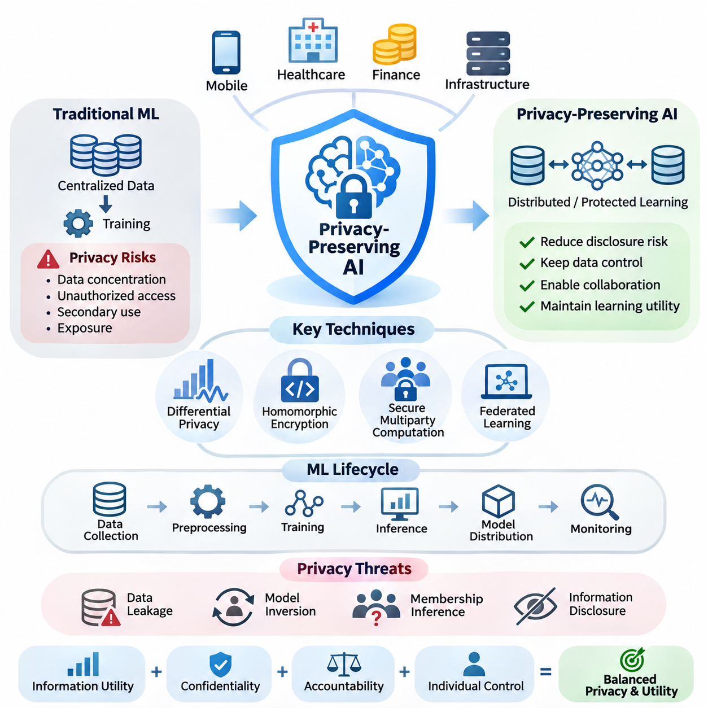
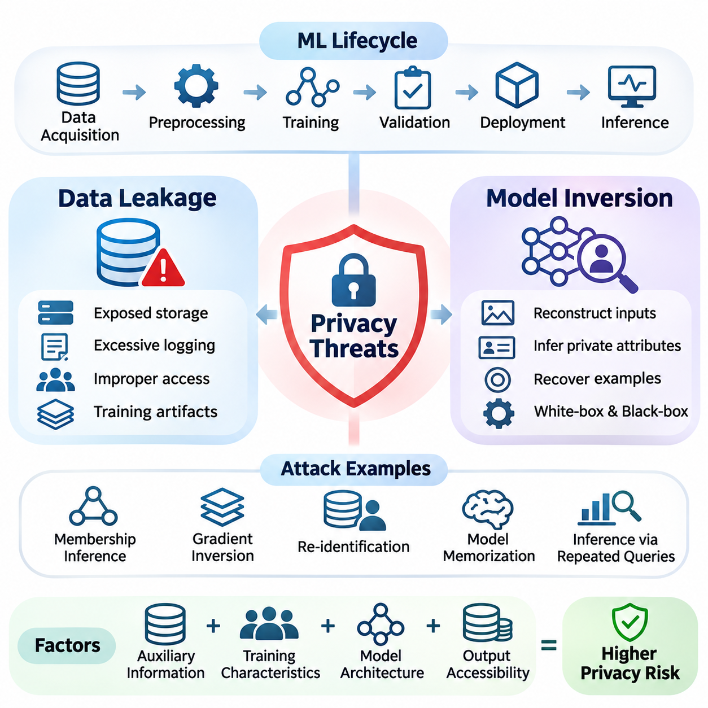
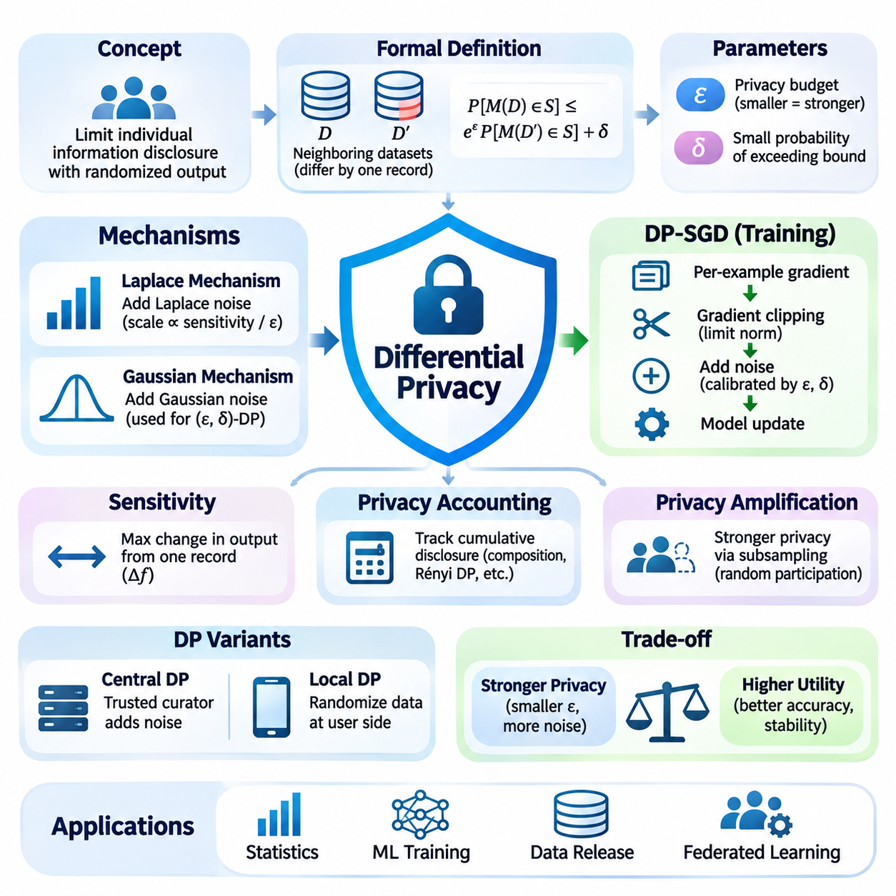
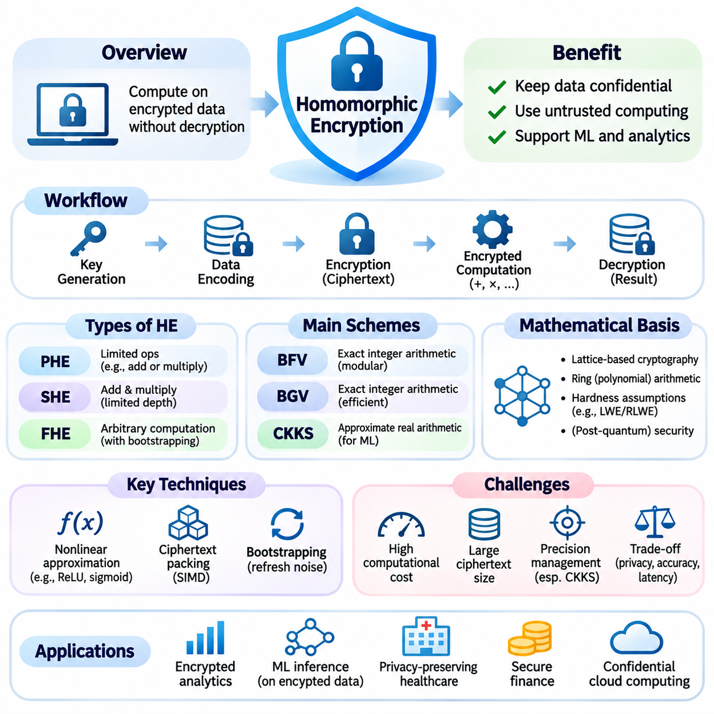
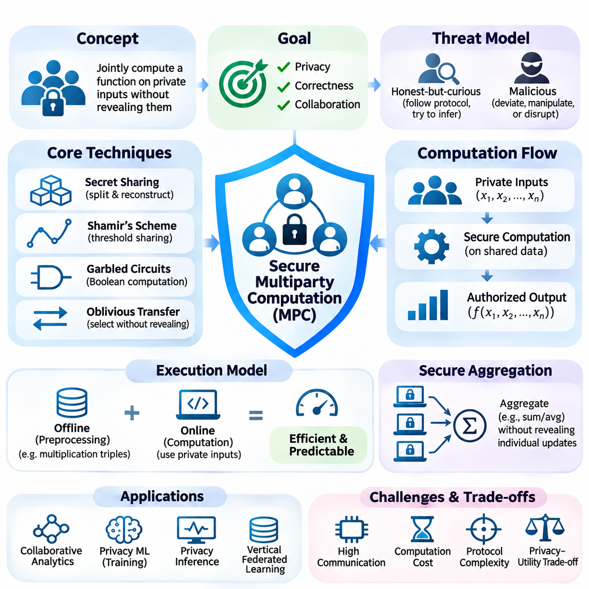
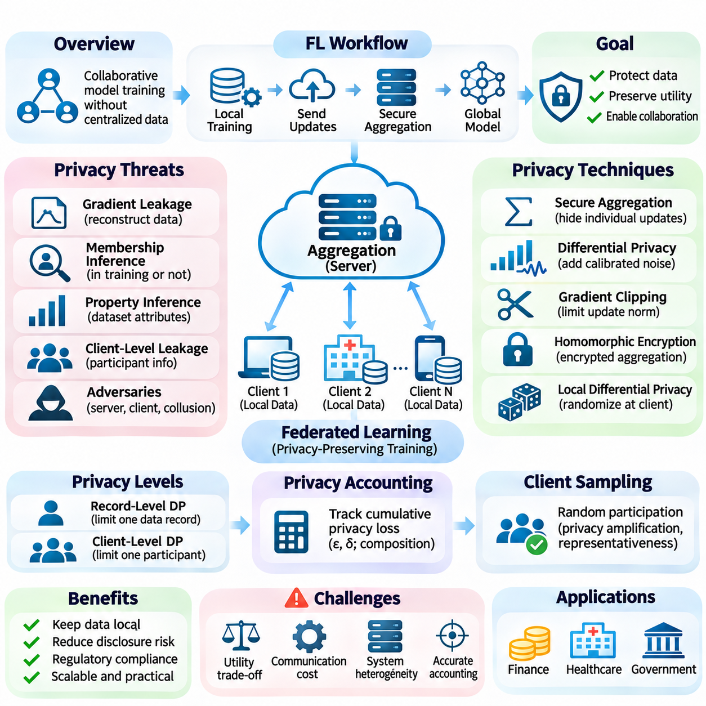
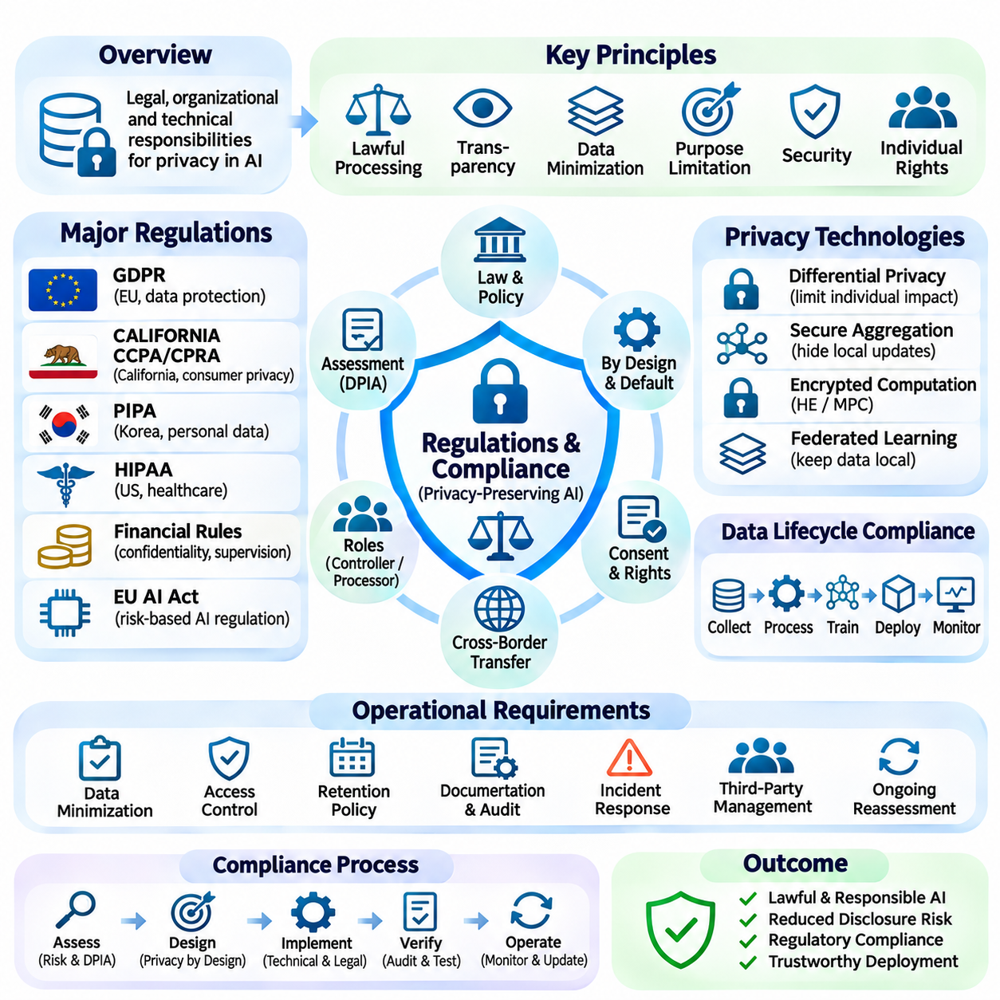
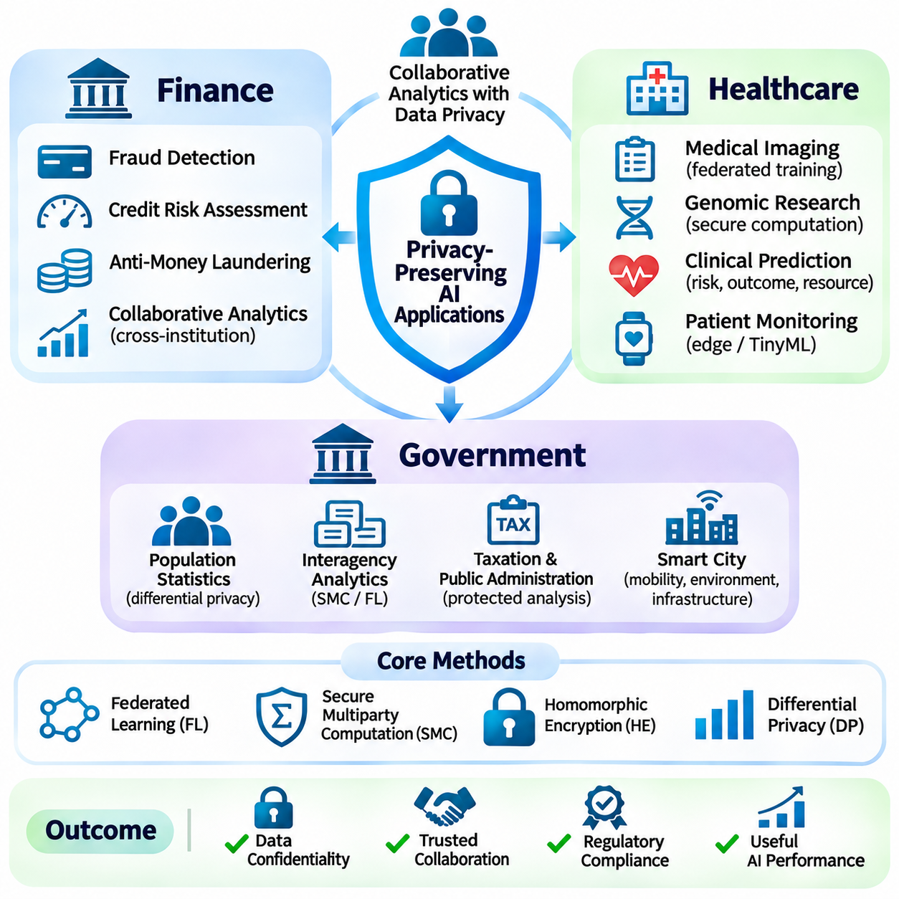

**Volume 40.** **TinyML and Federated Learning**

# 03. Privacy Preserving AI

## 03.00 Overview

{width="7.268055555555556in" height="7.268055555555556in"}

Privacy-preserving artificial intelligence focuses on developing intelligent systems that can learn from sensitive information while limiting unauthorized disclosure, identification, and misuse. As AI becomes integrated into mobile devices, healthcare platforms, financial services, and distributed infrastructure, privacy protection becomes a fundamental architectural requirement rather than an optional security feature.

Traditional machine learning commonly relies on collecting data from multiple sources and transferring it into centralized repositories for training. Although this approach simplifies model development, it creates significant privacy risks through data concentration, unauthorized access, secondary use, and potential exposure during processing. Privacy-preserving AI introduces technical mechanisms that reduce these risks while maintaining useful learning capabilities.

The central objective of privacy-preserving AI is to balance information utility with confidentiality, accountability, and individual control. Effective systems must protect sensitive records without unnecessarily restricting legitimate analytical operations. This balance requires explicit consideration of adversarial capabilities, information disclosure pathways, computational overhead, and the acceptable degradation of predictive performance.

Privacy threats arise throughout the machine learning lifecycle, including data collection, preprocessing, training, inference, model distribution, and monitoring. Even when original records are not directly accessible, trained models may reveal information about their training datasets. Consequently, protecting stored data alone is insufficient because intermediate representations, gradients, model parameters, and prediction outputs can expose sensitive attributes.

Data leakage represents a broad category of privacy failures in which confidential information becomes accessible through unintended channels. Leakage may occur through compromised storage, exposed communication interfaces, improperly configured logging systems, or shared computational resources. Machine learning introduces additional attack surfaces because training artifacts and model responses may retain information about individual examples.

Model inversion attacks demonstrate how an adversary may reconstruct sensitive characteristics of training data by analyzing model outputs or internal representations. Related membership inference attacks attempt to determine whether particular records participated in training. These threats illustrate why privacy assessment must consider what can be inferred from a model rather than merely whether raw data was transmitted or stored.

Differential privacy provides a mathematical framework for limiting the influence of individual records on released computational results. By introducing carefully calibrated randomness, differential privacy makes outputs statistically similar whether a particular individual\'s record is included or excluded. Its formal guarantees depend on the privacy definition, contribution bounds, mechanism design, and cumulative privacy expenditure.

A differential privacy mechanism is commonly characterized by parameters epsilon and delta, which quantify the permitted distinguishability between outputs generated from neighboring datasets. Smaller privacy budgets generally provide stronger protection but may reduce statistical accuracy. Practical implementations therefore require careful selection of clipping thresholds, noise distributions, sampling procedures, and privacy accounting methods.

Homomorphic encryption enables selected computations to operate directly on encrypted information without exposing plaintext to the computing party. This capability is particularly relevant when sensitive datasets must be processed by infrastructure that is not fully trusted. Depending on the encryption scheme, supported operations may range from limited arithmetic functions to more general computational circuits.

Despite its confidentiality advantages, homomorphic encryption introduces substantial computational and memory overhead. Encrypted representations can be significantly larger than their plaintext equivalents, while nonlinear neural network operations may require specialized approximations. Practical system design must therefore evaluate encryption parameters, numerical precision, supported operations, latency, and communication costs.

Secure multiparty computation allows multiple participants to jointly evaluate functions over private inputs without revealing those inputs beyond what the protocol permits. Techniques such as secret sharing, garbled circuits, and cryptographic protocols distribute computational responsibilities among cooperating parties. Their security properties depend on assumptions concerning participant behavior, collusion, and communication integrity.

Secure multiparty computation is especially useful when organizations possess complementary datasets but cannot exchange their underlying records. Financial institutions may jointly analyze suspicious transaction patterns, while medical organizations may compute aggregate statistics across restricted datasets. Such collaboration requires clearly defined outputs, trusted assumptions, and mechanisms for preventing unintended disclosure through final results.

Federated learning provides an architectural foundation for collaborative model training without routinely transferring raw training datasets to a central server. Participating devices or institutions perform local optimization and exchange model updates or related information. However, keeping data local does not automatically guarantee privacy because gradients and parameter updates may reveal sensitive training characteristics.

Privacy protection in federated learning commonly combines secure aggregation, differential privacy, encrypted communication, and carefully designed client participation policies. Secure aggregation can prevent a coordinating server from directly inspecting individual client updates under specified security assumptions. Differential privacy can further restrict the information attributable to particular records or participants in released models.

The integration of privacy mechanisms creates important engineering tradeoffs involving communication efficiency, convergence behavior, model accuracy, and resource consumption. Encryption increases processing requirements, while privacy noise may affect learning stability, especially with small or heterogeneous datasets. Distributed systems must additionally account for unreliable participants, changing network conditions, and unequal computational capabilities.

TinyML and on-device learning introduce further opportunities for privacy-aware computation by retaining sensor observations and personal information close to their original sources. Smartphones, wearable devices, and embedded controllers can execute local inference without continuously uploading raw observations. Nevertheless, local storage, model updates, telemetry, and physical device compromise remain important privacy concerns.

Privacy-preserving AI also requires a clear distinction between privacy, security, and regulatory compliance. Security mechanisms protect systems against unauthorized operations, while privacy mechanisms constrain the collection, processing, and disclosure of information. Compliance establishes organizational obligations concerning lawful processing, transparency, retention, individual rights, and accountability within applicable jurisdictions.

Regulatory frameworks such as the General Data Protection Regulation establish requirements that influence AI data processing and system governance. Organizations must evaluate the legal basis for processing, purpose limitations, data minimization, and safeguards appropriate to the risks involved. Technical privacy mechanisms can support these obligations, but their deployment does not independently establish legal compliance.

Privacy engineering begins with identifying protected information, relevant participants, potential adversaries, and permissible computational outcomes. A threat model should describe what attackers can observe, which components may be compromised, and what information must remain confidential. These assumptions guide the selection of differential privacy, cryptographic computation, access controls, and architectural isolation.

Evaluation must examine both privacy guarantees and the operational performance of the resulting AI system. Relevant measurements include attack success rates, privacy budgets, predictive accuracy, encryption overhead, communication volume, and inference latency. Formal guarantees should be distinguished from empirical resistance to specific attacks, since successful testing against known adversaries does not prove universal protection.

Financial applications benefit from privacy-preserving AI when analyzing transactions, detecting fraud, assessing risk, and coordinating information across institutions. Confidentiality requirements often restrict direct sharing of customer records, making protected collaborative computation attractive. Practical deployments must nevertheless consider transaction sensitivity, institutional trust boundaries, auditability, and the operational consequences of incorrect predictions.

Healthcare applications require especially careful treatment of medical histories, diagnostic images, physiological measurements, and patient identifiers. Privacy-preserving learning can support collaborative research across hospitals while reducing unnecessary movement of sensitive records. Effective implementations must account for patient-level information leakage, small clinical datasets, institutional governance, and the reliability of medical predictions.

Government applications include public health analysis, statistical reporting, infrastructure management, and cross-agency information processing. Privacy-preserving methods can help agencies extract useful aggregate information while limiting unnecessary disclosure of personal records. These systems must additionally address public accountability, lawful authorization, retention policies, and the potential consequences of linking information across administrative databases.

No single privacy-preserving technique provides complete protection against every threat. Differential privacy limits specified forms of information disclosure, encryption protects selected computational representations, and secure multiparty computation restricts access to private inputs during collaborative processing. Their complementary properties motivate layered architectures in which technical controls are selected according to explicit security and privacy objectives.

The long-term importance of privacy-preserving AI extends beyond preventing individual data breaches. It enables organizations to collaborate across trust boundaries, supports responsible deployment of distributed intelligence, and strengthens confidence in data-intensive technologies. Achieving these benefits requires integrating mathematical guarantees, cryptographic protocols, efficient implementation, regulatory governance, and continuous privacy evaluation throughout the AI lifecycle.

## 03.01 Privacy Threats

{width="7.268055555555556in" height="7.268055555555556in"}

Privacy threats in artificial intelligence arise when sensitive information becomes accessible, inferable, or reconstructable through unintended interactions with data, models, and computational infrastructure. These threats extend beyond conventional cybersecurity incidents because machine learning systems can retain statistical information about their training examples. Understanding privacy risks therefore requires examining both direct data exposure and indirect information extraction.

The privacy threat landscape spans the entire machine learning lifecycle, including data acquisition, preprocessing, training, validation, deployment, and inference. Sensitive information may appear in raw datasets, feature representations, intermediate activations, gradients, model parameters, and prediction outputs. Each component introduces distinct exposure pathways that must be evaluated according to attacker capabilities and system architecture.

Data leakage occurs when confidential information is disclosed to unauthorized parties through technical vulnerabilities, operational mistakes, or unintended model behavior. Conventional examples include exposed databases, insecure storage, excessive logging, and improperly configured access permissions. AI systems introduce additional leakage channels because learned parameters and computational artifacts may encode information about individual training records.

During data preparation, privacy risks emerge when personally identifiable information is insufficiently removed or when supposedly anonymous records can be linked to external datasets. Direct identifiers such as names and account numbers are not the only sources of exposure. Combinations of location histories, timestamps, behavioral patterns, and demographic attributes may permit re-identification even after obvious identifiers have been deleted.

Training pipelines create further leakage opportunities through cached datasets, temporary files, experiment tracking systems, and shared computational environments. Debugging outputs may inadvertently contain sensitive examples, while model checkpoints can preserve information derived from restricted datasets. Effective protection requires controlling access to training artifacts, establishing retention policies, and monitoring information movement across processing stages.

Distributed and federated learning introduce privacy risks associated with exchanged model updates rather than centralized raw data collection. Gradients may reveal properties of local training examples, particularly when batches are small or adversaries possess substantial auxiliary knowledge. Gradient inversion attacks attempt to reconstruct input characteristics from observed updates, demonstrating that local data storage alone does not guarantee confidentiality.

Inference interfaces create another important leakage surface because external users can repeatedly query deployed models and observe their responses. Prediction probabilities, confidence scores, embeddings, and generated outputs may expose information beyond the intended task. Attackers can exploit repeated queries, carefully selected inputs, and statistical comparisons to extract information about training distributions or individual records.

Model inversion attacks aim to recover sensitive characteristics of training data by exploiting information encoded in a trained model. Depending on the attack setting, an adversary may reconstruct representative inputs, infer private attributes, or approximate particular training examples. The feasibility of reconstruction depends on model architecture, output accessibility, training characteristics, and the attacker\'s background knowledge.

A typical model inversion scenario involves an attacker observing a classifier\'s outputs and searching for inputs that produce responses associated with a target class or identity. Optimization techniques may iteratively modify candidate inputs to maximize selected prediction scores. The resulting reconstruction can reveal recognizable features, although it does not necessarily reproduce an exact record from the original training dataset.

White-box model inversion assumes that attackers can inspect internal model information, including parameters, gradients, or intermediate activations. This access enables optimization procedures that directly exploit differentiable model structures. Black-box attacks instead rely on accessible prediction interfaces and may use query-based optimization, surrogate models, or prior knowledge to estimate sensitive input characteristics.

The distinction between model inversion and membership inference is important for understanding privacy objectives. Model inversion attempts to recover information about data attributes or input representations, whereas membership inference determines whether a particular example participated in training. These attacks may exploit related statistical signals, but they answer different questions and require separate evaluation procedures.

Model memorization increases privacy exposure when learning algorithms retain unusually detailed information about individual training examples. Overparameterized models may reproduce rare sequences, distinctive images, or sensitive patterns under certain conditions. However, memorization and reconstruction are not identical phenomena, and successful extraction depends on the accessibility of memorized information and the adversary\'s strategy.

Privacy attacks frequently depend on auxiliary information that improves the attacker\'s ability to interpret model behavior. Public datasets, previously disclosed records, population statistics, and knowledge of training procedures may reduce uncertainty about protected attributes. Consequently, privacy assessments should not assume that attackers operate without background knowledge or that anonymization eliminates all linkage opportunities.

Attack effectiveness also depends on the characteristics of the underlying data distribution. Small datasets, rare examples, highly distinctive features, and imbalanced classes may increase vulnerability under particular conditions. In contrast, reconstruction quality can deteriorate when model outputs provide limited information or when many different inputs produce similar predictions. These relationships require empirical investigation rather than universal assumptions.

Privacy risk assessment should distinguish an adversary\'s access level, objectives, available resources, and observable information. A threat model may consider external API users, malicious training participants, compromised servers, or insiders with privileged access. Each scenario changes the feasibility of data leakage and model inversion, making explicit trust boundaries essential for meaningful security analysis.

Defensive measures against data leakage include access control, encryption, secure storage, data minimization, and careful management of computational artifacts. Sensitive information should be excluded from unnecessary logs, temporary datasets, and publicly accessible interfaces. Encryption protects data under appropriate conditions, but it does not automatically prevent leakage through authorized model outputs or compromised processing environments.

Differential privacy provides a complementary defense by limiting how strongly individual training records influence released model behavior. Properly configured mechanisms can reduce certain membership inference and reconstruction risks through mathematically defined privacy guarantees. Nevertheless, protection depends on the privacy parameters, neighboring-dataset definition, implementation correctness, and accounting of repeated information releases.

Secure aggregation and cryptographic computation can further reduce exposure in collaborative learning environments. Secure aggregation limits visibility into individual participant updates, while secure multiparty computation and homomorphic encryption support selected operations on protected information. These methods address different trust assumptions and must be evaluated alongside possible leakage from aggregate outputs and final trained models.

Model-level defenses may restrict prediction detail, limit query frequency, reduce unnecessary confidence exposure, or monitor suspicious interaction patterns. Such measures can increase the difficulty of particular attacks but generally do not establish formal privacy guarantees. Excessive restrictions may also reduce legitimate functionality, requiring careful consideration of application requirements and adversarial adaptation.

Evaluating data leakage requires examining the complete flow of information through datasets, training systems, communication channels, deployed models, and operational logs. Security testing should include configuration reviews, access audits, artifact inspection, and controlled adversarial experiments. The objective is to identify both obvious disclosure pathways and indirect channels created by machine learning operations.

Model inversion evaluation commonly examines reconstruction fidelity, attribute recovery accuracy, attack success probability, query requirements, and computational cost. Reconstructed outputs should be compared against appropriate reference data while accounting for baseline reconstruction from population-level information. Strong visual similarity alone does not establish that a specific private training example has been recovered.

Privacy evaluation must also consider the relationship between protection strength and model utility. Noise injection, output restrictions, cryptographic processing, and reduced information sharing can affect accuracy, latency, communication overhead, and computational efficiency. These tradeoffs become especially important in TinyML and edge AI environments where memory, processing capacity, and energy availability are constrained.

In healthcare systems, privacy threats may involve reconstruction of patient characteristics from diagnostic models or disclosure of sensitive information through collaborative training updates. Financial applications face risks involving transaction histories, account behavior, and confidential risk indicators. Government systems must additionally consider the consequences of linking administrative records and exposing sensitive population-level information.

Operational privacy protection requires continuous monitoring because threats evolve as models, datasets, and interfaces change. Model updates may alter memorization behavior, newly available external datasets may improve re-identification attacks, and expanded API functionality may expose additional signals. Privacy testing should therefore be integrated into deployment reviews, incident response procedures, and ongoing model governance.

Data leakage and model inversion demonstrate that privacy protection cannot be reduced to keeping raw datasets hidden. Information can emerge through intermediate computations, trained representations, collaborative updates, and prediction interfaces even when conventional storage controls remain intact. Effective privacy-preserving AI requires layered technical safeguards, explicit adversarial assumptions, rigorous evaluation, and lifecycle-wide governance.

## 03.02 Differential Privacy [w/Code]

{width="7.268055555555556in" height="7.268055555555556in"}

Differential privacy is a mathematical framework designed to limit the disclosure of information about individuals when statistical analyses or machine learning models are released. Its central principle is that the presence or absence of one person\'s data should not substantially change the observable output of a computation. This provides a formal approach to privacy protection that does not depend solely on hiding identities or restricting access.

Traditional anonymization techniques remove direct identifiers but may remain vulnerable to re-identification through auxiliary information. Differential privacy addresses this limitation by introducing controlled randomness into computational results. Instead of guaranteeing that individual records cannot be recognized under every circumstance, it mathematically bounds how much additional information an observer can infer from a protected computation.

The formal definition compares the output distributions of a randomized mechanism applied to neighboring datasets. Two datasets are considered neighboring when they differ according to a specified individual contribution, such as the addition or removal of one record. A mechanism satisfies differential privacy when the probability of any possible output remains sufficiently similar across these neighboring datasets.

Differential privacy is commonly expressed using epsilon and delta parameters. Epsilon represents the multiplicative bound on differences between output probabilities, while delta permits a small additive probability of exceeding the pure privacy bound. Smaller epsilon values generally indicate stronger privacy protection, although practical interpretation depends on the neighboring relation, data contribution limits, and overall system configuration.

The privacy budget describes the amount of permitted information disclosure accumulated across protected computations. Each differentially private query or training operation may consume part of this budget, depending on the mechanism and accounting method. Repeated releases can weaken overall protection, making privacy accounting essential for systems that continuously analyze data or update machine learning models.

Sensitivity measures how strongly a function\'s output can change when one individual\'s contribution is modified according to the neighboring-dataset definition. Functions with high sensitivity generally require stronger randomization to achieve a given privacy guarantee. Bounding individual contributions and limiting the influence of extreme values are therefore important steps in designing accurate and privacy-preserving statistical mechanisms.

The Laplace mechanism provides differential privacy by adding noise drawn from a Laplace distribution to numerical query results. The noise scale depends on the function\'s sensitivity and the selected epsilon value. This mechanism is particularly suitable for releasing counts, sums, and other numerical statistics when their sensitivity can be bounded and the intended privacy definition is compatible with its assumptions.

The Gaussian mechanism introduces normally distributed noise and is widely used in approximate differential privacy. Its noise magnitude depends on sensitivity, epsilon, delta, and the chosen privacy analysis. Gaussian noise is especially relevant to machine learning because it can be applied to gradient-based optimization, enabling privacy protection during iterative training rather than only during statistical result publication.

Differentially private stochastic gradient descent, commonly called DP-SGD, integrates privacy mechanisms into neural network training. The method computes per-example gradients, limits their norms through clipping, and adds calibrated noise before parameter updates. These operations reduce the influence of individual training examples while allowing the model to learn useful patterns from the overall dataset.

Gradient clipping is essential because unrestricted gradients may allow individual examples to exert arbitrarily large influence on optimization. By enforcing a maximum gradient norm, DP-SGD establishes a sensitivity bound for subsequent noise addition. However, clipping can distort optimization directions, particularly when gradient magnitudes vary significantly across examples or training stages.

Noise injection introduces a tradeoff between privacy protection and model utility. Stronger noise can reduce the information attributable to individual records but may also degrade predictive accuracy and convergence stability. The impact depends on dataset size, model architecture, optimization settings, sampling procedures, and the complexity of the learning task, requiring systematic experimentation.

Privacy accounting tracks cumulative information disclosure during repeated training iterations. Advanced composition methods, Rényi differential privacy, and privacy loss analysis provide tools for estimating overall guarantees more accurately than simple addition in many settings. Correct accounting must reflect the actual sampling process, noise parameters, training duration, and any additional releases of private information.

Privacy amplification by subsampling can strengthen effective privacy guarantees when only a randomly selected subset of records participates in each computation. The magnitude of amplification depends on the sampling scheme and the mathematical assumptions used in the privacy analysis. Consequently, implementations must distinguish between independent sampling, fixed-size minibatches, and other participation strategies.

Central differential privacy assumes that a trusted data curator can access original records before applying a privacy mechanism to released outputs. Local differential privacy instead randomizes information before it reaches the collecting organization. Local protection reduces reliance on a trusted central collector but often requires more data or stronger statistical estimation methods to achieve comparable accuracy.

Differential privacy can be integrated into federated learning to protect information contributed by distributed clients. Record-level privacy limits the influence of individual examples, while client-level privacy aims to protect an entire participant\'s contribution. These guarantees are not interchangeable, and their implementation requires different sensitivity definitions, clipping strategies, and privacy accounting assumptions.

In federated systems, secure aggregation and differential privacy can provide complementary protection. Secure aggregation restricts access to individual client updates, while differential privacy bounds information disclosure through appropriately protected aggregate results. Combining these mechanisms requires careful consideration of client sampling, update clipping, distributed noise generation, participant dropout, and server trust assumptions.

Differential privacy also applies to statistical databases, analytics platforms, synthetic data generation, and privacy-aware reporting. Organizations may release aggregate population statistics without exposing the exact contribution of individual participants. However, synthetic datasets generated through differentially private procedures still require evaluation for statistical fidelity, downstream utility, and consistency with the claimed privacy guarantees.

Practical implementation requires selecting privacy parameters according to application risks rather than treating epsilon as a universal security score. The meaning of a particular privacy budget depends on the protected unit, neighboring relation, number of releases, and potential consequences of disclosure. Privacy parameters should therefore be documented alongside assumptions, implementation details, and evaluation results.

Privacy protection must be assessed together with model accuracy, computational cost, and operational constraints. DP-SGD may increase memory consumption because per-example gradients require additional processing or specialized implementations. On embedded devices and TinyML platforms, limited memory, processing capacity, and energy availability can make privacy-preserving training particularly challenging.

Differential privacy provides guarantees against changes attributable to protected individual contributions, but it does not eliminate every form of information disclosure. Models may still reveal general population patterns, and privacy guarantees do not automatically address insecure storage, compromised devices, or unauthorized system access. Differential privacy must therefore operate alongside conventional cybersecurity and data governance mechanisms.

Implementation errors can invalidate theoretical guarantees even when the underlying algorithm is mathematically sound. Incorrect gradient clipping, insufficient noise calibration, mismatched sampling assumptions, and incomplete privacy accounting may create unexpected exposure. Reliable implementations require validated libraries, reproducible configurations, automated testing, and independent review of the privacy mechanism.

Evaluation should report both privacy parameters and machine learning performance under clearly specified experimental conditions. Relevant measurements include epsilon, delta, prediction accuracy, convergence behavior, training time, memory consumption, and sensitivity to noise settings. Empirical membership inference or reconstruction attacks can provide additional evidence, but their failure does not independently establish a formal privacy guarantee.

Differential privacy is particularly valuable in healthcare, finance, government analytics, and distributed intelligence systems where sensitive information must support useful computation. Its mathematical foundation enables organizations to express privacy protection as an explicit, measurable design objective. Successful deployment depends on integrating formal guarantees, accurate accounting, efficient algorithms, and continuous operational oversight.

## 03.03 Homomorphic Encryption

{width="7.268055555555556in" height="7.268055555555556in"}

Homomorphic encryption is a cryptographic technique that enables computations to be performed directly on encrypted data without requiring decryption during processing. The resulting encrypted output can be decrypted by an authorized party to obtain the corresponding computational result. This capability allows sensitive information to remain confidential while supporting selected analytical and machine learning operations on infrastructure that may not be fully trusted.

Conventional encryption protects information during storage and transmission but generally requires plaintext access for computation. This creates exposure when sensitive datasets are processed by cloud servers or external service providers. Homomorphic encryption addresses this limitation by preserving encryption throughout supported operations, reducing the need to disclose original records to the computing environment.

The mathematical foundation of homomorphic encryption establishes relationships between operations on plaintext values and corresponding operations on ciphertexts. An encryption scheme is homomorphic when selected computations on encrypted inputs produce ciphertexts representing the intended plaintext results. Correctness depends on cryptographic parameters, supported operations, numerical representations, and the management of accumulated computational noise.

Partially homomorphic encryption supports a restricted family of operations, such as repeated addition or multiplication under a particular cryptographic construction. Some schemes enable encrypted aggregation, while others support multiplicative relationships. These capabilities are useful for specialized applications but cannot directly evaluate arbitrary machine learning algorithms requiring combinations of different arithmetic operations.

Somewhat homomorphic encryption extends computational flexibility by supporting both addition and multiplication for a limited number of operations or circuit depth. Each operation may increase internal noise or consume part of the available computational capacity. When this limit is exceeded, correct decryption may become unreliable, making parameter selection and circuit design important aspects of practical implementation.

Fully homomorphic encryption enables the evaluation of arbitrary computable functions represented through supported logical or arithmetic circuits, subject to practical resource limitations. Bootstrapping refreshes ciphertexts by reducing accumulated noise, allowing further computation without revealing plaintext. Although this provides substantial flexibility, bootstrapping and complex encrypted operations can introduce significant processing overhead.

Modern homomorphic encryption systems commonly rely on lattice-based cryptographic constructions and mathematical problems believed to resist efficient attacks, including those from quantum computers. Ring-based polynomial arithmetic enables structured encrypted operations with relatively efficient implementations. Security depends on carefully selected parameters, established hardness assumptions, and resistance to known cryptanalytic techniques.

The BFV and BGV schemes are designed primarily for exact modular integer arithmetic on encrypted data. They support additions and multiplications while maintaining correctness within their configured plaintext modulus and noise limits. These properties make them suitable for applications involving integer statistics, encrypted counting, and computations where exact arithmetic is more important than approximate numerical processing.

The CKKS scheme supports approximate arithmetic on encrypted real or complex values and is particularly relevant to machine learning workloads. It represents numerical information with controlled approximation error and supports vectorized operations through ciphertext packing. However, multiplication and rescaling introduce precision management requirements, making numerical stability an important consideration for encrypted inference.

Homomorphic encryption workflows typically involve key generation, data encoding, encryption, encrypted computation, and authorized decryption. The data owner generates cryptographic keys and encrypts information before transferring ciphertexts to a processing service. The service evaluates supported operations without possessing the secret decryption key, then returns encrypted results for authorized interpretation.

Encrypted machine learning inference allows a service provider to evaluate selected model operations while keeping client inputs confidential. Linear transformations, matrix multiplication, and polynomial approximations can be implemented using homomorphic operations. However, protecting model parameters as well as client inputs may require additional techniques, depending on the chosen protocol and the information available to each participant.

Nonlinear activation functions present a major challenge because many encryption schemes efficiently support arithmetic operations rather than direct comparisons or arbitrary nonlinear functions. Functions such as ReLU, sigmoid, and softmax may require polynomial approximations or specialized computational protocols. Approximation quality affects model accuracy, while polynomial degree influences multiplicative depth and computational cost.

Ciphertext packing improves computational efficiency by encoding multiple numerical values into a single encrypted representation. Single-instruction multiple-data techniques allow certain arithmetic operations to process many packed values simultaneously. Nevertheless, packing layouts, ciphertext rotations, memory requirements, and key-switching operations must be carefully optimized to achieve practical performance.

Encrypted computation introduces substantial overhead compared with ordinary plaintext processing. Ciphertexts may occupy considerably more memory than their original values, and multiplication can require expensive polynomial operations. Latency, throughput, energy consumption, and communication volume depend on encryption parameters, circuit complexity, implementation quality, and available hardware acceleration.

Security parameter selection involves balancing confidentiality, computational depth, numerical precision, and resource consumption. Larger parameters may support stronger security or more complex operations but increase ciphertext size and processing cost. Practical deployments should follow established parameter-selection guidance and evaluate whether the chosen configuration satisfies both cryptographic security and application requirements.

Homomorphic encryption can complement federated learning by protecting selected model updates or aggregated statistics during distributed collaboration. Participants may encrypt local contributions before transmission, allowing a coordinating service to perform supported aggregation operations. However, encrypted aggregation alone does not prevent information disclosure through decrypted results, requiring additional privacy controls when individual contributions remain inferable.

The relationship between homomorphic encryption and differential privacy illustrates the distinction between computational confidentiality and statistical disclosure protection. Homomorphic encryption restricts access to plaintext during computation, while differential privacy limits the influence of individual records on released outputs. Combining both techniques can protect data during processing and reduce information leakage from authorized statistical results.

Secure multiparty computation provides another complementary approach by distributing computation among multiple participants without exposing private inputs beyond the protocol\'s permitted disclosures. Homomorphic encryption may serve as a building block within such protocols, although the methods involve different trust and communication assumptions. Selecting an architecture requires evaluating participant relationships, adversarial behavior, and computational complexity.

Healthcare applications can use homomorphic encryption to support selected analyses of encrypted patient records, medical measurements, or diagnostic features. Hospitals may outsource computation without directly revealing plaintext information to the processing provider. However, practical medical AI deployment must evaluate numerical approximation, model reliability, processing latency, and the sensitivity of decrypted analytical outputs.

Financial applications include encrypted transaction analysis, confidential statistical aggregation, and selected risk evaluation operations. Organizations may benefit from processing sensitive financial information without exposing underlying customer records to external computing services. The feasibility of these applications depends on supported arithmetic operations, transaction volume, required response times, and institutional security requirements.

Government and public-sector systems can employ homomorphic encryption when confidential administrative information must be processed across organizational boundaries. Encrypted statistical computation may reduce exposure during outsourced analytics or interagency collaboration. Nevertheless, legal authorization, access management, output disclosure policies, and operational accountability remain necessary because encryption does not independently establish regulatory compliance.

Engineering homomorphic encryption systems requires specialized libraries, careful numerical encoding, and rigorous performance evaluation. Frameworks such as Microsoft SEAL, OpenFHE, and HElib provide implementations of established encryption schemes and related operations. Developers must validate parameter compatibility, ciphertext handling, key management, precision behavior, and deployment assumptions before integrating these tools into production systems.

Hardware constraints become particularly important when homomorphic encryption is combined with TinyML, edge AI, and distributed intelligence. Resource-limited devices may struggle with large ciphertexts, complex polynomial arithmetic, and expensive encrypted operations. Hybrid architectures can therefore assign encryption and lightweight preprocessing to edge devices while delegating computationally intensive encrypted evaluation to more capable infrastructure.

Homomorphic encryption protects data confidentiality during supported computations but does not eliminate all security or privacy threats. Access patterns, metadata, side channels, compromised endpoints, and decrypted outputs may still expose sensitive information. Effective systems must combine cryptographic computation with secure key management, access controls, threat modeling, differential privacy where appropriate, and continuous operational validation.

The long-term significance of homomorphic encryption lies in enabling useful computation without requiring unrestricted access to sensitive plaintext information. Advances in cryptographic algorithms, compiler optimization, ciphertext management, and hardware acceleration continue to improve practical feasibility. Its successful adoption depends on aligning formal security assumptions with computational requirements, numerical accuracy, system architecture, and privacy governance.

## 03.04 Secure Multiparty Computation

{width="7.268055555555556in" height="7.268055555555556in"}

Secure multiparty computation is a cryptographic framework that enables multiple participants to jointly compute a function over their private inputs without revealing those inputs to one another. Each participant contributes confidential information while learning only the outputs permitted by the protocol. This approach supports collaborative analytics and machine learning across organizations that cannot directly exchange sensitive datasets.

Traditional collaborative computation often requires transferring information to a trusted central authority. Such arrangements introduce confidentiality risks, organizational dependencies, and regulatory concerns. Secure multiparty computation replaces unrestricted data sharing with cryptographic protocols that distribute computational responsibilities while controlling what participants can observe during execution.

The security objective of multiparty computation is commonly expressed through an ideal functionality that receives private inputs and returns authorized results. A secure protocol attempts to reproduce this behavior without a trusted central party. Formal security definitions compare real protocol executions with idealized interactions, establishing what an adversary can learn or manipulate under specified assumptions.

Threat models distinguish honest-but-curious adversaries from malicious participants. Honest-but-curious parties follow the prescribed protocol but attempt to infer additional information from observed messages. Malicious adversaries may deviate from instructions, submit manipulated values, or disrupt computation. Stronger security against malicious behavior generally requires additional verification and communication.

Secret sharing is a foundational technique that divides sensitive values into multiple shares distributed among participants. Individual shares reveal no useful information under the scheme\'s security conditions, while authorized combinations reconstruct the original value. Additive secret sharing and threshold secret sharing provide different reconstruction rules and support distributed arithmetic operations.

Shamir\'s secret sharing represents private information through polynomial evaluations over a finite field. A specified threshold of shares can reconstruct the secret, while fewer shares reveal no information about it under appropriate assumptions. This structure supports fault tolerance and threshold-based trust distribution, making it useful in collaborative computation and distributed key management.

Arithmetic secret-sharing protocols enable participants to compute additions and multiplications over protected values. Additions can often be performed locally on shares, while multiplication generally requires communication or precomputed correlated randomness. These operations form the basis for evaluating arithmetic circuits without exposing the underlying private inputs.

Boolean circuit protocols represent computations using logical gates such as AND, XOR, and NOT. Garbled circuits allow parties to evaluate encrypted representations of Boolean functions while limiting disclosure of intermediate values. Yao\'s garbled circuit technique is particularly important in two-party computation, although practical implementations depend on security models and optimization choices.

Oblivious transfer enables a receiver to obtain selected information without revealing the selection to the sender, while preventing access to unselected information. It serves as an important building block for garbled circuits and other secure computation protocols. Efficient implementations frequently use oblivious transfer extension to reduce the cost of repeated cryptographic operations.

Secure multiparty computation protocols can use preprocessing to generate cryptographic resources before private inputs become available. Multiplication triples and other correlated randomness support efficient online computation. Separating preprocessing from execution can reduce interactive latency, although generating, storing, and protecting preprocessing material introduces additional engineering requirements.

The distinction between offline and online computation is important for practical performance. Offline phases may perform expensive cryptographic preparation independently of actual input values. Online phases process the private inputs using previously prepared resources. This division is particularly valuable when applications require predictable response times or repeated collaborative evaluations.

Secure aggregation is a specialized application of multiparty computation that protects individual contributions while revealing an authorized aggregate. In federated learning, clients can participate in computing sums or averages of model updates without directly exposing each update to the coordinating server. Security depends on protocol assumptions, participant availability, and the information revealed by aggregated results.

Multiparty computation can support privacy-preserving machine learning training by distributing data and intermediate computations among cooperating parties. Secure matrix operations, gradient calculations, and selected optimization procedures can be implemented through cryptographic protocols. However, complex neural network training may require substantial communication and specialized approximations for nonlinear operations.

Privacy-preserving inference allows multiple organizations to evaluate models without disclosing protected inputs or selected model parameters. One participant may provide confidential features while another contributes proprietary model information. Secure protocols can produce authorized predictions while limiting disclosure, although the output itself may still reveal sensitive information.

Vertical federated learning is a relevant application when different organizations possess distinct features describing overlapping individuals. Secure computation can help combine protected feature contributions without directly exchanging raw records. Private entity alignment and secure gradient calculations may be necessary, depending on the learning architecture and the relationships between participating datasets.

Horizontal federated learning involves participants holding similar feature structures but different records. Secure multiparty computation can protect model updates during aggregation and reduce reliance on a fully trusted coordinating server. Nevertheless, confidentiality of updates does not automatically provide formal privacy guarantees for the final model or prevent information inference from released predictions.

Homomorphic encryption and secure multiparty computation provide related but distinct approaches to confidential computation. Homomorphic encryption enables supported operations directly on ciphertexts, while multiparty computation distributes protected computation across participants. Hybrid protocols can combine encrypted arithmetic, secret sharing, and interactive cryptographic operations to improve performance under specific workloads.

Differential privacy complements multiparty computation by limiting information attributable to individual records in released results. Multiparty computation protects private inputs during protocol execution, whereas differential privacy addresses statistical disclosure through outputs. Combining these techniques can reduce both computational exposure and inference risks, provided noise generation and privacy accounting are implemented correctly.

Security guarantees depend on corruption thresholds, communication assumptions, adversarial capabilities, and the selected protocol. Some constructions tolerate only a limited number of colluding participants, while others provide security under different computational assumptions. Correctness, privacy, fairness, and guaranteed output delivery are separate properties that may not all be achievable under every network model.

Communication complexity is a major practical limitation because secure protocols often require repeated exchanges among participants. Network latency, bandwidth availability, message synchronization, and participant count influence execution time. Wide-area deployments may experience substantially higher overhead than local environments, even when the underlying arithmetic computation is relatively inexpensive.

Engineering optimization includes circuit simplification, batching, vectorization, preprocessing, and minimizing interactive communication rounds. Frameworks such as MP-SPDZ and related secure computation libraries provide implementations of multiple protocol families. Developers must evaluate supported threat models, numerical precision, deployment architecture, and performance characteristics rather than assuming equivalent guarantees across implementations.

Healthcare applications can use secure multiparty computation for collaborative medical research, protected statistical analysis, and selected predictive modeling tasks. Hospitals may jointly analyze patient populations without directly transferring identifiable records. Nevertheless, data alignment, consent requirements, authorization policies, and disclosure risks associated with final results remain important operational considerations.

Financial institutions can employ multiparty computation for confidential fraud analysis, collaborative risk assessment, and cross-organization statistical evaluation. Participating organizations may detect shared patterns without exposing complete transaction histories. Practical adoption requires balancing cryptographic protection with regulatory obligations, computation latency, participant trust, and the reliability of collaborative workflows.

Government applications include protected statistical reporting, interagency analysis, and confidential evaluation of distributed administrative datasets. Secure computation can reduce unnecessary exposure when multiple authorities contribute sensitive information. However, cryptographic confidentiality does not replace legal authorization, access governance, auditability, or appropriate restrictions on the disclosure of analytical outputs.

The long-term importance of secure multiparty computation lies in enabling cooperation without requiring unrestricted exchange of confidential information. Advances in protocol design, preprocessing, communication optimization, and hardware acceleration continue to improve practical feasibility. Successful deployment requires aligning formal security guarantees with application requirements, adversarial assumptions, operational constraints, and comprehensive privacy governance.

## 03.05 Privacy in Federated Learning

{width="7.268055555555556in" height="7.268055555555556in"}

Privacy in federated learning concerns protecting sensitive information while multiple participants collaboratively train machine learning models without centrally collecting their raw datasets. Each participant performs local computation and shares selected model updates with a coordinating system. Although this architecture reduces direct data transfer, it does not automatically prevent private information from being inferred through exchanged parameters or outputs.

Federated learning introduces distinct privacy challenges because model updates can encode statistical characteristics of local training data. Gradients, parameter differences, and intermediate representations may reveal information about individual records or participant populations. Effective privacy protection therefore requires examining communication channels, aggregation procedures, adversarial capabilities, and the information retained by the final trained model.

The threat model determines which participants are trusted and what information an adversary can observe. Potential attackers include curious aggregation servers, compromised clients, colluding participants, and external observers intercepting communications. Security assumptions must distinguish honest-but-curious behavior from malicious deviations because each adversarial setting requires different technical safeguards and verification procedures.

Gradient leakage is a significant concern when local updates contain information closely related to individual training examples. Under favorable attack conditions, adversaries may reconstruct input features or approximate original samples from exposed gradients. Small batch sizes, distinctive examples, and access to detailed model information can increase reconstruction feasibility, demonstrating that local data retention alone is insufficient.

Membership inference attacks attempt to determine whether a particular record participated in federated training. Attackers may examine model confidence, prediction behavior, or changes between successive model versions. Property inference attacks instead seek information about statistical characteristics of a participant\'s dataset, including attributes unrelated to the intended learning objective.

Client-level privacy introduces additional concerns because an entire participant may represent a sensitive institution, household, or individual device. Revealing participation patterns, update magnitudes, or training activity can expose operational information even without reconstructing individual records. Consequently, privacy objectives must distinguish record-level protection from protection of complete client contributions.

Secure aggregation protects individual model updates by allowing a server to recover an authorized aggregate without directly observing each participant\'s contribution. Cryptographic masking and secret-sharing techniques can support this process while maintaining collaborative training. However, aggregate outputs may still reveal information when participant groups are small or successive aggregates permit isolation of contributions.

Differential privacy provides mathematical guarantees that limit the influence of protected data contributions on released training results. In federated learning, noise can be introduced locally, during aggregation, or through coordinated distributed mechanisms. The resulting guarantees depend on the protected unit, clipping rules, noise calibration, sampling assumptions, and cumulative privacy accounting across training rounds.

Record-level differential privacy limits information attributable to individual training examples within participating datasets. Client-level differential privacy instead bounds the influence of an entire participant\'s contribution. These approaches protect different units and may require substantially different noise levels, especially when clients possess unequal dataset sizes or contribute highly heterogeneous updates.

Gradient clipping establishes a sensitivity bound before privacy-preserving noise is added to model updates. In client-level mechanisms, entire client updates may be clipped according to a predefined norm threshold. Although clipping reduces excessive influence, aggressive thresholds can distort useful updates and weaken model convergence, particularly when participant data distributions differ significantly.

Privacy accounting tracks cumulative information disclosure across repeated federated training rounds. Each round may involve client sampling, local optimization, aggregation, and randomized protection mechanisms. Advanced accounting techniques can estimate overall privacy loss, but guarantees remain valid only when the analysis accurately reflects actual participation patterns, sampling procedures, and information releases.

Client sampling influences both privacy amplification and statistical learning performance. Random participation may strengthen certain differential privacy guarantees under appropriate assumptions, while irregular availability can create participation bias. Devices that connect frequently may contribute disproportionately, requiring careful evaluation of sampling policies, privacy accounting, and the representativeness of aggregated training data.

Local differential privacy allows participants to randomize information before transmitting updates to the coordinating server. This approach reduces reliance on server confidentiality but may require stronger noise and larger participant populations to preserve accuracy. Central differential privacy can provide better utility under some conditions, although it requires suitable trust assumptions or secure aggregation to protect intermediate contributions.

Homomorphic encryption offers another method for protecting federated updates during aggregation. Participants can encrypt selected numerical contributions so that supported computations occur without exposing plaintext updates to the aggregation service. However, ciphertext expansion, encryption overhead, and computational limitations may affect scalability, particularly when models contain millions of parameters.

Secure multiparty computation distributes protected aggregation or related computations across multiple participants or servers. Secret sharing and cryptographic protocols can prevent unauthorized disclosure of individual inputs under specified corruption assumptions. Combining secure computation with differential privacy can protect intermediate updates while limiting information leakage from the final released model.

Communication security remains essential because federated learning relies on repeated exchanges between distributed devices and coordinating infrastructure. Authenticated channels, encryption in transit, certificate management, and secure endpoint configurations help prevent interception and impersonation. These protections complement privacy mechanisms but do not independently prevent information inference from legitimate model updates.

Privacy and security must be distinguished when evaluating malicious client behavior. Data poisoning, model poisoning, and backdoor attacks primarily threaten model integrity, but malicious participants may also manipulate training to amplify privacy leakage. Defenses may require robust aggregation, anomaly detection, authenticated participation, and secure validation without unnecessarily exposing private client information.

Non-independent and identically distributed data create additional challenges for privacy-preserving federated optimization. Participants may differ in sample counts, class distributions, sensor characteristics, and operational environments. Noise injection and update clipping can interact with this heterogeneity, potentially reducing accuracy for underrepresented groups or increasing convergence instability.

Cross-device federated learning commonly involves large populations of mobile, embedded, or edge devices with intermittent connectivity. Cross-silo federated learning typically connects a smaller number of institutions with larger local datasets. These settings differ in participant trust, availability, computational resources, and feasible privacy mechanisms, making architecture-specific protection strategies necessary.

TinyML and edge AI environments introduce strict constraints on memory, energy consumption, processing capacity, and communication bandwidth. Per-example gradient processing and cryptographic operations may exceed the capabilities of small embedded devices. Practical architectures may combine lightweight local training, secure aggregation, selective participation, and more capable infrastructure for expensive privacy-preserving computations.

Healthcare federated learning can support collaborative diagnostic modeling across hospitals while limiting direct transfers of patient records. Financial institutions may jointly improve fraud detection without centralizing complete transaction histories. Industrial and government applications can similarly benefit from distributed analysis, although each environment requires explicit consent, access policies, regulatory review, and output disclosure controls.

Privacy evaluation should combine formal guarantees with empirical testing against realistic adversaries. Relevant measurements include privacy budgets, reconstruction success, membership inference performance, model accuracy, communication overhead, and computational cost. Experimental attack failure does not establish mathematical privacy, while formal guarantees must be interpreted according to their stated assumptions and protected units.

Operational governance requires documenting participant eligibility, update retention, privacy parameters, key management, and incident response procedures. Model versioning and audit trails help establish accountability across collaborative training rounds. Changes in client populations, datasets, aggregation mechanisms, or deployment interfaces should trigger renewed privacy assessment because previously valid assumptions may no longer hold.

Privacy-preserving federated learning requires more than keeping raw datasets on local devices. Reliable protection emerges from combining explicit threat models, secure communication, cryptographic aggregation, differential privacy, careful optimization, and continuous governance. Its long-term value lies in enabling distributed intelligence while limiting unnecessary disclosure of sensitive information throughout collaborative model development.

## 03.06 Regulations and Compliance

{width="7.268055555555556in" height="7.268055555555556in"}

Regulations and compliance establish the legal, organizational, and technical responsibilities associated with collecting, processing, storing, and sharing personal information in artificial intelligence systems. Privacy-preserving AI must satisfy applicable legal requirements while maintaining useful computational capabilities. Compliance therefore involves more than encryption or anonymization and requires accountable governance throughout the data and model lifecycle.

Privacy regulations generally define obligations concerning lawful processing, transparency, data minimization, purpose limitation, security, and individual rights. Organizations must identify the legal basis for processing personal information and ensure that collected data remains appropriate for specified purposes. These principles influence dataset construction, model training, information retention, and the design of interfaces that expose analytical results.

The European Union General Data Protection Regulation, commonly known as GDPR, provides a comprehensive framework for protecting personal data. Its requirements include lawful processing, accountability, appropriate safeguards, and mechanisms for exercising data subject rights. AI developers must consider how model training and deployment affect access, correction, erasure, and other rights under the circumstances defined by applicable law.

GDPR distinguishes personal data from information that has been effectively anonymized, while pseudonymized data generally remains subject to data protection requirements. Removing direct identifiers does not necessarily eliminate re-identification risks. Machine learning systems must therefore assess whether feature combinations, embeddings, model outputs, or external datasets could enable individuals to be identified.

Data protection by design and by default requires privacy considerations to be incorporated into system architecture and operational decisions. Developers should limit unnecessary data collection, restrict access, establish retention periods, and select appropriate technical safeguards. Privacy-preserving methods such as differential privacy, secure aggregation, and encrypted computation can support these objectives when properly implemented.

Data protection impact assessments provide a structured process for identifying and managing privacy risks associated with potentially high-risk processing activities. Such assessments examine processing purposes, necessity, proportionality, threats, and proposed safeguards. AI projects involving sensitive information, extensive profiling, or systematic monitoring may require additional assessment before deployment under applicable regulations.

The California Consumer Privacy Act, as amended by the California Privacy Rights Act, establishes privacy obligations for covered businesses and rights for eligible consumers. These rights can include access, deletion, correction, and limitations on certain uses or disclosures of personal information. Compliance depends on statutory applicability, relevant exemptions, and the specific processing activities performed by an organization.

South Korea\'s Personal Information Protection Act establishes requirements for processing personal information, including lawful handling, security safeguards, and protection of data subject rights. AI systems operating within its scope must evaluate collection purposes, processing authority, outsourcing arrangements, and international transfers. Technical privacy mechanisms support compliance but do not independently replace legal obligations.

Sector-specific regulations introduce additional requirements for sensitive applications. Healthcare systems may be subject to the United States Health Insurance Portability and Accountability Act when covered entities or business associates process protected health information. Financial institutions may face confidentiality, security, and supervisory obligations that depend on jurisdiction, organizational status, and the nature of their services.

AI governance requirements increasingly interact with privacy regulation because automated systems can affect individual rights, safety, and access to essential services. The European Union AI Act establishes a risk-based regulatory framework with obligations that vary according to system classification and deployment context. Compliance with AI-specific rules does not eliminate separate responsibilities under data protection legislation.

Cross-border data transfers create compliance challenges when training datasets, model updates, or analytical outputs move between jurisdictions. Organizations must determine whether transferred information qualifies as personal data and identify applicable transfer mechanisms or restrictions. Federated learning may reduce centralized transfers of raw records, but transmitted updates and outputs can still require legal assessment.

Data controllers and processors have different responsibilities under regulatory frameworks such as GDPR. Controllers determine the purposes and means of personal data processing, while processors act on their instructions within defined arrangements. Collaborative AI projects must document organizational roles, contractual obligations, access permissions, and accountability for shared computational activities.

Consent management is important when consent serves as the legal basis for processing personal information. Valid consent requirements may include informed choice, specificity, and the ability to withdraw permission. However, consent is not the only possible lawful basis for processing, and organizations must avoid treating technical participation in federated learning as equivalent to legally valid consent.

Data minimization requires limiting personal information to what is necessary for legitimate processing purposes. AI developers should evaluate whether raw identifiers, high-resolution measurements, detailed location histories, or extensive behavioral records are essential. Feature reduction, local processing, selective collection, and appropriate aggregation can reduce exposure while preserving useful analytical capabilities.

Retention and deletion policies become complicated when personal information influences trained model parameters. Removing a record from a source database does not necessarily eliminate its influence on an existing model. Organizations may need to evaluate retraining, machine unlearning, checkpoint management, and legally applicable erasure obligations while recognizing the technical limitations of available methods.

Differential privacy can provide measurable protection against information disclosure attributable to individual contributions. However, selecting an epsilon value does not automatically establish regulatory compliance or guarantee that all outputs are legally anonymous. Privacy guarantees must be interpreted alongside data context, auxiliary information, implementation assumptions, and the applicable legal definition of personal data.

Homomorphic encryption and secure multiparty computation can reduce exposure when organizations collaborate on sensitive information. These techniques support selected computations without unrestricted access to underlying plaintext records. Nevertheless, encrypted inputs, intermediate metadata, decrypted outputs, and organizational relationships may remain relevant to legal obligations and privacy risk assessments.

Security compliance requires technical and organizational safeguards appropriate to the risks associated with personal information processing. Access control, encryption, authentication, vulnerability management, incident detection, and secure software development are important components. Privacy-preserving machine learning mechanisms complement these controls but cannot substitute for comprehensive cybersecurity practices.

Auditability and documentation provide evidence that privacy obligations have been considered throughout the AI lifecycle. Organizations should maintain records of processing activities, data sources, model versions, privacy parameters, access decisions, and security assessments. Traceable documentation supports internal reviews, regulatory inquiries, incident investigations, and responsible management of collaborative learning systems.

Third-party providers introduce additional compliance considerations when cloud platforms, model vendors, or external research partners process protected information. Contracts should address processing instructions, confidentiality, security measures, subcontracting, retention, and incident responsibilities where required. Technical verification remains important because contractual commitments alone cannot establish that deployed systems behave securely.

Privacy compliance also requires procedures for responding to data breaches and unauthorized disclosures. Incident response plans should define detection, containment, investigation, documentation, and applicable notification processes. Reporting deadlines and notification thresholds differ across jurisdictions, making regulatory classification and timely assessment essential when incidents involve personal information.

TinyML and edge AI architectures can support privacy objectives by processing information locally and reducing unnecessary transmission to centralized services. Nevertheless, embedded devices may retain sensitive logs, expose diagnostic interfaces, or operate without timely security updates. Compliance therefore requires secure device provisioning, lifecycle maintenance, access management, and appropriate controls for locally stored information.

Compliance evaluation should combine legal review, technical testing, privacy threat modeling, and operational verification. Relevant evidence may include data inventories, impact assessments, encryption configurations, differential privacy accounting, access logs, and documented retention practices. Regular reassessment is necessary when models, datasets, jurisdictions, vendors, or processing purposes change.

Effective regulations and compliance practices connect privacy-preserving AI techniques with enforceable organizational responsibilities. Legal requirements establish obligations, while cryptographic mechanisms and privacy-aware algorithms provide tools for reducing exposure. Sustainable deployment depends on integrating lawful processing, transparent governance, documented safeguards, technical validation, and continuous accountability across distributed AI systems.

## 03.07 Applications

{width="7.268055555555556in" height="7.268055555555556in"}

Privacy-preserving artificial intelligence enables organizations to extract useful insights from sensitive information while limiting unnecessary exposure of personal, financial, and institutional records. Its applications are particularly important in finance, healthcare, and government, where collaborative analysis must coexist with confidentiality requirements. Practical systems combine cryptographic computation, distributed learning, access controls, and privacy-aware governance.

Financial institutions process transaction histories, account information, credit profiles, and behavioral signals that require strong confidentiality protections. Privacy-preserving AI supports collaborative analytics without unrestricted sharing of these records. Federated learning, secure multiparty computation, and differential privacy can reduce exposure while enabling participating institutions to develop models using distributed financial information.

Fraud detection benefits from collaboration because suspicious activity may span multiple banks, payment networks, and financial service providers. Secure computation can help identify shared transaction patterns without revealing complete customer histories. Federated models may learn broader fraud indicators, although differences in data distributions, reporting standards, and attacker behavior can complicate training and evaluation.

Credit risk assessment can incorporate distributed financial indicators while limiting direct exchanges of sensitive customer attributes. Secure aggregation and encrypted computation may support selected collaborative scoring procedures. However, privacy protection does not automatically ensure fairness, explainability, or lawful decision-making, so credit models require independent evaluation of bias, transparency, and regulatory obligations.

Anti-money laundering systems can use privacy-preserving collaboration to identify potentially suspicious relationships across institutional boundaries. Secure entity matching and multiparty analytics may reveal authorized network-level patterns without exposing entire customer databases. Effective deployment requires reliable identity resolution, legally permitted information sharing, appropriate investigative controls, and careful management of false positives.

Financial privacy systems must also address inference attacks against model outputs and aggregated statistics. Even when individual records remain encrypted, repeated queries or small population groups may expose sensitive attributes. Differential privacy, query restrictions, minimum aggregation thresholds, and monitoring procedures can help control disclosure risks while preserving analytical usefulness.

Healthcare organizations maintain electronic health records, diagnostic images, genomic information, and clinical histories that are highly sensitive. Privacy-preserving AI enables collaborative research and model development without requiring unrestricted centralization of patient information. Hospitals can retain local control over datasets while participating in distributed training and selected secure statistical computations.

Federated medical imaging allows institutions to train diagnostic models using geographically distributed imaging datasets. Local training can incorporate variations in scanners, acquisition protocols, and patient populations. Secure aggregation can protect individual updates, but clinical validation must examine differences in image quality, disease prevalence, demographic representation, and generalization across hospitals.

Genomic research presents substantial privacy challenges because genetic information can reveal characteristics of individuals and their biological relatives. Secure multiparty computation can support selected association studies and statistical analyses across research institutions. Homomorphic encryption and controlled disclosure mechanisms may further reduce exposure, although computational costs and residual inference risks require careful assessment.

Clinical prediction systems can use federated learning to develop models for disease risk, treatment outcomes, and hospital resource planning. Distributed approaches may improve access to diverse patient populations while reducing raw-data transfers. Nevertheless, missing values, inconsistent medical coding, institutional biases, and differences in clinical workflows can affect both model reliability and privacy protection.

Healthcare applications require governance mechanisms that address patient consent, permitted processing purposes, research oversight, and access authorization. Technical confidentiality does not replace ethical review or applicable healthcare regulations. Model outputs must also be evaluated for membership inference, reconstruction attacks, and unintended disclosure of rare medical conditions or identifiable patient characteristics.

Remote patient monitoring and wearable devices create opportunities for privacy-aware edge intelligence. Local inference can process physiological measurements without continuously transmitting raw sensor streams. TinyML models may support anomaly detection and personalized monitoring under resource constraints, while secure updates and carefully controlled telemetry help reduce exposure during device maintenance and collaborative learning.

Government agencies manage population statistics, administrative records, taxation information, public health data, and social service datasets. Privacy-preserving AI can support interagency analysis while limiting unnecessary access to identifiable information. Secure computation and distributed learning may allow authorized institutions to collaborate without consolidating complete administrative databases into a single repository.

Statistical agencies can employ differential privacy to reduce disclosure risks when publishing population summaries and analytical results. Properly calibrated randomized mechanisms limit the influence of individual records on released statistics. However, privacy budgets, statistical accuracy, geographic granularity, and repeated publications must be managed carefully to preserve both confidentiality and the usefulness of public information.

Public health authorities can analyze distributed surveillance data to study disease patterns, healthcare demand, and regional trends. Federated learning and secure aggregation may support collaboration among hospitals and government organizations. Such systems require careful consideration of population representativeness, reporting delays, authorized access, and the possibility of identifying individuals in small geographic groups.

Taxation and public administration can use protected analytics to identify inconsistencies, evaluate service delivery, and improve resource allocation. Secure multiparty computation may enable authorized comparisons between agencies without unrestricted database exchange. These applications require strong procedural safeguards because automated assessments can affect individual rights, administrative decisions, and public trust.

Smart city systems generate mobility observations, environmental measurements, infrastructure telemetry, and video-derived analytics. Edge processing can reduce transmission of identifiable information, while federated models may combine learning across distributed infrastructure. Privacy protection should address location tracking, temporal correlation, re-identification, and secondary uses of data beyond originally authorized purposes.

Government deployment introduces accountability requirements that extend beyond computational confidentiality. Public institutions must document legal authority, processing purposes, access policies, algorithmic limitations, and oversight responsibilities. Transparent governance and independent evaluation are essential when privacy-preserving models influence eligibility decisions, public services, or other consequential administrative outcomes.

Across finance, healthcare, and government, secure aggregation protects selected distributed contributions, while multiparty computation enables confidential collaborative analysis. Homomorphic encryption supports computation over encrypted information, and differential privacy limits certain disclosures through released results. These techniques address different threat surfaces and should be selected according to explicit security assumptions.

Application architecture must reflect differences in participant numbers, trust relationships, network reliability, and computational resources. Cross-silo federated learning often suits institutional collaboration, whereas cross-device approaches support large populations of distributed endpoints. Hybrid designs may combine local inference, encrypted aggregation, secure computation, and centralized governance without centralizing raw datasets.

Performance evaluation should consider more than predictive accuracy. Relevant measurements include communication latency, cryptographic overhead, privacy guarantees, robustness, energy consumption, and operational availability. Financial applications may prioritize transaction response times, healthcare systems may emphasize clinical validity, and government services may require extensive auditability and procedural transparency.

Data governance remains essential because privacy-preserving computation does not automatically establish lawful processing or eliminate disclosure through final outputs. Organizations must define data ownership, permitted purposes, retention policies, participant responsibilities, and incident response procedures. Independent audits and periodic privacy assessments help verify that technical implementations remain aligned with institutional obligations.

Real-world deployment also requires interoperability between organizations with different data formats, security infrastructures, and operational practices. Standardized schemas, authenticated communication, controlled key management, and reproducible model evaluation support reliable collaboration. Privacy protections must remain effective during participant onboarding, software updates, system failures, and changes in institutional membership.

The broader significance of privacy-preserving AI applications lies in enabling cooperation where unrestricted information sharing would be unacceptable or impractical. Finance, healthcare, and government demonstrate how distributed intelligence can support valuable decisions while reducing unnecessary data exposure. Sustainable adoption requires integrating cryptographic safeguards, statistical privacy, domain-specific validation, legal compliance, and accountable operational governance.
