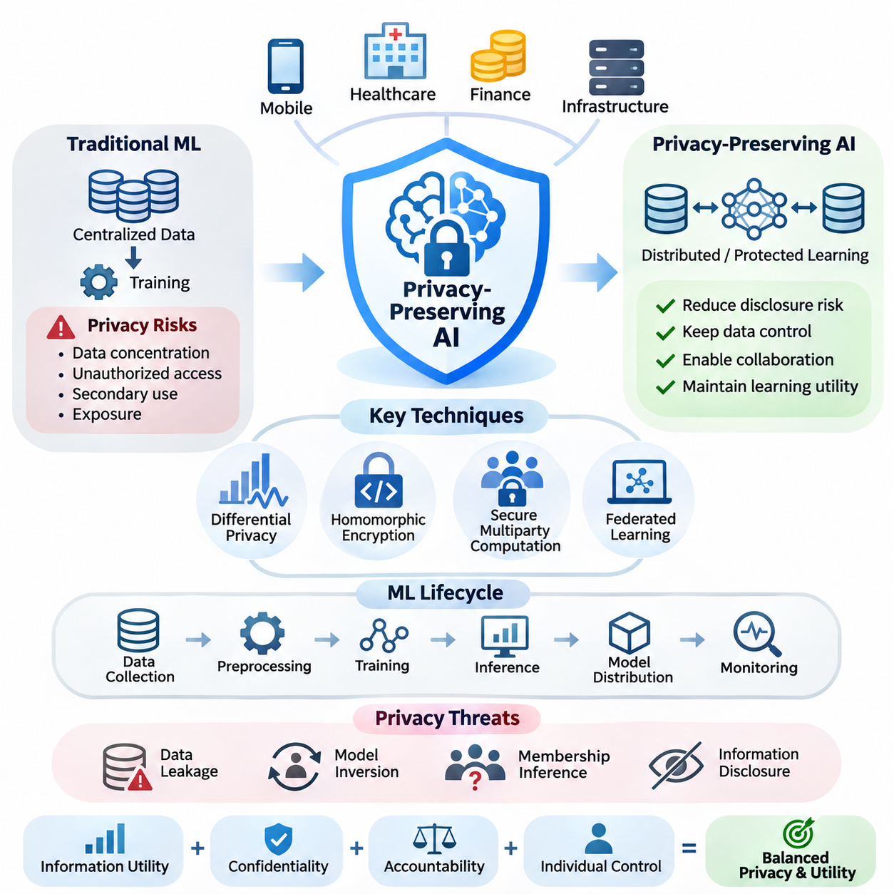
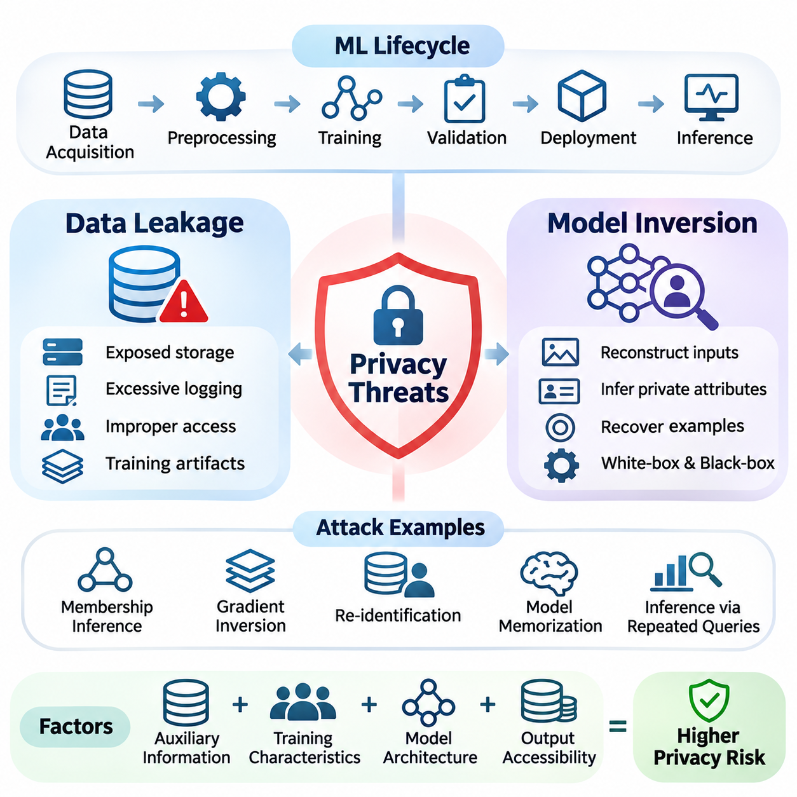
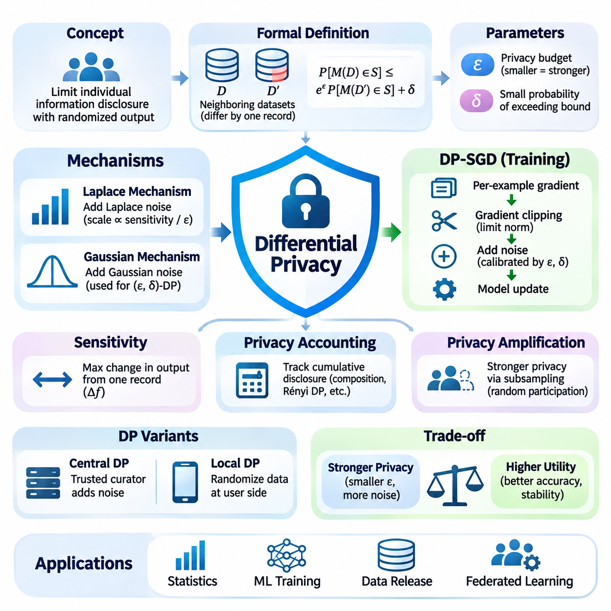
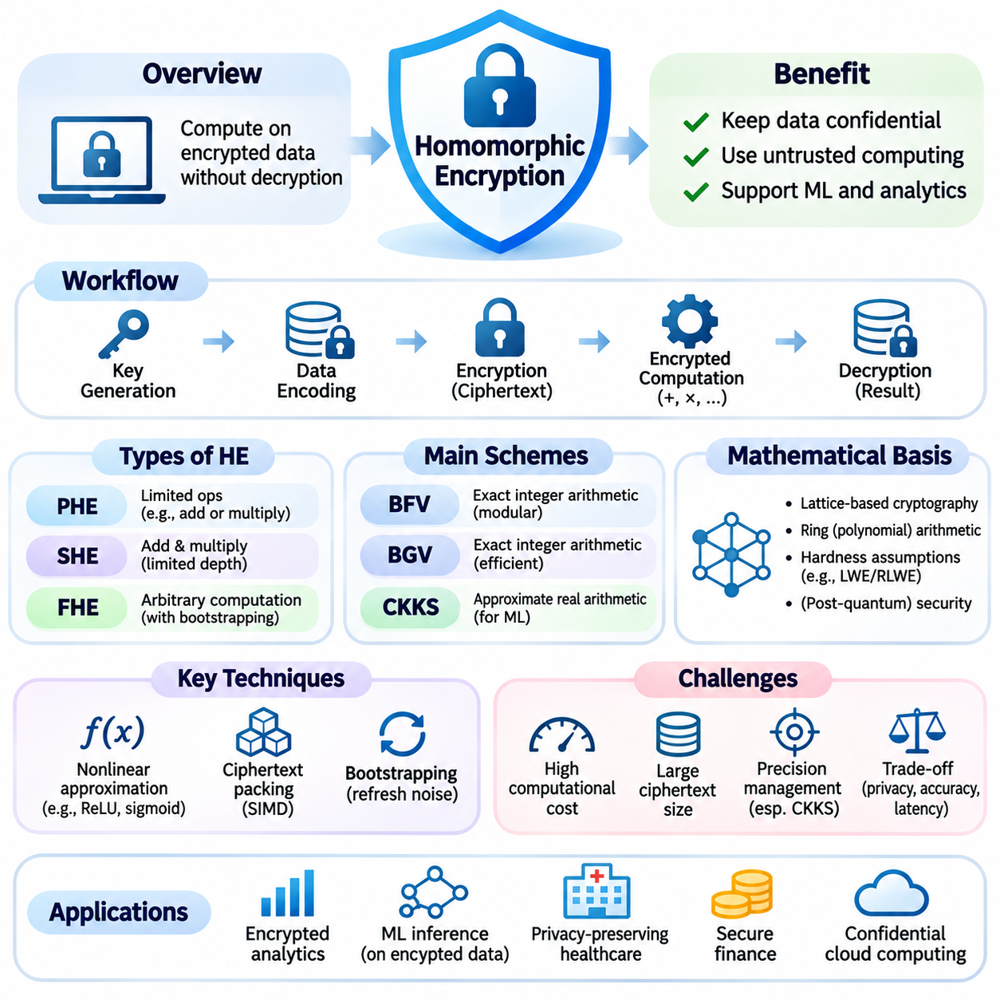
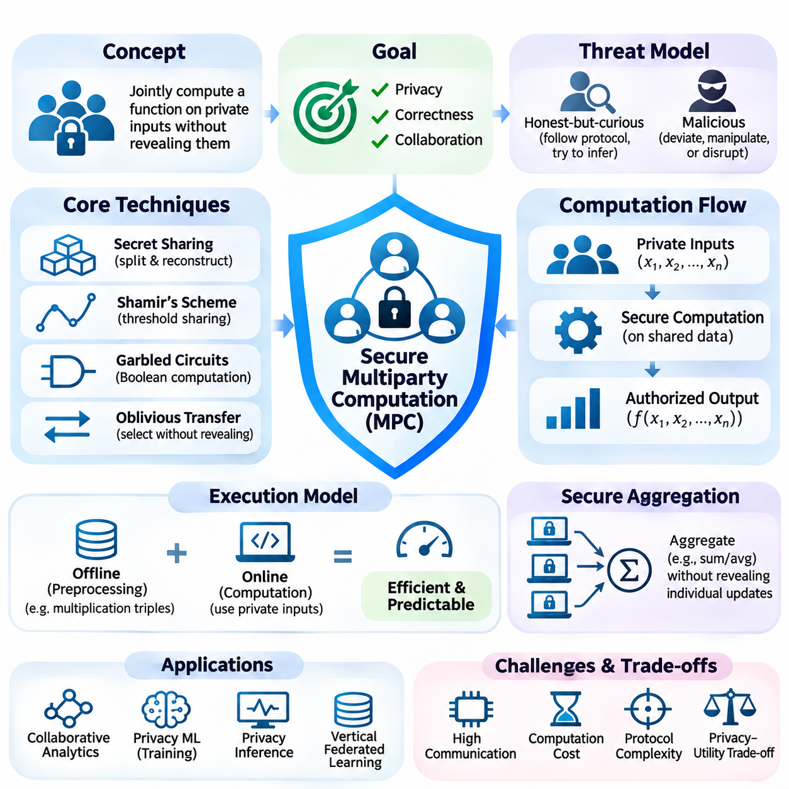
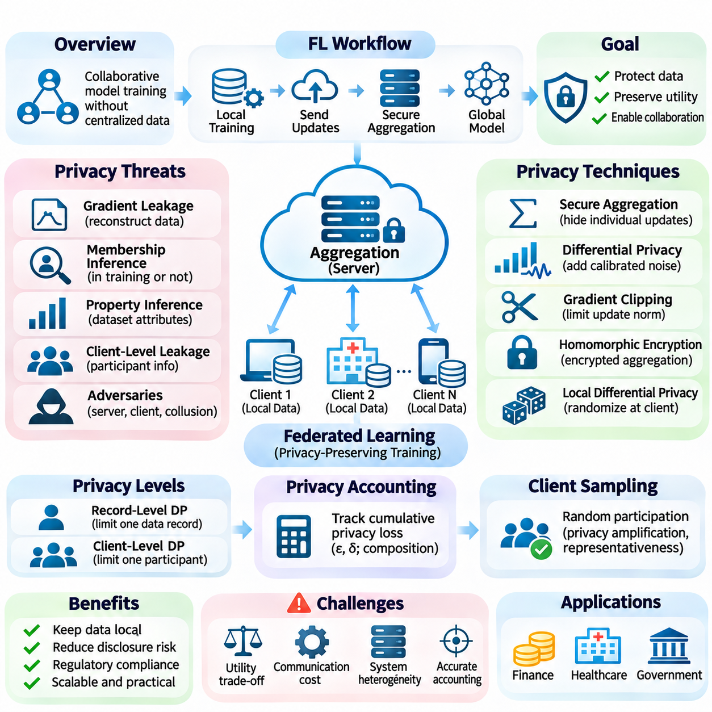
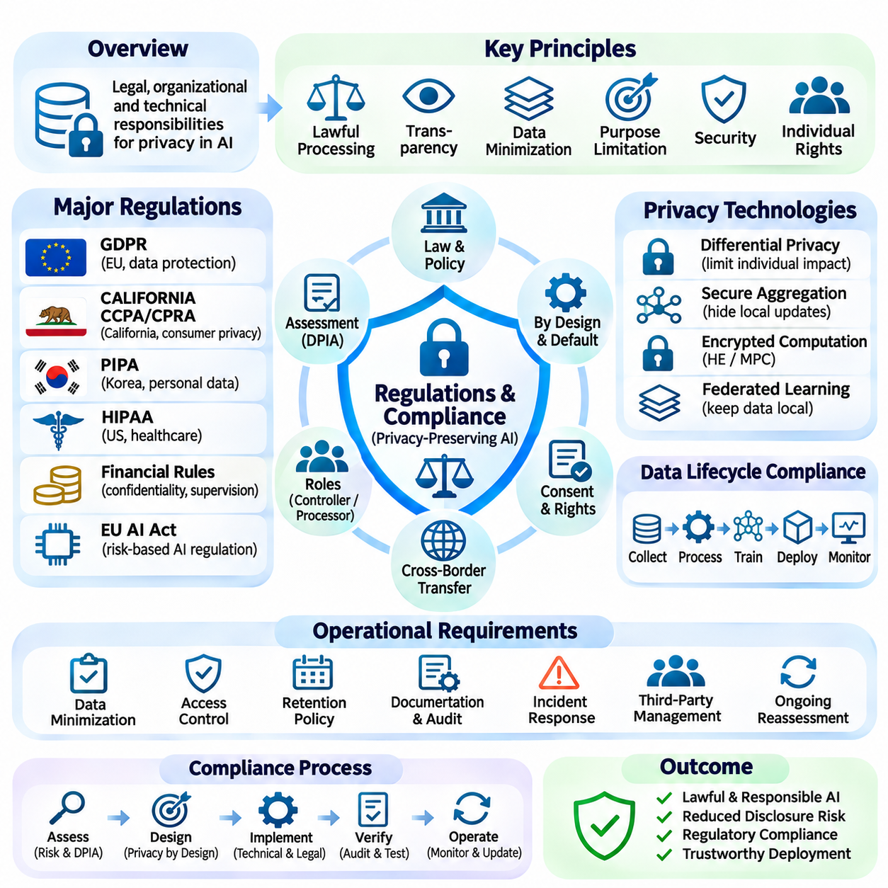
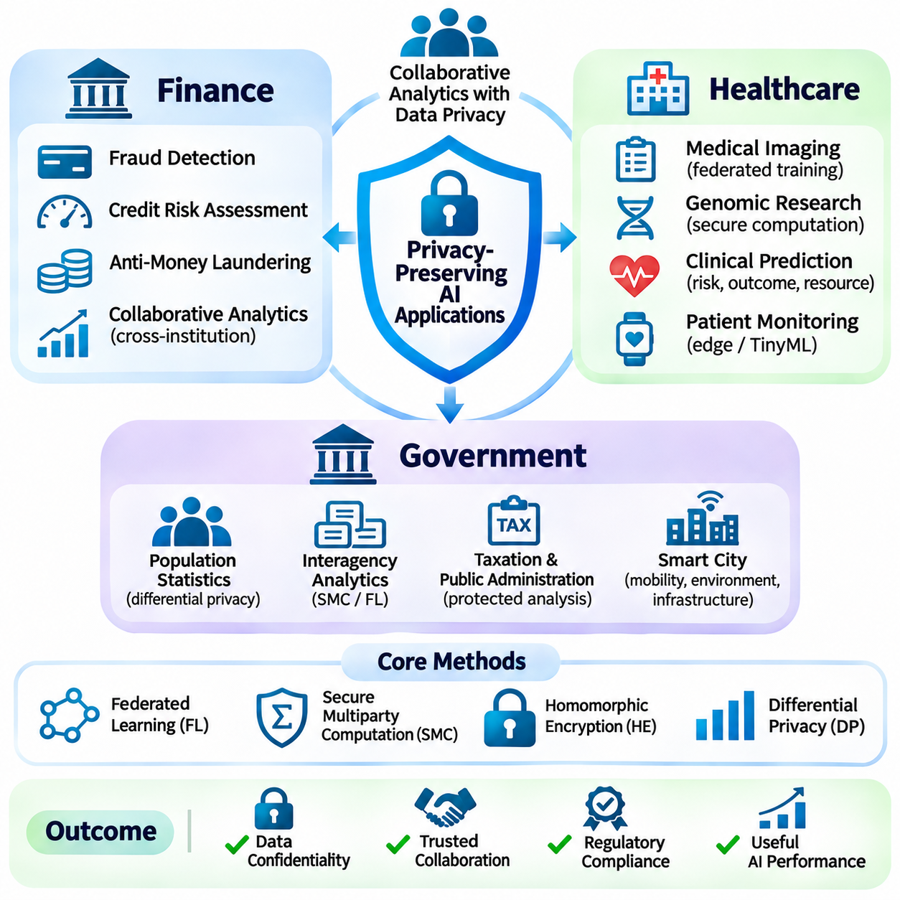

**Volume 40.** **TinyML and Federated Learning**

# 03. Privacy Preserving AI

## 03.00 Overview

{width="7.268055555555556in" height="7.268055555555556in"}

프라이버시 보호 인공지능(Privacy-Preserving Artificial Intelligence)은 민감한 정보(Sensitive Information)의 무단 공개, 개인 식별 및 오용을 제한하면서 지능형 시스템(Intelligent Systems)이 데이터를 학습할 수 있도록 하는 기술에 중점을 둔다. 인공지능(AI)이 모바일 기기, 의료 플랫폼, 금융 서비스 및 분산 인프라에 통합되면서 개인정보 보호(Privacy Protection)는 선택적인 보안 기능이 아니라 시스템 아키텍처(System Architecture)의 핵심 요구사항으로 자리 잡고 있다.

전통적인 기계학습(Machine Learning)은 일반적으로 여러 출처에서 데이터를 수집하고 이를 중앙 집중식 저장소(Centralized Repository)로 전송하여 학습하는 방식에 의존한다. 이러한 접근법은 모델 개발을 단순화하지만, 데이터 집중(Data Concentration), 무단 접근(Unauthorized Access), 목적 외 사용(Secondary Use), 처리 과정에서의 정보 노출 등 심각한 프라이버시 위험을 발생시킨다. 프라이버시 보호 인공지능은 유용한 학습 능력을 유지하면서 이러한 위험을 줄이는 기술적 메커니즘을 도입한다.

프라이버시 보호 인공지능의 핵심 목표는 정보 활용성(Information Utility)과 기밀성(Confidentiality), 책임성(Accountability), 개인의 통제권(Individual Control) 사이에서 균형을 유지하는 것이다. 효과적인 시스템은 정당한 분석 작업을 불필요하게 제한하지 않으면서 민감한 기록을 보호해야 한다. 이를 위해 공격자의 능력(Adversarial Capabilities), 정보 공개 경로, 계산 오버헤드(Computational Overhead), 예측 성능 저하의 허용 범위를 명시적으로 고려해야 한다.

프라이버시 위협(Privacy Threats)은 데이터 수집, 전처리(Preprocessing), 학습(Training), 추론(Inference), 모델 배포(Model Distribution), 모니터링(Monitoring)을 포함한 기계학습 생명주기(Machine Learning Lifecycle) 전반에서 발생한다. 원본 기록에 직접 접근할 수 없더라도 학습된 모델은 학습 데이터셋(Training Dataset)에 관한 정보를 노출할 수 있다. 따라서 중간 표현(Intermediate Representations), 기울기(Gradients), 모델 매개변수(Model Parameters), 예측 출력(Prediction Outputs)을 통한 정보 유출까지 고려해야 한다.

데이터 유출(Data Leakage)은 기밀 정보가 의도하지 않은 경로를 통해 접근 가능해지는 광범위한 프라이버시 침해를 의미한다. 유출은 손상된 저장소, 노출된 통신 인터페이스, 잘못 구성된 로깅 시스템(Logging Systems), 공유 컴퓨팅 자원 등을 통해 발생할 수 있다. 기계학습에서는 학습 산출물(Training Artifacts)과 모델 응답(Model Responses)이 개별 학습 사례에 관한 정보를 보유할 수 있으므로 추가적인 공격 표면(Attack Surface)이 형성된다.

모델 역전 공격(Model Inversion Attack)은 공격자가 모델 출력이나 내부 표현을 분석하여 학습 데이터의 민감한 특성을 복원할 수 있음을 보여준다. 이와 관련된 멤버십 추론 공격(Membership Inference Attack)은 특정 기록이 모델 학습에 사용되었는지를 판단하려고 시도한다. 이러한 위협은 원시 데이터(Raw Data)의 전송이나 저장 여부뿐 아니라 모델에서 어떤 정보를 추론할 수 있는지까지 프라이버시 평가에 포함해야 함을 보여준다.

차등 프라이버시(Differential Privacy)는 공개되는 계산 결과에 개별 기록이 미치는 영향을 제한하기 위한 수학적 프레임워크(Mathematical Framework)를 제공한다. 신중하게 조정된 무작위성(Randomness)을 도입함으로써 특정 개인의 기록이 포함되거나 제외된 경우에도 출력의 통계적 특성이 유사하도록 만든다. 이러한 형식적 보장(Formal Guarantees)은 프라이버시 정의, 기여도 제한(Contribution Bounds), 메커니즘 설계 및 누적 프라이버시 지출(Cumulative Privacy Expenditure)에 따라 달라진다.

차등 프라이버시 메커니즘(Differential Privacy Mechanism)은 일반적으로 엡실론(Epsilon)과 델타(Delta) 매개변수로 표현되며, 이는 인접 데이터셋(Neighboring Datasets)에서 생성된 출력 사이에 허용되는 구별 가능성을 정량화한다. 더 작은 프라이버시 예산(Privacy Budget)은 일반적으로 더 강한 보호를 제공하지만 통계적 정확도(Statistical Accuracy)를 감소시킬 수 있다. 따라서 실제 구현에서는 클리핑 임계값(Clipping Threshold), 잡음 분포(Noise Distribution), 샘플링 절차 및 프라이버시 회계(Privacy Accounting)를 신중하게 선택해야 한다.

동형암호(Homomorphic Encryption)는 암호화된 정보를 평문(Plaintext)으로 복호화하지 않고도 특정 계산을 수행할 수 있도록 한다. 이러한 기능은 완전히 신뢰할 수 없는 컴퓨팅 인프라에서 민감한 데이터셋을 처리해야 하는 상황에 특히 유용하다. 암호화 방식(Encryption Scheme)에 따라 지원되는 연산은 제한적인 산술 연산(Arithmetic Operations)부터 보다 일반적인 계산 회로(Computational Circuits)까지 다양하게 구성될 수 있다.

동형암호는 기밀성 측면에서 장점이 있지만 상당한 계산 및 메모리 오버헤드(Computational and Memory Overhead)를 발생시킨다. 암호화된 표현(Encrypted Representations)은 평문보다 훨씬 커질 수 있으며, 비선형 신경망 연산(Nonlinear Neural Network Operations)에는 특수한 근사 기법(Approximation Techniques)이 필요할 수 있다. 따라서 실제 시스템 설계에서는 암호화 매개변수, 수치 정밀도(Numerical Precision), 지원 연산, 지연시간(Latency), 통신 비용을 평가해야 한다.

안전한 다자간 계산(Secure Multiparty Computation)은 여러 참여자가 각자의 비공개 입력(Private Inputs)을 허용된 범위 이상으로 공개하지 않으면서 공동으로 함수를 계산할 수 있도록 한다. 비밀 공유(Secret Sharing), 가블드 회로(Garbled Circuits), 암호학적 프로토콜(Cryptographic Protocols) 등의 기술은 계산 책임을 참여자들에게 분산한다. 이러한 기술의 보안 특성은 참여자의 행동, 공모 가능성(Collusion), 통신 무결성(Communication Integrity)에 관한 가정에 따라 달라진다.

안전한 다자간 계산은 조직들이 상호 보완적인 데이터셋을 보유하고 있지만 원본 기록을 교환할 수 없는 상황에서 특히 유용하다. 금융기관은 의심스러운 거래 패턴을 공동 분석할 수 있으며, 의료기관은 접근이 제한된 데이터셋에 대한 집계 통계(Aggregate Statistics)를 계산할 수 있다. 이러한 협업을 위해서는 출력 결과, 신뢰 가정(Trust Assumptions), 최종 결과를 통한 의도하지 않은 정보 공개를 방지하는 메커니즘을 명확히 정의해야 한다.

연합학습(Federated Learning)은 원시 학습 데이터셋을 중앙 서버로 일상적으로 전송하지 않고도 협력적인 모델 학습을 수행할 수 있는 아키텍처 기반을 제공한다. 참여 기기나 기관은 로컬 최적화(Local Optimization)를 수행하고 모델 업데이트(Model Updates) 또는 관련 정보를 교환한다. 그러나 데이터를 로컬에 유지하는 것만으로 프라이버시가 자동 보장되는 것은 아니다. 기울기와 매개변수 업데이트를 통해 민감한 학습 특성이 노출될 수 있기 때문이다.

연합학습의 프라이버시 보호는 일반적으로 보안 집계(Secure Aggregation), 차등 프라이버시(Differential Privacy), 암호화 통신(Encrypted Communication), 신중하게 설계된 클라이언트 참여 정책(Client Participation Policies)을 결합한다. 보안 집계는 특정 보안 가정 아래에서 조정 서버(Coordinating Server)가 개별 클라이언트 업데이트를 직접 확인하지 못하도록 한다. 차등 프라이버시는 공개된 모델에서 특정 기록이나 참여자에게 귀속될 수 있는 정보를 추가로 제한할 수 있다.

프라이버시 메커니즘의 통합은 통신 효율성(Communication Efficiency), 수렴 동작(Convergence Behavior), 모델 정확도(Model Accuracy), 자원 소비(Resource Consumption) 사이에서 중요한 공학적 절충(Engineering Tradeoffs)을 발생시킨다. 암호화는 처리 요구량을 증가시키며, 프라이버시 잡음(Privacy Noise)은 특히 작거나 이질적인 데이터셋에서 학습 안정성(Learning Stability)에 영향을 줄 수 있다. 분산 시스템은 불안정한 참여자, 변화하는 네트워크 상태, 불균등한 계산 능력도 고려해야 한다.

초소형 기계학습(TinyML)과 온디바이스 학습(On-Device Learning)은 센서 관측값과 개인정보를 원래의 데이터 발생 위치 가까이에 유지함으로써 프라이버시 중심 계산(Privacy-Aware Computation)의 기회를 확대한다. 스마트폰, 웨어러블 기기(Wearable Devices), 임베디드 제어기(Embedded Controllers)는 원시 관측값을 지속적으로 업로드하지 않고 로컬 추론(Local Inference)을 수행할 수 있다. 그러나 로컬 저장소, 모델 업데이트, 원격 측정(Telemetry), 물리적 기기 침해는 여전히 중요한 프라이버시 위험으로 남는다.

프라이버시 보호 인공지능에서는 프라이버시(Privacy), 보안(Security), 규제 준수(Regulatory Compliance)를 명확히 구분해야 한다. 보안 메커니즘은 무단 작업으로부터 시스템을 보호하는 반면, 프라이버시 메커니즘은 정보의 수집, 처리 및 공개를 제한한다. 규제 준수는 적용되는 관할권(Jurisdictions) 내에서 적법한 처리, 투명성(Transparency), 보존 기간(Retention), 개인의 권리 및 책임성에 관한 조직적 의무를 규정한다.

일반 데이터 보호 규정(General Data Protection Regulation, GDPR)과 같은 규제 프레임워크(Regulatory Frameworks)는 인공지능 데이터 처리 및 시스템 거버넌스(System Governance)에 영향을 미치는 요구사항을 제시한다. 조직은 처리의 법적 근거(Legal Basis), 목적 제한(Purpose Limitation), 데이터 최소화(Data Minimization), 위험에 적합한 보호조치를 평가해야 한다. 기술적 프라이버시 메커니즘은 이러한 의무의 이행을 지원할 수 있지만, 기술을 도입했다는 사실만으로 법적 준수가 자동으로 성립하지는 않는다.

프라이버시 엔지니어링(Privacy Engineering)은 보호해야 할 정보, 관련 참여자, 잠재적 공격자, 허용 가능한 계산 결과를 식별하는 것에서 시작한다. 위협 모델(Threat Model)은 공격자가 관찰할 수 있는 정보, 침해될 가능성이 있는 구성요소, 기밀로 유지해야 하는 정보를 설명해야 한다. 이러한 가정은 차등 프라이버시, 암호학적 계산(Cryptographic Computation), 접근 제어(Access Controls), 아키텍처 격리(Architectural Isolation)의 선택 기준이 된다.

평가(Evaluation)는 프라이버시 보장과 인공지능 시스템의 운영 성능(Operational Performance)을 모두 검토해야 한다. 주요 측정 지표에는 공격 성공률(Attack Success Rate), 프라이버시 예산, 예측 정확도(Predictive Accuracy), 암호화 오버헤드(Encryption Overhead), 통신량(Communication Volume), 추론 지연시간(Inference Latency)이 포함된다. 알려진 공격에 대한 실험적 저항성(Empirical Resistance)이 모든 공격에 대한 보편적인 보호를 증명하지는 않으므로 형식적 보장과 실험적 결과를 구분해야 한다.

금융 분야(Financial Applications)에서는 거래 분석(Transaction Analysis), 사기 탐지(Fraud Detection), 위험 평가(Risk Assessment), 기관 간 정보 협력에 프라이버시 보호 인공지능을 활용할 수 있다. 기밀성 요구사항은 고객 기록의 직접적인 공유를 제한하는 경우가 많으므로 보호된 협업 계산(Protected Collaborative Computation)이 매력적인 대안이 된다. 실제 배포에서는 거래 정보의 민감성, 기관 간 신뢰 경계(Trust Boundaries), 감사 가능성(Auditability), 잘못된 예측의 운영상 결과를 고려해야 한다.

의료 분야(Healthcare Applications)에서는 병력(Medical Histories), 진단 영상(Diagnostic Images), 생리학적 측정값(Physiological Measurements), 환자 식별자(Patient Identifiers)를 특히 신중하게 처리해야 한다. 프라이버시 보호 학습(Privacy-Preserving Learning)은 민감한 기록의 불필요한 이동을 줄이면서 병원 간 공동 연구를 지원할 수 있다. 효과적인 구현을 위해서는 환자 수준의 정보 유출, 소규모 임상 데이터셋(Clinical Datasets), 기관 거버넌스(Institutional Governance), 의료 예측의 신뢰성을 고려해야 한다.

정부 분야(Government Applications)에는 공중보건 분석(Public Health Analysis), 통계 보고(Statistical Reporting), 인프라 관리(Infrastructure Management), 기관 간 정보 처리가 포함된다. 프라이버시 보호 기술은 개인정보의 불필요한 공개를 제한하면서 유용한 집계 정보를 추출하도록 지원할 수 있다. 이러한 시스템은 공공 책임성(Public Accountability), 적법한 권한(Lawful Authorization), 보존 정책(Retention Policies), 행정 데이터베이스 간 정보 연결로 발생할 수 있는 결과까지 다루어야 한다.

단일 프라이버시 보호 기술만으로 모든 위협을 완전히 방어할 수는 없다. 차등 프라이버시는 특정 형태의 정보 공개를 제한하고, 암호화(Encryption)는 선택된 계산 표현을 보호하며, 안전한 다자간 계산은 협업 처리 과정에서 비공개 입력에 대한 접근을 제한한다. 이러한 상호 보완적 특성은 명시적인 보안 및 프라이버시 목표에 따라 기술적 통제를 선택하는 계층형 아키텍처(Layered Architecture)의 필요성을 뒷받침한다.

프라이버시 보호 인공지능의 장기적인 중요성은 개별 데이터 유출 사고를 방지하는 수준을 넘어선다. 이는 조직이 신뢰 경계(Trust Boundaries)를 넘어 협력할 수 있도록 하고, 분산 지능(Distributed Intelligence)의 책임 있는 배포를 지원하며, 데이터 집약적 기술(Data-Intensive Technologies)에 대한 신뢰를 강화한다. 이러한 이점을 실현하려면 수학적 보장(Mathematical Guarantees), 암호학적 프로토콜(Cryptographic Protocols), 효율적인 구현(Efficient Implementation), 규제 거버넌스(Regulatory Governance), 지속적인 프라이버시 평가(Continuous Privacy Evaluation)를 인공지능 생명주기(AI Lifecycle) 전반에 통합해야 한다.

## 03.01 Privacy Threats

{width="7.268055555555556in" height="7.268055555555556in"}

인공지능(AI)의 프라이버시 위협(Privacy Threats)은 데이터, 모델 및 컴퓨팅 인프라(Computational Infrastructure)와의 의도하지 않은 상호작용을 통해 민감한 정보(Sensitive Information)에 접근하거나 이를 추론 또는 복원할 수 있을 때 발생한다. 이러한 위협은 기계학습(Machine Learning) 시스템이 개별 학습 사례에 관한 통계적 정보를 보유할 수 있다는 점에서 기존 사이버보안 사고(Cybersecurity Incidents)의 범위를 넘어선다. 따라서 프라이버시 위험을 이해하려면 직접적인 데이터 노출과 간접적인 정보 추출(Information Extraction)을 모두 검토해야 한다.

프라이버시 위협 환경(Privacy Threat Landscape)은 데이터 수집(Data Acquisition), 전처리(Preprocessing), 학습(Training), 검증(Validation), 배포(Deployment), 추론(Inference)을 포함한 기계학습 생명주기(Machine Learning Lifecycle) 전체에 걸쳐 존재한다. 민감한 정보는 원시 데이터셋(Raw Datasets), 특징 표현(Feature Representations), 중간 활성화값(Intermediate Activations), 기울기(Gradients), 모델 매개변수(Model Parameters), 예측 출력(Prediction Outputs)에 포함될 수 있다. 각 구성요소는 공격자의 능력과 시스템 아키텍처에 따라 평가해야 하는 서로 다른 정보 노출 경로를 형성한다.

데이터 유출(Data Leakage)은 기술적 취약점(Technical Vulnerabilities), 운영상의 실수(Operational Mistakes), 의도하지 않은 모델 동작(Model Behavior)을 통해 기밀 정보가 권한 없는 사용자에게 공개되는 현상을 의미한다. 일반적인 사례로는 노출된 데이터베이스, 안전하지 않은 저장소, 과도한 로깅(Excessive Logging), 잘못 구성된 접근 권한(Access Permissions)이 있다. 인공지능 시스템에서는 학습된 매개변수와 계산 산출물(Computational Artifacts)이 개별 학습 기록에 관한 정보를 인코딩할 수 있으므로 추가적인 유출 경로가 발생한다.

데이터 준비(Data Preparation) 과정에서는 개인 식별 정보(Personally Identifiable Information)가 충분히 제거되지 않거나 익명화된 기록(Anonymized Records)이 외부 데이터셋과 연결될 수 있을 때 프라이버시 위험이 발생한다. 이름이나 계좌번호와 같은 직접 식별자(Direct Identifiers)만이 정보 노출의 원인은 아니다. 위치 이력(Location Histories), 타임스탬프(Timestamps), 행동 패턴(Behavioral Patterns), 인구통계학적 속성(Demographic Attributes)의 조합은 명시적인 식별자가 삭제된 이후에도 재식별(Re-identification)을 가능하게 할 수 있다.

학습 파이프라인(Training Pipelines)은 캐시된 데이터셋(Cached Datasets), 임시 파일(Temporary Files), 실험 추적 시스템(Experiment Tracking Systems), 공유 컴퓨팅 환경(Shared Computational Environments)을 통해 추가적인 정보 유출 가능성을 만든다. 디버깅 출력(Debugging Outputs)에 민감한 학습 사례가 의도치 않게 포함될 수 있으며, 모델 체크포인트(Model Checkpoints)는 접근이 제한된 데이터셋에서 파생된 정보를 보존할 수 있다. 효과적인 보호를 위해서는 학습 산출물에 대한 접근 통제, 보존 정책(Retention Policies), 처리 단계 간 정보 이동의 모니터링이 필요하다.

분산학습(Distributed Learning)과 연합학습(Federated Learning)은 중앙 집중식 원시 데이터 수집 대신 교환되는 모델 업데이트(Model Updates)와 관련된 프라이버시 위험을 발생시킨다. 특히 배치 크기(Batch Size)가 작거나 공격자가 상당한 보조 지식(Auxiliary Knowledge)을 보유한 경우, 기울기(Gradients)를 통해 로컬 학습 사례의 특성이 노출될 수 있다. 기울기 역전 공격(Gradient Inversion Attacks)은 관찰된 업데이트에서 입력 특성을 복원하려고 시도하며, 로컬 데이터 저장만으로는 기밀성(Confidentiality)이 보장되지 않음을 보여준다.

추론 인터페이스(Inference Interfaces)는 외부 사용자가 배포된 모델에 반복적으로 질의하고 응답을 관찰할 수 있으므로 또 다른 중요한 정보 유출 경로를 형성한다. 예측 확률(Prediction Probabilities), 신뢰도 점수(Confidence Scores), 임베딩(Embeddings), 생성된 출력(Generated Outputs)은 의도된 작업 범위를 넘어서는 정보를 노출할 수 있다. 공격자는 반복 질의(Repeated Queries), 정교하게 선택된 입력, 통계적 비교(Statistical Comparisons)를 활용하여 학습 데이터 분포나 개별 기록에 관한 정보를 추출할 수 있다.

모델 역전 공격(Model Inversion Attacks)은 학습된 모델에 인코딩된 정보를 악용하여 학습 데이터의 민감한 특성을 복원하는 것을 목표로 한다. 공격 환경에 따라 공격자는 대표적인 입력(Representative Inputs)을 재구성하거나 비공개 속성(Private Attributes)을 추론하거나 특정 학습 사례를 근사적으로 복원할 수 있다. 복원 가능성은 모델 아키텍처(Model Architecture), 출력 접근성(Output Accessibility), 학습 특성(Training Characteristics), 공격자의 사전 지식(Background Knowledge)에 따라 달라진다.

일반적인 모델 역전 공격 시나리오에서는 공격자가 분류기(Classifier)의 출력을 관찰하고 특정 클래스(Class)나 신원(Identity)에 해당하는 응답을 생성하는 입력을 탐색한다. 최적화 기법(Optimization Techniques)은 선택된 예측 점수(Prediction Scores)를 최대화하도록 후보 입력을 반복적으로 수정할 수 있다. 그 결과 생성된 복원 데이터(Reconstructed Data)는 식별 가능한 특징을 드러낼 수 있지만, 반드시 원본 학습 데이터셋의 특정 기록을 정확하게 재현하는 것은 아니다.

화이트박스 모델 역전(White-Box Model Inversion)은 공격자가 매개변수, 기울기 또는 중간 활성화값을 포함한 모델 내부 정보에 접근할 수 있다고 가정한다. 이러한 접근 권한은 미분 가능한 모델 구조(Differentiable Model Structures)를 직접 활용하는 최적화 절차를 가능하게 한다. 반면 블랙박스 공격(Black-Box Attacks)은 접근 가능한 예측 인터페이스에 의존하며, 질의 기반 최적화(Query-Based Optimization), 대리 모델(Surrogate Models), 사전 지식(Prior Knowledge)을 활용하여 민감한 입력 특성을 추정할 수 있다.

모델 역전(Model Inversion)과 멤버십 추론(Membership Inference)의 차이를 이해하는 것은 프라이버시 보호 목표를 정의하는 데 중요하다. 모델 역전은 데이터 속성이나 입력 표현(Input Representations)에 관한 정보를 복원하려는 반면, 멤버십 추론은 특정 사례가 모델 학습에 참여했는지를 판단한다. 두 공격은 관련된 통계적 신호(Statistical Signals)를 활용할 수 있지만 서로 다른 질문에 답하며 별도의 평가 절차(Evaluation Procedures)가 필요하다.

모델 암기(Model Memorization)는 학습 알고리즘(Learning Algorithms)이 개별 학습 사례에 관한 지나치게 상세한 정보를 보존할 때 프라이버시 노출을 증가시킨다. 과매개변수화된 모델(Overparameterized Models)은 특정 조건에서 희귀한 시퀀스(Rare Sequences), 특징적인 이미지(Distinctive Images), 민감한 패턴(Sensitive Patterns)을 재생성할 수 있다. 그러나 암기와 복원(Reconstruction)은 동일한 현상이 아니며, 성공적인 추출은 암기된 정보의 접근 가능성과 공격자의 전략에 따라 달라진다.

프라이버시 공격은 공격자가 모델 동작을 해석하는 능력을 높여 주는 보조 정보(Auxiliary Information)에 의존하는 경우가 많다. 공개 데이터셋(Public Datasets), 이전에 공개된 기록, 모집단 통계(Population Statistics), 학습 절차에 관한 지식은 보호된 속성에 대한 불확실성을 줄일 수 있다. 따라서 프라이버시 평가에서는 공격자가 사전 지식 없이 행동한다고 가정하거나 익명화(Anonymization)가 모든 데이터 연결 가능성을 제거한다고 판단해서는 안 된다.

공격 효과(Attack Effectiveness)는 기본 데이터 분포(Data Distribution)의 특성에도 영향을 받는다. 소규모 데이터셋, 희귀 사례(Rare Examples), 매우 특징적인 속성(Highly Distinctive Features), 불균형 클래스(Imbalanced Classes)는 특정 조건에서 취약성을 증가시킬 수 있다. 반대로 모델 출력이 제한적인 정보만 제공하거나 서로 다른 입력들이 유사한 예측을 생성하면 복원 품질(Reconstruction Quality)이 저하될 수 있다. 이러한 관계는 보편적인 가정보다 실험적 조사(Empirical Investigation)를 통해 확인해야 한다.

프라이버시 위험 평가(Privacy Risk Assessment)에서는 공격자의 접근 수준(Access Level), 목표(Objectives), 사용 가능한 자원(Available Resources), 관찰 가능한 정보(Observable Information)를 구분해야 한다. 위협 모델(Threat Model)은 외부 API 사용자, 악의적인 학습 참여자(Malicious Training Participants), 침해된 서버(Compromised Servers), 특권 접근 권한을 가진 내부자(Privileged Insiders)를 고려할 수 있다. 각 시나리오는 데이터 유출과 모델 역전의 실현 가능성을 변화시키므로 명확한 신뢰 경계(Trust Boundaries)를 설정하는 것이 의미 있는 보안 분석의 필수 조건이다.

데이터 유출에 대한 방어 수단(Defensive Measures)에는 접근 제어(Access Control), 암호화(Encryption), 안전한 저장소(Secure Storage), 데이터 최소화(Data Minimization), 계산 산출물 관리(Computational Artifact Management)가 포함된다. 민감한 정보는 불필요한 로그, 임시 데이터셋, 공개적으로 접근 가능한 인터페이스에서 제외해야 한다. 암호화는 적절한 조건에서 데이터를 보호하지만, 승인된 모델 출력이나 침해된 처리 환경을 통한 정보 유출까지 자동으로 방지하지는 않는다.

차등 프라이버시(Differential Privacy)는 개별 학습 기록이 공개된 모델 동작에 미치는 영향을 제한함으로써 보완적인 방어 수단을 제공한다. 적절하게 구성된 메커니즘은 수학적으로 정의된 프라이버시 보장(Mathematically Defined Privacy Guarantees)을 통해 특정 멤버십 추론 및 복원 위험을 줄일 수 있다. 그러나 보호 수준은 프라이버시 매개변수(Privacy Parameters), 인접 데이터셋 정의(Neighboring-Dataset Definition), 구현의 정확성(Implementation Correctness), 반복적인 정보 공개에 대한 회계(Accounting)에 따라 달라진다.

보안 집계(Secure Aggregation)와 암호학적 계산(Cryptographic Computation)은 협업 학습 환경(Collaborative Learning Environments)에서 정보 노출을 추가로 줄일 수 있다. 보안 집계는 개별 참여자의 업데이트에 대한 가시성을 제한하며, 안전한 다자간 계산(Secure Multiparty Computation)과 동형암호(Homomorphic Encryption)는 보호된 정보에 대한 특정 연산을 지원한다. 이러한 기술은 서로 다른 신뢰 가정(Trust Assumptions)을 다루므로 집계 출력(Aggregate Outputs)과 최종 학습 모델(Final Trained Models)에서 발생할 수 있는 정보 유출도 함께 평가해야 한다.

모델 수준의 방어(Model-Level Defenses)는 예측 정보의 상세도를 제한하고, 질의 빈도(Query Frequency)를 통제하며, 불필요한 신뢰도 정보 노출을 줄이거나 의심스러운 상호작용 패턴(Suspicious Interaction Patterns)을 모니터링할 수 있다. 이러한 조치는 특정 공격의 난도를 높일 수 있지만 일반적으로 형식적인 프라이버시 보장(Formal Privacy Guarantees)을 제공하지는 않는다. 지나친 제한은 정상적인 기능도 저하시킬 수 있으므로 애플리케이션 요구사항(Application Requirements)과 공격자의 적응(Adversarial Adaptation)을 신중하게 고려해야 한다.

데이터 유출 평가(Data Leakage Evaluation)에서는 데이터셋, 학습 시스템, 통신 채널(Communication Channels), 배포된 모델, 운영 로그(Operational Logs)를 통과하는 전체 정보 흐름(Information Flow)을 검토해야 한다. 보안 테스트(Security Testing)에는 구성 검토(Configuration Reviews), 접근 감사(Access Audits), 산출물 검사(Artifact Inspection), 통제된 적대적 실험(Controlled Adversarial Experiments)이 포함되어야 한다. 목표는 명백한 정보 공개 경로뿐 아니라 기계학습 연산으로 형성되는 간접적인 유출 경로까지 식별하는 것이다.

모델 역전 평가(Model Inversion Evaluation)는 일반적으로 복원 충실도(Reconstruction Fidelity), 속성 복원 정확도(Attribute Recovery Accuracy), 공격 성공 확률(Attack Success Probability), 질의 요구량(Query Requirements), 계산 비용(Computational Cost)을 검토한다. 복원된 출력은 모집단 수준 정보(Population-Level Information)만을 사용한 기준 복원(Baseline Reconstruction)을 고려하면서 적절한 참조 데이터(Reference Data)와 비교해야 한다. 높은 시각적 유사성(Visual Similarity)만으로 특정 비공개 학습 사례가 실제로 복원되었다고 판단할 수는 없다.

프라이버시 평가(Privacy Evaluation)는 보호 강도(Protection Strength)와 모델 활용성(Model Utility) 사이의 관계도 고려해야 한다. 잡음 주입(Noise Injection), 출력 제한(Output Restrictions), 암호학적 처리(Cryptographic Processing), 정보 공유 축소(Reduced Information Sharing)는 정확도, 지연시간(Latency), 통신 오버헤드(Communication Overhead), 계산 효율성(Computational Efficiency)에 영향을 줄 수 있다. 이러한 절충 관계는 메모리, 처리 능력, 에너지 가용성(Energy Availability)이 제한된 초소형 기계학습(TinyML) 및 엣지 인공지능(Edge AI) 환경에서 특히 중요하다.

의료 시스템(Healthcare Systems)에서는 진단 모델(Diagnostic Models)에서 환자의 특성을 복원하거나 협업 학습 업데이트(Collaborative Training Updates)를 통해 민감한 정보가 공개되는 프라이버시 위협이 발생할 수 있다. 금융 애플리케이션(Financial Applications)은 거래 이력(Transaction Histories), 계좌 행동(Account Behavior), 기밀 위험 지표(Confidential Risk Indicators)와 관련된 위험에 직면한다. 정부 시스템(Government Systems)은 행정 기록(Administrative Records)의 연결과 민감한 모집단 수준 정보(Population-Level Information)의 노출이 초래할 결과도 고려해야 한다.

운영 단계의 프라이버시 보호(Operational Privacy Protection)는 모델, 데이터셋 및 인터페이스가 변화함에 따라 위협도 진화하므로 지속적인 모니터링(Continuous Monitoring)이 필요하다. 모델 업데이트(Model Updates)는 암기 동작(Memorization Behavior)을 변화시킬 수 있으며, 새롭게 공개된 외부 데이터셋은 재식별 공격(Re-identification Attacks)의 효과를 높일 수 있다. 또한 확장된 API 기능은 추가적인 정보 신호를 노출할 수 있으므로 프라이버시 테스트를 배포 검토(Deployment Reviews), 사고 대응 절차(Incident Response Procedures), 지속적인 모델 거버넌스(Model Governance)에 통합해야 한다.

데이터 유출(Data Leakage)과 모델 역전(Model Inversion)은 프라이버시 보호가 원시 데이터셋을 숨기는 것만으로 달성될 수 없음을 보여준다. 기존 저장소 보호 조치(Storage Controls)가 정상적으로 유지되더라도 중간 계산(Intermediate Computations), 학습된 표현(Learned Representations), 협업 업데이트(Collaborative Updates), 예측 인터페이스(Prediction Interfaces)를 통해 정보가 노출될 수 있다. 효과적인 프라이버시 보호 인공지능(Privacy-Preserving AI)을 구현하려면 계층화된 기술적 보호조치(Layered Technical Safeguards), 명시적인 공격자 가정(Adversarial Assumptions), 엄격한 평가(Rigorous Evaluation), 전체 생명주기에 걸친 거버넌스(Lifecycle-Wide Governance)가 필요하다.

## 03.02 Differential Privacy [w/Code]

{width="7.268055555555556in" height="7.268055555555556in"}

차등 프라이버시(Differential Privacy)는 통계 분석(Statistical Analysis) 결과나 기계학습 모델(Machine Learning Models)이 공개될 때 개인에 관한 정보의 노출을 제한하기 위해 설계된 수학적 프레임워크(Mathematical Framework)이다. 핵심 원리는 특정 개인의 데이터가 포함되거나 제외되더라도 계산 결과의 관찰 가능한 출력(Observable Output)이 크게 달라지지 않아야 한다는 것이다. 이는 단순히 신원을 숨기거나 접근을 제한하는 방식에 의존하지 않고 프라이버시 보호(Privacy Protection)를 형식적으로 보장하는 접근법을 제공한다.

전통적인 익명화 기법(Anonymization Techniques)은 직접 식별자(Direct Identifiers)를 제거하지만 보조 정보(Auxiliary Information)를 통한 재식별(Re-identification)에 여전히 취약할 수 있다. 차등 프라이버시는 계산 결과에 통제된 무작위성(Controlled Randomness)을 도입하여 이러한 한계를 해결한다. 모든 상황에서 개별 기록을 식별할 수 없다고 보장하는 대신, 보호된 계산으로부터 관찰자가 추가로 추론할 수 있는 정보의 양을 수학적으로 제한한다.

차등 프라이버시의 형식적 정의(Formal Definition)는 인접 데이터셋(Neighboring Datasets)에 무작위화 메커니즘(Randomized Mechanism)을 적용했을 때 생성되는 출력 분포(Output Distributions)를 비교한다. 두 데이터셋은 하나의 기록을 추가하거나 제거하는 것과 같이 명시된 개인 기여도(Individual Contribution)에 따라 차이가 있을 때 인접한 것으로 간주한다. 모든 가능한 출력의 발생 확률이 이러한 인접 데이터셋 사이에서 충분히 유사하게 유지되면 해당 메커니즘은 차등 프라이버시를 만족한다.

차등 프라이버시는 일반적으로 엡실론(Epsilon)과 델타(Delta) 매개변수를 사용하여 표현한다. 엡실론은 출력 확률 사이의 차이에 대한 곱셈적 경계(Multiplicative Bound)를 나타내며, 델타는 순수 프라이버시 경계(Pure Privacy Bound)를 초과할 수 있는 작은 가산적 확률(Additive Probability)을 허용한다. 일반적으로 엡실론 값이 작을수록 더 강한 프라이버시 보호를 의미하지만, 실제 해석은 인접 관계(Neighboring Relation), 데이터 기여도 제한(Data Contribution Limits), 전체 시스템 구성에 따라 달라진다.

프라이버시 예산(Privacy Budget)은 보호된 계산 전반에 걸쳐 누적되는 정보 공개의 허용량을 나타낸다. 차등 프라이버시가 적용된 각 질의(Query)나 학습 연산은 사용된 메커니즘과 회계 방법(Accounting Method)에 따라 예산의 일부를 소비할 수 있다. 반복적인 결과 공개(Repeated Releases)는 전체 보호 수준을 약화시킬 수 있으므로, 지속적으로 데이터를 분석하거나 기계학습 모델을 업데이트하는 시스템에서는 프라이버시 회계(Privacy Accounting)가 필수적이다.

민감도(Sensitivity)는 인접 데이터셋 정의에 따라 한 개인의 기여도가 변경될 때 함수의 출력이 얼마나 크게 달라질 수 있는지를 측정한다. 민감도가 높은 함수는 일반적으로 동일한 프라이버시 보장을 달성하기 위해 더 강한 무작위화(Randomization)가 필요하다. 따라서 개인별 기여도를 제한하고 극단적인 값(Extreme Values)의 영향을 줄이는 것은 정확하면서도 프라이버시를 보호하는 통계적 메커니즘(Statistical Mechanisms)을 설계하는 데 중요한 단계이다.

라플라스 메커니즘(Laplace Mechanism)은 수치 질의 결과(Numerical Query Results)에 라플라스 분포(Laplace Distribution)에서 추출한 잡음(Noise)을 추가하여 차등 프라이버시를 제공한다. 잡음의 크기(Noise Scale)는 함수의 민감도와 선택된 엡실론 값에 따라 결정된다. 이 메커니즘은 민감도를 제한할 수 있고 의도한 프라이버시 정의가 해당 가정과 일치하는 경우 개수(Counts), 합계(Sums), 기타 수치 통계(Numerical Statistics)를 공개하는 데 특히 적합하다.

가우시안 메커니즘(Gaussian Mechanism)은 정규분포 잡음(Normally Distributed Noise)을 도입하며 근사 차등 프라이버시(Approximate Differential Privacy)에서 널리 사용된다. 잡음의 크기는 민감도, 엡실론, 델타 및 선택한 프라이버시 분석 방법(Privacy Analysis)에 따라 달라진다. 가우시안 잡음은 기울기 기반 최적화(Gradient-Based Optimization)에 적용할 수 있으므로 통계 결과를 공개하는 단계뿐 아니라 반복적인 학습 과정에서도 프라이버시 보호를 가능하게 한다.

차등 프라이버시 확률적 경사하강법(Differentially Private Stochastic Gradient Descent, DP-SGD)은 프라이버시 메커니즘을 신경망 학습(Neural Network Training)에 통합한다. 이 방법은 개별 학습 사례별 기울기(Per-Example Gradients)를 계산하고, 클리핑(Clipping)을 통해 기울기 노름(Gradient Norms)을 제한한 다음, 매개변수 업데이트(Parameter Updates) 전에 보정된 잡음(Calibrated Noise)을 추가한다. 이러한 연산은 전체 데이터셋의 유용한 패턴을 학습하면서 개별 학습 사례의 영향을 줄인다.

기울기 클리핑(Gradient Clipping)은 제한되지 않은 기울기가 개별 학습 사례에 지나치게 큰 영향을 미칠 수 있으므로 필수적이다. 최대 기울기 노름(Maximum Gradient Norm)을 적용하면 DP-SGD는 이후 잡음 추가를 위한 민감도 경계(Sensitivity Bound)를 설정할 수 있다. 그러나 클리핑은 특히 학습 사례나 학습 단계에 따라 기울기 크기가 크게 달라질 때 최적화 방향(Optimization Directions)을 왜곡할 수 있다.

잡음 주입(Noise Injection)은 프라이버시 보호와 모델 활용성(Model Utility) 사이에 절충 관계(Tradeoff)를 발생시킨다. 더 강한 잡음은 개별 기록에 귀속될 수 있는 정보를 줄이지만 예측 정확도(Predictive Accuracy)와 수렴 안정성(Convergence Stability)을 저하시킬 수 있다. 이러한 영향은 데이터셋 크기(Dataset Size), 모델 아키텍처(Model Architecture), 최적화 설정(Optimization Settings), 샘플링 절차(Sampling Procedures), 학습 작업의 복잡도에 따라 달라지므로 체계적인 실험이 필요하다.

프라이버시 회계(Privacy Accounting)는 반복적인 학습 과정에서 누적되는 정보 공개량을 추적한다. 고급 합성 방법(Advanced Composition Methods), 레니 차등 프라이버시(Rényi Differential Privacy), 프라이버시 손실 분석(Privacy Loss Analysis)은 많은 상황에서 단순 합산보다 전체 프라이버시 보장을 더 정확하게 추정하는 도구를 제공한다. 정확한 회계는 실제 샘플링 과정, 잡음 매개변수(Noise Parameters), 학습 기간(Training Duration), 추가적인 비공개 정보 공개를 반영해야 한다.

부분표본추출을 통한 프라이버시 증폭(Privacy Amplification by Subsampling)은 각 계산에 무작위로 선택된 일부 기록만 참여할 때 실질적인 프라이버시 보장을 강화할 수 있다. 증폭 효과의 크기는 샘플링 방식(Sampling Scheme)과 프라이버시 분석에 사용되는 수학적 가정(Mathematical Assumptions)에 따라 달라진다. 따라서 구현 과정에서는 독립 샘플링(Independent Sampling), 고정 크기 미니배치(Fixed-Size Minibatches), 기타 참여 전략(Participation Strategies)을 구분해야 한다.

중앙 차등 프라이버시(Central Differential Privacy)는 신뢰할 수 있는 데이터 관리자(Trusted Data Curator)가 원본 기록에 접근한 후 공개할 출력에 프라이버시 메커니즘을 적용한다고 가정한다. 반면 로컬 차등 프라이버시(Local Differential Privacy)는 정보가 수집 기관에 도달하기 전에 무작위화한다. 로컬 보호 방식은 신뢰할 수 있는 중앙 수집자(Central Collector)에 대한 의존도를 줄이지만, 비슷한 정확도를 달성하기 위해 더 많은 데이터나 강력한 통계적 추정 방법(Statistical Estimation Methods)이 필요한 경우가 많다.

차등 프라이버시는 분산 클라이언트(Distributed Clients)가 제공하는 정보를 보호하기 위해 연합학습(Federated Learning)에 통합할 수 있다. 기록 수준 프라이버시(Record-Level Privacy)는 개별 학습 사례의 영향을 제한하는 반면, 클라이언트 수준 프라이버시(Client-Level Privacy)는 참여자 전체의 기여도를 보호하는 것을 목표로 한다. 두 보장은 서로 대체할 수 없으며 구현 과정에서 서로 다른 민감도 정의(Sensitivity Definitions), 클리핑 전략(Clipping Strategies), 프라이버시 회계 가정(Privacy Accounting Assumptions)이 필요하다.

연합 시스템(Federated Systems)에서는 보안 집계(Secure Aggregation)와 차등 프라이버시가 상호 보완적인 보호를 제공할 수 있다. 보안 집계는 개별 클라이언트 업데이트(Client Updates)에 대한 접근을 제한하며, 차등 프라이버시는 적절하게 보호된 집계 결과(Aggregate Results)를 통한 정보 공개를 제한한다. 이러한 메커니즘을 결합하려면 클라이언트 샘플링(Client Sampling), 업데이트 클리핑(Update Clipping), 분산 잡음 생성(Distributed Noise Generation), 참여자 이탈(Participant Dropout), 서버 신뢰 가정(Server Trust Assumptions)을 신중하게 고려해야 한다.

차등 프라이버시는 통계 데이터베이스(Statistical Databases), 분석 플랫폼(Analytics Platforms), 합성 데이터 생성(Synthetic Data Generation), 프라이버시 인식 보고(Privacy-Aware Reporting)에도 적용할 수 있다. 조직은 개별 참여자의 정확한 기여도를 노출하지 않으면서 모집단 집계 통계(Aggregate Population Statistics)를 공개할 수 있다. 그러나 차등 프라이버시 절차로 생성된 합성 데이터셋(Synthetic Datasets)도 통계적 충실도(Statistical Fidelity), 후속 작업 활용성(Downstream Utility), 주장된 프라이버시 보장과의 일치 여부를 평가해야 한다.

실제 구현에서는 엡실론을 보편적인 보안 점수(Universal Security Score)로 취급하지 않고 애플리케이션 위험(Application Risks)에 따라 프라이버시 매개변수(Privacy Parameters)를 선택해야 한다. 특정 프라이버시 예산의 의미는 보호 대상 단위(Protected Unit), 인접 관계(Neighboring Relation), 결과 공개 횟수(Number of Releases), 정보 노출의 잠재적 결과에 따라 달라진다. 따라서 프라이버시 매개변수는 관련 가정, 구현 세부사항(Implementation Details), 평가 결과(Evaluation Results)와 함께 문서화해야 한다.

프라이버시 보호는 모델 정확도(Model Accuracy), 계산 비용(Computational Cost), 운영 제약(Operational Constraints)과 함께 평가해야 한다. DP-SGD는 개별 사례별 기울기를 처리하기 위한 추가 연산이나 특수 구현(Specialized Implementations)이 필요하므로 메모리 소비(Memory Consumption)를 증가시킬 수 있다. 임베디드 기기(Embedded Devices)와 초소형 기계학습(TinyML) 플랫폼에서는 제한된 메모리, 처리 능력(Processing Capacity), 에너지 가용성(Energy Availability)으로 인해 프라이버시 보호 학습(Privacy-Preserving Training)이 특히 어려울 수 있다.

차등 프라이버시는 보호 대상인 개별 기여도(Individual Contributions)에 기인하는 변화에 대해 보장을 제공하지만 모든 형태의 정보 공개를 제거하지는 않는다. 모델은 여전히 일반적인 모집단 패턴(Population Patterns)을 드러낼 수 있으며, 프라이버시 보장이 안전하지 않은 저장소(Insecure Storage), 침해된 기기(Compromised Devices), 무단 시스템 접근(Unauthorized System Access)을 자동으로 해결하지는 않는다. 따라서 차등 프라이버시는 기존 사이버보안(Cybersecurity) 및 데이터 거버넌스(Data Governance) 메커니즘과 함께 작동해야 한다.

구현 오류(Implementation Errors)는 기본 알고리즘이 수학적으로 타당하더라도 이론적 보장(Theoretical Guarantees)을 무효화할 수 있다. 잘못된 기울기 클리핑(Gradient Clipping), 불충분한 잡음 보정(Noise Calibration), 일치하지 않는 샘플링 가정(Sampling Assumptions), 불완전한 프라이버시 회계(Privacy Accounting)는 예상하지 못한 정보 노출을 발생시킬 수 있다. 신뢰할 수 있는 구현을 위해서는 검증된 라이브러리(Validated Libraries), 재현 가능한 구성(Reproducible Configurations), 자동화 테스트(Automated Testing), 프라이버시 메커니즘에 대한 독립적인 검토(Independent Review)가 필요하다.

평가(Evaluation)에서는 명확하게 정의된 실험 조건(Experimental Conditions) 아래에서 프라이버시 매개변수와 기계학습 성능(Machine Learning Performance)을 함께 보고해야 한다. 주요 측정 항목에는 엡실론, 델타, 예측 정확도(Prediction Accuracy), 수렴 동작(Convergence Behavior), 학습 시간(Training Time), 메모리 소비(Memory Consumption), 잡음 설정에 대한 민감도(Sensitivity to Noise Settings)가 포함된다. 실험적인 멤버십 추론 공격(Membership Inference Attacks)이나 복원 공격(Reconstruction Attacks)은 추가적인 근거를 제공할 수 있지만, 공격이 실패했다는 사실만으로 형식적인 프라이버시 보장이 성립하는 것은 아니다.

차등 프라이버시는 민감한 정보를 활용하여 유용한 계산을 수행해야 하는 의료(Healthcare), 금융(Finance), 정부 분석(Government Analytics), 분산 지능 시스템(Distributed Intelligence Systems)에서 특히 가치가 높다. 수학적 기반(Mathematical Foundation)을 통해 조직은 프라이버시 보호를 명시적이고 측정 가능한 설계 목표(Measurable Design Objective)로 표현할 수 있다. 성공적인 배포(Deployment)를 위해서는 형식적 보장(Formal Guarantees), 정확한 프라이버시 회계(Accurate Privacy Accounting), 효율적인 알고리즘(Efficient Algorithms), 지속적인 운영 감독(Continuous Operational Oversight)을 통합해야 한다.

## 03.03 Homomorphic Encryption

{width="7.268055555555556in" height="7.268055555555556in"}

동형암호(Homomorphic Encryption)는 처리 과정에서 복호화(Decryption)하지 않고 암호화된 데이터(Encrypted Data)에 직접 연산을 수행할 수 있도록 하는 암호학적 기술(Cryptographic Technique)이다. 연산을 통해 생성된 암호화 출력(Encrypted Output)은 권한이 있는 사용자가 복호화하여 해당 계산 결과를 얻을 수 있다. 이러한 기능은 완전히 신뢰할 수 없는 컴퓨팅 인프라(Computing Infrastructure)에서도 특정 분석 및 기계학습 연산(Machine Learning Operations)을 수행하면서 민감한 정보의 기밀성(Confidentiality)을 유지할 수 있도록 한다.

기존 암호화(Conventional Encryption)는 저장 및 전송 과정에서 정보를 보호하지만, 일반적으로 계산을 수행하려면 평문(Plaintext)에 접근해야 한다. 이로 인해 민감한 데이터셋(Sensitive Datasets)을 클라우드 서버(Cloud Servers)나 외부 서비스 제공업체(External Service Providers)에서 처리할 때 정보 노출 위험이 발생한다. 동형암호는 지원되는 연산 전반에서 암호화 상태를 유지함으로써 이러한 한계를 해결하며, 컴퓨팅 환경에 원본 기록(Original Records)을 공개할 필요성을 줄인다.

동형암호의 수학적 기반(Mathematical Foundation)은 평문 값에 대한 연산과 암호문(Ciphertexts)에 대한 대응 연산 사이의 관계를 정의한다. 암호화 방식(Encryption Scheme)은 암호화된 입력에 특정 연산을 수행했을 때 의도한 평문 계산 결과를 나타내는 암호문이 생성되면 동형성(Homomorphic Property)을 가진다고 한다. 연산의 정확성(Correctness)은 암호학적 매개변수(Cryptographic Parameters), 지원 연산(Supported Operations), 수치 표현(Numerical Representations), 누적 계산 잡음(Accumulated Computational Noise)의 관리에 따라 달라진다.

부분 동형암호(Partially Homomorphic Encryption)는 특정 암호학적 구조(Cryptographic Construction)에서 반복적인 덧셈이나 곱셈과 같이 제한된 연산 계열을 지원한다. 일부 암호화 방식은 암호화된 집계(Encrypted Aggregation)를 가능하게 하고, 다른 방식은 곱셈 관계(Multiplicative Relationships)를 지원한다. 이러한 기능은 특수한 애플리케이션에 유용하지만, 서로 다른 산술 연산(Arithmetic Operations)의 조합이 필요한 임의의 기계학습 알고리즘을 직접 계산할 수는 없다.

준동형암호(Somewhat Homomorphic Encryption)는 제한된 연산 횟수나 회로 깊이(Circuit Depth) 내에서 덧셈과 곱셈을 모두 지원하여 계산 유연성(Computational Flexibility)을 확장한다. 각 연산은 내부 잡음(Internal Noise)을 증가시키거나 사용 가능한 계산 용량(Computational Capacity)의 일부를 소비할 수 있다. 이러한 한계를 초과하면 정확한 복호화가 불안정해질 수 있으므로 매개변수 선택(Parameter Selection)과 회로 설계(Circuit Design)가 실제 구현에서 중요한 요소가 된다.

완전 동형암호(Fully Homomorphic Encryption)는 실질적인 자원 제약(Resource Limitations)을 전제로 지원되는 논리 회로(Logical Circuits)나 산술 회로(Arithmetic Circuits)로 표현할 수 있는 임의의 계산 가능한 함수(Computable Functions)를 평가할 수 있도록 한다. 부트스트래핑(Bootstrapping)은 누적된 잡음을 줄여 암호문을 갱신함으로써 평문을 공개하지 않고 추가 연산을 수행할 수 있게 한다. 이러한 기능은 높은 유연성을 제공하지만 부트스트래핑과 복잡한 암호화 연산은 상당한 처리 오버헤드(Processing Overhead)를 발생시킬 수 있다.

현대적인 동형암호 시스템은 일반적으로 격자 기반 암호학(Lattice-Based Cryptography) 구조와 양자컴퓨터(Quantum Computers)를 포함한 공격에 대해서도 효율적인 해법이 알려지지 않은 수학적 문제에 기반한다. 환 기반 다항식 연산(Ring-Based Polynomial Arithmetic)은 비교적 효율적인 구현이 가능한 구조화된 암호화 연산을 지원한다. 보안성(Security)은 신중하게 선택된 매개변수, 확립된 계산 난해성 가정(Hardness Assumptions), 알려진 암호해독 기법(Cryptanalytic Techniques)에 대한 저항성에 따라 달라진다.

BFV와 BGV 암호화 방식(Encryption Schemes)은 주로 암호화된 데이터에 대한 정확한 모듈러 정수 연산(Exact Modular Integer Arithmetic)을 위해 설계되었다. 이들은 설정된 평문 모듈러스(Plaintext Modulus)와 잡음 한계(Noise Limits) 내에서 정확성을 유지하면서 덧셈과 곱셈을 지원한다. 이러한 특성으로 인해 근사적인 수치 처리보다 정확한 산술 연산이 중요한 정수 통계(Integer Statistics), 암호화된 계수(Encrypted Counting), 기타 계산 애플리케이션에 적합하다.

CKKS 암호화 방식(CKKS Scheme)은 암호화된 실수 또는 복소수 값(Real or Complex Values)에 대한 근사 산술 연산(Approximate Arithmetic)을 지원하며 기계학습 작업(Machine Learning Workloads)과 특히 관련성이 높다. 이 방식은 제어된 근사 오차(Approximation Error)를 사용하여 수치 정보를 표현하고 암호문 패킹(Ciphertext Packing)을 통해 벡터화 연산(Vectorized Operations)을 지원한다. 그러나 곱셈과 재스케일링(Rescaling)에는 정밀도 관리(Precision Management)가 필요하므로 암호화된 추론(Encrypted Inference)에서 수치 안정성(Numerical Stability)이 중요한 고려사항이 된다.

동형암호 작업 흐름(Homomorphic Encryption Workflow)은 일반적으로 키 생성(Key Generation), 데이터 인코딩(Data Encoding), 암호화(Encryption), 암호화된 연산(Encrypted Computation), 권한 있는 복호화(Authorized Decryption)로 구성된다. 데이터 소유자(Data Owner)는 암호학적 키(Cryptographic Keys)를 생성하고 정보를 암호화한 후 암호문을 처리 서비스(Processing Service)로 전송한다. 서비스는 비밀 복호화 키(Secret Decryption Key)를 보유하지 않은 상태에서 지원되는 연산을 수행하고, 암호화된 결과를 반환하여 권한 있는 사용자가 해석할 수 있도록 한다.

암호화된 기계학습 추론(Encrypted Machine Learning Inference)은 클라이언트 입력(Client Inputs)의 기밀성을 유지하면서 서비스 제공업체가 특정 모델 연산(Model Operations)을 수행할 수 있도록 한다. 선형 변환(Linear Transformations), 행렬 곱셈(Matrix Multiplication), 다항식 근사(Polynomial Approximations)는 동형 연산(Homomorphic Operations)을 사용하여 구현할 수 있다. 그러나 클라이언트 입력뿐 아니라 모델 매개변수(Model Parameters)까지 보호하려면 선택한 프로토콜과 각 참여자가 접근할 수 있는 정보에 따라 추가적인 기술이 필요할 수 있다.

비선형 활성화 함수(Nonlinear Activation Functions)는 많은 동형암호 방식이 직접적인 비교 연산이나 임의의 비선형 함수보다 산술 연산을 효율적으로 지원하기 때문에 주요한 과제로 남아 있다. ReLU, 시그모이드(Sigmoid), 소프트맥스(Softmax)와 같은 함수는 다항식 근사(Polynomial Approximations)나 특수 계산 프로토콜(Specialized Computational Protocols)이 필요할 수 있다. 근사 품질(Approximation Quality)은 모델 정확도(Model Accuracy)에 영향을 미치며, 다항식 차수(Polynomial Degree)는 곱셈 깊이(Multiplicative Depth)와 계산 비용(Computational Cost)에 영향을 준다.

암호문 패킹(Ciphertext Packing)은 여러 수치 값을 하나의 암호화 표현(Encrypted Representation)에 인코딩하여 계산 효율성(Computational Efficiency)을 향상시킨다. 단일 명령어 다중 데이터(Single-Instruction Multiple-Data, SIMD) 기술은 특정 산술 연산이 여러 패킹된 값을 동시에 처리할 수 있도록 한다. 그러나 실용적인 성능을 달성하려면 패킹 배치(Packing Layouts), 암호문 회전(Ciphertext Rotations), 메모리 요구사항(Memory Requirements), 키 전환 연산(Key-Switching Operations)을 신중하게 최적화해야 한다.

암호화된 계산(Encrypted Computation)은 일반적인 평문 처리(Plaintext Processing)와 비교하여 상당한 오버헤드(Overhead)를 발생시킨다. 암호문은 원본 값보다 훨씬 많은 메모리를 차지할 수 있으며, 곱셈에는 비용이 높은 다항식 연산(Polynomial Operations)이 필요할 수 있다. 지연시간(Latency), 처리량(Throughput), 에너지 소비(Energy Consumption), 통신량(Communication Volume)은 암호화 매개변수(Encryption Parameters), 회로 복잡도(Circuit Complexity), 구현 품질(Implementation Quality), 사용 가능한 하드웨어 가속(Hardware Acceleration)에 따라 달라진다.

보안 매개변수 선택(Security Parameter Selection)은 기밀성(Confidentiality), 계산 깊이(Computational Depth), 수치 정밀도(Numerical Precision), 자원 소비(Resource Consumption) 사이의 균형을 고려해야 한다. 더 큰 매개변수는 높은 보안 수준이나 복잡한 연산을 지원할 수 있지만 암호문 크기(Ciphertext Size)와 처리 비용(Processing Cost)을 증가시킨다. 실제 배포에서는 확립된 매개변수 선택 지침(Parameter-Selection Guidance)을 따르고 선택한 구성이 암호학적 보안과 애플리케이션 요구사항(Application Requirements)을 모두 충족하는지 평가해야 한다.

동형암호는 분산 협업(Distributed Collaboration) 과정에서 특정 모델 업데이트(Model Updates)나 집계 통계(Aggregated Statistics)를 보호함으로써 연합학습(Federated Learning)을 보완할 수 있다. 참여자는 전송 전에 로컬 기여도(Local Contributions)를 암호화하여 조정 서비스(Coordinating Service)가 지원되는 집계 연산(Aggregation Operations)을 수행하도록 할 수 있다. 그러나 암호화된 집계만으로는 복호화된 결과(Decrypted Results)를 통한 정보 공개를 방지할 수 없으므로 개별 기여도를 추론할 수 있는 경우 추가적인 프라이버시 통제가 필요하다.

동형암호와 차등 프라이버시(Differential Privacy)의 관계는 계산 기밀성(Computational Confidentiality)과 통계적 정보 공개 보호(Statistical Disclosure Protection)의 차이를 보여준다. 동형암호는 계산 과정에서 평문 접근을 제한하는 반면, 차등 프라이버시는 공개된 출력에 대한 개별 기록의 영향을 제한한다. 두 기술을 결합하면 처리 중 데이터를 보호하는 동시에 승인된 통계 결과(Authorized Statistical Results)에서 발생하는 정보 유출을 줄일 수 있다.

안전한 다자간 계산(Secure Multiparty Computation)은 프로토콜에서 허용하는 정보 공개 범위를 넘어 비공개 입력(Private Inputs)을 노출하지 않으면서 여러 참여자에게 계산을 분산하는 또 다른 보완적 접근법이다. 동형암호는 이러한 프로토콜의 구성요소(Building Block)로 사용될 수 있지만 두 방법은 서로 다른 신뢰 가정(Trust Assumptions)과 통신 가정(Communication Assumptions)을 가진다. 적절한 아키텍처를 선택하려면 참여자 관계(Participant Relationships), 적대적 행동(Adversarial Behavior), 계산 복잡도(Computational Complexity)를 평가해야 한다.

의료 애플리케이션(Healthcare Applications)은 동형암호를 사용하여 암호화된 환자 기록(Patient Records), 의료 측정값(Medical Measurements), 진단 특징(Diagnostic Features)에 대한 특정 분석을 수행할 수 있다. 병원은 처리 서비스 제공업체에 평문 정보를 직접 공개하지 않고 계산을 외부에 위탁할 수 있다. 그러나 실제 의료 인공지능(Medical AI) 배포에서는 수치 근사(Numerical Approximation), 모델 신뢰성(Model Reliability), 처리 지연시간(Processing Latency), 복호화된 분석 출력(Decrypted Analytical Outputs)의 민감도를 평가해야 한다.

금융 애플리케이션(Financial Applications)에는 암호화된 거래 분석(Encrypted Transaction Analysis), 기밀 통계 집계(Confidential Statistical Aggregation), 특정 위험 평가 연산(Risk Evaluation Operations)이 포함된다. 조직은 외부 컴퓨팅 서비스에 기본 고객 기록(Underlying Customer Records)을 노출하지 않고 민감한 금융 정보를 처리함으로써 이점을 얻을 수 있다. 이러한 애플리케이션의 실현 가능성은 지원되는 산술 연산, 거래량(Transaction Volume), 요구 응답시간(Required Response Times), 기관의 보안 요구사항(Institutional Security Requirements)에 따라 달라진다.

정부 및 공공 부문 시스템(Government and Public-Sector Systems)은 기밀 행정 정보(Confidential Administrative Information)를 조직 간 경계를 넘어 처리해야 할 때 동형암호를 활용할 수 있다. 암호화된 통계 계산(Encrypted Statistical Computation)은 외부 위탁 분석(Outsourced Analytics)이나 기관 간 협업(Interagency Collaboration)에서 정보 노출을 줄일 수 있다. 그러나 암호화만으로 규제 준수(Regulatory Compliance)가 확립되는 것은 아니므로 법적 승인(Legal Authorization), 접근 관리(Access Management), 출력 공개 정책(Output Disclosure Policies), 운영 책임성(Operational Accountability)이 여전히 필요하다.

동형암호 시스템의 엔지니어링(Engineering)은 전문 라이브러리(Specialized Libraries), 신중한 수치 인코딩(Numerical Encoding), 엄격한 성능 평가(Performance Evaluation)를 필요로 한다. Microsoft SEAL, OpenFHE, HElib와 같은 프레임워크(Frameworks)는 확립된 암호화 방식과 관련 연산의 구현을 제공한다. 개발자는 이러한 도구를 운영 시스템(Production Systems)에 통합하기 전에 매개변수 호환성(Parameter Compatibility), 암호문 처리(Ciphertext Handling), 키 관리(Key Management), 정밀도 특성(Precision Behavior), 배포 가정(Deployment Assumptions)을 검증해야 한다.

동형암호를 초소형 기계학습(TinyML), 엣지 인공지능(Edge AI), 분산 지능(Distributed Intelligence)과 결합할 때 하드웨어 제약(Hardware Constraints)은 특히 중요해진다. 자원이 제한된 기기(Resource-Limited Devices)는 큰 암호문, 복잡한 다항식 연산, 비용이 높은 암호화 연산을 처리하는 데 어려움을 겪을 수 있다. 따라서 하이브리드 아키텍처(Hybrid Architectures)는 암호화와 경량 전처리(Lightweight Preprocessing)를 엣지 기기에 할당하고, 계산 집약적인 암호화 평가(Computationally Intensive Encrypted Evaluation)를 더 높은 성능의 인프라에 위임할 수 있다.

동형암호는 지원되는 계산 과정에서 데이터 기밀성(Data Confidentiality)을 보호하지만 모든 보안 및 프라이버시 위협(Security and Privacy Threats)을 제거하지는 않는다. 접근 패턴(Access Patterns), 메타데이터(Metadata), 부채널(Side Channels), 침해된 엔드포인트(Compromised Endpoints), 복호화된 출력(Decrypted Outputs)은 여전히 민감한 정보를 노출할 수 있다. 효과적인 시스템은 암호학적 계산(Cryptographic Computation)을 안전한 키 관리(Secure Key Management), 접근 제어(Access Controls), 위협 모델링(Threat Modeling), 필요한 경우 차등 프라이버시, 지속적인 운영 검증(Continuous Operational Validation)과 결합해야 한다.

동형암호의 장기적인 중요성(Long-Term Significance)은 민감한 평문 정보에 대한 무제한 접근(Unrestricted Access) 없이도 유용한 계산을 가능하게 한다는 데 있다. 암호학적 알고리즘(Cryptographic Algorithms), 컴파일러 최적화(Compiler Optimization), 암호문 관리(Ciphertext Management), 하드웨어 가속(Hardware Acceleration)의 발전은 실제 적용 가능성(Practical Feasibility)을 지속적으로 개선하고 있다. 성공적인 도입을 위해서는 형식적인 보안 가정(Formal Security Assumptions)을 계산 요구사항(Computational Requirements), 수치 정확도(Numerical Accuracy), 시스템 아키텍처(System Architecture), 프라이버시 거버넌스(Privacy Governance)와 일치시켜야 한다.

## 03.04 Secure Multiparty Computation

{width="7.268055555555556in" height="7.268055555555556in"}

안전한 다자간 계산(Secure Multiparty Computation, SMPC)은 여러 참여자가 자신의 비공개 입력(Private Inputs)을 서로에게 공개하지 않고 공동으로 함수를 계산할 수 있도록 하는 암호학적 프레임워크(Cryptographic Framework)이다. 각 참여자는 기밀 정보(Confidential Information)를 제공하면서 프로토콜(Protocol)이 허용하는 출력만 확인할 수 있다. 이러한 접근법은 민감한 데이터셋(Sensitive Datasets)을 직접 교환할 수 없는 조직 간의 협업 분석(Collaborative Analytics)과 기계학습(Machine Learning)을 지원한다.

전통적인 협업 계산(Collaborative Computation)은 정보를 신뢰할 수 있는 중앙 기관(Trusted Central Authority)으로 전송해야 하는 경우가 많다. 이러한 구조는 기밀성 위험(Confidentiality Risks), 조직 간 의존성(Organizational Dependencies), 규제 관련 문제(Regulatory Concerns)를 발생시킨다. 안전한 다자간 계산은 무제한적인 데이터 공유를 암호학적 프로토콜(Cryptographic Protocols)로 대체하여 계산 책임(Computational Responsibilities)을 분산하는 동시에 실행 과정에서 참여자가 관찰할 수 있는 정보를 통제한다.

다자간 계산의 보안 목표(Security Objective)는 일반적으로 비공개 입력을 수신하고 승인된 결과를 반환하는 이상적 기능(Ideal Functionality)을 통해 표현된다. 안전한 프로토콜(Secure Protocol)은 신뢰할 수 있는 중앙 기관 없이 이러한 동작을 재현하는 것을 목표로 한다. 형식적 보안 정의(Formal Security Definitions)는 실제 프로토콜 실행(Real Protocol Executions)과 이상화된 상호작용(Idealized Interactions)을 비교하여 명시된 가정 아래에서 공격자가 학습하거나 조작할 수 있는 정보의 범위를 규정한다.

위협 모델(Threat Models)은 정직하지만 호기심이 있는 공격자(Honest-but-Curious Adversaries)와 악의적인 참여자(Malicious Participants)를 구분한다. 정직하지만 호기심이 있는 참여자는 정해진 프로토콜을 따르면서 관찰된 메시지에서 추가 정보를 추론하려고 시도한다. 반면 악의적인 공격자(Malicious Adversaries)는 지침을 위반하거나 조작된 값을 제출하거나 계산을 방해할 수 있다. 악의적인 행동에 대한 더 강력한 보안은 일반적으로 추가적인 검증(Verification)과 통신(Communication)을 필요로 한다.

비밀 분산(Secret Sharing)은 민감한 값을 여러 개의 지분(Shares)으로 나누어 참여자들에게 분배하는 기본적인 기술이다. 개별 지분은 해당 방식의 보안 조건(Security Conditions) 아래에서 유용한 정보를 공개하지 않으며, 승인된 지분 조합을 통해 원래 값을 복원할 수 있다. 가산적 비밀 분산(Additive Secret Sharing)과 임계값 비밀 분산(Threshold Secret Sharing)은 서로 다른 복원 규칙(Reconstruction Rules)을 제공하며 분산 산술 연산(Distributed Arithmetic Operations)을 지원한다.

샤미르 비밀 분산(Shamir\'s Secret Sharing)은 유한체(Finite Field)에서 다항식 평가(Polynomial Evaluations)를 통해 비공개 정보를 표현한다. 지정된 임계값(Threshold) 이상의 지분을 모으면 비밀을 복원할 수 있지만, 그보다 적은 지분은 적절한 가정 아래에서 비밀에 관한 정보를 공개하지 않는다. 이러한 구조는 결함 허용성(Fault Tolerance)과 임계값 기반 신뢰 분산(Threshold-Based Trust Distribution)을 지원하므로 협업 계산과 분산 키 관리(Distributed Key Management)에 유용하다.

산술 비밀 분산 프로토콜(Arithmetic Secret-Sharing Protocols)은 참여자가 보호된 값에 대해 덧셈과 곱셈을 수행할 수 있도록 한다. 덧셈은 지분에 대한 로컬 연산(Local Operations)으로 수행할 수 있는 경우가 많지만, 곱셈은 일반적으로 통신이나 사전에 계산된 상관 무작위성(Correlated Randomness)을 필요로 한다. 이러한 연산은 기본적인 비공개 입력을 노출하지 않고 산술 회로(Arithmetic Circuits)를 평가하는 기반을 형성한다.

불리언 회로 프로토콜(Boolean Circuit Protocols)은 AND, XOR, NOT과 같은 논리 게이트(Logical Gates)를 사용하여 계산을 표현한다. 가블드 회로(Garbled Circuits)는 참여자가 중간값(Intermediate Values)의 공개를 제한하면서 불리언 함수(Boolean Functions)의 암호화된 표현을 평가할 수 있도록 한다. 야오의 가블드 회로 기법(Yao\'s Garbled Circuit Technique)은 특히 양자간 계산(Two-Party Computation)에서 중요하지만 실제 구현은 보안 모델(Security Models)과 최적화 방식(Optimization Choices)에 따라 달라진다.

망각 전송(Oblivious Transfer)은 수신자(Receiver)가 선택한 정보를 송신자(Sender)에게 선택 내용을 공개하지 않고 획득하면서 선택하지 않은 정보에는 접근하지 못하도록 하는 기술이다. 이는 가블드 회로와 기타 안전한 계산 프로토콜(Secure Computation Protocols)의 중요한 구성요소(Building Block)로 사용된다. 효율적인 구현에서는 반복적인 암호학적 연산(Cryptographic Operations)의 비용을 줄이기 위해 망각 전송 확장(Oblivious Transfer Extension)을 자주 활용한다.

안전한 다자간 계산 프로토콜은 비공개 입력이 제공되기 전에 암호학적 자원(Cryptographic Resources)을 생성하는 전처리(Preprocessing)를 활용할 수 있다. 곱셈 트리플(Multiplication Triples)과 기타 상관 무작위성(Correlated Randomness)은 효율적인 온라인 계산(Online Computation)을 지원한다. 전처리와 실행을 분리하면 상호작용 지연시간(Interactive Latency)을 줄일 수 있지만, 전처리 자료(Preprocessing Material)의 생성, 저장 및 보호에는 추가적인 엔지니어링 요구사항(Engineering Requirements)이 발생한다.

오프라인 계산(Offline Computation)과 온라인 계산(Online Computation)의 구분은 실제 성능에서 중요하다. 오프라인 단계(Offline Phases)는 실제 입력값과 관계없이 비용이 높은 암호학적 준비 작업(Cryptographic Preparation)을 수행할 수 있다. 온라인 단계(Online Phases)는 사전에 준비된 자원을 사용하여 비공개 입력을 처리한다. 이러한 분리는 예측 가능한 응답시간(Predictable Response Times)이나 반복적인 협업 평가(Collaborative Evaluations)가 필요한 애플리케이션에서 특히 유용하다.

보안 집계(Secure Aggregation)는 승인된 집계 결과(Authorized Aggregate)를 공개하면서 개별 기여도(Individual Contributions)를 보호하는 다자간 계산의 특수한 응용이다. 연합학습(Federated Learning)에서는 클라이언트(Clients)가 각 모델 업데이트(Model Update)를 조정 서버(Coordinating Server)에 직접 노출하지 않고 합계나 평균을 계산하는 데 참여할 수 있다. 보안성(Security)은 프로토콜 가정(Protocol Assumptions), 참여자 가용성(Participant Availability), 집계 결과를 통해 공개되는 정보에 따라 달라진다.

다자간 계산은 협력하는 참여자 사이에 데이터와 중간 계산(Intermediate Computations)을 분산함으로써 프라이버시 보호 기계학습 학습(Privacy-Preserving Machine Learning Training)을 지원할 수 있다. 보안 행렬 연산(Secure Matrix Operations), 기울기 계산(Gradient Calculations), 특정 최적화 절차(Optimization Procedures)는 암호학적 프로토콜을 통해 구현할 수 있다. 그러나 복잡한 신경망 학습(Neural Network Training)은 상당한 통신량과 비선형 연산(Nonlinear Operations)을 위한 특수한 근사 기법(Specialized Approximations)을 필요로 할 수 있다.

프라이버시 보호 추론(Privacy-Preserving Inference)은 여러 조직이 보호된 입력이나 특정 모델 매개변수(Model Parameters)를 공개하지 않고 모델을 평가할 수 있도록 한다. 한 참여자는 기밀 특징(Confidential Features)을 제공하고 다른 참여자는 독점적인 모델 정보(Proprietary Model Information)를 제공할 수 있다. 안전한 프로토콜은 정보 공개를 제한하면서 승인된 예측(Authorized Predictions)을 생성할 수 있지만, 출력 자체가 여전히 민감한 정보를 노출할 가능성은 존재한다.

수직 연합학습(Vertical Federated Learning)은 서로 다른 조직이 동일하거나 중복되는 개인에 대해 서로 다른 특징(Features)을 보유한 경우에 관련성이 높은 응용이다. 안전한 계산은 원시 기록(Raw Records)을 직접 교환하지 않고 보호된 특징 기여도(Protected Feature Contributions)를 결합하는 데 도움을 줄 수 있다. 학습 아키텍처(Learning Architecture)와 참여 데이터셋 사이의 관계에 따라 비공개 개체 정렬(Private Entity Alignment)과 보안 기울기 계산(Secure Gradient Calculations)이 필요할 수 있다.

수평 연합학습(Horizontal Federated Learning)은 참여자들이 유사한 특징 구조(Feature Structures)를 가지지만 서로 다른 기록을 보유하는 환경을 의미한다. 안전한 다자간 계산은 집계 과정에서 모델 업데이트를 보호하고 완전히 신뢰할 수 있는 조정 서버에 대한 의존도를 줄일 수 있다. 그러나 업데이트의 기밀성(Confidentiality)이 최종 모델(Final Model)에 대한 형식적인 프라이버시 보장(Formal Privacy Guarantees)을 자동으로 제공하거나 공개된 예측을 통한 정보 추론을 방지하는 것은 아니다.

동형암호(Homomorphic Encryption)와 안전한 다자간 계산은 기밀 계산(Confidential Computation)을 위한 관련성이 있지만 서로 구별되는 접근법이다. 동형암호는 암호문(Ciphertexts)에 직접 지원되는 연산을 수행할 수 있도록 하는 반면, 다자간 계산은 보호된 계산을 여러 참여자에게 분산한다. 하이브리드 프로토콜(Hybrid Protocols)은 특정 작업 부하(Workloads)에서 성능을 향상시키기 위해 암호화된 산술 연산(Encrypted Arithmetic), 비밀 분산(Secret Sharing), 상호작용형 암호학적 연산(Interactive Cryptographic Operations)을 결합할 수 있다.

차등 프라이버시(Differential Privacy)는 공개된 결과에서 개별 기록에 귀속될 수 있는 정보를 제한함으로써 다자간 계산을 보완한다. 다자간 계산은 프로토콜 실행 과정에서 비공개 입력을 보호하는 반면, 차등 프라이버시는 출력을 통한 통계적 정보 공개(Statistical Disclosure)를 다룬다. 두 기술을 결합하면 계산 과정의 정보 노출(Computational Exposure)과 추론 위험(Inference Risks)을 모두 줄일 수 있지만, 잡음 생성(Noise Generation)과 프라이버시 회계(Privacy Accounting)가 올바르게 구현되어야 한다.

보안 보장(Security Guarantees)은 손상된 참여자의 허용 한계(Corruption Thresholds), 통신 가정(Communication Assumptions), 공격자 능력(Adversarial Capabilities), 선택한 프로토콜에 따라 달라진다. 일부 구조는 제한된 수의 공모 참여자(Colluding Participants)만 허용하지만, 다른 구조는 서로 다른 계산적 가정(Computational Assumptions) 아래에서 보안을 제공한다. 정확성(Correctness), 프라이버시(Privacy), 공정성(Fairness), 보장된 출력 전달(Guaranteed Output Delivery)은 별개의 속성이며 모든 네트워크 모델(Network Models)에서 동시에 달성할 수 있는 것은 아니다.

통신 복잡도(Communication Complexity)는 안전한 프로토콜이 참여자 사이에서 반복적인 메시지 교환(Message Exchanges)을 요구하는 경우가 많기 때문에 주요한 실무적 제약이 된다. 네트워크 지연시간(Network Latency), 대역폭 가용성(Bandwidth Availability), 메시지 동기화(Message Synchronization), 참여자 수(Participant Count)는 실행 시간에 영향을 준다. 광역 네트워크 배포(Wide-Area Deployments)는 기본 산술 계산이 비교적 단순하더라도 로컬 환경보다 훨씬 높은 오버헤드(Overhead)를 경험할 수 있다.

엔지니어링 최적화(Engineering Optimization)에는 회로 단순화(Circuit Simplification), 배칭(Batching), 벡터화(Vectorization), 전처리(Preprocessing), 상호작용 통신 라운드(Interactive Communication Rounds)의 최소화가 포함된다. MP-SPDZ와 관련 보안 계산 라이브러리(Secure Computation Libraries)는 여러 프로토콜 계열(Protocol Families)의 구현을 제공한다. 개발자는 구현 간 보안 보장이 동일하다고 가정하지 않고 지원되는 위협 모델(Threat Models), 수치 정밀도(Numerical Precision), 배포 아키텍처(Deployment Architecture), 성능 특성(Performance Characteristics)을 평가해야 한다.

의료 애플리케이션(Healthcare Applications)은 협업 의료 연구(Collaborative Medical Research), 보호된 통계 분석(Protected Statistical Analysis), 특정 예측 모델링(Predictive Modeling) 작업에 안전한 다자간 계산을 활용할 수 있다. 병원들은 식별 가능한 환자 기록(Identifiable Patient Records)을 직접 전송하지 않고 환자 집단(Patient Populations)을 공동으로 분석할 수 있다. 그러나 데이터 정렬(Data Alignment), 동의 요건(Consent Requirements), 승인 정책(Authorization Policies), 최종 결과와 관련된 정보 공개 위험(Disclosure Risks)은 여전히 중요한 운영상 고려사항이다.

금융기관(Financial Institutions)은 기밀 사기 분석(Confidential Fraud Analysis), 협업 위험 평가(Collaborative Risk Assessment), 조직 간 통계 평가(Cross-Organization Statistical Evaluation)에 다자간 계산을 활용할 수 있다. 참여 조직은 전체 거래 이력(Transaction Histories)을 공개하지 않고 공통 패턴(Shared Patterns)을 탐지할 수 있다. 실제 도입을 위해서는 암호학적 보호(Cryptographic Protection), 규제 의무(Regulatory Obligations), 계산 지연시간(Computation Latency), 참여자 신뢰(Participant Trust), 협업 작업 흐름(Collaborative Workflows)의 신뢰성 사이에서 균형을 유지해야 한다.

정부 애플리케이션(Government Applications)에는 보호된 통계 보고(Protected Statistical Reporting), 기관 간 분석(Interagency Analysis), 분산된 행정 데이터셋(Distributed Administrative Datasets)에 대한 기밀 평가(Confidential Evaluation)가 포함된다. 안전한 계산은 여러 기관이 민감한 정보를 제공할 때 불필요한 정보 노출을 줄일 수 있다. 그러나 암호학적 기밀성(Cryptographic Confidentiality)이 법적 승인(Legal Authorization), 접근 거버넌스(Access Governance), 감사 가능성(Auditability), 분석 결과 공개에 대한 적절한 제한을 대체하지는 않는다.

안전한 다자간 계산의 장기적인 중요성(Long-Term Importance)은 기밀 정보(Confidential Information)를 제한 없이 교환하지 않고도 협력을 가능하게 한다는 데 있다. 프로토콜 설계(Protocol Design), 전처리(Preprocessing), 통신 최적화(Communication Optimization), 하드웨어 가속(Hardware Acceleration)의 발전은 실제 적용 가능성(Practical Feasibility)을 지속적으로 개선하고 있다. 성공적인 배포(Deployment)를 위해서는 형식적 보안 보장(Formal Security Guarantees)을 애플리케이션 요구사항(Application Requirements), 공격자 가정(Adversarial Assumptions), 운영 제약(Operational Constraints), 포괄적인 프라이버시 거버넌스(Comprehensive Privacy Governance)와 일치시켜야 한다.

## 03.05 Privacy in Federated Learning

{width="7.268055555555556in" height="7.268055555555556in"}

연합학습에서의 프라이버시(Privacy in Federated Learning)는 여러 참여자가 원시 데이터셋(Raw Datasets)을 중앙에 수집하지 않고 공동으로 기계학습 모델(Machine Learning Models)을 학습하는 과정에서 민감한 정보(Sensitive Information)를 보호하는 것을 의미한다. 각 참여자는 로컬 계산(Local Computation)을 수행하고 선택된 모델 업데이트(Model Updates)를 조정 시스템(Coordinating System)과 공유한다. 이러한 아키텍처는 직접적인 데이터 전송을 줄이지만, 교환되는 매개변수(Parameters)나 출력을 통한 비공개 정보 추론을 자동으로 방지하지는 않는다.

연합학습(Federated Learning)은 모델 업데이트가 로컬 학습 데이터(Local Training Data)의 통계적 특성을 인코딩할 수 있기 때문에 고유한 프라이버시 문제를 발생시킨다. 기울기(Gradients), 매개변수 차이(Parameter Differences), 중간 표현(Intermediate Representations)은 개별 기록이나 참여자 집단에 관한 정보를 노출할 수 있다. 따라서 효과적인 프라이버시 보호(Privacy Protection)를 위해서는 통신 채널(Communication Channels), 집계 절차(Aggregation Procedures), 공격자 능력(Adversarial Capabilities), 최종 학습 모델(Final Trained Model)에 보존되는 정보를 검토해야 한다.

위협 모델(Threat Model)은 어떤 참여자를 신뢰할 수 있으며 공격자가 어떤 정보를 관찰할 수 있는지를 결정한다. 잠재적 공격자(Potential Attackers)에는 호기심을 가진 집계 서버(Curious Aggregation Servers), 침해된 클라이언트(Compromised Clients), 공모하는 참여자(Colluding Participants), 통신을 가로채는 외부 관찰자(External Observers)가 포함된다. 보안 가정(Security Assumptions)은 정직하지만 호기심이 있는 행동(Honest-but-Curious Behavior)과 악의적인 일탈(Malicious Deviations)을 구분해야 하며, 각 공격 환경에 따라 서로 다른 기술적 보호조치(Technical Safeguards)와 검증 절차(Verification Procedures)가 필요하다.

기울기 유출(Gradient Leakage)은 로컬 업데이트(Local Updates)에 개별 학습 사례(Individual Training Examples)와 밀접하게 관련된 정보가 포함될 때 중요한 문제가 된다. 공격에 유리한 조건에서는 공격자가 노출된 기울기에서 입력 특징(Input Features)을 복원하거나 원본 샘플(Original Samples)을 근사적으로 재구성할 수 있다. 작은 배치 크기(Small Batch Sizes), 특징적인 학습 사례(Distinctive Examples), 상세한 모델 정보에 대한 접근은 복원 가능성(Reconstruction Feasibility)을 높일 수 있으며, 로컬 데이터 보관만으로는 충분한 보호가 이루어지지 않음을 보여준다.

멤버십 추론 공격(Membership Inference Attacks)은 특정 기록이 연합학습 과정에 참여했는지를 판단하려고 시도한다. 공격자는 모델 신뢰도(Model Confidence), 예측 동작(Prediction Behavior), 연속적인 모델 버전(Successive Model Versions) 사이의 변화를 분석할 수 있다. 반면 속성 추론 공격(Property Inference Attacks)은 의도된 학습 목표(Learning Objective)와 관련이 없는 속성을 포함하여 참여자 데이터셋의 통계적 특성(Statistical Characteristics)에 관한 정보를 추출하려고 한다.

클라이언트 수준 프라이버시(Client-Level Privacy)는 전체 참여자가 민감한 기관(Institution), 가구(Household), 개인 기기(Individual Device)를 나타낼 수 있기 때문에 추가적인 문제를 발생시킨다. 개별 기록을 복원하지 않더라도 참여 패턴(Participation Patterns), 업데이트 크기(Update Magnitudes), 학습 활동(Training Activity)이 공개되면 운영 정보(Operational Information)가 노출될 수 있다. 따라서 프라이버시 목표(Privacy Objectives)는 기록 수준 보호(Record-Level Protection)와 전체 클라이언트 기여도(Complete Client Contributions)에 대한 보호를 구분해야 한다.

보안 집계(Secure Aggregation)는 서버가 각 참여자의 기여도를 직접 관찰하지 않고 승인된 집계 결과(Authorized Aggregate)를 복원할 수 있도록 하여 개별 모델 업데이트를 보호한다. 암호학적 마스킹(Cryptographic Masking)과 비밀 분산(Secret Sharing) 기술은 협업 학습(Collaborative Training)을 유지하면서 이러한 과정을 지원할 수 있다. 그러나 참여자 집단이 작거나 연속적인 집계 결과(Successive Aggregates)를 통해 개별 기여도를 분리할 수 있는 경우, 집계 출력(Aggregate Outputs)에서도 정보가 노출될 수 있다.

차등 프라이버시(Differential Privacy)는 보호 대상 데이터 기여도(Protected Data Contributions)가 공개된 학습 결과에 미치는 영향을 제한하는 수학적 보장(Mathematical Guarantees)을 제공한다. 연합학습에서는 잡음(Noise)을 로컬에서 추가하거나 집계 과정에서 주입하거나 조정된 분산 메커니즘(Coordinated Distributed Mechanisms)을 통해 생성할 수 있다. 최종 보장은 보호 대상 단위(Protected Unit), 클리핑 규칙(Clipping Rules), 잡음 보정(Noise Calibration), 샘플링 가정(Sampling Assumptions), 학습 라운드 전반의 누적 프라이버시 회계(Cumulative Privacy Accounting)에 따라 달라진다.

기록 수준 차등 프라이버시(Record-Level Differential Privacy)는 참여 데이터셋 내 개별 학습 사례에 귀속될 수 있는 정보를 제한한다. 반면 클라이언트 수준 차등 프라이버시(Client-Level Differential Privacy)는 전체 참여자의 기여도가 미치는 영향을 제한한다. 이러한 접근법은 서로 다른 보호 단위를 대상으로 하며, 특히 클라이언트마다 데이터셋 크기가 다르거나 매우 이질적인 업데이트(Heterogeneous Updates)를 제공하는 경우 필요한 잡음 수준(Noise Levels)이 크게 달라질 수 있다.

기울기 클리핑(Gradient Clipping)은 프라이버시 보호 잡음(Privacy-Preserving Noise)을 모델 업데이트에 추가하기 전에 민감도 경계(Sensitivity Bound)를 설정한다. 클라이언트 수준 메커니즘(Client-Level Mechanisms)에서는 전체 클라이언트 업데이트를 사전에 정의된 노름 임계값(Norm Threshold)에 따라 클리핑할 수 있다. 클리핑은 과도한 영향을 줄이지만, 지나치게 엄격한 임계값은 유용한 업데이트를 왜곡하고 모델 수렴(Model Convergence)을 약화시킬 수 있으며, 특히 참여자 데이터 분포가 크게 다른 경우 이러한 문제가 두드러진다.

프라이버시 회계(Privacy Accounting)는 반복적인 연합학습 라운드(Federated Training Rounds) 전반에 걸쳐 누적되는 정보 공개량을 추적한다. 각 라운드에는 클라이언트 샘플링(Client Sampling), 로컬 최적화(Local Optimization), 집계(Aggregation), 무작위화 보호 메커니즘(Randomized Protection Mechanisms)이 포함될 수 있다. 고급 회계 기법(Advanced Accounting Techniques)은 전체 프라이버시 손실(Overall Privacy Loss)을 추정할 수 있지만, 분석이 실제 참여 패턴, 샘플링 절차, 정보 공개를 정확하게 반영할 때에만 보장이 유효하다.

클라이언트 샘플링(Client Sampling)은 프라이버시 증폭(Privacy Amplification)과 통계적 학습 성능(Statistical Learning Performance)에 모두 영향을 미친다. 무작위 참여(Random Participation)는 적절한 가정 아래에서 특정 차등 프라이버시 보장을 강화할 수 있지만, 불규칙한 가용성(Irregular Availability)은 참여 편향(Participation Bias)을 발생시킬 수 있다. 자주 연결되는 기기는 불균형적으로 많은 기여를 할 수 있으므로 샘플링 정책(Sampling Policies), 프라이버시 회계, 집계된 학습 데이터의 대표성(Representativeness)을 신중하게 평가해야 한다.

로컬 차등 프라이버시(Local Differential Privacy)는 참여자가 조정 서버(Coordinating Server)에 업데이트를 전송하기 전에 정보를 무작위화할 수 있도록 한다. 이 접근법은 서버의 기밀성(Server Confidentiality)에 대한 의존도를 줄이지만, 정확도를 유지하기 위해 더 강한 잡음과 더 많은 참여자가 필요할 수 있다. 중앙 차등 프라이버시(Central Differential Privacy)는 특정 조건에서 더 높은 모델 활용성(Model Utility)을 제공할 수 있지만, 중간 기여도(Intermediate Contributions)를 보호하기 위해 적절한 신뢰 가정(Trust Assumptions)이나 보안 집계가 필요하다.

동형암호(Homomorphic Encryption)는 집계 과정에서 연합학습 업데이트를 보호하는 또 다른 방법을 제공한다. 참여자는 선택된 수치 기여도(Numerical Contributions)를 암호화하여 집계 서비스(Aggregation Service)가 평문 업데이트(Plaintext Updates)를 노출하지 않고 지원되는 계산을 수행하도록 할 수 있다. 그러나 암호문 크기 증가(Ciphertext Expansion), 암호화 오버헤드(Encryption Overhead), 계산 제약(Computational Limitations)은 특히 수백만 개의 매개변수를 가진 모델에서 확장성(Scalability)에 영향을 줄 수 있다.

안전한 다자간 계산(Secure Multiparty Computation)은 보호된 집계나 관련 계산을 여러 참여자 또는 서버에 분산한다. 비밀 분산(Secret Sharing)과 암호학적 프로토콜(Cryptographic Protocols)은 명시된 참여자 침해 가정(Corruption Assumptions) 아래에서 개별 입력의 무단 공개를 방지할 수 있다. 안전한 계산과 차등 프라이버시를 결합하면 중간 업데이트(Intermediate Updates)를 보호하면서 최종 공개 모델(Final Released Model)에서 발생하는 정보 유출을 제한할 수 있다.

통신 보안(Communication Security)은 연합학습이 분산 기기(Distributed Devices)와 조정 인프라(Coordinating Infrastructure) 사이의 반복적인 정보 교환에 의존하기 때문에 필수적이다. 인증된 채널(Authenticated Channels), 전송 중 암호화(Encryption in Transit), 인증서 관리(Certificate Management), 안전한 엔드포인트 구성(Secure Endpoint Configurations)은 통신 가로채기(Interception)와 신원 위장(Impersonation)을 방지하는 데 도움을 준다. 이러한 보호조치는 프라이버시 메커니즘을 보완하지만, 정상적인 모델 업데이트에서 발생하는 정보 추론을 독립적으로 방지하지는 못한다.

악의적인 클라이언트 행동(Malicious Client Behavior)을 평가할 때에는 프라이버시(Privacy)와 보안(Security)을 구분해야 한다. 데이터 포이즈닝(Data Poisoning), 모델 포이즈닝(Model Poisoning), 백도어 공격(Backdoor Attacks)은 주로 모델 무결성(Model Integrity)을 위협하지만, 악의적인 참여자는 프라이버시 유출을 확대하도록 학습 과정을 조작할 수도 있다. 방어에는 강건한 집계(Robust Aggregation), 이상 탐지(Anomaly Detection), 인증된 참여(Authenticated Participation), 비공개 클라이언트 정보를 불필요하게 노출하지 않는 안전한 검증(Secure Validation)이 필요할 수 있다.

독립적이고 동일한 분포가 아닌 데이터(Non-Independent and Identically Distributed Data, Non-IID Data)는 프라이버시 보호 연합 최적화(Privacy-Preserving Federated Optimization)에 추가적인 문제를 발생시킨다. 참여자는 샘플 수(Sample Counts), 클래스 분포(Class Distributions), 센서 특성(Sensor Characteristics), 운영 환경(Operational Environments)에서 차이를 보일 수 있다. 잡음 주입(Noise Injection)과 업데이트 클리핑(Update Clipping)은 이러한 이질성(Heterogeneity)과 상호작용하여 대표성이 낮은 집단(Underrepresented Groups)의 정확도를 저하시키거나 수렴 불안정성(Convergence Instability)을 증가시킬 수 있다.

교차 기기 연합학습(Cross-Device Federated Learning)은 일반적으로 간헐적인 연결성(Intermittent Connectivity)을 가진 대규모 모바일 기기(Mobile Devices), 임베디드 기기(Embedded Devices), 엣지 기기(Edge Devices)를 포함한다. 반면 교차 기관 연합학습(Cross-Silo Federated Learning)은 일반적으로 더 큰 로컬 데이터셋을 보유한 소수의 기관을 연결한다. 이러한 환경은 참여자 신뢰(Participant Trust), 가용성(Availability), 계산 자원(Computational Resources), 적용 가능한 프라이버시 메커니즘에서 차이가 있으므로 아키텍처별 보호 전략(Architecture-Specific Protection Strategies)이 필요하다.

초소형 기계학습(TinyML)과 엣지 인공지능(Edge AI) 환경은 메모리(Memory), 에너지 소비(Energy Consumption), 처리 능력(Processing Capacity), 통신 대역폭(Communication Bandwidth)에 엄격한 제약을 가진다. 개별 사례별 기울기 처리(Per-Example Gradient Processing)와 암호학적 연산(Cryptographic Operations)은 소형 임베디드 기기의 처리 능력을 초과할 수 있다. 실용적인 아키텍처는 경량 로컬 학습(Lightweight Local Training), 보안 집계, 선택적 참여(Selective Participation), 고비용 프라이버시 보호 계산을 위한 고성능 인프라를 결합할 수 있다.

의료 연합학습(Healthcare Federated Learning)은 환자 기록(Patient Records)의 직접적인 전송을 제한하면서 병원 간 협업 진단 모델링(Collaborative Diagnostic Modeling)을 지원할 수 있다. 금융기관(Financial Institutions)은 전체 거래 이력(Transaction Histories)을 중앙에 수집하지 않고 공동으로 사기 탐지(Fraud Detection)를 개선할 수 있다. 산업 및 정부 애플리케이션(Industrial and Government Applications)도 분산 분석(Distributed Analysis)의 이점을 얻을 수 있지만, 각 환경에서는 명시적인 동의(Consent), 접근 정책(Access Policies), 규제 검토(Regulatory Review), 출력 공개 통제(Output Disclosure Controls)가 필요하다.

프라이버시 평가(Privacy Evaluation)는 형식적 보장(Formal Guarantees)과 현실적인 공격자(Realistic Adversaries)를 대상으로 한 실험적 테스트(Empirical Testing)를 결합해야 한다. 관련 측정 항목에는 프라이버시 예산(Privacy Budgets), 복원 성공률(Reconstruction Success), 멤버십 추론 성능(Membership Inference Performance), 모델 정확도(Model Accuracy), 통신 오버헤드(Communication Overhead), 계산 비용(Computational Cost)이 포함된다. 실험적 공격의 실패가 수학적 프라이버시 보장(Mathematical Privacy)을 입증하는 것은 아니며, 형식적 보장 역시 명시된 가정과 보호 단위에 따라 해석해야 한다.

운영 거버넌스(Operational Governance)는 참여자 적격성(Participant Eligibility), 업데이트 보존(Update Retention), 프라이버시 매개변수(Privacy Parameters), 키 관리(Key Management), 사고 대응 절차(Incident Response Procedures)를 문서화해야 한다. 모델 버전 관리(Model Versioning)와 감사 추적(Audit Trails)은 협업 학습 라운드 전반에 걸쳐 책임성(Accountability)을 확보하는 데 도움을 준다. 클라이언트 집단(Client Populations), 데이터셋, 집계 메커니즘(Aggregation Mechanisms), 배포 인터페이스(Deployment Interfaces)가 변경되면 기존 가정이 더 이상 유효하지 않을 수 있으므로 프라이버시를 재평가해야 한다.

프라이버시 보호 연합학습(Privacy-Preserving Federated Learning)은 원시 데이터셋을 로컬 기기에 보관하는 것 이상의 보호를 필요로 한다. 신뢰할 수 있는 보호는 명시적인 위협 모델(Threat Models), 안전한 통신(Secure Communication), 암호학적 집계(Cryptographic Aggregation), 차등 프라이버시(Differential Privacy), 신중한 최적화(Careful Optimization), 지속적인 거버넌스(Continuous Governance)를 결합할 때 실현된다. 장기적인 가치는 협업 모델 개발(Collaborative Model Development) 전반에서 민감한 정보의 불필요한 공개를 제한하면서 분산 지능(Distributed Intelligence)을 구현할 수 있다는 데 있다.

## 03.06 Regulations and Compliance

{width="7.268055555555556in" height="7.268055555555556in"}

규제 및 규정 준수(Regulations and Compliance)는 인공지능 시스템(Artificial Intelligence Systems)에서 개인정보(Personal Information)를 수집, 처리, 저장 및 공유하는 과정과 관련된 법적, 조직적, 기술적 책임을 확립한다. 프라이버시 보호 인공지능(Privacy-Preserving AI)은 유용한 계산 기능(Computational Capabilities)을 유지하면서 적용 가능한 법적 요구사항(Legal Requirements)을 충족해야 한다. 따라서 규정 준수(Compliance)는 암호화(Encryption)나 익명화(Anonymization) 이상의 의미를 가지며, 데이터와 모델 생명주기(Data and Model Lifecycle) 전반에 걸친 책임 있는 거버넌스(Accountable Governance)를 필요로 한다.

프라이버시 규제(Privacy Regulations)는 일반적으로 적법한 처리(Lawful Processing), 투명성(Transparency), 데이터 최소화(Data Minimization), 목적 제한(Purpose Limitation), 보안(Security), 개인의 권리(Individual Rights)에 관한 의무를 정의한다. 조직은 개인정보 처리의 법적 근거(Legal Basis)를 확인하고 수집된 데이터가 명시된 목적에 적합하도록 관리해야 한다. 이러한 원칙은 데이터셋 구성(Dataset Construction), 모델 학습(Model Training), 정보 보존(Information Retention), 분석 결과를 공개하는 인터페이스 설계(Interface Design)에 영향을 미친다.

유럽연합 일반개인정보보호규정(General Data Protection Regulation, GDPR)은 개인정보(Personal Data)를 보호하기 위한 포괄적인 프레임워크(Comprehensive Framework)를 제공한다. 주요 요구사항에는 적법한 처리, 책임성(Accountability), 적절한 보호조치(Appropriate Safeguards), 정보주체 권리(Data Subject Rights)를 행사하기 위한 절차가 포함된다. 인공지능 개발자는 관련 법률에서 정한 조건에 따라 모델 학습과 배포가 접근권(Right of Access), 정정권(Right to Rectification), 삭제권(Right to Erasure), 기타 권리에 미치는 영향을 고려해야 한다.

GDPR은 개인정보와 효과적으로 익명화된 정보(Effectively Anonymized Information)를 구분하며, 가명처리된 데이터(Pseudonymized Data)는 일반적으로 개인정보 보호 요구사항의 적용을 받는다. 직접 식별자(Direct Identifiers)를 제거하는 것만으로 재식별 위험(Re-identification Risks)이 반드시 사라지는 것은 아니다. 따라서 기계학습 시스템은 특징 조합(Feature Combinations), 임베딩(Embeddings), 모델 출력(Model Outputs), 외부 데이터셋(External Datasets)을 통해 개인을 식별할 수 있는지 평가해야 한다.

설계 및 기본 설정에 의한 개인정보 보호(Data Protection by Design and by Default)는 시스템 아키텍처(System Architecture)와 운영 의사결정(Operational Decisions)에 프라이버시 고려사항을 통합하도록 요구한다. 개발자는 불필요한 데이터 수집을 제한하고, 접근을 통제하며, 보존 기간(Retention Periods)을 설정하고, 적절한 기술적 보호조치(Technical Safeguards)를 선택해야 한다. 차등 프라이버시(Differential Privacy), 보안 집계(Secure Aggregation), 암호화된 계산(Encrypted Computation)과 같은 기술은 올바르게 구현될 경우 이러한 목표를 지원할 수 있다.

개인정보 보호 영향평가(Data Protection Impact Assessment, DPIA)는 잠재적으로 높은 위험을 수반하는 처리 활동(Processing Activities)과 관련된 프라이버시 위험을 식별하고 관리하기 위한 체계적인 절차(Structured Process)를 제공한다. 이러한 평가는 처리 목적(Processing Purposes), 필요성(Necessity), 비례성(Proportionality), 위협(Threats), 제안된 보호조치(Proposed Safeguards)를 검토한다. 민감한 정보(Sensitive Information), 광범위한 프로파일링(Extensive Profiling), 체계적인 모니터링(Systematic Monitoring)을 포함하는 인공지능 프로젝트는 적용 규제에 따라 배포 전에 추가적인 평가가 필요할 수 있다.

캘리포니아 소비자 개인정보 보호법(California Consumer Privacy Act, CCPA)은 캘리포니아 개인정보 권리법(California Privacy Rights Act, CPRA)에 의해 개정되었으며, 적용 대상 기업(Covered Businesses)의 프라이버시 의무와 적격 소비자(Eligible Consumers)의 권리를 규정한다. 이러한 권리에는 개인정보에 대한 접근, 삭제, 정정 및 특정 이용이나 공개에 대한 제한이 포함될 수 있다. 규정 준수 여부는 법률의 적용 범위(Statutory Applicability), 관련 예외(Relevant Exemptions), 조직이 수행하는 구체적인 처리 활동에 따라 달라진다.

대한민국의 개인정보 보호법(Personal Information Protection Act, PIPA)은 적법한 처리(Lawful Handling), 보안 보호조치(Security Safeguards), 정보주체 권리 보호(Protection of Data Subject Rights)를 포함한 개인정보 처리 요구사항을 규정한다. 적용 범위에 해당하는 인공지능 시스템은 수집 목적(Collection Purposes), 처리 권한(Processing Authority), 위탁 처리 계약(Outsourcing Arrangements), 국외 이전(International Transfers)을 평가해야 한다. 기술적인 프라이버시 메커니즘(Technical Privacy Mechanisms)은 규정 준수를 지원하지만 법적 의무(Legal Obligations)를 독립적으로 대체하지는 않는다.

산업별 규제(Sector-Specific Regulations)는 민감한 애플리케이션(Sensitive Applications)에 추가적인 요구사항을 부과한다. 의료 시스템(Healthcare Systems)은 적용 대상 기관(Covered Entities)이나 업무 협력 기관(Business Associates)이 보호 대상 건강정보(Protected Health Information)를 처리하는 경우 미국 건강보험 이동성 및 책임법(Health Insurance Portability and Accountability Act, HIPAA)의 적용을 받을 수 있다. 금융기관(Financial Institutions)은 관할권(Jurisdiction), 조직의 법적 지위(Organizational Status), 제공 서비스의 성격에 따라 기밀성, 보안 및 감독 의무(Supervisory Obligations)를 부담할 수 있다.

인공지능 거버넌스 요구사항(AI Governance Requirements)은 자동화 시스템(Automated Systems)이 개인의 권리, 안전 및 필수 서비스 접근(Access to Essential Services)에 영향을 미칠 수 있기 때문에 프라이버시 규제와 점점 더 밀접하게 연결되고 있다. 유럽연합 인공지능법(European Union AI Act)은 시스템 분류(System Classification)와 배포 환경(Deployment Context)에 따라 의무가 달라지는 위험 기반 규제 프레임워크(Risk-Based Regulatory Framework)를 확립한다. 인공지능 관련 규정을 준수하더라도 개인정보 보호 법률(Data Protection Legislation)에 따른 별도의 책임이 사라지는 것은 아니다.

국경 간 데이터 이전(Cross-Border Data Transfers)은 학습 데이터셋(Training Datasets), 모델 업데이트(Model Updates), 분석 출력(Analytical Outputs)이 서로 다른 관할권 사이를 이동할 때 규정 준수 문제를 발생시킨다. 조직은 이전되는 정보가 개인정보에 해당하는지 판단하고 적용 가능한 이전 메커니즘(Transfer Mechanisms)이나 제한사항(Restrictions)을 확인해야 한다. 연합학습(Federated Learning)은 원시 기록(Raw Records)의 중앙 집중식 전송을 줄일 수 있지만, 전송되는 업데이트와 출력은 여전히 법적 평가(Legal Assessment)의 대상이 될 수 있다.

개인정보 처리자(Data Controllers)와 수탁 처리자(Data Processors)는 GDPR과 같은 규제 프레임워크에서 서로 다른 책임을 가진다. 개인정보 처리자는 개인정보 처리의 목적과 수단(Purposes and Means)을 결정하는 반면, 수탁 처리자는 정해진 계약 관계(Defined Arrangements) 안에서 처리자의 지시에 따라 업무를 수행한다. 협업 인공지능 프로젝트(Collaborative AI Projects)는 조직별 역할(Organizational Roles), 계약상 의무(Contractual Obligations), 접근 권한(Access Permissions), 공유 계산 활동(Shared Computational Activities)에 대한 책임성을 문서화해야 한다.

동의 관리(Consent Management)는 동의가 개인정보 처리의 법적 근거로 사용될 때 중요하다. 유효한 동의(Valid Consent)의 요건에는 충분한 정보를 바탕으로 한 선택(Informed Choice), 구체성(Specificity), 동의 철회 가능성(Ability to Withdraw Permission)이 포함될 수 있다. 그러나 동의가 개인정보 처리의 유일한 적법 근거(Lawful Basis)는 아니며, 조직은 연합학습에 대한 기술적 참여(Technical Participation)를 법적으로 유효한 동의와 동일하게 취급해서는 안 된다.

데이터 최소화(Data Minimization)는 정당한 처리 목적(Legitimate Processing Purposes)에 필요한 범위로 개인정보를 제한하도록 요구한다. 인공지능 개발자는 원시 식별자(Raw Identifiers), 고해상도 측정값(High-Resolution Measurements), 상세 위치 이력(Detailed Location Histories), 광범위한 행동 기록(Extensive Behavioral Records)이 필수적인지 평가해야 한다. 특징 축소(Feature Reduction), 로컬 처리(Local Processing), 선택적 수집(Selective Collection), 적절한 집계(Appropriate Aggregation)는 유용한 분석 기능을 유지하면서 정보 노출을 줄일 수 있다.

개인정보가 학습된 모델 매개변수(Trained Model Parameters)에 영향을 미치는 경우 보존 및 삭제 정책(Retention and Deletion Policies)은 복잡해진다. 원본 데이터베이스(Source Database)에서 기록을 제거하더라도 기존 모델에 남아 있는 영향이 반드시 제거되는 것은 아니다. 조직은 재학습(Retraining), 기계 언러닝(Machine Unlearning), 체크포인트 관리(Checkpoint Management), 법적으로 적용되는 삭제 의무(Erasure Obligations)를 평가해야 하며, 동시에 사용 가능한 기술의 한계(Technical Limitations)를 인식해야 한다.

차등 프라이버시(Differential Privacy)는 개별 기여도(Individual Contributions)에 기인하는 정보 공개를 측정 가능한 방식으로 보호할 수 있다. 그러나 엡실론 값(Epsilon Value)을 선택하는 것만으로 규제 준수(Regulatory Compliance)가 자동으로 확립되거나 모든 출력이 법적으로 익명 정보(Legally Anonymous Information)가 되는 것은 아니다. 프라이버시 보장(Privacy Guarantees)은 데이터 맥락(Data Context), 보조 정보(Auxiliary Information), 구현 가정(Implementation Assumptions), 적용 가능한 개인정보의 법적 정의(Legal Definition of Personal Data)와 함께 해석해야 한다.

동형암호(Homomorphic Encryption)와 안전한 다자간 계산(Secure Multiparty Computation)은 조직이 민감한 정보를 활용하여 협업할 때 정보 노출을 줄일 수 있다. 이러한 기술은 기본 평문 기록(Underlying Plaintext Records)에 대한 무제한 접근 없이 특정 계산을 지원한다. 그러나 암호화된 입력(Encrypted Inputs), 중간 메타데이터(Intermediate Metadata), 복호화된 출력(Decrypted Outputs), 조직 간 관계(Organizational Relationships)는 여전히 법적 의무와 프라이버시 위험 평가(Privacy Risk Assessments)에 관련될 수 있다.

보안 규정 준수(Security Compliance)는 개인정보 처리와 관련된 위험에 적합한 기술적 및 조직적 보호조치(Technical and Organizational Safeguards)를 요구한다. 접근 제어(Access Control), 암호화(Encryption), 인증(Authentication), 취약점 관리(Vulnerability Management), 사고 탐지(Incident Detection), 안전한 소프트웨어 개발(Secure Software Development)은 중요한 구성요소이다. 프라이버시 보호 기계학습 메커니즘(Privacy-Preserving Machine Learning Mechanisms)은 이러한 통제를 보완하지만 포괄적인 사이버보안 관행(Comprehensive Cybersecurity Practices)을 대체할 수는 없다.

감사 가능성(Auditability)과 문서화(Documentation)는 인공지능 생명주기(AI Lifecycle) 전반에서 프라이버시 의무가 고려되었다는 증거를 제공한다. 조직은 처리 활동 기록(Records of Processing Activities), 데이터 출처(Data Sources), 모델 버전(Model Versions), 프라이버시 매개변수(Privacy Parameters), 접근 결정(Access Decisions), 보안 평가(Security Assessments)를 유지해야 한다. 추적 가능한 문서(Traceable Documentation)는 내부 검토(Internal Reviews), 규제기관의 질의(Regulatory Inquiries), 사고 조사(Incident Investigations), 협업 학습 시스템(Collaborative Learning Systems)의 책임 있는 관리를 지원한다.

제3자 제공업체(Third-Party Providers)는 클라우드 플랫폼(Cloud Platforms), 모델 공급업체(Model Vendors), 외부 연구 협력기관(External Research Partners)이 보호 대상 정보를 처리할 때 추가적인 규정 준수 고려사항을 발생시킨다. 필요한 경우 계약에는 처리 지침(Processing Instructions), 기밀성(Confidentiality), 보안조치(Security Measures), 재위탁(Subcontracting), 보존(Retention), 사고 관련 책임(Incident Responsibilities)이 포함되어야 한다. 계약상 약속(Contractual Commitments)만으로 배포된 시스템이 안전하게 작동한다는 사실을 입증할 수 없으므로 기술적 검증(Technical Verification)이 여전히 중요하다.

프라이버시 규정 준수는 데이터 침해(Data Breaches)와 무단 공개(Unauthorized Disclosures)에 대응하기 위한 절차도 필요로 한다. 사고 대응 계획(Incident Response Plans)은 탐지(Detection), 봉쇄(Containment), 조사(Investigation), 문서화(Documentation), 적용 가능한 통지 절차(Notification Processes)를 정의해야 한다. 보고 기한(Reporting Deadlines)과 통지 기준(Notification Thresholds)은 관할권마다 다르므로 개인정보가 관련된 사고에서는 규제상 분류(Regulatory Classification)와 신속한 평가(Timely Assessment)가 필수적이다.

초소형 기계학습(TinyML)과 엣지 인공지능(Edge AI) 아키텍처는 정보를 로컬에서 처리하고 중앙 서비스로의 불필요한 전송을 줄임으로써 프라이버시 목표(Privacy Objectives)를 지원할 수 있다. 그러나 임베디드 기기(Embedded Devices)는 민감한 로그(Sensitive Logs)를 보존하거나 진단 인터페이스(Diagnostic Interfaces)를 노출하거나 적시에 보안 업데이트(Security Updates)를 적용하지 못할 수 있다. 따라서 규정 준수에는 안전한 기기 프로비저닝(Secure Device Provisioning), 생명주기 유지관리(Lifecycle Maintenance), 접근 관리(Access Management), 로컬 저장 정보(Locally Stored Information)에 대한 적절한 통제가 필요하다.

규정 준수 평가(Compliance Evaluation)는 법적 검토(Legal Review), 기술적 테스트(Technical Testing), 프라이버시 위협 모델링(Privacy Threat Modeling), 운영 검증(Operational Verification)을 결합해야 한다. 관련 증거에는 데이터 목록(Data Inventories), 영향평가(Impact Assessments), 암호화 구성(Encryption Configurations), 차등 프라이버시 회계(Differential Privacy Accounting), 접근 로그(Access Logs), 문서화된 보존 관행(Documented Retention Practices)이 포함될 수 있다. 모델, 데이터셋, 관할권, 공급업체 또는 처리 목적이 변경되면 정기적인 재평가(Regular Reassessment)가 필요하다.

효과적인 규제 및 규정 준수 관행(Effective Regulations and Compliance Practices)은 프라이버시 보호 인공지능 기술(Privacy-Preserving AI Techniques)을 집행 가능한 조직적 책임(Enforceable Organizational Responsibilities)과 연결한다. 법적 요구사항(Legal Requirements)은 의무를 확립하며, 암호학적 메커니즘(Cryptographic Mechanisms)과 프라이버시 인식 알고리즘(Privacy-Aware Algorithms)은 정보 노출을 줄이는 도구를 제공한다. 지속 가능한 배포(Sustainable Deployment)를 위해서는 분산 인공지능 시스템(Distributed AI Systems) 전반에 걸쳐 적법한 처리(Lawful Processing), 투명한 거버넌스(Transparent Governance), 문서화된 보호조치(Documented Safeguards), 기술적 검증(Technical Validation), 지속적인 책임성(Continuous Accountability)을 통합해야 한다.

## 03.07 Applications

{width="7.268055555555556in" height="7.268055555555556in"}

프라이버시 보호 인공지능(Privacy-Preserving Artificial Intelligence)은 개인정보(Personal Information), 금융 기록(Financial Records), 기관 기록(Institutional Records)의 불필요한 노출을 제한하면서 조직이 민감한 정보(Sensitive Information)에서 유용한 통찰(Useful Insights)을 도출할 수 있도록 한다. 이러한 응용은 협업 분석(Collaborative Analysis)과 기밀성 요구사항(Confidentiality Requirements)이 동시에 충족되어야 하는 금융(Finance), 의료(Healthcare), 정부(Government) 분야에서 특히 중요하다. 실제 시스템은 암호학적 계산(Cryptographic Computation), 분산 학습(Distributed Learning), 접근 제어(Access Controls), 프라이버시 인식 거버넌스(Privacy-Aware Governance)를 결합한다.

금융기관(Financial Institutions)은 강력한 기밀성 보호(Confidentiality Protection)가 필요한 거래 이력(Transaction Histories), 계좌 정보(Account Information), 신용 프로필(Credit Profiles), 행동 신호(Behavioral Signals)를 처리한다. 프라이버시 보호 인공지능은 이러한 기록을 제한 없이 공유하지 않고도 협업 분석을 지원한다. 연합학습(Federated Learning), 안전한 다자간 계산(Secure Multiparty Computation), 차등 프라이버시(Differential Privacy)는 참여 금융기관이 분산된 금융 정보(Distributed Financial Information)를 활용하여 모델을 개발하면서 정보 노출을 줄일 수 있도록 한다.

사기 탐지(Fraud Detection)는 의심스러운 활동(Suspicious Activity)이 여러 은행, 결제 네트워크(Payment Networks), 금융 서비스 제공업체(Financial Service Providers)에 걸쳐 발생할 수 있기 때문에 협업을 통해 이점을 얻는다. 안전한 계산(Secure Computation)은 전체 고객 거래 이력(Customer Transaction Histories)을 공개하지 않고 공통 거래 패턴(Shared Transaction Patterns)을 식별하는 데 도움을 줄 수 있다. 연합 모델(Federated Models)은 더 광범위한 사기 징후(Fraud Indicators)를 학습할 수 있지만, 데이터 분포(Data Distributions), 보고 표준(Reporting Standards), 공격자 행동(Attacker Behavior)의 차이는 학습과 평가를 복잡하게 만들 수 있다.

신용 위험 평가(Credit Risk Assessment)는 민감한 고객 속성(Sensitive Customer Attributes)의 직접적인 교환을 제한하면서 분산된 금융 지표(Distributed Financial Indicators)를 활용할 수 있다. 보안 집계(Secure Aggregation)와 암호화된 계산(Encrypted Computation)은 특정 협업 신용평가 절차(Collaborative Scoring Procedures)를 지원할 수 있다. 그러나 프라이버시 보호가 공정성(Fairness), 설명 가능성(Explainability), 적법한 의사결정(Lawful Decision-Making)을 자동으로 보장하지는 않으므로, 신용 모델(Credit Models)은 편향(Bias), 투명성(Transparency), 규제 의무(Regulatory Obligations)에 대한 독립적인 평가가 필요하다.

자금세탁방지 시스템(Anti-Money Laundering Systems)은 프라이버시 보호 협업(Privacy-Preserving Collaboration)을 활용하여 기관 간 경계를 넘어 잠재적으로 의심스러운 관계(Suspicious Relationships)를 식별할 수 있다. 안전한 개체 매칭(Secure Entity Matching)과 다자간 분석(Multiparty Analytics)은 전체 고객 데이터베이스(Customer Databases)를 공개하지 않고 승인된 네트워크 수준 패턴(Network-Level Patterns)을 도출할 수 있다. 효과적인 배포를 위해서는 신뢰할 수 있는 신원 확인(Identity Resolution), 법적으로 허용된 정보 공유(Legally Permitted Information Sharing), 적절한 조사 통제(Investigative Controls), 오탐(False Positives)에 대한 신중한 관리가 필요하다.

금융 프라이버시 시스템(Financial Privacy Systems)은 모델 출력(Model Outputs)과 집계 통계(Aggregated Statistics)를 대상으로 하는 추론 공격(Inference Attacks)에도 대응해야 한다. 개별 기록이 암호화된 상태로 유지되더라도 반복적인 질의(Repeated Queries)나 소규모 모집단(Small Population Groups)을 통해 민감한 속성(Sensitive Attributes)이 노출될 수 있다. 차등 프라이버시, 질의 제한(Query Restrictions), 최소 집계 임계값(Minimum Aggregation Thresholds), 모니터링 절차(Monitoring Procedures)는 분석적 유용성(Analytical Usefulness)을 유지하면서 정보 공개 위험(Disclosure Risks)을 통제하는 데 도움을 줄 수 있다.

의료기관(Healthcare Organizations)은 매우 민감한 전자의무기록(Electronic Health Records), 진단 영상(Diagnostic Images), 유전체 정보(Genomic Information), 임상 이력(Clinical Histories)을 관리한다. 프라이버시 보호 인공지능은 환자 정보(Patient Information)를 제한 없이 중앙 집중화하지 않고도 협업 연구(Collaborative Research)와 모델 개발(Model Development)을 가능하게 한다. 병원은 데이터셋에 대한 로컬 통제(Local Control)를 유지하면서 분산 학습과 특정 보안 통계 계산(Secure Statistical Computations)에 참여할 수 있다.

연합 의료영상 학습(Federated Medical Imaging)은 의료기관이 지리적으로 분산된 영상 데이터셋(Geographically Distributed Imaging Datasets)을 활용하여 진단 모델(Diagnostic Models)을 학습할 수 있도록 한다. 로컬 학습(Local Training)은 스캐너(Scanners), 영상 획득 프로토콜(Acquisition Protocols), 환자 집단(Patient Populations)의 차이를 반영할 수 있다. 보안 집계는 개별 업데이트(Individual Updates)를 보호할 수 있지만, 임상 검증(Clinical Validation)은 영상 품질(Image Quality), 질병 유병률(Disease Prevalence), 인구통계학적 대표성(Demographic Representation), 병원 간 일반화 성능(Generalization)을 검토해야 한다.

유전체 연구(Genomic Research)는 유전 정보(Genetic Information)가 개인과 생물학적 친족(Biological Relatives)의 특성을 드러낼 수 있기 때문에 상당한 프라이버시 문제를 수반한다. 안전한 다자간 계산은 연구기관 간 특정 연관성 연구(Association Studies)와 통계 분석(Statistical Analyses)을 지원할 수 있다. 동형암호(Homomorphic Encryption)와 통제된 정보 공개 메커니즘(Controlled Disclosure Mechanisms)은 정보 노출을 추가로 줄일 수 있지만, 계산 비용(Computational Costs)과 잔여 추론 위험(Residual Inference Risks)에 대한 신중한 평가가 필요하다.

임상 예측 시스템(Clinical Prediction Systems)은 연합학습을 활용하여 질병 위험(Disease Risk), 치료 결과(Treatment Outcomes), 병원 자원 계획(Hospital Resource Planning)을 위한 모델을 개발할 수 있다. 분산 접근법(Distributed Approaches)은 원시 데이터 전송(Raw-Data Transfers)을 줄이면서 다양한 환자 집단에 대한 접근성을 높일 수 있다. 그러나 결측값(Missing Values), 일관되지 않은 의료 코딩(Medical Coding), 기관별 편향(Institutional Biases), 임상 업무 흐름(Clinical Workflows)의 차이는 모델 신뢰성(Model Reliability)과 프라이버시 보호 모두에 영향을 줄 수 있다.

의료 애플리케이션(Healthcare Applications)은 환자 동의(Patient Consent), 허용된 처리 목적(Permitted Processing Purposes), 연구 감독(Research Oversight), 접근 승인(Access Authorization)을 다루는 거버넌스 메커니즘(Governance Mechanisms)이 필요하다. 기술적 기밀성(Technical Confidentiality)은 윤리적 검토(Ethical Review)나 적용 가능한 의료 규제(Healthcare Regulations)를 대체하지 않는다. 또한 모델 출력은 멤버십 추론(Membership Inference), 복원 공격(Reconstruction Attacks), 희귀 질환(Rare Medical Conditions)이나 식별 가능한 환자 특성(Identifiable Patient Characteristics)의 의도하지 않은 공개에 대해 평가해야 한다.

원격 환자 모니터링(Remote Patient Monitoring)과 웨어러블 기기(Wearable Devices)는 프라이버시 인식 엣지 지능(Privacy-Aware Edge Intelligence)을 위한 기회를 제공한다. 로컬 추론(Local Inference)은 원시 센서 스트림(Raw Sensor Streams)을 지속적으로 전송하지 않고 생리학적 측정값(Physiological Measurements)을 처리할 수 있다. 초소형 기계학습(TinyML) 모델은 자원 제약(Resource Constraints) 아래에서 이상 탐지(Anomaly Detection)와 개인화 모니터링(Personalized Monitoring)을 지원할 수 있으며, 안전한 업데이트(Secure Updates)와 신중하게 통제된 원격 측정(Telemetry)은 기기 유지관리와 협업 학습 과정의 정보 노출을 줄이는 데 도움을 준다.

정부기관(Government Agencies)은 인구 통계(Population Statistics), 행정 기록(Administrative Records), 조세 정보(Taxation Information), 공중보건 데이터(Public Health Data), 사회서비스 데이터셋(Social Service Datasets)을 관리한다. 프라이버시 보호 인공지능은 식별 가능한 정보(Identifiable Information)에 대한 불필요한 접근을 제한하면서 기관 간 분석(Interagency Analysis)을 지원할 수 있다. 안전한 계산과 분산 학습은 승인된 기관이 전체 행정 데이터베이스(Administrative Databases)를 단일 저장소(Single Repository)에 통합하지 않고 협업할 수 있도록 한다.

통계기관(Statistical Agencies)은 인구 요약(Population Summaries)과 분석 결과(Analytical Results)를 공개할 때 정보 공개 위험을 줄이기 위해 차등 프라이버시를 활용할 수 있다. 적절하게 보정된 무작위화 메커니즘(Calibrated Randomized Mechanisms)은 공개 통계(Released Statistics)에 대한 개별 기록의 영향을 제한한다. 그러나 기밀성(Confidentiality)과 공공 정보의 유용성(Usefulness of Public Information)을 모두 유지하려면 프라이버시 예산(Privacy Budgets), 통계적 정확도(Statistical Accuracy), 지리적 세분성(Geographic Granularity), 반복적인 통계 공개(Repeated Publications)를 신중하게 관리해야 한다.

공중보건 당국(Public Health Authorities)은 분산된 감시 데이터(Distributed Surveillance Data)를 분석하여 질병 패턴(Disease Patterns), 의료 수요(Healthcare Demand), 지역별 추세(Regional Trends)를 연구할 수 있다. 연합학습과 보안 집계는 병원과 정부기관 간 협업을 지원할 수 있다. 이러한 시스템은 인구 대표성(Population Representativeness), 보고 지연(Reporting Delays), 승인된 접근(Authorized Access), 소규모 지역 집단(Small Geographic Groups)에서 개인이 식별될 가능성을 신중하게 고려해야 한다.

조세 행정(Taxation Administration)과 공공 행정(Public Administration)은 보호된 분석(Protected Analytics)을 활용하여 불일치 사항(Inconsistencies)을 식별하고 서비스 제공(Service Delivery)을 평가하며 자원 배분(Resource Allocation)을 개선할 수 있다. 안전한 다자간 계산은 데이터베이스를 제한 없이 교환하지 않고 기관 간 승인된 비교(Authorized Comparisons)를 가능하게 할 수 있다. 이러한 응용은 자동화된 평가(Automated Assessments)가 개인의 권리(Individual Rights), 행정적 결정(Administrative Decisions), 공공 신뢰(Public Trust)에 영향을 미칠 수 있으므로 강력한 절차적 보호조치(Procedural Safeguards)가 필요하다.

스마트 시티 시스템(Smart City Systems)은 이동성 관측 데이터(Mobility Observations), 환경 측정값(Environmental Measurements), 인프라 원격 측정(Infrastructure Telemetry), 영상 기반 분석(Video-Derived Analytics)을 생성한다. 엣지 처리(Edge Processing)는 식별 가능한 정보의 전송을 줄일 수 있으며, 연합 모델은 분산된 인프라 전반의 학습을 결합할 수 있다. 프라이버시 보호는 위치 추적(Location Tracking), 시간적 상관관계(Temporal Correlation), 재식별(Re-identification), 최초 승인된 목적을 벗어난 데이터의 2차 이용(Secondary Uses)을 다루어야 한다.

정부 시스템의 배포(Government Deployment)는 계산상의 기밀성(Computational Confidentiality)을 넘어서는 책임성 요구사항(Accountability Requirements)을 수반한다. 공공기관(Public Institutions)은 법적 권한(Legal Authority), 처리 목적(Processing Purposes), 접근 정책(Access Policies), 알고리즘의 한계(Algorithmic Limitations), 감독 책임(Oversight Responsibilities)을 문서화해야 한다. 프라이버시 보호 모델이 수급 자격 결정(Eligibility Decisions), 공공서비스(Public Services), 기타 중대한 행정적 결과(Consequential Administrative Outcomes)에 영향을 미치는 경우 투명한 거버넌스(Transparent Governance)와 독립적인 평가(Independent Evaluation)가 필수적이다.

금융, 의료, 정부 전반에서 보안 집계는 특정 분산 기여도(Distributed Contributions)를 보호하며, 다자간 계산(Multiparty Computation)은 기밀 협업 분석(Confidential Collaborative Analysis)을 가능하게 한다. 동형암호는 암호화된 정보에 대한 계산을 지원하고, 차등 프라이버시는 공개된 결과를 통한 특정 정보 노출을 제한한다. 이러한 기술은 서로 다른 위협 영역(Threat Surfaces)을 다루므로 명시적인 보안 가정(Security Assumptions)에 따라 선택해야 한다.

애플리케이션 아키텍처(Application Architecture)는 참여자 수(Participant Numbers), 신뢰 관계(Trust Relationships), 네트워크 신뢰성(Network Reliability), 계산 자원(Computational Resources)의 차이를 반영해야 한다. 교차 기관 연합학습(Cross-Silo Federated Learning)은 기관 간 협업에 적합한 경우가 많으며, 교차 기기 연합학습(Cross-Device Federated Learning)은 대규모 분산 엔드포인트(Distributed Endpoints)를 지원한다. 하이브리드 설계(Hybrid Designs)는 원시 데이터셋을 중앙 집중화하지 않고 로컬 추론, 암호화된 집계(Encrypted Aggregation), 안전한 계산, 중앙 집중식 거버넌스(Centralized Governance)를 결합할 수 있다.

성능 평가(Performance Evaluation)는 예측 정확도(Predictive Accuracy) 이상의 요소를 고려해야 한다. 관련 측정 항목에는 통신 지연시간(Communication Latency), 암호학적 오버헤드(Cryptographic Overhead), 프라이버시 보장(Privacy Guarantees), 강건성(Robustness), 에너지 소비(Energy Consumption), 운영 가용성(Operational Availability)이 포함된다. 금융 애플리케이션은 거래 응답시간(Transaction Response Times)을 우선할 수 있고, 의료 시스템은 임상적 타당성(Clinical Validity)을 강조할 수 있으며, 정부 서비스는 광범위한 감사 가능성(Auditability)과 절차적 투명성(Procedural Transparency)을 요구할 수 있다.

데이터 거버넌스(Data Governance)는 프라이버시 보호 계산이 적법한 처리(Lawful Processing)를 자동으로 보장하거나 최종 출력(Final Outputs)을 통한 정보 공개를 제거하지 않기 때문에 여전히 필수적이다. 조직은 데이터 소유권(Data Ownership), 허용된 목적(Permitted Purposes), 보존 정책(Retention Policies), 참여자 책임(Participant Responsibilities), 사고 대응 절차(Incident Response Procedures)를 정의해야 한다. 독립적인 감사(Independent Audits)와 정기적인 프라이버시 평가(Periodic Privacy Assessments)는 기술적 구현이 기관의 의무(Institutional Obligations)에 지속적으로 부합하는지 검증하는 데 도움을 준다.

실제 환경에서의 배포(Real-World Deployment)는 서로 다른 데이터 형식(Data Formats), 보안 인프라(Security Infrastructures), 운영 관행(Operational Practices)을 가진 조직 간 상호운용성(Interoperability)도 필요로 한다. 표준화된 스키마(Standardized Schemas), 인증된 통신(Authenticated Communication), 통제된 키 관리(Controlled Key Management), 재현 가능한 모델 평가(Reproducible Model Evaluation)는 신뢰할 수 있는 협업을 지원한다. 프라이버시 보호는 참여자 등록(Participant Onboarding), 소프트웨어 업데이트(Software Updates), 시스템 장애(System Failures), 기관 구성원 변경(Changes in Institutional Membership) 과정에서도 효과적으로 유지되어야 한다.

프라이버시 보호 인공지능 응용(Privacy-Preserving AI Applications)의 더 넓은 중요성은 제한 없는 정보 공유가 허용되지 않거나 현실적으로 어려운 환경에서도 협력을 가능하게 한다는 데 있다. 금융, 의료, 정부 분야는 분산 지능(Distributed Intelligence)이 불필요한 데이터 노출(Data Exposure)을 줄이면서 가치 있는 의사결정(Valuable Decisions)을 지원할 수 있음을 보여준다. 지속 가능한 도입(Sustainable Adoption)을 위해서는 암호학적 보호조치(Cryptographic Safeguards), 통계적 프라이버시(Statistical Privacy), 분야별 검증(Domain-Specific Validation), 법적 규정 준수(Legal Compliance), 책임 있는 운영 거버넌스(Accountable Operational Governance)를 통합해야 한다.
