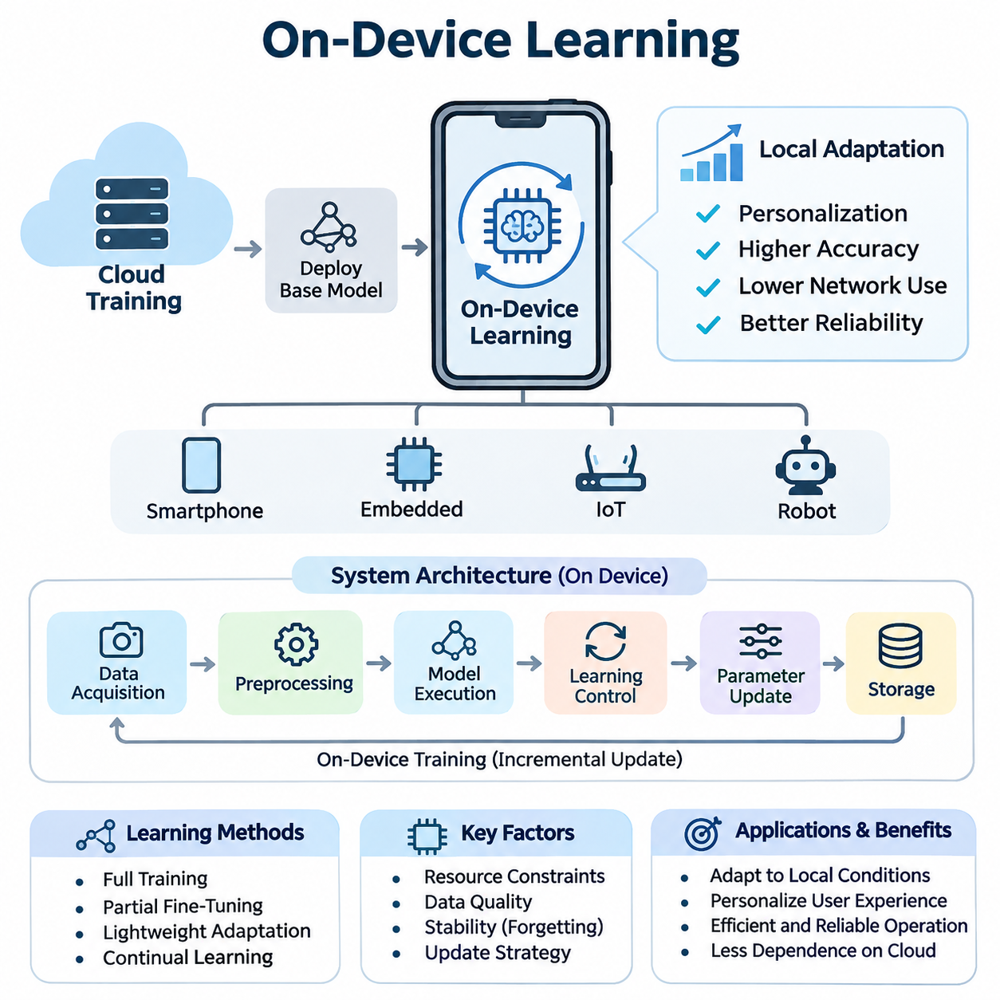
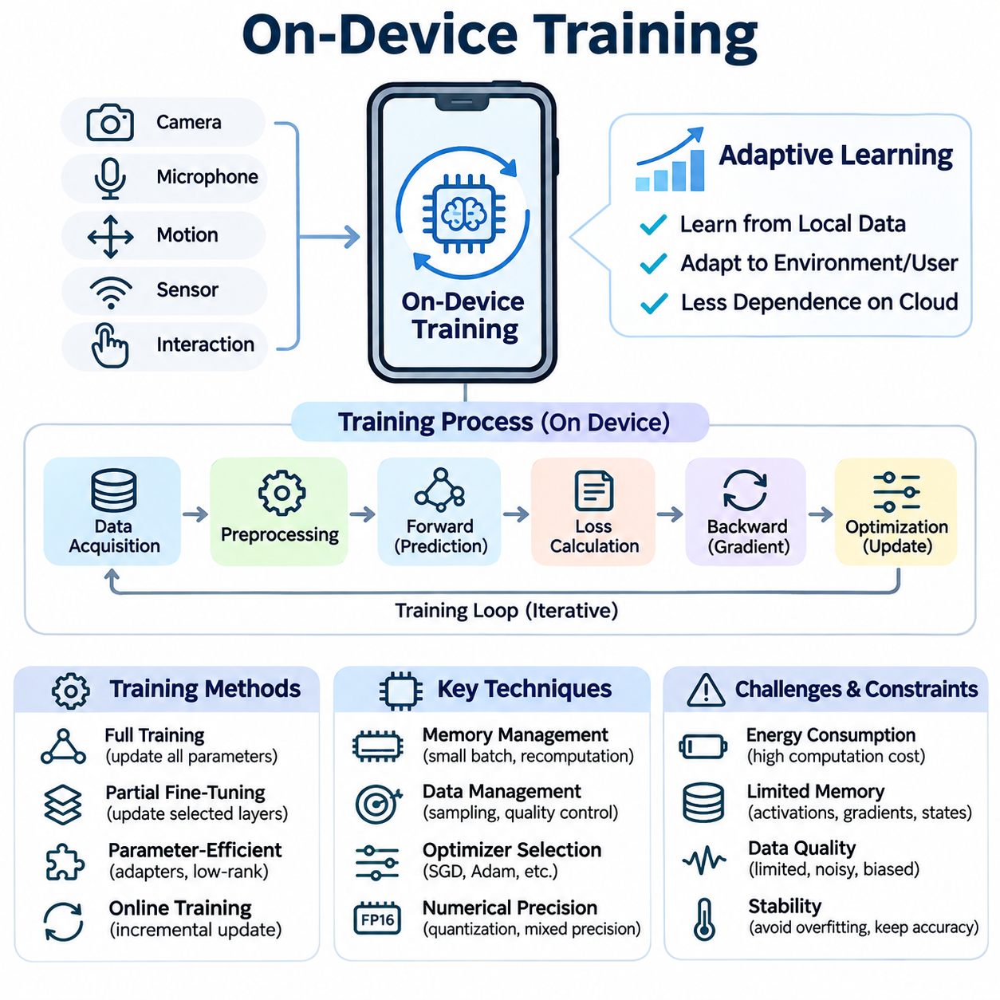
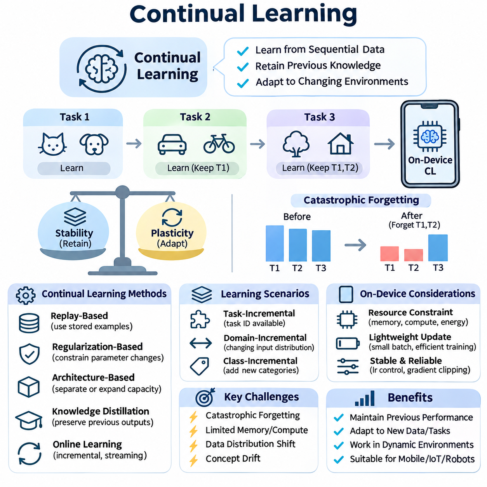
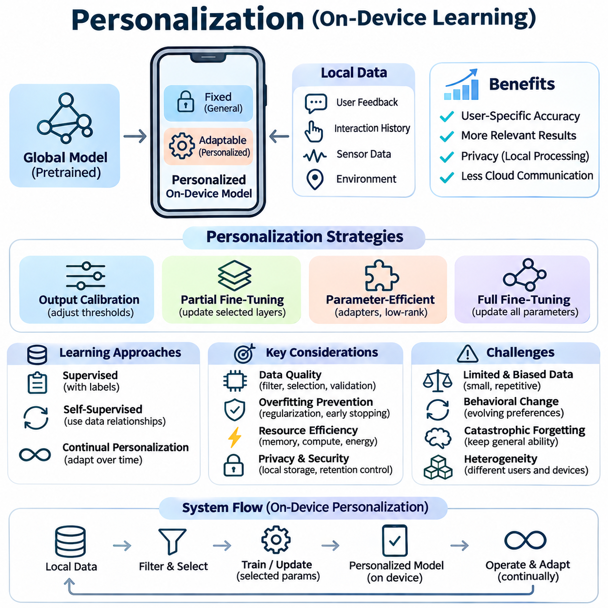
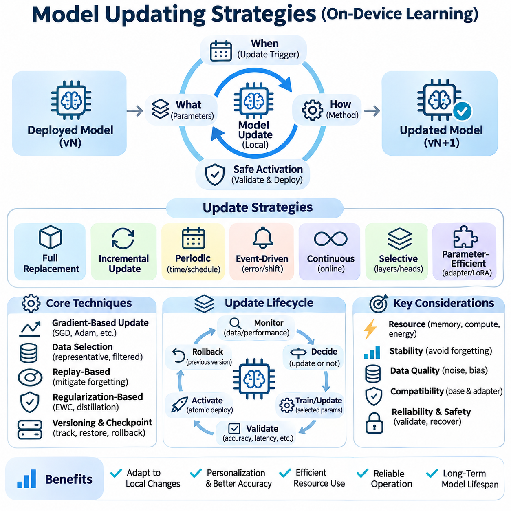
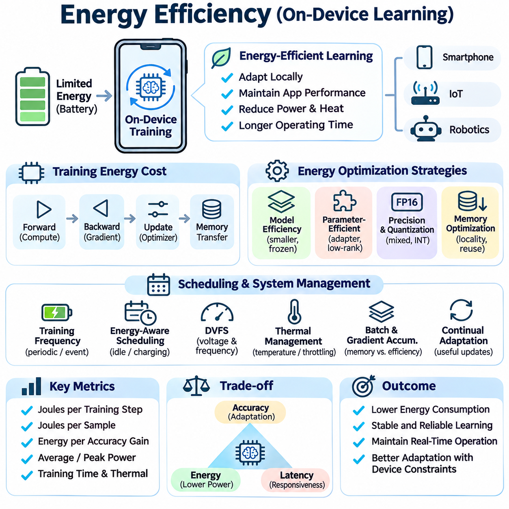
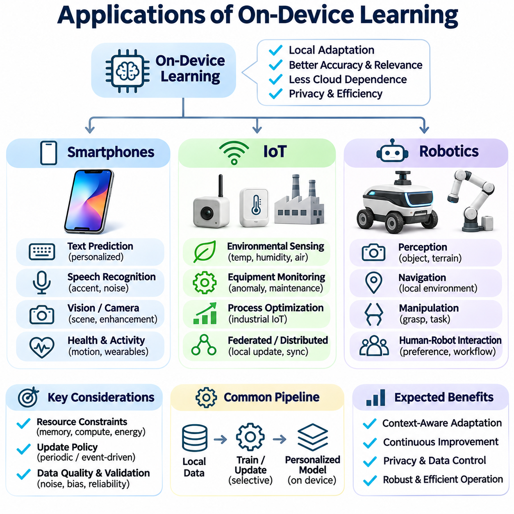

**Volume 40.** **TinyML and Federated Learning**


# 04. On Device Learning

## 04.00 Overview

{width="7.268055555555556in" height="7.268055555555556in"}

On-device learning is a machine learning paradigm in which artificial intelligence models are trained, adapted, or updated directly on local devices rather than relying entirely on centralized cloud infrastructure. This approach enables smartphones, embedded computers, Internet of Things devices, and autonomous robots to improve their behavior using locally collected data while reducing dependence on continuous network connectivity.

Traditional machine learning systems typically perform computationally intensive training in centralized data centers before deploying fixed models to edge devices. Although this architecture simplifies model management, it limits adaptation to changing environments and individual requirements. On-device learning extends the conventional deployment model by allowing selected learning operations to occur within the device itself.

The primary motivation for on-device learning is to create intelligent systems that continuously respond to local conditions. Sensor characteristics, user behavior, environmental changes, and operational requirements may differ significantly between devices. A centrally trained model cannot always represent these variations accurately, making local adaptation valuable for maintaining prediction accuracy, responsiveness, and operational reliability.

On-device learning differs from on-device inference because it modifies model parameters, representations, or adaptation states rather than merely executing predictions. Inference generally requires a forward computational pass, whereas training may involve gradient calculations, optimizer states, and additional memory allocations. Consequently, learning introduces substantially greater computational and energy demands than executing an already optimized model.

The architecture of an on-device learning system typically includes local data acquisition, preprocessing, model execution, learning control, parameter updating, and persistent storage. Data collected through cameras, microphones, inertial sensors, or user interactions can support incremental improvements. The learning controller determines when updates should occur and whether sufficient computational resources are available to execute them safely.

On-device training represents the foundational mechanism through which a deployed model acquires new information. Training may involve updating an entire neural network, modifying selected layers, or adjusting a small set of trainable parameters. Full-model optimization offers flexibility but consumes considerable resources, while partial fine-tuning and lightweight adaptation methods reduce memory requirements and computational overhead.

Resource constraints strongly influence the design of local learning algorithms. Embedded processors and mobile accelerators operate under limited memory capacity, computational throughput, and thermal budgets. Training procedures must therefore balance model complexity, batch size, optimizer selection, and numerical precision. Techniques such as selective layer freezing, gradient accumulation, and parameter-efficient adaptation can help accommodate constrained hardware environments.

Continual learning enables devices to acquire knowledge from sequentially arriving data without repeatedly retraining models from their original datasets. This capability is particularly important when operating conditions evolve over time. However, continual learning introduces catastrophic forgetting, in which adaptation to new observations reduces performance on previously learned tasks. Effective systems must balance plasticity toward new information with stability of existing knowledge.

Several approaches address the stability challenges associated with continual learning. Replay-based methods preserve representative historical examples, regularization methods constrain changes to important parameters, and architecture-based methods allocate specialized capacity for new knowledge. Each approach introduces different memory and computational costs, requiring careful selection according to device capabilities, data availability, and application requirements.

Personalization is another important objective of on-device learning because individual devices frequently encounter distinctive users, behaviors, and operating environments. A smartphone may adapt language predictions to personal writing patterns, while a wearable device may learn individual movement characteristics. Local personalization allows a shared baseline model to become more relevant without requiring every adaptation to be performed centrally.

Personalized learning systems often separate general model knowledge from device-specific parameters. A pretrained feature extractor can remain unchanged while a lightweight classification head, adapter, or calibration component learns from local observations. This separation reduces training costs and helps preserve general capabilities. It also supports controlled updates because personalized components can be independently evaluated, replaced, or reset.

Model updating strategies determine how newly acquired information becomes part of a deployed system. Updates may occur periodically, when sufficient new data accumulates, or when monitoring identifies a meaningful distribution shift. Event-driven learning can reduce unnecessary computation, while scheduled updates simplify resource management. Reliable updating requires explicit acceptance criteria, version tracking, and mechanisms for recovering from unsuccessful adaptation.

Data quality is essential because local learning frequently operates with limited, noisy, or weakly labeled observations. Sensor drift, temporary environmental disturbances, and incorrect user feedback can introduce misleading training signals. Systems must therefore evaluate sample relevance, confidence, and representativeness before updating parameters. Data filtering and validation mechanisms reduce the likelihood that transient anomalies will permanently degrade model performance.

Energy efficiency is a central engineering requirement because learning workloads can rapidly consume battery capacity and increase device temperature. Unlike inference, training may repeatedly execute forward and backward operations over multiple examples. Energy-aware learning schedules can postpone updates until charging is available, reduce training frequency, or select smaller adaptation workloads based on remaining power and thermal conditions.

Hardware characteristics also determine which learning operations are practical. CPUs provide flexible execution, while GPUs and neural processing units can accelerate supported tensor operations. However, an accelerator optimized for inference may not efficiently support backpropagation or parameter updates. Developers must examine training operator availability, memory bandwidth, software compatibility, and power consumption rather than assuming inference acceleration automatically enables efficient training.

Privacy is a major advantage of processing learning data locally because sensitive observations need not be transmitted to external servers for every model update. Nevertheless, local execution does not automatically guarantee privacy or security. Stored training examples, model checkpoints, diagnostic logs, and learned parameters may still expose sensitive information. Encryption, access control, data minimization, and secure model storage remain necessary.

On-device learning is closely related to federated learning, but the two concepts describe different system properties. On-device learning concerns where adaptation occurs, whereas federated learning coordinates training across multiple participants without requiring centralized collection of their raw datasets. A device can learn independently without participating in federation, while federated architectures may combine local updates with periodic aggregation of shared model parameters.

Connectivity constraints further distinguish local learning from cloud-dependent approaches. Devices operating in remote industrial facilities, autonomous vehicles, or intermittently connected environments may need to adapt without immediate server access. Local learning can preserve adaptive functionality during communication outages. However, synchronization policies are still necessary when devices eventually reconnect to centralized management or collaborative learning infrastructure.

Smartphones provide a practical environment for personalized on-device learning because they combine substantial processing capability with rich interaction data. Applications include adaptive text prediction, user-specific activity recognition, and personalized recommendation components. Training must coexist with foreground applications, operating-system scheduling, and battery management, making opportunistic execution and lightweight parameter updates especially important.

Internet of Things systems present a different set of constraints because many sensors operate with extremely limited memory, processing capacity, and energy reserves. Simple adaptive classifiers, statistical estimators, and incremental anomaly detectors may be more practical than full neural network training. In these environments, learning architecture must be matched to hardware capabilities, communication patterns, and the expected frequency of environmental changes.

Robotics applications benefit from on-device learning when perception and control systems encounter changing physical conditions. Mobile robots may adapt to sensor calibration differences, surface characteristics, or variations in visual appearance. Local adaptation can improve operational robustness, but safety-critical control functions require strict separation between experimental learning behavior and validated control policies, particularly when unexpected updates could affect physical motion.

Evaluating on-device learning requires more than measuring prediction accuracy after training. Important metrics include adaptation latency, peak memory consumption, energy per update, computational utilization, thermal behavior, and retention of previously acquired knowledge. Evaluation should also measure performance under realistic data distributions and device workloads because laboratory training results may not represent behavior during continuous field operation.

Reliable experimentation requires consistent initial model states, documented learning schedules, controlled datasets, and reproducible measurement procedures. Comparisons between local adaptation methods should account for differences in trainable parameter counts, available memory, optimization steps, and energy budgets. Evaluating both immediate improvement and long-term degradation provides a more complete understanding of whether a learning strategy remains sustainable.

Deployment engineering introduces additional requirements involving update validation, fault recovery, and lifecycle management. A newly adapted model should be evaluated before replacing its previously validated version. Checkpointing, rollback mechanisms, and bounded update procedures help prevent corrupted or unstable models from disrupting device operation. Monitoring must distinguish genuine improvements from temporary fluctuations caused by small local datasets.

The broader significance of on-device learning lies in transforming edge devices from static inference endpoints into adaptive intelligent systems. By integrating local training, continual learning, personalization, controlled model updates, and energy-aware execution, devices can respond more effectively to changing environments. Successful implementation depends on balancing adaptability with resource efficiency, privacy, reliability, and operational safety.

온디바이스 학습(On-Device Learning)은 중앙 집중형 클라우드 인프라(Centralized Cloud Infrastructure)에 전적으로 의존하지 않고, 로컬 디바이스(Local Device)에서 직접 인공지능 모델(Artificial Intelligence Model)을 학습, 적응 또는 갱신하는 기계학습 패러다임(Machine Learning Paradigm)이다. 이러한 접근 방식은 스마트폰(Smartphone), 임베디드 컴퓨터(Embedded Computer), 사물인터넷(IoT) 장치 및 자율 로봇(Autonomous Robot)이 지속적인 네트워크 연결(Network Connectivity)에 대한 의존도를 줄이면서 로컬에서 수집한 데이터를 활용하여 동작을 개선할 수 있도록 한다.

전통적인 기계학습 시스템(Traditional Machine Learning System)은 일반적으로 중앙 집중형 데이터센터(Centralized Data Center)에서 계산 집약적인 학습(Computationally Intensive Training)을 수행한 후, 고정된 모델(Fixed Model)을 엣지 디바이스(Edge Device)에 배포한다. 이러한 아키텍처(Architecture)는 모델 관리(Model Management)를 단순화하지만, 변화하는 환경과 개별 요구사항에 대한 적응을 제한한다. 온디바이스 학습은 선택적인 학습 연산(Learning Operation)을 디바이스 내부에서 수행하도록 허용함으로써 기존 배포 모델(Deployment Model)을 확장한다.

온디바이스 학습의 주요 목적은 로컬 환경(Local Environment)에 지속적으로 대응하는 지능형 시스템(Intelligent System)을 구현하는 것이다. 센서 특성(Sensor Characteristics), 사용자 행동(User Behavior), 환경 변화(Environmental Changes) 및 운영 요구사항(Operational Requirements)은 디바이스마다 크게 다를 수 있다. 중앙에서 학습된 모델(Centrally Trained Model)이 이러한 차이를 항상 정확하게 표현할 수는 없으므로, 로컬 적응(Local Adaptation)은 예측 정확도(Prediction Accuracy), 응답성(Responsiveness) 및 운영 신뢰성(Operational Reliability)을 유지하는 데 중요한 역할을 한다.

온디바이스 학습은 단순히 예측을 실행하는 것이 아니라 모델 매개변수(Model Parameters), 표현(Representations) 또는 적응 상태(Adaptation States)를 수정한다는 점에서 온디바이스 추론(On-Device Inference)과 구별된다. 추론(Inference)은 일반적으로 순전파 연산(Forward Computational Pass)을 필요로 하지만, 학습(Training)은 기울기 계산(Gradient Calculation), 최적화기 상태(Optimizer States) 및 추가 메모리 할당(Memory Allocation)을 포함할 수 있다. 따라서 학습은 이미 최적화된 모델을 실행하는 것보다 훨씬 높은 계산 및 에너지 요구량을 발생시킨다.

온디바이스 학습 시스템의 아키텍처는 일반적으로 로컬 데이터 수집(Local Data Acquisition), 전처리(Preprocessing), 모델 실행(Model Execution), 학습 제어(Learning Control), 매개변수 갱신(Parameter Updating) 및 영구 저장소(Persistent Storage)로 구성된다. 카메라(Camera), 마이크(Microphone), 관성 센서(Inertial Sensor) 또는 사용자 상호작용(User Interaction)을 통해 수집된 데이터는 점진적인 성능 개선을 지원한다. 학습 제어기는 갱신 시점과 사용 가능한 계산 자원이 학습을 안전하게 실행하기에 충분한지를 결정한다.

온디바이스 훈련(On-Device Training)은 배포된 모델이 새로운 정보를 획득하는 기본 메커니즘(Foundational Mechanism)이다. 학습 과정에서는 전체 신경망(Neural Network)을 갱신하거나, 선택된 계층(Selected Layers)을 수정하거나, 소수의 학습 가능한 매개변수(Trainable Parameters)를 조정할 수 있다. 전체 모델 최적화(Full-Model Optimization)는 높은 유연성을 제공하지만 상당한 자원을 소비하는 반면, 부분 미세조정(Partial Fine-Tuning)과 경량 적응 기법(Lightweight Adaptation Methods)은 메모리 요구량과 계산 부하를 줄인다.

자원 제약(Resource Constraints)은 로컬 학습 알고리즘(Local Learning Algorithm)의 설계에 큰 영향을 미친다. 임베디드 프로세서(Embedded Processor)와 모바일 가속기(Mobile Accelerator)는 제한된 메모리 용량(Memory Capacity), 계산 처리량(Computational Throughput) 및 열 예산(Thermal Budget) 내에서 작동한다. 따라서 학습 절차는 모델 복잡도(Model Complexity), 배치 크기(Batch Size), 최적화기 선택(Optimizer Selection) 및 수치 정밀도(Numerical Precision)의 균형을 유지해야 한다. 선택적 계층 동결(Selective Layer Freezing), 기울기 누적(Gradient Accumulation) 및 매개변수 효율적 적응(Parameter-Efficient Adaptation)은 제한된 하드웨어 환경에 대응하는 데 도움이 된다.

지속 학습(Continual Learning)은 원래 데이터셋(Original Dataset)으로 모델을 반복적으로 재학습하지 않고도 순차적으로 도착하는 데이터(Sequentially Arriving Data)에서 지식을 획득하도록 한다. 이러한 기능은 운영 조건이 시간에 따라 변화하는 환경에서 특히 중요하다. 그러나 지속 학습은 새로운 관측 데이터에 적응하는 과정에서 이전에 학습한 작업의 성능이 저하되는 파국적 망각(Catastrophic Forgetting) 문제를 발생시킨다. 효과적인 시스템은 새로운 정보에 대한 가소성(Plasticity)과 기존 지식의 안정성(Stability) 사이에서 균형을 유지해야 한다.

지속 학습과 관련된 안정성 문제를 해결하기 위해 여러 접근 방식이 사용된다. 재현 기반 방법(Replay-Based Methods)은 대표적인 과거 학습 사례를 보존하고, 정규화 기반 방법(Regularization Methods)은 중요한 매개변수의 변경을 제한하며, 아키텍처 기반 방법(Architecture-Based Methods)은 새로운 지식을 위한 전용 용량을 할당한다. 각 접근 방식은 서로 다른 메모리 및 계산 비용을 발생시키므로, 디바이스 성능과 데이터 가용성(Data Availability), 애플리케이션 요구사항(Application Requirements)에 따라 신중하게 선택해야 한다.

개인화(Personalization)는 개별 디바이스가 서로 다른 사용자, 행동 및 운영 환경을 경험한다는 점에서 온디바이스 학습의 또 다른 중요한 목표이다. 스마트폰은 개인의 문장 작성 패턴(Writing Patterns)에 맞춰 언어 예측(Language Prediction)을 조정할 수 있으며, 웨어러블 디바이스(Wearable Device)는 개인의 움직임 특성(Movement Characteristics)을 학습할 수 있다. 로컬 개인화(Local Personalization)는 모든 적응 과정을 중앙에서 수행하지 않고도 공통 기반 모델(Shared Baseline Model)의 관련성을 높인다.

개인화 학습 시스템(Personalized Learning System)은 일반적으로 모델의 일반 지식(General Model Knowledge)과 디바이스별 매개변수(Device-Specific Parameters)를 분리한다. 사전학습된 특징 추출기(Pretrained Feature Extractor)는 변경하지 않고 유지하면서 경량 분류 헤드(Lightweight Classification Head), 어댑터(Adapter) 또는 보정 구성요소(Calibration Component)를 로컬 관측 데이터로 학습할 수 있다. 이러한 분리는 학습 비용을 줄이고 일반적인 모델 능력을 보존하는 데 도움이 된다. 또한 개인화 구성요소를 독립적으로 평가, 교체 또는 초기화할 수 있어 제어된 갱신(Controlled Updates)을 지원한다.

모델 갱신 전략(Model Updating Strategies)은 새롭게 획득한 정보를 배포된 시스템에 반영하는 방법을 결정한다. 갱신은 주기적으로 수행하거나, 충분한 신규 데이터가 축적되었을 때 또는 모니터링(Monitoring)을 통해 의미 있는 분포 변화(Distribution Shift)가 감지되었을 때 실행할 수 있다. 이벤트 기반 학습(Event-Driven Learning)은 불필요한 계산을 줄이는 반면, 예약된 갱신(Scheduled Updates)은 자원 관리를 단순화한다. 신뢰할 수 있는 갱신에는 명확한 승인 기준(Acceptance Criteria), 버전 추적(Version Tracking) 및 실패한 적응으로부터 복구하는 메커니즘(Recovery Mechanism)이 필요하다.

데이터 품질(Data Quality)은 로컬 학습이 제한적이고 잡음이 많거나 약하게 레이블링된 관측 데이터(Weakly Labeled Observations)를 사용하는 경우가 많기 때문에 매우 중요하다. 센서 드리프트(Sensor Drift), 일시적인 환경 교란(Environmental Disturbances) 및 잘못된 사용자 피드백(User Feedback)은 오해를 유발하는 학습 신호(Training Signals)를 생성할 수 있다. 따라서 시스템은 매개변수를 갱신하기 전에 샘플의 관련성(Relevance), 신뢰도(Confidence) 및 대표성(Representativeness)을 평가해야 한다. 데이터 필터링(Data Filtering)과 검증 메커니즘(Validation Mechanisms)은 일시적인 이상 현상(Transient Anomalies)이 모델 성능을 영구적으로 저하할 가능성을 줄인다.

에너지 효율성(Energy Efficiency)은 학습 워크로드(Training Workload)가 배터리 용량(Battery Capacity)을 빠르게 소모하고 디바이스 온도를 상승시킬 수 있으므로 핵심적인 엔지니어링 요구사항(Engineering Requirement)이다. 추론과 달리 학습은 여러 데이터 샘플에 대해 순전파(Forward Pass)와 역전파(Backward Pass)를 반복적으로 실행할 수 있다. 에너지 인식 학습 스케줄(Energy-Aware Learning Schedule)은 충전이 가능할 때까지 갱신을 연기하거나, 학습 빈도를 줄이거나, 남은 전력과 열 조건에 따라 더 작은 적응 워크로드를 선택할 수 있다.

하드웨어 특성(Hardware Characteristics) 역시 어떤 학습 연산이 실용적인지를 결정한다. 중앙처리장치(CPU)는 유연한 실행을 제공하며, 그래픽처리장치(GPU)와 신경망처리장치(NPU)는 지원되는 텐서 연산(Tensor Operations)을 가속할 수 있다. 그러나 추론에 최적화된 가속기(Accelerator)가 역전파(Backpropagation)나 매개변수 갱신(Parameter Updates)을 효율적으로 지원하는 것은 아니다. 개발자는 추론 가속(Inference Acceleration)이 효율적인 학습을 자동으로 보장한다고 가정하지 않고, 학습 연산자 지원 여부(Training Operator Availability), 메모리 대역폭(Memory Bandwidth), 소프트웨어 호환성(Software Compatibility) 및 전력 소비(Power Consumption)를 검토해야 한다.

개인정보 보호(Privacy)는 민감한 관측 데이터를 모델 갱신마다 외부 서버로 전송할 필요가 없다는 점에서 로컬 학습의 주요 장점이다. 그러나 로컬 실행(Local Execution)이 개인정보 보호나 보안(Security)을 자동으로 보장하는 것은 아니다. 저장된 학습 사례(Training Examples), 모델 체크포인트(Model Checkpoints), 진단 로그(Diagnostic Logs) 및 학습된 매개변수(Learned Parameters)는 여전히 민감한 정보를 노출할 수 있다. 따라서 암호화(Encryption), 접근 제어(Access Control), 데이터 최소화(Data Minimization) 및 안전한 모델 저장(Secure Model Storage)이 필요하다.

온디바이스 학습은 연합학습(Federated Learning)과 밀접하게 관련되어 있지만, 두 개념은 서로 다른 시스템 특성을 설명한다. 온디바이스 학습은 적응이 수행되는 위치에 초점을 맞추는 반면, 연합학습은 원시 데이터셋(Raw Datasets)을 중앙에 수집하지 않고 여러 참여자 간 학습을 조정한다. 디바이스는 연합학습에 참여하지 않고 독립적으로 학습할 수 있으며, 연합학습 아키텍처(Federated Architecture)는 로컬 갱신(Local Updates)과 공유 모델 매개변수의 주기적인 집계(Periodic Aggregation)를 결합할 수 있다.

연결성 제약(Connectivity Constraints)은 로컬 학습을 클라우드 의존형 접근 방식(Cloud-Dependent Approaches)과 구별하는 또 다른 요소이다. 원격 산업 시설(Remote Industrial Facilities), 자율주행 차량(Autonomous Vehicles) 또는 간헐적으로 연결되는 환경(Intermittently Connected Environments)의 디바이스는 즉각적인 서버 접근 없이 적응해야 할 수 있다. 로컬 학습은 통신 장애(Communication Outages) 중에도 적응 기능(Adaptive Functionality)을 유지할 수 있다. 그러나 디바이스가 중앙 관리 시스템(Centralized Management System)이나 협업 학습 인프라(Collaborative Learning Infrastructure)에 다시 연결될 때는 동기화 정책(Synchronization Policies)이 필요하다.

스마트폰(Smartphones)은 상당한 처리 능력(Processing Capability)과 풍부한 상호작용 데이터(Interaction Data)를 결합하므로 개인화된 온디바이스 학습에 적합한 환경을 제공한다. 적용 분야에는 적응형 텍스트 예측(Adaptive Text Prediction), 사용자별 활동 인식(User-Specific Activity Recognition) 및 개인화 추천 구성요소(Personalized Recommendation Components)가 포함된다. 학습은 포그라운드 애플리케이션(Foreground Applications), 운영체제 스케줄링(Operating-System Scheduling) 및 배터리 관리(Battery Management)와 공존해야 하므로, 기회적 실행(Opportunistic Execution)과 경량 매개변수 갱신(Lightweight Parameter Updates)이 특히 중요하다.

사물인터넷 시스템(IoT Systems)은 많은 센서가 극도로 제한된 메모리, 처리 능력 및 에너지 자원으로 작동하기 때문에 서로 다른 제약 조건을 가진다. 단순한 적응형 분류기(Adaptive Classifiers), 통계적 추정기(Statistical Estimators) 및 점진적 이상 탐지기(Incremental Anomaly Detectors)는 전체 신경망 학습보다 실용적일 수 있다. 이러한 환경에서는 학습 아키텍처(Learning Architecture)를 하드웨어 성능, 통신 패턴(Communication Patterns) 및 예상되는 환경 변화 빈도에 맞춰 설계해야 한다.

로봇공학(Robotics) 분야에서는 인식 및 제어 시스템(Perception and Control Systems)이 변화하는 물리적 조건에 직면할 때 온디바이스 학습의 이점을 얻을 수 있다. 이동 로봇(Mobile Robots)은 센서 보정 차이(Sensor Calibration Differences), 지면 특성(Surface Characteristics) 또는 시각적 외관 변화(Visual Appearance Variations)에 적응할 수 있다. 로컬 적응은 운영 강건성(Operational Robustness)을 향상할 수 있지만, 안전 필수 제어 기능(Safety-Critical Control Functions)은 실험적인 학습 동작(Experimental Learning Behavior)과 검증된 제어 정책(Validated Control Policies)을 엄격하게 분리해야 한다. 특히 예상치 못한 갱신이 물리적 움직임에 영향을 줄 수 있는 경우 이러한 분리가 중요하다.

온디바이스 학습의 평가(Evaluation)는 학습 이후의 예측 정확도를 측정하는 것 이상을 요구한다. 중요한 평가 지표(Evaluation Metrics)에는 적응 지연시간(Adaptation Latency), 최대 메모리 사용량(Peak Memory Consumption), 갱신당 에너지 소비(Energy per Update), 계산 자원 활용률(Computational Utilization), 열 특성(Thermal Behavior) 및 이전에 획득한 지식의 유지율(Knowledge Retention)이 포함된다. 또한 실험실 학습 결과가 지속적인 현장 운영(Continuous Field Operation)의 동작을 대표하지 못할 수 있으므로, 실제 데이터 분포(Realistic Data Distributions)와 디바이스 워크로드(Device Workloads)에서 성능을 측정해야 한다.

신뢰할 수 있는 실험(Reliable Experimentation)을 위해서는 일관된 초기 모델 상태(Initial Model States), 문서화된 학습 일정(Learning Schedules), 통제된 데이터셋(Controlled Datasets) 및 재현 가능한 측정 절차(Reproducible Measurement Procedures)가 필요하다. 로컬 적응 방법을 비교할 때는 학습 가능한 매개변수 수(Trainable Parameter Counts), 사용 가능한 메모리, 최적화 단계(Optimization Steps) 및 에너지 예산(Energy Budgets)의 차이를 고려해야 한다. 즉각적인 성능 개선(Immediate Improvement)과 장기적인 성능 저하(Long-Term Degradation)를 함께 평가하면 학습 전략의 지속 가능성을 더욱 종합적으로 이해할 수 있다.

배포 엔지니어링(Deployment Engineering)은 갱신 검증(Update Validation), 장애 복구(Fault Recovery) 및 수명주기 관리(Lifecycle Management)와 관련된 추가 요구사항을 발생시킨다. 새롭게 적응된 모델은 이전에 검증된 버전(Previously Validated Version)을 대체하기 전에 평가되어야 한다. 체크포인트 저장(Checkpointing), 롤백 메커니즘(Rollback Mechanisms) 및 제한된 갱신 절차(Bounded Update Procedures)는 손상되거나 불안정한 모델이 디바이스 운영을 방해하지 않도록 지원한다. 모니터링은 실제 성능 개선과 소규모 로컬 데이터셋(Small Local Datasets)으로 인한 일시적인 변동을 구별해야 한다.

온디바이스 학습의 광범위한 의의는 엣지 디바이스를 정적인 추론 종단점(Static Inference Endpoints)에서 적응형 지능 시스템(Adaptive Intelligent Systems)으로 전환하는 데 있다. 로컬 훈련(Local Training), 지속 학습(Continual Learning), 개인화(Personalization), 제어된 모델 갱신(Controlled Model Updates) 및 에너지 인식 실행(Energy-Aware Execution)을 통합함으로써 디바이스는 변화하는 환경에 더욱 효과적으로 대응할 수 있다. 성공적인 구현을 위해서는 적응성(Adaptability), 자원 효율성(Resource Efficiency), 개인정보 보호(Privacy), 신뢰성(Reliability) 및 운영 안전성(Operational Safety) 사이의 균형을 유지해야 한다.

## 04.01 On Device Training

{width="7.268055555555556in" height="7.268055555555556in"}

On-device training refers to the process of optimizing machine learning models directly on local hardware rather than transferring all training data to centralized computing infrastructure. This approach enables intelligent devices to learn from their own observations, interactions, and environmental conditions. Unlike conventional edge inference, on-device training modifies model parameters and therefore requires additional computational resources, memory capacity, and energy.

The fundamental objective of on-device training is to support adaptive intelligence under constrained hardware conditions. Smartphones, wearable devices, industrial sensors, and autonomous robots frequently encounter data distributions that differ from those represented during centralized training. Local optimization allows deployed models to respond to these differences without requiring continuous communication with remote servers or complete retraining in cloud environments.

A typical on-device training architecture combines data acquisition, preprocessing, model execution, loss calculation, gradient computation, and parameter optimization. Local sensors or application interactions generate training examples that are processed into suitable representations. The model produces predictions, a learning objective evaluates their quality, and an optimization algorithm adjusts selected parameters to improve subsequent predictions.

The training process generally involves both forward propagation and backward propagation. Forward propagation calculates model outputs and associated losses, while backward propagation determines gradients describing how parameters influence those losses. An optimizer then applies parameter updates using algorithms such as stochastic gradient descent or Adam. These operations introduce computational and memory requirements beyond those associated with inference alone.

Memory management is particularly important because training requires intermediate activations, gradients, model parameters, and potentially optimizer states. The total memory footprint may substantially exceed the size of the deployed inference model. Devices with limited random-access memory must therefore employ strategies such as smaller batches, selective parameter updates, activation recomputation, or carefully managed memory allocation to prevent resource exhaustion.

Full-model training provides maximum flexibility because every trainable parameter can be modified in response to local data. However, this approach is often impractical for embedded systems because of its computational intensity and memory requirements. Partial fine-tuning offers a more efficient alternative by freezing selected network layers and updating only components that are most relevant to local adaptation, such as classification heads or specialized feature transformations.

Parameter-efficient training further reduces resource requirements by introducing compact trainable components into an otherwise fixed model. Techniques such as adapters and low-rank adaptation modify a relatively small number of parameters while preserving most pretrained weights. These methods can make local adaptation more practical, although their effectiveness depends on model architecture, task complexity, and the availability of supported training operations.

Training data management presents another challenge because local observations are often limited, noisy, and unevenly distributed. A device may encounter repetitive examples, temporary environmental disturbances, or user-specific patterns that differ from broader populations. Without appropriate sampling and validation, local optimization can overfit recent observations and degrade general performance. Data selection and quality control are therefore essential components of reliable training.

Supervised on-device training uses labeled examples to calculate prediction errors and guide parameter updates. Labels may originate from explicit user feedback, verified sensor measurements, or trusted application events. However, acquiring reliable labels can be expensive or inconvenient. Weak supervision, self-supervised objectives, and carefully validated pseudo-labeling provide alternative learning signals when direct annotations are unavailable.

Online training processes incoming observations incrementally rather than waiting for large datasets to accumulate. This approach supports rapid adaptation to evolving conditions, but individual updates may be highly sensitive to noisy samples. Mini-batch accumulation, learning-rate control, and update scheduling can improve stability. The system must determine whether immediate adaptation provides sufficient benefit to justify its computational and operational costs.

Optimization algorithms must be selected according to hardware limitations and learning objectives. Stochastic gradient descent generally requires relatively little optimizer-state memory, while adaptive optimizers such as Adam maintain additional statistics for each updated parameter. Although adaptive methods may improve convergence in certain settings, their memory overhead can become significant on constrained devices. Optimizer selection therefore involves balancing convergence behavior, stability, and resource consumption.

Numerical precision influences both training efficiency and optimization reliability. Reduced-precision arithmetic can lower memory requirements and accelerate supported operations, particularly on hardware with specialized matrix-processing units. However, low-precision gradients may suffer from rounding errors, overflow, or underflow. Mixed-precision training, selective higher-precision accumulation, and numerical stability checks can help maintain acceptable learning behavior.

Energy consumption is a major constraint because training repeatedly executes computationally intensive operations. Battery-powered devices must balance adaptation benefits against operating time, thermal limits, and competing application workloads. Energy-aware scheduling can restrict training to periods of sufficient battery capacity, available charging power, or low processor utilization. Training frequency and computational intensity should reflect the device\'s operating requirements.

Thermal management is closely related to energy efficiency because sustained training workloads generate heat and may trigger processor throttling. Reduced clock frequencies can increase training duration and affect application responsiveness. Training controllers should monitor temperature, processor utilization, and available computational capacity. Adaptive workload scheduling can reduce training intensity or suspend updates when thermal conditions threaten stable device operation.

Hardware acceleration can improve on-device training performance when suitable computational operators are available. Mobile GPUs, embedded accelerators, and neural processing units may accelerate supported tensor calculations, but many devices are primarily optimized for inference. Efficient training requires compatible backward operators, sufficient memory bandwidth, and appropriate software support. Hardware selection must therefore consider training capabilities independently from inference performance.

Training frameworks provide the software infrastructure required to execute optimization workloads on embedded platforms. TensorFlow, PyTorch, and specialized mobile runtimes offer different combinations of automatic differentiation, operator support, and deployment compatibility. However, lightweight inference runtimes do not necessarily provide complete training functionality. Developers must verify supported operations, model formats, optimizer availability, and hardware-specific execution constraints.

Local model adaptation introduces important privacy advantages because raw training observations can remain within the originating device. Nevertheless, local processing does not eliminate security risks. Training datasets, gradients, optimizer states, and stored checkpoints may reveal sensitive information if accessed improperly. Secure storage, access restrictions, encrypted persistence, and controlled diagnostic logging are necessary to protect the learning process.

On-device training also creates risks associated with model integrity and unexpected parameter changes. Incorrect labels, adversarial observations, or corrupted training samples can cause performance degradation. Reliable systems should validate incoming data, restrict update magnitudes when appropriate, and evaluate candidate models before deployment. Maintaining a previously validated checkpoint provides a recovery mechanism when local adaptation produces unacceptable results.

Continual learning extends on-device training by enabling models to accumulate knowledge across changing tasks and environments. However, repeated optimization on recent observations may cause catastrophic forgetting of previously learned information. Replay buffers, regularization constraints, and selective parameter isolation can reduce this problem. These mechanisms introduce additional resource costs that must be considered when designing long-running adaptive systems.

Personalization represents an important application of local training because individual users and devices exhibit distinctive characteristics. A smartphone may adapt text prediction to preferred vocabulary, while a wearable sensor may adjust activity recognition to personal movement patterns. Personalized training often modifies compact model components rather than entire networks, reducing computational demands while preserving general capabilities learned during centralized pretraining.

Robotic systems can use on-device training to adapt perception models to changing lighting, sensor characteristics, or operating environments. For example, an autonomous mobile robot may improve visual classification using locally observed conditions. However, updates affecting safety-critical perception or control require additional safeguards. Candidate models should undergo validation before influencing operational decisions, and learning must not bypass established safety mechanisms.

Evaluation of on-device training requires simultaneous consideration of model quality and system efficiency. Accuracy, loss reduction, convergence behavior, and generalization must be assessed alongside training latency, peak memory usage, energy consumption, and thermal stability. Measurements should reflect realistic workloads because isolated laboratory benchmarks may underestimate interference from sensing, communication, and application execution.

A reliable training pipeline should maintain clear separation between data collection, optimization, validation, and model activation. Candidate updates can be evaluated against representative local examples and retained reference data before replacing the active model. Version tracking, checkpoint management, and rollback procedures support reproducibility and fault recovery. Monitoring after activation helps identify delayed performance degradation or unexpected behavior.

The effectiveness of on-device training ultimately depends on balancing learning capability with hardware constraints and operational reliability. Full training, partial fine-tuning, parameter-efficient adaptation, and incremental optimization provide different tradeoffs between flexibility and resource consumption. By integrating efficient algorithms, controlled update policies, secure data handling, and systematic evaluation, on-device training enables practical adaptive intelligence across smartphones, IoT systems, and autonomous robotics.

온디바이스 훈련(On-Device Training)은 모든 학습 데이터를 중앙 집중형 컴퓨팅 인프라(Centralized Computing Infrastructure)로 전송하는 대신, 로컬 하드웨어(Local Hardware)에서 직접 기계학습 모델(Machine Learning Model)을 최적화하는 과정이다. 이러한 접근 방식은 지능형 디바이스(Intelligent Device)가 자체 관측 데이터, 상호작용 및 환경 조건으로부터 학습할 수 있도록 한다. 기존의 엣지 추론(Edge Inference)과 달리 온디바이스 훈련은 모델 매개변수(Model Parameters)를 수정하므로 추가적인 계산 자원(Computational Resources), 메모리 용량(Memory Capacity) 및 에너지(Energy)가 필요하다.

온디바이스 훈련의 기본 목표는 제한된 하드웨어 조건(Constrained Hardware Conditions)에서 적응형 지능(Adaptive Intelligence)을 지원하는 것이다. 스마트폰(Smartphones), 웨어러블 디바이스(Wearable Devices), 산업용 센서(Industrial Sensors) 및 자율 로봇(Autonomous Robots)은 중앙 집중형 학습(Centralized Training)에서 사용된 데이터와 다른 데이터 분포(Data Distributions)를 자주 경험한다. 로컬 최적화(Local Optimization)는 원격 서버(Remote Servers)와 지속적으로 통신하거나 클라우드 환경(Cloud Environments)에서 전체 모델을 재학습하지 않고도 이러한 차이에 대응할 수 있도록 한다.

일반적인 온디바이스 훈련 아키텍처(On-Device Training Architecture)는 데이터 수집(Data Acquisition), 전처리(Preprocessing), 모델 실행(Model Execution), 손실 계산(Loss Calculation), 기울기 계산(Gradient Computation) 및 매개변수 최적화(Parameter Optimization)를 결합한다. 로컬 센서(Local Sensors) 또는 애플리케이션 상호작용(Application Interactions)은 적절한 표현(Representations)으로 처리되는 학습 사례(Training Examples)를 생성한다. 모델은 예측 결과를 출력하고, 학습 목적함수(Learning Objective)는 예측 품질을 평가하며, 최적화 알고리즘(Optimization Algorithm)은 이후의 예측 성능을 개선하도록 선택된 매개변수를 조정한다.

훈련 과정(Training Process)은 일반적으로 순전파(Forward Propagation)와 역전파(Backward Propagation)를 모두 포함한다. 순전파는 모델 출력(Model Outputs)과 관련 손실(Losses)을 계산하며, 역전파는 매개변수가 손실에 미치는 영향을 나타내는 기울기(Gradients)를 결정한다. 이후 최적화기(Optimizer)는 확률적 경사하강법(Stochastic Gradient Descent, SGD) 또는 아담(Adam)과 같은 알고리즘을 사용하여 매개변수를 갱신한다. 이러한 연산은 단순 추론(Inference)에 필요한 수준을 넘어서는 계산 및 메모리 요구사항을 발생시킨다.

메모리 관리(Memory Management)는 훈련 과정에서 중간 활성화값(Intermediate Activations), 기울기(Gradients), 모델 매개변수(Model Parameters) 및 최적화기 상태(Optimizer States)가 필요할 수 있으므로 특히 중요하다. 전체 메모리 사용량(Memory Footprint)은 배포된 추론 모델(Inference Model)의 크기를 상당히 초과할 수 있다. 제한된 임의 접근 메모리(Random-Access Memory, RAM)를 가진 디바이스는 자원 고갈(Resource Exhaustion)을 방지하기 위해 작은 배치(Smaller Batches), 선택적 매개변수 갱신(Selective Parameter Updates), 활성화값 재계산(Activation Recalculation) 또는 체계적인 메모리 할당(Memory Allocation) 전략을 사용해야 한다.

전체 모델 훈련(Full-Model Training)은 모든 학습 가능한 매개변수(Trainable Parameters)를 로컬 데이터에 따라 수정할 수 있으므로 최대한의 유연성을 제공한다. 그러나 높은 계산 강도(Computational Intensity)와 메모리 요구량 때문에 임베디드 시스템(Embedded Systems)에서는 비현실적인 경우가 많다. 부분 미세조정(Partial Fine-Tuning)은 선택된 신경망 계층(Network Layers)을 동결하고 분류 헤드(Classification Heads) 또는 특수 특징 변환(Specialized Feature Transformations)과 같이 로컬 적응에 중요한 구성요소만 갱신하는 효율적인 대안을 제공한다.

매개변수 효율적 훈련(Parameter-Efficient Training)은 대부분의 모델을 고정한 상태에서 소형 학습 구성요소(Compact Trainable Components)를 추가하여 자원 요구량을 더욱 줄인다. 어댑터(Adapters)와 저랭크 적응(Low-Rank Adaptation, LoRA) 등의 기법은 대부분의 사전학습 가중치(Pretrained Weights)를 유지하면서 상대적으로 적은 수의 매개변수를 수정한다. 이러한 방법은 로컬 적응(Local Adaptation)의 실용성을 높일 수 있지만, 효과는 모델 아키텍처(Model Architecture), 작업 복잡도(Task Complexity) 및 지원되는 학습 연산(Training Operations)의 가용성에 따라 달라진다.

학습 데이터 관리(Training Data Management)는 로컬 관측 데이터(Local Observations)가 제한적이고 잡음이 많으며 불균등하게 분포하는 경우가 많기 때문에 또 다른 과제를 제시한다. 디바이스는 반복적인 학습 사례(Repetitive Examples), 일시적인 환경 교란(Temporary Environmental Disturbances) 또는 전체 사용자 집단과 다른 사용자별 패턴(User-Specific Patterns)을 경험할 수 있다. 적절한 샘플링(Sampling)과 검증(Validation)이 없으면 로컬 최적화가 최근 관측 데이터에 과적합(Overfitting)되어 일반적인 성능을 저하시킬 수 있다. 따라서 데이터 선택(Data Selection)과 품질 관리(Quality Control)는 신뢰할 수 있는 훈련의 필수 구성요소이다.

지도 기반 온디바이스 훈련(Supervised On-Device Training)은 레이블이 지정된 사례(Labeled Examples)를 사용하여 예측 오류(Prediction Errors)를 계산하고 매개변수 갱신을 유도한다. 레이블(Labels)은 명시적인 사용자 피드백(Explicit User Feedback), 검증된 센서 측정값(Verified Sensor Measurements) 또는 신뢰할 수 있는 애플리케이션 이벤트(Trusted Application Events)에서 얻을 수 있다. 그러나 신뢰할 수 있는 레이블을 확보하는 과정은 비용이 높거나 불편할 수 있다. 직접적인 주석(Annotations)을 사용할 수 없는 경우 약지도 학습(Weak Supervision), 자기지도 목적함수(Self-Supervised Objectives) 및 신중하게 검증된 의사 레이블링(Pseudo-Labeling)이 대체 학습 신호(Learning Signals)를 제공한다.

온라인 훈련(Online Training)은 대규모 데이터셋(Dataset)이 축적될 때까지 기다리지 않고 입력되는 관측 데이터를 점진적으로 처리한다. 이러한 접근 방식은 변화하는 조건에 빠르게 적응하도록 지원하지만, 개별 갱신(Individual Updates)이 잡음이 포함된 샘플(Noisy Samples)에 매우 민감할 수 있다. 미니배치 누적(Mini-Batch Accumulation), 학습률 제어(Learning-Rate Control) 및 갱신 일정 관리(Update Scheduling)는 안정성을 개선할 수 있다. 시스템은 즉각적인 적응(Immediate Adaptation)이 계산 및 운영 비용(Operational Costs)을 정당화할 만큼 충분한 이점을 제공하는지 판단해야 한다.

최적화 알고리즘(Optimization Algorithms)은 하드웨어 제약(Hardware Limitations)과 학습 목표(Learning Objectives)에 따라 선택해야 한다. 확률적 경사하강법(Stochastic Gradient Descent)은 일반적으로 최적화기 상태 메모리(Optimizer-State Memory)를 상대적으로 적게 요구하지만, 아담(Adam)과 같은 적응형 최적화기(Adaptive Optimizers)는 갱신되는 각 매개변수에 대한 추가 통계값(Additional Statistics)을 유지한다. 적응형 방법은 특정 조건에서 수렴(Convergence)을 개선할 수 있지만, 제한된 디바이스에서는 메모리 오버헤드(Memory Overhead)가 상당해질 수 있다. 따라서 최적화기 선택은 수렴 특성(Convergence Behavior), 안정성(Stability) 및 자원 소비(Resource Consumption) 사이의 균형을 고려해야 한다.

수치 정밀도(Numerical Precision)는 훈련 효율성(Training Efficiency)과 최적화 신뢰성(Optimization Reliability)에 모두 영향을 미친다. 저정밀도 연산(Reduced-Precision Arithmetic)은 특히 특수 행렬 처리 장치(Specialized Matrix-Processing Units)를 갖춘 하드웨어에서 메모리 요구량을 줄이고 지원되는 연산을 가속할 수 있다. 그러나 저정밀도 기울기(Low-Precision Gradients)는 반올림 오차(Rounding Errors), 오버플로(Overflow) 또는 언더플로(Underflow)를 겪을 수 있다. 혼합 정밀도 훈련(Mixed-Precision Training), 선택적 고정밀도 누적(Selective Higher-Precision Accumulation) 및 수치 안정성 검사(Numerical Stability Checks)는 허용 가능한 학습 동작을 유지하는 데 도움이 된다.

에너지 소비(Energy Consumption)는 훈련이 계산 집약적인 연산(Computationally Intensive Operations)을 반복적으로 실행하기 때문에 주요 제약 조건이다. 배터리 구동 디바이스(Battery-Powered Devices)는 적응의 이점과 작동 시간(Operating Time), 열 제한(Thermal Limits) 및 경쟁하는 애플리케이션 워크로드(Application Workloads) 사이에서 균형을 유지해야 한다. 에너지 인식 스케줄링(Energy-Aware Scheduling)은 충분한 배터리 용량, 충전 전력(Charging Power) 또는 낮은 프로세서 활용률(Processor Utilization)이 확보된 기간으로 훈련을 제한할 수 있다. 훈련 빈도(Training Frequency)와 계산 강도(Computational Intensity)는 디바이스의 운영 요구사항을 반영해야 한다.

열 관리(Thermal Management)는 지속적인 훈련 워크로드(Training Workloads)가 열을 발생시키고 프로세서 스로틀링(Processor Throttling)을 유발할 수 있으므로 에너지 효율성과 밀접하게 관련된다. 클록 주파수(Clock Frequencies)가 감소하면 훈련 시간이 증가하고 애플리케이션 응답성(Application Responsiveness)에 영향을 줄 수 있다. 훈련 제어기(Training Controllers)는 온도(Temperature), 프로세서 활용률 및 사용 가능한 계산 용량(Computational Capacity)을 모니터링해야 한다. 적응형 워크로드 스케줄링(Adaptive Workload Scheduling)은 열 조건이 안정적인 디바이스 운영을 위협할 때 훈련 강도를 낮추거나 갱신을 일시 중단할 수 있다.

하드웨어 가속(Hardware Acceleration)은 적절한 계산 연산자(Computational Operators)를 사용할 수 있을 때 온디바이스 훈련 성능을 개선할 수 있다. 모바일 그래픽처리장치(Mobile GPUs), 임베디드 가속기(Embedded Accelerators) 및 신경망처리장치(Neural Processing Units, NPUs)는 지원되는 텐서 계산(Tensor Calculations)을 가속할 수 있지만, 많은 디바이스는 주로 추론에 최적화되어 있다. 효율적인 훈련을 위해서는 호환 가능한 역전파 연산자(Backward Operators), 충분한 메모리 대역폭(Memory Bandwidth) 및 적절한 소프트웨어 지원(Software Support)이 필요하다. 따라서 하드웨어 선택에서는 추론 성능(Inference Performance)과 별개로 훈련 기능(Training Capabilities)을 고려해야 한다.

훈련 프레임워크(Training Frameworks)는 임베디드 플랫폼(Embedded Platforms)에서 최적화 워크로드(Optimization Workloads)를 실행하는 데 필요한 소프트웨어 인프라(Software Infrastructure)를 제공한다. 텐서플로(TensorFlow), 파이토치(PyTorch) 및 특수 모바일 런타임(Specialized Mobile Runtimes)은 자동 미분(Automatic Differentiation), 연산자 지원(Operator Support) 및 배포 호환성(Deployment Compatibility) 측면에서 서로 다른 기능 조합을 제공한다. 그러나 경량 추론 런타임(Lightweight Inference Runtimes)이 반드시 완전한 훈련 기능을 제공하는 것은 아니다. 개발자는 지원되는 연산, 모델 형식(Model Formats), 최적화기 가용성(Optimizer Availability) 및 하드웨어별 실행 제약(Hardware-Specific Execution Constraints)을 검증해야 한다.

로컬 모델 적응(Local Model Adaptation)은 원시 학습 관측 데이터(Raw Training Observations)를 원래 디바이스 내부에 유지할 수 있으므로 중요한 개인정보 보호(Privacy) 이점을 제공한다. 그러나 로컬 처리(Local Processing)가 보안 위험(Security Risks)을 제거하는 것은 아니다. 학습 데이터셋(Training Datasets), 기울기(Gradients), 최적화기 상태(Optimizer States) 및 저장된 체크포인트(Stored Checkpoints)는 부적절하게 접근될 경우 민감한 정보를 노출할 수 있다. 학습 과정을 보호하기 위해서는 안전한 저장(Secure Storage), 접근 제한(Access Restrictions), 암호화된 영구 저장(Encrypted Persistence) 및 통제된 진단 로깅(Controlled Diagnostic Logging)이 필요하다.

온디바이스 훈련은 모델 무결성(Model Integrity)과 예상치 못한 매개변수 변경(Unexpected Parameter Changes)에 관련된 위험도 발생시킨다. 잘못된 레이블(Incorrect Labels), 적대적 관측 데이터(Adversarial Observations) 또는 손상된 학습 샘플(Corrupted Training Samples)은 성능 저하(Performance Degradation)를 유발할 수 있다. 신뢰할 수 있는 시스템은 입력 데이터를 검증하고, 필요한 경우 갱신 크기(Update Magnitudes)를 제한하며, 배포 전에 후보 모델(Candidate Models)을 평가해야 한다. 이전에 검증된 체크포인트(Previously Validated Checkpoint)를 유지하면 로컬 적응이 허용할 수 없는 결과를 생성했을 때 복구 메커니즘(Recovery Mechanism)을 제공할 수 있다.

지속 학습(Continual Learning)은 모델이 변화하는 작업과 환경에 걸쳐 지식을 축적할 수 있도록 온디바이스 훈련을 확장한다. 그러나 최근 관측 데이터에 대한 반복적인 최적화는 이전에 학습한 정보의 파국적 망각(Catastrophic Forgetting)을 유발할 수 있다. 재현 버퍼(Replay Buffers), 정규화 제약(Regularization Constraints) 및 선택적 매개변수 격리(Selective Parameter Isolation)는 이러한 문제를 줄일 수 있다. 이러한 메커니즘은 추가적인 자원 비용(Resource Costs)을 발생시키므로 장기간 작동하는 적응형 시스템(Long-Running Adaptive Systems)을 설계할 때 고려해야 한다.

개인화(Personalization)는 개별 사용자와 디바이스가 서로 다른 특성을 보인다는 점에서 로컬 훈련(Local Training)의 중요한 응용 분야이다. 스마트폰은 선호 어휘(Preferred Vocabulary)에 맞춰 텍스트 예측(Text Prediction)을 조정할 수 있으며, 웨어러블 센서(Wearable Sensor)는 개인의 움직임 패턴(Movement Patterns)에 맞춰 활동 인식(Activity Recognition)을 조정할 수 있다. 개인화 훈련(Personalized Training)은 전체 신경망(Entire Networks)보다 소형 모델 구성요소(Compact Model Components)를 수정하는 경우가 많으며, 이를 통해 중앙 집중형 사전학습(Centralized Pretraining)에서 획득한 일반적인 능력을 유지하면서 계산 요구량을 줄인다.

로봇 시스템(Robotic Systems)은 온디바이스 훈련을 활용하여 인식 모델(Perception Models)을 변화하는 조명(Lighting), 센서 특성(Sensor Characteristics) 또는 운영 환경(Operating Environments)에 적응시킬 수 있다. 예를 들어 자율 이동 로봇(Autonomous Mobile Robot)은 로컬에서 관측한 조건을 활용하여 시각적 분류(Visual Classification) 성능을 개선할 수 있다. 그러나 안전 필수 인식(Safety-Critical Perception)이나 제어(Control)에 영향을 미치는 갱신에는 추가적인 안전장치(Safeguards)가 필요하다. 후보 모델은 운영 의사결정(Operational Decisions)에 영향을 미치기 전에 검증되어야 하며, 학습 과정이 기존 안전 메커니즘(Safety Mechanisms)을 우회해서는 안 된다.

온디바이스 훈련의 평가(Evaluation)는 모델 품질(Model Quality)과 시스템 효율성(System Efficiency)을 동시에 고려해야 한다. 정확도(Accuracy), 손실 감소(Loss Reduction), 수렴 특성(Convergence Behavior) 및 일반화 성능(Generalization)은 훈련 지연시간(Training Latency), 최대 메모리 사용량(Peak Memory Usage), 에너지 소비(Energy Consumption) 및 열 안정성(Thermal Stability)과 함께 평가해야 한다. 독립적인 실험실 벤치마크(Laboratory Benchmarks)는 센싱(Sensing), 통신(Communication) 및 애플리케이션 실행(Application Execution)으로 인한 간섭을 과소평가할 수 있으므로 측정은 실제 워크로드(Realistic Workloads)를 반영해야 한다.

신뢰할 수 있는 훈련 파이프라인(Reliable Training Pipeline)은 데이터 수집(Data Collection), 최적화(Optimization), 검증(Validation) 및 모델 활성화(Model Activation)를 명확하게 분리해야 한다. 후보 갱신(Candidate Updates)은 활성 모델(Active Model)을 대체하기 전에 대표적인 로컬 사례(Representative Local Examples)와 보존된 참조 데이터(Retained Reference Data)를 대상으로 평가할 수 있다. 버전 추적(Version Tracking), 체크포인트 관리(Checkpoint Management) 및 롤백 절차(Rollback Procedures)는 재현성(Reproducibility)과 장애 복구(Fault Recovery)를 지원한다. 활성화 이후의 모니터링(Monitoring)은 지연된 성능 저하(Delayed Performance Degradation)나 예상치 못한 동작(Unexpected Behavior)을 식별하는 데 도움이 된다.

온디바이스 훈련의 효과는 궁극적으로 학습 능력(Learning Capability), 하드웨어 제약(Hardware Constraints) 및 운영 신뢰성(Operational Reliability) 사이의 균형에 달려 있다. 전체 훈련(Full Training), 부분 미세조정(Partial Fine-Tuning), 매개변수 효율적 적응(Parameter-Efficient Adaptation) 및 점진적 최적화(Incremental Optimization)는 유연성과 자원 소비 사이에서 서로 다른 절충관계(Tradeoffs)를 제공한다. 효율적인 알고리즘(Efficient Algorithms), 통제된 갱신 정책(Controlled Update Policies), 안전한 데이터 처리(Secure Data Handling) 및 체계적인 평가(Systematic Evaluation)를 통합함으로써 온디바이스 훈련은 스마트폰, 사물인터넷 시스템(IoT Systems) 및 자율 로봇(Autonomous Robotics) 전반에서 실용적인 적응형 지능(Adaptive Intelligence)을 구현할 수 있도록 한다.

## 04.02 Continual Learning [w/Code]

{width="7.268055555555556in" height="7.268055555555556in"}

Continual learning is a machine learning paradigm that enables models to acquire new knowledge from sequentially arriving data while retaining previously learned capabilities. Unlike conventional training, which assumes access to a fixed dataset, continual learning operates under evolving data distributions and changing tasks. In on-device environments, this capability allows intelligent systems to adapt locally without repeatedly retraining entire models in centralized infrastructure.

The primary objective of continual learning is to maintain a balance between stability and plasticity. Stability preserves existing knowledge, while plasticity enables adaptation to new observations and requirements. Excessive stability prevents meaningful learning, whereas excessive plasticity causes previously acquired information to deteriorate. Effective continual learning algorithms must coordinate these competing properties throughout the operational lifetime of a deployed model.

Catastrophic forgetting represents one of the most significant challenges in continual learning. When neural networks are optimized using new data, parameter updates may overwrite representations that were important for earlier tasks. Consequently, performance on previously learned categories or environments can decline sharply. This problem becomes especially serious when historical training data cannot be retained because of memory, privacy, or storage limitations.

Continual learning scenarios are commonly categorized according to how tasks and data distributions evolve. Task-incremental learning assumes that task identity is available during evaluation, while domain-incremental learning involves changing input distributions without necessarily introducing new output categories. Class-incremental learning requires models to recognize newly introduced categories alongside previously learned ones without relying on task identifiers.

On-device continual learning introduces additional constraints because adaptation occurs on hardware with limited computational capacity, memory, and energy. Smartphones, embedded processors, and autonomous robots cannot continuously execute expensive optimization procedures without affecting primary functions. Learning algorithms must therefore minimize training overhead while maintaining responsiveness, thermal stability, and reliable inference performance during normal device operation.

Replay-based learning addresses catastrophic forgetting by retaining representative examples from previous experiences. During adaptation, the model trains on a combination of recent observations and stored historical samples. This approach helps preserve earlier decision boundaries and feature representations. However, replay buffers consume memory, and retaining raw observations may introduce privacy concerns or storage-management challenges on resource-constrained devices.

Experience replay can be implemented through reservoir sampling, class-balanced selection, or importance-based memory management. Reservoir sampling provides a mechanism for maintaining representative examples from a continuous data stream, while class-balanced strategies reduce bias toward frequently observed categories. The selection policy influences both memory efficiency and learning quality, particularly when device data distributions are highly imbalanced.

Regularization-based continual learning protects previously acquired knowledge by restricting changes to important model parameters. Elastic Weight Consolidation estimates parameter importance and penalizes updates that would substantially modify weights associated with earlier tasks. Other approaches use knowledge distillation or functional constraints to preserve historical model behavior. These techniques reduce reliance on stored examples but may limit adaptation flexibility.

Architecture-based methods address forgetting by separating or expanding model capacity for different learning experiences. Progressive networks, dynamically allocated modules, and parameter-isolation strategies preserve previously learned components while introducing new trainable structures. Although these approaches can reduce interference between tasks, expanding architectures may increase memory consumption and computational complexity, making unrestricted growth unsuitable for embedded deployment.

Knowledge distillation provides another mechanism for maintaining continuity between model versions. A previously trained model generates reference predictions that guide the updated model during adaptation. By minimizing differences between historical and current outputs, the system can preserve established behavior while learning new patterns. Distillation can be combined with replay or regularization, although its effectiveness depends on representative inputs and teacher-model quality.

Online continual learning processes observations as they arrive, often with limited opportunities to revisit historical data. This setting is particularly relevant to mobile devices and robotic systems operating in dynamic environments. Small training batches and incremental optimization enable frequent adaptation, but noisy observations may destabilize updates. Learning-rate scheduling, gradient clipping, and selective update policies can improve robustness under streaming conditions.

Data distribution shift is a central motivation for continual learning because deployed devices encounter environments that differ from their original training conditions. Changes in illumination, sensor calibration, user behavior, or operating context can reduce model accuracy. Continual adaptation allows models to respond to these shifts, but systems must distinguish persistent changes from temporary anomalies before modifying parameters.

Concept drift occurs when relationships between input features and target outputs change over time. Unlike simple changes in input frequency, concept drift can invalidate previously learned decision boundaries. Detection mechanisms may monitor prediction confidence, error rates, or statistical properties of incoming observations. When meaningful drift is detected, the system can initiate controlled adaptation rather than performing unnecessary training continuously.

Self-supervised learning can support continual adaptation when reliable labels are unavailable. Devices may learn updated feature representations through reconstruction, contrastive objectives, or consistency-based training. These methods exploit naturally occurring relationships within local observations. However, representation updates must be evaluated carefully because improvements in unsupervised objectives do not necessarily translate into better downstream task performance.

Pseudo-labeling provides an alternative mechanism for generating training targets from model predictions. High-confidence predictions may be selected as provisional labels for subsequent optimization. Although this approach reduces dependence on manual annotation, incorrect pseudo-labels can reinforce existing errors and cause model drift. Confidence calibration, sample filtering, and periodic validation are necessary to limit error accumulation.

Memory-efficient continual learning is especially important for TinyML and embedded systems. Full historical datasets are generally impractical to retain on microcontrollers or low-power processors. Compact replay buffers, prototype representations, feature summaries, and parameter-efficient updates offer alternatives to storing extensive raw observations. Their effectiveness depends on the complexity of the learning task and the information preserved by each representation.

Energy-aware continual learning coordinates adaptation with device power availability and operational priorities. Training may be scheduled during charging periods, low processor utilization, or reduced application activity. Adaptive learning frequency can respond to battery state, thermal conditions, and detected distribution changes. Such scheduling reduces unnecessary computation while preserving the ability to adapt when environmental changes justify additional resource consumption.

Personalization is a major application of continual learning because individual users generate evolving behavioral patterns. Smartphones may adapt language prediction to changing vocabulary, while wearable devices may update activity recognition models as movement characteristics change. Continual personalization should preserve broadly useful pretrained knowledge while incorporating individual preferences, preventing temporary observations from dominating long-term model behavior.

Robotic systems benefit from continual learning when operating conditions evolve beyond those represented during initial training. Autonomous mobile robots may encounter new floor surfaces, lighting conditions, or visual obstacles. Local adaptation can improve perception and environmental understanding, but learning must remain separated from validated safety mechanisms. Updated models should undergo controlled evaluation before influencing safety-critical navigation or motion decisions.

Continual learning evaluation requires measuring performance across the entire sequence of learning experiences rather than assessing only the latest task. Average accuracy, forgetting, backward transfer, and forward transfer provide complementary perspectives on adaptation quality. Backward transfer measures how new learning affects earlier tasks, while forward transfer examines whether accumulated knowledge improves performance on subsequent learning experiences.

System-level evaluation must also account for training latency, memory usage, energy consumption, and inference availability. An algorithm that achieves strong retention but requires excessive computational resources may be unsuitable for on-device deployment. Benchmarking should reproduce realistic data arrival patterns, resource constraints, and operational interruptions. Comparisons must distinguish improvements in learning quality from increases in model capacity or replay memory.

Reliable continual learning systems require model versioning, checkpoint management, and rollback mechanisms. Candidate updates should be evaluated against both recent observations and representative historical conditions before activation. Monitoring can identify unexpected performance degradation after deployment. When validation fails, the system should preserve or restore the previous model rather than automatically accepting potentially harmful parameter changes.

The long-term objective of continual learning is to create adaptive systems that accumulate useful knowledge throughout their operational lifetime. Achieving this goal requires integrating replay, regularization, architectural adaptation, efficient optimization, and controlled deployment procedures. In on-device environments, successful continual learning must preserve existing capabilities while responding to new information within strict memory, energy, privacy, and reliability constraints.

지속 학습(Continual Learning)은 순차적으로 유입되는 데이터(Sequentially Arriving Data)로부터 새로운 지식을 획득하면서 이전에 학습한 능력을 유지할 수 있도록 하는 기계학습 패러다임(Machine Learning Paradigm)이다. 고정된 데이터셋(Fixed Dataset)에 접근할 수 있다고 가정하는 기존 학습 방식과 달리, 지속 학습은 변화하는 데이터 분포(Data Distributions)와 작업(Tasks)에 대응한다. 온디바이스 환경(On-Device Environments)에서는 중앙 집중형 인프라(Centralized Infrastructure)에서 전체 모델을 반복적으로 재학습하지 않고도 지능형 시스템(Intelligent Systems)이 로컬에서 적응할 수 있도록 한다.

지속 학습의 주요 목표는 안정성(Stability)과 가소성(Plasticity) 사이의 균형을 유지하는 것이다. 안정성은 기존 지식(Existing Knowledge)을 보존하는 반면, 가소성은 새로운 관측 데이터(New Observations)와 요구사항에 대한 적응을 가능하게 한다. 지나치게 높은 안정성은 의미 있는 학습을 방해하고, 과도한 가소성은 이전에 획득한 정보의 손실을 초래한다. 효과적인 지속 학습 알고리즘(Continual Learning Algorithms)은 배포된 모델의 전체 운영 수명(Operational Lifetime)에 걸쳐 이러한 상충하는 특성을 조정해야 한다.

파국적 망각(Catastrophic Forgetting)은 지속 학습에서 가장 중요한 과제 중 하나이다. 신경망(Neural Networks)이 새로운 데이터를 사용하여 최적화될 때, 매개변수 갱신(Parameter Updates)은 이전 작업에 중요했던 표현(Representations)을 덮어쓸 수 있다. 결과적으로 이전에 학습한 범주(Categories)나 환경(Environments)에 대한 성능이 급격히 저하될 수 있다. 이러한 문제는 메모리(Memory), 개인정보 보호(Privacy) 또는 저장 공간(Storage)의 제약으로 과거 학습 데이터(Historical Training Data)를 보존할 수 없는 경우 특히 심각해진다.

지속 학습 시나리오(Continual Learning Scenarios)는 일반적으로 작업과 데이터 분포가 변화하는 방식에 따라 분류된다. 작업 증분 학습(Task-Incremental Learning)은 평가 시 작업 식별 정보(Task Identity)를 사용할 수 있다고 가정하며, 도메인 증분 학습(Domain-Incremental Learning)은 새로운 출력 범주(Output Categories)를 반드시 도입하지 않으면서 입력 분포(Input Distributions)가 변화하는 상황을 다룬다. 클래스 증분 학습(Class-Incremental Learning)은 작업 식별자(Task Identifiers)에 의존하지 않고 새롭게 추가된 범주와 이전에 학습한 범주를 함께 인식하도록 요구한다.

온디바이스 지속 학습(On-Device Continual Learning)은 제한된 계산 용량(Computational Capacity), 메모리(Memory) 및 에너지(Energy)를 가진 하드웨어에서 적응이 수행되므로 추가적인 제약이 발생한다. 스마트폰(Smartphones), 임베디드 프로세서(Embedded Processors) 및 자율 로봇(Autonomous Robots)은 주요 기능에 영향을 주지 않으면서 비용이 높은 최적화 절차(Optimization Procedures)를 지속적으로 실행하기 어렵다. 따라서 학습 알고리즘은 정상적인 디바이스 운영 중 응답성(Responsiveness), 열 안정성(Thermal Stability) 및 신뢰할 수 있는 추론 성능(Inference Performance)을 유지하면서 학습 오버헤드(Training Overhead)를 최소화해야 한다.

재현 기반 학습(Replay-Based Learning)은 이전 경험(Previous Experiences)에서 대표적인 사례를 보존함으로써 파국적 망각 문제를 해결한다. 적응 과정에서 모델은 최근 관측 데이터(Recent Observations)와 저장된 과거 샘플(Historical Samples)을 결합하여 학습한다. 이러한 접근 방식은 이전의 결정 경계(Decision Boundaries)와 특징 표현(Feature Representations)을 보존하는 데 도움이 된다. 그러나 재현 버퍼(Replay Buffers)는 메모리를 소비하며, 원시 관측 데이터(Raw Observations)를 보존하는 과정에서 자원 제약이 있는 디바이스의 개인정보 보호 문제나 저장소 관리(Storage Management) 문제가 발생할 수 있다.

경험 재현(Experience Replay)은 저수지 샘플링(Reservoir Sampling), 클래스 균형 선택(Class-Balanced Selection) 또는 중요도 기반 메모리 관리(Importance-Based Memory Management)를 통해 구현할 수 있다. 저수지 샘플링은 연속적인 데이터 스트림(Continuous Data Stream)에서 대표적인 사례를 유지하는 메커니즘을 제공하며, 클래스 균형 전략(Class-Balanced Strategies)은 자주 관측되는 범주에 대한 편향(Bias)을 줄인다. 선택 정책(Selection Policy)은 특히 디바이스의 데이터 분포가 심하게 불균형한 경우 메모리 효율성(Memory Efficiency)과 학습 품질(Learning Quality)에 모두 영향을 미친다.

정규화 기반 지속 학습(Regularization-Based Continual Learning)은 중요한 모델 매개변수(Model Parameters)의 변경을 제한하여 이전에 획득한 지식을 보호한다. 탄성 가중치 통합(Elastic Weight Consolidation, EWC)은 매개변수 중요도(Parameter Importance)를 추정하고 이전 작업과 관련된 가중치(Weights)를 크게 변경하는 갱신에 페널티(Penalty)를 부과한다. 다른 접근 방식은 지식 증류(Knowledge Distillation) 또는 함수적 제약(Functional Constraints)을 사용하여 과거 모델의 동작을 보존한다. 이러한 기법은 저장된 사례에 대한 의존도를 줄이지만 적응 유연성(Adaptation Flexibility)을 제한할 수 있다.

아키텍처 기반 방법(Architecture-Based Methods)은 서로 다른 학습 경험에 대해 모델 용량(Model Capacity)을 분리하거나 확장하여 망각 문제를 해결한다. 점진적 신경망(Progressive Networks), 동적으로 할당되는 모듈(Dynamically Allocated Modules) 및 매개변수 격리 전략(Parameter-Isolation Strategies)은 이전에 학습한 구성요소를 보존하면서 새로운 학습 가능 구조(Trainable Structures)를 도입한다. 이러한 접근 방식은 작업 간 간섭(Interference)을 줄일 수 있지만, 아키텍처 확장은 메모리 소비와 계산 복잡도(Computational Complexity)를 증가시킬 수 있으므로 무제한적인 확장은 임베디드 배포(Embedded Deployment)에 적합하지 않다.

지식 증류(Knowledge Distillation)는 모델 버전(Model Versions) 간 연속성을 유지하는 또 다른 메커니즘을 제공한다. 이전에 학습된 모델은 갱신된 모델의 적응을 유도하는 참조 예측(Reference Predictions)을 생성한다. 과거 출력과 현재 출력 사이의 차이를 최소화함으로써 시스템은 새로운 패턴을 학습하면서 기존 동작을 보존할 수 있다. 지식 증류는 재현(Replay) 또는 정규화(Regularization)와 결합할 수 있지만, 그 효과는 대표적인 입력 데이터(Representative Inputs)와 교사 모델(Teacher Model)의 품질에 따라 달라진다.

온라인 지속 학습(Online Continual Learning)은 관측 데이터가 도착하는 즉시 처리하며, 과거 데이터를 다시 활용할 기회가 제한되는 경우가 많다. 이러한 환경은 동적인 환경에서 작동하는 모바일 디바이스(Mobile Devices)와 로봇 시스템(Robotic Systems)에 특히 적합하다. 작은 학습 배치(Small Training Batches)와 점진적 최적화(Incremental Optimization)는 빈번한 적응을 가능하게 하지만, 잡음이 포함된 관측 데이터(Noisy Observations)는 갱신을 불안정하게 만들 수 있다. 학습률 스케줄링(Learning-Rate Scheduling), 기울기 클리핑(Gradient Clipping) 및 선택적 갱신 정책(Selective Update Policies)은 스트리밍 환경(Streaming Conditions)에서 강건성(Robustness)을 개선할 수 있다.

데이터 분포 변화(Data Distribution Shift)는 배포된 디바이스가 초기 학습 조건과 다른 환경을 경험하기 때문에 지속 학습의 핵심적인 동기가 된다. 조명(Illumination), 센서 보정(Sensor Calibration), 사용자 행동(User Behavior) 또는 운영 맥락(Operating Context)의 변화는 모델 정확도(Model Accuracy)를 감소시킬 수 있다. 지속적인 적응(Continual Adaptation)은 모델이 이러한 변화에 대응하도록 하지만, 시스템은 매개변수를 수정하기 전에 지속적인 변화(Persistent Changes)와 일시적인 이상 현상(Temporary Anomalies)을 구별해야 한다.

개념 드리프트(Concept Drift)는 입력 특징(Input Features)과 목표 출력(Target Outputs) 사이의 관계가 시간에 따라 변화하는 현상이다. 단순한 입력 빈도(Input Frequency)의 변화와 달리, 개념 드리프트는 이전에 학습한 결정 경계(Decision Boundaries)를 무효화할 수 있다. 탐지 메커니즘(Detection Mechanisms)은 예측 신뢰도(Prediction Confidence), 오류율(Error Rates) 또는 입력 관측 데이터의 통계적 특성(Statistical Properties)을 모니터링할 수 있다. 의미 있는 드리프트가 감지되면 시스템은 불필요한 학습을 지속적으로 수행하는 대신 통제된 적응(Controlled Adaptation)을 시작할 수 있다.

자기지도 학습(Self-Supervised Learning)은 신뢰할 수 있는 레이블(Labels)을 사용할 수 없는 경우 지속적인 적응을 지원할 수 있다. 디바이스는 재구성(Reconstruction), 대조 목적함수(Contrastive Objectives) 또는 일관성 기반 학습(Consistency-Based Training)을 통해 갱신된 특징 표현(Feature Representations)을 학습할 수 있다. 이러한 방법은 로컬 관측 데이터에 자연스럽게 존재하는 관계를 활용한다. 그러나 비지도 목적함수(Unsupervised Objectives)의 개선이 반드시 다운스트림 작업(Downstream Tasks)의 성능 향상으로 이어지는 것은 아니므로 표현 갱신(Representation Updates)을 신중하게 평가해야 한다.

의사 레이블링(Pseudo-Labeling)은 모델 예측(Model Predictions)으로부터 학습 목표값(Training Targets)을 생성하는 대체 메커니즘을 제공한다. 신뢰도가 높은 예측(High-Confidence Predictions)을 후속 최적화를 위한 임시 레이블(Provisional Labels)로 선택할 수 있다. 이러한 접근 방식은 수동 주석(Manual Annotation)에 대한 의존도를 줄이지만, 잘못된 의사 레이블(Incorrect Pseudo-Labels)은 기존 오류를 강화하고 모델 드리프트(Model Drift)를 유발할 수 있다. 오류 누적(Error Accumulation)을 제한하기 위해서는 신뢰도 보정(Confidence Calibration), 샘플 필터링(Sample Filtering) 및 주기적인 검증(Periodic Validation)이 필요하다.

메모리 효율적 지속 학습(Memory-Efficient Continual Learning)은 초소형 기계학습(TinyML)과 임베디드 시스템(Embedded Systems)에서 특히 중요하다. 마이크로컨트롤러(Microcontrollers)나 저전력 프로세서(Low-Power Processors)에 전체 과거 데이터셋(Historical Datasets)을 보존하는 것은 일반적으로 비현실적이다. 소형 재현 버퍼(Compact Replay Buffers), 프로토타입 표현(Prototype Representations), 특징 요약(Feature Summaries) 및 매개변수 효율적 갱신(Parameter-Efficient Updates)은 광범위한 원시 관측 데이터를 저장하는 대신 사용할 수 있는 대안이다. 이러한 방법의 효과는 학습 작업의 복잡도와 각 표현이 보존하는 정보에 따라 달라진다.

에너지 인식 지속 학습(Energy-Aware Continual Learning)은 디바이스의 전력 가용성(Power Availability)과 운영 우선순위(Operational Priorities)에 맞춰 적응을 조정한다. 학습은 충전 기간(Charging Periods), 낮은 프로세서 활용률(Low Processor Utilization) 또는 애플리케이션 활동이 감소한 시간에 수행하도록 예약할 수 있다. 적응형 학습 빈도(Adaptive Learning Frequency)는 배터리 상태(Battery State), 열 조건(Thermal Conditions) 및 감지된 분포 변화(Detected Distribution Changes)에 따라 조정될 수 있다. 이러한 스케줄링은 불필요한 계산을 줄이면서 환경 변화가 추가 자원 소비를 정당화할 때 적응할 수 있는 능력을 유지한다.

개인화(Personalization)는 개별 사용자가 시간에 따라 변화하는 행동 패턴(Behavioral Patterns)을 생성하기 때문에 지속 학습의 주요 응용 분야이다. 스마트폰은 변화하는 어휘(Vocabulary)에 맞춰 언어 예측(Language Prediction)을 조정할 수 있으며, 웨어러블 디바이스(Wearable Devices)는 움직임 특성(Movement Characteristics)이 변화함에 따라 활동 인식 모델(Activity Recognition Models)을 갱신할 수 있다. 지속적 개인화(Continual Personalization)는 일시적인 관측 데이터가 장기적인 모델 동작을 지배하지 않도록 하면서 광범위하게 유용한 사전학습 지식(Pretrained Knowledge)을 보존하고 개인별 선호도(Individual Preferences)를 반영해야 한다.

로봇 시스템(Robotic Systems)은 운영 조건이 초기 학습에서 표현된 범위를 넘어 변화할 때 지속 학습의 이점을 얻을 수 있다. 자율 이동 로봇(Autonomous Mobile Robots)은 새로운 바닥 표면(Floor Surfaces), 조명 조건(Lighting Conditions) 또는 시각적 장애물(Visual Obstacles)을 마주할 수 있다. 로컬 적응(Local Adaptation)은 인식(Perception)과 환경 이해(Environmental Understanding)를 개선할 수 있지만, 학습은 검증된 안전 메커니즘(Validated Safety Mechanisms)과 분리되어야 한다. 갱신된 모델(Updated Models)은 안전 필수 내비게이션(Safety-Critical Navigation)이나 동작 결정(Motion Decisions)에 영향을 미치기 전에 통제된 평가(Controlled Evaluation)를 거쳐야 한다.

지속 학습 평가(Continual Learning Evaluation)는 최신 작업(Latest Task)만 평가하는 것이 아니라 전체 학습 경험의 순서(Sequence of Learning Experiences)에 걸쳐 성능을 측정해야 한다. 평균 정확도(Average Accuracy), 망각(Forgetting), 역방향 전이(Backward Transfer) 및 순방향 전이(Forward Transfer)는 적응 품질(Adaptation Quality)에 대한 상호보완적인 관점을 제공한다. 역방향 전이는 새로운 학습이 이전 작업에 미치는 영향을 측정하며, 순방향 전이는 축적된 지식(Accumulated Knowledge)이 이후 학습 경험의 성능을 개선하는지를 평가한다.

시스템 수준 평가(System-Level Evaluation)는 훈련 지연시간(Training Latency), 메모리 사용량(Memory Usage), 에너지 소비(Energy Consumption) 및 추론 가용성(Inference Availability)도 고려해야 한다. 지식 유지 성능(Knowledge Retention)이 우수하더라도 과도한 계산 자원을 요구하는 알고리즘은 온디바이스 배포(On-Device Deployment)에 적합하지 않을 수 있다. 벤치마킹(Benchmarking)은 실제 데이터 도착 패턴(Data Arrival Patterns), 자원 제약(Resource Constraints) 및 운영 중단(Operational Interruptions)을 재현해야 한다. 비교 과정에서는 학습 품질의 개선과 모델 용량(Model Capacity) 또는 재현 메모리(Replay Memory) 증가에 따른 효과를 구별해야 한다.

신뢰할 수 있는 지속 학습 시스템(Reliable Continual Learning Systems)에는 모델 버전 관리(Model Versioning), 체크포인트 관리(Checkpoint Management) 및 롤백 메커니즘(Rollback Mechanisms)이 필요하다. 후보 갱신(Candidate Updates)은 활성화 전에 최근 관측 데이터(Recent Observations)와 대표적인 과거 조건(Representative Historical Conditions)을 모두 대상으로 평가되어야 한다. 모니터링(Monitoring)은 배포 이후 예상치 못한 성능 저하(Performance Degradation)를 식별할 수 있다. 검증이 실패하면 시스템은 잠재적으로 유해한 매개변수 변경(Parameter Changes)을 자동으로 수용하는 대신 이전 모델을 유지하거나 복원해야 한다.

지속 학습의 장기적인 목표는 전체 운영 수명(Operational Lifetime)에 걸쳐 유용한 지식을 축적하는 적응형 시스템(Adaptive Systems)을 구현하는 것이다. 이러한 목표를 달성하려면 재현(Replay), 정규화(Regularization), 아키텍처 적응(Architectural Adaptation), 효율적인 최적화(Efficient Optimization) 및 통제된 배포 절차(Controlled Deployment Procedures)를 통합해야 한다. 온디바이스 환경(On-Device Environments)에서 성공적인 지속 학습은 엄격한 메모리(Memory), 에너지(Energy), 개인정보 보호(Privacy) 및 신뢰성(Reliability) 제약을 충족하면서 새로운 정보에 대응하고 기존 능력을 보존해야 한다.

## 04.03 Personalization

{width="7.268055555555556in" height="7.268055555555556in"}

Personalization in on-device learning refers to adapting machine learning models to the characteristics, preferences, and operating conditions of individual users or devices. Unlike centralized models optimized for population-level performance, personalized models incorporate local observations to improve relevance and accuracy. This capability enables intelligent systems to respond to individual differences while reducing dependence on continuous cloud communication.

The fundamental motivation for personalization is the variability of real-world data across users, devices, and environments. A globally trained model may perform well on average but poorly for individuals whose behavior or operating conditions differ from the training population. On-device personalization addresses this limitation by modifying selected model components using locally collected data, allowing predictions to reflect individual characteristics.

Personalization typically begins with a pretrained global model that provides general representations and baseline capabilities. Local adaptation then adjusts selected parameters, decision thresholds, or output layers using device-specific observations. This separation between shared knowledge and personalized components reduces training requirements while preserving broadly useful features. The resulting model combines general intelligence with locally optimized behavior.

A central design decision concerns which model parameters should remain fixed and which should be adapted. Full-model fine-tuning offers flexibility but introduces substantial memory, computation, and energy costs. Partial fine-tuning updates only selected layers, while parameter-efficient methods introduce compact adapters or low-rank modifications. These approaches enable personalization on resource-constrained hardware without repeatedly optimizing entire neural networks.

Personalization data may originate from explicit user feedback, interaction histories, sensor measurements, or environmental observations. The usefulness of these sources depends on their reliability, representativeness, and relationship to the target task. Local datasets are often small, repetitive, or biased toward recent behavior. Effective personalization therefore requires careful data filtering, sample selection, and validation to prevent unstable or misleading updates.

Supervised personalization relies on labeled examples that connect local observations with desired outcomes. A smartphone may learn preferred vocabulary from corrected predictions, while a wearable device may adapt activity recognition using confirmed movement labels. However, explicit annotation can interrupt normal usage. Implicit feedback and weak supervision provide alternatives, although their uncertainty must be considered when generating training targets.

Self-supervised personalization can exploit relationships within locally collected data without requiring manually assigned labels. Representation learning objectives may use temporal consistency, reconstruction, or contrastive relationships to adapt feature extractors. These techniques are useful when continuous sensor streams generate abundant observations but few reliable annotations. Nevertheless, improvements in representation objectives should be validated against actual application performance.

Personalized learning must address the risk of overfitting because individual devices often provide limited and correlated training examples. Excessive optimization can cause a model to memorize recent observations rather than learn stable personal characteristics. Regularization, early stopping, conservative learning rates, and restricted parameter updates can reduce this risk. Retaining general pretrained representations also helps preserve performance outside frequently observed situations.

Continual personalization extends local adaptation across the operational lifetime of a device. User preferences, physical characteristics, and environmental conditions may change gradually or abruptly. Incremental updates allow models to follow these changes without restarting training from the original dataset. However, continual personalization must distinguish persistent behavioral evolution from temporary anomalies to avoid unnecessary changes and catastrophic forgetting.

Personalization strategies may operate at different levels of model complexity. Output calibration adjusts decision thresholds or confidence estimates without modifying internal representations. Lightweight classification heads adapt task-specific predictions, while adapter modules modify intermediate features. Full-network adaptation provides greater expressive capacity but requires substantially more resources. The appropriate strategy depends on device capability and the magnitude of local distribution differences.

Privacy is a major advantage of on-device personalization because sensitive behavioral and sensor data can remain within the originating device. Local processing reduces the need to transmit raw observations to centralized servers. However, personalized parameters, stored examples, and diagnostic logs may still contain sensitive information. Secure storage, access control, data minimization, and controlled retention policies are therefore essential for responsible deployment.

Personalization and federated learning can be combined to balance shared knowledge with individual adaptation. A federated system may periodically update a global model using information contributed by multiple devices, while each participant maintains private local parameters. Personalized federated learning can also optimize shared and device-specific components jointly. These architectures must account for heterogeneous data, communication costs, and differing device capabilities.

Resource efficiency determines whether personalization can operate continuously on mobile and embedded hardware. Training workloads compete with inference, communication, sensing, and application execution for processing capacity. Energy-aware scheduling can delay updates until charging periods or low-utilization intervals. Parameter-efficient optimization, compact training batches, and selective learning frequency reduce interference with primary device functions.

Hardware characteristics influence the selection of personalization algorithms. Smartphones may provide CPUs, GPUs, and neural processing units, while microcontrollers typically offer much smaller memory and computational budgets. Specialized accelerators may execute inference efficiently without supporting all backward operations required for training. Developers must verify training compatibility, memory requirements, and energy consumption rather than assuming inference acceleration guarantees efficient adaptation.

Smartphone personalization supports applications such as predictive text, speech recognition, recommendation, and adaptive user interfaces. A language model may learn preferred expressions, while a speech system may adapt to an individual\'s pronunciation patterns. Such improvements can increase usability without continuously transmitting personal interactions. However, personalization should remain reversible and should not prevent the model from handling unfamiliar inputs.

Wearable devices benefit from personalization because physiological signals and movement patterns vary considerably among individuals. Activity recognition, gesture detection, and sensor calibration can be adapted using local observations. Personalized models may compensate for device placement differences or evolving movement habits. Reliable deployment requires attention to noisy measurements, limited labels, and the consequences of incorrect predictions.

In industrial IoT environments, personalization can adapt models to individual machines, sensors, and operating conditions. Equipment may exhibit distinct vibration signatures, temperature patterns, or normal operating ranges. Local adaptation can improve anomaly detection by learning equipment-specific baselines. However, the system must avoid treating developing faults as normal behavior, making reference models and controlled update policies essential.

Robotic personalization adapts perception and interaction models to particular platforms, environments, or operators. Robots may learn sensor-specific calibration parameters, visual characteristics of recurring locations, or preferred interaction patterns. These adaptations can improve operational efficiency, but safety-critical control should remain governed by validated constraints. Candidate updates require evaluation before influencing navigation, manipulation, or physical interaction.

Evaluation of personalized models must consider both individual improvements and preservation of general capabilities. Personalized accuracy, adaptation speed, calibration quality, and user-specific performance should be measured against a common baseline. Testing must also examine performance on unfamiliar conditions to identify overfitting. Comparisons should control for local dataset size, training duration, and available computational resources.

Fairness and robustness are important because personalization may produce different performance levels across users and devices. Individuals with limited interaction data may receive weaker adaptations than those generating abundant observations. Poor-quality sensors or unusual operating environments can further increase performance disparities. Evaluation should therefore consider variation across participants, data availability, and hardware configurations rather than reporting only average improvements.

Reliable personalization requires explicit model lifecycle management, including update validation, checkpoint storage, version tracking, and rollback. A newly adapted model should replace the active version only when it satisfies predefined quality and resource constraints. Monitoring can identify performance degradation or unexpected behavior after deployment. Users and operators may also require mechanisms to reset personalized parameters or suspend further adaptation.

The broader significance of on-device personalization lies in transforming general-purpose artificial intelligence into context-aware systems that respond to individual needs. Effective implementation combines pretrained knowledge, efficient local optimization, privacy protection, continual adaptation, and systematic evaluation. By balancing personalization benefits with resource limitations and operational reliability, intelligent devices can deliver adaptive behavior without sacrificing general performance or user control.

온디바이스 학습(On-Device Learning)에서 개인화(Personalization)는 기계학습 모델(Machine Learning Models)을 개별 사용자나 디바이스의 특성, 선호도 및 운영 조건에 맞게 적응시키는 것을 의미한다. 전체 사용자 집단의 성능(Population-Level Performance)을 최적화하는 중앙 집중형 모델(Centralized Models)과 달리, 개인화 모델(Personalized Models)은 로컬 관측 데이터(Local Observations)를 활용하여 관련성과 정확도를 개선한다. 이러한 기능은 지속적인 클라우드 통신(Cloud Communication)에 대한 의존도를 줄이면서 지능형 시스템(Intelligent Systems)이 개인별 차이에 대응할 수 있도록 한다.

개인화의 근본적인 동기는 사용자, 디바이스 및 환경에 따라 실제 데이터(Real-World Data)가 다양하게 나타난다는 점이다. 전역 학습 모델(Globally Trained Model)은 평균적으로 우수한 성능을 보이더라도 행동이나 운영 조건이 학습 대상 집단(Training Population)과 다른 개인에게는 낮은 성능을 나타낼 수 있다. 온디바이스 개인화(On-Device Personalization)는 로컬에서 수집한 데이터를 사용하여 선택된 모델 구성요소(Model Components)를 수정함으로써 이러한 한계를 해결하고, 예측 결과가 개별 특성(Individual Characteristics)을 반영하도록 한다.

개인화는 일반적으로 범용 표현(General Representations)과 기본 기능(Baseline Capabilities)을 제공하는 사전학습된 전역 모델(Pretrained Global Model)에서 시작된다. 이후 로컬 적응(Local Adaptation)은 디바이스별 관측 데이터(Device-Specific Observations)를 사용하여 선택된 매개변수(Parameters), 결정 임계값(Decision Thresholds) 또는 출력 계층(Output Layers)을 조정한다. 공유 지식(Shared Knowledge)과 개인화 구성요소(Personalized Components)를 분리하면 광범위하게 유용한 특징(Features)을 보존하면서 학습 요구량을 줄일 수 있다. 결과적으로 일반적인 지능(General Intelligence)과 로컬에 최적화된 동작(Locally Optimized Behavior)을 결합한 모델이 형성된다.

핵심적인 설계 결정(Design Decision)은 어떤 모델 매개변수(Model Parameters)를 고정하고 어떤 매개변수를 적응시킬 것인지에 관한 것이다. 전체 모델 미세조정(Full-Model Fine-Tuning)은 높은 유연성을 제공하지만 상당한 메모리, 계산 및 에너지 비용을 발생시킨다. 부분 미세조정(Partial Fine-Tuning)은 선택된 계층(Selected Layers)만 갱신하며, 매개변수 효율적 방법(Parameter-Efficient Methods)은 소형 어댑터(Compact Adapters) 또는 저랭크 수정(Low-Rank Modifications)을 도입한다. 이러한 접근 방식은 전체 신경망(Neural Networks)을 반복적으로 최적화하지 않고도 자원 제약이 있는 하드웨어(Resource-Constrained Hardware)에서 개인화를 가능하게 한다.

개인화 데이터(Personalization Data)는 명시적인 사용자 피드백(Explicit User Feedback), 상호작용 이력(Interaction Histories), 센서 측정값(Sensor Measurements) 또는 환경 관측 데이터(Environmental Observations)에서 얻을 수 있다. 이러한 데이터 소스(Data Sources)의 유용성은 신뢰성(Reliability), 대표성(Representativeness) 및 목표 작업(Target Task)과의 관련성에 따라 달라진다. 로컬 데이터셋(Local Datasets)은 규모가 작거나 반복적이며 최근 행동에 편향되는 경우가 많다. 따라서 효과적인 개인화를 위해서는 불안정하거나 오해를 유발하는 갱신을 방지하도록 신중한 데이터 필터링(Data Filtering), 샘플 선택(Sample Selection) 및 검증(Validation)이 필요하다.

지도 기반 개인화(Supervised Personalization)는 로컬 관측 데이터와 원하는 결과(Desired Outcomes)를 연결하는 레이블이 지정된 사례(Labeled Examples)에 의존한다. 스마트폰은 수정된 예측 결과(Corrected Predictions)로부터 선호 어휘(Preferred Vocabulary)를 학습할 수 있으며, 웨어러블 디바이스(Wearable Device)는 확인된 움직임 레이블(Confirmed Movement Labels)을 사용하여 활동 인식(Activity Recognition)을 적응시킬 수 있다. 그러나 명시적인 주석 작업(Explicit Annotation)은 정상적인 사용을 방해할 수 있다. 암묵적 피드백(Implicit Feedback)과 약지도 학습(Weak Supervision)은 대안을 제공하지만, 학습 목표값(Training Targets)을 생성할 때 이러한 신호의 불확실성(Uncertainty)을 고려해야 한다.

자기지도 개인화(Self-Supervised Personalization)는 수동으로 지정된 레이블(Manually Assigned Labels) 없이 로컬에서 수집한 데이터 내부의 관계를 활용할 수 있다. 표현 학습 목적함수(Representation Learning Objectives)는 시간적 일관성(Temporal Consistency), 재구성(Reconstruction) 또는 대조 관계(Contrastive Relationships)를 사용하여 특징 추출기(Feature Extractors)를 적응시킬 수 있다. 이러한 기법은 연속적인 센서 스트림(Continuous Sensor Streams)이 풍부한 관측 데이터를 생성하지만 신뢰할 수 있는 주석(Annotations)은 적은 경우 유용하다. 그러나 표현 학습 목표의 개선이 실제 애플리케이션 성능(Application Performance)으로 이어지는지 검증해야 한다.

개인화 학습(Personalized Learning)은 개별 디바이스가 제한적이고 상관관계가 높은 학습 사례(Correlated Training Examples)를 제공하는 경우가 많으므로 과적합(Overfitting) 위험을 해결해야 한다. 과도한 최적화(Excessive Optimization)는 모델이 안정적인 개인별 특성(Stable Personal Characteristics)을 학습하는 대신 최근 관측 데이터를 암기하도록 만들 수 있다. 정규화(Regularization), 조기 종료(Early Stopping), 보수적인 학습률(Conservative Learning Rates) 및 제한된 매개변수 갱신(Restricted Parameter Updates)은 이러한 위험을 줄일 수 있다. 일반적인 사전학습 표현(Pretrained Representations)을 유지하는 것도 자주 관측되지 않는 상황에서 성능을 보존하는 데 도움이 된다.

지속적 개인화(Continual Personalization)는 로컬 적응(Local Adaptation)을 디바이스의 전체 운영 수명(Operational Lifetime)에 걸쳐 확장한다. 사용자 선호도(User Preferences), 신체적 특성(Physical Characteristics) 및 환경 조건(Environmental Conditions)은 점진적으로 또는 갑작스럽게 변화할 수 있다. 점진적 갱신(Incremental Updates)은 원래 데이터셋(Original Dataset)에서 학습을 다시 시작하지 않고도 모델이 이러한 변화를 따라가도록 한다. 그러나 지속적 개인화는 불필요한 변경과 파국적 망각(Catastrophic Forgetting)을 방지하기 위해 지속적인 행동 변화(Persistent Behavioral Evolution)와 일시적인 이상 현상(Temporary Anomalies)을 구별해야 한다.

개인화 전략(Personalization Strategies)은 서로 다른 모델 복잡도(Model Complexity) 수준에서 작동할 수 있다. 출력 보정(Output Calibration)은 내부 표현(Internal Representations)을 수정하지 않고 결정 임계값(Decision Thresholds)이나 신뢰도 추정값(Confidence Estimates)을 조정한다. 경량 분류 헤드(Lightweight Classification Heads)는 작업별 예측(Task-Specific Predictions)을 적응시키며, 어댑터 모듈(Adapter Modules)은 중간 특징(Intermediate Features)을 수정한다. 전체 신경망 적응(Full-Network Adaptation)은 더 높은 표현 능력(Expressive Capacity)을 제공하지만 훨씬 많은 자원을 요구한다. 적절한 전략은 디바이스 성능(Device Capability)과 로컬 데이터 분포 차이(Local Distribution Differences)의 크기에 따라 결정된다.

개인정보 보호(Privacy)는 민감한 행동 데이터(Behavioral Data)와 센서 데이터(Sensor Data)를 원래 디바이스 내부에 유지할 수 있으므로 온디바이스 개인화의 주요 장점이다. 로컬 처리(Local Processing)는 원시 관측 데이터(Raw Observations)를 중앙 서버(Centralized Servers)로 전송할 필요성을 줄인다. 그러나 개인화된 매개변수(Personalized Parameters), 저장된 학습 사례(Stored Examples) 및 진단 로그(Diagnostic Logs)에는 여전히 민감한 정보가 포함될 수 있다. 따라서 책임 있는 배포(Responsible Deployment)를 위해서는 안전한 저장(Secure Storage), 접근 제어(Access Control), 데이터 최소화(Data Minimization) 및 통제된 보존 정책(Controlled Retention Policies)이 필수적이다.

개인화와 연합학습(Federated Learning)은 공유 지식(Shared Knowledge)과 개별 적응(Individual Adaptation)의 균형을 유지하기 위해 결합할 수 있다. 연합 시스템(Federated System)은 여러 디바이스가 제공하는 정보를 활용하여 전역 모델(Global Model)을 주기적으로 갱신하면서 각 참여자가 비공개 로컬 매개변수(Private Local Parameters)를 유지하도록 할 수 있다. 개인화 연합학습(Personalized Federated Learning)은 공유 구성요소(Shared Components)와 디바이스별 구성요소(Device-Specific Components)를 공동으로 최적화할 수도 있다. 이러한 아키텍처는 이질적인 데이터(Heterogeneous Data), 통신 비용(Communication Costs) 및 서로 다른 디바이스 성능(Device Capabilities)을 고려해야 한다.

자원 효율성(Resource Efficiency)은 개인화가 모바일 및 임베디드 하드웨어(Mobile and Embedded Hardware)에서 지속적으로 작동할 수 있는지를 결정한다. 학습 워크로드(Training Workloads)는 추론(Inference), 통신(Communication), 센싱(Sensing) 및 애플리케이션 실행(Application Execution)과 처리 용량(Processing Capacity)을 놓고 경쟁한다. 에너지 인식 스케줄링(Energy-Aware Scheduling)은 충전 기간(Charging Periods)이나 활용률이 낮은 구간(Low-Utilization Intervals)까지 갱신을 연기할 수 있다. 매개변수 효율적 최적화(Parameter-Efficient Optimization), 소형 학습 배치(Compact Training Batches) 및 선택적 학습 빈도(Selective Learning Frequency)는 디바이스의 주요 기능에 대한 간섭을 줄인다.

하드웨어 특성(Hardware Characteristics)은 개인화 알고리즘(Personalization Algorithms)의 선택에 영향을 미친다. 스마트폰은 중앙처리장치(CPU), 그래픽처리장치(GPU) 및 신경망처리장치(NPU)를 제공할 수 있지만, 마이크로컨트롤러(Microcontrollers)는 일반적으로 훨씬 작은 메모리와 계산 예산(Computational Budgets)을 가진다. 특수 가속기(Specialized Accelerators)는 훈련에 필요한 모든 역전파 연산(Backward Operations)을 지원하지 않으면서도 추론을 효율적으로 실행할 수 있다. 개발자는 추론 가속(Inference Acceleration)이 효율적인 적응을 보장한다고 가정하지 않고 훈련 호환성(Training Compatibility), 메모리 요구사항(Memory Requirements) 및 에너지 소비(Energy Consumption)를 검증해야 한다.

스마트폰 개인화(Smartphone Personalization)는 예측 텍스트(Predictive Text), 음성 인식(Speech Recognition), 추천(Recommendation) 및 적응형 사용자 인터페이스(Adaptive User Interfaces)와 같은 애플리케이션을 지원한다. 언어 모델(Language Model)은 선호 표현(Preferred Expressions)을 학습할 수 있으며, 음성 시스템(Speech System)은 개인의 발음 패턴(Pronunciation Patterns)에 적응할 수 있다. 이러한 개선은 개인적인 상호작용(Personal Interactions)을 지속적으로 전송하지 않고도 사용성(Usability)을 높일 수 있다. 그러나 개인화는 되돌릴 수 있어야 하며, 모델이 익숙하지 않은 입력(Unfamiliar Inputs)을 처리하는 능력을 방해해서는 안 된다.

웨어러블 디바이스(Wearable Devices)는 생리학적 신호(Physiological Signals)와 움직임 패턴(Movement Patterns)이 개인마다 상당히 다르기 때문에 개인화의 이점을 얻는다. 활동 인식(Activity Recognition), 제스처 탐지(Gesture Detection) 및 센서 보정(Sensor Calibration)은 로컬 관측 데이터를 사용하여 적응시킬 수 있다. 개인화 모델(Personalized Models)은 디바이스 착용 위치(Device Placement)의 차이나 변화하는 움직임 습관(Movement Habits)을 보정할 수 있다. 신뢰할 수 있는 배포를 위해서는 잡음이 포함된 측정값(Noisy Measurements), 제한된 레이블(Limited Labels) 및 잘못된 예측(Incorrect Predictions)의 결과를 고려해야 한다.

산업용 사물인터넷(Industrial IoT) 환경에서 개인화는 모델을 개별 기계(Machines), 센서(Sensors) 및 운영 조건(Operating Conditions)에 맞게 적응시킬 수 있다. 장비(Equipment)는 서로 다른 진동 특성(Vibration Signatures), 온도 패턴(Temperature Patterns) 또는 정상 작동 범위(Normal Operating Ranges)를 나타낼 수 있다. 로컬 적응은 장비별 기준선(Equipment-Specific Baselines)을 학습하여 이상 탐지(Anomaly Detection)를 개선할 수 있다. 그러나 시스템은 진행 중인 고장(Developing Faults)을 정상 동작으로 간주하지 않아야 하므로 참조 모델(Reference Models)과 통제된 갱신 정책(Controlled Update Policies)이 필수적이다.

로봇 개인화(Robotic Personalization)는 인식 모델(Perception Models)과 상호작용 모델(Interaction Models)을 특정 플랫폼(Platforms), 환경(Environments) 또는 운영자(Operators)에 맞게 적응시킨다. 로봇은 센서별 보정 매개변수(Sensor-Specific Calibration Parameters), 반복적으로 방문하는 장소의 시각적 특성(Visual Characteristics) 또는 선호하는 상호작용 패턴(Preferred Interaction Patterns)을 학습할 수 있다. 이러한 적응은 운영 효율성(Operational Efficiency)을 개선할 수 있지만, 안전 필수 제어(Safety-Critical Control)는 검증된 제약조건(Validated Constraints)에 따라 유지되어야 한다. 후보 갱신(Candidate Updates)은 내비게이션(Navigation), 조작(Manipulation) 또는 물리적 상호작용(Physical Interaction)에 영향을 미치기 전에 평가되어야 한다.

개인화 모델(Personalized Models)의 평가는 개별 성능 개선(Individual Improvements)과 일반적인 기능(General Capabilities)의 보존을 모두 고려해야 한다. 개인화 정확도(Personalized Accuracy), 적응 속도(Adaptation Speed), 보정 품질(Calibration Quality) 및 사용자별 성능(User-Specific Performance)은 공통 기준 모델(Common Baseline)과 비교하여 측정해야 한다. 과적합을 식별하기 위해 익숙하지 않은 조건(Unfamiliar Conditions)에서의 성능도 시험해야 한다. 비교 과정에서는 로컬 데이터셋 크기(Local Dataset Size), 훈련 시간(Training Duration) 및 사용 가능한 계산 자원(Computational Resources)을 통제해야 한다.

공정성(Fairness)과 강건성(Robustness)은 개인화가 사용자와 디바이스에 따라 서로 다른 성능 수준을 생성할 수 있으므로 중요하다. 상호작용 데이터(Interaction Data)가 제한된 개인은 풍부한 관측 데이터를 생성하는 사용자보다 약한 적응 효과를 얻을 수 있다. 품질이 낮은 센서(Poor-Quality Sensors)나 특이한 운영 환경(Unusual Operating Environments)은 성능 격차(Performance Disparities)를 더욱 확대할 수 있다. 따라서 평가는 평균적인 개선만 보고하는 대신 참여자(Participants), 데이터 가용성(Data Availability) 및 하드웨어 구성(Hardware Configurations)에 따른 차이를 고려해야 한다.

신뢰할 수 있는 개인화(Reliable Personalization)를 위해서는 갱신 검증(Update Validation), 체크포인트 저장(Checkpoint Storage), 버전 추적(Version Tracking) 및 롤백(Rollback)을 포함하는 명확한 모델 수명주기 관리(Model Lifecycle Management)가 필요하다. 새롭게 적응된 모델은 사전에 정의된 품질 및 자원 제약(Quality and Resource Constraints)을 충족하는 경우에만 활성 버전(Active Version)을 대체해야 한다. 모니터링(Monitoring)은 배포 이후 성능 저하(Performance Degradation)나 예상치 못한 동작(Unexpected Behavior)을 식별할 수 있다. 사용자와 운영자는 개인화된 매개변수를 초기화하거나 추가 적응을 일시 중단하는 메커니즘도 필요할 수 있다.

온디바이스 개인화(On-Device Personalization)의 광범위한 의의는 범용 인공지능(General-Purpose Artificial Intelligence)을 개별 요구사항에 대응하는 맥락 인식 시스템(Context-Aware Systems)으로 전환하는 데 있다. 효과적인 구현은 사전학습 지식(Pretrained Knowledge), 효율적인 로컬 최적화(Efficient Local Optimization), 개인정보 보호(Privacy Protection), 지속적 적응(Continual Adaptation) 및 체계적인 평가(Systematic Evaluation)를 결합한다. 개인화의 이점과 자원 제약(Resource Limitations), 운영 신뢰성(Operational Reliability) 사이의 균형을 유지함으로써 지능형 디바이스는 일반적인 성능(General Performance)이나 사용자 제어권(User Control)을 희생하지 않으면서 적응형 동작(Adaptive Behavior)을 제공할 수 있다.

## 04.04 Model Updating Strategies

{width="7.268055555555556in" height="7.268055555555556in"}

Model updating strategies define how deployed machine learning systems incorporate new knowledge while preserving reliability, efficiency, and previously learned capabilities. In on-device learning, updates occur under constraints involving memory, computation, energy, and connectivity. Effective strategies must determine when models should change, which parameters require modification, and how updated versions can be safely activated.

A fundamental distinction exists between full-model replacement and incremental model updating. Full replacement installs a newly trained model, often prepared in centralized infrastructure, while incremental updating modifies selected parameters using local observations. Full replacement provides consistent global improvements but may require substantial downloads. Incremental updating supports personalization and adaptation with lower communication demands.

Periodic updating follows predefined schedules based on elapsed time, accumulated observations, or device maintenance intervals. This approach simplifies resource planning and allows training to occur during predictable operating conditions. However, fixed schedules may trigger unnecessary updates when data distributions remain stable. They may also delay adaptation when environmental changes occur between scheduled learning sessions.

Event-driven updating initiates adaptation when predefined conditions indicate that model behavior requires improvement. Triggers may include sustained prediction errors, declining confidence, detected distribution shifts, or changes in sensor calibration. Event-driven policies reduce unnecessary computation but depend on reliable monitoring. Poorly designed triggers can produce excessive updates or overlook gradual performance degradation.

Continuous updating processes new observations through frequent incremental optimization. This strategy can provide rapid adaptation to changing conditions, particularly in dynamic environments. However, repeated parameter modifications increase computational overhead and may introduce instability or catastrophic forgetting. Practical implementations often combine online learning with bounded update frequency and conservative optimization settings.

Selective parameter updating reduces training costs by modifying only components associated with local adaptation. Classification heads, normalization parameters, adapters, or selected network layers may be updated while the remaining model stays fixed. This approach preserves general pretrained representations and reduces gradient computation. Parameter selection should reflect task requirements, hardware limitations, and expected distribution changes.

Parameter-efficient updating introduces compact trainable structures that modify model behavior without changing most pretrained weights. Low-rank adaptation and adapter modules are examples of this approach. Small update packages can simplify storage, transmission, and rollback. Nevertheless, compatibility between adapter versions and their underlying base models must be maintained to prevent incorrect execution or degraded predictions.

Gradient-based updating uses optimization algorithms to adjust parameters according to observed prediction errors. Learning rates, batch sizes, and optimization steps determine how aggressively the model adapts. Excessively large updates can destabilize established behavior, while overly conservative settings may prevent meaningful improvement. Gradient clipping, update limits, and adaptive learning-rate schedules can improve stability.

Data selection strongly influences model updating quality because local observations may be noisy, repetitive, or unrepresentative. Updating exclusively from recent samples can bias models toward temporary conditions. Representative sampling, confidence filtering, and balanced training batches help maintain generalization. Systems should distinguish meaningful environmental changes from transient anomalies before accepting new training data.

Replay-based updating combines recent observations with retained historical examples to preserve previously learned capabilities. Compact replay buffers can reduce catastrophic forgetting without storing complete historical datasets. Alternative approaches retain feature prototypes or statistical summaries. Memory allocation must balance historical coverage against the limited storage available on embedded devices and mobile platforms.

Regularization-based updating constrains parameter changes to protect important existing knowledge. Penalty terms can discourage modifications to weights associated with earlier tasks, while knowledge distillation can preserve historical predictions. These techniques are useful when raw training data cannot be retained. However, strong constraints may reduce adaptation speed or prevent learning when new conditions differ substantially from previous environments.

Model versioning provides a structured mechanism for tracking changes throughout the update lifecycle. Each version should identify its base model, updated parameters, training configuration, validation results, and compatibility requirements. Consistent version identifiers support reproducibility and fault investigation. Version metadata also helps distinguish locally personalized models from centrally distributed global releases.

Checkpoint management protects deployed systems against interrupted or unsuccessful updates. A checkpoint records sufficient model state to restore a previously validated configuration. On resource-constrained devices, storing complete model copies may be expensive, so incremental checkpoints or parameter differences can reduce storage requirements. Recovery procedures must ensure that partially written updates cannot corrupt the active model.

Atomic model activation prevents applications from accessing incomplete or inconsistent model states. Candidate updates should be prepared separately from the active inference model and activated only after integrity and compatibility checks succeed. Double-buffered storage or transactional replacement can support this process. If activation fails, the system should continue operating with the last validated model.

Validation gates determine whether an updated model satisfies predefined acceptance criteria. Evaluation should consider prediction accuracy, performance on historical reference cases, memory consumption, inference latency, and energy requirements. A candidate that improves recent observations but significantly degrades earlier capabilities should be rejected. Safety-critical applications require additional checks before updated models influence physical operations.

Rollback strategies provide recovery when an activated update causes unexpected performance degradation. Monitoring systems can detect abnormal error rates, unstable outputs, or violations of operational constraints. When predefined thresholds are exceeded, the device may restore an earlier validated version. Rollback procedures should preserve diagnostic information while avoiding prolonged interruption of essential services.

Over-the-air updating enables centrally prepared models or parameter packages to reach distributed devices through network connections. Reliable delivery requires package authentication, integrity verification, compatibility checking, and interruption recovery. Delta updates transmit only differences between model versions, potentially reducing communication costs. However, delta packages must be applied against the correct base version to avoid inconsistent model states.

Hybrid updating combines centralized model releases with local adaptation. A shared model may receive periodic global improvements, while device-specific components preserve personalized behavior. Updating the global base can create compatibility problems with existing local adapters or calibration parameters. Migration procedures and validation are therefore necessary when integrating centrally distributed improvements with locally learned knowledge.

Energy-aware updating coordinates training and installation activities with device power availability. Computationally expensive updates may be deferred until charging periods or low-utilization intervals. Thermal conditions and competing workloads should also influence scheduling decisions. For autonomous systems, update execution must respect operational priorities so that adaptation does not interfere with perception, communication, or control functions.

Privacy and security requirements influence how update data and model packages are handled. Local training can reduce transmission of sensitive observations, but gradients and personalized parameters may still reveal information. Update packages should be authenticated, and stored model states should be protected against unauthorized modification. Secure update procedures must also prevent rollback to known vulnerable versions without appropriate authorization.

Robotic and industrial applications require particularly conservative updating policies because model changes can affect physical behavior. Perception updates may alter obstacle recognition, anomaly detection, or environmental classification. Candidate models should undergo representative testing before operational activation. Safety controllers and validated fallback mechanisms must remain independent of unverified learning components.

Evaluation of updating strategies must examine both learning effectiveness and deployment efficiency. Relevant metrics include adaptation accuracy, forgetting, update duration, package size, memory overhead, energy consumption, and recovery time. Experiments should reproduce interrupted downloads, limited storage, distribution shifts, and operational workloads. Such testing reveals failures that conventional offline accuracy benchmarks may overlook.

The long-term effectiveness of model updating depends on combining adaptation mechanisms with disciplined lifecycle management. Periodic, event-driven, incremental, selective, and hybrid strategies offer different tradeoffs between responsiveness and resource consumption. Reliable on-device systems integrate monitoring, validation, version control, secure activation, and rollback to ensure that learning improves performance without compromising operational stability.

모델 갱신 전략(Model Updating Strategies)은 배포된 기계학습 시스템(Machine Learning Systems)이 신뢰성(Reliability), 효율성(Efficiency) 및 이전에 학습한 능력(Previously Learned Capabilities)을 유지하면서 새로운 지식을 통합하는 방법을 정의한다. 온디바이스 학습(On-Device Learning)에서는 메모리(Memory), 계산 자원(Computation), 에너지(Energy) 및 연결성(Connectivity)의 제약 속에서 갱신이 수행된다. 효과적인 전략은 모델을 언제 변경해야 하는지, 어떤 매개변수(Parameters)를 수정해야 하는지, 갱신된 버전(Updated Versions)을 어떻게 안전하게 활성화할 것인지를 결정해야 한다.

전체 모델 교체(Full-Model Replacement)와 점진적 모델 갱신(Incremental Model Updating) 사이에는 근본적인 차이가 존재한다. 전체 교체는 일반적으로 중앙 집중형 인프라(Centralized Infrastructure)에서 학습된 새로운 모델을 설치하는 반면, 점진적 갱신은 로컬 관측 데이터(Local Observations)를 사용하여 선택된 매개변수를 수정한다. 전체 교체는 일관된 전역 성능 개선(Global Improvements)을 제공하지만 상당한 다운로드 용량이 필요할 수 있다. 점진적 갱신은 낮은 통신 요구량(Communication Demands)으로 개인화(Personalization)와 적응(Adaptation)을 지원한다.

주기적 갱신(Periodic Updating)은 경과 시간(Elapsed Time), 누적된 관측 데이터(Accumulated Observations) 또는 디바이스 유지보수 주기(Device Maintenance Intervals)에 따라 사전에 정의된 일정(Schedules)을 따른다. 이러한 접근 방식은 자원 계획(Resource Planning)을 단순화하고 예측 가능한 운영 조건(Operating Conditions)에서 학습을 수행하도록 한다. 그러나 고정된 일정(Fixed Schedules)은 데이터 분포(Data Distributions)가 안정적인 경우에도 불필요한 갱신을 유발할 수 있다. 또한 예정된 학습 세션(Learning Sessions) 사이에 환경 변화가 발생하면 적응이 지연될 수 있다.

이벤트 기반 갱신(Event-Driven Updating)은 사전에 정의된 조건이 모델 동작(Model Behavior)의 개선 필요성을 나타낼 때 적응을 시작한다. 갱신을 유발하는 조건(Triggers)에는 지속적인 예측 오류(Prediction Errors), 신뢰도 감소(Declining Confidence), 감지된 분포 변화(Distribution Shifts) 또는 센서 보정(Sensor Calibration)의 변화가 포함될 수 있다. 이벤트 기반 정책(Event-Driven Policies)은 불필요한 계산을 줄이지만 신뢰할 수 있는 모니터링(Monitoring)에 의존한다. 잘못 설계된 트리거는 과도한 갱신을 발생시키거나 점진적인 성능 저하(Performance Degradation)를 놓칠 수 있다.

연속적 갱신(Continuous Updating)은 빈번한 점진적 최적화(Incremental Optimization)를 통해 새로운 관측 데이터를 처리한다. 이러한 전략은 특히 동적인 환경(Dynamic Environments)에서 변화하는 조건에 빠르게 적응하도록 지원할 수 있다. 그러나 반복적인 매개변수 수정(Parameter Modifications)은 계산 오버헤드(Computational Overhead)를 증가시키고 불안정성(Instability)이나 파국적 망각(Catastrophic Forgetting)을 유발할 수 있다. 실제 구현에서는 온라인 학습(Online Learning)에 제한된 갱신 빈도(Bounded Update Frequency)와 보수적인 최적화 설정(Conservative Optimization Settings)을 결합하는 경우가 많다.

선택적 매개변수 갱신(Selective Parameter Updating)은 로컬 적응(Local Adaptation)과 관련된 구성요소만 수정하여 학습 비용(Training Costs)을 줄인다. 분류 헤드(Classification Heads), 정규화 매개변수(Normalization Parameters), 어댑터(Adapters) 또는 선택된 신경망 계층(Network Layers)은 갱신하고 나머지 모델은 고정할 수 있다. 이러한 접근 방식은 일반적인 사전학습 표현(Pretrained Representations)을 보존하고 기울기 계산(Gradient Computation)을 줄인다. 매개변수 선택(Parameter Selection)은 작업 요구사항(Task Requirements), 하드웨어 제약(Hardware Limitations) 및 예상되는 분포 변화를 반영해야 한다.

매개변수 효율적 갱신(Parameter-Efficient Updating)은 대부분의 사전학습 가중치(Pretrained Weights)를 변경하지 않으면서 모델 동작을 수정하는 소형 학습 가능 구조(Compact Trainable Structures)를 도입한다. 저랭크 적응(Low-Rank Adaptation)과 어댑터 모듈(Adapter Modules)이 이러한 접근 방식의 예이다. 작은 갱신 패키지(Update Packages)는 저장(Storage), 전송(Transmission) 및 롤백(Rollback)을 단순화할 수 있다. 그러나 잘못된 실행이나 예측 성능 저하를 방지하려면 어댑터 버전(Adapter Versions)과 기반 모델(Base Models) 사이의 호환성(Compatibility)을 유지해야 한다.

기울기 기반 갱신(Gradient-Based Updating)은 관측된 예측 오류(Prediction Errors)에 따라 최적화 알고리즘(Optimization Algorithms)을 사용하여 매개변수를 조정한다. 학습률(Learning Rates), 배치 크기(Batch Sizes) 및 최적화 단계(Optimization Steps)는 모델이 얼마나 적극적으로 적응하는지를 결정한다. 지나치게 큰 갱신은 기존 동작(Established Behavior)을 불안정하게 만들 수 있으며, 과도하게 보수적인 설정은 의미 있는 개선을 방해할 수 있다. 기울기 클리핑(Gradient Clipping), 갱신 제한(Update Limits) 및 적응형 학습률 스케줄(Adaptive Learning-Rate Schedules)은 안정성을 개선할 수 있다.

데이터 선택(Data Selection)은 로컬 관측 데이터(Local Observations)에 잡음이 포함되거나 반복적이거나 대표성이 부족할 수 있으므로 모델 갱신 품질(Model Updating Quality)에 큰 영향을 미친다. 최근 샘플(Recent Samples)만 사용하여 갱신하면 모델이 일시적인 조건에 편향될 수 있다. 대표성 있는 샘플링(Representative Sampling), 신뢰도 필터링(Confidence Filtering) 및 균형 잡힌 학습 배치(Balanced Training Batches)는 일반화 성능(Generalization)을 유지하는 데 도움이 된다. 시스템은 새로운 학습 데이터를 수용하기 전에 의미 있는 환경 변화(Environmental Changes)와 일시적인 이상 현상(Transient Anomalies)을 구별해야 한다.

재현 기반 갱신(Replay-Based Updating)은 최근 관측 데이터와 보존된 과거 사례(Retained Historical Examples)를 결합하여 이전에 학습한 능력을 유지한다. 소형 재현 버퍼(Compact Replay Buffers)는 전체 과거 데이터셋(Historical Datasets)을 저장하지 않고도 파국적 망각을 줄일 수 있다. 대체 접근 방식은 특징 프로토타입(Feature Prototypes)이나 통계적 요약(Statistical Summaries)을 보존한다. 메모리 할당(Memory Allocation)은 과거 데이터의 포괄성(Historical Coverage)과 임베디드 디바이스(Embedded Devices) 및 모바일 플랫폼(Mobile Platforms)에서 사용할 수 있는 제한된 저장 공간 사이의 균형을 유지해야 한다.

정규화 기반 갱신(Regularization-Based Updating)은 중요한 기존 지식(Existing Knowledge)을 보호하기 위해 매개변수 변경을 제한한다. 페널티 항(Penalty Terms)은 이전 작업(Earlier Tasks)과 관련된 가중치(Weights)의 변경을 억제할 수 있으며, 지식 증류(Knowledge Distillation)는 과거 예측(Historical Predictions)을 보존할 수 있다. 이러한 기법은 원시 학습 데이터(Raw Training Data)를 유지할 수 없는 경우 유용하다. 그러나 강한 제약(Strong Constraints)은 적응 속도(Adaptation Speed)를 감소시키거나 새로운 조건이 이전 환경과 크게 다를 때 학습을 방해할 수 있다.

모델 버전 관리(Model Versioning)는 갱신 수명주기(Update Lifecycle) 전반에 걸쳐 변경 사항을 추적하는 체계적인 메커니즘을 제공한다. 각 버전(Version)은 기반 모델(Base Model), 갱신된 매개변수(Updated Parameters), 학습 구성(Training Configuration), 검증 결과(Validation Results) 및 호환성 요구사항(Compatibility Requirements)을 식별할 수 있어야 한다. 일관된 버전 식별자(Version Identifiers)는 재현성(Reproducibility)과 장애 조사(Fault Investigation)를 지원한다. 버전 메타데이터(Version Metadata)는 로컬에서 개인화된 모델(Locally Personalized Models)과 중앙에서 배포된 전역 릴리스(Global Releases)를 구별하는 데도 도움이 된다.

체크포인트 관리(Checkpoint Management)는 중단되거나 실패한 갱신으로부터 배포된 시스템을 보호한다. 체크포인트(Checkpoint)는 이전에 검증된 구성(Previously Validated Configuration)을 복원하는 데 충분한 모델 상태(Model State)를 기록한다. 자원 제약이 있는 디바이스(Resource-Constrained Devices)에서는 전체 모델 복사본(Complete Model Copies)을 저장하는 비용이 높을 수 있으므로 점진적 체크포인트(Incremental Checkpoints)나 매개변수 차이(Parameter Differences)를 사용하여 저장 요구량을 줄일 수 있다. 복구 절차(Recovery Procedures)는 부분적으로 기록된 갱신이 활성 모델(Active Model)을 손상시키지 않도록 보장해야 한다.

원자적 모델 활성화(Atomic Model Activation)는 애플리케이션이 불완전하거나 일관성이 없는 모델 상태(Inconsistent Model States)에 접근하는 것을 방지한다. 후보 갱신(Candidate Updates)은 활성 추론 모델(Active Inference Model)과 별도로 준비되어야 하며, 무결성 검사(Integrity Checks)와 호환성 검사(Compatibility Checks)가 성공한 이후에만 활성화되어야 한다. 이중 버퍼 저장(Double-Buffered Storage) 또는 트랜잭션 기반 교체(Transactional Replacement)는 이러한 과정을 지원할 수 있다. 활성화가 실패하면 시스템은 마지막으로 검증된 모델(Last Validated Model)을 사용하여 계속 작동해야 한다.

검증 게이트(Validation Gates)는 갱신된 모델이 사전에 정의된 수용 기준(Acceptance Criteria)을 충족하는지를 결정한다. 평가는 예측 정확도(Prediction Accuracy), 과거 참조 사례(Historical Reference Cases)에 대한 성능, 메모리 소비(Memory Consumption), 추론 지연시간(Inference Latency) 및 에너지 요구사항(Energy Requirements)을 고려해야 한다. 최근 관측 데이터에 대한 성능은 개선하지만 이전 능력을 크게 저하시키는 후보 모델은 거부해야 한다. 안전 필수 애플리케이션(Safety-Critical Applications)은 갱신된 모델이 물리적 운영(Physical Operations)에 영향을 미치기 전에 추가적인 검사를 요구한다.

롤백 전략(Rollback Strategies)은 활성화된 갱신이 예상치 못한 성능 저하(Performance Degradation)를 유발할 때 복구 수단을 제공한다. 모니터링 시스템(Monitoring Systems)은 비정상적인 오류율(Abnormal Error Rates), 불안정한 출력(Unstable Outputs) 또는 운영 제약 위반(Operational Constraint Violations)을 감지할 수 있다. 사전에 정의된 임계값(Thresholds)을 초과하면 디바이스는 이전에 검증된 버전(Previously Validated Version)을 복원할 수 있다. 롤백 절차는 필수 서비스(Essential Services)의 장시간 중단을 방지하면서 진단 정보(Diagnostic Information)를 보존해야 한다.

무선 원격 갱신(Over-the-Air Updating, OTA Updating)은 중앙에서 준비된 모델이나 매개변수 패키지(Parameter Packages)를 네트워크 연결(Network Connections)을 통해 분산된 디바이스에 전달할 수 있도록 한다. 신뢰할 수 있는 전달(Reliable Delivery)을 위해서는 패키지 인증(Package Authentication), 무결성 검증(Integrity Verification), 호환성 검사(Compatibility Checking) 및 중단 복구(Interruption Recovery)가 필요하다. 델타 갱신(Delta Updates)은 모델 버전 사이의 차이만 전송하여 통신 비용(Communication Costs)을 줄일 수 있다. 그러나 일관성이 없는 모델 상태를 방지하려면 델타 패키지(Delta Packages)를 올바른 기반 버전(Base Version)에 적용해야 한다.

하이브리드 갱신(Hybrid Updating)은 중앙 집중형 모델 릴리스(Centralized Model Releases)와 로컬 적응(Local Adaptation)을 결합한다. 공유 모델(Shared Model)은 주기적인 전역 개선(Global Improvements)을 적용받을 수 있으며, 디바이스별 구성요소(Device-Specific Components)는 개인화된 동작(Personalized Behavior)을 유지할 수 있다. 전역 기반 모델(Global Base Model)을 갱신하면 기존 로컬 어댑터(Local Adapters)나 보정 매개변수(Calibration Parameters)와의 호환성 문제가 발생할 수 있다. 따라서 중앙에서 배포된 개선 사항과 로컬에서 학습한 지식(Locally Learned Knowledge)을 통합할 때는 마이그레이션 절차(Migration Procedures)와 검증이 필요하다.

에너지 인식 갱신(Energy-Aware Updating)은 학습 및 설치 활동(Training and Installation Activities)을 디바이스의 전력 가용성(Power Availability)에 맞춰 조정한다. 계산 비용이 높은 갱신은 충전 기간(Charging Periods)이나 활용률이 낮은 구간(Low-Utilization Intervals)까지 연기할 수 있다. 열 조건(Thermal Conditions)과 경쟁하는 워크로드(Competing Workloads)도 일정 결정(Scheduling Decisions)에 영향을 미쳐야 한다. 자율 시스템(Autonomous Systems)에서는 적응이 인식(Perception), 통신(Communication) 또는 제어(Control) 기능을 방해하지 않도록 갱신 실행이 운영 우선순위(Operational Priorities)를 준수해야 한다.

개인정보 보호(Privacy)와 보안 요구사항(Security Requirements)은 갱신 데이터(Update Data)와 모델 패키지(Model Packages)를 처리하는 방식에 영향을 미친다. 로컬 학습(Local Training)은 민감한 관측 데이터(Sensitive Observations)의 전송을 줄일 수 있지만, 기울기(Gradients)와 개인화된 매개변수(Personalized Parameters)는 여전히 정보를 노출할 수 있다. 갱신 패키지는 인증되어야 하며, 저장된 모델 상태(Stored Model States)는 무단 수정(Unauthorized Modification)으로부터 보호되어야 한다. 안전한 갱신 절차(Secure Update Procedures)는 적절한 승인(Authorization) 없이 알려진 취약 버전(Known Vulnerable Versions)으로 롤백하는 것도 방지해야 한다.

로봇 및 산업용 애플리케이션(Robotic and Industrial Applications)은 모델 변경이 물리적 동작(Physical Behavior)에 영향을 미칠 수 있으므로 특히 보수적인 갱신 정책(Conservative Updating Policies)이 필요하다. 인식 모델 갱신(Perception Updates)은 장애물 인식(Obstacle Recognition), 이상 탐지(Anomaly Detection) 또는 환경 분류(Environmental Classification)를 변화시킬 수 있다. 후보 모델(Candidate Models)은 운영 환경에서 활성화되기 전에 대표성 있는 시험(Representative Testing)을 거쳐야 한다. 안전 제어기(Safety Controllers)와 검증된 대체 메커니즘(Validated Fallback Mechanisms)은 검증되지 않은 학습 구성요소(Unverified Learning Components)와 독립적으로 유지되어야 한다.

갱신 전략의 평가(Evaluation of Updating Strategies)는 학습 효과(Learning Effectiveness)와 배포 효율성(Deployment Efficiency)을 모두 검토해야 한다. 관련 지표(Metrics)에는 적응 정확도(Adaptation Accuracy), 망각(Forgetting), 갱신 시간(Update Duration), 패키지 크기(Package Size), 메모리 오버헤드(Memory Overhead), 에너지 소비(Energy Consumption) 및 복구 시간(Recovery Time)이 포함된다. 실험(Experiments)은 중단된 다운로드(Interrupted Downloads), 제한된 저장 공간(Limited Storage), 분포 변화(Distribution Shifts) 및 운영 워크로드(Operational Workloads)를 재현해야 한다. 이러한 시험은 기존의 오프라인 정확도 벤치마크(Offline Accuracy Benchmarks)에서 놓칠 수 있는 장애를 드러낸다.

모델 갱신의 장기적인 효과(Long-Term Effectiveness)는 적응 메커니즘(Adaptation Mechanisms)과 체계적인 수명주기 관리(Disciplined Lifecycle Management)를 결합하는 데 달려 있다. 주기적(Periodic), 이벤트 기반(Event-Driven), 점진적(Incremental), 선택적(Selective) 및 하이브리드(Hybrid) 전략은 응답성(Responsiveness)과 자원 소비(Resource Consumption) 사이에서 서로 다른 절충관계(Tradeoffs)를 제공한다. 신뢰할 수 있는 온디바이스 시스템(On-Device Systems)은 모니터링(Monitoring), 검증(Validation), 버전 제어(Version Control), 안전한 활성화(Secure Activation) 및 롤백(Rollback)을 통합하여 운영 안정성(Operational Stability)을 저해하지 않으면서 학습이 성능을 개선하도록 보장한다.

## 04.05 Energy Efficiency

{width="7.268055555555556in" height="7.268055555555556in"}

Energy efficiency is a fundamental requirement for on-device learning because training operations consume substantially more resources than conventional inference. Battery-powered devices must execute adaptation while maintaining essential application functions and acceptable operating time. Efficient learning therefore requires coordinated optimization of algorithms, memory access, processor utilization, and scheduling policies under strict power and thermal constraints.

The energy cost of on-device training originates from forward propagation, backward propagation, parameter updates, and repeated memory transfers. Unlike inference, training must retain or reconstruct intermediate activations and calculate gradients. These operations increase arithmetic intensity and data movement. Understanding their individual contributions is essential for identifying opportunities to reduce total energy consumption without sacrificing learning effectiveness.

Energy consumption depends on both instantaneous power and execution duration. A faster accelerator may consume more power while completing training with less total energy than a slower processor. Conversely, high utilization can increase thermal throttling and prolong execution. Energy-aware optimization must therefore evaluate joules per training step, joules per sample, and energy required to achieve a specified improvement in model quality.

Computational complexity strongly influences training energy requirements. Large neural networks involve extensive matrix operations, gradient calculations, and optimizer updates. Reducing trainable parameter counts can lower computational demands, particularly when frozen layers avoid backward computation. However, frozen feature extractors may still require forward execution, so actual savings depend on network architecture and the selected training procedure.

Parameter-efficient learning reduces energy consumption by updating compact model components rather than entire networks. Adapter modules, lightweight classification heads, and low-rank adaptation can limit gradient storage and optimizer computations. These approaches are particularly useful when local adaptation requires modest changes to pretrained representations. Their efficiency should be measured on target hardware rather than inferred solely from parameter counts.

Quantization and reduced-precision arithmetic can improve energy efficiency by lowering memory traffic and accelerating supported tensor operations. Mixed-precision training combines lower-precision calculations with selected higher-precision operations to maintain numerical stability. However, some embedded accelerators support quantized inference without efficient gradient computation. Precision choices must therefore reflect actual training capabilities and convergence requirements.

Memory access is a major contributor to energy consumption because transferring data between storage, main memory, caches, and processing units requires electrical power. Training often moves activations, gradients, and optimizer states repeatedly. Improving data locality, reusing cached tensors, and reducing unnecessary transfers can lower energy requirements. In some architectures, memory optimization provides greater benefits than reducing arithmetic operations alone.

Batch size affects energy efficiency through its influence on processor utilization, memory requirements, and optimization behavior. Larger batches may improve accelerator throughput but increase activation storage and peak memory consumption. Smaller batches reduce memory pressure but can introduce execution overhead and less efficient hardware utilization. The optimal batch size depends on available memory, workload characteristics, and convergence behavior.

Gradient accumulation provides a mechanism for approximating larger effective batches while processing smaller microbatches. This technique reduces peak activation memory requirements but does not eliminate the computational cost of processing individual samples. Additional execution steps may increase total training time and energy consumption. Its practical value depends on whether memory savings enable more efficient execution or prevent resource exhaustion.

Training frequency is another important determinant of lifetime energy consumption. Continuous adaptation may waste energy when incoming observations provide little new information. Periodic or event-driven learning can reduce unnecessary updates by responding to accumulated data or detected distribution shifts. Effective scheduling must balance the energy cost of adaptation against the performance degradation caused by delaying necessary model updates.

Energy-aware scheduling considers battery state, charging availability, processor activity, and operational priorities. Smartphones may perform training during charging or idle periods, while industrial sensors may update models during scheduled maintenance windows. Autonomous robots require additional coordination because perception and control workloads must retain priority. Training should be deferred when energy reserves or operational conditions are insufficient.

Dynamic voltage and frequency scaling adjusts processor operating conditions to balance performance and power consumption. Lower clock frequencies can reduce instantaneous power but may extend training duration. Higher frequencies may shorten execution while increasing heat generation. Selecting an efficient operating point requires measuring total energy rather than assuming that minimum power always produces the lowest energy consumption.

Thermal management is closely connected to energy efficiency because sustained training generates heat that can trigger hardware throttling. Reduced operating frequencies may prolong optimization and interfere with real-time applications. Monitoring temperature, processor utilization, and execution latency allows training controllers to adjust workload intensity. Thermal-aware policies can suspend learning before overheating threatens device reliability.

Hardware accelerators can improve energy efficiency when their architecture matches the training workload. GPUs provide parallel computation, while specialized neural accelerators may efficiently execute selected tensor operations. However, many low-power accelerators primarily support inference and lack complete backward-propagation functionality. Energy comparisons must include unsupported operations executed on CPUs and the overhead of transferring data between processors.

Data preprocessing also consumes energy through sensor acquisition, decoding, augmentation, and feature extraction. Complex augmentation pipelines may improve generalization but increase computation and memory movement. Reusing suitable intermediate representations or simplifying preprocessing can reduce overhead. However, excessive simplification may lower training quality, so preprocessing efficiency must be evaluated alongside downstream model performance.

Communication energy becomes relevant when on-device learning interacts with cloud services or federated learning systems. Wireless transmission of model parameters, gradients, or checkpoints consumes energy and may compete with local computation. Compression, sparse updates, and less frequent synchronization can reduce communication costs. The optimal balance depends on network conditions, model size, and the energy characteristics of the communication interface.

Energy-efficient continual learning requires retaining useful knowledge without repeatedly training on extensive historical datasets. Compact replay buffers, prototype-based representations, and regularization methods can reduce storage or computation requirements. However, replay introduces additional training examples, while regularization may require extra calculations. Energy comparisons must account for both immediate update costs and long-term knowledge retention.

Adaptive training budgets allocate computational resources according to the expected value of additional learning. A device may perform more optimization steps when significant distribution shifts occur and fewer steps when predictions remain stable. Early stopping, confidence monitoring, and improvement thresholds can prevent unnecessary iterations. Such policies require reliable indicators that distinguish meaningful progress from temporary fluctuations.

System-level coordination is essential because learning competes with sensing, inference, communication, and user-facing applications. Uncontrolled training can increase latency, drain batteries, or interrupt real-time processing. Resource managers should enforce limits on processor utilization, memory consumption, and training duration. For robotic systems, learning tasks must never compromise validated safety functions or essential control deadlines.

Energy profiling provides the measurements needed to compare optimization strategies objectively. Relevant metrics include average power, peak power, total joules per update, training duration, and model improvement per joule. Measurements should include preprocessing, memory operations, and communication where applicable. Hardware-specific profiling is necessary because theoretical operation counts do not reliably predict actual energy consumption.

Benchmarking energy efficiency requires standardized workloads, consistent initial model states, and comparable accuracy targets. Two algorithms should not be compared solely by energy per iteration when they require different numbers of iterations to reach useful performance. Evaluation should also consider thermal conditions, battery state, and concurrent applications. Repeated measurements help distinguish systematic improvements from variations in device operation.

The long-term objective of energy-efficient on-device learning is to sustain useful adaptation throughout a device\'s operational lifetime. Achieving this goal requires combining parameter-efficient optimization, memory-aware execution, adaptive scheduling, hardware acceleration, and reliable energy measurement. Successful systems minimize energy consumption per meaningful learning improvement while preserving inference responsiveness, thermal stability, and operational reliability.

에너지 효율성(Energy Efficiency)은 온디바이스 학습(On-Device Learning)의 기본 요구사항이다. 학습 연산(Training Operations)은 일반적인 추론(Inference)보다 훨씬 많은 자원을 소비하기 때문이다. 배터리 구동 디바이스(Battery-Powered Devices)는 필수적인 애플리케이션 기능(Essential Application Functions)과 허용 가능한 작동 시간(Operating Time)을 유지하면서 적응 학습(Adaptation)을 수행해야 한다. 따라서 효율적인 학습을 위해서는 엄격한 전력 및 열 제약(Power and Thermal Constraints) 아래에서 알고리즘(Algorithms), 메모리 접근(Memory Access), 프로세서 활용률(Processor Utilization) 및 스케줄링 정책(Scheduling Policies)을 통합적으로 최적화해야 한다.

온디바이스 학습의 에너지 비용(Energy Cost)은 순전파(Forward Propagation), 역전파(Backward Propagation), 매개변수 갱신(Parameter Updates) 및 반복적인 메모리 전송(Memory Transfers)에서 발생한다. 추론과 달리 학습은 중간 활성화값(Intermediate Activations)을 유지하거나 재구성하고 기울기(Gradients)를 계산해야 한다. 이러한 연산은 산술 연산 강도(Arithmetic Intensity)와 데이터 이동(Data Movement)을 증가시킨다. 각 요소의 기여도를 이해하는 것은 학습 효과(Learning Effectiveness)를 희생하지 않으면서 전체 에너지 소비(Total Energy Consumption)를 줄일 수 있는 기회를 식별하는 데 필수적이다.

에너지 소비(Energy Consumption)는 순간 전력(Instantaneous Power)과 실행 시간(Execution Duration)에 따라 결정된다. 더 빠른 가속기(Accelerator)는 더 많은 전력을 소비하더라도 느린 프로세서(Processor)보다 적은 총에너지(Total Energy)로 학습을 완료할 수 있다. 반대로 높은 활용률(High Utilization)은 열 스로틀링(Thermal Throttling)을 증가시켜 실행 시간을 연장할 수 있다. 따라서 에너지 인식 최적화(Energy-Aware Optimization)는 학습 단계당 에너지(Joules per Training Step), 샘플당 에너지(Joules per Sample) 및 지정된 모델 품질(Model Quality) 개선을 달성하는 데 필요한 에너지를 평가해야 한다.

계산 복잡도(Computational Complexity)는 학습 에너지 요구량(Training Energy Requirements)에 큰 영향을 미친다. 대규모 신경망(Large Neural Networks)은 광범위한 행렬 연산(Matrix Operations), 기울기 계산(Gradient Calculations) 및 최적화기 갱신(Optimizer Updates)을 수행한다. 학습 가능한 매개변수(Trainable Parameters)의 수를 줄이면 계산 요구량을 낮출 수 있으며, 특히 고정된 계층(Frozen Layers)에서 역전파 계산을 생략할 때 효과적이다. 그러나 고정된 특징 추출기(Frozen Feature Extractors)도 순전파 실행이 필요할 수 있으므로 실제 절감 효과는 신경망 구조(Network Architecture)와 선택한 학습 절차(Training Procedure)에 따라 달라진다.

매개변수 효율적 학습(Parameter-Efficient Learning)은 전체 신경망 대신 소형 모델 구성요소(Compact Model Components)를 갱신하여 에너지 소비를 줄인다. 어댑터 모듈(Adapter Modules), 경량 분류 헤드(Lightweight Classification Heads) 및 저랭크 적응(Low-Rank Adaptation)은 기울기 저장(Gradient Storage)과 최적화기 연산(Optimizer Computations)을 제한할 수 있다. 이러한 접근 방식은 로컬 적응(Local Adaptation)에 사전학습 표현(Pretrained Representations)의 제한적인 변경만 필요한 경우 특히 유용하다. 효율성은 매개변수 수만으로 추정하지 않고 목표 하드웨어(Target Hardware)에서 직접 측정해야 한다.

양자화(Quantization)와 저정밀도 산술 연산(Reduced-Precision Arithmetic)은 메모리 트래픽(Memory Traffic)을 줄이고 지원되는 텐서 연산(Tensor Operations)을 가속하여 에너지 효율성을 개선할 수 있다. 혼합 정밀도 학습(Mixed-Precision Training)은 수치적 안정성(Numerical Stability)을 유지하기 위해 저정밀도 계산과 선택적인 고정밀도 연산(Higher-Precision Operations)을 결합한다. 그러나 일부 임베디드 가속기(Embedded Accelerators)는 효율적인 기울기 계산(Gradient Computation)을 지원하지 않으면서 양자화 추론(Quantized Inference)만 지원한다. 따라서 정밀도 선택(Precision Choices)은 실제 학습 기능(Training Capabilities)과 수렴 요구사항(Convergence Requirements)을 반영해야 한다.

메모리 접근(Memory Access)은 저장장치(Storage), 주기억장치(Main Memory), 캐시(Caches) 및 처리 장치(Processing Units) 사이에서 데이터를 전송하는 데 전력이 필요하므로 에너지 소비의 주요 원인이다. 학습 과정에서는 활성화값(Activations), 기울기(Gradients) 및 최적화기 상태(Optimizer States)가 반복적으로 이동한다. 데이터 지역성(Data Locality)을 개선하고 캐시된 텐서(Cached Tensors)를 재사용하며 불필요한 전송을 줄이면 에너지 요구량을 낮출 수 있다. 일부 아키텍처(Architectures)에서는 산술 연산(Arithmetic Operations) 자체를 줄이는 것보다 메모리 최적화(Memory Optimization)가 더 큰 이점을 제공한다.

배치 크기(Batch Size)는 프로세서 활용률(Processor Utilization), 메모리 요구사항(Memory Requirements) 및 최적화 동작(Optimization Behavior)에 영향을 미쳐 에너지 효율성을 결정한다. 큰 배치(Larger Batches)는 가속기 처리량(Accelerator Throughput)을 개선할 수 있지만 활성화값 저장(Activation Storage)과 최대 메모리 소비(Peak Memory Consumption)를 증가시킨다. 작은 배치(Smaller Batches)는 메모리 부담(Memory Pressure)을 줄이지만 실행 오버헤드(Execution Overhead)와 비효율적인 하드웨어 활용(Hardware Utilization)을 초래할 수 있다. 최적의 배치 크기는 사용 가능한 메모리, 워크로드 특성(Workload Characteristics) 및 수렴 동작(Convergence Behavior)에 따라 달라진다.

기울기 누적(Gradient Accumulation)은 작은 마이크로배치(Microbatches)를 처리하면서 더 큰 유효 배치(Effective Batches)를 근사하는 메커니즘을 제공한다. 이 기법은 최대 활성화 메모리 요구량(Peak Activation Memory Requirements)을 줄이지만 개별 샘플을 처리하는 계산 비용(Computational Cost) 자체를 제거하지는 않는다. 추가적인 실행 단계(Execution Steps)는 전체 학습 시간(Training Time)과 에너지 소비를 증가시킬 수 있다. 실제 가치는 메모리 절감이 더 효율적인 실행을 가능하게 하거나 자원 고갈(Resource Exhaustion)을 방지하는지에 따라 결정된다.

학습 빈도(Training Frequency)는 디바이스 수명 전체의 에너지 소비(Lifetime Energy Consumption)를 결정하는 또 다른 중요한 요소이다. 연속적 적응(Continuous Adaptation)은 새롭게 입력되는 관측 데이터(Incoming Observations)가 유용한 정보를 거의 제공하지 않을 때 에너지를 낭비할 수 있다. 주기적 학습(Periodic Learning) 또는 이벤트 기반 학습(Event-Driven Learning)은 누적된 데이터나 감지된 분포 변화(Distribution Shifts)에 대응하여 불필요한 갱신을 줄일 수 있다. 효과적인 스케줄링(Effective Scheduling)은 적응에 필요한 에너지 비용과 필수적인 모델 갱신을 지연함으로써 발생하는 성능 저하(Performance Degradation) 사이의 균형을 유지해야 한다.

에너지 인식 스케줄링(Energy-Aware Scheduling)은 배터리 상태(Battery State), 충전 가능 여부(Charging Availability), 프로세서 활동(Processor Activity) 및 운영 우선순위(Operational Priorities)를 고려한다. 스마트폰(Smartphones)은 충전 중이나 유휴 시간(Idle Periods)에 학습을 수행할 수 있으며, 산업용 센서(Industrial Sensors)는 예정된 유지보수 기간(Scheduled Maintenance Windows)에 모델을 갱신할 수 있다. 자율 로봇(Autonomous Robots)은 인식 및 제어 워크로드(Perception and Control Workloads)가 우선순위를 유지해야 하므로 추가적인 조정이 필요하다. 에너지 잔량(Energy Reserves)이나 운영 조건이 충분하지 않으면 학습을 연기해야 한다.

동적 전압 및 주파수 조절(Dynamic Voltage and Frequency Scaling, DVFS)은 성능(Performance)과 전력 소비(Power Consumption)의 균형을 유지하기 위해 프로세서의 작동 조건(Operating Conditions)을 조정한다. 낮은 클록 주파수(Lower Clock Frequencies)는 순간 전력을 줄일 수 있지만 학습 시간을 연장할 수 있다. 높은 주파수(Higher Frequencies)는 실행 시간을 단축하는 대신 발열(Heat Generation)을 증가시킬 수 있다. 효율적인 작동점(Operating Point)을 선택하려면 최소 전력이 항상 최소 에너지 소비를 의미한다고 가정하지 않고 총에너지(Total Energy)를 측정해야 한다.

열 관리(Thermal Management)는 지속적인 학습이 열을 발생시켜 하드웨어 스로틀링(Hardware Throttling)을 유발할 수 있으므로 에너지 효율성과 밀접하게 연결된다. 작동 주파수(Operating Frequencies)가 낮아지면 최적화 시간이 길어지고 실시간 애플리케이션(Real-Time Applications)을 방해할 수 있다. 온도(Temperature), 프로세서 활용률(Processor Utilization) 및 실행 지연시간(Execution Latency)을 모니터링하면 학습 제어기(Training Controllers)가 워크로드 강도(Workload Intensity)를 조정할 수 있다. 열 인식 정책(Thermal-Aware Policies)은 과열(Overheating)이 디바이스 신뢰성(Device Reliability)을 위협하기 전에 학습을 중단할 수 있다.

하드웨어 가속기(Hardware Accelerators)는 아키텍처가 학습 워크로드(Training Workload)에 적합할 때 에너지 효율성을 개선할 수 있다. 그래픽처리장치(GPUs)는 병렬 계산(Parallel Computation)을 제공하며, 특수 신경망 가속기(Specialized Neural Accelerators)는 선택된 텐서 연산(Tensor Operations)을 효율적으로 실행할 수 있다. 그러나 많은 저전력 가속기(Low-Power Accelerators)는 주로 추론을 지원하며 완전한 역전파 기능(Backward-Propagation Functionality)을 제공하지 않는다. 에너지 비교(Energy Comparisons)에는 중앙처리장치(CPUs)에서 실행되는 미지원 연산(Unsupported Operations)과 프로세서 간 데이터 전송 오버헤드(Data Transfer Overhead)를 포함해야 한다.

데이터 전처리(Data Preprocessing) 역시 센서 데이터 수집(Sensor Acquisition), 디코딩(Decoding), 데이터 증강(Data Augmentation) 및 특징 추출(Feature Extraction)을 통해 에너지를 소비한다. 복잡한 데이터 증강 파이프라인(Augmentation Pipelines)은 일반화 성능(Generalization)을 개선할 수 있지만 계산량과 메모리 이동(Memory Movement)을 증가시킨다. 적절한 중간 표현(Intermediate Representations)을 재사용하거나 전처리를 단순화하면 오버헤드를 줄일 수 있다. 그러나 지나친 단순화는 학습 품질(Training Quality)을 저하시킬 수 있으므로 전처리 효율성(Preprocessing Efficiency)은 후속 모델 성능(Downstream Model Performance)과 함께 평가해야 한다.

통신 에너지(Communication Energy)는 온디바이스 학습이 클라우드 서비스(Cloud Services)나 연합학습 시스템(Federated Learning Systems)과 상호작용할 때 중요해진다. 모델 매개변수(Model Parameters), 기울기(Gradients) 또는 체크포인트(Checkpoints)를 무선으로 전송하면 에너지가 소비되며 로컬 계산(Local Computation)과 자원을 놓고 경쟁할 수 있다. 압축(Compression), 희소 갱신(Sparse Updates) 및 낮은 동기화 빈도(Less Frequent Synchronization)는 통신 비용을 줄일 수 있다. 최적의 균형은 네트워크 조건(Network Conditions), 모델 크기(Model Size) 및 통신 인터페이스(Communication Interface)의 에너지 특성에 따라 달라진다.

에너지 효율적인 지속 학습(Energy-Efficient Continual Learning)은 방대한 과거 데이터셋(Historical Datasets)을 반복적으로 학습하지 않으면서 유용한 지식을 유지해야 한다. 소형 재현 버퍼(Compact Replay Buffers), 프로토타입 기반 표현(Prototype-Based Representations) 및 정규화 방법(Regularization Methods)은 저장 공간이나 계산 요구량을 줄일 수 있다. 그러나 재현(Replay)은 추가적인 학습 사례(Training Examples)를 도입하며, 정규화(Regularization)는 추가 계산을 요구할 수 있다. 에너지 비교는 즉각적인 갱신 비용(Immediate Update Costs)과 장기적인 지식 유지(Long-Term Knowledge Retention)를 모두 고려해야 한다.

적응형 학습 예산(Adaptive Training Budgets)은 추가 학습에서 기대되는 가치(Expected Value)에 따라 계산 자원(Computational Resources)을 할당한다. 디바이스는 상당한 분포 변화(Significant Distribution Shifts)가 발생하면 더 많은 최적화 단계(Optimization Steps)를 수행하고, 예측이 안정적으로 유지되면 더 적은 단계를 수행할 수 있다. 조기 종료(Early Stopping), 신뢰도 모니터링(Confidence Monitoring) 및 개선 임계값(Improvement Thresholds)은 불필요한 반복을 방지할 수 있다. 이러한 정책에는 의미 있는 학습 진전(Meaningful Progress)과 일시적인 변동(Temporary Fluctuations)을 구별할 수 있는 신뢰성 높은 지표(Reliable Indicators)가 필요하다.

시스템 수준의 조정(System-Level Coordination)은 학습이 센싱(Sensing), 추론(Inference), 통신(Communication) 및 사용자 대상 애플리케이션(User-Facing Applications)과 자원을 놓고 경쟁하기 때문에 필수적이다. 통제되지 않은 학습(Uncontrolled Training)은 지연시간(Latency)을 증가시키거나 배터리를 소모시키고 실시간 처리(Real-Time Processing)를 방해할 수 있다. 자원 관리자(Resource Managers)는 프로세서 활용률(Processor Utilization), 메모리 소비(Memory Consumption) 및 학습 시간(Training Duration)에 제한을 적용해야 한다. 로봇 시스템(Robotic Systems)에서는 학습 작업(Learning Tasks)이 검증된 안전 기능(Validated Safety Functions)이나 필수 제어 마감시간(Essential Control Deadlines)을 절대로 저해해서는 안 된다.

에너지 프로파일링(Energy Profiling)은 최적화 전략(Optimization Strategies)을 객관적으로 비교하는 데 필요한 측정값을 제공한다. 관련 지표(Metrics)에는 평균 전력(Average Power), 최대 전력(Peak Power), 갱신당 총에너지(Total Joules per Update), 학습 시간(Training Duration) 및 에너지당 모델 성능 개선(Model Improvement per Joule)이 포함된다. 측정에는 해당하는 경우 전처리(Preprocessing), 메모리 연산(Memory Operations) 및 통신(Communication)을 포함해야 한다. 이론적인 연산 횟수(Theoretical Operation Counts)만으로 실제 에너지 소비를 신뢰성 있게 예측할 수 없으므로 하드웨어별 프로파일링(Hardware-Specific Profiling)이 필요하다.

에너지 효율성 벤치마킹(Energy Efficiency Benchmarking)에는 표준화된 워크로드(Standardized Workloads), 일관된 초기 모델 상태(Consistent Initial Model States) 및 비교 가능한 정확도 목표(Comparable Accuracy Targets)가 필요하다. 두 알고리즘(Algorithms)이 유용한 성능에 도달하기 위해 서로 다른 반복 횟수(Iterations)를 필요로 한다면 반복당 에너지(Energy per Iteration)만으로 비교해서는 안 된다. 평가에서는 열 조건(Thermal Conditions), 배터리 상태(Battery State) 및 동시에 실행되는 애플리케이션(Concurrent Applications)도 고려해야 한다. 반복 측정(Repeated Measurements)은 체계적인 개선(Systematic Improvements)과 디바이스 작동 변화(Variations in Device Operation)를 구별하는 데 도움이 된다.

에너지 효율적인 온디바이스 학습(Energy-Efficient On-Device Learning)의 장기적인 목표는 디바이스의 전체 운영 수명(Operational Lifetime) 동안 유용한 적응(Useful Adaptation)을 지속하는 것이다. 이를 달성하려면 매개변수 효율적 최적화(Parameter-Efficient Optimization), 메모리 인식 실행(Memory-Aware Execution), 적응형 스케줄링(Adaptive Scheduling), 하드웨어 가속(Hardware Acceleration) 및 신뢰할 수 있는 에너지 측정(Reliable Energy Measurement)을 결합해야 한다. 성공적인 시스템은 추론 응답성(Inference Responsiveness), 열 안정성(Thermal Stability) 및 운영 신뢰성(Operational Reliability)을 유지하면서 의미 있는 학습 개선당 에너지 소비(Energy Consumption per Meaningful Learning Improvement)를 최소화한다.

## 04.06 Applications

{width="7.268055555555556in" height="7.268055555555556in"}

On-device learning enables intelligent applications to adapt directly within smartphones, Internet of Things devices, and robotic platforms without requiring continuous cloud-based training. These applications share the objective of improving model behavior through locally collected observations, but their computational resources, operational requirements, and adaptation priorities differ substantially. Effective deployment requires matching learning strategies to each application environment.

Smartphones provide a practical platform for on-device learning because they combine powerful processors, dedicated neural accelerators, multiple sensors, and continuous user interaction. Local adaptation can improve prediction accuracy and personalize services while reducing the transmission of sensitive information. However, training must coexist with communication, multimedia processing, and interactive applications without noticeably reducing battery life or responsiveness.

Personalized text prediction is a representative smartphone application in which language models adapt to individual vocabulary, writing patterns, and frequently used expressions. Local training can incorporate corrected suggestions and repeated typing behavior to improve subsequent predictions. Parameter-efficient updates help limit computation, while privacy-preserving storage protects personal communication patterns from unnecessary external exposure.

Speech recognition and voice interaction systems benefit from adaptation to individual pronunciation, accent, speaking speed, and acoustic conditions. On-device learning can refine selected recognition components using locally available speech observations and reliable correction signals. Adaptation must account for background noise and changing microphone conditions. Careful validation prevents improvements for familiar speech patterns from degrading recognition of unfamiliar expressions.

Smartphone cameras can use on-device adaptation to improve scene classification, image enhancement, and user-specific visual preferences. Local observations may reveal recurring lighting conditions, frequently photographed objects, or preferred image characteristics. Lightweight calibration and selective model updates can improve performance without retraining complete vision networks. Computational scheduling remains important because camera applications often require immediate inference.

Mobile health and activity applications can adapt motion recognition models to individual movement patterns and sensor placement. Accelerometer, gyroscope, and other wearable or smartphone sensor streams provide observations for personalized classification. Self-supervised learning may exploit unlabeled sequences, while confirmed activities provide supervised examples. Reliable evaluation is essential because sensor noise and behavioral changes can produce misleading updates.

Energy-aware personalization determines when smartphones should execute learning operations. Training may be postponed until charging periods, idle intervals, or favorable thermal conditions. Small batches and selective parameter updates reduce interference with foreground applications. Update policies should also consider whether new observations contain sufficient information to justify computation, preventing unnecessary energy consumption during periods of stable user behavior.

Internet of Things applications introduce a broader range of hardware constraints, from microcontrollers with limited memory to industrial gateways with substantial processing capacity. Many IoT devices operate continuously and collect environmental measurements over extended periods. On-device learning allows models to adapt to local conditions without transmitting every observation. The feasible learning method depends on memory capacity, power availability, and processor capabilities.

Smart environmental sensors can adapt anomaly detection and forecasting models to local temperature, humidity, vibration, or air-quality patterns. A model trained on general conditions may require calibration when installed in a different environment. Incremental learning can update reference distributions as normal operating conditions evolve. However, adaptation policies must distinguish genuine environmental changes from sensor faults or abnormal events.

Industrial IoT systems use local learning to improve equipment monitoring, predictive maintenance, and process optimization. Machines often exhibit distinct operating signatures caused by installation conditions, mechanical wear, and production workloads. Personalized anomaly detection can establish equipment-specific baselines. Conservative updating is essential because models must not gradually incorporate developing failures into their definitions of normal behavior.

IoT devices frequently operate under strict energy budgets, especially when powered by batteries or energy-harvesting systems. Continuous training may be impractical, making event-driven updates and lightweight statistical adaptation attractive alternatives. Learning can occur when sufficient energy becomes available or when significant distribution changes are detected. Communication-efficient synchronization may complement local learning when network connectivity is intermittent.

Distributed IoT deployments can combine on-device learning with federated learning to improve shared models without centralizing raw sensor measurements. Individual nodes may train small parameter subsets and periodically transmit protected updates to an aggregation server. Differences in sensor quality, data distributions, and device capabilities complicate collaboration. Communication scheduling and secure aggregation help manage energy costs and privacy risks.

Robotics represents a particularly demanding application because learning must operate alongside real-time perception, planning, and control. Robots encounter changing environments, sensor characteristics, and interaction patterns that cannot always be represented during initial training. On-device adaptation can improve task-specific performance using operational observations. However, learning activities must remain subordinate to safety requirements and validated control constraints.

Robotic perception systems can adapt object recognition, terrain classification, and environmental understanding models to local operating conditions. Changes in illumination, weather, surface appearance, and sensor calibration may reduce the effectiveness of pretrained models. Selective adaptation can improve robustness using newly collected observations. Candidate models should be validated before replacing perception components that influence safety-critical decisions.

Mobile robots can benefit from learning environment-specific navigation characteristics, such as recurring obstacles, traversability patterns, and localization uncertainty. Local observations may improve terrain assessment or prediction of motion-related disturbances. Adaptation should remain separated from independently validated safety mechanisms. Reliable operation requires detecting when learned assumptions become invalid and reverting to conservative behavior.

Robotic manipulation systems can personalize grasp selection, object handling, and task execution to particular tools or workpieces. Repeated interaction provides information about object geometry, contact behavior, and execution outcomes. Local learning may improve task efficiency through updated perception or action-selection models. Physical experimentation must remain within safe operating boundaries, particularly when unexpected contact forces could damage equipment.

Human-robot interaction can use personalization to adapt communication, gesture interpretation, and assistance preferences to individual operators. Local models may learn preferred commands, recurring workflows, or interaction timing. Such adaptation can improve usability while keeping sensitive interaction histories on the robot. Explicit feedback and operator-controlled resets help prevent incorrect assumptions from becoming persistent behavior.

Continual learning is especially relevant to long-lived robotic systems because operational environments evolve over time. Replay buffers, regularization, and selective parameter updates can preserve established capabilities while incorporating new observations. Evaluation must examine catastrophic forgetting and performance under previously encountered conditions. Reliable checkpoints and rollback mechanisms provide protection when adaptation produces unexpected results.

Across smartphones, IoT, and robotics, application success depends on balancing adaptation quality with energy consumption, memory requirements, latency, and reliability. Smartphones emphasize personalized interaction and battery life, IoT systems prioritize continuous operation and resource efficiency, and robots require real-time responsiveness and physical safety. These differences determine suitable training schedules, update mechanisms, and validation procedures.

The broader significance of these applications is the transition from static deployed models toward intelligent systems that improve through local experience. On-device learning enables contextual adaptation, reduces dependence on continuous connectivity, and supports stronger control over locally generated data. Sustainable deployment requires efficient algorithms, dependable monitoring, secure model management, and application-specific safeguards throughout the operational lifecycle.

온디바이스 학습(On-Device Learning)은 지속적인 클라우드 기반 학습(Cloud-Based Training) 없이 스마트폰(Smartphones), 사물인터넷 디바이스(Internet of Things Devices) 및 로봇 플랫폼(Robotic Platforms) 내부에서 직접 적응할 수 있는 지능형 애플리케이션(Intelligent Applications)을 가능하게 한다. 이러한 애플리케이션은 로컬에서 수집한 관측 데이터(Locally Collected Observations)를 통해 모델 동작(Model Behavior)을 개선한다는 공통 목표를 가지지만, 계산 자원(Computational Resources), 운영 요구사항(Operational Requirements) 및 적응 우선순위(Adaptation Priorities)는 상당히 다르다. 효과적인 배포(Effective Deployment)를 위해서는 학습 전략(Learning Strategies)을 각 애플리케이션 환경(Application Environment)에 맞게 조정해야 한다.

스마트폰(Smartphones)은 강력한 프로세서(Processors), 전용 신경망 가속기(Dedicated Neural Accelerators), 다양한 센서(Sensors) 및 지속적인 사용자 상호작용(User Interaction)을 결합하므로 온디바이스 학습을 위한 실용적인 플랫폼이다. 로컬 적응(Local Adaptation)은 민감한 정보(Sensitive Information)의 전송을 줄이면서 예측 정확도(Prediction Accuracy)를 개선하고 서비스 개인화(Service Personalization)를 지원할 수 있다. 그러나 학습은 배터리 수명(Battery Life)이나 응답성(Responsiveness)을 눈에 띄게 저하시키지 않으면서 통신(Communication), 멀티미디어 처리(Multimedia Processing) 및 대화형 애플리케이션(Interactive Applications)과 함께 실행되어야 한다.

개인화된 텍스트 예측(Personalized Text Prediction)은 언어 모델(Language Models)이 개인별 어휘(Individual Vocabulary), 작성 패턴(Writing Patterns) 및 자주 사용하는 표현(Frequently Used Expressions)에 적응하는 대표적인 스마트폰 애플리케이션이다. 로컬 학습(Local Training)은 수정된 추천 결과(Corrected Suggestions)와 반복적인 입력 행동(Repeated Typing Behavior)을 반영하여 이후의 예측을 개선할 수 있다. 매개변수 효율적 갱신(Parameter-Efficient Updates)은 계산량을 제한하는 데 도움이 되며, 개인정보 보호 저장(Privacy-Preserving Storage)은 개인적인 의사소통 패턴(Personal Communication Patterns)이 불필요하게 외부에 노출되는 것을 방지한다.

음성 인식(Speech Recognition)과 음성 상호작용 시스템(Voice Interaction Systems)은 개인별 발음(Pronunciation), 억양(Accent), 말하기 속도(Speaking Speed) 및 음향 조건(Acoustic Conditions)에 적응함으로써 성능을 개선할 수 있다. 온디바이스 학습은 로컬에서 이용 가능한 음성 관측 데이터(Speech Observations)와 신뢰할 수 있는 수정 신호(Correction Signals)를 사용하여 선택된 인식 구성요소(Recognition Components)를 개선할 수 있다. 적응 과정에서는 배경 잡음(Background Noise)과 변화하는 마이크 조건(Microphone Conditions)을 고려해야 한다. 신중한 검증(Validation)은 익숙한 음성 패턴(Familiar Speech Patterns)에 대한 개선이 익숙하지 않은 표현(Unfamiliar Expressions)의 인식 성능을 저하시키지 않도록 한다.

스마트폰 카메라(Smartphone Cameras)는 온디바이스 적응(On-Device Adaptation)을 활용하여 장면 분류(Scene Classification), 이미지 향상(Image Enhancement) 및 사용자별 시각적 선호도(User-Specific Visual Preferences)를 개선할 수 있다. 로컬 관측 데이터(Local Observations)는 반복적으로 나타나는 조명 조건(Lighting Conditions), 자주 촬영하는 객체(Frequently Photographed Objects) 또는 선호하는 이미지 특성(Image Characteristics)을 드러낼 수 있다. 경량 보정(Lightweight Calibration)과 선택적 모델 갱신(Selective Model Updates)은 전체 비전 신경망(Vision Networks)을 재학습하지 않고도 성능을 개선할 수 있다. 카메라 애플리케이션은 즉각적인 추론(Immediate Inference)을 요구하는 경우가 많으므로 계산 스케줄링(Computational Scheduling)이 중요하다.

모바일 건강 및 활동 애플리케이션(Mobile Health and Activity Applications)은 동작 인식 모델(Motion Recognition Models)을 개인별 움직임 패턴(Movement Patterns)과 센서 배치(Sensor Placement)에 맞게 적응시킬 수 있다. 가속도계(Accelerometer), 자이로스코프(Gyroscope) 및 기타 웨어러블 또는 스마트폰 센서 스트림(Sensor Streams)은 개인화된 분류(Personalized Classification)를 위한 관측 데이터를 제공한다. 자기지도 학습(Self-Supervised Learning)은 레이블이 없는 시퀀스(Unlabeled Sequences)를 활용할 수 있으며, 확인된 활동(Confirmed Activities)은 지도학습 사례(Supervised Examples)를 제공한다. 센서 잡음(Sensor Noise)과 행동 변화(Behavioral Changes)가 잘못된 갱신(Misleading Updates)을 유발할 수 있으므로 신뢰할 수 있는 평가(Reliable Evaluation)가 필수적이다.

에너지 인식 개인화(Energy-Aware Personalization)는 스마트폰이 학습 연산(Learning Operations)을 수행할 시점을 결정한다. 학습은 충전 기간(Charging Periods), 유휴 구간(Idle Intervals) 또는 유리한 열 조건(Favorable Thermal Conditions)까지 연기할 수 있다. 작은 배치(Small Batches)와 선택적 매개변수 갱신(Selective Parameter Updates)은 전경 애플리케이션(Foreground Applications)에 대한 간섭을 줄인다. 갱신 정책(Update Policies)은 새로운 관측 데이터가 계산을 정당화할 만큼 충분한 정보를 포함하는지도 고려해야 하며, 사용자 행동(User Behavior)이 안정적인 기간에는 불필요한 에너지 소비(Energy Consumption)를 방지해야 한다.

사물인터넷(Internet of Things, IoT) 애플리케이션은 제한된 메모리(Limited Memory)를 가진 마이크로컨트롤러(Microcontrollers)부터 상당한 처리 능력(Processing Capacity)을 갖춘 산업용 게이트웨이(Industrial Gateways)까지 폭넓은 하드웨어 제약(Hardware Constraints)을 포함한다. 많은 사물인터넷 디바이스(IoT Devices)는 지속적으로 작동하며 장기간 환경 측정값(Environmental Measurements)을 수집한다. 온디바이스 학습은 모든 관측 데이터를 전송하지 않고도 모델이 로컬 조건(Local Conditions)에 적응하도록 한다. 실행 가능한 학습 방법(Feasible Learning Method)은 메모리 용량(Memory Capacity), 전력 가용성(Power Availability) 및 프로세서 성능(Processor Capabilities)에 따라 달라진다.

스마트 환경 센서(Smart Environmental Sensors)는 이상 탐지(Anomaly Detection) 및 예측 모델(Forecasting Models)을 로컬 온도(Temperature), 습도(Humidity), 진동(Vibration) 또는 공기질 패턴(Air-Quality Patterns)에 맞게 적응시킬 수 있다. 일반적인 조건에서 학습된 모델은 다른 환경에 설치될 때 보정(Calibration)이 필요할 수 있다. 점진적 학습(Incremental Learning)은 정상 운영 조건(Normal Operating Conditions)이 변화함에 따라 참조 분포(Reference Distributions)를 갱신할 수 있다. 그러나 적응 정책(Adaptation Policies)은 실제 환경 변화(Genuine Environmental Changes)와 센서 고장(Sensor Faults) 또는 이상 사건(Abnormal Events)을 구별해야 한다.

산업용 사물인터넷(Industrial IoT) 시스템은 로컬 학습(Local Learning)을 활용하여 장비 모니터링(Equipment Monitoring), 예지보전(Predictive Maintenance) 및 공정 최적화(Process Optimization)를 개선한다. 기계(Machines)는 설치 조건(Installation Conditions), 기계적 마모(Mechanical Wear) 및 생산 워크로드(Production Workloads)로 인해 서로 다른 작동 특성(Operating Signatures)을 나타내는 경우가 많다. 개인화된 이상 탐지(Personalized Anomaly Detection)는 장비별 기준선(Equipment-Specific Baselines)을 설정할 수 있다. 모델이 진행 중인 고장(Developing Failures)을 정상 동작(Normal Behavior)의 정의에 점진적으로 포함하지 않도록 보수적인 갱신(Conservative Updating)이 필수적이다.

사물인터넷 디바이스(IoT Devices)는 특히 배터리(Batteries) 또는 에너지 하베스팅 시스템(Energy-Harvesting Systems)으로 구동될 때 엄격한 에너지 예산(Energy Budgets) 아래에서 작동하는 경우가 많다. 연속적 학습(Continuous Training)은 비현실적일 수 있으므로 이벤트 기반 갱신(Event-Driven Updates)과 경량 통계적 적응(Lightweight Statistical Adaptation)이 매력적인 대안이 된다. 충분한 에너지를 사용할 수 있거나 상당한 분포 변화(Significant Distribution Changes)가 감지되면 학습을 수행할 수 있다. 네트워크 연결성(Network Connectivity)이 간헐적인 경우에는 통신 효율적 동기화(Communication-Efficient Synchronization)가 로컬 학습을 보완할 수 있다.

분산 사물인터넷 배포(Distributed IoT Deployments)는 온디바이스 학습과 연합학습(Federated Learning)을 결합하여 원시 센서 측정값(Raw Sensor Measurements)을 중앙에 수집하지 않고도 공유 모델(Shared Models)을 개선할 수 있다. 개별 노드(Individual Nodes)는 작은 매개변수 부분집합(Parameter Subsets)을 학습하고 보호된 갱신 정보(Protected Updates)를 집계 서버(Aggregation Server)에 주기적으로 전송할 수 있다. 센서 품질(Sensor Quality), 데이터 분포(Data Distributions) 및 디바이스 성능(Device Capabilities)의 차이는 협업을 복잡하게 만든다. 통신 스케줄링(Communication Scheduling)과 보안 집계(Secure Aggregation)는 에너지 비용(Energy Costs)과 개인정보 보호 위험(Privacy Risks)을 관리하는 데 도움이 된다.

로봇공학(Robotics)은 학습이 실시간 인식(Real-Time Perception), 계획(Planning) 및 제어(Control)와 함께 작동해야 하므로 특히 까다로운 애플리케이션 분야이다. 로봇(Robots)은 초기 학습(Initial Training) 과정에서 항상 표현할 수 없는 변화하는 환경(Changing Environments), 센서 특성(Sensor Characteristics) 및 상호작용 패턴(Interaction Patterns)을 경험한다. 온디바이스 적응(On-Device Adaptation)은 운영 관측 데이터(Operational Observations)를 활용하여 작업별 성능(Task-Specific Performance)을 개선할 수 있다. 그러나 학습 활동(Learning Activities)은 안전 요구사항(Safety Requirements)과 검증된 제어 제약조건(Validated Control Constraints)보다 낮은 우선순위로 유지되어야 한다.

로봇 인식 시스템(Robotic Perception Systems)은 객체 인식(Object Recognition), 지형 분류(Terrain Classification) 및 환경 이해(Environmental Understanding) 모델을 로컬 운영 조건(Local Operating Conditions)에 맞게 적응시킬 수 있다. 조명(Illumination), 날씨(Weather), 표면 외관(Surface Appearance) 및 센서 보정(Sensor Calibration)의 변화는 사전학습 모델(Pretrained Models)의 효과를 감소시킬 수 있다. 선택적 적응(Selective Adaptation)은 새롭게 수집된 관측 데이터를 사용하여 강건성(Robustness)을 개선할 수 있다. 후보 모델(Candidate Models)은 안전 필수 의사결정(Safety-Critical Decisions)에 영향을 미치는 인식 구성요소(Perception Components)를 대체하기 전에 검증되어야 한다.

이동 로봇(Mobile Robots)은 반복적으로 나타나는 장애물(Recurring Obstacles), 주행 가능성 패턴(Traversability Patterns) 및 위치추정 불확실성(Localization Uncertainty)과 같은 환경별 내비게이션 특성(Environment-Specific Navigation Characteristics)을 학습함으로써 이점을 얻을 수 있다. 로컬 관측 데이터(Local Observations)는 지형 평가(Terrain Assessment) 또는 운동 관련 교란(Motion-Related Disturbances)의 예측을 개선할 수 있다. 적응은 독립적으로 검증된 안전 메커니즘(Independently Validated Safety Mechanisms)과 분리되어 유지되어야 한다. 신뢰할 수 있는 작동(Reliable Operation)을 위해서는 학습된 가정(Learned Assumptions)이 더 이상 유효하지 않은 시점을 감지하고 보수적인 동작(Conservative Behavior)으로 복귀해야 한다.

로봇 조작 시스템(Robotic Manipulation Systems)은 파지 선택(Grasp Selection), 객체 취급(Object Handling) 및 작업 실행(Task Execution)을 특정 도구(Tools)나 작업물(Workpieces)에 맞게 개인화할 수 있다. 반복적인 상호작용(Repeated Interaction)은 객체 형상(Object Geometry), 접촉 동작(Contact Behavior) 및 실행 결과(Execution Outcomes)에 관한 정보를 제공한다. 로컬 학습은 갱신된 인식 모델(Perception Models)이나 행동 선택 모델(Action-Selection Models)을 통해 작업 효율성(Task Efficiency)을 개선할 수 있다. 특히 예상하지 못한 접촉력(Contact Forces)이 장비를 손상시킬 수 있는 경우, 물리적 실험(Physical Experimentation)은 안전한 운영 경계(Safe Operating Boundaries) 내에서 수행되어야 한다.

인간-로봇 상호작용(Human-Robot Interaction)은 개인화를 활용하여 의사소통(Communication), 제스처 해석(Gesture Interpretation) 및 지원 선호도(Assistance Preferences)를 개별 운영자(Individual Operators)에 맞게 적응시킬 수 있다. 로컬 모델(Local Models)은 선호 명령(Preferred Commands), 반복적인 작업 흐름(Recurring Workflows) 또는 상호작용 타이밍(Interaction Timing)을 학습할 수 있다. 이러한 적응은 민감한 상호작용 이력(Sensitive Interaction Histories)을 로봇 내부에 유지하면서 사용성(Usability)을 개선할 수 있다. 명시적 피드백(Explicit Feedback)과 운영자가 제어하는 초기화(Operator-Controlled Resets)는 잘못된 가정(Incorrect Assumptions)이 지속적인 동작으로 고착되는 것을 방지하는 데 도움이 된다.

지속 학습(Continual Learning)은 운영 환경(Operational Environments)이 시간이 지남에 따라 변화하므로 수명이 긴 로봇 시스템(Long-Lived Robotic Systems)에 특히 중요하다. 재현 버퍼(Replay Buffers), 정규화(Regularization) 및 선택적 매개변수 갱신(Selective Parameter Updates)은 새로운 관측 데이터를 통합하면서 기존 능력(Established Capabilities)을 보존할 수 있다. 평가(Evaluation)는 파국적 망각(Catastrophic Forgetting)과 이전에 경험한 조건(Previously Encountered Conditions)에서의 성능을 검토해야 한다. 신뢰할 수 있는 체크포인트(Reliable Checkpoints)와 롤백 메커니즘(Rollback Mechanisms)은 적응이 예상하지 못한 결과를 생성할 때 보호 수단을 제공한다.

스마트폰(Smartphones), 사물인터넷(IoT) 및 로봇공학(Robotics) 전반에서 애플리케이션의 성공은 적응 품질(Adaptation Quality)과 에너지 소비(Energy Consumption), 메모리 요구사항(Memory Requirements), 지연시간(Latency) 및 신뢰성(Reliability) 사이의 균형에 달려 있다. 스마트폰은 개인화된 상호작용(Personalized Interaction)과 배터리 수명(Battery Life)을 강조하고, 사물인터넷 시스템은 연속적인 운영(Continuous Operation)과 자원 효율성(Resource Efficiency)을 우선하며, 로봇은 실시간 응답성(Real-Time Responsiveness)과 물리적 안전(Physical Safety)을 요구한다. 이러한 차이는 적절한 학습 일정(Training Schedules), 갱신 메커니즘(Update Mechanisms) 및 검증 절차(Validation Procedures)를 결정한다.

이러한 애플리케이션의 광범위한 의의는 정적인 배포 모델(Static Deployed Models)에서 로컬 경험(Local Experience)을 통해 개선되는 지능형 시스템(Intelligent Systems)으로 전환한다는 데 있다. 온디바이스 학습(On-Device Learning)은 맥락적 적응(Contextual Adaptation)을 가능하게 하고, 지속적인 연결성(Continuous Connectivity)에 대한 의존도를 줄이며, 로컬에서 생성된 데이터(Locally Generated Data)에 대한 통제력을 강화한다. 지속 가능한 배포(Sustainable Deployment)를 위해서는 전체 운영 수명주기(Operational Lifecycle)에 걸쳐 효율적인 알고리즘(Efficient Algorithms), 신뢰할 수 있는 모니터링(Dependable Monitoring), 안전한 모델 관리(Secure Model Management) 및 애플리케이션별 보호장치(Application-Specific Safeguards)가 필요하다.
