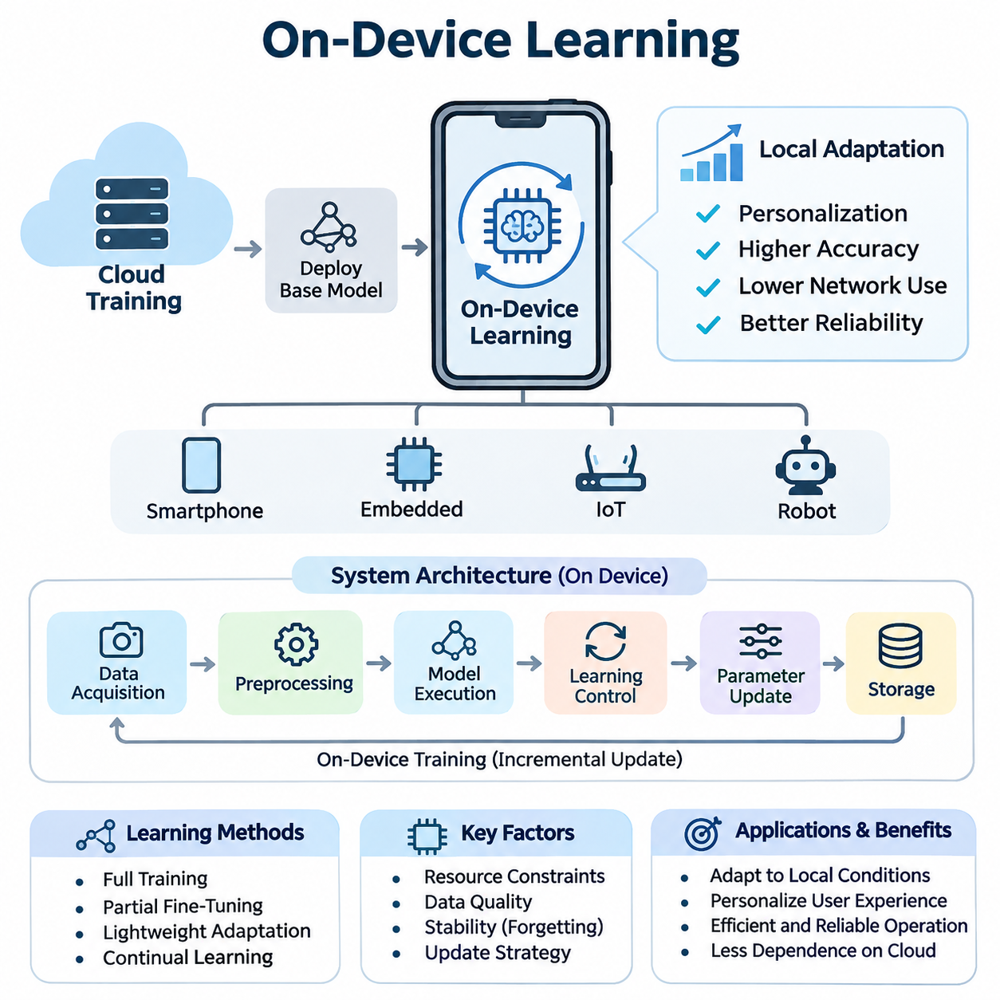
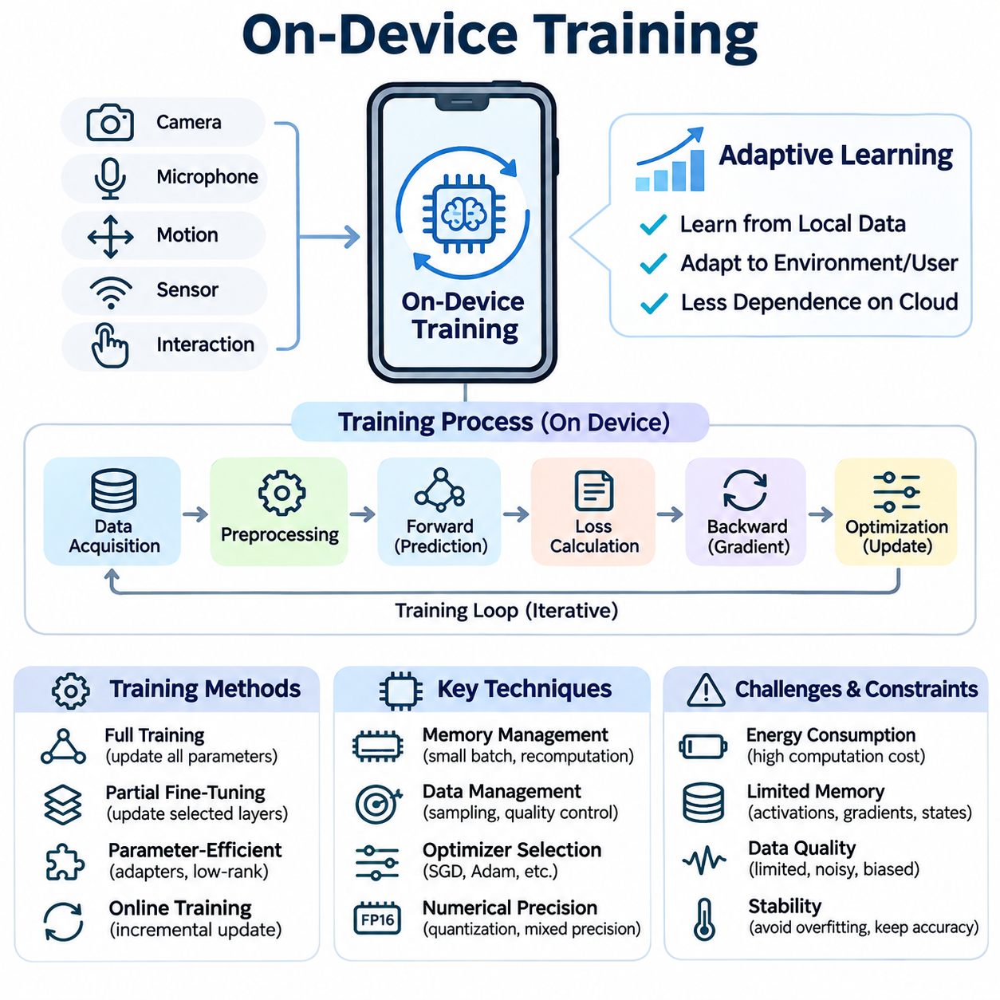
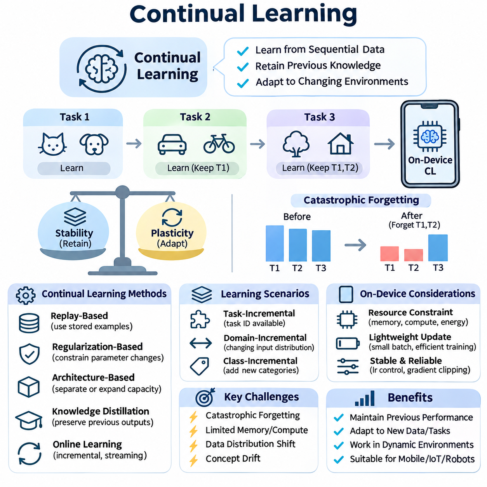
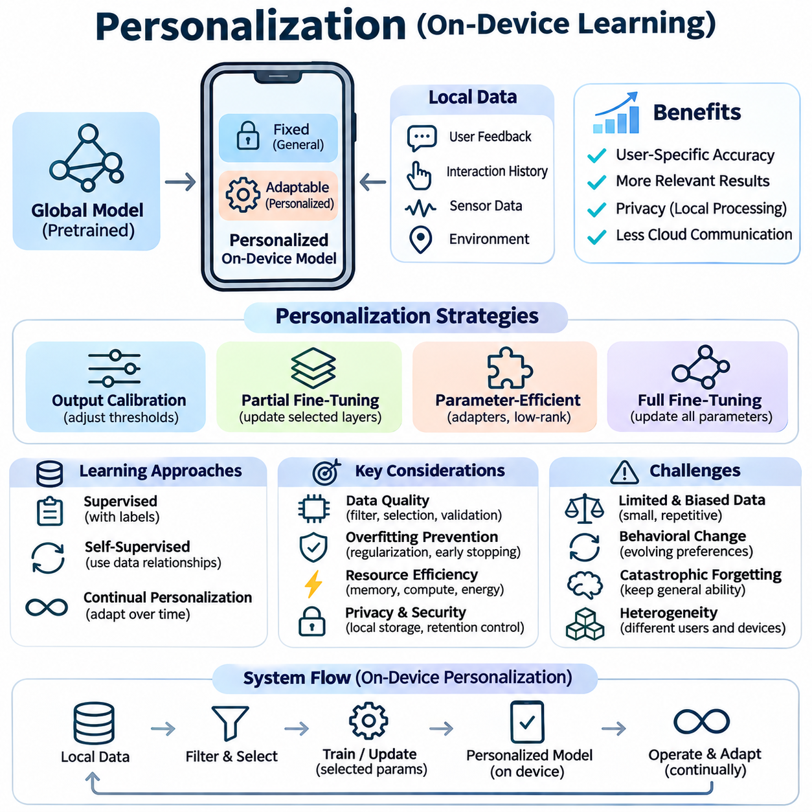
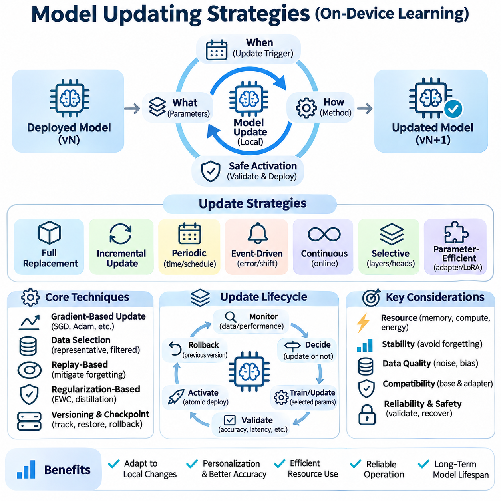
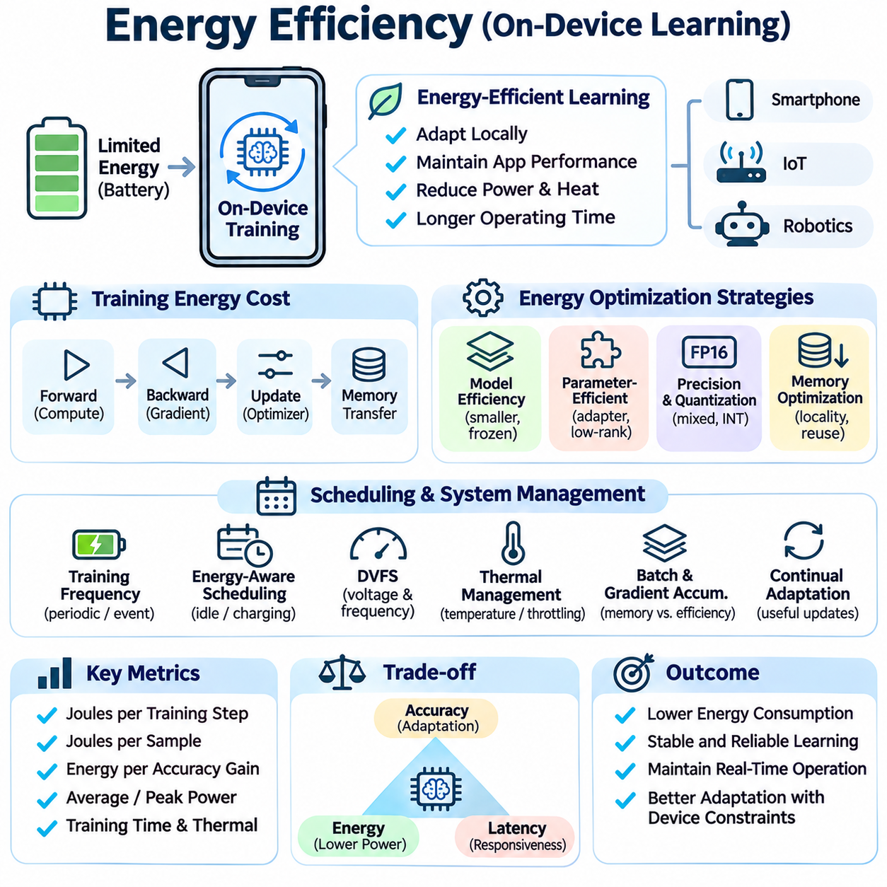
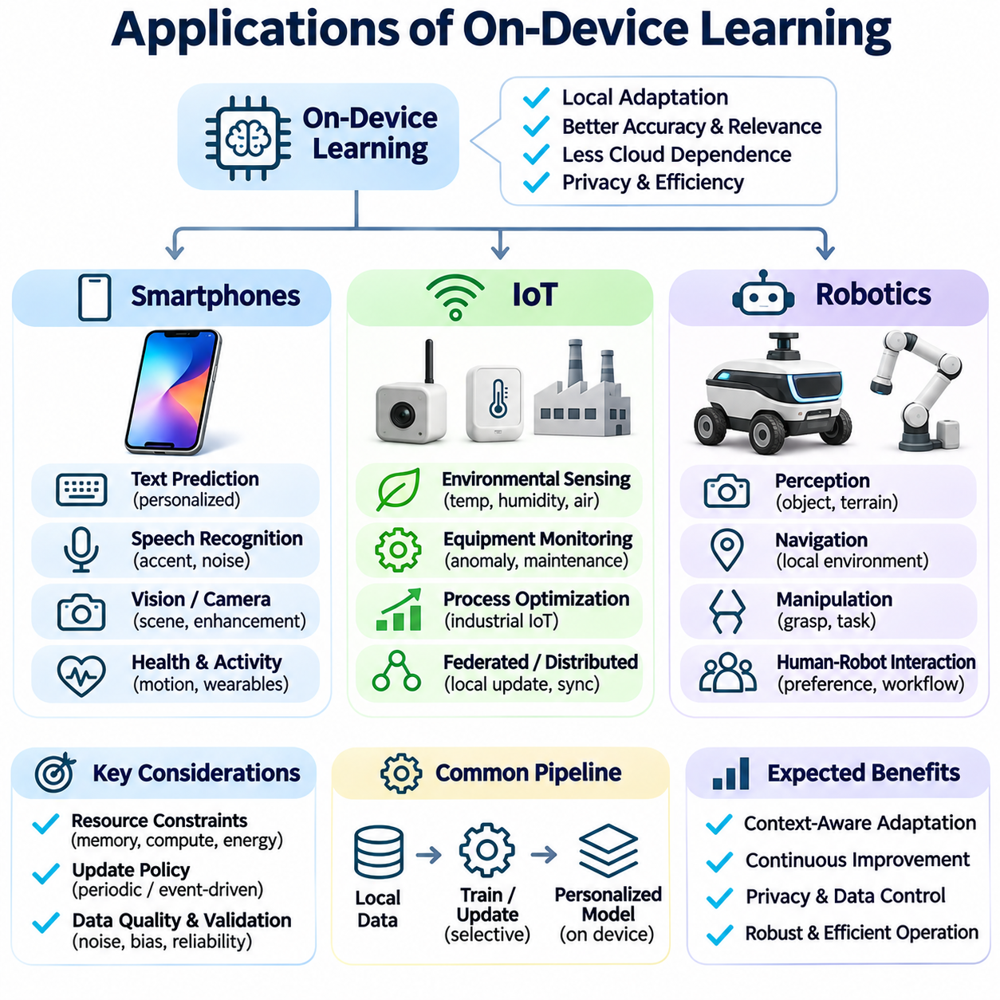

**Volume 40.** **TinyML and Federated Learning**

# 04. On Device Learning

## 04.00 Overview

{width="7.268055555555556in" height="7.268055555555556in"}

On-device learning is a machine learning paradigm in which artificial intelligence models are trained, adapted, or updated directly on local devices rather than relying entirely on centralized cloud infrastructure. This approach enables smartphones, embedded computers, Internet of Things devices, and autonomous robots to improve their behavior using locally collected data while reducing dependence on continuous network connectivity.

Traditional machine learning systems typically perform computationally intensive training in centralized data centers before deploying fixed models to edge devices. Although this architecture simplifies model management, it limits adaptation to changing environments and individual requirements. On-device learning extends the conventional deployment model by allowing selected learning operations to occur within the device itself.

The primary motivation for on-device learning is to create intelligent systems that continuously respond to local conditions. Sensor characteristics, user behavior, environmental changes, and operational requirements may differ significantly between devices. A centrally trained model cannot always represent these variations accurately, making local adaptation valuable for maintaining prediction accuracy, responsiveness, and operational reliability.

On-device learning differs from on-device inference because it modifies model parameters, representations, or adaptation states rather than merely executing predictions. Inference generally requires a forward computational pass, whereas training may involve gradient calculations, optimizer states, and additional memory allocations. Consequently, learning introduces substantially greater computational and energy demands than executing an already optimized model.

The architecture of an on-device learning system typically includes local data acquisition, preprocessing, model execution, learning control, parameter updating, and persistent storage. Data collected through cameras, microphones, inertial sensors, or user interactions can support incremental improvements. The learning controller determines when updates should occur and whether sufficient computational resources are available to execute them safely.

On-device training represents the foundational mechanism through which a deployed model acquires new information. Training may involve updating an entire neural network, modifying selected layers, or adjusting a small set of trainable parameters. Full-model optimization offers flexibility but consumes considerable resources, while partial fine-tuning and lightweight adaptation methods reduce memory requirements and computational overhead.

Resource constraints strongly influence the design of local learning algorithms. Embedded processors and mobile accelerators operate under limited memory capacity, computational throughput, and thermal budgets. Training procedures must therefore balance model complexity, batch size, optimizer selection, and numerical precision. Techniques such as selective layer freezing, gradient accumulation, and parameter-efficient adaptation can help accommodate constrained hardware environments.

Continual learning enables devices to acquire knowledge from sequentially arriving data without repeatedly retraining models from their original datasets. This capability is particularly important when operating conditions evolve over time. However, continual learning introduces catastrophic forgetting, in which adaptation to new observations reduces performance on previously learned tasks. Effective systems must balance plasticity toward new information with stability of existing knowledge.

Several approaches address the stability challenges associated with continual learning. Replay-based methods preserve representative historical examples, regularization methods constrain changes to important parameters, and architecture-based methods allocate specialized capacity for new knowledge. Each approach introduces different memory and computational costs, requiring careful selection according to device capabilities, data availability, and application requirements.

Personalization is another important objective of on-device learning because individual devices frequently encounter distinctive users, behaviors, and operating environments. A smartphone may adapt language predictions to personal writing patterns, while a wearable device may learn individual movement characteristics. Local personalization allows a shared baseline model to become more relevant without requiring every adaptation to be performed centrally.

Personalized learning systems often separate general model knowledge from device-specific parameters. A pretrained feature extractor can remain unchanged while a lightweight classification head, adapter, or calibration component learns from local observations. This separation reduces training costs and helps preserve general capabilities. It also supports controlled updates because personalized components can be independently evaluated, replaced, or reset.

Model updating strategies determine how newly acquired information becomes part of a deployed system. Updates may occur periodically, when sufficient new data accumulates, or when monitoring identifies a meaningful distribution shift. Event-driven learning can reduce unnecessary computation, while scheduled updates simplify resource management. Reliable updating requires explicit acceptance criteria, version tracking, and mechanisms for recovering from unsuccessful adaptation.

Data quality is essential because local learning frequently operates with limited, noisy, or weakly labeled observations. Sensor drift, temporary environmental disturbances, and incorrect user feedback can introduce misleading training signals. Systems must therefore evaluate sample relevance, confidence, and representativeness before updating parameters. Data filtering and validation mechanisms reduce the likelihood that transient anomalies will permanently degrade model performance.

Energy efficiency is a central engineering requirement because learning workloads can rapidly consume battery capacity and increase device temperature. Unlike inference, training may repeatedly execute forward and backward operations over multiple examples. Energy-aware learning schedules can postpone updates until charging is available, reduce training frequency, or select smaller adaptation workloads based on remaining power and thermal conditions.

Hardware characteristics also determine which learning operations are practical. CPUs provide flexible execution, while GPUs and neural processing units can accelerate supported tensor operations. However, an accelerator optimized for inference may not efficiently support backpropagation or parameter updates. Developers must examine training operator availability, memory bandwidth, software compatibility, and power consumption rather than assuming inference acceleration automatically enables efficient training.

Privacy is a major advantage of processing learning data locally because sensitive observations need not be transmitted to external servers for every model update. Nevertheless, local execution does not automatically guarantee privacy or security. Stored training examples, model checkpoints, diagnostic logs, and learned parameters may still expose sensitive information. Encryption, access control, data minimization, and secure model storage remain necessary.

On-device learning is closely related to federated learning, but the two concepts describe different system properties. On-device learning concerns where adaptation occurs, whereas federated learning coordinates training across multiple participants without requiring centralized collection of their raw datasets. A device can learn independently without participating in federation, while federated architectures may combine local updates with periodic aggregation of shared model parameters.

Connectivity constraints further distinguish local learning from cloud-dependent approaches. Devices operating in remote industrial facilities, autonomous vehicles, or intermittently connected environments may need to adapt without immediate server access. Local learning can preserve adaptive functionality during communication outages. However, synchronization policies are still necessary when devices eventually reconnect to centralized management or collaborative learning infrastructure.

Smartphones provide a practical environment for personalized on-device learning because they combine substantial processing capability with rich interaction data. Applications include adaptive text prediction, user-specific activity recognition, and personalized recommendation components. Training must coexist with foreground applications, operating-system scheduling, and battery management, making opportunistic execution and lightweight parameter updates especially important.

Internet of Things systems present a different set of constraints because many sensors operate with extremely limited memory, processing capacity, and energy reserves. Simple adaptive classifiers, statistical estimators, and incremental anomaly detectors may be more practical than full neural network training. In these environments, learning architecture must be matched to hardware capabilities, communication patterns, and the expected frequency of environmental changes.

Robotics applications benefit from on-device learning when perception and control systems encounter changing physical conditions. Mobile robots may adapt to sensor calibration differences, surface characteristics, or variations in visual appearance. Local adaptation can improve operational robustness, but safety-critical control functions require strict separation between experimental learning behavior and validated control policies, particularly when unexpected updates could affect physical motion.

Evaluating on-device learning requires more than measuring prediction accuracy after training. Important metrics include adaptation latency, peak memory consumption, energy per update, computational utilization, thermal behavior, and retention of previously acquired knowledge. Evaluation should also measure performance under realistic data distributions and device workloads because laboratory training results may not represent behavior during continuous field operation.

Reliable experimentation requires consistent initial model states, documented learning schedules, controlled datasets, and reproducible measurement procedures. Comparisons between local adaptation methods should account for differences in trainable parameter counts, available memory, optimization steps, and energy budgets. Evaluating both immediate improvement and long-term degradation provides a more complete understanding of whether a learning strategy remains sustainable.

Deployment engineering introduces additional requirements involving update validation, fault recovery, and lifecycle management. A newly adapted model should be evaluated before replacing its previously validated version. Checkpointing, rollback mechanisms, and bounded update procedures help prevent corrupted or unstable models from disrupting device operation. Monitoring must distinguish genuine improvements from temporary fluctuations caused by small local datasets.

The broader significance of on-device learning lies in transforming edge devices from static inference endpoints into adaptive intelligent systems. By integrating local training, continual learning, personalization, controlled model updates, and energy-aware execution, devices can respond more effectively to changing environments. Successful implementation depends on balancing adaptability with resource efficiency, privacy, reliability, and operational safety.

## 04.01 On Device Training

{width="7.268055555555556in" height="7.268055555555556in"}

On-device training refers to the process of optimizing machine learning models directly on local hardware rather than transferring all training data to centralized computing infrastructure. This approach enables intelligent devices to learn from their own observations, interactions, and environmental conditions. Unlike conventional edge inference, on-device training modifies model parameters and therefore requires additional computational resources, memory capacity, and energy.

The fundamental objective of on-device training is to support adaptive intelligence under constrained hardware conditions. Smartphones, wearable devices, industrial sensors, and autonomous robots frequently encounter data distributions that differ from those represented during centralized training. Local optimization allows deployed models to respond to these differences without requiring continuous communication with remote servers or complete retraining in cloud environments.

A typical on-device training architecture combines data acquisition, preprocessing, model execution, loss calculation, gradient computation, and parameter optimization. Local sensors or application interactions generate training examples that are processed into suitable representations. The model produces predictions, a learning objective evaluates their quality, and an optimization algorithm adjusts selected parameters to improve subsequent predictions.

The training process generally involves both forward propagation and backward propagation. Forward propagation calculates model outputs and associated losses, while backward propagation determines gradients describing how parameters influence those losses. An optimizer then applies parameter updates using algorithms such as stochastic gradient descent or Adam. These operations introduce computational and memory requirements beyond those associated with inference alone.

Memory management is particularly important because training requires intermediate activations, gradients, model parameters, and potentially optimizer states. The total memory footprint may substantially exceed the size of the deployed inference model. Devices with limited random-access memory must therefore employ strategies such as smaller batches, selective parameter updates, activation recomputation, or carefully managed memory allocation to prevent resource exhaustion.

Full-model training provides maximum flexibility because every trainable parameter can be modified in response to local data. However, this approach is often impractical for embedded systems because of its computational intensity and memory requirements. Partial fine-tuning offers a more efficient alternative by freezing selected network layers and updating only components that are most relevant to local adaptation, such as classification heads or specialized feature transformations.

Parameter-efficient training further reduces resource requirements by introducing compact trainable components into an otherwise fixed model. Techniques such as adapters and low-rank adaptation modify a relatively small number of parameters while preserving most pretrained weights. These methods can make local adaptation more practical, although their effectiveness depends on model architecture, task complexity, and the availability of supported training operations.

Training data management presents another challenge because local observations are often limited, noisy, and unevenly distributed. A device may encounter repetitive examples, temporary environmental disturbances, or user-specific patterns that differ from broader populations. Without appropriate sampling and validation, local optimization can overfit recent observations and degrade general performance. Data selection and quality control are therefore essential components of reliable training.

Supervised on-device training uses labeled examples to calculate prediction errors and guide parameter updates. Labels may originate from explicit user feedback, verified sensor measurements, or trusted application events. However, acquiring reliable labels can be expensive or inconvenient. Weak supervision, self-supervised objectives, and carefully validated pseudo-labeling provide alternative learning signals when direct annotations are unavailable.

Online training processes incoming observations incrementally rather than waiting for large datasets to accumulate. This approach supports rapid adaptation to evolving conditions, but individual updates may be highly sensitive to noisy samples. Mini-batch accumulation, learning-rate control, and update scheduling can improve stability. The system must determine whether immediate adaptation provides sufficient benefit to justify its computational and operational costs.

Optimization algorithms must be selected according to hardware limitations and learning objectives. Stochastic gradient descent generally requires relatively little optimizer-state memory, while adaptive optimizers such as Adam maintain additional statistics for each updated parameter. Although adaptive methods may improve convergence in certain settings, their memory overhead can become significant on constrained devices. Optimizer selection therefore involves balancing convergence behavior, stability, and resource consumption.

Numerical precision influences both training efficiency and optimization reliability. Reduced-precision arithmetic can lower memory requirements and accelerate supported operations, particularly on hardware with specialized matrix-processing units. However, low-precision gradients may suffer from rounding errors, overflow, or underflow. Mixed-precision training, selective higher-precision accumulation, and numerical stability checks can help maintain acceptable learning behavior.

Energy consumption is a major constraint because training repeatedly executes computationally intensive operations. Battery-powered devices must balance adaptation benefits against operating time, thermal limits, and competing application workloads. Energy-aware scheduling can restrict training to periods of sufficient battery capacity, available charging power, or low processor utilization. Training frequency and computational intensity should reflect the device\'s operating requirements.

Thermal management is closely related to energy efficiency because sustained training workloads generate heat and may trigger processor throttling. Reduced clock frequencies can increase training duration and affect application responsiveness. Training controllers should monitor temperature, processor utilization, and available computational capacity. Adaptive workload scheduling can reduce training intensity or suspend updates when thermal conditions threaten stable device operation.

Hardware acceleration can improve on-device training performance when suitable computational operators are available. Mobile GPUs, embedded accelerators, and neural processing units may accelerate supported tensor calculations, but many devices are primarily optimized for inference. Efficient training requires compatible backward operators, sufficient memory bandwidth, and appropriate software support. Hardware selection must therefore consider training capabilities independently from inference performance.

Training frameworks provide the software infrastructure required to execute optimization workloads on embedded platforms. TensorFlow, PyTorch, and specialized mobile runtimes offer different combinations of automatic differentiation, operator support, and deployment compatibility. However, lightweight inference runtimes do not necessarily provide complete training functionality. Developers must verify supported operations, model formats, optimizer availability, and hardware-specific execution constraints.

Local model adaptation introduces important privacy advantages because raw training observations can remain within the originating device. Nevertheless, local processing does not eliminate security risks. Training datasets, gradients, optimizer states, and stored checkpoints may reveal sensitive information if accessed improperly. Secure storage, access restrictions, encrypted persistence, and controlled diagnostic logging are necessary to protect the learning process.

On-device training also creates risks associated with model integrity and unexpected parameter changes. Incorrect labels, adversarial observations, or corrupted training samples can cause performance degradation. Reliable systems should validate incoming data, restrict update magnitudes when appropriate, and evaluate candidate models before deployment. Maintaining a previously validated checkpoint provides a recovery mechanism when local adaptation produces unacceptable results.

Continual learning extends on-device training by enabling models to accumulate knowledge across changing tasks and environments. However, repeated optimization on recent observations may cause catastrophic forgetting of previously learned information. Replay buffers, regularization constraints, and selective parameter isolation can reduce this problem. These mechanisms introduce additional resource costs that must be considered when designing long-running adaptive systems.

Personalization represents an important application of local training because individual users and devices exhibit distinctive characteristics. A smartphone may adapt text prediction to preferred vocabulary, while a wearable sensor may adjust activity recognition to personal movement patterns. Personalized training often modifies compact model components rather than entire networks, reducing computational demands while preserving general capabilities learned during centralized pretraining.

Robotic systems can use on-device training to adapt perception models to changing lighting, sensor characteristics, or operating environments. For example, an autonomous mobile robot may improve visual classification using locally observed conditions. However, updates affecting safety-critical perception or control require additional safeguards. Candidate models should undergo validation before influencing operational decisions, and learning must not bypass established safety mechanisms.

Evaluation of on-device training requires simultaneous consideration of model quality and system efficiency. Accuracy, loss reduction, convergence behavior, and generalization must be assessed alongside training latency, peak memory usage, energy consumption, and thermal stability. Measurements should reflect realistic workloads because isolated laboratory benchmarks may underestimate interference from sensing, communication, and application execution.

A reliable training pipeline should maintain clear separation between data collection, optimization, validation, and model activation. Candidate updates can be evaluated against representative local examples and retained reference data before replacing the active model. Version tracking, checkpoint management, and rollback procedures support reproducibility and fault recovery. Monitoring after activation helps identify delayed performance degradation or unexpected behavior.

The effectiveness of on-device training ultimately depends on balancing learning capability with hardware constraints and operational reliability. Full training, partial fine-tuning, parameter-efficient adaptation, and incremental optimization provide different tradeoffs between flexibility and resource consumption. By integrating efficient algorithms, controlled update policies, secure data handling, and systematic evaluation, on-device training enables practical adaptive intelligence across smartphones, IoT systems, and autonomous robotics.

## 04.02 Continual Learning [w/Code]

{width="7.268055555555556in" height="7.268055555555556in"}

Continual learning is a machine learning paradigm that enables models to acquire new knowledge from sequentially arriving data while retaining previously learned capabilities. Unlike conventional training, which assumes access to a fixed dataset, continual learning operates under evolving data distributions and changing tasks. In on-device environments, this capability allows intelligent systems to adapt locally without repeatedly retraining entire models in centralized infrastructure.

The primary objective of continual learning is to maintain a balance between stability and plasticity. Stability preserves existing knowledge, while plasticity enables adaptation to new observations and requirements. Excessive stability prevents meaningful learning, whereas excessive plasticity causes previously acquired information to deteriorate. Effective continual learning algorithms must coordinate these competing properties throughout the operational lifetime of a deployed model.

Catastrophic forgetting represents one of the most significant challenges in continual learning. When neural networks are optimized using new data, parameter updates may overwrite representations that were important for earlier tasks. Consequently, performance on previously learned categories or environments can decline sharply. This problem becomes especially serious when historical training data cannot be retained because of memory, privacy, or storage limitations.

Continual learning scenarios are commonly categorized according to how tasks and data distributions evolve. Task-incremental learning assumes that task identity is available during evaluation, while domain-incremental learning involves changing input distributions without necessarily introducing new output categories. Class-incremental learning requires models to recognize newly introduced categories alongside previously learned ones without relying on task identifiers.

On-device continual learning introduces additional constraints because adaptation occurs on hardware with limited computational capacity, memory, and energy. Smartphones, embedded processors, and autonomous robots cannot continuously execute expensive optimization procedures without affecting primary functions. Learning algorithms must therefore minimize training overhead while maintaining responsiveness, thermal stability, and reliable inference performance during normal device operation.

Replay-based learning addresses catastrophic forgetting by retaining representative examples from previous experiences. During adaptation, the model trains on a combination of recent observations and stored historical samples. This approach helps preserve earlier decision boundaries and feature representations. However, replay buffers consume memory, and retaining raw observations may introduce privacy concerns or storage-management challenges on resource-constrained devices.

Experience replay can be implemented through reservoir sampling, class-balanced selection, or importance-based memory management. Reservoir sampling provides a mechanism for maintaining representative examples from a continuous data stream, while class-balanced strategies reduce bias toward frequently observed categories. The selection policy influences both memory efficiency and learning quality, particularly when device data distributions are highly imbalanced.

Regularization-based continual learning protects previously acquired knowledge by restricting changes to important model parameters. Elastic Weight Consolidation estimates parameter importance and penalizes updates that would substantially modify weights associated with earlier tasks. Other approaches use knowledge distillation or functional constraints to preserve historical model behavior. These techniques reduce reliance on stored examples but may limit adaptation flexibility.

Architecture-based methods address forgetting by separating or expanding model capacity for different learning experiences. Progressive networks, dynamically allocated modules, and parameter-isolation strategies preserve previously learned components while introducing new trainable structures. Although these approaches can reduce interference between tasks, expanding architectures may increase memory consumption and computational complexity, making unrestricted growth unsuitable for embedded deployment.

Knowledge distillation provides another mechanism for maintaining continuity between model versions. A previously trained model generates reference predictions that guide the updated model during adaptation. By minimizing differences between historical and current outputs, the system can preserve established behavior while learning new patterns. Distillation can be combined with replay or regularization, although its effectiveness depends on representative inputs and teacher-model quality.

Online continual learning processes observations as they arrive, often with limited opportunities to revisit historical data. This setting is particularly relevant to mobile devices and robotic systems operating in dynamic environments. Small training batches and incremental optimization enable frequent adaptation, but noisy observations may destabilize updates. Learning-rate scheduling, gradient clipping, and selective update policies can improve robustness under streaming conditions.

Data distribution shift is a central motivation for continual learning because deployed devices encounter environments that differ from their original training conditions. Changes in illumination, sensor calibration, user behavior, or operating context can reduce model accuracy. Continual adaptation allows models to respond to these shifts, but systems must distinguish persistent changes from temporary anomalies before modifying parameters.

Concept drift occurs when relationships between input features and target outputs change over time. Unlike simple changes in input frequency, concept drift can invalidate previously learned decision boundaries. Detection mechanisms may monitor prediction confidence, error rates, or statistical properties of incoming observations. When meaningful drift is detected, the system can initiate controlled adaptation rather than performing unnecessary training continuously.

Self-supervised learning can support continual adaptation when reliable labels are unavailable. Devices may learn updated feature representations through reconstruction, contrastive objectives, or consistency-based training. These methods exploit naturally occurring relationships within local observations. However, representation updates must be evaluated carefully because improvements in unsupervised objectives do not necessarily translate into better downstream task performance.

Pseudo-labeling provides an alternative mechanism for generating training targets from model predictions. High-confidence predictions may be selected as provisional labels for subsequent optimization. Although this approach reduces dependence on manual annotation, incorrect pseudo-labels can reinforce existing errors and cause model drift. Confidence calibration, sample filtering, and periodic validation are necessary to limit error accumulation.

Memory-efficient continual learning is especially important for TinyML and embedded systems. Full historical datasets are generally impractical to retain on microcontrollers or low-power processors. Compact replay buffers, prototype representations, feature summaries, and parameter-efficient updates offer alternatives to storing extensive raw observations. Their effectiveness depends on the complexity of the learning task and the information preserved by each representation.

Energy-aware continual learning coordinates adaptation with device power availability and operational priorities. Training may be scheduled during charging periods, low processor utilization, or reduced application activity. Adaptive learning frequency can respond to battery state, thermal conditions, and detected distribution changes. Such scheduling reduces unnecessary computation while preserving the ability to adapt when environmental changes justify additional resource consumption.

Personalization is a major application of continual learning because individual users generate evolving behavioral patterns. Smartphones may adapt language prediction to changing vocabulary, while wearable devices may update activity recognition models as movement characteristics change. Continual personalization should preserve broadly useful pretrained knowledge while incorporating individual preferences, preventing temporary observations from dominating long-term model behavior.

Robotic systems benefit from continual learning when operating conditions evolve beyond those represented during initial training. Autonomous mobile robots may encounter new floor surfaces, lighting conditions, or visual obstacles. Local adaptation can improve perception and environmental understanding, but learning must remain separated from validated safety mechanisms. Updated models should undergo controlled evaluation before influencing safety-critical navigation or motion decisions.

Continual learning evaluation requires measuring performance across the entire sequence of learning experiences rather than assessing only the latest task. Average accuracy, forgetting, backward transfer, and forward transfer provide complementary perspectives on adaptation quality. Backward transfer measures how new learning affects earlier tasks, while forward transfer examines whether accumulated knowledge improves performance on subsequent learning experiences.

System-level evaluation must also account for training latency, memory usage, energy consumption, and inference availability. An algorithm that achieves strong retention but requires excessive computational resources may be unsuitable for on-device deployment. Benchmarking should reproduce realistic data arrival patterns, resource constraints, and operational interruptions. Comparisons must distinguish improvements in learning quality from increases in model capacity or replay memory.

Reliable continual learning systems require model versioning, checkpoint management, and rollback mechanisms. Candidate updates should be evaluated against both recent observations and representative historical conditions before activation. Monitoring can identify unexpected performance degradation after deployment. When validation fails, the system should preserve or restore the previous model rather than automatically accepting potentially harmful parameter changes.

The long-term objective of continual learning is to create adaptive systems that accumulate useful knowledge throughout their operational lifetime. Achieving this goal requires integrating replay, regularization, architectural adaptation, efficient optimization, and controlled deployment procedures. In on-device environments, successful continual learning must preserve existing capabilities while responding to new information within strict memory, energy, privacy, and reliability constraints.

## 04.03 Personalization

{width="7.268055555555556in" height="7.268055555555556in"}

Personalization in on-device learning refers to adapting machine learning models to the characteristics, preferences, and operating conditions of individual users or devices. Unlike centralized models optimized for population-level performance, personalized models incorporate local observations to improve relevance and accuracy. This capability enables intelligent systems to respond to individual differences while reducing dependence on continuous cloud communication.

The fundamental motivation for personalization is the variability of real-world data across users, devices, and environments. A globally trained model may perform well on average but poorly for individuals whose behavior or operating conditions differ from the training population. On-device personalization addresses this limitation by modifying selected model components using locally collected data, allowing predictions to reflect individual characteristics.

Personalization typically begins with a pretrained global model that provides general representations and baseline capabilities. Local adaptation then adjusts selected parameters, decision thresholds, or output layers using device-specific observations. This separation between shared knowledge and personalized components reduces training requirements while preserving broadly useful features. The resulting model combines general intelligence with locally optimized behavior.

A central design decision concerns which model parameters should remain fixed and which should be adapted. Full-model fine-tuning offers flexibility but introduces substantial memory, computation, and energy costs. Partial fine-tuning updates only selected layers, while parameter-efficient methods introduce compact adapters or low-rank modifications. These approaches enable personalization on resource-constrained hardware without repeatedly optimizing entire neural networks.

Personalization data may originate from explicit user feedback, interaction histories, sensor measurements, or environmental observations. The usefulness of these sources depends on their reliability, representativeness, and relationship to the target task. Local datasets are often small, repetitive, or biased toward recent behavior. Effective personalization therefore requires careful data filtering, sample selection, and validation to prevent unstable or misleading updates.

Supervised personalization relies on labeled examples that connect local observations with desired outcomes. A smartphone may learn preferred vocabulary from corrected predictions, while a wearable device may adapt activity recognition using confirmed movement labels. However, explicit annotation can interrupt normal usage. Implicit feedback and weak supervision provide alternatives, although their uncertainty must be considered when generating training targets.

Self-supervised personalization can exploit relationships within locally collected data without requiring manually assigned labels. Representation learning objectives may use temporal consistency, reconstruction, or contrastive relationships to adapt feature extractors. These techniques are useful when continuous sensor streams generate abundant observations but few reliable annotations. Nevertheless, improvements in representation objectives should be validated against actual application performance.

Personalized learning must address the risk of overfitting because individual devices often provide limited and correlated training examples. Excessive optimization can cause a model to memorize recent observations rather than learn stable personal characteristics. Regularization, early stopping, conservative learning rates, and restricted parameter updates can reduce this risk. Retaining general pretrained representations also helps preserve performance outside frequently observed situations.

Continual personalization extends local adaptation across the operational lifetime of a device. User preferences, physical characteristics, and environmental conditions may change gradually or abruptly. Incremental updates allow models to follow these changes without restarting training from the original dataset. However, continual personalization must distinguish persistent behavioral evolution from temporary anomalies to avoid unnecessary changes and catastrophic forgetting.

Personalization strategies may operate at different levels of model complexity. Output calibration adjusts decision thresholds or confidence estimates without modifying internal representations. Lightweight classification heads adapt task-specific predictions, while adapter modules modify intermediate features. Full-network adaptation provides greater expressive capacity but requires substantially more resources. The appropriate strategy depends on device capability and the magnitude of local distribution differences.

Privacy is a major advantage of on-device personalization because sensitive behavioral and sensor data can remain within the originating device. Local processing reduces the need to transmit raw observations to centralized servers. However, personalized parameters, stored examples, and diagnostic logs may still contain sensitive information. Secure storage, access control, data minimization, and controlled retention policies are therefore essential for responsible deployment.

Personalization and federated learning can be combined to balance shared knowledge with individual adaptation. A federated system may periodically update a global model using information contributed by multiple devices, while each participant maintains private local parameters. Personalized federated learning can also optimize shared and device-specific components jointly. These architectures must account for heterogeneous data, communication costs, and differing device capabilities.

Resource efficiency determines whether personalization can operate continuously on mobile and embedded hardware. Training workloads compete with inference, communication, sensing, and application execution for processing capacity. Energy-aware scheduling can delay updates until charging periods or low-utilization intervals. Parameter-efficient optimization, compact training batches, and selective learning frequency reduce interference with primary device functions.

Hardware characteristics influence the selection of personalization algorithms. Smartphones may provide CPUs, GPUs, and neural processing units, while microcontrollers typically offer much smaller memory and computational budgets. Specialized accelerators may execute inference efficiently without supporting all backward operations required for training. Developers must verify training compatibility, memory requirements, and energy consumption rather than assuming inference acceleration guarantees efficient adaptation.

Smartphone personalization supports applications such as predictive text, speech recognition, recommendation, and adaptive user interfaces. A language model may learn preferred expressions, while a speech system may adapt to an individual\'s pronunciation patterns. Such improvements can increase usability without continuously transmitting personal interactions. However, personalization should remain reversible and should not prevent the model from handling unfamiliar inputs.

Wearable devices benefit from personalization because physiological signals and movement patterns vary considerably among individuals. Activity recognition, gesture detection, and sensor calibration can be adapted using local observations. Personalized models may compensate for device placement differences or evolving movement habits. Reliable deployment requires attention to noisy measurements, limited labels, and the consequences of incorrect predictions.

In industrial IoT environments, personalization can adapt models to individual machines, sensors, and operating conditions. Equipment may exhibit distinct vibration signatures, temperature patterns, or normal operating ranges. Local adaptation can improve anomaly detection by learning equipment-specific baselines. However, the system must avoid treating developing faults as normal behavior, making reference models and controlled update policies essential.

Robotic personalization adapts perception and interaction models to particular platforms, environments, or operators. Robots may learn sensor-specific calibration parameters, visual characteristics of recurring locations, or preferred interaction patterns. These adaptations can improve operational efficiency, but safety-critical control should remain governed by validated constraints. Candidate updates require evaluation before influencing navigation, manipulation, or physical interaction.

Evaluation of personalized models must consider both individual improvements and preservation of general capabilities. Personalized accuracy, adaptation speed, calibration quality, and user-specific performance should be measured against a common baseline. Testing must also examine performance on unfamiliar conditions to identify overfitting. Comparisons should control for local dataset size, training duration, and available computational resources.

Fairness and robustness are important because personalization may produce different performance levels across users and devices. Individuals with limited interaction data may receive weaker adaptations than those generating abundant observations. Poor-quality sensors or unusual operating environments can further increase performance disparities. Evaluation should therefore consider variation across participants, data availability, and hardware configurations rather than reporting only average improvements.

Reliable personalization requires explicit model lifecycle management, including update validation, checkpoint storage, version tracking, and rollback. A newly adapted model should replace the active version only when it satisfies predefined quality and resource constraints. Monitoring can identify performance degradation or unexpected behavior after deployment. Users and operators may also require mechanisms to reset personalized parameters or suspend further adaptation.

The broader significance of on-device personalization lies in transforming general-purpose artificial intelligence into context-aware systems that respond to individual needs. Effective implementation combines pretrained knowledge, efficient local optimization, privacy protection, continual adaptation, and systematic evaluation. By balancing personalization benefits with resource limitations and operational reliability, intelligent devices can deliver adaptive behavior without sacrificing general performance or user control.

## 04.04 Model Updating Strategies

{width="7.268055555555556in" height="7.268055555555556in"}

Model updating strategies define how deployed machine learning systems incorporate new knowledge while preserving reliability, efficiency, and previously learned capabilities. In on-device learning, updates occur under constraints involving memory, computation, energy, and connectivity. Effective strategies must determine when models should change, which parameters require modification, and how updated versions can be safely activated.

A fundamental distinction exists between full-model replacement and incremental model updating. Full replacement installs a newly trained model, often prepared in centralized infrastructure, while incremental updating modifies selected parameters using local observations. Full replacement provides consistent global improvements but may require substantial downloads. Incremental updating supports personalization and adaptation with lower communication demands.

Periodic updating follows predefined schedules based on elapsed time, accumulated observations, or device maintenance intervals. This approach simplifies resource planning and allows training to occur during predictable operating conditions. However, fixed schedules may trigger unnecessary updates when data distributions remain stable. They may also delay adaptation when environmental changes occur between scheduled learning sessions.

Event-driven updating initiates adaptation when predefined conditions indicate that model behavior requires improvement. Triggers may include sustained prediction errors, declining confidence, detected distribution shifts, or changes in sensor calibration. Event-driven policies reduce unnecessary computation but depend on reliable monitoring. Poorly designed triggers can produce excessive updates or overlook gradual performance degradation.

Continuous updating processes new observations through frequent incremental optimization. This strategy can provide rapid adaptation to changing conditions, particularly in dynamic environments. However, repeated parameter modifications increase computational overhead and may introduce instability or catastrophic forgetting. Practical implementations often combine online learning with bounded update frequency and conservative optimization settings.

Selective parameter updating reduces training costs by modifying only components associated with local adaptation. Classification heads, normalization parameters, adapters, or selected network layers may be updated while the remaining model stays fixed. This approach preserves general pretrained representations and reduces gradient computation. Parameter selection should reflect task requirements, hardware limitations, and expected distribution changes.

Parameter-efficient updating introduces compact trainable structures that modify model behavior without changing most pretrained weights. Low-rank adaptation and adapter modules are examples of this approach. Small update packages can simplify storage, transmission, and rollback. Nevertheless, compatibility between adapter versions and their underlying base models must be maintained to prevent incorrect execution or degraded predictions.

Gradient-based updating uses optimization algorithms to adjust parameters according to observed prediction errors. Learning rates, batch sizes, and optimization steps determine how aggressively the model adapts. Excessively large updates can destabilize established behavior, while overly conservative settings may prevent meaningful improvement. Gradient clipping, update limits, and adaptive learning-rate schedules can improve stability.

Data selection strongly influences model updating quality because local observations may be noisy, repetitive, or unrepresentative. Updating exclusively from recent samples can bias models toward temporary conditions. Representative sampling, confidence filtering, and balanced training batches help maintain generalization. Systems should distinguish meaningful environmental changes from transient anomalies before accepting new training data.

Replay-based updating combines recent observations with retained historical examples to preserve previously learned capabilities. Compact replay buffers can reduce catastrophic forgetting without storing complete historical datasets. Alternative approaches retain feature prototypes or statistical summaries. Memory allocation must balance historical coverage against the limited storage available on embedded devices and mobile platforms.

Regularization-based updating constrains parameter changes to protect important existing knowledge. Penalty terms can discourage modifications to weights associated with earlier tasks, while knowledge distillation can preserve historical predictions. These techniques are useful when raw training data cannot be retained. However, strong constraints may reduce adaptation speed or prevent learning when new conditions differ substantially from previous environments.

Model versioning provides a structured mechanism for tracking changes throughout the update lifecycle. Each version should identify its base model, updated parameters, training configuration, validation results, and compatibility requirements. Consistent version identifiers support reproducibility and fault investigation. Version metadata also helps distinguish locally personalized models from centrally distributed global releases.

Checkpoint management protects deployed systems against interrupted or unsuccessful updates. A checkpoint records sufficient model state to restore a previously validated configuration. On resource-constrained devices, storing complete model copies may be expensive, so incremental checkpoints or parameter differences can reduce storage requirements. Recovery procedures must ensure that partially written updates cannot corrupt the active model.

Atomic model activation prevents applications from accessing incomplete or inconsistent model states. Candidate updates should be prepared separately from the active inference model and activated only after integrity and compatibility checks succeed. Double-buffered storage or transactional replacement can support this process. If activation fails, the system should continue operating with the last validated model.

Validation gates determine whether an updated model satisfies predefined acceptance criteria. Evaluation should consider prediction accuracy, performance on historical reference cases, memory consumption, inference latency, and energy requirements. A candidate that improves recent observations but significantly degrades earlier capabilities should be rejected. Safety-critical applications require additional checks before updated models influence physical operations.

Rollback strategies provide recovery when an activated update causes unexpected performance degradation. Monitoring systems can detect abnormal error rates, unstable outputs, or violations of operational constraints. When predefined thresholds are exceeded, the device may restore an earlier validated version. Rollback procedures should preserve diagnostic information while avoiding prolonged interruption of essential services.

Over-the-air updating enables centrally prepared models or parameter packages to reach distributed devices through network connections. Reliable delivery requires package authentication, integrity verification, compatibility checking, and interruption recovery. Delta updates transmit only differences between model versions, potentially reducing communication costs. However, delta packages must be applied against the correct base version to avoid inconsistent model states.

Hybrid updating combines centralized model releases with local adaptation. A shared model may receive periodic global improvements, while device-specific components preserve personalized behavior. Updating the global base can create compatibility problems with existing local adapters or calibration parameters. Migration procedures and validation are therefore necessary when integrating centrally distributed improvements with locally learned knowledge.

Energy-aware updating coordinates training and installation activities with device power availability. Computationally expensive updates may be deferred until charging periods or low-utilization intervals. Thermal conditions and competing workloads should also influence scheduling decisions. For autonomous systems, update execution must respect operational priorities so that adaptation does not interfere with perception, communication, or control functions.

Privacy and security requirements influence how update data and model packages are handled. Local training can reduce transmission of sensitive observations, but gradients and personalized parameters may still reveal information. Update packages should be authenticated, and stored model states should be protected against unauthorized modification. Secure update procedures must also prevent rollback to known vulnerable versions without appropriate authorization.

Robotic and industrial applications require particularly conservative updating policies because model changes can affect physical behavior. Perception updates may alter obstacle recognition, anomaly detection, or environmental classification. Candidate models should undergo representative testing before operational activation. Safety controllers and validated fallback mechanisms must remain independent of unverified learning components.

Evaluation of updating strategies must examine both learning effectiveness and deployment efficiency. Relevant metrics include adaptation accuracy, forgetting, update duration, package size, memory overhead, energy consumption, and recovery time. Experiments should reproduce interrupted downloads, limited storage, distribution shifts, and operational workloads. Such testing reveals failures that conventional offline accuracy benchmarks may overlook.

The long-term effectiveness of model updating depends on combining adaptation mechanisms with disciplined lifecycle management. Periodic, event-driven, incremental, selective, and hybrid strategies offer different tradeoffs between responsiveness and resource consumption. Reliable on-device systems integrate monitoring, validation, version control, secure activation, and rollback to ensure that learning improves performance without compromising operational stability.

## 04.05 Energy Efficiency

{width="7.268055555555556in" height="7.268055555555556in"}

Energy efficiency is a fundamental requirement for on-device learning because training operations consume substantially more resources than conventional inference. Battery-powered devices must execute adaptation while maintaining essential application functions and acceptable operating time. Efficient learning therefore requires coordinated optimization of algorithms, memory access, processor utilization, and scheduling policies under strict power and thermal constraints.

The energy cost of on-device training originates from forward propagation, backward propagation, parameter updates, and repeated memory transfers. Unlike inference, training must retain or reconstruct intermediate activations and calculate gradients. These operations increase arithmetic intensity and data movement. Understanding their individual contributions is essential for identifying opportunities to reduce total energy consumption without sacrificing learning effectiveness.

Energy consumption depends on both instantaneous power and execution duration. A faster accelerator may consume more power while completing training with less total energy than a slower processor. Conversely, high utilization can increase thermal throttling and prolong execution. Energy-aware optimization must therefore evaluate joules per training step, joules per sample, and energy required to achieve a specified improvement in model quality.

Computational complexity strongly influences training energy requirements. Large neural networks involve extensive matrix operations, gradient calculations, and optimizer updates. Reducing trainable parameter counts can lower computational demands, particularly when frozen layers avoid backward computation. However, frozen feature extractors may still require forward execution, so actual savings depend on network architecture and the selected training procedure.

Parameter-efficient learning reduces energy consumption by updating compact model components rather than entire networks. Adapter modules, lightweight classification heads, and low-rank adaptation can limit gradient storage and optimizer computations. These approaches are particularly useful when local adaptation requires modest changes to pretrained representations. Their efficiency should be measured on target hardware rather than inferred solely from parameter counts.

Quantization and reduced-precision arithmetic can improve energy efficiency by lowering memory traffic and accelerating supported tensor operations. Mixed-precision training combines lower-precision calculations with selected higher-precision operations to maintain numerical stability. However, some embedded accelerators support quantized inference without efficient gradient computation. Precision choices must therefore reflect actual training capabilities and convergence requirements.

Memory access is a major contributor to energy consumption because transferring data between storage, main memory, caches, and processing units requires electrical power. Training often moves activations, gradients, and optimizer states repeatedly. Improving data locality, reusing cached tensors, and reducing unnecessary transfers can lower energy requirements. In some architectures, memory optimization provides greater benefits than reducing arithmetic operations alone.

Batch size affects energy efficiency through its influence on processor utilization, memory requirements, and optimization behavior. Larger batches may improve accelerator throughput but increase activation storage and peak memory consumption. Smaller batches reduce memory pressure but can introduce execution overhead and less efficient hardware utilization. The optimal batch size depends on available memory, workload characteristics, and convergence behavior.

Gradient accumulation provides a mechanism for approximating larger effective batches while processing smaller microbatches. This technique reduces peak activation memory requirements but does not eliminate the computational cost of processing individual samples. Additional execution steps may increase total training time and energy consumption. Its practical value depends on whether memory savings enable more efficient execution or prevent resource exhaustion.

Training frequency is another important determinant of lifetime energy consumption. Continuous adaptation may waste energy when incoming observations provide little new information. Periodic or event-driven learning can reduce unnecessary updates by responding to accumulated data or detected distribution shifts. Effective scheduling must balance the energy cost of adaptation against the performance degradation caused by delaying necessary model updates.

Energy-aware scheduling considers battery state, charging availability, processor activity, and operational priorities. Smartphones may perform training during charging or idle periods, while industrial sensors may update models during scheduled maintenance windows. Autonomous robots require additional coordination because perception and control workloads must retain priority. Training should be deferred when energy reserves or operational conditions are insufficient.

Dynamic voltage and frequency scaling adjusts processor operating conditions to balance performance and power consumption. Lower clock frequencies can reduce instantaneous power but may extend training duration. Higher frequencies may shorten execution while increasing heat generation. Selecting an efficient operating point requires measuring total energy rather than assuming that minimum power always produces the lowest energy consumption.

Thermal management is closely connected to energy efficiency because sustained training generates heat that can trigger hardware throttling. Reduced operating frequencies may prolong optimization and interfere with real-time applications. Monitoring temperature, processor utilization, and execution latency allows training controllers to adjust workload intensity. Thermal-aware policies can suspend learning before overheating threatens device reliability.

Hardware accelerators can improve energy efficiency when their architecture matches the training workload. GPUs provide parallel computation, while specialized neural accelerators may efficiently execute selected tensor operations. However, many low-power accelerators primarily support inference and lack complete backward-propagation functionality. Energy comparisons must include unsupported operations executed on CPUs and the overhead of transferring data between processors.

Data preprocessing also consumes energy through sensor acquisition, decoding, augmentation, and feature extraction. Complex augmentation pipelines may improve generalization but increase computation and memory movement. Reusing suitable intermediate representations or simplifying preprocessing can reduce overhead. However, excessive simplification may lower training quality, so preprocessing efficiency must be evaluated alongside downstream model performance.

Communication energy becomes relevant when on-device learning interacts with cloud services or federated learning systems. Wireless transmission of model parameters, gradients, or checkpoints consumes energy and may compete with local computation. Compression, sparse updates, and less frequent synchronization can reduce communication costs. The optimal balance depends on network conditions, model size, and the energy characteristics of the communication interface.

Energy-efficient continual learning requires retaining useful knowledge without repeatedly training on extensive historical datasets. Compact replay buffers, prototype-based representations, and regularization methods can reduce storage or computation requirements. However, replay introduces additional training examples, while regularization may require extra calculations. Energy comparisons must account for both immediate update costs and long-term knowledge retention.

Adaptive training budgets allocate computational resources according to the expected value of additional learning. A device may perform more optimization steps when significant distribution shifts occur and fewer steps when predictions remain stable. Early stopping, confidence monitoring, and improvement thresholds can prevent unnecessary iterations. Such policies require reliable indicators that distinguish meaningful progress from temporary fluctuations.

System-level coordination is essential because learning competes with sensing, inference, communication, and user-facing applications. Uncontrolled training can increase latency, drain batteries, or interrupt real-time processing. Resource managers should enforce limits on processor utilization, memory consumption, and training duration. For robotic systems, learning tasks must never compromise validated safety functions or essential control deadlines.

Energy profiling provides the measurements needed to compare optimization strategies objectively. Relevant metrics include average power, peak power, total joules per update, training duration, and model improvement per joule. Measurements should include preprocessing, memory operations, and communication where applicable. Hardware-specific profiling is necessary because theoretical operation counts do not reliably predict actual energy consumption.

Benchmarking energy efficiency requires standardized workloads, consistent initial model states, and comparable accuracy targets. Two algorithms should not be compared solely by energy per iteration when they require different numbers of iterations to reach useful performance. Evaluation should also consider thermal conditions, battery state, and concurrent applications. Repeated measurements help distinguish systematic improvements from variations in device operation.

The long-term objective of energy-efficient on-device learning is to sustain useful adaptation throughout a device\'s operational lifetime. Achieving this goal requires combining parameter-efficient optimization, memory-aware execution, adaptive scheduling, hardware acceleration, and reliable energy measurement. Successful systems minimize energy consumption per meaningful learning improvement while preserving inference responsiveness, thermal stability, and operational reliability.

## 04.06 Applications

{width="7.268055555555556in" height="7.268055555555556in"}

On-device learning enables intelligent applications to adapt directly within smartphones, Internet of Things devices, and robotic platforms without requiring continuous cloud-based training. These applications share the objective of improving model behavior through locally collected observations, but their computational resources, operational requirements, and adaptation priorities differ substantially. Effective deployment requires matching learning strategies to each application environment.

Smartphones provide a practical platform for on-device learning because they combine powerful processors, dedicated neural accelerators, multiple sensors, and continuous user interaction. Local adaptation can improve prediction accuracy and personalize services while reducing the transmission of sensitive information. However, training must coexist with communication, multimedia processing, and interactive applications without noticeably reducing battery life or responsiveness.

Personalized text prediction is a representative smartphone application in which language models adapt to individual vocabulary, writing patterns, and frequently used expressions. Local training can incorporate corrected suggestions and repeated typing behavior to improve subsequent predictions. Parameter-efficient updates help limit computation, while privacy-preserving storage protects personal communication patterns from unnecessary external exposure.

Speech recognition and voice interaction systems benefit from adaptation to individual pronunciation, accent, speaking speed, and acoustic conditions. On-device learning can refine selected recognition components using locally available speech observations and reliable correction signals. Adaptation must account for background noise and changing microphone conditions. Careful validation prevents improvements for familiar speech patterns from degrading recognition of unfamiliar expressions.

Smartphone cameras can use on-device adaptation to improve scene classification, image enhancement, and user-specific visual preferences. Local observations may reveal recurring lighting conditions, frequently photographed objects, or preferred image characteristics. Lightweight calibration and selective model updates can improve performance without retraining complete vision networks. Computational scheduling remains important because camera applications often require immediate inference.

Mobile health and activity applications can adapt motion recognition models to individual movement patterns and sensor placement. Accelerometer, gyroscope, and other wearable or smartphone sensor streams provide observations for personalized classification. Self-supervised learning may exploit unlabeled sequences, while confirmed activities provide supervised examples. Reliable evaluation is essential because sensor noise and behavioral changes can produce misleading updates.

Energy-aware personalization determines when smartphones should execute learning operations. Training may be postponed until charging periods, idle intervals, or favorable thermal conditions. Small batches and selective parameter updates reduce interference with foreground applications. Update policies should also consider whether new observations contain sufficient information to justify computation, preventing unnecessary energy consumption during periods of stable user behavior.

Internet of Things applications introduce a broader range of hardware constraints, from microcontrollers with limited memory to industrial gateways with substantial processing capacity. Many IoT devices operate continuously and collect environmental measurements over extended periods. On-device learning allows models to adapt to local conditions without transmitting every observation. The feasible learning method depends on memory capacity, power availability, and processor capabilities.

Smart environmental sensors can adapt anomaly detection and forecasting models to local temperature, humidity, vibration, or air-quality patterns. A model trained on general conditions may require calibration when installed in a different environment. Incremental learning can update reference distributions as normal operating conditions evolve. However, adaptation policies must distinguish genuine environmental changes from sensor faults or abnormal events.

Industrial IoT systems use local learning to improve equipment monitoring, predictive maintenance, and process optimization. Machines often exhibit distinct operating signatures caused by installation conditions, mechanical wear, and production workloads. Personalized anomaly detection can establish equipment-specific baselines. Conservative updating is essential because models must not gradually incorporate developing failures into their definitions of normal behavior.

IoT devices frequently operate under strict energy budgets, especially when powered by batteries or energy-harvesting systems. Continuous training may be impractical, making event-driven updates and lightweight statistical adaptation attractive alternatives. Learning can occur when sufficient energy becomes available or when significant distribution changes are detected. Communication-efficient synchronization may complement local learning when network connectivity is intermittent.

Distributed IoT deployments can combine on-device learning with federated learning to improve shared models without centralizing raw sensor measurements. Individual nodes may train small parameter subsets and periodically transmit protected updates to an aggregation server. Differences in sensor quality, data distributions, and device capabilities complicate collaboration. Communication scheduling and secure aggregation help manage energy costs and privacy risks.

Robotics represents a particularly demanding application because learning must operate alongside real-time perception, planning, and control. Robots encounter changing environments, sensor characteristics, and interaction patterns that cannot always be represented during initial training. On-device adaptation can improve task-specific performance using operational observations. However, learning activities must remain subordinate to safety requirements and validated control constraints.

Robotic perception systems can adapt object recognition, terrain classification, and environmental understanding models to local operating conditions. Changes in illumination, weather, surface appearance, and sensor calibration may reduce the effectiveness of pretrained models. Selective adaptation can improve robustness using newly collected observations. Candidate models should be validated before replacing perception components that influence safety-critical decisions.

Mobile robots can benefit from learning environment-specific navigation characteristics, such as recurring obstacles, traversability patterns, and localization uncertainty. Local observations may improve terrain assessment or prediction of motion-related disturbances. Adaptation should remain separated from independently validated safety mechanisms. Reliable operation requires detecting when learned assumptions become invalid and reverting to conservative behavior.

Robotic manipulation systems can personalize grasp selection, object handling, and task execution to particular tools or workpieces. Repeated interaction provides information about object geometry, contact behavior, and execution outcomes. Local learning may improve task efficiency through updated perception or action-selection models. Physical experimentation must remain within safe operating boundaries, particularly when unexpected contact forces could damage equipment.

Human-robot interaction can use personalization to adapt communication, gesture interpretation, and assistance preferences to individual operators. Local models may learn preferred commands, recurring workflows, or interaction timing. Such adaptation can improve usability while keeping sensitive interaction histories on the robot. Explicit feedback and operator-controlled resets help prevent incorrect assumptions from becoming persistent behavior.

Continual learning is especially relevant to long-lived robotic systems because operational environments evolve over time. Replay buffers, regularization, and selective parameter updates can preserve established capabilities while incorporating new observations. Evaluation must examine catastrophic forgetting and performance under previously encountered conditions. Reliable checkpoints and rollback mechanisms provide protection when adaptation produces unexpected results.

Across smartphones, IoT, and robotics, application success depends on balancing adaptation quality with energy consumption, memory requirements, latency, and reliability. Smartphones emphasize personalized interaction and battery life, IoT systems prioritize continuous operation and resource efficiency, and robots require real-time responsiveness and physical safety. These differences determine suitable training schedules, update mechanisms, and validation procedures.

The broader significance of these applications is the transition from static deployed models toward intelligent systems that improve through local experience. On-device learning enables contextual adaptation, reduces dependence on continuous connectivity, and supports stronger control over locally generated data. Sustainable deployment requires efficient algorithms, dependable monitoring, secure model management, and application-specific safeguards throughout the operational lifecycle.
