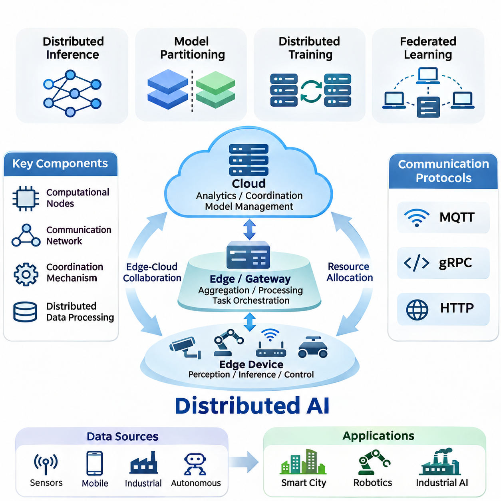
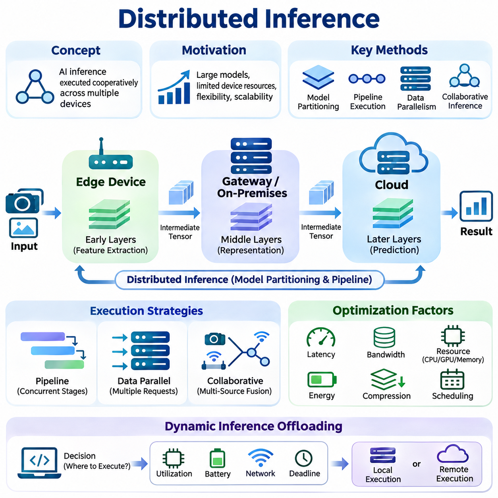
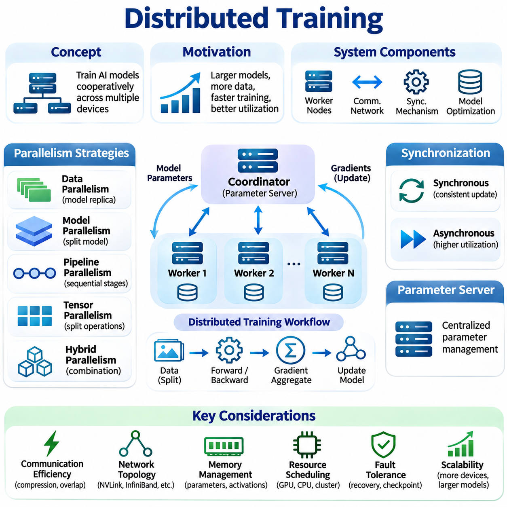
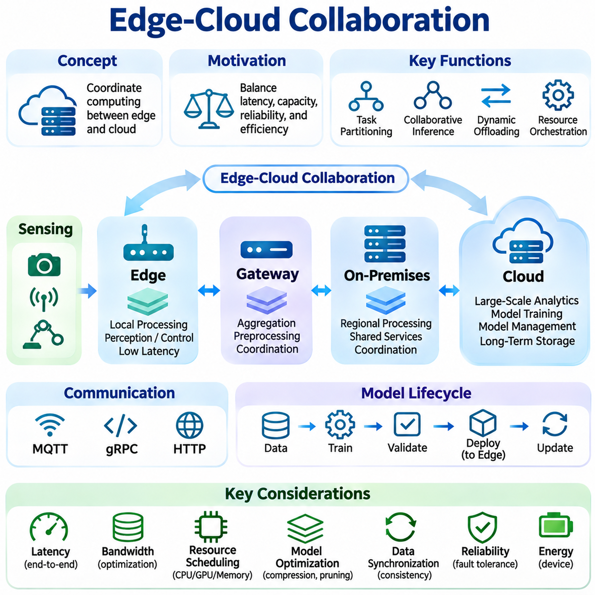
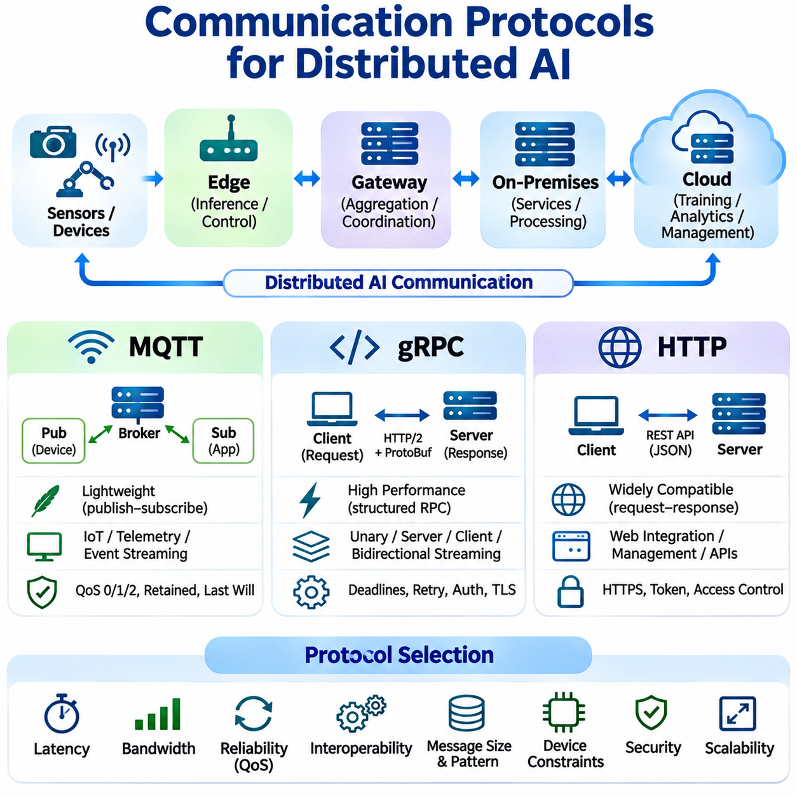
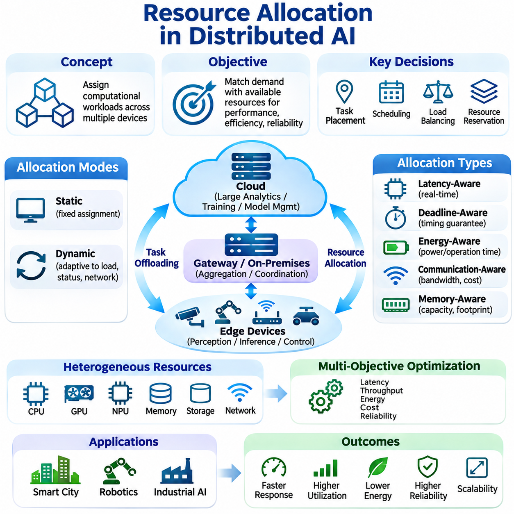
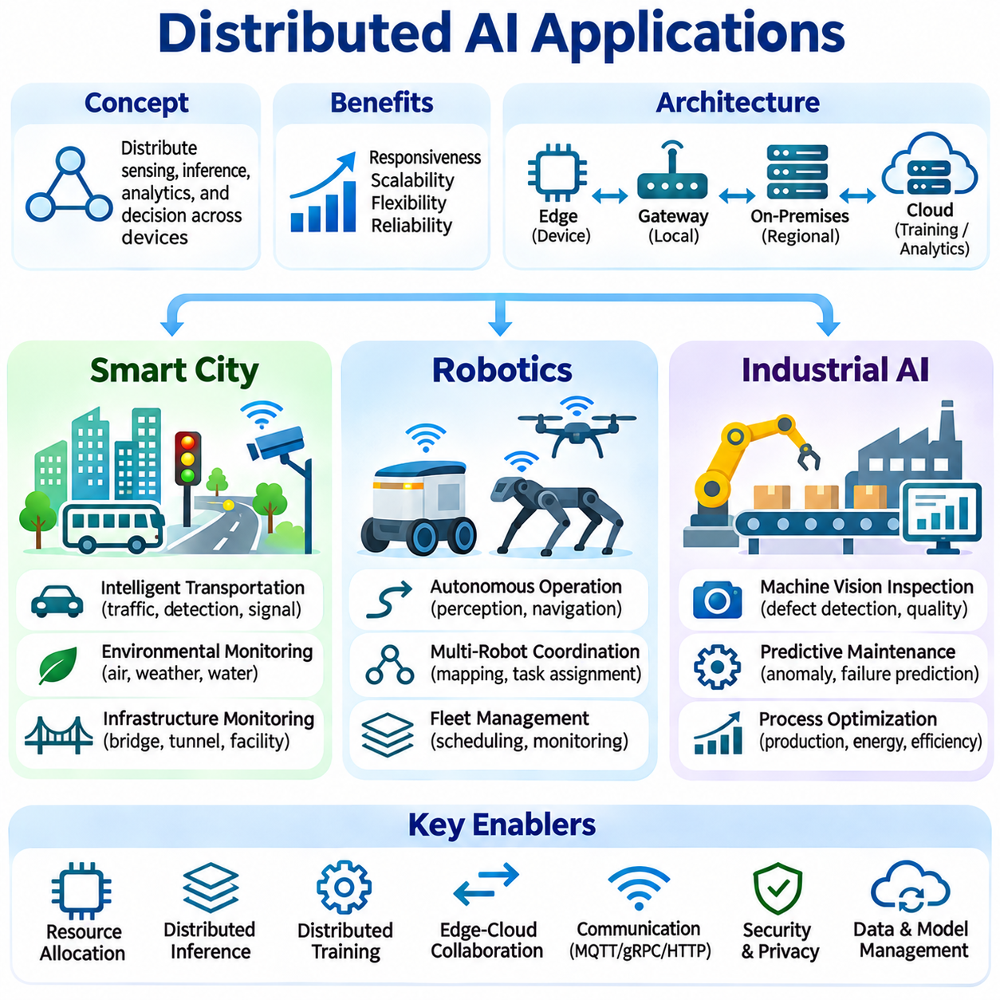

**Volume 40.** **TinyML and Federated Learning**

# 05. Distributed AI

## 05.00 Overview

{width="7.268055555555556in" height="7.268055555555556in"}

Distributed Artificial Intelligence (Distributed AI) refers to an architectural approach in which multiple interconnected computing devices collaborate to execute intelligent tasks, process information, and coordinate decisions. Rather than concentrating all computational operations within a centralized server, distributed AI allocates workloads across edge devices, local gateways, on-premises infrastructure, and cloud platforms according to their capabilities and operational requirements.

The fundamental motivation for distributed AI arises from the increasing volume of data generated by connected sensors, mobile devices, industrial equipment, and autonomous systems. Transmitting every observation to centralized infrastructure introduces communication delays, bandwidth consumption, and operational dependencies. Distributed architectures address these limitations by positioning computation closer to data sources while retaining access to shared computational resources.

A distributed AI system typically consists of computational nodes, communication networks, coordination mechanisms, and distributed data processing components. Each node may perform specialized functions such as sensor preprocessing, neural network inference, model training, or decision execution. The architecture determines how these responsibilities are assigned, how intermediate results are exchanged, and how the system maintains consistent behavior across independently operating devices.

Distributed inference enables multiple computing nodes to participate in executing artificial intelligence models. Some architectures divide neural networks into sequential processing stages, while others distribute independent inference requests across available devices. Pipeline execution, model partitioning, and collaborative inference allow systems to balance computational capacity, memory limitations, communication overhead, and response latency.

Model partitioning is particularly important when neural networks exceed the memory or processing capabilities of individual edge devices. Selected layers can execute locally, while subsequent layers operate on gateways or cloud accelerators. Intermediate feature representations are transmitted between participating nodes, creating opportunities for computational flexibility while introducing additional communication costs and synchronization requirements.

Distributed training extends machine learning optimization across multiple computational resources. Data parallelism allows workers to process different training samples while maintaining synchronized or periodically updated model parameters. Model parallelism distributes portions of a neural network across devices, enabling training workloads that exceed the capacity of a single accelerator. Hybrid strategies combine both approaches according to workload characteristics.

Synchronization represents a fundamental challenge in distributed training. Synchronous optimization coordinates parameter updates across participating workers, whereas asynchronous methods permit workers to progress independently. These approaches involve different tradeoffs concerning convergence behavior, resource utilization, communication overhead, and tolerance to slow or temporarily unavailable nodes. Effective synchronization policies depend on network conditions and computational heterogeneity.

Distributed AI and federated learning share architectural principles but differ in their primary objectives and operational assumptions. Federated learning emphasizes collaborative model optimization while retaining training data within participating organizations or devices. Distributed AI encompasses a broader range of computational cooperation, including distributed inference, coordinated training, workload orchestration, and real-time collaboration between heterogeneous computing environments.

Edge-cloud collaboration provides a practical foundation for distributed intelligence. Edge devices perform latency-sensitive operations, including perception, local filtering, and immediate control decisions, while cloud infrastructure supports computationally intensive analytics, centralized coordination, and large-scale model management. Intermediate edge servers or on-premises gateways can bridge these environments by aggregating information and executing workloads beyond the capabilities of individual devices.

The placement of computational tasks strongly influences system performance. Executing inference near sensors can reduce communication latency and preserve operational continuity during network interruptions. Conversely, centralized processing may provide greater computational capacity and simplified model management. Hybrid architectures dynamically select execution locations based on workload complexity, available resources, communication quality, and application-specific timing constraints.

Communication protocols establish the mechanisms through which distributed components exchange information. Message Queuing Telemetry Transport (MQTT) supports lightweight publish-subscribe messaging, making it useful for sensor networks and constrained devices. Google Remote Procedure Call (gRPC) provides structured service communication, while Hypertext Transfer Protocol (HTTP) enables broadly compatible request-response interactions across distributed applications.

Protocol selection affects message delivery, interoperability, computational overhead, and operational reliability. Lightweight messaging can accommodate intermittent connectivity and limited bandwidth, whereas structured remote procedure calls support efficient service interactions. Communication architectures must also consider serialization formats, authentication, encryption, retry policies, and failure detection to maintain dependable coordination between distributed components.

Resource allocation determines how computational workloads are assigned across available processors, accelerators, memory systems, and network connections. Static allocation establishes predetermined execution responsibilities, while dynamic scheduling adapts assignments to changing workloads and resource availability. Intelligent orchestration considers processing capacity, energy consumption, latency requirements, and communication costs when selecting execution nodes.

Heterogeneous hardware introduces additional complexity because participating devices may contain microcontrollers, CPUs, GPUs, neural processing units, or specialized accelerators. Their supported numerical formats, memory capacities, and execution frameworks can differ significantly. Distributed AI architectures therefore require hardware-aware workload placement, compatible model representations, and mechanisms for managing computational imbalance between participating nodes.

Energy efficiency is especially important when distributed intelligence incorporates battery-powered sensors, mobile robots, and embedded controllers. Continuous communication and intensive neural network execution can substantially reduce operating time. Energy-aware scheduling, adaptive inference frequency, model compression, and selective data transmission help distribute computational responsibilities while maintaining acceptable accuracy and responsiveness under limited power budgets.

Scalability describes the ability of a distributed AI architecture to accommodate additional devices, computational workloads, and data streams without disproportionate performance degradation. Increasing the number of participating nodes does not automatically improve efficiency because communication overhead and coordination complexity may grow simultaneously. Effective scalability requires balanced partitioning, efficient scheduling, and communication mechanisms suited to the deployment topology.

Reliability and fault tolerance are essential because distributed systems operate across multiple devices and communication links that may fail independently. Node failures, network partitions, delayed messages, and resource exhaustion can interrupt collaborative processing. Robust architectures incorporate health monitoring, workload reassignment, redundancy, checkpointing, and recovery procedures to preserve essential functions despite partial infrastructure failures.

Consistency and coordination become particularly important when distributed nodes maintain shared models, intermediate states, or operational decisions. Strong synchronization can simplify consistency management but may increase latency and reduce availability under unstable network conditions. More flexible consistency approaches can improve responsiveness while introducing temporary differences between participating nodes. Appropriate policies depend on the consequences of inconsistent information.

Security boundaries extend across every participating device, communication channel, and coordination service. Distributed AI systems must protect model parameters, sensor observations, authentication credentials, and operational commands against unauthorized access or modification. Encryption, identity management, access control, secure software updates, and integrity verification establish foundational protections, although their effectiveness depends on implementation and operational governance.

Smart city environments illustrate the value of distributed intelligence across geographically dispersed infrastructure. Traffic sensors, roadside cameras, environmental monitoring stations, and municipal computing platforms generate information with different latency and processing requirements. Local nodes can perform immediate event detection, while regional and centralized systems combine observations to support broader traffic management, infrastructure monitoring, and operational planning.

Robotics applications require distributed intelligence to coordinate perception, navigation, planning, and communication across embedded processors and external computing resources. Mobile robots can execute safety-critical control locally while exchanging maps, task assignments, or computationally demanding perception results with nearby servers. Multi-robot systems additionally require coordination mechanisms that account for communication delays, inconsistent observations, and changing network availability.

Industrial AI environments combine distributed computing with manufacturing equipment, machine vision systems, programmable controllers, and supervisory infrastructure. Edge processors can perform defect detection and condition monitoring near production machinery, while on-premises servers aggregate operational information for predictive maintenance and process optimization. System design must preserve deterministic control requirements and isolate critical functions from nonessential network dependencies.

Evaluating distributed AI requires more than measuring model accuracy or computational throughput. Relevant performance indicators include end-to-end latency, communication volume, energy consumption, resource utilization, scalability, availability, and recovery time. Experimental comparisons should account for network variability, heterogeneous devices, workload distribution, and synchronization overhead to distinguish genuine architectural improvements from favorable testing conditions.

The development of distributed AI reflects a broader transition from isolated intelligent devices toward coordinated computational ecosystems. Distributed inference, distributed training, edge-cloud collaboration, communication protocols, and resource allocation form the central foundations of this transition. Understanding their interactions enables the design of scalable, efficient, resilient, and secure AI systems capable of operating across diverse real-world environments.

## 05.01 Distributed Inference [w/Code]

{width="7.268055555555556in" height="7.268055555555556in"}

Distributed inference is an artificial intelligence execution approach in which multiple interconnected computing devices cooperate to process inference workloads. Instead of executing an entire neural network on a single processor or centralized server, computational tasks are distributed across edge devices, gateways, on-premises servers, and cloud infrastructure. This approach enables flexible execution while addressing hardware limitations and operational requirements.

The primary motivation for distributed inference is the growing computational demand of modern neural networks combined with the limited resources available on embedded devices. Large models often require substantial memory, processing capacity, and energy. Distributing inference operations allows resource-constrained devices to participate in complex AI applications without independently supporting every computational component.

Distributed inference architectures can be organized through model partitioning, workload distribution, pipeline execution, and collaborative processing. Model partitioning divides a neural network into computational segments assigned to different devices. Workload distribution assigns independent inference requests to available nodes, while collaborative processing combines intermediate representations or predictions produced by multiple participating systems.

Model partitioning typically divides neural network layers into consecutive execution stages. An edge device may execute initial feature extraction layers, while a gateway or cloud server processes deeper representations and generates final predictions. Intermediate tensors are transmitted between devices, allowing the computational burden to be shared according to processing capacity, memory availability, and communication conditions.

The selection of partition boundaries significantly affects inference performance. Early neural network layers may generate large feature maps, making intermediate data transmission expensive. Later layers often produce more compact representations but may require substantial computation. Effective partitioning therefore considers tensor dimensions, computational complexity, available bandwidth, and communication latency rather than distributing layers uniformly.

Pipeline parallelism allows different inference stages to execute concurrently on separate devices. While one device processes the initial layers of a new input, another device can execute subsequent layers for an earlier input. This overlapping execution can improve system throughput when sufficient requests are available, although individual request latency may remain constrained by communication and sequential dependencies.

Data parallelism distributes independent inference requests across multiple replicas of the same model. Each processing node maintains a compatible model instance and handles assigned inputs without requiring intermediate tensor exchange. Load balancing mechanisms distribute requests according to device capacity, current utilization, and response time, enabling scalable inference services across heterogeneous computing infrastructure.

Collaborative inference extends beyond conventional model partitioning by allowing multiple devices to contribute complementary information. Distributed cameras, sensors, and robotic platforms may independently extract features or generate predictions before combining their outputs. Feature-level fusion and decision-level fusion provide different mechanisms for integrating observations while balancing communication overhead and predictive performance.

Edge-cloud collaborative inference combines local responsiveness with centralized computational resources. Edge devices perform preprocessing, lightweight inference, or initial feature extraction, while cloud servers execute computationally demanding operations. This arrangement can reduce local hardware requirements, but its effectiveness depends on network availability, transmission costs, and the latency requirements of the target application.

Dynamic inference offloading determines whether computational tasks should execute locally or on remote infrastructure. Offloading decisions may depend on processor utilization, battery capacity, network bandwidth, estimated execution time, and service deadlines. Adaptive policies can select execution locations as operating conditions change, allowing distributed systems to respond to fluctuating workloads and communication environments.

Communication overhead is a fundamental limitation of distributed inference. Transmitting intermediate tensors, input observations, or prediction results consumes bandwidth and introduces additional latency. When transmission costs exceed the computational savings achieved through distribution, remote execution may perform worse than local inference. Consequently, communication-aware optimization is essential for practical deployment.

Intermediate feature compression reduces the volume of information exchanged between inference nodes. Quantization, dimensionality reduction, learned compression, and selective feature transmission can decrease communication requirements. However, aggressive compression may distort important representations and reduce prediction accuracy, requiring careful evaluation of the relationship between transmission efficiency and model performance.

Latency optimization must account for computation, communication, serialization, scheduling, and synchronization. End-to-end inference latency includes the time required to prepare inputs, execute neural network operations, transfer intermediate results, and return predictions. Optimizing only processor execution time may provide limited benefits when network transmission or scheduling delays dominate overall system responsiveness.

Resource-aware scheduling assigns inference tasks according to the capabilities and current conditions of participating devices. Nodes may differ in CPU performance, GPU availability, accelerator support, memory capacity, and power consumption. Scheduling mechanisms can use estimated execution costs and real-time resource measurements to avoid overloaded devices and maintain predictable response times across distributed workloads.

Energy efficiency is particularly important for battery-powered edge devices and mobile robotic platforms. Local inference consumes computational energy, while remote inference requires communication energy and potentially additional waiting time. Energy-aware offloading evaluates these competing costs and selects execution strategies that preserve battery life without violating application-specific accuracy or latency requirements.

Fault tolerance allows distributed inference systems to continue operating when individual nodes or communication links become unavailable. Redundant model replicas, alternative execution paths, timeout mechanisms, and local fallback models can reduce service interruptions. Critical applications may require independent local inference capabilities so that essential decisions remain available during temporary failures of remote infrastructure.

Consistency becomes important when inference nodes operate with different model versions or preprocessing configurations. Inconsistent parameters, normalization procedures, or feature representations can produce incompatible intermediate results. Model version management, interface validation, and coordinated deployment procedures help ensure that distributed components execute compatible computational stages and maintain reproducible prediction behavior.

Security considerations extend across model execution, communication channels, and participating devices. Intermediate features may reveal sensitive information even when raw inputs remain local. Secure communication, authentication, access control, and integrity verification protect distributed inference operations against unauthorized interception or modification. Additional privacy-preserving techniques may be required for applications involving sensitive observations.

Implementation commonly relies on machine learning frameworks and distributed communication interfaces. PyTorch, TensorFlow, and ONNX Runtime can execute model components on supported hardware, while gRPC, HTTP, and message-oriented protocols coordinate remote processing. Practical implementations must manage tensor serialization, device compatibility, asynchronous requests, execution timeouts, and the transfer of intermediate results.

A representative implementation can partition a neural network into an edge encoder and a remote prediction head. The edge device converts sensor observations into feature tensors and transmits them through a defined communication interface. The remote service reconstructs the tensors, executes the remaining layers, and returns predictions. Both components must share compatible model parameters, tensor specifications, and preprocessing conventions.

Performance evaluation requires measurements of prediction accuracy, end-to-end latency, throughput, communication volume, memory utilization, and energy consumption. Experiments should compare local execution, fully remote execution, and distributed configurations under equivalent workloads. Network bandwidth, round-trip time, concurrent request volume, and hardware heterogeneity must be controlled or reported to support meaningful comparisons.

Scalability depends on how effectively distributed inference accommodates additional devices and incoming requests. Replicated inference services can increase aggregate throughput, while partitioned models may encounter bottlenecks at heavily utilized stages. Dynamic load balancing, request batching, resource monitoring, and adaptive partitioning help maintain performance as deployment size and workload intensity increase.

Robotics provides a practical application of distributed inference because perception and control tasks have different computational and timing requirements. Mobile robots may execute obstacle detection and immediate safety decisions locally while offloading semantic mapping or complex scene interpretation to nearby servers. Such architectures must ensure that communication delays cannot compromise safety-critical control loops.

Industrial AI systems can distribute machine vision inference across production cameras, edge gateways, and factory servers. Local processors perform rapid defect screening, while more powerful infrastructure analyzes ambiguous observations or aggregates information across production lines. This hierarchical approach supports flexible computational allocation while preserving the responsiveness required for industrial monitoring and quality inspection.

Smart city applications employ distributed inference across traffic cameras, roadside sensors, and regional computing infrastructure. Local nodes detect events and extract relevant features, while centralized services integrate observations for broader situational awareness. By transmitting selected information rather than continuous raw data streams, these systems can reduce bandwidth requirements while supporting geographically distributed intelligence.

Distributed inference represents an important architectural foundation for scalable and resource-efficient AI deployment. Its effectiveness depends on coordinated optimization of model partitioning, computation placement, communication efficiency, resource scheduling, reliability, and security. When these factors are considered together, distributed inference enables heterogeneous devices to collaborate on intelligent tasks beyond the practical capabilities of isolated computing nodes.

## 05.02 Distributed Training

{width="7.268055555555556in" height="7.268055555555556in"}

Distributed training is a machine learning approach in which multiple interconnected computing devices cooperate to optimize artificial intelligence models. Instead of executing all training operations on a single processor, workloads are distributed across GPUs, servers, edge devices, or computing clusters. This architecture enables larger models, faster processing, and improved resource utilization while introducing coordination and communication challenges.

The primary motivation for distributed training is the increasing computational complexity of modern neural networks and the growing size of training datasets. Large-scale models require substantial memory, processing capacity, and training time. Distributed architectures divide these requirements among multiple devices, allowing organizations to train models that exceed the practical capabilities of individual computing systems.

Distributed training systems generally consist of worker nodes, communication infrastructure, synchronization mechanisms, and model optimization components. Each worker processes assigned computations, while coordination services manage parameter updates and execution progress. The system architecture determines how data, model parameters, gradients, and optimizer states are distributed and exchanged throughout the training process.

Data parallelism is one of the most widely adopted distributed training strategies. Each worker maintains a replica of the model and processes a different subset of training samples. Gradients calculated from local mini-batches are combined to produce a coordinated parameter update. This approach increases aggregate processing capacity while preserving a shared optimization objective across participating workers.

Model parallelism distributes different portions of a neural network across multiple devices. Individual workers execute assigned layers, operations, or parameter partitions rather than maintaining complete model replicas. This approach is particularly useful when model parameters and intermediate activations exceed the memory capacity of a single accelerator, although communication between partitions introduces additional execution overhead.

Pipeline parallelism divides a neural network into sequential computational stages assigned to different devices. Training mini-batches are divided into smaller micro-batches that move through the pipeline. Multiple stages can operate concurrently on different micro-batches, improving hardware utilization. Pipeline scheduling must account for forward execution, backward propagation, activation storage, and temporary idle periods.

Tensor parallelism partitions individual neural network operations across multiple accelerators. Large matrix multiplications, attention mechanisms, and feedforward layers can be divided into smaller computational segments. Participating devices exchange intermediate results through collective communication operations. This strategy enables large model execution but depends heavily on high-bandwidth interconnects and efficient synchronization.

Hybrid parallelism combines data, model, pipeline, and tensor parallelism to support complex training workloads. Different parallelization dimensions address distinct computational limitations, including memory capacity, processing throughput, and model size. Effective hybrid architectures balance communication overhead, device utilization, and execution dependencies while maintaining mathematically consistent optimization behavior.

Gradient synchronization is a central operation in distributed training. During synchronous optimization, workers calculate gradients independently and coordinate their updates before proceeding to the next training step. Collective communication algorithms such as All-Reduce aggregate gradients across participating devices. Synchronization maintains consistent model parameters but may introduce waiting time when workers progress at different speeds.

Asynchronous distributed training allows workers to calculate and communicate updates without waiting for every participating device. This approach can improve resource utilization in heterogeneous or unreliable environments. However, delayed gradients may be calculated using outdated model parameters, introducing gradient staleness. The resulting optimization behavior requires careful consideration of convergence stability and update consistency.

Parameter server architectures provide centralized or logically centralized management of model parameters. Worker nodes retrieve parameter values, calculate gradients, and submit updates to designated parameter servers. This arrangement supports flexible coordination and asynchronous optimization, although server bottlenecks, communication overhead, and fault tolerance become important concerns as the number of workers increases.

Communication efficiency strongly influences distributed training performance. Gradient exchanges, parameter synchronization, and activation transfers can consume substantial network bandwidth. Gradient compression, reduced-precision communication, communication overlap, and optimized collective operations help reduce overhead. Their effectiveness depends on model architecture, network topology, synchronization frequency, and acceptable numerical approximation.

Network topology determines how efficiently participating devices exchange training information. High-speed interconnects such as NVLink and InfiniBand can support intensive accelerator communication, while conventional Ethernet networks may impose greater bandwidth and latency constraints. Communication-aware workload placement attempts to minimize expensive transfers between nodes while maximizing the benefits of parallel computation.

Memory management is particularly important when training large neural networks. Model parameters, gradients, optimizer states, and intermediate activations consume accelerator memory. Techniques such as activation checkpointing, optimizer state partitioning, gradient accumulation, and parameter sharding reduce memory requirements. These methods introduce different tradeoffs involving recomputation, communication, and execution time.

Distributed optimizer strategies coordinate parameter updates across participating workers. Conventional synchronous training commonly applies equivalent updates to replicated model parameters, while sharded optimization distributes optimizer states and related data structures across devices. Approaches such as Zero Redundancy Optimizer reduce duplicated memory consumption, enabling larger models to train within available hardware resources.

Load balancing addresses differences in computational capacity and workload distribution between training nodes. Heterogeneous processors, variable data processing times, and uneven network performance can cause some workers to remain idle while waiting for others. Effective scheduling, balanced data partitioning, and adaptive workload assignment improve utilization and reduce the influence of slow workers on overall training throughput.

Fault tolerance enables distributed training to recover from hardware failures, communication interruptions, and unexpected process termination. Periodic checkpointing preserves model parameters, optimizer states, and training progress. Recovery mechanisms can restart failed workers or restore consistent training states. Large-scale systems may also employ elastic training strategies that adjust the number of participating workers when resources change.

Training reproducibility becomes more challenging when computations are distributed across multiple devices. Random initialization, data shuffling, floating-point reduction order, and asynchronous execution can introduce differences between runs. Reproducible experiments require controlled random seeds, documented software environments, consistent data partitioning, and explicit reporting of synchronization and numerical precision settings.

Distributed training frameworks provide abstractions for coordinating computation and communication. PyTorch Distributed Data Parallel supports synchronized gradient aggregation, while TensorFlow distribution strategies provide mechanisms for multi-device execution. Frameworks such as DeepSpeed and distributed training components within JAX support additional scaling strategies. Framework selection depends on model structure, hardware infrastructure, and operational requirements.

A practical distributed training implementation begins by initializing a communication group and assigning computational devices to worker processes. Each worker loads its assigned data partition, performs forward propagation, calculates the loss, and executes backward propagation. Gradient synchronization coordinates optimization updates, while checkpoint management and monitoring services maintain training continuity and operational visibility.

Performance evaluation must consider training throughput, accelerator utilization, communication overhead, memory consumption, and convergence behavior. Strong scaling measures performance improvement when a fixed workload is distributed across additional devices. Weak scaling evaluates performance when workload size increases with computational resources. Both approaches reveal limitations caused by synchronization, communication, and workload imbalance.

Scaling efficiency generally decreases when communication and coordination costs grow faster than useful computation. Increasing the number of accelerators does not guarantee proportional reductions in training time. Small batch sizes, frequent synchronization, inefficient data loading, and slow interconnects can limit performance. Effective scaling requires balancing computational granularity, communication frequency, and available hardware resources.

Distributed training is particularly valuable for large-scale computer vision, language modeling, and multimodal learning. High-resolution image datasets, transformer architectures, and combined sensor representations can generate substantial computational workloads. Parallel processing enables these applications to use larger datasets and model architectures while maintaining manageable training durations through coordinated resource utilization.

Edge-oriented distributed training introduces additional challenges because participating devices may have limited processing power, memory, energy, and connectivity. Local training tasks can be coordinated through gateways or regional servers, while selected updates are exchanged between devices. Unlike conventional data-center training, these systems must accommodate heterogeneous hardware, intermittent connectivity, and application-specific privacy constraints.

Distributed training also supports industrial AI and robotics applications involving data collected from multiple machines, facilities, or robotic platforms. Training infrastructure can aggregate authorized datasets or coordinate learning across separate environments. Such systems must account for differences in sensor configurations, operating conditions, and data distributions to maintain reliable model performance across deployment locations.

Distributed training provides a fundamental mechanism for scaling machine learning beyond the limitations of individual computing devices. Its effectiveness depends on selecting appropriate parallelization strategies, managing synchronization, minimizing communication overhead, and maintaining reliable execution. By integrating these considerations, distributed training enables efficient model optimization across heterogeneous computing infrastructure and supports increasingly demanding AI applications.

## 05.03 Edge Cloud Collaboration

{width="7.268055555555556in" height="7.268055555555556in"}

Edge-cloud collaboration is a distributed artificial intelligence architecture that coordinates computational tasks between edge devices and cloud infrastructure. Edge systems process data near its source, while cloud platforms provide large-scale computing, storage, and model management capabilities. By combining these environments, distributed AI systems can balance responsiveness, computational capacity, operational reliability, and resource efficiency.

The primary motivation for edge-cloud collaboration arises from the limitations of exclusively centralized or localized computing. Cloud-only architectures may experience network latency, bandwidth consumption, and connectivity dependencies. Edge-only systems face restrictions in processing power, memory, and energy. Collaborative architectures distribute responsibilities according to application requirements and available computational resources.

A typical edge-cloud architecture includes sensing devices, embedded processors, local gateways, on-premises servers, and remote cloud services. Sensors generate observations, edge processors perform immediate analysis, and gateways coordinate communication or intermediate processing. Cloud infrastructure supports computationally demanding analytics, large-scale training, historical data management, and centralized service orchestration.

Task partitioning determines how application functions are distributed across computing layers. Latency-sensitive perception and control tasks are generally assigned to local devices, while complex analytics and model training are placed on more powerful infrastructure. Intermediate gateways can execute aggregation, preprocessing, and regional coordination. Effective partitioning considers computation, communication, privacy, and operational constraints.

Collaborative inference enables edge devices and cloud servers to participate in different stages of neural network execution. An edge processor may perform initial feature extraction before transmitting intermediate representations to a remote accelerator. Alternatively, lightweight local models can generate preliminary predictions, while cloud models perform detailed analysis when additional computational resources are required.

Dynamic computation offloading allows workloads to move between local and remote execution environments. Decisions depend on processor utilization, available memory, network bandwidth, communication latency, battery capacity, and task deadlines. Adaptive offloading policies continuously evaluate operating conditions and select execution locations that satisfy performance requirements while avoiding unnecessary communication.

Hierarchical computing extends collaboration beyond a simple edge-cloud relationship. Device-level processors handle immediate operations, nearby gateways provide shared services, and on-premises servers support coordinated workloads. Cloud infrastructure supplies broader analytical capabilities and centralized management. This hierarchy reduces dependence on distant resources while allowing computationally demanding tasks to access larger processing environments.

Communication architecture determines how information moves between distributed components. Lightweight messaging protocols such as MQTT support sensor updates and event notifications, while gRPC enables structured service interactions. HTTP-based interfaces provide compatibility with conventional cloud applications. Protocol selection depends on message size, communication frequency, reliability requirements, and device capabilities.

Bandwidth optimization is essential because continuous transmission of raw sensor streams can overwhelm communication infrastructure. Edge preprocessing, feature extraction, event filtering, and selective transmission reduce the volume of data sent to remote services. Compression techniques further decrease communication requirements, although their effects on information quality and downstream model accuracy must be evaluated.

Latency management requires consideration of the entire processing path rather than individual computing stages. End-to-end response time includes sensing, preprocessing, local execution, network transmission, remote computation, and result delivery. Applications with strict timing constraints must establish latency budgets and ensure that remote dependencies do not interfere with time-critical operations.

Resource orchestration coordinates computing, memory, storage, and communication capacity across participating environments. Scheduling systems assign workloads according to device availability, processing capability, energy consumption, and network conditions. Dynamic orchestration can migrate tasks, replicate services, or adjust execution priorities as workloads change, improving overall utilization and operational flexibility.

Data synchronization enables distributed components to maintain compatible information across local and remote systems. Edge devices may generate observations while disconnected, storing information temporarily until communication becomes available. Synchronization mechanisms reconcile updates, preserve timestamps, and manage conflicting records. Appropriate consistency policies depend on whether applications prioritize immediate responsiveness or globally consistent state.

Model lifecycle management connects cloud-based development with edge deployment. Cloud infrastructure can support dataset preparation, model training, validation, and version management. Optimized models are distributed to edge devices through controlled deployment procedures. Monitoring services collect performance information and support subsequent updates, allowing models to evolve without requiring every device to perform intensive training locally.

Model optimization is necessary because cloud-trained neural networks may exceed the capabilities of embedded processors. Quantization, pruning, knowledge distillation, and architecture adaptation can reduce memory consumption and inference costs. Hardware-aware deployment selects compatible execution formats and accelerator backends, ensuring that model performance remains acceptable across heterogeneous edge computing platforms.

Reliability becomes particularly important when distributed applications operate under unstable network conditions. Edge systems should retain essential functionality during temporary cloud disconnections. Local fallback models, cached configuration data, redundant gateways, and recovery procedures help preserve service continuity. Critical control operations should remain independent of remote infrastructure whenever communication delays could create unacceptable risks.

Security must protect devices, communication channels, models, and operational data throughout the collaborative architecture. Authentication, encryption, access control, and integrity verification reduce exposure to unauthorized access or modification. Secure update mechanisms protect deployed models and software components. Trust boundaries between edge, on-premises, and cloud environments require explicit policies for data movement and execution permissions.

Privacy considerations influence where information is processed and stored. Sensitive observations can be analyzed locally, with only selected features, aggregated statistics, or authorized results transmitted to cloud services. However, intermediate representations may still reveal private information. Privacy-aware collaboration therefore requires data minimization, appropriate access controls, and evaluation of information leakage risks.

Energy management is essential for battery-powered sensors, mobile robots, and embedded devices. Local computation consumes processing energy, while remote execution requires wireless communication and potentially longer active periods. Energy-aware scheduling balances these costs against latency and accuracy requirements. Adaptive sensing, selective inference, and communication reduction can extend operating time without eliminating necessary intelligence.

Scalability describes the ability of edge-cloud architectures to accommodate increasing numbers of devices and computational workloads. Centralized services may become bottlenecks when many edge nodes submit simultaneous requests. Regional aggregation, distributed service replication, load balancing, and hierarchical coordination reduce pressure on shared infrastructure while supporting geographically distributed deployment.

Observability provides visibility into distributed application behavior through metrics, logs, traces, and device health information. Monitoring systems track inference latency, communication failures, resource utilization, model performance, and service availability. Correlating observations across edge and cloud components helps identify bottlenecks, diagnose failures, and distinguish network problems from computational limitations.

Robotics applications benefit from edge-cloud collaboration because autonomous systems require immediate local decisions alongside computationally demanding perception and planning. Mobile robots can execute obstacle avoidance and safety-related control locally while exchanging maps, semantic information, or task assignments with nearby servers. Cloud services may support fleet analytics, model improvement, and long-term operational planning.

Industrial AI environments combine edge computing with factory networks and on-premises infrastructure. Machine vision devices perform rapid inspection near production equipment, while local servers aggregate results and execute predictive maintenance analytics. Cloud platforms support cross-site analysis and centralized model management. This arrangement preserves operational responsiveness while enabling broader optimization across manufacturing facilities.

Smart city systems employ edge-cloud collaboration across traffic cameras, environmental sensors, roadside infrastructure, and regional data centers. Local processors detect events and filter observations, while regional services integrate information for traffic coordination and infrastructure monitoring. Centralized platforms support historical analysis and citywide planning, allowing geographically dispersed systems to operate through coordinated computational layers.

Performance evaluation must examine latency, throughput, bandwidth consumption, energy efficiency, service availability, and operational cost. Experiments should compare edge-only, cloud-only, and collaborative configurations under equivalent workloads. Network variability, device heterogeneity, concurrent requests, and failure scenarios must be considered to determine whether collaboration provides measurable improvements over simpler architectures.

Edge-cloud collaboration establishes a flexible foundation for distributed intelligence by integrating local responsiveness with scalable computational infrastructure. Successful implementations require coordinated task placement, communication optimization, secure data exchange, reliable operation, and continuous model management. These capabilities enable AI applications to operate efficiently across embedded devices, local infrastructure, and cloud platforms while adapting to changing operational conditions.

## 05.04 Communication Protocols

{width="7.268055555555556in" height="7.268055555555556in"}

Communication protocols provide the foundation for information exchange between interconnected components of distributed artificial intelligence systems. Edge devices, gateways, on-premises servers, and cloud platforms require standardized mechanisms to transfer sensor observations, inference requests, model updates, and operational commands. Protocol selection influences latency, bandwidth efficiency, interoperability, reliability, and system scalability.

Distributed AI communication differs from conventional application networking because participating devices often have heterogeneous computational capabilities and connectivity conditions. Embedded sensors may operate with limited memory and intermittent wireless connections, while cloud servers support high-throughput communication. Effective architectures therefore select protocols according to message characteristics, device constraints, and operational requirements.

Message Queuing Telemetry Transport, commonly known as MQTT, is a lightweight messaging protocol designed for efficient communication between connected devices. It follows a publish-subscribe architecture in which message producers publish information to named topics, while subscribers receive messages associated with their subscriptions. A central broker coordinates message distribution without requiring publishers to know individual recipients.

MQTT is particularly suitable for Internet of Things environments, embedded systems, and distributed sensor networks. Its compact message structure reduces protocol overhead, making it useful when bandwidth and processing resources are limited. Edge devices can publish telemetry, equipment status, and event notifications, while gateways and cloud applications subscribe to relevant topics for monitoring and coordinated processing.

The MQTT broker acts as an intermediary responsible for routing messages between publishers and subscribers. Topic hierarchies organize information according to devices, locations, or application functions. For example, an industrial AI deployment may publish temperature readings, equipment alarms, and inference results through separate topic structures. This separation supports flexible communication without tightly coupling participating components.

MQTT provides three Quality of Service levels that establish different message delivery guarantees. QoS 0 uses best-effort delivery without acknowledgment, QoS 1 supports at-least-once delivery, and QoS 2 provides exactly-once delivery within the MQTT messaging exchange. Higher reliability levels introduce additional protocol interactions, requiring applications to balance delivery guarantees against communication overhead and processing requirements.

Persistent sessions, retained messages, and Last Will messages improve MQTT communication management. Persistent session mechanisms can preserve subscription information and eligible queued messages across disconnections. Retained messages provide newly subscribing clients with the latest retained value for a topic, while Last Will messages help indicate unexpected client disconnections. These capabilities support distributed monitoring and device coordination.

MQTT security commonly relies on Transport Layer Security, authentication credentials, and broker-level authorization policies. Encryption protects transmitted messages, while access controls restrict which clients can publish or subscribe to particular topics. However, MQTT does not inherently guarantee application-level data integrity or authorization correctness. Secure deployments require credential management, topic permissions, and protection against unauthorized message injection.

Google Remote Procedure Call, known as gRPC, is a high-performance remote communication framework that allows distributed services to invoke operations through defined interfaces. It commonly uses HTTP/2 as its transport and Protocol Buffers for structured message serialization. Service definitions specify available procedures and data structures, enabling strongly typed communication between applications implemented in different programming languages.

gRPC is well suited to distributed AI services that require structured request-response interactions and efficient binary data exchange. An edge gateway may invoke a remote inference service by transmitting feature tensors or processed sensor observations. The server executes the requested operation and returns prediction results through a defined interface. This approach supports modular service development and explicit communication contracts.

gRPC supports unary requests, server streaming, client streaming, and bidirectional streaming. Unary communication exchanges one request and one response, while streaming methods allow multiple messages to flow through a persistent logical interaction. Streaming is useful for continuous sensor processing, sequential inference results, and coordinated robotic services, although flow control and application-level timing requirements must be managed carefully.

Protocol Buffers provide compact binary serialization and schema-based message definitions for gRPC applications. Defined schemas improve interoperability and support controlled interface evolution. However, large tensors and high-frequency sensor streams may still generate substantial communication loads. Efficient implementations must consider message size, serialization cost, compression, batching, and memory allocation during distributed inference execution.

gRPC deployments require explicit management of deadlines, cancellation, retries, and connection failures. Deadlines prevent remote operations from consuming unlimited time, while cancellation allows unnecessary requests to terminate. Retry policies must account for whether operations are safe to repeat. Authentication, encrypted channels, and service authorization provide additional protection when inference or coordination services communicate across network boundaries.

Hypertext Transfer Protocol, or HTTP, is a widely adopted application-layer protocol used for communication between clients and servers. HTTP supports standardized methods, headers, status codes, and message bodies, making it suitable for interoperable distributed applications. REST-style APIs commonly use HTTP to expose inference endpoints, device management functions, model repositories, and monitoring services.

HTTP-based communication is particularly valuable when distributed AI systems integrate with existing web services and cloud infrastructure. Edge devices can submit inference requests through POST operations, retrieve configuration information through GET requests, and report operational status to management platforms. JSON provides a readable data representation, while binary payloads can reduce overhead for large or structured data transfers.

HTTP/1.1, HTTP/2, and HTTP/3 offer different transport characteristics. HTTP/1.1 supports persistent connections, while HTTP/2 introduces multiplexed streams and header compression. HTTP/3 operates over QUIC and can improve connection behavior under certain network conditions. Actual performance depends on implementation, network quality, payload characteristics, and the communication patterns of distributed AI workloads.

HTTP communication generally follows a request-response model, although streaming and persistent interaction mechanisms are also available. Conventional REST APIs are convenient for configuration management, occasional inference requests, and administrative operations. Continuous telemetry or low-latency bidirectional communication may benefit from alternative mechanisms or specialized streaming interfaces depending on application requirements.

Security for HTTP-based AI services commonly uses HTTPS, authentication tokens, access control policies, and API gateways. Transport encryption protects information in transit, while authorization determines which clients can invoke particular operations. Rate limiting, request validation, and payload restrictions help protect inference endpoints against excessive traffic, malformed inputs, and unauthorized service usage.

Selecting between MQTT, gRPC, and HTTP requires evaluating communication patterns rather than identifying a universally superior protocol. MQTT is effective for lightweight event distribution and asynchronous telemetry. gRPC supports structured service-to-service communication and streaming interactions, while HTTP provides broad compatibility with web-based infrastructure. Each approach introduces different implementation, reliability, and operational considerations.

Hybrid communication architectures frequently combine these protocols within a single distributed AI system. Sensors may publish observations through MQTT, edge gateways may invoke inference services through gRPC, and cloud management platforms may expose HTTP APIs. This arrangement allows each communication layer to use an appropriate interaction model while maintaining clear interfaces between sensing, computation, and administration.

Communication reliability depends on more than protocol selection. Network interruptions, duplicated messages, delayed responses, and unavailable services can affect distributed operations. Applications should implement appropriate timeouts, retry policies, message identifiers, idempotent processing where necessary, and recovery mechanisms. Critical control decisions must not depend on remote communication when unpredictable delays could compromise safety.

Performance evaluation should measure message latency, throughput, bandwidth consumption, serialization overhead, CPU utilization, and delivery behavior under network disturbances. Experiments must consider payload sizes, connection persistence, concurrent clients, and wireless link variability. Comparing protocols under equivalent workloads provides a more meaningful basis for architectural decisions than relying solely on theoretical performance characteristics.

Communication protocols ultimately determine how effectively distributed AI components exchange information and coordinate intelligent operations. MQTT, gRPC, and HTTP provide complementary mechanisms for telemetry, remote computation, and service integration. Their coordinated use, supported by appropriate security, reliability, and performance engineering, enables scalable and maintainable distributed intelligence across heterogeneous computing environments.

## 05.05 Resource Allocation

{width="7.268055555555556in" height="7.268055555555556in"}

Resource allocation in distributed artificial intelligence determines how computational workloads are assigned across interconnected devices, processors, memory systems, and communication networks. Unlike centralized computing, distributed AI must coordinate resources with different capabilities and availability. Effective allocation improves inference responsiveness, training throughput, energy efficiency, and system reliability while preventing unnecessary resource contention.

The fundamental objective of resource allocation is to match computational requirements with available processing capacity. Edge devices, gateways, on-premises servers, and cloud platforms offer different combinations of computing performance, memory, storage, and connectivity. Allocation mechanisms evaluate these differences to determine where tasks should execute and how resources should be shared among competing applications.

Resource allocation involves several interconnected decisions, including task placement, scheduling, workload balancing, and resource reservation. Task placement selects execution locations, while scheduling determines when operations receive processing time. Load balancing distributes demand across available nodes, and reservation mechanisms protect resources needed for critical operations. These decisions collectively influence overall system behavior.

Static resource allocation assigns predetermined computational responsibilities to specific devices. This approach provides predictable execution and simplifies system validation when workloads remain stable. For example, an embedded controller may continuously execute safety-related inference while an on-premises server handles analytics. However, fixed assignments can waste resources or create bottlenecks when operating conditions change.

Dynamic resource allocation adjusts execution responsibilities according to workload intensity, device availability, and network conditions. Scheduling systems monitor resource utilization and reassign tasks when necessary. A computationally demanding inference request may move from an overloaded edge device to a nearby gateway. Dynamic allocation improves flexibility but introduces monitoring, migration, and coordination overhead.

Heterogeneous hardware complicates allocation because devices may contain CPUs, GPUs, neural processing units, microcontrollers, and specialized accelerators. Their memory capacities, supported numerical formats, and software execution environments differ substantially. Hardware-aware scheduling evaluates model compatibility and expected execution performance before assigning workloads, reducing inefficient placement and unsupported execution configurations.

Computational profiling provides the measurements required for informed allocation decisions. Profiling tools estimate execution time, memory consumption, processor utilization, and energy requirements for individual tasks. These measurements can be collected offline or updated during operation. Accurate profiling allows schedulers to predict resource demand and identify whether particular nodes can satisfy application deadlines.

Latency-aware allocation prioritizes tasks according to their response-time requirements. Real-time perception and control operations often require execution near sensors to avoid unpredictable network delays. Less urgent analytics may execute on remote infrastructure. Scheduling policies must consider both computational latency and communication time, ensuring that distributed execution does not violate application-specific timing constraints.

Deadline-aware scheduling extends latency management by considering the latest acceptable completion time for each task. Tasks with strict deadlines may receive reserved processing capacity or elevated priority. Admission control can reject or defer requests when available resources cannot satisfy their timing requirements. Such mechanisms are especially important in industrial automation and robotic systems with predictable execution needs.

Load balancing prevents individual nodes from becoming overloaded while other resources remain underutilized. Static balancing distributes tasks according to predefined capacity estimates, whereas dynamic balancing responds to observed queue lengths, processor utilization, and response times. Effective strategies must consider heterogeneous device performance because equal task counts do not necessarily produce equal computational workloads.

Energy-aware resource allocation is essential for battery-powered sensors, mobile robots, and embedded platforms. Local processing consumes computational energy, while remote execution requires communication energy. Allocation policies estimate these competing costs and select execution locations that preserve operating time. Energy constraints may also influence inference frequency, model complexity, and the activation of available accelerators.

Communication-aware allocation considers the cost of transferring inputs, intermediate tensors, model parameters, and results between devices. Large data transfers may eliminate the benefits of remote acceleration. Scheduling algorithms therefore evaluate network bandwidth, round-trip latency, serialization overhead, and data locality. Placing computation near existing data can reduce transmission requirements and improve overall responsiveness.

Memory-aware scheduling prevents tasks from exceeding the capacity of their assigned devices. Neural network inference requires memory for parameters, intermediate activations, and runtime buffers, while training additionally requires gradients and optimizer states. Resource managers can estimate peak memory demand and select compatible nodes. Model partitioning, memory sharing, and controlled concurrency help reduce allocation failures.

Multi-objective optimization is necessary because resource allocation rarely involves a single performance metric. Minimizing latency may increase energy consumption, while reducing communication traffic may require additional local computation. Allocation policies can combine latency, throughput, energy, cost, and reliability objectives through weighted optimization or constrained scheduling. Appropriate priorities depend on application requirements.

Priority-based scheduling distinguishes critical operations from background workloads. Safety-related perception, navigation updates, and immediate control decisions may require preferential access to processing resources. Background analytics and model maintenance can execute when capacity becomes available. Priority mechanisms must prevent resource starvation and account for interference between workloads sharing processors, memory, or communication links.

Resource isolation improves predictability when multiple AI services operate on shared infrastructure. Containers, process scheduling, memory limits, and accelerator allocation policies can restrict interference between applications. Isolation is particularly important when real-time services coexist with computationally intensive analytics. However, software isolation alone does not guarantee deterministic timing on shared hardware.

Distributed orchestration systems coordinate resource allocation across multiple computing nodes. Container orchestration platforms can deploy services, monitor availability, and adjust replica counts according to demand. Edge environments require additional consideration of intermittent connectivity, limited hardware capacity, and local autonomy. Orchestration policies should preserve essential operations even when centralized coordination services become unavailable.

Adaptive scheduling uses runtime measurements to respond to changing computational conditions. Resource monitors collect information about processor load, memory pressure, network quality, and task completion times. Scheduling algorithms update allocation decisions based on these observations. Predictive approaches may estimate future workloads, allowing systems to prepare resources before demand increases.

Learning-based resource allocation applies machine learning techniques to scheduling and workload placement. Reinforcement learning can explore policies that balance latency, energy, and utilization under changing conditions. Supervised models may predict execution costs or resource demand. Such approaches require representative training data, safe exploration constraints, and evaluation against simpler scheduling baselines.

Fault-aware allocation considers the possibility that computing nodes or communication links may fail. Redundant execution, standby resources, and workload migration can preserve service availability during partial failures. Recovery policies must distinguish temporary communication disruptions from permanent node failures. Critical tasks may require local fallback execution rather than depending exclusively on remote recovery mechanisms.

Scalability depends on how allocation mechanisms respond as device counts and workloads increase. Centralized schedulers provide unified visibility but may encounter coordination bottlenecks. Hierarchical or decentralized scheduling distributes allocation responsibilities across regional controllers or local nodes. These approaches reduce centralized dependencies while introducing challenges involving consistency, coordination, and global resource visibility.

Robotics applications require allocation policies that distinguish safety-critical control from computationally demanding perception and planning. Mobile robots can reserve local processing resources for obstacle avoidance and motion control while assigning semantic mapping or fleet analytics to nearby servers. Allocation decisions must account for mobility, wireless connectivity, battery constraints, and the consequences of delayed execution.

Industrial AI systems allocate resources across machine vision cameras, embedded controllers, factory gateways, and on-premises servers. Inspection tasks with strict timing requirements remain close to production equipment, while predictive maintenance and historical analysis use shared infrastructure. Resource management must prevent noncritical analytics from interfering with deterministic control and production continuity.

Smart city environments distribute computational demand across traffic sensors, roadside computing nodes, regional servers, and cloud platforms. Local event detection reduces response latency, while regional aggregation supports coordinated traffic management. Dynamic allocation can respond to changing traffic density and sensor activity, although communication capacity and geographical distribution constrain scheduling decisions.

Evaluating resource allocation requires measuring task completion time, deadline satisfaction, throughput, resource utilization, energy consumption, communication overhead, and service availability. Experiments should compare static, dynamic, and adaptive scheduling under equivalent workloads. Heterogeneous hardware, network disturbances, workload bursts, and node failures must be included to assess operational robustness.

Resource allocation is a fundamental coordination mechanism that determines the efficiency and reliability of distributed artificial intelligence systems. Successful strategies integrate hardware awareness, task scheduling, communication optimization, energy management, and fault tolerance. By continuously aligning computational demand with available resources, distributed AI architectures can maintain responsive and scalable operation across diverse deployment environments.

## 05.06 Applications

{width="7.268055555555556in" height="7.268055555555556in"}

Distributed artificial intelligence enables smart cities, robotics, and industrial environments to coordinate intelligent processing across geographically and functionally separated computing resources. Rather than relying exclusively on centralized servers, these applications distribute sensing, inference, analytics, and decision support among edge devices, local infrastructure, and cloud platforms. This architecture improves responsiveness, scalability, and operational flexibility.

Smart city applications integrate distributed AI across transportation networks, environmental monitoring systems, public infrastructure, and urban services. Cameras, roadside sensors, connected vehicles, and regional computing nodes continuously generate heterogeneous data. Edge processors analyze local observations, while regional servers combine information from multiple locations. Cloud infrastructure supports historical analytics, model development, and citywide coordination.

Intelligent transportation systems use distributed inference to detect vehicles, pedestrians, traffic congestion, and abnormal road conditions. Roadside computing units process camera and sensor streams near intersections, reducing dependence on remote communication. Regional platforms aggregate traffic measurements and support coordinated signal optimization. Centralized analytics can identify recurring congestion patterns and evaluate long-term transportation strategies.

Smart traffic management requires coordination between immediate local decisions and broader network optimization. Intersection controllers may use locally available perception results to support traffic signal decisions, while regional services estimate traffic flow across connected corridors. Distributed scheduling assigns processing tasks according to latency and network capacity. Safety-critical traffic control must remain protected from unpredictable cloud communication delays.

Environmental monitoring networks distribute intelligent processing across air-quality sensors, weather stations, acoustic monitors, and water infrastructure. Edge devices filter measurements, detect anomalies, and transmit relevant events rather than continuous raw data. Regional services combine observations to estimate environmental conditions across larger areas. Cloud platforms support predictive modeling, historical analysis, and infrastructure planning.

Urban infrastructure monitoring applies distributed AI to bridges, tunnels, energy systems, and public facilities. Embedded sensors collect vibration, temperature, strain, and equipment-status measurements. Local processors detect unusual patterns, while regional analytics correlate observations from multiple assets. Predictive maintenance systems use accumulated information to identify deterioration trends and prioritize inspection activities.

Smart city deployments face challenges involving geographical scale, heterogeneous equipment, communication reliability, and data governance. Public infrastructure may operate through different network providers and administrative organizations. Distributed architectures require standardized interfaces, access controls, and resilient local processing. Privacy protection is particularly important when cameras and connected devices capture information about individuals.

Robotics applications use distributed AI to coordinate perception, navigation, planning, and fleet-level intelligence across autonomous machines. Individual robots execute immediate sensing and control operations locally, while nearby servers provide shared computational services. Cloud infrastructure supports large-scale training, historical analysis, and fleet management. This separation allows robots to preserve autonomy while benefiting from collective information.

Autonomous mobile robots require low-latency perception and motion planning to operate safely in changing environments. Onboard processors analyze camera, LiDAR, and inertial measurements to detect obstacles and estimate motion. Computationally demanding mapping or semantic analysis may be delegated to local servers when appropriate. Essential collision avoidance and safety functions must remain operational during network interruptions.

Multi-robot systems benefit from distributed coordination because individual agents possess different observations and computational capabilities. Robots can exchange localization estimates, map updates, detected objects, and task status through communication networks. Shared servers may maintain common environmental representations and coordinate assignments. Distributed decision mechanisms reduce unnecessary duplication while preserving local execution autonomy.

Collaborative mapping allows multiple robots to contribute observations toward a shared representation of their environment. Each robot processes sensor measurements locally and transmits selected map updates or features. A coordination service can align observations, identify overlapping regions, and distribute updated information. Communication delays, inconsistent localization, and conflicting measurements require explicit reconciliation mechanisms.

Fleet management systems allocate missions and computational resources across groups of autonomous robots. Task assignment considers robot location, battery state, payload capability, availability, and mission priority. Edge or on-premises servers coordinate scheduling and traffic management, while cloud services analyze operational performance. Dynamic allocation helps maintain productivity when robots become unavailable or workload demand changes.

Robotic edge-cloud collaboration must account for mobility, unstable wireless links, and strict operational deadlines. Communication-aware scheduling determines whether remote computation offers sufficient benefits to justify transmission delays. Local fallback behavior preserves essential functions when shared services cannot be reached. System validation must distinguish performance improvements from safety guarantees, which require dedicated engineering controls.

Industrial AI applies distributed intelligence to manufacturing, process automation, quality inspection, equipment monitoring, and production optimization. Factories contain interconnected cameras, sensors, programmable controllers, industrial computers, and supervisory systems. Edge processors execute time-sensitive inference near equipment, while on-premises infrastructure coordinates multiple production lines. Cloud services support broader analytics and model lifecycle management.

Machine vision inspection illustrates the benefits of distributed processing in industrial environments. Cameras capture products moving through production equipment, and nearby accelerators execute detection, classification, or segmentation models. Inspection results can trigger authorized production responses through validated control interfaces. Factory servers aggregate defect statistics, while centralized systems analyze quality trends across facilities.

Predictive maintenance combines distributed sensing with machine learning to identify equipment deterioration before major failures occur. Vibration, temperature, electrical current, and acoustic signals are analyzed near industrial machines. Edge models detect anomalies, while regional servers combine historical measurements and operating conditions. Cloud-based training can improve diagnostic models using appropriately governed datasets from multiple facilities.

Industrial process optimization requires coordinated analysis across machines, production cells, and manufacturing lines. Local controllers maintain deterministic operations, while distributed AI services estimate production quality, energy consumption, and equipment efficiency. Higher-level systems identify opportunities for scheduling improvements and resource allocation. AI recommendations should pass through appropriate validation and authorization before influencing physical processes.

Digital twins provide another application of distributed AI by connecting physical equipment with computational representations. Edge systems collect operational measurements and update local state estimates. On-premises servers maintain synchronized models of production assets, while cloud platforms execute larger simulations and comparative analyses. Differences between physical observations and simulated behavior can reveal anomalies or support maintenance planning.

Industrial deployments must address interoperability with existing automation systems, cybersecurity, operational continuity, and regulatory requirements. Communication interfaces may include industrial Ethernet, OPC UA, MQTT, and service-oriented APIs. AI workloads must not compromise deterministic control networks or safety systems. Network segmentation, controlled access, and independent safety mechanisms are important architectural considerations.

Across smart cities, robotics, and industrial AI, resource allocation determines how effectively distributed computing infrastructure supports application requirements. Latency-sensitive workloads remain near physical processes, while computationally intensive analytics use shared servers or cloud resources. Dynamic scheduling considers processing capacity, bandwidth, energy, and service availability. Hierarchical coordination supports scaling without requiring every decision to pass through centralized infrastructure.

Communication protocols connect distributed components through complementary interaction patterns. MQTT supports event-driven telemetry, gRPC enables structured service communication, and HTTP provides integration with management platforms. Application architectures may combine these mechanisms according to message frequency, payload characteristics, and reliability requirements. Secure communication and appropriate recovery policies are necessary for dependable operation.

Performance evaluation should examine end-to-end latency, inference accuracy, throughput, energy consumption, bandwidth utilization, and service availability. Smart city experiments should include geographical distribution and traffic variability, while robotics evaluations should include mobility and communication failures. Industrial benchmarks must consider production timing, equipment reliability, and operational interference under representative workloads.

Distributed AI applications demonstrate how intelligent computation can extend beyond isolated devices or centralized cloud services. Smart cities benefit from coordinated urban analytics, robotics gains shared perception and fleet intelligence, and industrial systems achieve scalable monitoring and optimization. Successful deployment depends on matching computational responsibilities to operational constraints while maintaining security, reliability, and local autonomy.
