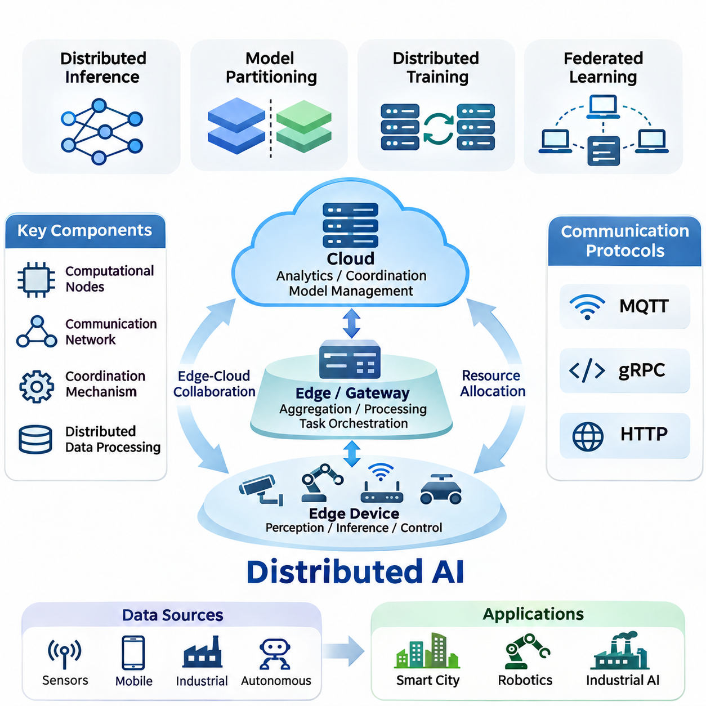
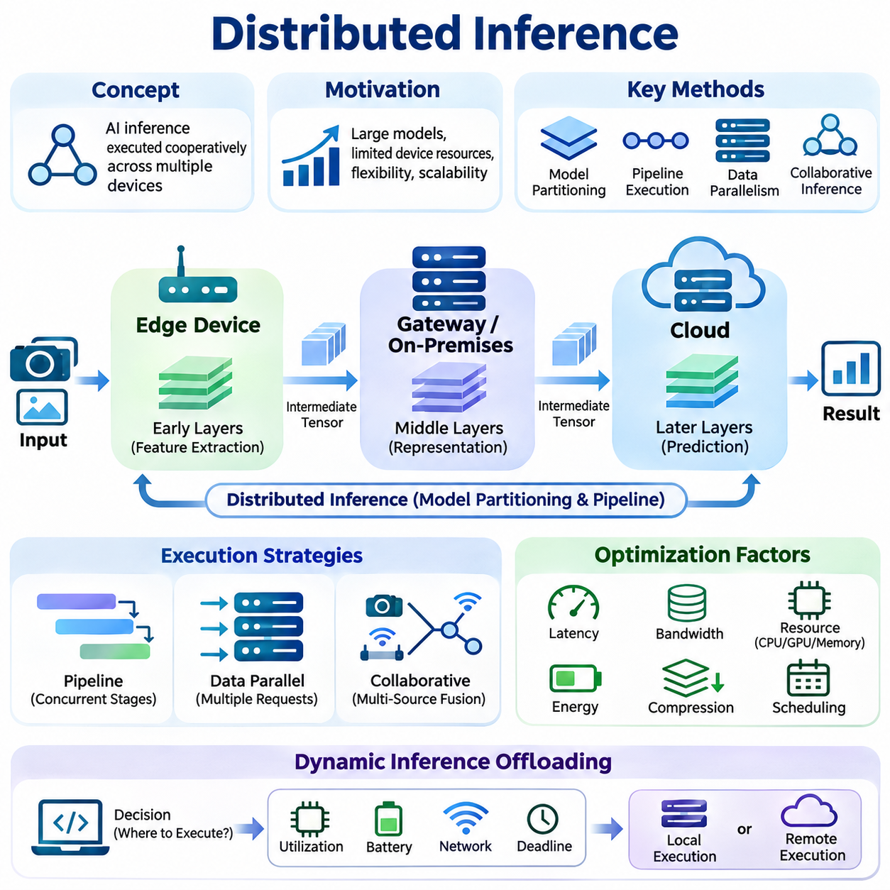
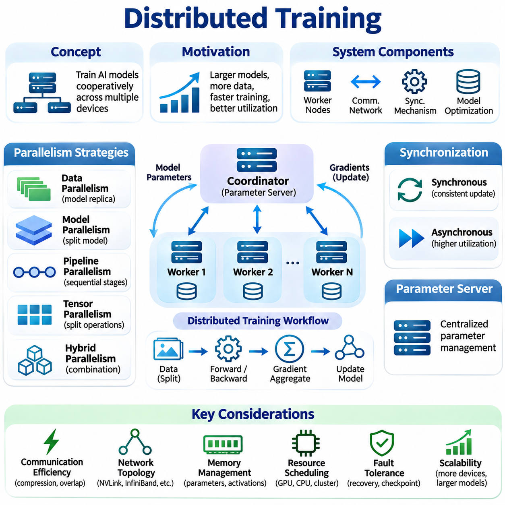
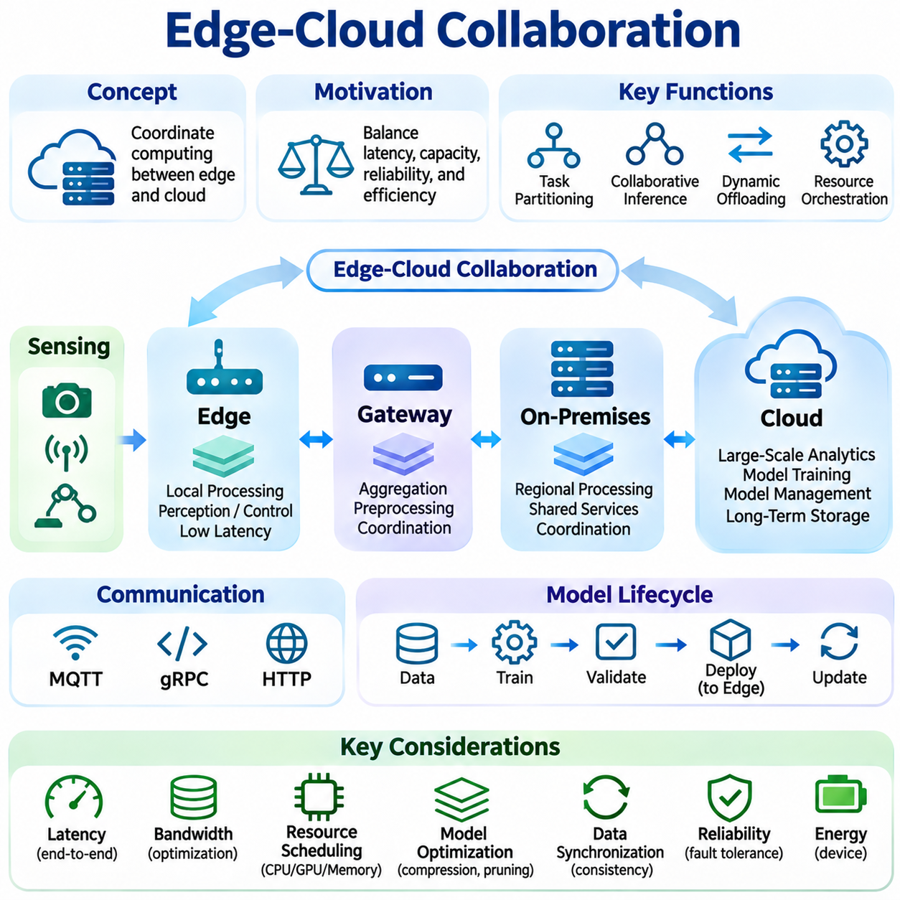
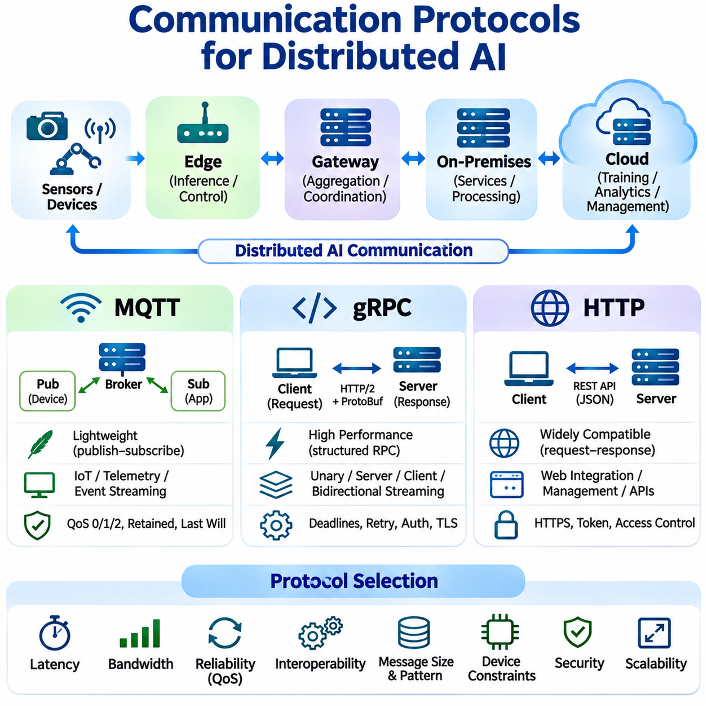
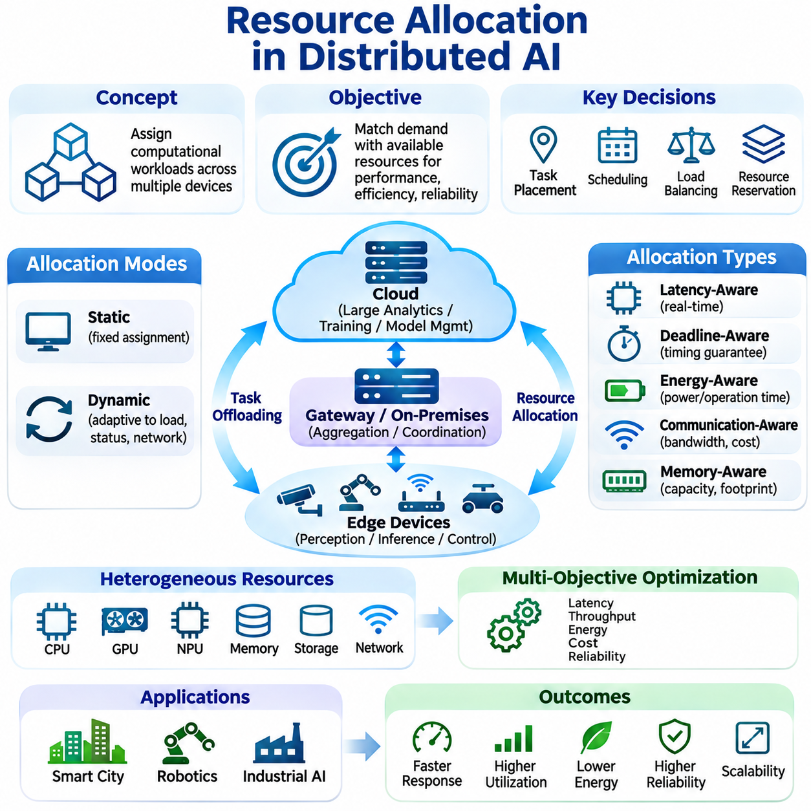
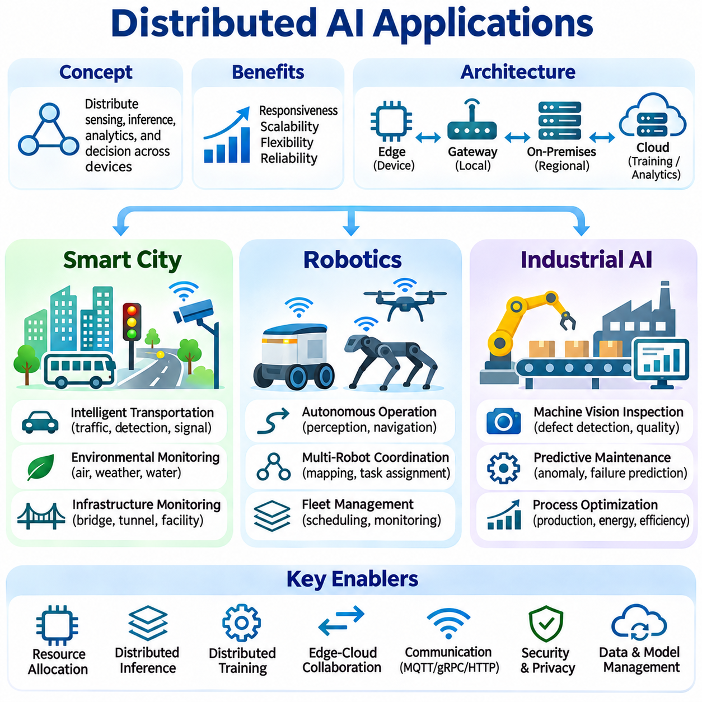

**Volume 40.** **TinyML and Federated Learning**

# 05. Distributed AI

## 05.00 Overview

{width="7.268055555555556in" height="7.268055555555556in"}

분산 인공지능(Distributed Artificial Intelligence, Distributed AI)은 여러 개의 상호 연결된 컴퓨팅 장치(Computing Device)가 협력하여 지능형 작업(Intelligent Task)을 실행하고, 정보를 처리하며, 의사결정을 조정하는 아키텍처 접근 방식(Architectural Approach)을 의미한다. 모든 연산을 중앙 서버(Centralized Server)에 집중시키는 대신, 분산 인공지능은 각 장치의 성능과 운영 요구사항에 따라 엣지 장치(Edge Device), 로컬 게이트웨이(Local Gateway), 온프레미스 인프라(On-Premises Infrastructure), 클라우드 플랫폼(Cloud Platform)에 작업 부하(Workload)를 분배한다.

분산 인공지능의 근본적인 필요성은 연결된 센서(Connected Sensor), 모바일 장치(Mobile Device), 산업 장비(Industrial Equipment), 자율 시스템(Autonomous System)에서 생성되는 데이터의 양이 지속적으로 증가하는 데서 비롯된다. 모든 관측 데이터를 중앙 인프라로 전송하면 통신 지연(Communication Latency), 대역폭 소비(Bandwidth Consumption), 운영 의존성(Operational Dependency)이 발생한다. 분산 아키텍처(Distributed Architecture)는 데이터 발생 위치에 가까운 곳에서 연산을 수행하면서 공유 컴퓨팅 자원(Shared Computing Resource)에 접근할 수 있도록 하여 이러한 한계를 해결한다.

분산 인공지능 시스템(Distributed AI System)은 일반적으로 연산 노드(Computational Node), 통신 네트워크(Communication Network), 조정 메커니즘(Coordination Mechanism), 분산 데이터 처리 구성요소(Distributed Data Processing Component)로 구성된다. 각 노드는 센서 전처리(Sensor Preprocessing), 신경망 추론(Neural Network Inference), 모델 학습(Model Training), 의사결정 실행(Decision Execution)과 같은 전문화된 기능을 수행할 수 있다. 아키텍처는 이러한 책임을 어떻게 할당하고, 중간 결과를 어떻게 교환하며, 독립적으로 동작하는 장치 사이에서 일관된 동작을 어떻게 유지할 것인지를 결정한다.

분산 추론(Distributed Inference)은 여러 컴퓨팅 노드가 인공지능 모델 실행에 공동으로 참여할 수 있도록 한다. 일부 아키텍처는 신경망(Neural Network)을 순차적인 처리 단계로 분할하는 반면, 다른 아키텍처는 독립적인 추론 요청(Inference Request)을 사용 가능한 장치에 분산한다. 파이프라인 실행(Pipeline Execution), 모델 분할(Model Partitioning), 협력 추론(Collaborative Inference)은 연산 용량(Computational Capacity), 메모리 제약(Memory Constraint), 통신 오버헤드(Communication Overhead), 응답 지연(Response Latency) 사이의 균형을 유지하도록 지원한다.

모델 분할(Model Partitioning)은 신경망이 개별 엣지 장치의 메모리 또는 처리 성능을 초과하는 경우 특히 중요하다. 선택된 계층(Layer)은 로컬에서 실행하고, 후속 계층은 게이트웨이 또는 클라우드 가속기(Cloud Accelerator)에서 실행할 수 있다. 참여 노드 사이에서는 중간 특징 표현(Intermediate Feature Representation)이 전송되며, 이를 통해 연산 유연성(Computational Flexibility)을 확보할 수 있지만 추가적인 통신 비용(Communication Cost)과 동기화 요구사항(Synchronization Requirement)이 발생한다.

분산 학습(Distributed Training)은 머신러닝 최적화(Machine Learning Optimization)를 여러 컴퓨팅 자원으로 확장한다. 데이터 병렬화(Data Parallelism)는 작업 노드(Worker)가 서로 다른 학습 샘플(Training Sample)을 처리하면서 모델 매개변수(Model Parameter)를 동기화하거나 주기적으로 갱신하도록 한다. 모델 병렬화(Model Parallelism)는 신경망의 일부를 여러 장치에 분산하여 단일 가속기(Accelerator)의 처리 용량을 초과하는 학습을 가능하게 한다. 하이브리드 전략(Hybrid Strategy)은 작업 부하 특성에 따라 두 접근 방식을 결합한다.

동기화(Synchronization)는 분산 학습에서 핵심적인 과제이다. 동기식 최적화(Synchronous Optimization)는 참여 작업 노드 사이의 매개변수 갱신(Parameter Update)을 조정하는 반면, 비동기식 방법(Asynchronous Method)은 작업 노드가 독립적으로 진행하도록 허용한다. 이러한 접근 방식은 수렴 특성(Convergence Behavior), 자원 활용률(Resource Utilization), 통신 오버헤드, 느리거나 일시적으로 사용할 수 없는 노드에 대한 허용 능력에서 서로 다른 절충 관계(Tradeoff)를 갖는다. 효과적인 동기화 정책은 네트워크 상태와 연산 이질성(Computational Heterogeneity)에 따라 달라진다.

분산 인공지능과 연합학습(Federated Learning)은 아키텍처 원칙을 공유하지만 주요 목적과 운영 가정(Operational Assumption)에서 차이가 있다. 연합학습은 학습 데이터를 참여 조직이나 장치 내부에 유지하면서 협력적으로 모델을 최적화하는 데 중점을 둔다. 반면 분산 인공지능은 분산 추론, 협력 학습(Coordinated Training), 작업 부하 오케스트레이션(Workload Orchestration), 이기종 컴퓨팅 환경(Heterogeneous Computing Environment) 사이의 실시간 협력(Real-Time Collaboration)을 포함하는 더 넓은 범위의 연산 협력을 다룬다.

엣지-클라우드 협력(Edge-Cloud Collaboration)은 분산 지능(Distributed Intelligence)의 실용적인 기반을 제공한다. 엣지 장치는 인지(Perception), 로컬 필터링(Local Filtering), 즉각적인 제어 결정(Immediate Control Decision)과 같은 지연 시간에 민감한 작업을 수행하고, 클라우드 인프라는 고부하 분석(Computationally Intensive Analytics), 중앙 집중식 조정(Centralized Coordination), 대규모 모델 관리(Large-Scale Model Management)를 지원한다. 중간 엣지 서버(Edge Server) 또는 온프레미스 게이트웨이는 정보를 집계하고 개별 장치의 성능을 초과하는 작업을 실행함으로써 두 환경을 연결한다.

연산 작업의 배치(Computational Task Placement)는 시스템 성능에 큰 영향을 미친다. 센서 가까이에서 추론을 실행하면 통신 지연을 줄이고 네트워크 중단(Network Interruption) 중에도 운영 연속성(Operational Continuity)을 유지할 수 있다. 반대로 중앙 집중식 처리(Centralized Processing)는 더 높은 연산 용량과 단순화된 모델 관리를 제공할 수 있다. 하이브리드 아키텍처(Hybrid Architecture)는 작업 복잡도(Workload Complexity), 가용 자원(Available Resource), 통신 품질(Communication Quality), 애플리케이션별 시간 제약(Timing Constraint)에 따라 실행 위치를 동적으로 선택한다.

통신 프로토콜(Communication Protocol)은 분산 구성요소 사이에서 정보를 교환하는 메커니즘을 정의한다. 메시지 큐잉 텔레메트리 전송(Message Queuing Telemetry Transport, MQTT)은 경량 발행-구독 메시징(Lightweight Publish-Subscribe Messaging)을 지원하므로 센서 네트워크와 자원 제약 장치에 적합하다. 구글 원격 프로시저 호출(Google Remote Procedure Call, gRPC)은 구조화된 서비스 통신(Structured Service Communication)을 제공하며, 하이퍼텍스트 전송 프로토콜(Hypertext Transfer Protocol, HTTP)은 분산 애플리케이션 사이에서 폭넓은 호환성을 갖춘 요청-응답 상호작용(Request-Response Interaction)을 지원한다.

프로토콜 선택(Protocol Selection)은 메시지 전달(Message Delivery), 상호운용성(Interoperability), 연산 오버헤드(Computational Overhead), 운영 신뢰성(Operational Reliability)에 영향을 미친다. 경량 메시징(Lightweight Messaging)은 간헐적인 연결과 제한된 대역폭에 대응할 수 있으며, 구조화된 원격 프로시저 호출(Structured Remote Procedure Call)은 효율적인 서비스 상호작용을 지원한다. 통신 아키텍처는 분산 구성요소 사이의 안정적인 조정을 유지하기 위해 직렬화 형식(Serialization Format), 인증(Authentication), 암호화(Encryption), 재시도 정책(Retry Policy), 장애 감지(Failure Detection)를 함께 고려해야 한다.

자원 할당(Resource Allocation)은 사용 가능한 프로세서(Processor), 가속기(Accelerator), 메모리 시스템(Memory System), 네트워크 연결(Network Connection)에 연산 작업을 어떻게 배정할 것인지를 결정한다. 정적 할당(Static Allocation)은 사전에 정의된 실행 책임을 설정하는 반면, 동적 스케줄링(Dynamic Scheduling)은 작업 부하와 자원 가용성(Resource Availability)의 변화에 따라 할당을 조정한다. 지능형 오케스트레이션(Intelligent Orchestration)은 실행 노드를 선택할 때 처리 용량, 에너지 소비(Energy Consumption), 지연 요구사항(Latency Requirement), 통신 비용을 고려한다.

이기종 하드웨어(Heterogeneous Hardware)는 참여 장치가 마이크로컨트롤러(Microcontroller), 중앙처리장치(CPU), 그래픽처리장치(GPU), 신경망처리장치(NPU), 특수 목적 가속기(Specialized Accelerator) 등을 포함할 수 있으므로 추가적인 복잡성을 발생시킨다. 장치마다 지원하는 수치 형식(Numerical Format), 메모리 용량(Memory Capacity), 실행 프레임워크(Execution Framework)가 크게 다를 수 있다. 따라서 분산 인공지능 아키텍처에는 하드웨어 인식 작업 배치(Hardware-Aware Workload Placement), 호환 가능한 모델 표현(Model Representation), 참여 노드 사이의 연산 불균형(Computational Imbalance)을 관리하는 메커니즘이 필요하다.

에너지 효율(Energy Efficiency)은 분산 지능이 배터리 기반 센서(Battery-Powered Sensor), 모바일 로봇(Mobile Robot), 임베디드 제어기(Embedded Controller)를 포함하는 경우 특히 중요하다. 지속적인 통신과 고부하 신경망 실행은 작동 시간을 크게 단축할 수 있다. 에너지 인식 스케줄링(Energy-Aware Scheduling), 적응형 추론 주기(Adaptive Inference Frequency), 모델 압축(Model Compression), 선택적 데이터 전송(Selective Data Transmission)은 제한된 전력 예산(Power Budget) 내에서 허용 가능한 정확도와 응답성을 유지하면서 연산 책임을 분산하도록 지원한다.

확장성(Scalability)은 분산 인공지능 아키텍처가 추가 장치, 연산 작업, 데이터 스트림(Data Stream)을 수용하면서 성능 저하가 과도하게 증가하지 않도록 하는 능력을 의미한다. 참여 노드의 수를 늘린다고 반드시 효율성이 향상되는 것은 아니며, 통신 오버헤드와 조정 복잡도(Coordination Complexity)가 동시에 증가할 수 있다. 효과적인 확장성을 확보하려면 균형 잡힌 작업 분할(Balanced Partitioning), 효율적인 스케줄링(Efficient Scheduling), 배포 토폴로지(Deployment Topology)에 적합한 통신 메커니즘이 필요하다.

신뢰성(Reliability)과 장애 허용성(Fault Tolerance)은 분산 시스템이 독립적으로 장애가 발생할 수 있는 여러 장치와 통신 링크(Communication Link)에 걸쳐 동작하기 때문에 필수적이다. 노드 장애(Node Failure), 네트워크 분할(Network Partition), 메시지 지연(Delayed Message), 자원 고갈(Resource Exhaustion)은 협력 처리를 중단시킬 수 있다. 견고한 아키텍처(Robust Architecture)는 상태 모니터링(Health Monitoring), 작업 재할당(Workload Reassignment), 중복성(Redundancy), 체크포인팅(Checkpointing), 복구 절차(Recovery Procedure)를 통합하여 인프라 일부에 장애가 발생하더라도 필수 기능을 유지한다.

일관성(Consistency)과 조정(Coordination)은 분산 노드가 공유 모델(Shared Model), 중간 상태(Intermediate State), 운영 의사결정(Operational Decision)을 유지하는 경우 특히 중요하다. 강한 동기화(Strong Synchronization)는 일관성 관리를 단순화할 수 있지만 불안정한 네트워크 환경에서는 지연을 증가시키고 가용성(Availability)을 낮출 수 있다. 보다 유연한 일관성 접근 방식(Flexible Consistency Approach)은 응답성을 향상시킬 수 있지만 참여 노드 사이에 일시적인 정보 차이를 발생시킨다. 적절한 정책은 정보 불일치(Inconsistent Information)가 초래하는 결과에 따라 결정된다.

보안 경계(Security Boundary)는 모든 참여 장치, 통신 채널(Communication Channel), 조정 서비스(Coordination Service)에 걸쳐 확장된다. 분산 인공지능 시스템은 모델 매개변수, 센서 관측 데이터(Sensor Observation), 인증 자격 증명(Authentication Credential), 운영 명령(Operational Command)을 무단 접근이나 변조로부터 보호해야 한다. 암호화, 신원 관리(Identity Management), 접근 제어(Access Control), 안전한 소프트웨어 업데이트(Secure Software Update), 무결성 검증(Integrity Verification)은 기본적인 보호 수단을 제공하지만 실제 효과는 구현 방식과 운영 거버넌스(Operational Governance)에 따라 달라진다.

스마트 시티(Smart City) 환경은 지리적으로 분산된 인프라 전반에서 분산 지능의 가치를 보여준다. 교통 센서(Traffic Sensor), 도로변 카메라(Roadside Camera), 환경 모니터링 장치(Environmental Monitoring Station), 도시 컴퓨팅 플랫폼(Municipal Computing Platform)은 서로 다른 지연 및 처리 요구사항을 가진 정보를 생성한다. 로컬 노드는 즉각적인 이벤트 감지(Event Detection)를 수행하고, 지역 및 중앙 시스템은 관측 정보를 통합하여 광역 교통 관리(Traffic Management), 인프라 모니터링(Infrastructure Monitoring), 운영 계획(Operational Planning)을 지원한다.

로보틱스(Robotics) 애플리케이션은 임베디드 프로세서(Embedded Processor)와 외부 컴퓨팅 자원(External Computing Resource)에 걸쳐 인지, 내비게이션(Navigation), 계획(Planning), 통신을 조정하기 위해 분산 지능을 활용한다. 모바일 로봇은 안전 필수 제어(Safety-Critical Control)를 로컬에서 실행하면서 지도(Map), 작업 할당(Task Assignment), 고부하 인지 결과(Computationally Demanding Perception Result)를 인근 서버와 교환할 수 있다. 다중 로봇 시스템(Multi-Robot System)은 통신 지연, 일치하지 않는 관측 정보, 변화하는 네트워크 가용성을 고려하는 추가적인 조정 메커니즘을 필요로 한다.

산업 인공지능(Industrial AI) 환경은 분산 컴퓨팅(Distributed Computing)을 제조 장비(Manufacturing Equipment), 머신비전 시스템(Machine Vision System), 프로그래머블 제어기(Programmable Controller), 감독 인프라(Supervisory Infrastructure)와 결합한다. 엣지 프로세서는 생산 장비 가까이에서 결함 검출(Defect Detection)과 상태 모니터링(Condition Monitoring)을 수행하고, 온프레미스 서버는 운영 정보를 집계하여 예지보전(Predictive Maintenance)과 공정 최적화(Process Optimization)를 지원한다. 시스템 설계는 결정론적 제어 요구사항(Deterministic Control Requirement)을 유지하고 필수 제어 기능을 불필요한 네트워크 의존성으로부터 분리해야 한다.

분산 인공지능의 평가(Evaluation)는 모델 정확도(Model Accuracy)나 연산 처리량(Computational Throughput)을 측정하는 것만으로 충분하지 않다. 주요 성능 지표(Performance Indicator)에는 종단 간 지연(End-to-End Latency), 통신량(Communication Volume), 에너지 소비, 자원 활용률, 확장성, 가용성, 복구 시간(Recovery Time)이 포함된다. 실험 비교(Experimental Comparison)는 실제 아키텍처 개선 효과와 유리한 시험 조건에 따른 결과를 구분하기 위해 네트워크 변동성(Network Variability), 이기종 장치, 작업 부하 분포(Workload Distribution), 동기화 오버헤드를 고려해야 한다.

분산 인공지능의 발전은 독립적인 지능형 장치(Isolated Intelligent Device)에서 상호 조정되는 컴퓨팅 생태계(Coordinated Computational Ecosystem)로 전환되는 광범위한 흐름을 반영한다. 분산 추론, 분산 학습, 엣지-클라우드 협력, 통신 프로토콜, 자원 할당은 이러한 전환의 핵심 기반을 형성한다. 이들 요소의 상호작용을 이해하면 다양한 실제 환경에서 작동할 수 있는 확장 가능하고 효율적이며 회복탄력적(Resilient)이고 안전한 인공지능 시스템을 설계할 수 있다.

## 05.01 Distributed Inference [w/Code]

{width="7.268055555555556in" height="7.268055555555556in"}

분산 추론(Distributed Inference)은 여러 개의 상호 연결된 컴퓨팅 장치(Computing Device)가 협력하여 추론 작업 부하(Inference Workload)를 처리하는 인공지능 실행 방식이다. 전체 신경망(Neural Network)을 단일 프로세서(Single Processor)나 중앙 서버(Centralized Server)에서 실행하는 대신, 연산 작업을 엣지 장치(Edge Device), 게이트웨이(Gateway), 온프레미스 서버(On-Premises Server), 클라우드 인프라(Cloud Infrastructure)에 분산한다. 이러한 접근 방식은 하드웨어 제약(Hardware Constraint)과 운영 요구사항(Operational Requirement)을 해결하면서 유연한 실행을 가능하게 한다.

분산 추론의 주요 필요성은 현대 신경망의 연산 요구량(Computational Demand)이 증가하는 동시에 임베디드 장치(Embedded Device)에서 사용할 수 있는 자원이 제한적이라는 점에서 비롯된다. 대규모 모델(Large Model)은 상당한 메모리(Memory), 처리 용량(Processing Capacity), 에너지(Energy)를 요구하는 경우가 많다. 추론 연산(Inference Operation)을 분산하면 자원 제약 장치(Resource-Constrained Device)가 모든 연산 구성요소를 독립적으로 지원하지 않더라도 복잡한 인공지능 애플리케이션(AI Application)에 참여할 수 있다.

분산 추론 아키텍처(Distributed Inference Architecture)는 모델 분할(Model Partitioning), 작업 부하 분산(Workload Distribution), 파이프라인 실행(Pipeline Execution), 협력 처리(Collaborative Processing)를 통해 구성할 수 있다. 모델 분할은 신경망을 여러 연산 구간(Computational Segment)으로 나누어 서로 다른 장치에 할당한다. 작업 부하 분산은 독립적인 추론 요청(Inference Request)을 사용 가능한 노드(Node)에 배정하며, 협력 처리는 여러 참여 시스템에서 생성한 중간 표현(Intermediate Representation)이나 예측 결과(Prediction)를 결합한다.

모델 분할은 일반적으로 신경망 계층(Neural Network Layer)을 연속적인 실행 단계(Execution Stage)로 나누는 방식으로 수행된다. 엣지 장치는 초기 특징 추출 계층(Feature Extraction Layer)을 실행하고, 게이트웨이나 클라우드 서버는 더 깊은 표현(Deeper Representation)을 처리하여 최종 예측 결과를 생성할 수 있다. 중간 텐서(Intermediate Tensor)는 장치 사이에서 전송되며, 이를 통해 처리 용량, 메모리 가용성(Memory Availability), 통신 상태(Communication Condition)에 따라 연산 부담을 분담할 수 있다.

분할 경계(Partition Boundary)의 선택은 추론 성능(Inference Performance)에 상당한 영향을 미친다. 신경망의 초기 계층은 큰 특징 맵(Feature Map)을 생성할 수 있으므로 중간 데이터 전송 비용이 높아질 수 있다. 후반 계층은 상대적으로 압축된 표현을 생성하는 경우가 많지만 상당한 연산량을 요구할 수 있다. 따라서 효과적인 모델 분할은 계층을 균등하게 분배하기보다 텐서 차원(Tensor Dimension), 연산 복잡도(Computational Complexity), 가용 대역폭(Available Bandwidth), 통신 지연(Communication Latency)을 함께 고려해야 한다.

파이프라인 병렬화(Pipeline Parallelism)는 서로 다른 추론 단계가 별도의 장치에서 동시에 실행되도록 한다. 하나의 장치가 새로운 입력 데이터의 초기 계층을 처리하는 동안 다른 장치는 이전 입력 데이터의 후속 계층을 실행할 수 있다. 이러한 중첩 실행(Overlapping Execution)은 충분한 추론 요청이 존재할 때 시스템 처리량(System Throughput)을 향상시킬 수 있지만, 개별 요청의 지연 시간(Request Latency)은 통신과 순차적 의존성(Sequential Dependency)에 의해 제한될 수 있다.

데이터 병렬화(Data Parallelism)는 동일한 모델의 여러 복제본(Model Replica)에 독립적인 추론 요청을 분산한다. 각 처리 노드(Processing Node)는 호환 가능한 모델 인스턴스(Model Instance)를 유지하며, 중간 텐서를 교환하지 않고 할당된 입력을 처리한다. 부하 분산 메커니즘(Load Balancing Mechanism)은 장치 성능(Device Capacity), 현재 활용률(Current Utilization), 응답 시간(Response Time)에 따라 요청을 분배하여 이기종 컴퓨팅 인프라(Heterogeneous Computing Infrastructure) 전반에서 확장 가능한 추론 서비스를 구현한다.

협력 추론(Collaborative Inference)은 여러 장치가 상호 보완적인 정보(Complementary Information)를 제공하도록 함으로써 기존 모델 분할 방식을 확장한다. 분산 카메라(Distributed Camera), 센서(Sensor), 로봇 플랫폼(Robotic Platform)은 각각 독립적으로 특징을 추출하거나 예측 결과를 생성한 후 출력을 결합할 수 있다. 특징 수준 융합(Feature-Level Fusion)과 의사결정 수준 융합(Decision-Level Fusion)은 통신 오버헤드(Communication Overhead)와 예측 성능(Predictive Performance) 사이의 균형을 유지하면서 관측 정보를 통합하는 서로 다른 메커니즘을 제공한다.

엣지-클라우드 협력 추론(Edge-Cloud Collaborative Inference)은 로컬 응답성(Local Responsiveness)과 중앙 집중식 연산 자원(Centralized Computational Resource)을 결합한다. 엣지 장치는 전처리(Preprocessing), 경량 추론(Lightweight Inference), 초기 특징 추출(Initial Feature Extraction)을 수행하고, 클라우드 서버는 연산 요구량이 높은 작업을 실행한다. 이러한 구성은 로컬 하드웨어 요구사항을 줄일 수 있지만, 효과는 네트워크 가용성(Network Availability), 전송 비용(Transmission Cost), 대상 애플리케이션의 지연 요구사항(Latency Requirement)에 따라 달라진다.

동적 추론 오프로딩(Dynamic Inference Offloading)은 연산 작업을 로컬에서 실행할지 원격 인프라(Remote Infrastructure)에서 실행할지를 결정한다. 오프로딩 결정(Offloading Decision)은 프로세서 활용률(Processor Utilization), 배터리 용량(Battery Capacity), 네트워크 대역폭(Network Bandwidth), 예상 실행 시간(Estimated Execution Time), 서비스 마감시간(Service Deadline)에 따라 달라질 수 있다. 적응형 정책(Adaptive Policy)은 운영 조건이 변화함에 따라 실행 위치를 선택하여 분산 시스템이 변동하는 작업 부하와 통신 환경에 대응하도록 한다.

통신 오버헤드(Communication Overhead)는 분산 추론의 근본적인 제약 요소이다. 중간 텐서, 입력 관측 데이터(Input Observation), 예측 결과를 전송하면 대역폭(Bandwidth)이 소비되고 추가적인 지연 시간(Latency)이 발생한다. 전송 비용이 연산 분산을 통해 얻는 절감 효과보다 크다면 원격 실행(Remote Execution)의 성능이 로컬 추론(Local Inference)보다 낮아질 수 있다. 따라서 통신 인식 최적화(Communication-Aware Optimization)는 실제 배포(Practical Deployment)에 필수적이다.

중간 특징 압축(Intermediate Feature Compression)은 추론 노드 사이에서 교환되는 정보량을 줄인다. 양자화(Quantization), 차원 축소(Dimensionality Reduction), 학습 기반 압축(Learned Compression), 선택적 특징 전송(Selective Feature Transmission)은 통신 요구량을 감소시킬 수 있다. 그러나 지나치게 강한 압축은 중요한 특징 표현(Feature Representation)을 왜곡하고 예측 정확도(Prediction Accuracy)를 낮출 수 있으므로 전송 효율(Transmission Efficiency)과 모델 성능(Model Performance) 사이의 관계를 신중하게 평가해야 한다.

지연 최적화(Latency Optimization)는 연산(Computation), 통신(Communication), 직렬화(Serialization), 스케줄링(Scheduling), 동기화(Synchronization)를 모두 고려해야 한다. 종단 간 추론 지연(End-to-End Inference Latency)에는 입력 준비(Input Preparation), 신경망 연산 실행(Neural Network Execution), 중간 결과 전송(Intermediate Result Transfer), 예측 결과 반환(Prediction Return)에 필요한 시간이 포함된다. 네트워크 전송이나 스케줄링 지연이 전체 응답 시간을 지배하는 경우 프로세서 실행 시간만 최적화해서는 제한적인 효과만 얻을 수 있다.

자원 인식 스케줄링(Resource-Aware Scheduling)은 참여 장치의 성능과 현재 상태에 따라 추론 작업을 할당한다. 노드마다 중앙처리장치(CPU) 성능, 그래픽처리장치(GPU) 가용성, 가속기 지원(Accelerator Support), 메모리 용량(Memory Capacity), 전력 소비(Power Consumption)가 다를 수 있다. 스케줄링 메커니즘(Scheduling Mechanism)은 예상 실행 비용(Estimated Execution Cost)과 실시간 자원 측정값(Real-Time Resource Measurement)을 활용하여 과부하 장치를 피하고 분산 작업 부하 전반에서 예측 가능한 응답 시간을 유지할 수 있다.

에너지 효율(Energy Efficiency)은 배터리 기반 엣지 장치(Battery-Powered Edge Device)와 모바일 로봇 플랫폼(Mobile Robotic Platform)에서 특히 중요하다. 로컬 추론은 연산 에너지(Computational Energy)를 소비하는 반면, 원격 추론은 통신 에너지(Communication Energy)와 추가적인 대기 시간(Waiting Time)을 요구한다. 에너지 인식 오프로딩(Energy-Aware Offloading)은 이러한 비용을 비교하여 애플리케이션별 정확도 및 지연 요구사항을 위반하지 않으면서 배터리 수명(Battery Life)을 유지하는 실행 전략을 선택한다.

장애 허용성(Fault Tolerance)은 개별 노드나 통신 링크(Communication Link)를 사용할 수 없게 되더라도 분산 추론 시스템이 계속 작동하도록 한다. 중복 모델 복제본(Redundant Model Replica), 대체 실행 경로(Alternative Execution Path), 타임아웃 메커니즘(Timeout Mechanism), 로컬 대체 모델(Local Fallback Model)은 서비스 중단을 줄일 수 있다. 중요 애플리케이션(Critical Application)은 원격 인프라에 일시적인 장애가 발생하더라도 필수적인 의사결정을 유지할 수 있도록 독립적인 로컬 추론 기능을 요구할 수 있다.

일관성(Consistency)은 추론 노드가 서로 다른 모델 버전(Model Version)이나 전처리 구성(Preprocessing Configuration)을 사용하는 경우 중요해진다. 일치하지 않는 매개변수(Parameter), 정규화 절차(Normalization Procedure), 특징 표현(Feature Representation)은 호환되지 않는 중간 결과를 생성할 수 있다. 모델 버전 관리(Model Version Management), 인터페이스 검증(Interface Validation), 조정된 배포 절차(Coordinated Deployment Procedure)는 분산 구성요소가 호환 가능한 연산 단계를 실행하고 재현 가능한 예측 동작(Reproducible Prediction Behavior)을 유지하도록 지원한다.

보안 고려사항(Security Consideration)은 모델 실행(Model Execution), 통신 채널(Communication Channel), 참여 장치(Participating Device) 전반에 적용된다. 원시 입력 데이터(Raw Input)가 로컬에 유지되더라도 중간 특징(Intermediate Feature)을 통해 민감한 정보(Sensitive Information)가 노출될 수 있다. 보안 통신(Secure Communication), 인증(Authentication), 접근 제어(Access Control), 무결성 검증(Integrity Verification)은 무단 가로채기(Unauthorized Interception)나 변조(Modification)로부터 분산 추론 작업을 보호한다. 민감한 관측 데이터를 다루는 애플리케이션에는 추가적인 개인정보 보호 기술(Privacy-Preserving Technique)이 필요할 수 있다.

구현(Implementation)에는 일반적으로 머신러닝 프레임워크(Machine Learning Framework)와 분산 통신 인터페이스(Distributed Communication Interface)가 사용된다. 파이토치(PyTorch), 텐서플로(TensorFlow), ONNX 런타임(ONNX Runtime)은 지원되는 하드웨어에서 모델 구성요소를 실행할 수 있으며, gRPC, HTTP, 메시지 지향 프로토콜(Message-Oriented Protocol)은 원격 처리를 조정한다. 실제 구현에서는 텐서 직렬화(Tensor Serialization), 장치 호환성(Device Compatibility), 비동기 요청(Asynchronous Request), 실행 타임아웃(Execution Timeout), 중간 결과 전송을 관리해야 한다.

대표적인 구현 방식(Representative Implementation)은 신경망을 엣지 인코더(Edge Encoder)와 원격 예측 헤드(Remote Prediction Head)로 분할하는 것이다. 엣지 장치는 센서 관측 데이터(Sensor Observation)를 특징 텐서(Feature Tensor)로 변환하고 정의된 통신 인터페이스를 통해 전송한다. 원격 서비스(Remote Service)는 텐서를 재구성하고 나머지 계층을 실행한 후 예측 결과를 반환한다. 두 구성요소는 호환 가능한 모델 매개변수(Model Parameter), 텐서 명세(Tensor Specification), 전처리 규칙(Preprocessing Convention)을 공유해야 한다.

성능 평가(Performance Evaluation)에는 예측 정확도, 종단 간 지연, 처리량(Throughput), 통신량(Communication Volume), 메모리 활용률(Memory Utilization), 에너지 소비(Energy Consumption)의 측정이 필요하다. 실험은 동등한 작업 부하(Equivalent Workload)에서 로컬 실행(Local Execution), 완전 원격 실행(Fully Remote Execution), 분산 구성(Distributed Configuration)을 비교해야 한다. 의미 있는 비교를 위해 네트워크 대역폭, 왕복 시간(Round-Trip Time), 동시 요청량(Concurrent Request Volume), 하드웨어 이질성(Hardware Heterogeneity)을 통제하거나 보고해야 한다.

확장성(Scalability)은 분산 추론이 추가 장치와 증가하는 요청을 얼마나 효과적으로 수용하는지에 따라 결정된다. 복제된 추론 서비스(Replicated Inference Service)는 전체 처리량(Aggregate Throughput)을 증가시킬 수 있지만, 분할된 모델(Partitioned Model)은 활용률이 높은 단계에서 병목 현상(Bottleneck)이 발생할 수 있다. 동적 부하 분산(Dynamic Load Balancing), 요청 배치(Request Batching), 자원 모니터링(Resource Monitoring), 적응형 분할(Adaptive Partitioning)은 배포 규모와 작업 부하 강도가 증가하더라도 성능을 유지하도록 지원한다.

로보틱스(Robotics)는 인지(Perception)와 제어(Control) 작업이 서로 다른 연산 및 시간 요구사항을 갖기 때문에 분산 추론의 실용적인 적용 분야이다. 모바일 로봇(Mobile Robot)은 장애물 검출(Obstacle Detection)과 즉각적인 안전 의사결정(Immediate Safety Decision)을 로컬에서 실행하면서 의미론적 지도 작성(Semantic Mapping)이나 복잡한 장면 해석(Complex Scene Interpretation)을 인근 서버로 오프로딩할 수 있다. 이러한 아키텍처는 통신 지연이 안전 필수 제어 루프(Safety-Critical Control Loop)를 손상시키지 않도록 보장해야 한다.

산업 인공지능(Industrial AI) 시스템은 생산 카메라(Production Camera), 엣지 게이트웨이(Edge Gateway), 공장 서버(Factory Server)에 머신비전 추론(Machine Vision Inference)을 분산할 수 있다. 로컬 프로세서(Local Processor)는 신속한 결함 선별(Rapid Defect Screening)을 수행하고, 더 강력한 인프라는 판단이 모호한 관측 데이터(Ambiguous Observation)를 분석하거나 생산라인 전반의 정보를 집계한다. 이러한 계층적 접근 방식(Hierarchical Approach)은 산업 모니터링(Industrial Monitoring)과 품질 검사(Quality Inspection)에 필요한 응답성을 유지하면서 유연한 연산 자원 할당을 지원한다.

스마트 시티(Smart City) 애플리케이션은 교통 카메라(Traffic Camera), 도로변 센서(Roadside Sensor), 지역 컴퓨팅 인프라(Regional Computing Infrastructure)에 분산 추론을 적용한다. 로컬 노드는 이벤트(Event)를 감지하고 관련 특징을 추출하며, 중앙 서비스(Centralized Service)는 관측 정보를 통합하여 광역 상황 인식(Broader Situational Awareness)을 지원한다. 연속적인 원시 데이터 스트림(Raw Data Stream) 대신 선택된 정보만 전송함으로써 대역폭 요구량을 줄이면서 지리적으로 분산된 지능형 시스템을 지원할 수 있다.

분산 추론은 확장 가능하고 자원 효율적인 인공지능 배포(Scalable and Resource-Efficient AI Deployment)를 위한 중요한 아키텍처 기반이다. 그 효과는 모델 분할, 연산 배치(Computation Placement), 통신 효율(Communication Efficiency), 자원 스케줄링(Resource Scheduling), 신뢰성(Reliability), 보안(Security)을 통합적으로 최적화하는 데 달려 있다. 이러한 요소를 함께 고려하면 분산 추론은 이기종 장치가 협력하여 개별 컴퓨팅 노드의 실질적인 처리 능력을 넘어서는 지능형 작업을 수행하도록 지원한다.

## 05.02 Distributed Training

{width="7.268055555555556in" height="7.268055555555556in"}

분산 학습(Distributed Training)은 여러 개의 상호 연결된 컴퓨팅 장치(Computing Device)가 협력하여 인공지능 모델(Artificial Intelligence Model)을 최적화하는 머신러닝(Machine Learning) 접근 방식이다. 모든 학습 연산(Training Operation)을 단일 프로세서(Single Processor)에서 실행하는 대신, 작업 부하(Workload)를 GPU, 서버(Server), 엣지 장치(Edge Device), 컴퓨팅 클러스터(Computing Cluster)에 분산한다. 이러한 아키텍처는 더 큰 모델, 빠른 처리, 향상된 자원 활용률(Resource Utilization)을 가능하게 하지만 조정(Coordination)과 통신(Communication)에 관한 과제도 발생시킨다.

분산 학습의 주요 필요성은 현대 신경망(Neural Network)의 연산 복잡도(Computational Complexity)가 증가하고 학습 데이터셋(Training Dataset)의 규모가 커지는 데서 비롯된다. 대규모 모델(Large-Scale Model)은 상당한 메모리(Memory), 처리 용량(Processing Capacity), 학습 시간(Training Time)을 요구한다. 분산 아키텍처(Distributed Architecture)는 이러한 요구사항을 여러 장치에 분담시켜 개별 컴퓨팅 시스템(Computing System)의 실질적인 처리 능력을 초과하는 모델도 학습할 수 있도록 한다.

분산 학습 시스템(Distributed Training System)은 일반적으로 작업 노드(Worker Node), 통신 인프라(Communication Infrastructure), 동기화 메커니즘(Synchronization Mechanism), 모델 최적화 구성요소(Model Optimization Component)로 구성된다. 각 작업 노드는 할당된 연산을 처리하고, 조정 서비스(Coordination Service)는 매개변수 갱신(Parameter Update)과 실행 진행 상태(Execution Progress)를 관리한다. 시스템 아키텍처(System Architecture)는 학습 과정에서 데이터, 모델 매개변수(Model Parameter), 기울기(Gradient), 옵티마이저 상태(Optimizer State)를 어떻게 분산하고 교환할 것인지를 결정한다.

데이터 병렬화(Data Parallelism)는 가장 널리 사용되는 분산 학습 전략 중 하나이다. 각 작업 노드는 모델 복제본(Model Replica)을 유지하면서 서로 다른 학습 샘플(Training Sample)의 부분집합(Subset)을 처리한다. 로컬 미니배치(Local Mini-Batch)에서 계산된 기울기는 결합되어 조정된 매개변수 갱신(Coordinated Parameter Update)을 생성한다. 이러한 접근 방식은 참여 작업 노드 사이에서 공통 최적화 목표(Shared Optimization Objective)를 유지하면서 전체 처리 용량(Aggregate Processing Capacity)을 증가시킨다.

모델 병렬화(Model Parallelism)는 신경망의 서로 다른 부분을 여러 장치에 분산한다. 개별 작업 노드는 전체 모델 복제본을 유지하는 대신 할당된 계층(Layer), 연산(Operation), 매개변수 분할(Parameter Partition)을 실행한다. 이러한 접근 방식은 모델 매개변수와 중간 활성화값(Intermediate Activation)이 단일 가속기(Accelerator)의 메모리 용량을 초과하는 경우 특히 유용하지만, 분할된 구성요소 사이의 통신은 추가적인 실행 오버헤드(Execution Overhead)를 발생시킨다.

파이프라인 병렬화(Pipeline Parallelism)는 신경망을 서로 다른 장치에 할당되는 순차적인 연산 단계(Computational Stage)로 분할한다. 학습 미니배치(Training Mini-Batch)는 파이프라인을 따라 이동하는 더 작은 마이크로배치(Micro-Batch)로 나뉜다. 여러 단계가 서로 다른 마이크로배치를 동시에 처리하여 하드웨어 활용률(Hardware Utilization)을 향상시킬 수 있다. 파이프라인 스케줄링(Pipeline Scheduling)은 순전파(Forward Propagation), 역전파(Backward Propagation), 활성화값 저장(Activation Storage), 일시적인 유휴 구간(Idle Period)을 고려해야 한다.

텐서 병렬화(Tensor Parallelism)는 개별 신경망 연산을 여러 가속기에 분할한다. 대규모 행렬 곱셈(Matrix Multiplication), 어텐션 메커니즘(Attention Mechanism), 피드포워드 계층(Feedforward Layer)을 더 작은 연산 구간(Computational Segment)으로 나눌 수 있다. 참여 장치는 집합 통신 연산(Collective Communication Operation)을 통해 중간 결과(Intermediate Result)를 교환한다. 이러한 전략은 대규모 모델 실행을 가능하게 하지만 고대역폭 상호연결망(High-Bandwidth Interconnect)과 효율적인 동기화에 크게 의존한다.

하이브리드 병렬화(Hybrid Parallelism)는 데이터 병렬화, 모델 병렬화, 파이프라인 병렬화, 텐서 병렬화를 결합하여 복잡한 학습 작업 부하를 지원한다. 서로 다른 병렬화 차원(Parallelization Dimension)은 메모리 용량, 처리량(Processing Throughput), 모델 크기(Model Size)와 관련된 개별적인 연산 제약을 해결한다. 효과적인 하이브리드 아키텍처(Hybrid Architecture)는 수학적으로 일관된 최적화 동작(Mathematically Consistent Optimization Behavior)을 유지하면서 통신 오버헤드(Communication Overhead), 장치 활용률(Device Utilization), 실행 의존성(Execution Dependency)의 균형을 조정한다.

기울기 동기화(Gradient Synchronization)는 분산 학습의 핵심 연산이다. 동기식 최적화(Synchronous Optimization)에서는 작업 노드가 독립적으로 기울기를 계산하고 다음 학습 단계(Training Step)로 진행하기 전에 갱신을 조정한다. 올리듀스(All-Reduce)와 같은 집합 통신 알고리즘(Collective Communication Algorithm)은 참여 장치 사이에서 기울기를 집계한다. 동기화는 일관된 모델 매개변수를 유지하지만 작업 노드의 진행 속도가 서로 다른 경우 대기 시간(Waiting Time)을 발생시킬 수 있다.

비동기식 분산 학습(Asynchronous Distributed Training)은 모든 참여 장치를 기다리지 않고 작업 노드가 갱신을 계산하고 전달하도록 허용한다. 이러한 접근 방식은 이기종 환경(Heterogeneous Environment)이나 신뢰성이 낮은 환경(Unreliable Environment)에서 자원 활용률을 향상시킬 수 있다. 그러나 지연된 기울기는 오래된 모델 매개변수(Outdated Model Parameter)를 사용하여 계산될 수 있으며, 이로 인해 기울기 노후화(Gradient Staleness)가 발생한다. 따라서 수렴 안정성(Convergence Stability)과 갱신 일관성(Update Consistency)에 미치는 영향을 신중하게 고려해야 한다.

매개변수 서버 아키텍처(Parameter Server Architecture)는 모델 매개변수를 중앙 집중식 또는 논리적으로 중앙 집중화된 방식(Logically Centralized Management)으로 관리한다. 작업 노드는 매개변수 값을 가져오고 기울기를 계산한 후 지정된 매개변수 서버(Parameter Server)에 갱신 정보를 제출한다. 이러한 구성은 유연한 조정과 비동기식 최적화를 지원하지만 작업 노드의 수가 증가함에 따라 서버 병목 현상(Server Bottleneck), 통신 오버헤드, 장애 허용성(Fault Tolerance)이 중요한 고려사항이 된다.

통신 효율(Communication Efficiency)은 분산 학습 성능에 큰 영향을 미친다. 기울기 교환(Gradient Exchange), 매개변수 동기화(Parameter Synchronization), 활성화값 전송(Activation Transfer)은 상당한 네트워크 대역폭(Network Bandwidth)을 소비할 수 있다. 기울기 압축(Gradient Compression), 저정밀도 통신(Reduced-Precision Communication), 통신 중첩(Communication Overlap), 최적화된 집합 연산(Optimized Collective Operation)은 오버헤드를 줄이는 데 도움이 된다. 이러한 기술의 효과는 모델 아키텍처(Model Architecture), 네트워크 토폴로지(Network Topology), 동기화 빈도(Synchronization Frequency), 허용 가능한 수치 근사(Numerical Approximation)에 따라 달라진다.

네트워크 토폴로지(Network Topology)는 참여 장치가 학습 정보를 얼마나 효율적으로 교환할 수 있는지를 결정한다. NVLink와 인피니밴드(InfiniBand) 같은 고속 상호연결망(High-Speed Interconnect)은 집약적인 가속기 통신(Accelerator Communication)을 지원할 수 있지만, 일반적인 이더넷(Ethernet) 네트워크는 대역폭과 지연 시간에서 더 큰 제약을 가질 수 있다. 통신 인식 작업 배치(Communication-Aware Workload Placement)는 노드 사이의 비용이 높은 데이터 전송을 최소화하면서 병렬 연산(Parallel Computation)의 이점을 극대화하는 것을 목표로 한다.

메모리 관리(Memory Management)는 대규모 신경망을 학습할 때 특히 중요하다. 모델 매개변수, 기울기, 옵티마이저 상태, 중간 활성화값은 가속기 메모리(Accelerator Memory)를 소비한다. 활성화 체크포인팅(Activation Checkpointing), 옵티마이저 상태 분할(Optimizer State Partitioning), 기울기 누적(Gradient Accumulation), 매개변수 샤딩(Parameter Sharding)과 같은 기술은 메모리 요구량을 줄인다. 이러한 방법은 재연산(Recomputation), 통신, 실행 시간 사이에서 서로 다른 절충 관계(Tradeoff)를 발생시킨다.

분산 옵티마이저 전략(Distributed Optimizer Strategy)은 참여 작업 노드 사이의 매개변수 갱신을 조정한다. 기존 동기식 학습(Conventional Synchronous Training)은 일반적으로 복제된 모델 매개변수에 동등한 갱신을 적용하는 반면, 샤딩 기반 최적화(Sharded Optimization)는 옵티마이저 상태와 관련 자료구조(Data Structure)를 여러 장치에 분산한다. 제로 중복 옵티마이저(Zero Redundancy Optimizer, ZeRO)와 같은 접근 방식은 중복된 메모리 사용량(Duplicated Memory Consumption)을 줄여 사용 가능한 하드웨어 자원 내에서 더 큰 모델을 학습할 수 있도록 한다.

부하 분산(Load Balancing)은 학습 노드 사이의 연산 용량과 작업 부하 분포(Workload Distribution) 차이를 해결한다. 이기종 프로세서(Heterogeneous Processor), 가변적인 데이터 처리 시간(Variable Data Processing Time), 불균등한 네트워크 성능(Uneven Network Performance)은 일부 작업 노드가 다른 노드를 기다리는 동안 유휴 상태(Idle State)에 머무르게 할 수 있다. 효과적인 스케줄링(Effective Scheduling), 균형 잡힌 데이터 분할(Balanced Data Partitioning), 적응형 작업 할당(Adaptive Workload Assignment)은 활용률을 높이고 느린 작업 노드(Slow Worker)가 전체 학습 처리량에 미치는 영향을 줄인다.

장애 허용성(Fault Tolerance)은 분산 학습이 하드웨어 장애(Hardware Failure), 통신 중단(Communication Interruption), 예상하지 못한 프로세스 종료(Unexpected Process Termination)로부터 복구할 수 있도록 한다. 주기적인 체크포인팅(Periodic Checkpointing)은 모델 매개변수, 옵티마이저 상태, 학습 진행 상태(Training Progress)를 보존한다. 복구 메커니즘(Recovery Mechanism)은 실패한 작업 노드를 다시 시작하거나 일관된 학습 상태(Consistent Training State)를 복원할 수 있다. 대규모 시스템은 자원이 변화할 때 참여 작업 노드의 수를 조정하는 탄력적 학습 전략(Elastic Training Strategy)을 활용하기도 한다.

학습 재현성(Training Reproducibility)은 연산이 여러 장치에 분산되면 더욱 복잡해진다. 무작위 초기화(Random Initialization), 데이터 셔플링(Data Shuffling), 부동소수점 축약 연산 순서(Floating-Point Reduction Order), 비동기식 실행(Asynchronous Execution)은 실험 실행 사이에 차이를 발생시킬 수 있다. 재현 가능한 실험(Reproducible Experiment)을 위해서는 제어된 난수 시드(Random Seed), 문서화된 소프트웨어 환경(Software Environment), 일관된 데이터 분할, 동기화 및 수치 정밀도 설정(Numerical Precision Setting)에 대한 명확한 보고가 필요하다.

분산 학습 프레임워크(Distributed Training Framework)는 연산과 통신을 조정하기 위한 추상화(Abstraction)를 제공한다. 파이토치 분산 데이터 병렬화(PyTorch Distributed Data Parallel)는 동기화된 기울기 집계(Synchronized Gradient Aggregation)를 지원하며, 텐서플로 분산 전략(TensorFlow Distribution Strategy)은 다중 장치 실행(Multi-Device Execution)을 위한 메커니즘을 제공한다. 딥스피드(DeepSpeed)와 잭스(JAX)의 분산 학습 구성요소는 추가적인 확장 전략(Scaling Strategy)을 지원한다. 프레임워크 선택(Framework Selection)은 모델 구조(Model Structure), 하드웨어 인프라(Hardware Infrastructure), 운영 요구사항에 따라 달라진다.

실용적인 분산 학습 구현(Distributed Training Implementation)은 통신 그룹(Communication Group)을 초기화하고 작업 프로세스(Worker Process)에 연산 장치를 할당하는 것으로 시작한다. 각 작업 노드는 할당된 데이터 분할(Data Partition)을 불러오고, 순전파를 수행하며, 손실(Loss)을 계산하고, 역전파를 실행한다. 기울기 동기화는 최적화 갱신(Optimization Update)을 조정하며, 체크포인트 관리(Checkpoint Management)와 모니터링 서비스(Monitoring Service)는 학습 연속성(Training Continuity)과 운영 가시성(Operational Visibility)을 유지한다.

성능 평가(Performance Evaluation)는 학습 처리량(Training Throughput), 가속기 활용률(Accelerator Utilization), 통신 오버헤드, 메모리 소비(Memory Consumption), 수렴 특성(Convergence Behavior)을 고려해야 한다. 강한 확장성(Strong Scaling)은 고정된 작업 부하(Fixed Workload)를 추가 장치에 분산했을 때의 성능 향상을 측정한다. 약한 확장성(Weak Scaling)은 연산 자원과 함께 작업 부하 규모를 증가시켰을 때의 성능을 평가한다. 두 접근 방식 모두 동기화, 통신, 작업 부하 불균형(Workload Imbalance)으로 인한 한계를 드러낸다.

확장 효율(Scaling Efficiency)은 일반적으로 통신 및 조정 비용(Communication and Coordination Cost)이 실제 유효 연산(Useful Computation)보다 빠르게 증가할 때 감소한다. 가속기 수를 늘린다고 학습 시간이 비례하여 단축되는 것은 아니다. 작은 배치 크기(Batch Size), 빈번한 동기화, 비효율적인 데이터 로딩(Data Loading), 느린 상호연결망(Slow Interconnect)은 성능을 제한할 수 있다. 효과적인 확장에는 연산 단위의 크기(Computational Granularity), 통신 빈도(Communication Frequency), 가용 하드웨어 자원 사이의 균형이 필요하다.

분산 학습은 대규모 컴퓨터 비전(Computer Vision), 언어 모델링(Language Modeling), 멀티모달 학습(Multimodal Learning)에 특히 유용하다. 고해상도 이미지 데이터셋(High-Resolution Image Dataset), 트랜스포머 아키텍처(Transformer Architecture), 결합된 센서 표현(Combined Sensor Representation)은 상당한 연산 작업 부하를 발생시킬 수 있다. 병렬 처리(Parallel Processing)는 이러한 애플리케이션이 더 큰 데이터셋과 모델 아키텍처를 활용하면서 조정된 자원 활용(Coordinated Resource Utilization)을 통해 관리 가능한 학습 시간을 유지하도록 한다.

엣지 지향 분산 학습(Edge-Oriented Distributed Training)은 참여 장치의 처리 성능, 메모리, 에너지, 연결성(Connectivity)이 제한적일 수 있기 때문에 추가적인 과제를 발생시킨다. 로컬 학습 작업(Local Training Task)은 게이트웨이 또는 지역 서버(Regional Server)를 통해 조정할 수 있으며, 선택된 갱신 정보(Selected Update)는 장치 사이에서 교환된다. 기존 데이터센터 학습(Data-Center Training)과 달리 이러한 시스템은 이기종 하드웨어(Heterogeneous Hardware), 간헐적인 연결(Intermittent Connectivity), 애플리케이션별 개인정보 보호 제약(Privacy Constraint)을 수용해야 한다.

분산 학습은 여러 기계(Machine), 시설(Facility), 로봇 플랫폼(Robotic Platform)에서 수집한 데이터를 활용하는 산업 인공지능(Industrial AI)과 로보틱스(Robotics) 애플리케이션도 지원한다. 학습 인프라(Training Infrastructure)는 승인된 데이터셋(Authorized Dataset)을 집계하거나 분리된 환경 사이에서 학습을 조정할 수 있다. 이러한 시스템은 배포 위치(Deployment Location) 전반에서 신뢰할 수 있는 모델 성능(Model Performance)을 유지하기 위해 센서 구성(Sensor Configuration), 운영 조건(Operating Condition), 데이터 분포(Data Distribution)의 차이를 고려해야 한다.

분산 학습은 개별 컴퓨팅 장치의 한계를 넘어 머신러닝을 확장하기 위한 핵심 메커니즘(Fundamental Mechanism)을 제공한다. 그 효과는 적절한 병렬화 전략(Parallelization Strategy)을 선택하고, 동기화를 관리하며, 통신 오버헤드를 최소화하고, 신뢰할 수 있는 실행(Reliable Execution)을 유지하는 데 달려 있다. 이러한 요소를 통합적으로 고려하면 분산 학습은 이기종 컴퓨팅 인프라 전반에서 효율적인 모델 최적화(Model Optimization)를 가능하게 하고, 점점 더 높은 성능을 요구하는 인공지능 애플리케이션을 지원할 수 있다.

## 05.03 Edge Cloud Collaboration

{width="7.268055555555556in" height="7.268055555555556in"}

엣지-클라우드 협력(Edge-Cloud Collaboration)은 엣지 장치(Edge Device)와 클라우드 인프라(Cloud Infrastructure) 사이에서 연산 작업(Computational Task)을 조정하는 분산 인공지능 아키텍처(Distributed Artificial Intelligence Architecture)이다. 엣지 시스템(Edge System)은 데이터 발생 위치 가까이에서 정보를 처리하고, 클라우드 플랫폼(Cloud Platform)은 대규모 컴퓨팅(Large-Scale Computing), 저장소(Storage), 모델 관리(Model Management) 기능을 제공한다. 이러한 환경을 결합하면 분산 인공지능 시스템은 응답성(Responsiveness), 연산 용량(Computational Capacity), 운영 신뢰성(Operational Reliability), 자원 효율(Resource Efficiency) 사이의 균형을 유지할 수 있다.

엣지-클라우드 협력의 주요 필요성은 중앙 집중식 컴퓨팅(Centralized Computing) 또는 로컬 컴퓨팅(Local Computing)만 사용하는 아키텍처의 한계에서 비롯된다. 클라우드 전용 아키텍처(Cloud-Only Architecture)는 네트워크 지연(Network Latency), 대역폭 소비(Bandwidth Consumption), 연결 의존성(Connectivity Dependency) 문제를 겪을 수 있다. 반면 엣지 전용 시스템(Edge-Only System)은 처리 성능(Processing Power), 메모리(Memory), 에너지(Energy) 측면에서 제약을 받는다. 협력 아키텍처(Collaborative Architecture)는 애플리케이션 요구사항(Application Requirement)과 사용 가능한 연산 자원(Computational Resource)에 따라 역할을 분산한다.

일반적인 엣지-클라우드 아키텍처(Edge-Cloud Architecture)는 센싱 장치(Sensing Device), 임베디드 프로세서(Embedded Processor), 로컬 게이트웨이(Local Gateway), 온프레미스 서버(On-Premises Server), 원격 클라우드 서비스(Remote Cloud Service)로 구성된다. 센서는 관측 데이터(Observation)를 생성하고, 엣지 프로세서는 즉각적인 분석(Immediate Analysis)을 수행하며, 게이트웨이는 통신 또는 중간 처리(Intermediate Processing)를 조정한다. 클라우드 인프라는 연산 집약적 분석(Computationally Demanding Analytics), 대규모 학습(Large-Scale Training), 과거 데이터 관리(Historical Data Management), 중앙 집중식 서비스 오케스트레이션(Centralized Service Orchestration)을 지원한다.

작업 분할(Task Partitioning)은 애플리케이션 기능(Application Function)을 여러 컴퓨팅 계층(Computing Layer)에 어떻게 분산할 것인지를 결정한다. 지연 시간에 민감한 인지(Perception) 및 제어(Control) 작업은 일반적으로 로컬 장치에 할당하고, 복잡한 분석(Complex Analytics)과 모델 학습(Model Training)은 더 강력한 인프라에서 수행한다. 중간 게이트웨이(Intermediate Gateway)는 데이터 집계(Aggregation), 전처리(Preprocessing), 지역별 조정(Regional Coordination)을 실행할 수 있다. 효과적인 작업 분할은 연산, 통신, 개인정보 보호(Privacy), 운영 제약(Operational Constraint)을 함께 고려한다.

협력 추론(Collaborative Inference)은 엣지 장치와 클라우드 서버(Cloud Server)가 신경망 실행(Neural Network Execution)의 서로 다른 단계에 참여하도록 한다. 엣지 프로세서는 초기 특징 추출(Initial Feature Extraction)을 수행한 후 중간 표현(Intermediate Representation)을 원격 가속기(Remote Accelerator)로 전송할 수 있다. 또는 경량 로컬 모델(Lightweight Local Model)이 예비 예측(Preliminary Prediction)을 생성하고, 추가 연산 자원이 필요한 경우 클라우드 모델(Cloud Model)이 상세 분석(Detailed Analysis)을 수행할 수 있다.

동적 연산 오프로딩(Dynamic Computation Offloading)은 작업 부하(Workload)를 로컬 실행 환경(Local Execution Environment)과 원격 실행 환경(Remote Execution Environment) 사이에서 이동할 수 있도록 한다. 의사결정은 프로세서 활용률(Processor Utilization), 가용 메모리(Available Memory), 네트워크 대역폭(Network Bandwidth), 통신 지연(Communication Latency), 배터리 용량(Battery Capacity), 작업 마감시간(Task Deadline)에 따라 달라진다. 적응형 오프로딩 정책(Adaptive Offloading Policy)은 운영 조건을 지속적으로 평가하고 불필요한 통신을 방지하면서 성능 요구사항(Performance Requirement)을 충족하는 실행 위치를 선택한다.

계층적 컴퓨팅(Hierarchical Computing)은 단순한 엣지와 클라우드의 관계를 넘어 협력 범위를 확장한다. 장치 수준 프로세서(Device-Level Processor)는 즉각적인 작업을 처리하고, 인근 게이트웨이는 공유 서비스(Shared Service)를 제공하며, 온프레미스 서버는 조정된 작업 부하(Coordinated Workload)를 지원한다. 클라우드 인프라는 더 광범위한 분석 기능(Analytical Capability)과 중앙 집중식 관리(Centralized Management)를 제공한다. 이러한 계층 구조는 원거리 자원에 대한 의존성을 줄이면서 연산 요구량이 높은 작업이 더 큰 처리 환경을 활용할 수 있도록 한다.

통신 아키텍처(Communication Architecture)는 분산 구성요소(Distributed Component) 사이에서 정보가 이동하는 방식을 결정한다. MQTT와 같은 경량 메시징 프로토콜(Lightweight Messaging Protocol)은 센서 갱신(Sensor Update)과 이벤트 알림(Event Notification)을 지원하며, gRPC는 구조화된 서비스 상호작용(Structured Service Interaction)을 가능하게 한다. HTTP 기반 인터페이스(HTTP-Based Interface)는 기존 클라우드 애플리케이션(Cloud Application)과의 호환성을 제공한다. 프로토콜 선택(Protocol Selection)은 메시지 크기(Message Size), 통신 빈도(Communication Frequency), 신뢰성 요구사항(Reliability Requirement), 장치 성능(Device Capability)에 따라 달라진다.

대역폭 최적화(Bandwidth Optimization)는 원시 센서 스트림(Raw Sensor Stream)을 지속적으로 전송하면 통신 인프라에 과도한 부하가 발생할 수 있기 때문에 필수적이다. 엣지 전처리(Edge Preprocessing), 특징 추출(Feature Extraction), 이벤트 필터링(Event Filtering), 선택적 전송(Selective Transmission)은 원격 서비스(Remote Service)로 전송되는 데이터량을 줄인다. 압축 기술(Compression Technique)은 통신 요구량을 추가로 감소시키지만, 정보 품질(Information Quality)과 후속 모델 정확도(Downstream Model Accuracy)에 미치는 영향을 평가해야 한다.

지연 관리(Latency Management)는 개별 컴퓨팅 단계가 아니라 전체 처리 경로(Processing Path)를 고려해야 한다. 종단 간 응답 시간(End-to-End Response Time)에는 센싱(Sensing), 전처리, 로컬 실행(Local Execution), 네트워크 전송(Network Transmission), 원격 연산(Remote Computation), 결과 전달(Result Delivery)이 포함된다. 엄격한 시간 제약(Timing Constraint)을 가진 애플리케이션은 지연 시간 예산(Latency Budget)을 설정하고 원격 자원 의존성(Remote Dependency)이 시간 필수 작업(Time-Critical Operation)에 영향을 미치지 않도록 보장해야 한다.

자원 오케스트레이션(Resource Orchestration)은 참여 환경 전반에서 컴퓨팅, 메모리, 저장소, 통신 용량을 조정한다. 스케줄링 시스템(Scheduling System)은 장치 가용성(Device Availability), 처리 성능(Processing Capability), 에너지 소비(Energy Consumption), 네트워크 상태(Network Condition)에 따라 작업 부하를 할당한다. 동적 오케스트레이션(Dynamic Orchestration)은 작업 부하가 변화함에 따라 작업을 이전하거나, 서비스를 복제하거나, 실행 우선순위(Execution Priority)를 조정하여 전체 자원 활용률과 운영 유연성(Operational Flexibility)을 향상시킬 수 있다.

데이터 동기화(Data Synchronization)는 분산 구성요소가 로컬 및 원격 시스템 사이에서 호환 가능한 정보(Compatible Information)를 유지하도록 한다. 엣지 장치는 연결이 끊긴 상태에서도 관측 데이터를 생성하고, 통신이 복구될 때까지 정보를 임시로 저장할 수 있다. 동기화 메커니즘(Synchronization Mechanism)은 갱신 정보를 조정하고, 타임스탬프(Timestamp)를 보존하며, 충돌하는 레코드(Conflicting Record)를 관리한다. 적절한 일관성 정책(Consistency Policy)은 애플리케이션이 즉각적인 응답성과 전역적으로 일관된 상태(Globally Consistent State) 중 무엇을 우선하는지에 따라 달라진다.

모델 수명주기 관리(Model Lifecycle Management)는 클라우드 기반 개발(Cloud-Based Development)과 엣지 배포(Edge Deployment)를 연결한다. 클라우드 인프라는 데이터셋 준비(Dataset Preparation), 모델 학습, 검증(Validation), 버전 관리(Version Management)를 지원할 수 있다. 최적화된 모델(Optimized Model)은 통제된 배포 절차(Controlled Deployment Procedure)를 통해 엣지 장치에 배포된다. 모니터링 서비스(Monitoring Service)는 성능 정보를 수집하고 후속 갱신을 지원하여 모든 장치가 로컬에서 고부하 학습을 수행하지 않더라도 모델을 지속적으로 개선할 수 있도록 한다.

모델 최적화(Model Optimization)는 클라우드에서 학습한 신경망(Cloud-Trained Neural Network)이 임베디드 프로세서의 성능을 초과할 수 있기 때문에 필요하다. 양자화(Quantization), 가지치기(Pruning), 지식 증류(Knowledge Distillation), 아키텍처 적응(Architecture Adaptation)은 메모리 소비와 추론 비용(Inference Cost)을 줄일 수 있다. 하드웨어 인식 배포(Hardware-Aware Deployment)는 호환 가능한 실행 형식(Execution Format)과 가속기 백엔드(Accelerator Backend)를 선택하여 이기종 엣지 컴퓨팅 플랫폼(Heterogeneous Edge Computing Platform) 전반에서 허용 가능한 모델 성능을 유지하도록 한다.

신뢰성(Reliability)은 분산 애플리케이션(Distributed Application)이 불안정한 네트워크 환경(Unstable Network Condition)에서 작동할 때 특히 중요하다. 엣지 시스템은 일시적인 클라우드 연결 중단(Cloud Disconnection) 중에도 필수 기능(Essential Function)을 유지해야 한다. 로컬 대체 모델(Local Fallback Model), 캐시된 구성 데이터(Cached Configuration Data), 중복 게이트웨이(Redundant Gateway), 복구 절차(Recovery Procedure)는 서비스 연속성(Service Continuity)을 유지하는 데 도움이 된다. 통신 지연이 허용할 수 없는 위험을 발생시킬 수 있다면 핵심 제어 작업(Critical Control Operation)은 원격 인프라와 독립적으로 유지되어야 한다.

보안(Security)은 협력 아키텍처 전반에서 장치, 통신 채널(Communication Channel), 모델, 운영 데이터(Operational Data)를 보호해야 한다. 인증(Authentication), 암호화(Encryption), 접근 제어(Access Control), 무결성 검증(Integrity Verification)은 무단 접근(Unauthorized Access)이나 변조(Modification)에 대한 노출을 줄인다. 보안 갱신 메커니즘(Secure Update Mechanism)은 배포된 모델과 소프트웨어 구성요소(Software Component)를 보호한다. 엣지, 온프레미스, 클라우드 환경 사이의 신뢰 경계(Trust Boundary)에는 데이터 이동(Data Movement)과 실행 권한(Execution Permission)에 대한 명확한 정책이 필요하다.

개인정보 보호 고려사항(Privacy Consideration)은 정보가 처리되고 저장되는 위치에 영향을 미친다. 민감한 관측 데이터(Sensitive Observation)는 로컬에서 분석하고, 선택된 특징(Selected Feature), 집계 통계(Aggregated Statistics), 승인된 결과(Authorized Result)만 클라우드 서비스로 전송할 수 있다. 그러나 중간 표현(Intermediate Representation)도 개인정보(Private Information)를 노출할 수 있다. 따라서 개인정보 보호 인식 협력(Privacy-Aware Collaboration)에는 데이터 최소화(Data Minimization), 적절한 접근 제어, 정보 유출 위험(Information Leakage Risk)에 대한 평가가 필요하다.

에너지 관리(Energy Management)는 배터리 기반 센서(Battery-Powered Sensor), 모바일 로봇(Mobile Robot), 임베디드 장치(Embedded Device)에 필수적이다. 로컬 연산(Local Computation)은 처리 에너지(Processing Energy)를 소비하는 반면, 원격 실행(Remote Execution)은 무선 통신(Wireless Communication)과 잠재적으로 더 긴 활성 시간(Active Period)을 요구한다. 에너지 인식 스케줄링(Energy-Aware Scheduling)은 이러한 비용과 지연 및 정확도 요구사항(Accuracy Requirement) 사이의 균형을 조정한다. 적응형 센싱(Adaptive Sensing), 선택적 추론(Selective Inference), 통신량 감소(Communication Reduction)는 필요한 지능형 기능을 유지하면서 작동 시간을 연장할 수 있다.

확장성(Scalability)은 엣지-클라우드 아키텍처가 증가하는 장치 수와 연산 작업 부하를 수용할 수 있는 능력을 의미한다. 많은 엣지 노드(Edge Node)가 동시에 요청을 제출하면 중앙 집중식 서비스(Centralized Service)에 병목 현상(Bottleneck)이 발생할 수 있다. 지역별 집계(Regional Aggregation), 분산 서비스 복제(Distributed Service Replication), 부하 분산(Load Balancing), 계층적 조정(Hierarchical Coordination)은 공유 인프라(Shared Infrastructure)의 부담을 줄이면서 지리적으로 분산된 배포(Geographically Distributed Deployment)를 지원한다.

관측 가능성(Observability)은 메트릭(Metric), 로그(Log), 추적 정보(Trace), 장치 상태 정보(Device Health Information)를 통해 분산 애플리케이션의 동작을 파악할 수 있도록 한다. 모니터링 시스템(Monitoring System)은 추론 지연(Inference Latency), 통신 장애(Communication Failure), 자원 활용률(Resource Utilization), 모델 성능(Model Performance), 서비스 가용성(Service Availability)을 추적한다. 엣지와 클라우드 구성요소의 관측 정보를 연계하면 병목 현상을 식별하고 장애를 진단하며 네트워크 문제(Network Problem)와 연산 성능 제약(Computational Limitation)을 구분하는 데 도움이 된다.

로보틱스(Robotics) 애플리케이션은 자율 시스템(Autonomous System)이 즉각적인 로컬 의사결정(Local Decision)과 연산 집약적인 인지 및 계획(Planning)을 동시에 필요로 하기 때문에 엣지-클라우드 협력의 이점을 얻는다. 모바일 로봇은 장애물 회피(Obstacle Avoidance)와 안전 관련 제어(Safety-Related Control)를 로컬에서 실행하면서 지도(Map), 의미론적 정보(Semantic Information), 작업 할당(Task Assignment)을 인근 서버와 교환할 수 있다. 클라우드 서비스는 로봇 군집 분석(Fleet Analytics), 모델 개선(Model Improvement), 장기 운영 계획(Long-Term Operational Planning)을 지원할 수 있다.

산업 인공지능(Industrial AI) 환경은 엣지 컴퓨팅(Edge Computing)을 공장 네트워크(Factory Network)와 온프레미스 인프라(On-Premises Infrastructure)에 결합한다. 머신비전 장치(Machine Vision Device)는 생산 장비(Production Equipment) 근처에서 신속한 검사(Rapid Inspection)를 수행하고, 로컬 서버(Local Server)는 결과를 집계하여 예지보전 분석(Predictive Maintenance Analytics)을 실행한다. 클라우드 플랫폼은 사업장 간 분석(Cross-Site Analysis)과 중앙 집중식 모델 관리를 지원한다. 이러한 구성은 운영 응답성(Operational Responsiveness)을 유지하면서 여러 제조 시설(Manufacturing Facility)에 걸친 광범위한 최적화를 가능하게 한다.

스마트 시티(Smart City) 시스템은 교통 카메라(Traffic Camera), 환경 센서(Environmental Sensor), 도로변 인프라(Roadside Infrastructure), 지역 데이터센터(Regional Data Center)에 엣지-클라우드 협력을 적용한다. 로컬 프로세서(Local Processor)는 이벤트(Event)를 감지하고 관측 데이터를 필터링하며, 지역 서비스(Regional Service)는 정보를 통합하여 교통 조정(Traffic Coordination)과 인프라 모니터링(Infrastructure Monitoring)을 지원한다. 중앙 집중식 플랫폼(Centralized Platform)은 과거 데이터 분석(Historical Analysis)과 도시 전체 계획(Citywide Planning)을 지원하여 지리적으로 분산된 시스템이 조정된 컴퓨팅 계층을 통해 작동하도록 한다.

성능 평가(Performance Evaluation)는 지연 시간(Latency), 처리량(Throughput), 대역폭 소비, 에너지 효율(Energy Efficiency), 서비스 가용성, 운영 비용(Operational Cost)을 검토해야 한다. 실험은 동등한 작업 부하(Equivalent Workload)에서 엣지 전용 구성(Edge-Only Configuration), 클라우드 전용 구성(Cloud-Only Configuration), 협력 구성(Collaborative Configuration)을 비교해야 한다. 협력이 단순한 아키텍처보다 측정 가능한 개선 효과(Measurable Improvement)를 제공하는지 판단하려면 네트워크 변동성(Network Variability), 장치 이질성(Device Heterogeneity), 동시 요청(Concurrent Request), 장애 시나리오(Failure Scenario)를 고려해야 한다.

엣지-클라우드 협력은 로컬 응답성과 확장 가능한 연산 인프라(Scalable Computational Infrastructure)를 통합하여 분산 지능(Distributed Intelligence)을 위한 유연한 기반을 구축한다. 성공적인 구현에는 조정된 작업 배치(Coordinated Task Placement), 통신 최적화(Communication Optimization), 안전한 데이터 교환(Secure Data Exchange), 신뢰할 수 있는 운영(Reliable Operation), 지속적인 모델 관리(Continuous Model Management)가 필요하다. 이러한 기능은 인공지능 애플리케이션이 변화하는 운영 조건에 적응하면서 임베디드 장치, 로컬 인프라, 클라우드 플랫폼 전반에서 효율적으로 작동하도록 한다.

## 05.04 Communication Protocols

{width="7.268055555555556in" height="7.268055555555556in"}

통신 프로토콜(Communication Protocol)은 분산 인공지능 시스템(Distributed Artificial Intelligence System)의 상호 연결된 구성요소 사이에서 정보를 교환하기 위한 기반을 제공한다. 엣지 장치(Edge Device), 게이트웨이(Gateway), 온프레미스 서버(On-Premises Server), 클라우드 플랫폼(Cloud Platform)은 센서 관측 데이터(Sensor Observation), 추론 요청(Inference Request), 모델 갱신(Model Update), 운영 명령(Operational Command)을 전송하기 위한 표준화된 메커니즘(Standardized Mechanism)을 필요로 한다. 프로토콜 선택(Protocol Selection)은 지연 시간(Latency), 대역폭 효율(Bandwidth Efficiency), 상호운용성(Interoperability), 신뢰성(Reliability), 시스템 확장성(System Scalability)에 영향을 미친다.

분산 인공지능 통신(Distributed AI Communication)은 참여 장치가 서로 다른 연산 성능(Computational Capability)과 연결 상태(Connectivity Condition)를 갖는 경우가 많기 때문에 기존 애플리케이션 네트워킹(Conventional Application Networking)과 차이가 있다. 임베디드 센서(Embedded Sensor)는 제한된 메모리(Memory)와 간헐적인 무선 연결(Intermittent Wireless Connection) 환경에서 동작할 수 있지만, 클라우드 서버(Cloud Server)는 높은 처리량의 통신(High-Throughput Communication)을 지원한다. 따라서 효과적인 아키텍처는 메시지 특성(Message Characteristic), 장치 제약(Device Constraint), 운영 요구사항(Operational Requirement)에 따라 프로토콜을 선택한다.

메시지 큐잉 텔레메트리 전송(Message Queuing Telemetry Transport, MQTT)은 연결된 장치 사이의 효율적인 통신을 위해 설계된 경량 메시징 프로토콜(Lightweight Messaging Protocol)이다. MQTT는 메시지 생산자(Message Producer)가 이름이 지정된 토픽(Topic)에 정보를 발행(Publish)하고, 구독자(Subscriber)가 구독한 토픽과 관련된 메시지를 수신하는 발행-구독 아키텍처(Publish-Subscribe Architecture)를 따른다. 중앙 브로커(Central Broker)는 발행자가 개별 수신자를 알 필요 없이 메시지 분배(Message Distribution)를 조정한다.

MQTT는 사물인터넷(Internet of Things, IoT) 환경, 임베디드 시스템(Embedded System), 분산 센서 네트워크(Distributed Sensor Network)에 특히 적합하다. 간결한 메시지 구조(Compact Message Structure)는 프로토콜 오버헤드(Protocol Overhead)를 줄이므로 대역폭과 처리 자원이 제한된 환경에서 유용하다. 엣지 장치는 원격 측정 데이터(Telemetry), 장비 상태(Equipment Status), 이벤트 알림(Event Notification)을 발행하고, 게이트웨이와 클라우드 애플리케이션은 관련 토픽을 구독하여 모니터링(Monitoring)과 협력 처리(Coordinated Processing)를 수행할 수 있다.

MQTT 브로커(MQTT Broker)는 발행자(Publisher)와 구독자(Subscriber) 사이에서 메시지를 라우팅(Routing)하는 중개자(Intermediary) 역할을 수행한다. 토픽 계층 구조(Topic Hierarchy)는 장치, 위치, 애플리케이션 기능(Application Function)에 따라 정보를 구성한다. 예를 들어 산업 인공지능 배포(Industrial AI Deployment)에서는 온도 측정값(Temperature Reading), 장비 경보(Equipment Alarm), 추론 결과(Inference Result)를 서로 다른 토픽 구조로 발행할 수 있다. 이러한 분리는 참여 구성요소 사이의 강한 결합(Tight Coupling) 없이 유연한 통신을 지원한다.

MQTT는 서로 다른 메시지 전달 보장(Message Delivery Guarantee)을 정의하는 세 가지 서비스 품질 수준(Quality of Service Level, QoS)을 제공한다. QoS 0은 확인 응답(Acknowledgment) 없이 최선형 전달(Best-Effort Delivery)을 사용하고, QoS 1은 최소 한 번 전달(At-Least-Once Delivery)을 지원하며, QoS 2는 MQTT 메시징 교환 과정에서 정확히 한 번 전달(Exactly-Once Delivery)을 제공한다. 더 높은 신뢰성 수준은 추가적인 프로토콜 상호작용(Protocol Interaction)을 발생시키므로 애플리케이션은 전달 보장과 통신 오버헤드 및 처리 요구사항 사이의 균형을 고려해야 한다.

영속 세션(Persistent Session), 보존 메시지(Retained Message), 최종 유언 메시지(Last Will Message)는 MQTT 통신 관리를 향상시킨다. 영속 세션 메커니즘(Persistent Session Mechanism)은 연결이 끊어진 동안에도 구독 정보(Subscription Information)와 저장 가능한 대기 메시지(Queued Message)를 유지할 수 있다. 보존 메시지는 새롭게 구독하는 클라이언트(Client)에게 해당 토픽의 최신 보존 값을 제공하며, 최종 유언 메시지는 예상하지 못한 클라이언트 연결 종료(Unexpected Client Disconnection)를 알리는 데 도움이 된다. 이러한 기능은 분산 모니터링과 장치 조정(Device Coordination)을 지원한다.

MQTT 보안(MQTT Security)은 일반적으로 전송 계층 보안(Transport Layer Security, TLS), 인증 자격 증명(Authentication Credential), 브로커 수준 권한 부여 정책(Broker-Level Authorization Policy)에 의존한다. 암호화(Encryption)는 전송되는 메시지를 보호하고, 접근 제어(Access Control)는 특정 토픽에 발행하거나 구독할 수 있는 클라이언트를 제한한다. 그러나 MQTT 자체가 애플리케이션 수준 데이터 무결성(Application-Level Data Integrity)이나 권한 부여의 정확성(Authorization Correctness)을 본질적으로 보장하지는 않는다. 안전한 배포를 위해서는 자격 증명 관리(Credential Management), 토픽 권한(Topic Permission), 무단 메시지 삽입(Unauthorized Message Injection)에 대한 보호가 필요하다.

구글 원격 프로시저 호출(Google Remote Procedure Call, gRPC)은 분산 서비스(Distributed Service)가 정의된 인터페이스(Defined Interface)를 통해 작업을 호출할 수 있도록 하는 고성능 원격 통신 프레임워크(High-Performance Remote Communication Framework)이다. 일반적으로 HTTP/2를 전송 방식(Transport)으로 사용하고 프로토콜 버퍼(Protocol Buffers)를 구조화된 메시지 직렬화(Structured Message Serialization)에 활용한다. 서비스 정의(Service Definition)는 사용 가능한 프로시저(Procedure)와 데이터 구조(Data Structure)를 명시하여 서로 다른 프로그래밍 언어(Programming Language)로 구현된 애플리케이션 사이에서 강한 형식의 통신(Strongly Typed Communication)을 가능하게 한다.

gRPC는 구조화된 요청-응답 상호작용(Structured Request-Response Interaction)과 효율적인 바이너리 데이터 교환(Binary Data Exchange)이 필요한 분산 인공지능 서비스에 적합하다. 엣지 게이트웨이(Edge Gateway)는 특징 텐서(Feature Tensor)나 처리된 센서 관측 데이터를 전송하여 원격 추론 서비스(Remote Inference Service)를 호출할 수 있다. 서버는 요청된 작업을 실행하고 정의된 인터페이스를 통해 예측 결과(Prediction Result)를 반환한다. 이러한 접근 방식은 모듈형 서비스 개발(Modular Service Development)과 명확한 통신 계약(Communication Contract)을 지원한다.

gRPC는 단일 요청-응답(Unary Request), 서버 스트리밍(Server Streaming), 클라이언트 스트리밍(Client Streaming), 양방향 스트리밍(Bidirectional Streaming)을 지원한다. 단일 요청-응답 통신(Unary Communication)은 하나의 요청과 하나의 응답을 교환하며, 스트리밍 방식(Streaming Method)은 지속되는 논리적 상호작용(Logical Interaction)을 통해 여러 메시지를 전달할 수 있도록 한다. 스트리밍은 연속적인 센서 처리(Continuous Sensor Processing), 순차적 추론 결과(Sequential Inference Result), 협력 로봇 서비스(Coordinated Robotic Service)에 유용하지만 흐름 제어(Flow Control)와 애플리케이션 수준의 시간 요구사항(Application-Level Timing Requirement)을 신중하게 관리해야 한다.

프로토콜 버퍼(Protocol Buffers)는 gRPC 애플리케이션을 위한 간결한 바이너리 직렬화(Compact Binary Serialization)와 스키마 기반 메시지 정의(Schema-Based Message Definition)를 제공한다. 정의된 스키마(Schema)는 상호운용성을 향상시키고 통제된 인터페이스 변경(Controlled Interface Evolution)을 지원한다. 그러나 대형 텐서(Large Tensor)와 고주파 센서 스트림(High-Frequency Sensor Stream)은 여전히 상당한 통신 부하(Communication Load)를 발생시킬 수 있다. 효율적인 구현은 분산 추론 실행(Distributed Inference Execution) 중 메시지 크기(Message Size), 직렬화 비용(Serialization Cost), 압축(Compression), 배치 처리(Batching), 메모리 할당(Memory Allocation)을 고려해야 한다.

gRPC 배포(gRPC Deployment)에서는 마감시간(Deadline), 취소(Cancellation), 재시도(Retry), 연결 장애(Connection Failure)를 명확하게 관리해야 한다. 마감시간은 원격 작업(Remote Operation)이 무제한으로 시간을 소비하지 않도록 하며, 취소 기능은 불필요한 요청을 종료할 수 있도록 한다. 재시도 정책(Retry Policy)은 작업을 반복 실행해도 안전한지를 고려해야 한다. 인증(Authentication), 암호화된 채널(Encrypted Channel), 서비스 권한 부여(Service Authorization)는 추론 서비스나 조정 서비스(Coordination Service)가 네트워크 경계를 넘어 통신할 때 추가적인 보호를 제공한다.

하이퍼텍스트 전송 프로토콜(Hypertext Transfer Protocol, HTTP)은 클라이언트(Client)와 서버(Server) 사이의 통신에 널리 사용되는 애플리케이션 계층 프로토콜(Application-Layer Protocol)이다. HTTP는 표준화된 메서드(Method), 헤더(Header), 상태 코드(Status Code), 메시지 본문(Message Body)을 지원하므로 상호운용 가능한 분산 애플리케이션(Interoperable Distributed Application)에 적합하다. REST 방식의 응용 프로그래밍 인터페이스(REST-Style Application Programming Interface, REST API)는 일반적으로 HTTP를 사용하여 추론 엔드포인트(Inference Endpoint), 장치 관리 기능(Device Management Function), 모델 저장소(Model Repository), 모니터링 서비스(Monitoring Service)를 제공한다.

HTTP 기반 통신(HTTP-Based Communication)은 분산 인공지능 시스템이 기존 웹 서비스(Web Service) 및 클라우드 인프라와 통합되는 경우 특히 유용하다. 엣지 장치는 POST 작업을 통해 추론 요청을 제출하고, GET 요청을 통해 구성 정보(Configuration Information)를 가져오며, 운영 상태(Operational Status)를 관리 플랫폼(Management Platform)에 보고할 수 있다. JSON은 사람이 읽기 쉬운 데이터 표현(Readable Data Representation)을 제공하고, 바이너리 페이로드(Binary Payload)는 크거나 구조화된 데이터 전송에서 오버헤드를 줄일 수 있다.

HTTP/1.1, HTTP/2, HTTP/3는 서로 다른 전송 특성(Transport Characteristic)을 제공한다. HTTP/1.1은 지속 연결(Persistent Connection)을 지원하며, HTTP/2는 다중화 스트림(Multiplexed Stream)과 헤더 압축(Header Compression)을 도입한다. HTTP/3는 QUIC을 기반으로 동작하며 특정 네트워크 환경에서 연결 동작(Connection Behavior)을 개선할 수 있다. 실제 성능은 구현 방식(Implementation), 네트워크 품질(Network Quality), 페이로드 특성(Payload Characteristic), 분산 인공지능 작업 부하의 통신 패턴(Communication Pattern)에 따라 달라진다.

HTTP 통신은 일반적으로 요청-응답 모델(Request-Response Model)을 따르지만, 스트리밍(Streaming)과 지속적 상호작용 메커니즘(Persistent Interaction Mechanism)도 사용할 수 있다. 기존 REST API는 구성 관리(Configuration Management), 간헐적인 추론 요청(Occasional Inference Request), 관리 작업(Administrative Operation)에 편리하다. 연속적인 원격 측정 데이터(Continuous Telemetry)나 저지연 양방향 통신(Low-Latency Bidirectional Communication)은 애플리케이션 요구사항에 따라 대체 메커니즘(Alternative Mechanism)이나 특수 스트리밍 인터페이스(Specialized Streaming Interface)를 활용하는 것이 유리할 수 있다.

HTTP 기반 인공지능 서비스(HTTP-Based AI Service)의 보안은 일반적으로 HTTPS, 인증 토큰(Authentication Token), 접근 제어 정책(Access Control Policy), API 게이트웨이(API Gateway)를 활용한다. 전송 암호화(Transport Encryption)는 전송 중인 정보(Information in Transit)를 보호하고, 권한 부여(Authorization)는 특정 작업을 호출할 수 있는 클라이언트를 결정한다. 속도 제한(Rate Limiting), 요청 검증(Request Validation), 페이로드 제한(Payload Restriction)은 과도한 트래픽(Excessive Traffic), 잘못된 형식의 입력(Malformed Input), 무단 서비스 사용(Unauthorized Service Usage)으로부터 추론 엔드포인트를 보호하는 데 도움이 된다.

MQTT, gRPC, HTTP 중에서 적절한 프로토콜을 선택하려면 보편적으로 우수한 하나의 프로토콜을 찾기보다 통신 패턴(Communication Pattern)을 평가해야 한다. MQTT는 경량 이벤트 분배(Lightweight Event Distribution)와 비동기식 원격 측정(Asynchronous Telemetry)에 효과적이다. gRPC는 구조화된 서비스 간 통신(Structured Service-to-Service Communication)과 스트리밍 상호작용(Streaming Interaction)을 지원하며, HTTP는 웹 기반 인프라(Web-Based Infrastructure)와의 폭넓은 호환성을 제공한다. 각 접근 방식은 구현(Implementation), 신뢰성(Reliability), 운영(Operation) 측면에서 서로 다른 고려사항을 가진다.

하이브리드 통신 아키텍처(Hybrid Communication Architecture)는 하나의 분산 인공지능 시스템에서 이러한 프로토콜을 결합하는 경우가 많다. 센서는 MQTT를 통해 관측 데이터를 발행하고, 엣지 게이트웨이는 gRPC를 통해 추론 서비스를 호출하며, 클라우드 관리 플랫폼(Cloud Management Platform)은 HTTP API를 제공할 수 있다. 이러한 구성은 각 통신 계층(Communication Layer)이 적절한 상호작용 모델(Interaction Model)을 사용하면서 센싱(Sensing), 연산(Computation), 관리(Administration) 사이에 명확한 인터페이스를 유지하도록 한다.

통신 신뢰성(Communication Reliability)은 프로토콜 선택만으로 결정되지 않는다. 네트워크 중단(Network Interruption), 중복 메시지(Duplicated Message), 지연된 응답(Delayed Response), 사용 불가능한 서비스(Unavailable Service)는 분산 작업에 영향을 미칠 수 있다. 애플리케이션은 적절한 타임아웃(Timeout), 재시도 정책, 메시지 식별자(Message Identifier), 필요한 경우 멱등 처리(Idempotent Processing), 복구 메커니즘(Recovery Mechanism)을 구현해야 한다. 예측할 수 없는 통신 지연이 안전을 저해할 수 있다면 핵심 제어 결정(Critical Control Decision)은 원격 통신에 의존해서는 안 된다.

성능 평가(Performance Evaluation)는 메시지 지연(Message Latency), 처리량(Throughput), 대역폭 소비(Bandwidth Consumption), 직렬화 오버헤드(Serialization Overhead), CPU 활용률(CPU Utilization), 네트워크 장애 상황에서의 전달 동작(Delivery Behavior)을 측정해야 한다. 실험에서는 페이로드 크기(Payload Size), 연결 지속성(Connection Persistence), 동시 접속 클라이언트(Concurrent Client), 무선 링크 변동성(Wireless Link Variability)을 고려해야 한다. 동등한 작업 부하(Equivalent Workload)에서 프로토콜을 비교하면 이론적인 성능 특성에만 의존하는 것보다 아키텍처 의사결정(Architectural Decision)을 위한 의미 있는 근거를 얻을 수 있다.

통신 프로토콜은 궁극적으로 분산 인공지능 구성요소가 정보를 얼마나 효과적으로 교환하고 지능형 작업(Intelligent Operation)을 조정할 수 있는지를 결정한다. MQTT, gRPC, HTTP는 원격 측정, 원격 연산(Remote Computation), 서비스 통합(Service Integration)을 위한 상호 보완적인 메커니즘(Complementary Mechanism)을 제공한다. 적절한 보안(Security), 신뢰성, 성능 엔지니어링(Performance Engineering)을 기반으로 이러한 프로토콜을 조정하여 사용하면 이기종 컴퓨팅 환경(Heterogeneous Computing Environment) 전반에서 확장 가능하고 유지보수가 용이한 분산 지능(Distributed Intelligence)을 구현할 수 있다.

## 05.05 Resource Allocation

{width="7.268055555555556in" height="7.268055555555556in"}

분산 인공지능(Distributed Artificial Intelligence)의 자원 할당(Resource Allocation)은 상호 연결된 장치, 프로세서(Processor), 메모리 시스템(Memory System), 통신 네트워크(Communication Network) 전반에 연산 작업 부하(Computational Workload)를 어떻게 배정할 것인지를 결정한다. 중앙 집중식 컴퓨팅(Centralized Computing)과 달리 분산 인공지능은 서로 다른 성능과 가용성(Availability)을 가진 자원을 조정해야 한다. 효과적인 자원 할당은 불필요한 자원 경합(Resource Contention)을 방지하면서 추론 응답성(Inference Responsiveness), 학습 처리량(Training Throughput), 에너지 효율(Energy Efficiency), 시스템 신뢰성(System Reliability)을 향상시킨다.

자원 할당의 근본적인 목표는 연산 요구사항(Computational Requirement)을 사용 가능한 처리 용량(Processing Capacity)에 적절하게 대응시키는 것이다. 엣지 장치(Edge Device), 게이트웨이(Gateway), 온프레미스 서버(On-Premises Server), 클라우드 플랫폼(Cloud Platform)은 연산 성능(Computing Performance), 메모리(Memory), 저장소(Storage), 연결성(Connectivity) 측면에서 서로 다른 조합을 제공한다. 자원 할당 메커니즘(Allocation Mechanism)은 이러한 차이를 평가하여 작업 실행 위치(Execution Location)와 경쟁하는 애플리케이션(Competing Application) 사이에서 자원을 공유하는 방식을 결정한다.

자원 할당에는 작업 배치(Task Placement), 스케줄링(Scheduling), 작업 부하 분산(Workload Balancing), 자원 예약(Resource Reservation) 등 서로 연결된 여러 의사결정이 포함된다. 작업 배치는 실행 위치를 선택하고, 스케줄링은 작업이 처리 시간을 할당받는 시점을 결정한다. 부하 분산(Load Balancing)은 사용 가능한 노드(Node) 전반에 수요를 분산하며, 예약 메커니즘(Reservation Mechanism)은 핵심 작업(Critical Operation)에 필요한 자원을 보호한다. 이러한 의사결정은 전체 시스템 동작(System Behavior)에 종합적으로 영향을 미친다.

정적 자원 할당(Static Resource Allocation)은 미리 결정된 연산 책임(Computational Responsibility)을 특정 장치에 할당한다. 이러한 접근 방식은 작업 부하가 안정적으로 유지되는 환경에서 예측 가능한 실행(Predictable Execution)을 제공하고 시스템 검증(System Validation)을 단순화한다. 예를 들어 임베디드 제어기(Embedded Controller)는 안전 관련 추론(Safety-Related Inference)을 지속적으로 실행하고, 온프레미스 서버는 분석 작업(Analytics)을 처리할 수 있다. 그러나 고정된 할당(Fixed Assignment)은 운영 조건이 변화할 때 자원을 낭비하거나 병목 현상(Bottleneck)을 발생시킬 수 있다.

동적 자원 할당(Dynamic Resource Allocation)은 작업 부하 강도(Workload Intensity), 장치 가용성(Device Availability), 네트워크 상태(Network Condition)에 따라 실행 책임을 조정한다. 스케줄링 시스템(Scheduling System)은 자원 활용률(Resource Utilization)을 모니터링하고 필요한 경우 작업을 재할당한다. 연산 요구량이 높은 추론 요청(Inference Request)은 과부하 상태의 엣지 장치에서 인근 게이트웨이로 이동할 수 있다. 동적 할당은 유연성(Flexibility)을 향상시키지만 모니터링(Monitoring), 마이그레이션(Migration), 조정(Coordination)에 따른 오버헤드(Overhead)를 발생시킨다.

이기종 하드웨어(Heterogeneous Hardware)는 장치에 CPU, GPU, 신경망 처리 장치(Neural Processing Unit, NPU), 마이크로컨트롤러(Microcontroller), 특수 목적 가속기(Specialized Accelerator)가 포함될 수 있기 때문에 자원 할당을 복잡하게 만든다. 이들 장치는 메모리 용량(Memory Capacity), 지원 수치 형식(Supported Numerical Format), 소프트웨어 실행 환경(Software Execution Environment)에서 상당한 차이를 보인다. 하드웨어 인식 스케줄링(Hardware-Aware Scheduling)은 작업을 할당하기 전에 모델 호환성(Model Compatibility)과 예상 실행 성능(Expected Execution Performance)을 평가하여 비효율적인 배치와 지원되지 않는 실행 구성을 줄인다.

연산 프로파일링(Computational Profiling)은 정보에 근거한 자원 할당 의사결정(Informed Allocation Decision)에 필요한 측정값을 제공한다. 프로파일링 도구(Profiling Tool)는 개별 작업의 실행 시간(Execution Time), 메모리 소비(Memory Consumption), 프로세서 활용률(Processor Utilization), 에너지 요구량(Energy Requirement)을 추정한다. 이러한 측정값은 오프라인(Offline)에서 수집하거나 운영 중에 갱신할 수 있다. 정확한 프로파일링은 스케줄러(Scheduler)가 자원 수요(Resource Demand)를 예측하고 특정 노드가 애플리케이션 마감시간(Application Deadline)을 충족할 수 있는지 판단하도록 한다.

지연 시간 인식 자원 할당(Latency-Aware Allocation)은 작업의 응답 시간 요구사항(Response-Time Requirement)에 따라 우선순위를 결정한다. 실시간 인지(Real-Time Perception)와 제어(Control) 작업은 예측하기 어려운 네트워크 지연(Network Delay)을 방지하기 위해 센서(Sensor) 가까이에서 실행해야 하는 경우가 많다. 긴급성이 낮은 분석 작업은 원격 인프라(Remote Infrastructure)에서 실행할 수 있다. 스케줄링 정책(Scheduling Policy)은 연산 지연(Computational Latency)과 통신 시간(Communication Time)을 모두 고려하여 분산 실행(Distributed Execution)이 애플리케이션별 시간 제약(Application-Specific Timing Constraint)을 위반하지 않도록 해야 한다.

마감시간 인식 스케줄링(Deadline-Aware Scheduling)은 각 작업의 최종 허용 완료 시간(Latest Acceptable Completion Time)을 고려하여 지연 시간 관리를 확장한다. 엄격한 마감시간을 가진 작업에는 예약된 처리 용량(Reserved Processing Capacity)이나 높은 우선순위(Elevated Priority)를 부여할 수 있다. 수락 제어(Admission Control)는 사용 가능한 자원으로 시간 요구사항을 충족할 수 없는 요청을 거부하거나 연기할 수 있다. 이러한 메커니즘은 예측 가능한 실행이 필요한 산업 자동화(Industrial Automation)와 로봇 시스템(Robotic System)에서 특히 중요하다.

부하 분산(Load Balancing)은 일부 노드에 과부하가 발생하는 동안 다른 자원이 충분히 활용되지 않는 상황을 방지한다. 정적 부하 분산(Static Load Balancing)은 사전에 정의된 용량 추정값(Capacity Estimate)에 따라 작업을 분배하는 반면, 동적 부하 분산(Dynamic Load Balancing)은 관측된 대기열 길이(Queue Length), 프로세서 활용률, 응답 시간(Response Time)에 대응한다. 효과적인 전략은 이기종 장치 성능(Heterogeneous Device Performance)을 고려해야 한다. 동일한 작업 수가 반드시 동일한 연산 작업 부하를 의미하지는 않기 때문이다.

에너지 인식 자원 할당(Energy-Aware Resource Allocation)은 배터리 기반 센서(Battery-Powered Sensor), 모바일 로봇(Mobile Robot), 임베디드 플랫폼(Embedded Platform)에 필수적이다. 로컬 처리(Local Processing)는 연산 에너지(Computational Energy)를 소비하는 반면, 원격 실행(Remote Execution)은 통신 에너지(Communication Energy)를 필요로 한다. 자원 할당 정책(Allocation Policy)은 이러한 경쟁 비용(Competing Cost)을 추정하고 작동 시간(Operating Time)을 유지할 수 있는 실행 위치를 선택한다. 에너지 제약(Energy Constraint)은 추론 빈도(Inference Frequency), 모델 복잡도(Model Complexity), 사용 가능한 가속기의 활성화에도 영향을 미칠 수 있다.

통신 인식 자원 할당(Communication-Aware Allocation)은 장치 사이에서 입력 데이터(Input Data), 중간 텐서(Intermediate Tensor), 모델 매개변수(Model Parameter), 결과(Result)를 전송하는 비용을 고려한다. 대용량 데이터 전송(Large Data Transfer)은 원격 가속(Remote Acceleration)의 이점을 상쇄할 수 있다. 따라서 스케줄링 알고리즘(Scheduling Algorithm)은 네트워크 대역폭(Network Bandwidth), 왕복 지연 시간(Round-Trip Latency), 직렬화 오버헤드(Serialization Overhead), 데이터 지역성(Data Locality)을 평가한다. 기존 데이터 가까이에 연산을 배치하면 전송 요구량을 줄이고 전체 응답성을 향상시킬 수 있다.

메모리 인식 스케줄링(Memory-Aware Scheduling)은 작업이 할당된 장치의 메모리 용량을 초과하지 않도록 한다. 신경망 추론(Neural Network Inference)은 매개변수(Parameter), 중간 활성화(Intermediate Activation), 런타임 버퍼(Runtime Buffer)를 위한 메모리가 필요하며, 학습(Training)은 추가로 기울기(Gradient)와 옵티마이저 상태(Optimizer State)를 필요로 한다. 자원 관리자(Resource Manager)는 최대 메모리 요구량(Peak Memory Demand)을 추정하고 호환 가능한 노드를 선택할 수 있다. 모델 분할(Model Partitioning), 메모리 공유(Memory Sharing), 제어된 동시 실행(Controlled Concurrency)은 자원 할당 실패(Allocation Failure)를 줄이는 데 도움이 된다.

다목적 최적화(Multi-Objective Optimization)는 자원 할당이 단일 성능 지표(Performance Metric)만을 대상으로 하는 경우가 드물기 때문에 필요하다. 지연 시간을 최소화하면 에너지 소비가 증가할 수 있으며, 통신 트래픽(Communication Traffic)을 줄이려면 추가적인 로컬 연산이 필요할 수 있다. 자원 할당 정책은 가중치 기반 최적화(Weighted Optimization) 또는 제약 기반 스케줄링(Constrained Scheduling)을 통해 지연 시간, 처리량(Throughput), 에너지, 비용(Cost), 신뢰성(Reliability) 목표를 결합할 수 있다. 적절한 우선순위는 애플리케이션 요구사항에 따라 달라진다.

우선순위 기반 스케줄링(Priority-Based Scheduling)은 핵심 작업(Critical Operation)과 백그라운드 작업 부하(Background Workload)를 구분한다. 안전 관련 인지(Safety-Related Perception), 내비게이션 갱신(Navigation Update), 즉각적인 제어 결정(Immediate Control Decision)은 처리 자원에 대한 우선 접근(Preferential Access)이 필요할 수 있다. 백그라운드 분석(Background Analytics)과 모델 유지관리(Model Maintenance)는 여유 용량이 확보될 때 실행할 수 있다. 우선순위 메커니즘(Priority Mechanism)은 자원 기아(Resource Starvation)를 방지하고 프로세서, 메모리, 통신 링크(Communication Link)를 공유하는 작업 부하 사이의 간섭(Interference)을 고려해야 한다.

자원 격리(Resource Isolation)는 여러 인공지능 서비스(AI Service)가 공유 인프라(Shared Infrastructure)에서 실행될 때 예측 가능성(Predictability)을 향상시킨다. 컨테이너(Container), 프로세스 스케줄링(Process Scheduling), 메모리 제한(Memory Limit), 가속기 할당 정책(Accelerator Allocation Policy)은 애플리케이션 사이의 간섭을 제한할 수 있다. 격리는 실시간 서비스(Real-Time Service)와 연산 집약적 분석(Computationally Intensive Analytics)이 공존하는 경우 특히 중요하다. 그러나 소프트웨어 격리(Software Isolation)만으로 공유 하드웨어(Shared Hardware)에서 결정론적 시간 특성(Deterministic Timing)을 보장할 수는 없다.

분산 오케스트레이션 시스템(Distributed Orchestration System)은 여러 컴퓨팅 노드(Computing Node)에 걸친 자원 할당을 조정한다. 컨테이너 오케스트레이션 플랫폼(Container Orchestration Platform)은 서비스를 배포하고 가용성을 모니터링하며 수요에 따라 복제본 수(Replica Count)를 조정할 수 있다. 엣지 환경(Edge Environment)에서는 간헐적인 연결(Intermittent Connectivity), 제한된 하드웨어 용량(Limited Hardware Capacity), 로컬 자율성(Local Autonomy)을 추가로 고려해야 한다. 오케스트레이션 정책(Orchestration Policy)은 중앙 집중식 조정 서비스(Centralized Coordination Service)를 사용할 수 없는 상황에서도 필수 작업을 유지해야 한다.

적응형 스케줄링(Adaptive Scheduling)은 런타임 측정값(Runtime Measurement)을 활용하여 변화하는 연산 조건(Computational Condition)에 대응한다. 자원 모니터(Resource Monitor)는 프로세서 부하(Processor Load), 메모리 압박(Memory Pressure), 네트워크 품질(Network Quality), 작업 완료 시간(Task Completion Time)에 대한 정보를 수집한다. 스케줄링 알고리즘은 이러한 관측값을 바탕으로 자원 할당 결정을 갱신한다. 예측 기반 접근 방식(Predictive Approach)은 미래 작업 부하(Future Workload)를 추정하여 수요가 증가하기 전에 시스템이 자원을 준비하도록 할 수 있다.

학습 기반 자원 할당(Learning-Based Resource Allocation)은 스케줄링과 작업 부하 배치에 머신러닝(Machine Learning) 기법을 적용한다. 강화학습(Reinforcement Learning)은 변화하는 조건에서 지연 시간, 에너지, 활용률(Utilization)의 균형을 유지하는 정책을 탐색할 수 있다. 지도학습 모델(Supervised Model)은 실행 비용(Execution Cost)이나 자원 수요를 예측할 수 있다. 이러한 접근 방식에는 대표성 있는 학습 데이터(Representative Training Data), 안전한 탐색 제약(Safe Exploration Constraint), 단순한 스케줄링 기준선(Scheduling Baseline)과의 비교 평가가 필요하다.

장애 인식 자원 할당(Fault-Aware Allocation)은 컴퓨팅 노드나 통신 링크에 장애가 발생할 가능성을 고려한다. 중복 실행(Redundant Execution), 대기 자원(Standby Resource), 작업 부하 마이그레이션(Workload Migration)은 부분 장애(Partial Failure)가 발생했을 때 서비스 가용성(Service Availability)을 유지할 수 있다. 복구 정책(Recovery Policy)은 일시적인 통신 중단(Temporary Communication Disruption)과 영구적인 노드 장애(Permanent Node Failure)를 구분해야 한다. 핵심 작업은 원격 복구 메커니즘에만 의존하기보다 로컬 대체 실행(Local Fallback Execution)이 필요할 수 있다.

확장성(Scalability)은 장치 수와 작업 부하가 증가할 때 자원 할당 메커니즘이 어떻게 대응하는지에 따라 달라진다. 중앙 집중식 스케줄러(Centralized Scheduler)는 통합된 가시성(Unified Visibility)을 제공하지만 조정 병목 현상(Coordination Bottleneck)이 발생할 수 있다. 계층적 스케줄링(Hierarchical Scheduling) 또는 분산형 스케줄링(Decentralized Scheduling)은 지역 제어기(Regional Controller)나 로컬 노드에 자원 할당 책임을 분산한다. 이러한 접근 방식은 중앙 집중식 의존성(Centralized Dependency)을 줄이는 동시에 일관성(Consistency), 조정, 전역 자원 가시성(Global Resource Visibility)에 관한 과제를 발생시킨다.

로보틱스(Robotics) 애플리케이션은 안전 필수 제어(Safety-Critical Control)와 연산 요구량이 높은 인지 및 계획(Perception and Planning)을 구분하는 자원 할당 정책을 필요로 한다. 모바일 로봇은 장애물 회피(Obstacle Avoidance)와 운동 제어(Motion Control)를 위해 로컬 처리 자원(Local Processing Resource)을 예약하면서 의미론적 지도 작성(Semantic Mapping)이나 로봇 군집 분석(Fleet Analytics)을 인근 서버에 할당할 수 있다. 자원 할당 결정은 이동성(Mobility), 무선 연결(Wireless Connectivity), 배터리 제약(Battery Constraint), 실행 지연(Delayed Execution)의 영향을 고려해야 한다.

산업 인공지능(Industrial AI) 시스템은 머신비전 카메라(Machine Vision Camera), 임베디드 제어기, 공장 게이트웨이(Factory Gateway), 온프레미스 서버 전반에 자원을 할당한다. 엄격한 시간 요구사항(Timing Requirement)을 가진 검사 작업(Inspection Task)은 생산 장비(Production Equipment) 가까이에서 실행하고, 예지보전(Predictive Maintenance)과 과거 데이터 분석(Historical Analysis)은 공유 인프라를 활용한다. 자원 관리는 비핵심 분석(Noncritical Analytics)이 결정론적 제어(Deterministic Control)와 생산 연속성(Production Continuity)을 방해하지 않도록 해야 한다.

스마트 시티(Smart City) 환경은 교통 센서(Traffic Sensor), 도로변 컴퓨팅 노드(Roadside Computing Node), 지역 서버(Regional Server), 클라우드 플랫폼 전반에 연산 수요(Computational Demand)를 분산한다. 로컬 이벤트 감지(Local Event Detection)는 응답 지연(Response Latency)을 줄이고, 지역별 집계(Regional Aggregation)는 협력 교통 관리(Coordinated Traffic Management)를 지원한다. 동적 자원 할당은 변화하는 교통 밀도(Traffic Density)와 센서 활동(Sensor Activity)에 대응할 수 있지만, 통신 용량(Communication Capacity)과 지리적 분포(Geographical Distribution)는 스케줄링 결정을 제약한다.

자원 할당을 평가하려면 작업 완료 시간(Task Completion Time), 마감시간 충족률(Deadline Satisfaction), 처리량, 자원 활용률, 에너지 소비(Energy Consumption), 통신 오버헤드(Communication Overhead), 서비스 가용성을 측정해야 한다. 실험에서는 동등한 작업 부하(Equivalent Workload)에서 정적 스케줄링(Static Scheduling), 동적 스케줄링(Dynamic Scheduling), 적응형 스케줄링(Adaptive Scheduling)을 비교해야 한다. 운영 견고성(Operational Robustness)을 평가하기 위해서는 이기종 하드웨어, 네트워크 장애(Network Disturbance), 작업 부하 급증(Workload Burst), 노드 장애(Node Failure)를 포함해야 한다.

자원 할당은 분산 인공지능 시스템의 효율성과 신뢰성을 결정하는 핵심 조정 메커니즘(Fundamental Coordination Mechanism)이다. 성공적인 전략은 하드웨어 인식(Hardware Awareness), 작업 스케줄링(Task Scheduling), 통신 최적화(Communication Optimization), 에너지 관리(Energy Management), 결함 허용(Fault Tolerance)을 통합한다. 연산 수요를 사용 가능한 자원과 지속적으로 일치시킴으로써 분산 인공지능 아키텍처(Distributed AI Architecture)는 다양한 배포 환경(Deployment Environment)에서 응답성이 높고 확장 가능한 운영을 유지할 수 있다.

## 05.06 Applications

{width="7.268055555555556in" height="7.268055555555556in"}

분산 인공지능(Distributed Artificial Intelligence)은 스마트 시티(Smart City), 로보틱스(Robotics), 산업 환경(Industrial Environment)에서 지리적·기능적으로 분리된 컴퓨팅 자원(Computing Resource) 전반에 걸쳐 지능형 처리(Intelligent Processing)를 조정할 수 있도록 한다. 이러한 애플리케이션은 중앙 집중식 서버(Centralized Server)에만 의존하지 않고 센싱(Sensing), 추론(Inference), 분석(Analytics), 의사결정 지원(Decision Support)을 엣지 장치(Edge Device), 로컬 인프라(Local Infrastructure), 클라우드 플랫폼(Cloud Platform)에 분산한다. 이러한 아키텍처는 응답성(Responsiveness), 확장성(Scalability), 운영 유연성(Operational Flexibility)을 향상시킨다.

스마트 시티 애플리케이션(Smart City Application)은 교통 네트워크(Transportation Network), 환경 모니터링 시스템(Environmental Monitoring System), 공공 인프라(Public Infrastructure), 도시 서비스(Urban Service) 전반에 분산 인공지능을 통합한다. 카메라(Camera), 도로변 센서(Roadside Sensor), 커넥티드 차량(Connected Vehicle), 지역 컴퓨팅 노드(Regional Computing Node)는 지속적으로 이기종 데이터(Heterogeneous Data)를 생성한다. 엣지 프로세서(Edge Processor)는 로컬 관측 데이터(Local Observation)를 분석하고, 지역 서버(Regional Server)는 여러 위치에서 수집한 정보를 결합한다. 클라우드 인프라(Cloud Infrastructure)는 과거 데이터 분석(Historical Analytics), 모델 개발(Model Development), 도시 전체 조정(Citywide Coordination)을 지원한다.

지능형 교통 시스템(Intelligent Transportation System)은 분산 추론(Distributed Inference)을 활용하여 차량(Vehicle), 보행자(Pedestrian), 교통 혼잡(Traffic Congestion), 비정상 도로 상황(Abnormal Road Condition)을 감지한다. 도로변 컴퓨팅 장치(Roadside Computing Unit)는 교차로(Intersection) 근처에서 카메라 및 센서 스트림(Sensor Stream)을 처리하여 원격 통신(Remote Communication)에 대한 의존성을 줄인다. 지역 플랫폼(Regional Platform)은 교통 측정값(Traffic Measurement)을 집계하고 협력 신호 최적화(Coordinated Signal Optimization)를 지원한다. 중앙 집중식 분석(Centralized Analytics)은 반복되는 혼잡 패턴(Congestion Pattern)을 식별하고 장기 교통 전략(Long-Term Transportation Strategy)을 평가할 수 있다.

스마트 교통 관리(Smart Traffic Management)는 즉각적인 로컬 의사결정(Local Decision)과 광범위한 네트워크 최적화(Network Optimization) 사이의 조정을 필요로 한다. 교차로 제어기(Intersection Controller)는 로컬에서 확보한 인지 결과(Perception Result)를 활용하여 교통 신호 결정(Traffic Signal Decision)을 지원하고, 지역 서비스(Regional Service)는 연결된 도로 구간(Connected Corridor) 전반의 교통 흐름(Traffic Flow)을 추정할 수 있다. 분산 스케줄링(Distributed Scheduling)은 지연 시간(Latency)과 네트워크 용량(Network Capacity)에 따라 처리 작업을 할당한다. 안전 필수 교통 제어(Safety-Critical Traffic Control)는 예측하기 어려운 클라우드 통신 지연(Cloud Communication Delay)으로부터 보호되어야 한다.

환경 모니터링 네트워크(Environmental Monitoring Network)는 대기질 센서(Air-Quality Sensor), 기상 관측소(Weather Station), 음향 모니터(Acoustic Monitor), 수자원 인프라(Water Infrastructure) 전반에 지능형 처리를 분산한다. 엣지 장치는 측정값(Measurement)을 필터링하고 이상 현상(Anomaly)을 감지하며, 연속적인 원시 데이터(Raw Data) 대신 관련 이벤트(Relevant Event)를 전송한다. 지역 서비스는 관측 데이터를 결합하여 더 넓은 지역의 환경 상태(Environmental Condition)를 추정한다. 클라우드 플랫폼은 예측 모델링(Predictive Modeling), 과거 데이터 분석(Historical Analysis), 인프라 계획(Infrastructure Planning)을 지원한다.

도시 인프라 모니터링(Urban Infrastructure Monitoring)은 교량(Bridge), 터널(Tunnel), 에너지 시스템(Energy System), 공공시설(Public Facility)에 분산 인공지능을 적용한다. 임베디드 센서(Embedded Sensor)는 진동(Vibration), 온도(Temperature), 변형률(Strain), 장비 상태(Equipment Status)를 측정한다. 로컬 프로세서(Local Processor)는 비정상 패턴(Unusual Pattern)을 감지하고, 지역 분석 시스템(Regional Analytics)은 여러 자산(Asset)의 관측 데이터를 연관 분석한다. 예지보전 시스템(Predictive Maintenance System)은 축적된 정보를 활용하여 열화 추세(Deterioration Trend)를 식별하고 검사 활동(Inspection Activity)의 우선순위를 결정한다.

스마트 시티 배포(Smart City Deployment)는 지리적 규모(Geographical Scale), 이기종 장비(Heterogeneous Equipment), 통신 신뢰성(Communication Reliability), 데이터 거버넌스(Data Governance)와 관련된 과제에 직면한다. 공공 인프라는 서로 다른 네트워크 사업자(Network Provider)와 행정 조직(Administrative Organization)을 통해 운영될 수 있다. 분산 아키텍처(Distributed Architecture)는 표준화된 인터페이스(Standardized Interface), 접근 제어(Access Control), 복원력 있는 로컬 처리(Resilient Local Processing)를 필요로 한다. 특히 카메라와 연결된 장치가 개인에 관한 정보를 수집하는 경우 개인정보 보호(Privacy Protection)가 중요하다.

로보틱스 애플리케이션(Robotics Application)은 분산 인공지능을 활용하여 자율 기계(Autonomous Machine) 전반의 인지(Perception), 내비게이션(Navigation), 계획(Planning), 로봇 군집 수준 지능(Fleet-Level Intelligence)을 조정한다. 개별 로봇(Individual Robot)은 즉각적인 센싱과 제어 작업(Control Operation)을 로컬에서 실행하고, 인근 서버(Nearby Server)는 공유 연산 서비스(Shared Computational Service)를 제공한다. 클라우드 인프라는 대규모 학습(Large-Scale Training), 과거 데이터 분석, 로봇 군집 관리(Fleet Management)를 지원한다. 이러한 역할 분리는 로봇이 집단 정보(Collective Information)의 이점을 활용하면서 자율성(Autonomy)을 유지하도록 한다.

자율 이동 로봇(Autonomous Mobile Robot, AMR)은 변화하는 환경에서 안전하게 작동하기 위해 저지연 인지(Low-Latency Perception)와 동작 계획(Motion Planning)을 필요로 한다. 온보드 프로세서(Onboard Processor)는 카메라, 라이다(LiDAR), 관성 측정값(Inertial Measurement)을 분석하여 장애물(Obstacle)을 감지하고 움직임(Motion)을 추정한다. 연산 요구량이 높은 지도 작성(Mapping)이나 의미론적 분석(Semantic Analysis)은 적절한 경우 로컬 서버(Local Server)에 위임할 수 있다. 필수 충돌 회피(Essential Collision Avoidance)와 안전 기능(Safety Function)은 네트워크 중단(Network Interruption) 중에도 계속 작동해야 한다.

다중 로봇 시스템(Multi-Robot System)은 개별 에이전트(Agent)가 서로 다른 관측 정보(Observation)와 연산 능력(Computational Capability)을 보유하기 때문에 분산 협력(Distributed Coordination)의 이점을 얻는다. 로봇은 통신 네트워크(Communication Network)를 통해 위치 추정값(Localization Estimate), 지도 갱신(Map Update), 감지된 객체(Detected Object), 작업 상태(Task Status)를 교환할 수 있다. 공유 서버(Shared Server)는 공통 환경 표현(Common Environmental Representation)을 유지하고 작업 할당(Task Assignment)을 조정할 수 있다. 분산 의사결정 메커니즘(Distributed Decision Mechanism)은 로컬 실행 자율성(Local Execution Autonomy)을 유지하면서 불필요한 중복 작업을 줄인다.

협력 지도 작성(Collaborative Mapping)은 여러 로봇이 관측 데이터를 제공하여 공유 환경 표현(Shared Environmental Representation)을 구축하도록 한다. 각 로봇은 센서 측정값(Sensor Measurement)을 로컬에서 처리하고 선택된 지도 갱신 정보나 특징(Feature)을 전송한다. 조정 서비스(Coordination Service)는 관측 데이터를 정렬하고 중첩 영역(Overlapping Region)을 식별하며 갱신된 정보를 배포할 수 있다. 통신 지연(Communication Delay), 일관되지 않은 위치 추정(Inconsistent Localization), 상충하는 측정값(Conflicting Measurement)을 처리하려면 명시적인 조정 메커니즘(Reconciliation Mechanism)이 필요하다.

로봇 군집 관리 시스템(Fleet Management System)은 자율 로봇 그룹(Autonomous Robot Group) 전반에 임무(Mission)와 연산 자원(Computational Resource)을 할당한다. 작업 할당은 로봇 위치(Robot Location), 배터리 상태(Battery State), 적재 능력(Payload Capability), 가용성(Availability), 임무 우선순위(Mission Priority)를 고려한다. 엣지 서버(Edge Server) 또는 온프레미스 서버(On-Premises Server)는 스케줄링(Scheduling)과 교통 관리(Traffic Management)를 조정하고, 클라우드 서비스(Cloud Service)는 운영 성능(Operational Performance)을 분석한다. 동적 할당(Dynamic Allocation)은 로봇을 사용할 수 없게 되거나 작업 수요(Workload Demand)가 변화할 때 생산성을 유지하는 데 도움이 된다.

로봇의 엣지-클라우드 협력(Edge-Cloud Collaboration)은 이동성(Mobility), 불안정한 무선 연결(Unstable Wireless Link), 엄격한 운영 마감시간(Operational Deadline)을 고려해야 한다. 통신 인식 스케줄링(Communication-Aware Scheduling)은 원격 연산(Remote Computation)이 전송 지연(Transmission Delay)을 정당화할 만큼 충분한 이점을 제공하는지 판단한다. 로컬 대체 동작(Local Fallback Behavior)은 공유 서비스에 접근할 수 없을 때 필수 기능을 유지한다. 시스템 검증(System Validation)은 성능 개선(Performance Improvement)과 안전 보장(Safety Guarantee)을 구분해야 하며, 안전 보장에는 별도의 안전 엔지니어링 제어(Dedicated Safety Engineering Control)가 필요하다.

산업 인공지능(Industrial AI)은 제조(Manufacturing), 공정 자동화(Process Automation), 품질 검사(Quality Inspection), 장비 모니터링(Equipment Monitoring), 생산 최적화(Production Optimization)에 분산 지능(Distributed Intelligence)을 적용한다. 공장에는 상호 연결된 카메라, 센서, 프로그래머블 제어기(Programmable Controller), 산업용 컴퓨터(Industrial Computer), 감독 시스템(Supervisory System)이 존재한다. 엣지 프로세서는 장비 근처에서 시간에 민감한 추론(Time-Sensitive Inference)을 실행하고, 온프레미스 인프라(On-Premises Infrastructure)는 여러 생산 라인(Production Line)을 조정한다. 클라우드 서비스는 광범위한 분석과 모델 수명주기 관리(Model Lifecycle Management)를 지원한다.

머신비전 검사(Machine Vision Inspection)는 산업 환경에서 분산 처리(Distributed Processing)의 이점을 보여주는 대표적인 사례이다. 카메라는 생산 장비를 따라 이동하는 제품(Product)을 촬영하고, 인근 가속기(Accelerator)는 객체 검출(Object Detection), 분류(Classification), 분할(Segmentation) 모델을 실행한다. 검사 결과(Inspection Result)는 검증된 제어 인터페이스(Validated Control Interface)를 통해 승인된 생산 대응(Authorized Production Response)을 실행하도록 할 수 있다. 공장 서버(Factory Server)는 결함 통계(Defect Statistics)를 집계하고, 중앙 집중식 시스템(Centralized System)은 여러 시설의 품질 추세(Quality Trend)를 분석한다.

예지보전(Predictive Maintenance)은 분산 센싱(Distributed Sensing)과 머신러닝(Machine Learning)을 결합하여 중대한 고장(Major Failure)이 발생하기 전에 장비 열화(Equipment Deterioration)를 식별한다. 진동, 온도, 전류(Electrical Current), 음향 신호(Acoustic Signal)는 산업용 기계(Industrial Machine) 근처에서 분석된다. 엣지 모델(Edge Model)은 이상 현상을 감지하고, 지역 서버는 과거 측정값(Historical Measurement)과 운영 조건(Operating Condition)을 결합한다. 클라우드 기반 학습(Cloud-Based Training)은 적절하게 관리되는 여러 시설의 데이터셋(Dataset)을 활용하여 진단 모델(Diagnostic Model)을 개선할 수 있다.

산업 공정 최적화(Industrial Process Optimization)는 기계(Machine), 생산 셀(Production Cell), 제조 라인(Manufacturing Line) 전반에 걸친 협력 분석(Coordinated Analysis)을 필요로 한다. 로컬 제어기(Local Controller)는 결정론적 동작(Deterministic Operation)을 유지하고, 분산 인공지능 서비스(Distributed AI Service)는 생산 품질(Production Quality), 에너지 소비(Energy Consumption), 장비 효율(Equipment Efficiency)을 추정한다. 상위 시스템(Higher-Level System)은 스케줄링 개선(Scheduling Improvement)과 자원 할당(Resource Allocation)의 기회를 식별한다. 인공지능 권고사항(AI Recommendation)은 물리적 공정(Physical Process)에 영향을 미치기 전에 적절한 검증(Validation)과 승인(Authorization)을 거쳐야 한다.

디지털 트윈(Digital Twin)은 물리적 장비(Physical Equipment)를 연산 표현(Computational Representation)과 연결함으로써 분산 인공지능의 또 다른 응용 분야를 제공한다. 엣지 시스템(Edge System)은 운영 측정값(Operational Measurement)을 수집하고 로컬 상태 추정값(Local State Estimate)을 갱신한다. 온프레미스 서버는 생산 자산(Production Asset)의 동기화된 모델(Synchronized Model)을 유지하고, 클라우드 플랫폼은 더 큰 규모의 시뮬레이션(Simulation)과 비교 분석(Comparative Analysis)을 실행한다. 물리적 관측값(Physical Observation)과 시뮬레이션 동작(Simulated Behavior) 사이의 차이는 이상 현상을 발견하거나 유지보수 계획(Maintenance Planning)을 지원할 수 있다.

산업 환경의 배포(Industrial Deployment)는 기존 자동화 시스템(Existing Automation System)과의 상호운용성(Interoperability), 사이버보안(Cybersecurity), 운영 연속성(Operational Continuity), 규제 요구사항(Regulatory Requirement)을 고려해야 한다. 통신 인터페이스(Communication Interface)에는 산업용 이더넷(Industrial Ethernet), OPC UA, MQTT, 서비스 지향 API(Service-Oriented API)가 포함될 수 있다. 인공지능 작업 부하(AI Workload)는 결정론적 제어 네트워크(Deterministic Control Network)나 안전 시스템(Safety System)을 저해해서는 안 된다. 네트워크 분할(Network Segmentation), 통제된 접근(Controlled Access), 독립적인 안전 메커니즘(Independent Safety Mechanism)은 중요한 아키텍처 고려사항이다.

스마트 시티, 로보틱스, 산업 인공지능 전반에서 자원 할당은 분산 컴퓨팅 인프라(Distributed Computing Infrastructure)가 애플리케이션 요구사항(Application Requirement)을 얼마나 효과적으로 지원하는지를 결정한다. 지연 시간에 민감한 작업 부하(Latency-Sensitive Workload)는 물리적 공정 가까이에 유지하고, 연산 집약적 분석(Computationally Intensive Analytics)은 공유 서버(Shared Server)나 클라우드 자원(Cloud Resource)을 활용한다. 동적 스케줄링(Dynamic Scheduling)은 처리 용량(Processing Capacity), 대역폭(Bandwidth), 에너지, 서비스 가용성(Service Availability)을 고려한다. 계층적 조정(Hierarchical Coordination)은 모든 의사결정이 중앙 집중식 인프라를 거치지 않더라도 확장할 수 있도록 지원한다.

통신 프로토콜(Communication Protocol)은 상호 보완적인 상호작용 패턴(Complementary Interaction Pattern)을 통해 분산 구성요소(Distributed Component)를 연결한다. MQTT는 이벤트 기반 원격 측정(Event-Driven Telemetry)을 지원하고, gRPC는 구조화된 서비스 통신(Structured Service Communication)을 가능하게 하며, HTTP는 관리 플랫폼(Management Platform)과의 통합을 제공한다. 애플리케이션 아키텍처(Application Architecture)는 메시지 빈도(Message Frequency), 페이로드 특성(Payload Characteristic), 신뢰성 요구사항(Reliability Requirement)에 따라 이러한 메커니즘을 결합할 수 있다. 안정적인 운영(Dependable Operation)을 위해서는 안전한 통신(Secure Communication)과 적절한 복구 정책(Recovery Policy)이 필요하다.

성능 평가(Performance Evaluation)는 종단 간 지연 시간(End-to-End Latency), 추론 정확도(Inference Accuracy), 처리량(Throughput), 에너지 소비, 대역폭 활용률(Bandwidth Utilization), 서비스 가용성을 검토해야 한다. 스마트 시티 실험(Smart City Experiment)에는 지리적 분포(Geographical Distribution)와 교통 변동성(Traffic Variability)을 포함해야 하며, 로보틱스 평가(Robotics Evaluation)에는 이동성과 통신 장애(Communication Failure)를 포함해야 한다. 산업 벤치마크(Industrial Benchmark)는 대표적인 작업 부하(Representative Workload)에서 생산 타이밍(Production Timing), 장비 신뢰성(Equipment Reliability), 운영 간섭(Operational Interference)을 고려해야 한다.

분산 인공지능 애플리케이션(Distributed AI Application)은 지능형 연산(Intelligent Computation)이 독립된 장치나 중앙 집중식 클라우드 서비스를 넘어 확장될 수 있음을 보여준다. 스마트 시티는 협력 도시 분석(Coordinated Urban Analytics)의 이점을 얻고, 로보틱스는 공유 인지(Shared Perception)와 로봇 군집 지능(Fleet Intelligence)을 확보하며, 산업 시스템(Industrial System)은 확장 가능한 모니터링(Scalable Monitoring)과 최적화(Optimization)를 실현한다. 성공적인 배포는 보안(Security), 신뢰성(Reliability), 로컬 자율성(Local Autonomy)을 유지하면서 연산 책임(Computational Responsibility)을 운영 제약(Operational Constraint)에 적절하게 대응시키는 데 달려 있다.
