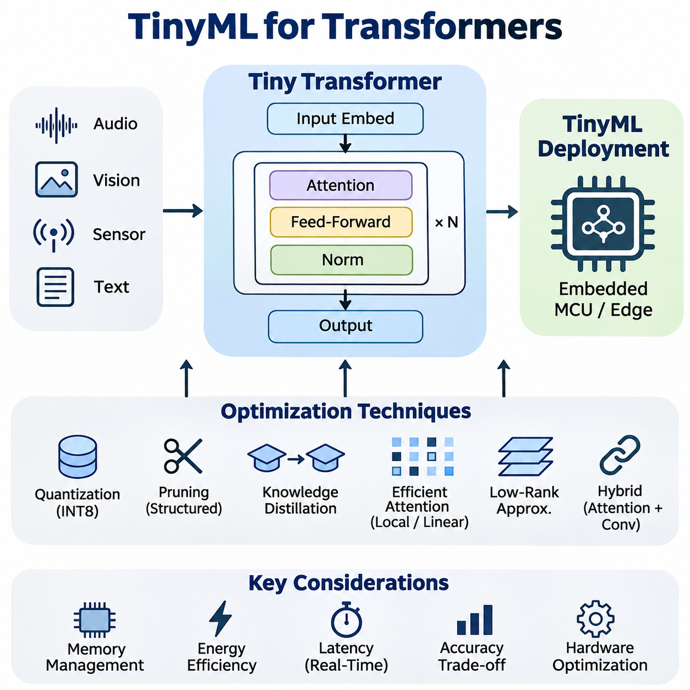
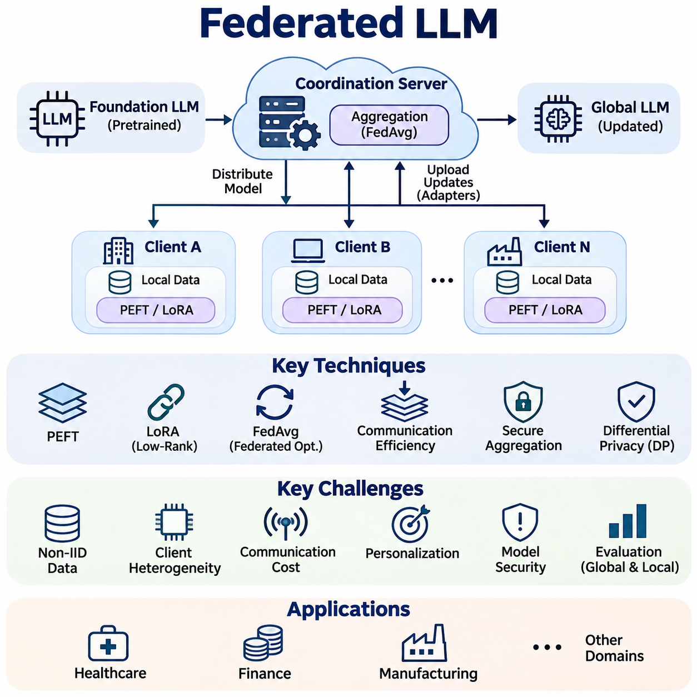
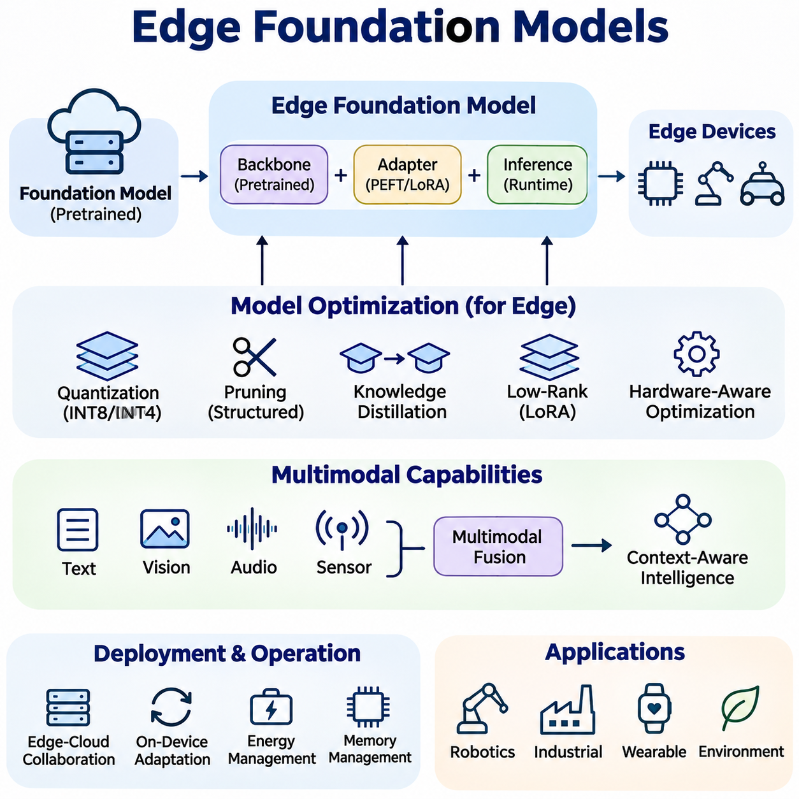
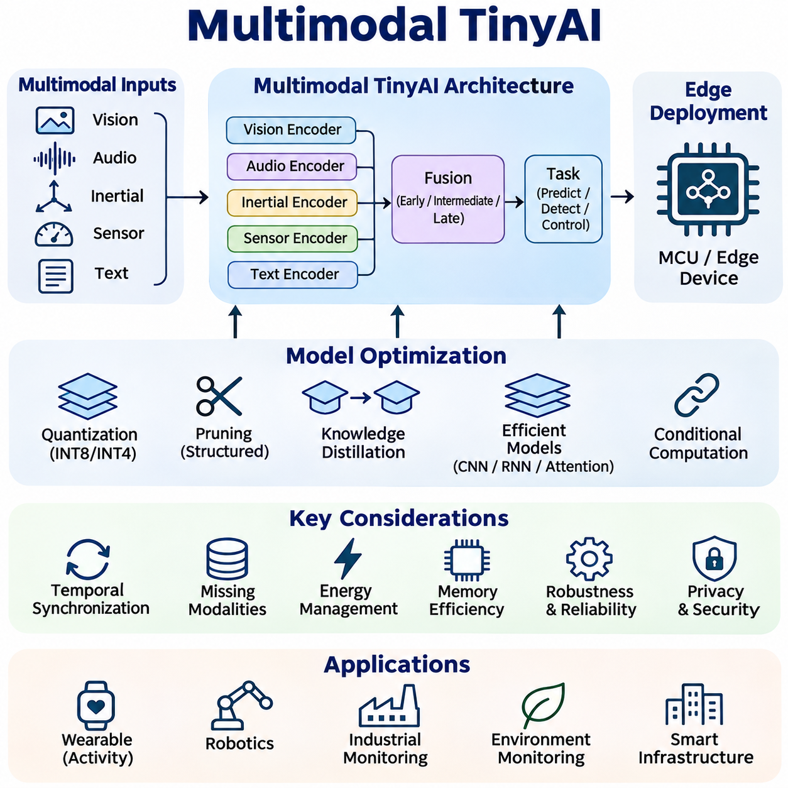
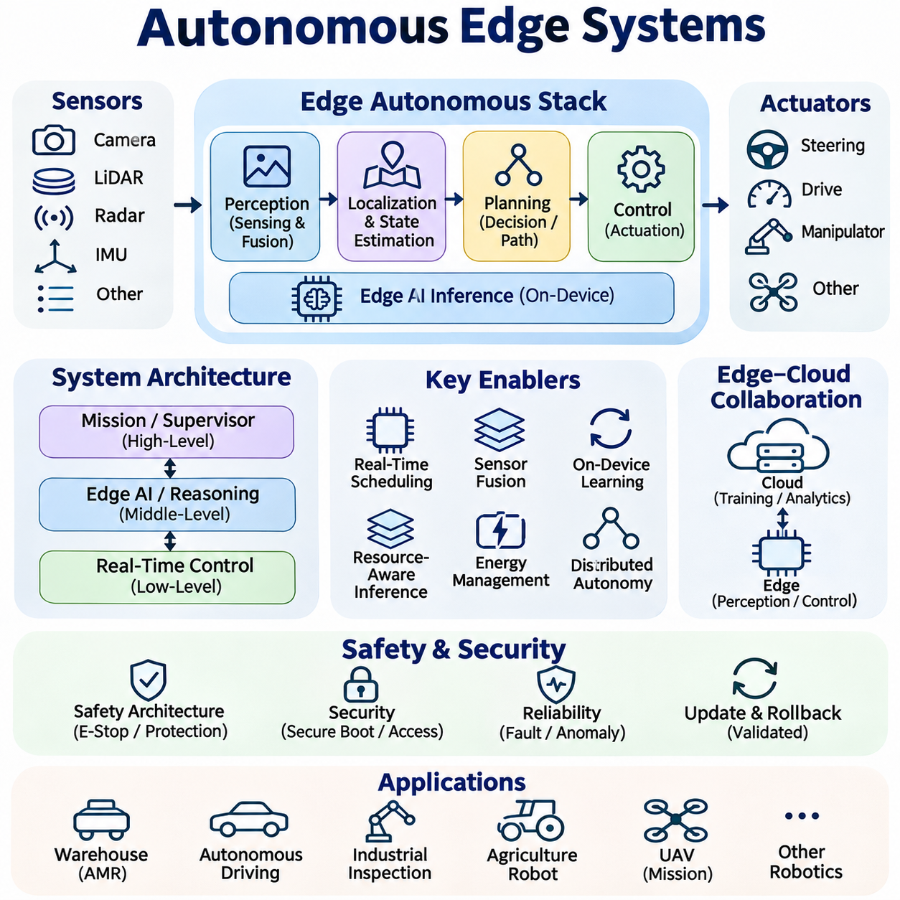

**Volume 40.** **TinyML and Federated Learning**

# 06. Advanced Tiny and Distributed AI

## 06.01 TinyML for Transformers

{width="7.268055555555556in" height="7.268055555555556in"}

TinyML for Transformers extends attention-based neural architectures into resource-constrained embedded systems, enabling sophisticated sequence processing without continuous reliance on cloud infrastructure. Conventional Transformers require substantial memory, computation, and energy, while TinyML platforms operate under strict hardware limitations. The central objective is to preserve useful attention mechanisms while reducing model complexity and execution overhead.

Transformer architectures rely on self-attention to capture relationships among input tokens, sensor measurements, or temporal observations. Unlike recurrent networks, attention mechanisms can directly connect distant elements within a sequence. However, conventional self-attention requires computation and intermediate storage that grow quadratically with sequence length. This creates significant challenges for microcontrollers and low-power processors with limited memory bandwidth.

Deploying Transformers on TinyML hardware requires reconsidering model dimensions, attention heads, layer counts, and sequence lengths. A conventional Transformer may contain millions of parameters, whereas embedded applications often require substantially smaller architectures. Reducing hidden dimensions and limiting attention layers can decrease memory consumption and arithmetic operations, although excessive simplification may weaken representation quality and prediction accuracy.

Efficient Transformer design begins with identifying the computational components responsible for memory and latency bottlenecks. Attention projections, feed-forward networks, normalization operations, and intermediate activations contribute differently to execution costs. Feed-forward layers frequently account for a substantial portion of model parameters, while attention matrices can dominate temporary memory consumption when processing long sequences.

Quantization is a fundamental optimization technique for deploying compact Transformers on embedded processors. Converting floating-point weights and activations into lower-precision integer representations reduces storage requirements and can accelerate inference when supported by hardware. Integer quantization commonly uses eight-bit representations, although more aggressive precision reduction may be appropriate when numerical stability and application accuracy remain acceptable.

Transformer quantization introduces difficulties because attention calculations contain operations with different numerical sensitivities. Query-key multiplication, Softmax normalization, and layer normalization may require careful scaling and precision management. Quantization-aware training can expose the model to simulated numerical effects during optimization, improving its ability to maintain accuracy after conversion into an integer-based inference representation.

Structured pruning reduces Transformer complexity by removing unnecessary attention heads, neurons, channels, or complete computational blocks. Unlike unstructured sparsity, structured pruning produces smaller dense operations that are generally easier to accelerate on embedded hardware. Effective pruning requires evaluating the contribution of individual components and retraining the resulting architecture to recover accuracy lost during structural simplification.

Knowledge distillation transfers useful behavior from a larger Transformer into a smaller student network. The teacher provides output probabilities or intermediate representations that guide student training beyond conventional ground-truth supervision. This approach allows compact architectures to approximate selected capabilities of larger models while operating within strict memory and computational budgets imposed by embedded deployment environments.

Efficient attention mechanisms address the computational growth associated with conventional self-attention. Local attention restricts interactions to nearby tokens, while linear attention variants reformulate attention calculations to reduce sequence-length complexity under particular assumptions. These techniques can improve scalability, but their practical advantages depend on sequence dimensions, numerical implementation, and the capabilities of the target processor.

Low-rank approximation provides another method for reducing Transformer computation. Weight matrices can be decomposed into smaller factors, potentially lowering parameter counts and multiplication costs. Low-rank techniques may be applied to attention projections or feed-forward layers, although the resulting efficiency depends on decomposition rank and execution support. Excessive rank reduction can remove important representational capacity and degrade predictive performance.

Tiny Transformer architectures frequently combine attention with convolutional operations to balance global context modeling and efficient local feature extraction. Convolutional layers can process short-range patterns with predictable memory requirements, while lightweight attention modules capture relationships across selected features or time intervals. Hybrid architectures are particularly useful for embedded vision, acoustic recognition, and sensor analysis applications.

Memory management is often more restrictive than arithmetic throughput in microcontroller-based Transformer inference. Model parameters may reside in nonvolatile flash memory, while intermediate activations require limited SRAM. Attention score matrices, temporary buffers, and normalization tensors can exceed available memory even when model weights fit successfully. Consequently, memory planning must consider peak activation usage rather than parameter size alone.

Static memory allocation improves predictability in embedded Transformer execution. Inference runtimes can reserve predefined tensor buffers and reuse memory when intermediate values are no longer required. Operator scheduling, tensor lifetime analysis, and in-place transformations reduce peak SRAM demand. These techniques are particularly important for systems without virtual memory, dynamic memory management, or substantial external RAM.

Sequence-length optimization directly influences attention computation and memory requirements. Shorter input windows reduce processing costs but may discard temporal dependencies essential for accurate predictions. Sliding windows, temporal downsampling, token selection, and hierarchical aggregation offer alternative strategies for preserving useful information. Selecting an appropriate sequence representation requires understanding both the application dynamics and the available computational resources.

Token reduction is especially valuable for embedded vision Transformers. Images can be divided into patches, but smaller patches produce more tokens and increase attention overhead. Larger patches reduce computational demand while potentially losing fine spatial details. Adaptive token selection and feature pooling can further reduce processing requirements by retaining informative regions and suppressing redundant visual representations.

Streaming inference allows Tiny Transformers to process continuously arriving sensor data without repeatedly recomputing entire observation histories. Cached intermediate representations can preserve useful context between inference cycles, particularly in causal attention architectures. However, cache storage introduces additional memory requirements, and accumulated state must be managed carefully to prevent stale information from influencing current predictions.

Energy efficiency depends on more than the number of mathematical operations performed by a Transformer. Memory transfers, processor wake-up events, peripheral activity, and idle power consumption contribute to total energy usage. A smaller model does not necessarily consume less energy if its operators execute inefficiently. Effective optimization therefore evaluates energy per inference alongside latency, memory footprint, and application-level accuracy.

Hardware-aware architecture design aligns Transformer operations with processor instruction sets and accelerator capabilities. Embedded CPUs may support optimized integer matrix multiplication, while specialized neural processing units accelerate selected tensor operations. Unsupported attention or normalization operators may execute on slower fallback paths. Architecture selection should therefore consider the actual runtime operator library rather than theoretical operation counts alone.

Deployment frameworks such as TensorFlow Lite for Microcontrollers and lightweight embedded inference engines provide mechanisms for executing optimized neural networks on constrained devices. Transformer deployment nevertheless depends on supported operators, tensor shapes, and memory allocation strategies. Custom kernels or graph transformations may be required when attention-related operations are unavailable or inefficient within the selected embedded runtime.

Embedded Transformer applications include keyword spotting, vibration monitoring, gesture recognition, and predictive maintenance. In these scenarios, attention mechanisms can identify relationships among temporal observations that conventional local filters may overlook. The practical benefit depends on whether long-range context materially improves predictions relative to simpler convolutional or recurrent architectures operating under the same hardware constraints.

Robotics provides additional opportunities for Tiny Transformer deployment. Compact attention models can analyze sequences of inertial measurements, motor feedback, proximity observations, or environmental features. These representations may support anomaly detection, motion classification, and local perception. Safety-critical control functions, however, require independently validated timing guarantees and protective mechanisms rather than relying exclusively on neural inference.

Distributed edge systems can combine Tiny Transformers with more capable processors to create hierarchical intelligence. A microcontroller may perform continuous low-power monitoring, while a nearby edge computer executes larger models when unusual events are detected. This arrangement reduces unnecessary computation and communication. Reliable operation requires explicit decisions about when to escalate processing and how to handle communication failures.

Evaluating Tiny Transformers requires measuring accuracy, peak SRAM consumption, flash usage, inference latency, and energy consumption on actual target hardware. Desktop benchmarks cannot reliably predict embedded performance because memory hierarchies, instruction support, and runtime implementations differ substantially. Measurements should include realistic input sequences, representative operating frequencies, and sustained execution conditions rather than isolated synthetic workloads.

Comparative experiments should examine compact Transformers alongside convolutional networks, recurrent models, and hybrid architectures under equivalent resource budgets. Parameter count alone is insufficient because architectures with similar storage requirements may exhibit different activation memory demands and execution times. A meaningful comparison considers accuracy-resource tradeoffs, numerical robustness, hardware compatibility, and the complexity of maintaining each deployed implementation.

Robustness becomes particularly important when Tiny Transformers operate continuously in uncontrolled environments. Sensor noise, missing observations, distribution shifts, and quantization errors can alter attention patterns and prediction confidence. Training with representative disturbances and evaluating out-of-distribution behavior help identify weaknesses. Runtime monitoring and conservative fallback behavior provide additional protection when predictions become unreliable.

The development of TinyML for Transformers represents a transition from merely shrinking large neural networks toward designing attention-based intelligence specifically for constrained hardware. Progress depends on coordinated advances in architecture optimization, quantization, memory scheduling, embedded kernels, and energy-aware execution. Successful systems balance contextual reasoning capability with predictable resource consumption, enabling increasingly capable local intelligence without sacrificing operational reliability.

## 06.02 Federated LLM

{width="7.268055555555556in" height="7.268055555555556in"}

Federated Large Language Models (Federated LLMs) extend federated learning principles to large-scale language architectures, enabling multiple organizations or devices to improve shared models without directly exchanging their private training datasets. Instead of collecting sensitive information in centralized repositories, participating clients perform local optimization and communicate selected model updates to a coordinating infrastructure.

The architecture of Federated LLM systems typically includes a pretrained foundation model, distributed clients, an aggregation mechanism, and a coordination server. Each client receives a compatible model configuration and performs training using locally available text or interaction data. The server combines accepted updates into a revised global model, which can subsequently be redistributed for additional training rounds.

Federated LLM training differs significantly from conventional federated learning because language models contain large parameter matrices and require substantial computational resources. Transmitting complete model weights or gradients may exceed available communication bandwidth, while full-parameter optimization can overwhelm client memory. Practical systems therefore emphasize parameter-efficient adaptation, selective synchronization, and heterogeneous resource management.

Parameter-Efficient Fine-Tuning (PEFT) provides a practical foundation for federated language model adaptation. Instead of updating every parameter, clients train a limited collection of additional or selected parameters while preserving most pretrained weights. This approach reduces local optimizer memory, communication volume, and computational requirements, making collaborative adaptation more feasible across resource-constrained participants.

Low-Rank Adaptation (LoRA) is particularly relevant because it represents weight updates through compact low-rank matrices. Clients can optimize these matrices locally and transmit adapter parameters rather than complete language models. Aggregation must account for adapter compatibility and mathematical structure, since averaging independently trained low-rank factors does not necessarily reproduce the average of their resulting weight updates.

Federated optimization commonly extends algorithms such as Federated Averaging (FedAvg), where participating clients perform local training before contributing updates to a shared model. However, language-model adaptation often encounters unstable convergence because clients possess different vocabulary distributions, document structures, and task objectives. Adaptive optimization, regularization, and controlled local training schedules can improve stability.

Non-Independent and Identically Distributed (Non-IID) data represents a fundamental challenge in Federated LLM systems. Different organizations may specialize in legal documents, technical manuals, customer interactions, or medical terminology. Their local datasets consequently produce distinct gradient directions and adaptation requirements. A single global model must balance these competing distributions without disproportionately favoring dominant participants.

Client heterogeneity extends beyond data distributions to include hardware capabilities, memory capacity, network quality, and available training time. Enterprise servers may support accelerator-based fine-tuning, while edge devices can process only small batches or compressed adapters. Federated coordination must accommodate these differences through flexible participation schedules, resource-aware client selection, and potentially asynchronous optimization.

Communication efficiency becomes essential when federated training involves geographically distributed participants. Adapter synchronization, update compression, quantization, and reduced communication frequency can lower network requirements. Nevertheless, aggressive compression may introduce optimization noise, while infrequent synchronization can increase model divergence. Effective communication strategies must balance transmission cost against convergence quality and model consistency.

Privacy preservation is a primary motivation for Federated LLM development, but keeping raw training data local does not automatically guarantee confidentiality. Model updates can reveal information about sensitive examples through gradient leakage or inference attacks. Secure aggregation, differential privacy, access controls, and carefully designed participation protocols provide complementary defenses against information disclosure.

Secure aggregation allows a coordinating server to recover an aggregate of client updates without directly observing individual contributions under the protocol\'s security assumptions. This capability can reduce exposure of organization-specific training signals. However, secure aggregation introduces communication and coordination overhead, and its protection depends on assumptions concerning client participation, collusion, and protocol implementation.

Differential Privacy (DP) introduces statistical protection by limiting the influence of individual training records and adding calibrated randomness to released information. In Federated LLM training, privacy mechanisms may operate at record or client level, depending on the intended guarantee. Stronger privacy protection can reduce model utility, making privacy-budget accounting and application-specific accuracy evaluation necessary.

Personalization addresses situations where a single global language model cannot adequately represent every participant\'s requirements. Federated systems may maintain shared parameters while preserving client-specific adapters, prompts, or output layers. This arrangement supports collective knowledge transfer without eliminating local specialization, although personalization introduces additional challenges involving model versioning, evaluation, and long-term maintenance.

Federated instruction tuning enables participating clients to improve a language model using locally maintained instruction-response examples. Organizations can contribute knowledge about preferred response formats, terminology, and operational procedures without uploading their complete datasets. However, inconsistent annotation standards and conflicting instructions can produce unstable behavior, requiring careful quality control and validation of aggregated adaptations.

Federated preference optimization extends collaborative adaptation toward response quality and behavioral alignment. Clients may collect local preference comparisons or feedback signals and use them to optimize compatible model components. Differences in organizational policies and user expectations complicate aggregation, making it important to distinguish broadly transferable preferences from requirements that should remain local.

Model security introduces risks beyond accidental privacy leakage. Malicious participants may submit manipulated updates intended to degrade performance, introduce backdoors, or influence specific outputs. Robust aggregation, anomaly detection, update validation, and participant authentication can reduce exposure to these threats. No single defense guarantees protection against every adaptive attack or coordinated group of compromised clients.

Evaluation of Federated LLM systems requires more than conventional language-model benchmarks. Researchers must examine global task performance, local personalization quality, communication overhead, training energy, privacy guarantees, and robustness to client dropout. Measurements should also capture differences among participants because strong average performance can conceal severe degradation for smaller or underrepresented client groups.

Deployment architectures may combine cloud coordination, enterprise infrastructure, and edge computing resources. Large pretrained models can remain on capable servers while lightweight adapters are trained or applied within participating organizations. More constrained devices may contribute through smaller student models or specialized local components, although exchanging updates across different architectures requires explicit compatibility mechanisms.

Federated LLMs offer potential benefits in healthcare, finance, manufacturing, and other environments where information sharing is restricted. Organizations can collaborate on domain adaptation while retaining operational control over their datasets. Nevertheless, regulatory compliance requires additional measures concerning lawful processing, data governance, retention, auditing, and contractual responsibilities beyond the technical properties of federated learning.

Continual federated adaptation allows language models to incorporate evolving terminology, changing workflows, and newly observed patterns across distributed environments. Repeated updates introduce risks of catastrophic forgetting, model drift, and inconsistent client versions. Effective lifecycle management therefore requires controlled update schedules, regression testing, rollback mechanisms, and monitoring of both global and local performance.

The future of Federated LLMs depends on advances in efficient adaptation, privacy-preserving optimization, robust aggregation, and distributed systems engineering. Their practical value lies not simply in decentralizing training, but in enabling controlled collaboration among participants with different resources and information boundaries. Successful implementations must balance language capability, privacy, communication efficiency, security, and operational reliability.

## 06.03 Edge Foundation Models

{width="7.268055555555556in" height="7.268055555555556in"}

Edge Foundation Models extend the capabilities of large pretrained artificial intelligence systems into resource-constrained computing environments. Rather than depending entirely on centralized cloud infrastructure, these models execute selected foundation-model functions near data sources. Their purpose is to provide adaptable intelligence with reduced communication latency, improved data locality, and greater operational independence across embedded and edge computing platforms.

Foundation models acquire broadly transferable representations through pretraining on diverse datasets. These representations support multiple downstream tasks, including language understanding, visual recognition, sensor interpretation, and decision support. Edge deployment adapts this general-purpose capability to constrained hardware, requiring careful tradeoffs among model capacity, inference accuracy, memory consumption, computational throughput, and energy efficiency.

The architecture of an Edge Foundation Model typically combines a pretrained backbone, task-specific adaptation components, and an optimized inference runtime. The backbone provides reusable representations, while lightweight adapters or prediction heads specialize the model for local applications. Separating general representation learning from task adaptation reduces the need to retrain complete models whenever operational requirements change.

Model compression is essential because conventional foundation models frequently exceed the memory and processing capabilities of edge devices. Quantization, structured pruning, knowledge distillation, and low-rank factorization reduce storage requirements and execution costs. These methods must preserve critical representations while limiting numerical errors, since excessive compression can undermine generalization, robustness, and performance on unfamiliar inputs.

Quantization converts model parameters and selected activations into lower-precision numerical formats. Eight-bit and four-bit representations can substantially reduce model storage, although actual acceleration depends on processor instructions and supported inference kernels. Mixed-precision execution preserves higher precision for sensitive operations while compressing less critical components, providing a practical balance between computational efficiency and prediction quality.

Knowledge distillation enables smaller edge models to approximate selected capabilities of larger foundation models. A powerful teacher model generates supervision signals that guide a compact student architecture during training. Distillation can transfer semantic representations, intermediate features, or task-specific behavior, but the resulting student cannot automatically retain every capability of its teacher under severe capacity constraints.

Parameter-Efficient Fine-Tuning allows Edge Foundation Models to adapt without modifying all pretrained parameters. Techniques such as Low-Rank Adaptation introduce compact trainable components that capture domain-specific information. These adapters can be distributed, updated, or replaced independently of the base model, reducing adaptation costs and supporting specialized deployments across different devices and operational environments.

Hardware-aware optimization aligns model architectures with the capabilities of embedded CPUs, GPUs, neural processing units, and specialized accelerators. Different platforms support different numerical formats, memory hierarchies, and operator implementations. Consequently, a model optimized for one accelerator may perform poorly on another. Deployment engineering must evaluate actual operator compatibility, memory bandwidth, thermal behavior, and sustained inference performance.

Memory management represents a major constraint for Edge Foundation Models. Model weights, activation tensors, attention caches, and temporary execution buffers compete for limited memory capacity. Techniques such as activation reuse, memory mapping, reduced context windows, and optimized tensor scheduling can lower peak consumption. Effective memory planning must consider runtime allocation rather than relying exclusively on model parameter counts.

Language-oriented Edge Foundation Models provide local capabilities such as command interpretation, document classification, semantic search, and constrained question answering. Small language models can operate on capable edge computers, while more limited devices may execute specialized encoders or distilled networks. Practical deployment requires matching vocabulary coverage, context length, generation quality, and response latency to the intended application.

Vision foundation models extend edge intelligence through reusable image representations and adaptable perception capabilities. Compact vision Transformers and hybrid convolution-attention architectures can support classification, detection, segmentation, and visual anomaly analysis. However, high-resolution inputs and dense prediction tasks create substantial computational demands, making input resolution, token reduction, and feature extraction efficiency important design considerations.

Multimodal Edge Foundation Models combine information from images, audio, text, and sensor measurements to support context-aware interpretation. Cross-modal representations can improve understanding when individual sensors provide incomplete observations. Their deployment requires synchronization, modality-specific preprocessing, and efficient fusion mechanisms. Resource constraints may favor compact encoders and selective modality activation instead of continuously executing every component.

Robotics applications benefit from Edge Foundation Models that connect perception, semantic interpretation, and task-level decision support. A robot may use a compact visual-language model to interpret environmental observations and translate instructions into structured objectives. Nevertheless, low-level motion control and safety-critical functions require deterministic execution and independent safeguards, rather than depending exclusively on probabilistic foundation-model outputs.

Edge-cloud collaboration provides a practical strategy when local hardware cannot execute every required model capability. Lightweight models handle routine inference locally, while computationally intensive requests are selectively transferred to more capable infrastructure. This hierarchical approach can reduce network traffic and improve responsiveness, although communication failures, privacy requirements, and remote execution delays must be incorporated into system design.

Adaptive inference adjusts computational effort according to input complexity and available resources. Early-exit mechanisms, dynamic token selection, conditional computation, and model routing can reduce unnecessary processing. A system may execute a compact model for familiar inputs and invoke a larger model when uncertainty increases. Such mechanisms require reliable confidence estimation and careful evaluation of the costs introduced by switching models.

On-device adaptation enables Edge Foundation Models to respond to changing environments and application requirements. Local fine-tuning, adapter updates, and incremental learning can improve domain relevance without repeatedly transferring complete datasets. However, limited computational resources and nonstationary observations introduce risks of overfitting, catastrophic forgetting, and unstable updates. Controlled adaptation procedures and validation datasets are therefore essential.

Privacy and security are important motivations for processing foundation-model workloads near data sources. Local inference can reduce unnecessary transmission of sensitive observations, but stored model parameters, cached inputs, and intermediate representations still require protection. Secure boot, encrypted storage, access control, signed updates, and trusted execution mechanisms can strengthen deployment security when supported by the target platform.

Operational reliability requires more than successful execution of an optimized model. Edge devices experience variable workloads, thermal throttling, power limitations, and intermittent connectivity. Monitoring systems should track inference latency, memory pressure, processor utilization, model failures, and prediction quality. Resource-aware scheduling and conservative fallback procedures help maintain essential functionality when operating conditions deteriorate.

Evaluation of Edge Foundation Models must combine task accuracy with system-level measurements. Relevant metrics include model footprint, peak memory consumption, inference latency, throughput, energy per request, and sustained thermal performance. Tests should also examine distribution shifts, corrupted inputs, and hardware-specific numerical differences. Measurements on representative deployment hardware provide stronger evidence than theoretical operation counts or desktop benchmarks.

Industrial applications include equipment inspection, predictive maintenance, operator assistance, and intelligent monitoring. Edge Foundation Models can interpret local sensor streams and support multiple related tasks without requiring a separately trained network for every application. Their practical value depends on dependable inference, integration with existing control systems, manageable update procedures, and clear boundaries between advisory intelligence and safety-critical operations.

The development of Edge Foundation Models represents a shift toward distributing reusable artificial intelligence capabilities across heterogeneous computing environments. Advances in compact architectures, efficient adaptation, accelerator-aware execution, and collaborative inference will expand their practical applicability. Successful systems must balance general-purpose intelligence with predictable resource usage, privacy protection, operational robustness, and the constraints of real-world deployment.

## 06.04 Multimodal TinyAI

{width="7.268055555555556in" height="7.268055555555556in"}

Multimodal TinyAI extends resource-constrained artificial intelligence beyond single-input processing by combining information from multiple sensory modalities. Embedded devices may integrate vision, audio, inertial measurements, environmental sensors, and textual commands to interpret complex situations. The objective is to achieve complementary perception and contextual understanding while maintaining strict limits on memory, computation, communication, and energy consumption.

Multimodal learning relies on the principle that different information sources provide complementary evidence about the same environment. Cameras capture spatial appearance, microphones detect acoustic events, and inertial sensors measure motion dynamics. Combining these observations can improve recognition reliability when individual modalities are ambiguous or degraded. However, effective integration requires managing differences in sampling rates, data formats, and measurement uncertainty.

The architecture of Multimodal TinyAI typically includes modality-specific encoders, feature alignment mechanisms, a compact fusion network, and task-oriented prediction layers. Each encoder transforms raw observations into efficient representations suitable for embedded processing. The fusion network combines selected features before generating classifications, anomaly scores, or control-related information, allowing shared inference without requiring a large independent model for every sensor.

Early fusion combines measurements or extracted features before substantial task-specific processing. This approach can capture interactions between modalities at relatively low architectural complexity. Nevertheless, early fusion requires compatible representations and careful synchronization, while high-dimensional inputs may increase memory requirements. Compact projection layers and feature normalization help reduce these difficulties within constrained inference pipelines.

Late fusion processes each modality independently before combining prediction scores or decision outputs. This architecture supports modular deployment and allows individual sensors to operate at different computational frequencies. It can also simplify handling unavailable modalities. However, late fusion may overlook detailed cross-modal relationships that could improve recognition when information sources contain strongly interdependent patterns.

Intermediate fusion combines representations at selected stages within a neural network. Attention mechanisms, gating functions, and learned feature weighting can emphasize informative modalities according to operating conditions. Such adaptive fusion may improve robustness under changing sensor quality, although its additional parameters and intermediate activations must remain compatible with embedded memory and latency budgets.

Temporal synchronization is essential when combining measurements collected at different frequencies. Cameras may operate at tens of frames per second, while inertial sensors produce hundreds of samples over the same interval. Timestamp alignment, interpolation, buffering, and temporal windowing help associate related observations. Synchronization errors can introduce misleading relationships and reduce the reliability of downstream multimodal predictions.

Efficient representation learning reduces the cost of processing heterogeneous sensor streams. Lightweight convolutional networks can extract visual or acoustic features, while compact recurrent or attention-based models capture temporal dependencies. Shared latent representations allow information from different modalities to interact within a common feature space. Their dimensions must be selected to balance expressive capacity against memory and computational requirements.

Quantization plays a central role in deploying multimodal networks on microcontrollers and embedded accelerators. Converting compatible weights and activations into integer representations reduces storage and may accelerate execution. However, modalities can exhibit different numerical ranges and sensitivity to precision loss. Calibration and quantization-aware training should therefore evaluate individual encoders and fusion operations rather than treating the complete network uniformly.

Structured pruning and knowledge distillation further reduce multimodal model complexity. Pruning removes redundant channels, attention heads, or fusion components, while distillation transfers selected capabilities from a larger multimodal teacher into a compact student. Training objectives may preserve intermediate features and cross-modal relationships. Excessive compression can nevertheless weaken the interactions that originally justified multimodal processing.

Conditional computation allows Multimodal TinyAI systems to activate only the sensors and neural components required by the current situation. A low-power motion sensor may trigger camera analysis, while acoustic detection can initiate more detailed environmental interpretation. Such event-driven processing reduces unnecessary computation, but trigger reliability and sensor activation delays must be evaluated against application requirements.

Missing modalities represent a common challenge in practical embedded environments. Cameras may become obscured, microphones may encounter excessive noise, and communication links to external sensors may fail. Robust architectures can use modality masking, confidence-aware fusion, and training with intentionally omitted inputs. These techniques improve resilience, although predictions must remain appropriately uncertain when critical evidence is unavailable.

Energy-aware scheduling coordinates sensor acquisition, preprocessing, inference, and communication to minimize total power consumption. Neural computation represents only part of the energy budget because image sensors, microphones, memory transfers, and wireless interfaces also consume power. Duty cycling and adaptive sampling can extend battery life, provided that reduced observation frequency does not compromise detection latency or operational safety.

Multimodal TinyAI is particularly valuable for wearable devices and human activity recognition. Combining accelerometer, gyroscope, acoustic, and physiological signals can distinguish activities that appear similar when observed through a single sensor. Lightweight fusion networks can support local classification and event detection without continuously uploading personal observations. Accuracy depends on sensor placement, user variability, and representative training conditions.

Robotics applications combine visual perception, inertial measurements, proximity sensing, and actuator feedback to improve environmental awareness. Compact multimodal models can support terrain classification, motion anomaly detection, contact recognition, and task-state estimation. These capabilities complement conventional estimation and control algorithms, while safety-critical decisions require validated protective mechanisms and predictable execution timing.

Industrial monitoring provides another application for multimodal embedded intelligence. Vibration, acoustic emissions, temperature, and electrical measurements can jointly characterize equipment operating conditions. A compact fusion model may identify abnormal patterns that individual thresholds cannot reliably detect. Deployment requires calibration across machines, sensitivity to changing workloads, and careful management of false alarms and missed detections.

Multimodal TinyAI can also support environmental monitoring and smart infrastructure. Distributed devices may combine sound, imagery, air-quality measurements, and motion signals to identify relevant local events. Processing observations near their sources can reduce network traffic and unnecessary data transmission. However, environmental variation and sensor degradation require periodic validation to maintain dependable performance.

Hardware-software co-design is essential because multimodal workloads create heterogeneous computational demands. Image processing may benefit from neural accelerators, while sensor filtering and synchronization execute efficiently on microcontrollers. Shared memory buffers, direct memory access, and optimized operator scheduling can reduce transfer overhead. System architecture must account for the peak resource demands of simultaneously active modalities.

Evaluation of Multimodal TinyAI requires measuring both predictive performance and embedded system efficiency. Accuracy, precision, recall, inference latency, peak memory usage, and energy per decision provide complementary evidence. Experiments should compare individual modalities against fused configurations and examine performance under missing sensors, noise, synchronization errors, and changing environmental conditions.

The development of Multimodal TinyAI reflects a transition toward compact systems that interpret their environments through coordinated sensory intelligence. Progress depends on efficient encoders, adaptive fusion, robust temporal alignment, compression, and energy-aware execution. Successful implementations must demonstrate that multimodal integration delivers measurable benefits over simpler alternatives while preserving the reliability and resource predictability required for embedded deployment.

## 06.05 Autonomous Edge Systems

{width="7.268055555555556in" height="7.268055555555556in"}

Autonomous Edge Systems integrate sensing, artificial intelligence, decision-making, and actuation within distributed computing platforms operating near physical environments. Unlike cloud-dependent architectures, these systems perform essential perception and control functions locally. Their primary objective is to maintain responsive, reliable, and context-aware operation despite limited computational resources, variable connectivity, and changing environmental conditions.

The architecture of an Autonomous Edge System typically combines sensors, embedded processors, inference accelerators, communication interfaces, and actuator controllers. Perception modules transform raw observations into environmental representations, while planning components select appropriate actions. Execution layers translate decisions into physical commands, supported by monitoring mechanisms that detect faults and enforce operational constraints.

Autonomy requires coordinated interaction among perception, localization, prediction, planning, and control. Cameras, LiDAR, radar, and inertial sensors provide complementary observations of the surrounding environment. State estimation combines these measurements to infer system position and motion. Planning algorithms evaluate feasible actions, while feedback controllers execute selected trajectories under timing and safety constraints.

Edge intelligence reduces dependence on remote computation by placing time-sensitive inference close to sensors and actuators. Local processing can lower communication latency and preserve functionality during network interruptions. However, embedded processors have finite memory, energy, and thermal capacity. System designers must allocate computational resources according to task criticality rather than assuming every model can execute continuously.

Hierarchical autonomy separates immediate control decisions from higher-level reasoning and mission management. Low-level controllers maintain stable motion and enforce physical constraints, while edge AI modules interpret complex observations and recommend actions. Supervisory components coordinate objectives and operational modes. This separation supports predictable execution while allowing advanced learning-based functions to operate within defined boundaries.

Real-time scheduling is fundamental because autonomous behavior depends on completing critical operations before their deadlines. Sensor acquisition, state estimation, inference, planning, and actuation compete for processing time. Priority-based scheduling and bounded execution paths can protect essential control loops. Average inference latency alone is insufficient; worst-case timing and scheduling interference must also be evaluated.

Sensor fusion improves environmental understanding by combining measurements with different strengths and limitations. Visual sensors provide semantic detail, while range sensors estimate geometry and inertial devices capture rapid motion. Fusion algorithms must account for calibration, timestamp alignment, uncertainty, and missing observations. Incorrect synchronization or overconfident measurements can compromise localization and downstream decisions.

On-device learning allows autonomous systems to adapt selected models to changing environments without continuously transmitting raw data. Incremental updates may improve terrain recognition, anomaly detection, or task-specific perception. Nevertheless, uncontrolled adaptation can introduce model drift and catastrophic forgetting. Validated update procedures, version control, and rollback capabilities are necessary before modified models influence operational behavior.

Resource-aware inference adjusts model execution according to workload, available processing capacity, and mission priorities. Lightweight models can handle routine observations, while more demanding analysis is activated when uncertainty or environmental complexity increases. Dynamic model selection, adaptive sampling, and conditional computation reduce unnecessary processing, provided that switching delays remain compatible with real-time requirements.

Energy management is particularly important for mobile robots, autonomous sensors, and battery-powered edge platforms. Computation, sensing, wireless communication, and actuation all contribute to total energy consumption. Duty cycling and workload scheduling can extend operating time, while thermal management protects sustained performance. Optimization must consider mission completion and safety margins rather than minimizing processor power in isolation.

Distributed autonomy enables multiple edge devices to coordinate observations, decisions, and tasks without relying on a continuously available central controller. Robots may exchange local maps, detected objects, or mission status information. Cooperative operation can expand environmental coverage and improve task efficiency, but communication delays and inconsistent state estimates require explicit coordination and conflict-resolution mechanisms.

Edge-cloud collaboration supports workloads that exceed local computational capabilities. An autonomous platform may perform immediate perception and control locally while transferring noncritical mapping, analytics, or model training tasks to remote infrastructure. This division preserves essential responsiveness and enables access to larger models. Communication failures must not prevent the system from entering a defined safe operating state.

Safety architecture must remain distinct from probabilistic AI decision-making. Emergency stopping, protective separation, actuator inhibition, and fault detection require independently engineered safeguards appropriate to the application. Safety controllers and validated monitoring functions can restrict or override AI-generated commands. Learning-based components should operate within verified limits rather than serving as the sole protective mechanism.

Operational robustness requires autonomous systems to tolerate sensor degradation, uncertain observations, hardware faults, and environmental changes. Confidence estimation and anomaly monitoring can identify conditions outside validated operating ranges. When uncertainty becomes unacceptable, the system may reduce speed, restrict functionality, request supervision, or enter a safe state. These responses should be defined and tested before deployment.

Security is essential because autonomous edge devices interact directly with physical infrastructure. Compromised software, manipulated sensor inputs, or unauthorized commands can produce consequences beyond information loss. Secure boot, authenticated communication, signed software updates, and access controls reduce attack exposure. Runtime integrity monitoring and controlled recovery procedures further support dependable operation in distributed environments.

Autonomous robotics provides applications ranging from warehouse transportation and industrial inspection to agricultural machines and mobile service platforms. Edge AI can support obstacle recognition, terrain interpretation, route adaptation, and equipment monitoring. Successful integration requires matching perception and planning capabilities to the platform\'s dynamics, operating environment, available sensors, and independently validated safety functions.

Industrial autonomous systems must integrate intelligent decision-making with established automation infrastructure. Programmable controllers, industrial networks, safety devices, and supervisory systems impose timing and interoperability requirements. Edge intelligence can improve inspection, diagnostics, and adaptive task execution, but deployment should preserve deterministic control interfaces and clearly defined responsibility between AI components and conventional automation systems.

Evaluation of Autonomous Edge Systems must address both algorithmic performance and physical system behavior. Relevant measurements include perception accuracy, localization error, planning success, control latency, deadline violations, energy consumption, and recovery time. Testing should cover representative operating conditions, sensor failures, network interruptions, and computational overload rather than relying exclusively on isolated model benchmarks.

Simulation and hardware-in-the-loop testing provide controlled environments for evaluating autonomous behavior before field deployment. Digital environments can reproduce environmental disturbances and rare operating scenarios, while hardware-in-the-loop configurations expose real execution constraints. However, simulation results cannot fully establish physical reliability. Progressive validation on representative hardware and real environments remains necessary.

The development of Autonomous Edge Systems represents a transition from isolated embedded inference toward coordinated physical intelligence. Advances in efficient models, distributed coordination, adaptive computation, and hardware-software integration will expand autonomy at the edge. Successful systems must balance intelligent decision-making with deterministic execution, cybersecurity, resource efficiency, and independently verified operational safety.
