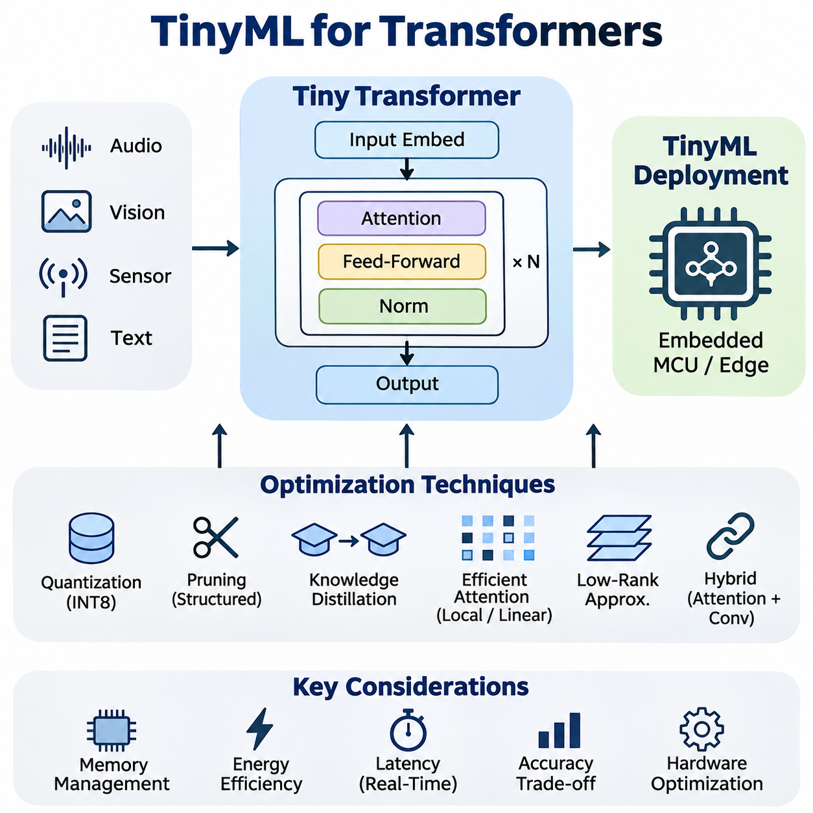
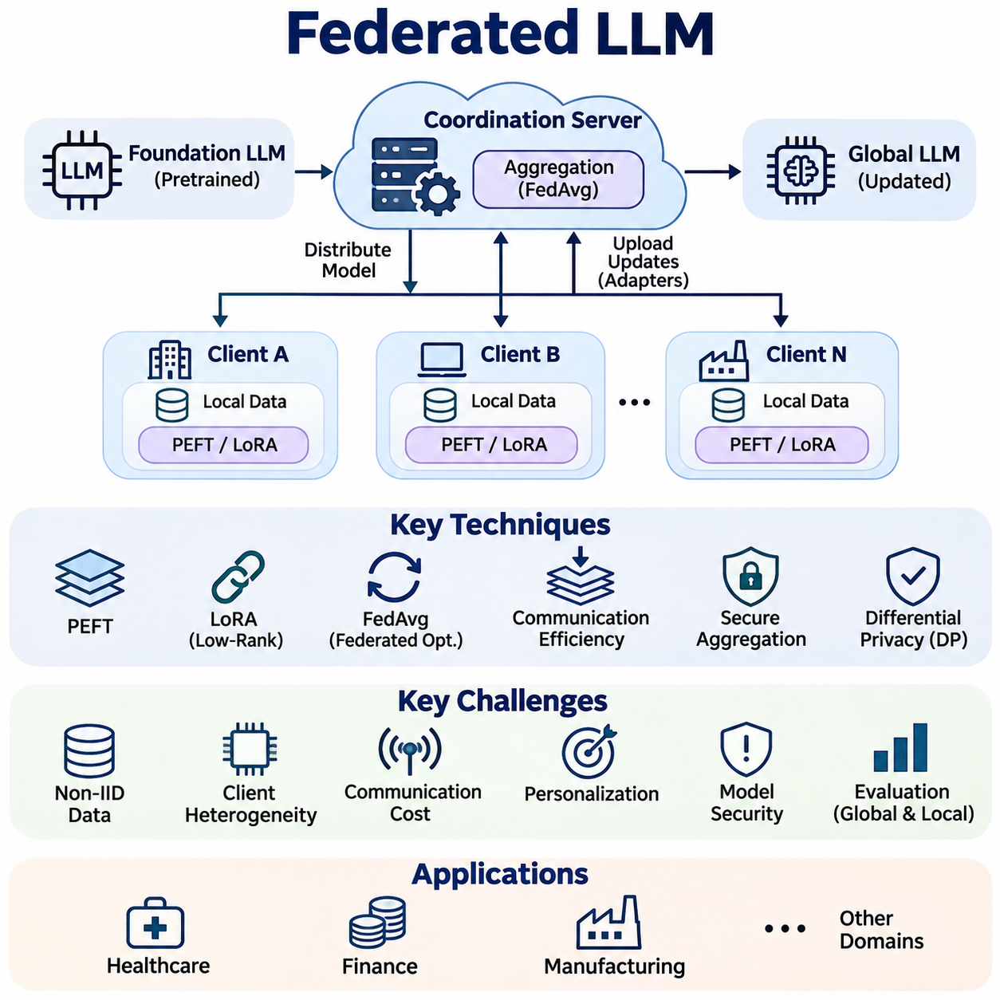
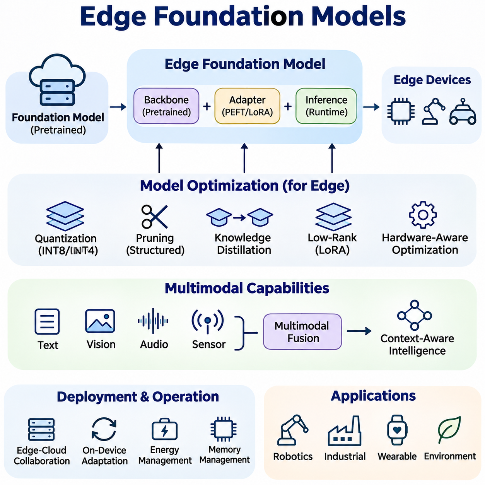
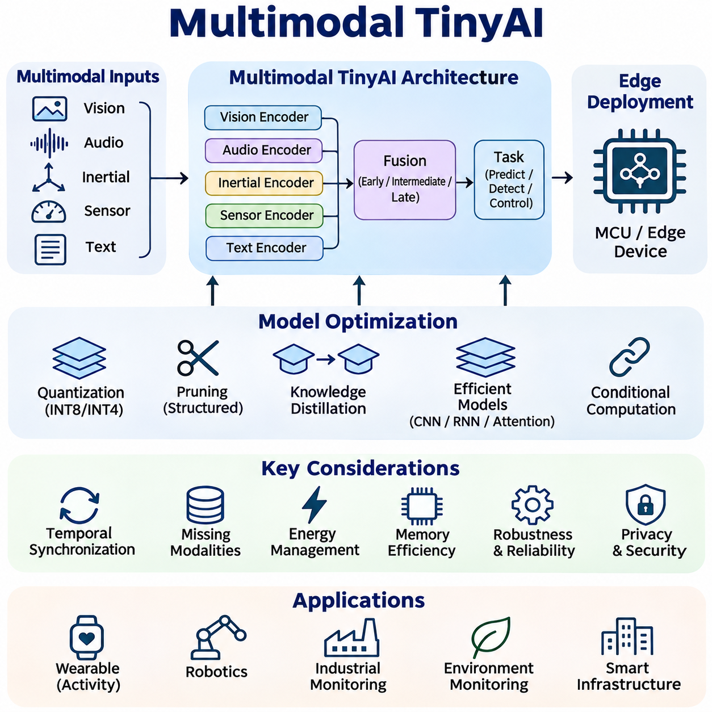
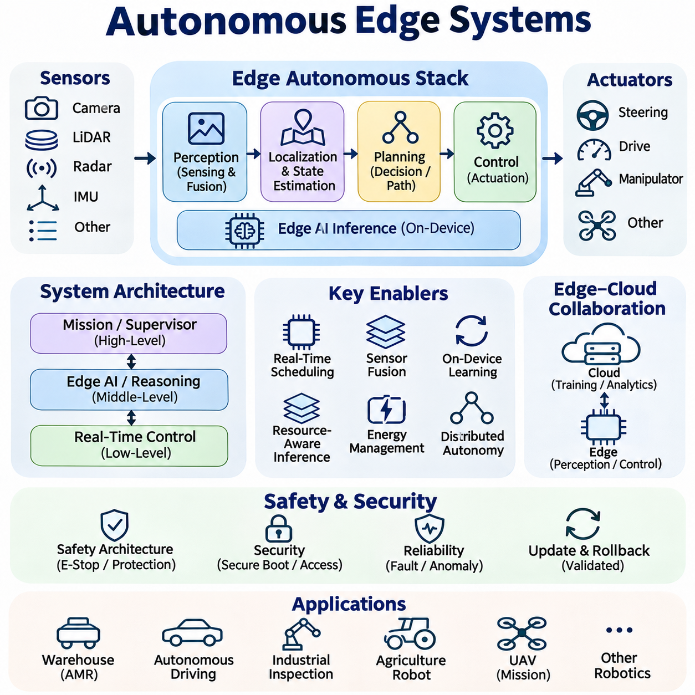

**Volume 40.** **TinyML and Federated Learning**

# 06. Advanced Tiny and Distributed AI

## 06.01 TinyML for Transformers

{width="7.268055555555556in" height="7.268055555555556in"}

트랜스포머를 위한 초소형 기계학습(TinyML for Transformers)은 주의집중 기반 신경망 구조(Attention-Based Neural Architectures)를 자원이 제한된 임베디드 시스템(Embedded Systems)으로 확장하여, 클라우드 인프라(Cloud Infrastructure)에 지속적으로 의존하지 않고도 정교한 시퀀스 처리(Sequence Processing)를 수행할 수 있도록 한다. 기존 트랜스포머(Transformer)는 상당한 메모리, 연산 자원 및 에너지를 요구하지만, 초소형 기계학습(TinyML) 플랫폼은 엄격한 하드웨어 제약(Hardware Constraints) 아래에서 동작한다. 핵심 목표는 모델 복잡도(Model Complexity)와 실행 오버헤드(Execution Overhead)를 줄이면서 유용한 주의집중 메커니즘(Attention Mechanism)을 유지하는 것이다.

트랜스포머 구조(Transformer Architecture)는 자기 주의집중(Self-Attention)을 활용하여 입력 토큰(Input Token), 센서 측정값(Sensor Measurement), 시간적 관측값(Temporal Observation) 사이의 관계를 포착한다. 순환 신경망(Recurrent Neural Network)과 달리 주의집중 메커니즘은 시퀀스 내에서 멀리 떨어진 요소들을 직접 연결할 수 있다. 그러나 기존 자기 주의집중은 시퀀스 길이(Sequence Length)의 제곱에 비례하여 연산량과 중간 저장 공간이 증가하므로, 메모리 대역폭(Memory Bandwidth)이 제한된 마이크로컨트롤러(Microcontroller)와 저전력 프로세서(Low-Power Processor)에 상당한 어려움을 초래한다.

초소형 기계학습 하드웨어(TinyML Hardware)에 트랜스포머를 배포하려면 모델 차원(Model Dimension), 주의집중 헤드(Attention Head), 계층 수(Layer Count), 시퀀스 길이(Sequence Length)를 재검토해야 한다. 일반적인 트랜스포머는 수백만 개의 매개변수(Parameter)를 포함할 수 있지만, 임베디드 애플리케이션(Embedded Application)에서는 훨씬 작은 구조가 요구되는 경우가 많다. 은닉 차원(Hidden Dimension)을 축소하고 주의집중 계층을 제한하면 메모리 소비와 산술 연산량을 줄일 수 있지만, 지나친 단순화는 표현 품질(Representation Quality)과 예측 정확도(Prediction Accuracy)를 저하시킬 수 있다.

효율적인 트랜스포머 설계(Efficient Transformer Design)는 메모리와 지연시간 병목현상(Latency Bottleneck)을 발생시키는 연산 구성요소를 식별하는 것에서 시작한다. 주의집중 투영(Attention Projection), 피드포워드 네트워크(Feed-Forward Network), 정규화 연산(Normalization Operation), 중간 활성화값(Intermediate Activation)은 실행 비용에 서로 다른 영향을 미친다. 피드포워드 계층은 모델 매개변수의 상당 부분을 차지하는 경우가 많으며, 긴 시퀀스를 처리할 때 주의집중 행렬(Attention Matrix)이 임시 메모리 소비를 지배할 수 있다.

양자화(Quantization)는 소형 트랜스포머(Compact Transformer)를 임베디드 프로세서(Embedded Processor)에 배포하기 위한 핵심 최적화 기법이다. 부동소수점 가중치(Floating-Point Weight)와 활성화값(Activation)을 낮은 정밀도의 정수 표현(Integer Representation)으로 변환하면 저장 공간을 줄이고, 하드웨어가 지원하는 경우 추론 속도(Inference Speed)를 높일 수 있다. 일반적으로 8비트 정수 양자화(Int8 Quantization)가 사용되지만, 수치 안정성(Numerical Stability)과 애플리케이션 정확도가 유지된다면 더욱 낮은 정밀도도 적용할 수 있다.

트랜스포머 양자화(Transformer Quantization)는 주의집중 계산에 서로 다른 수치 민감도(Numerical Sensitivity)를 가진 연산들이 포함되기 때문에 어려움을 수반한다. 쿼리-키 곱셈(Query-Key Multiplication), 소프트맥스 정규화(Softmax Normalization), 계층 정규화(Layer Normalization)는 정밀한 스케일 조정(Scaling)과 정밀도 관리(Precision Management)가 필요할 수 있다. 양자화 인식 학습(Quantization-Aware Training)은 최적화 과정에서 양자화로 발생하는 수치적 영향을 모사하여, 정수 기반 추론 표현으로 변환한 이후에도 모델 정확도를 유지하도록 지원한다.

구조적 가지치기(Structured Pruning)는 불필요한 주의집중 헤드(Attention Head), 뉴런(Neuron), 채널(Channel), 전체 연산 블록(Computational Block)을 제거하여 트랜스포머 복잡도를 줄인다. 비구조적 희소성(Unstructured Sparsity)과 달리 구조적 가지치기는 임베디드 하드웨어에서 가속하기 쉬운 작은 밀집 연산(Dense Operation)을 생성한다. 효과적인 가지치기를 위해서는 개별 구성요소의 기여도를 평가하고, 구조 단순화 과정에서 손실된 정확도를 회복하도록 모델을 재학습(Retraining)해야 한다.

지식 증류(Knowledge Distillation)는 대형 트랜스포머(Large Transformer)의 유용한 동작 특성을 소형 학생 네트워크(Student Network)로 전달한다. 교사 모델(Teacher Model)은 기존의 정답 기반 지도학습(Ground-Truth Supervision)을 보완하는 출력 확률(Output Probability)이나 중간 표현(Intermediate Representation)을 제공하여 학생 모델의 학습을 유도한다. 이를 통해 소형 구조는 임베디드 배포 환경의 엄격한 메모리 및 연산 예산 내에서 대형 모델의 일부 기능을 근사할 수 있다.

효율적인 주의집중 메커니즘(Efficient Attention Mechanism)은 기존 자기 주의집중(Self-Attention)에서 발생하는 연산량 증가 문제를 해결한다. 국소 주의집중(Local Attention)은 상호작용 범위를 인접 토큰으로 제한하며, 선형 주의집중(Linear Attention)의 일부 변형은 특정 가정 아래에서 시퀀스 길이에 따른 연산 복잡도를 줄이도록 계산 방식을 재구성한다. 이러한 기법은 확장성(Scalability)을 개선할 수 있지만, 실제 효과는 시퀀스 차원, 수치 구현 방식 및 대상 프로세서의 성능에 따라 달라진다.

저랭크 근사(Low-Rank Approximation)는 트랜스포머 연산량을 줄이는 또 다른 방법이다. 가중치 행렬(Weight Matrix)을 더 작은 행렬 인자(Matrix Factor)로 분해하면 매개변수 수와 곱셈 연산량을 줄일 수 있다. 저랭크 기법은 주의집중 투영이나 피드포워드 계층에 적용할 수 있지만, 실제 효율은 분해 랭크(Decomposition Rank)와 실행 지원 수준에 따라 결정된다. 지나친 랭크 축소는 중요한 표현 능력(Representational Capacity)을 제거하여 예측 성능을 저하시킬 수 있다.

초소형 트랜스포머 구조(Tiny Transformer Architecture)는 전역 문맥 모델링(Global Context Modeling)과 효율적인 국소 특징 추출(Local Feature Extraction)의 균형을 맞추기 위해 주의집중과 합성곱 연산(Convolution Operation)을 결합하는 경우가 많다. 합성곱 계층(Convolutional Layer)은 예측 가능한 메모리 요구량으로 단거리 패턴을 처리하며, 경량 주의집중 모듈(Lightweight Attention Module)은 선택된 특징이나 시간 구간 사이의 관계를 포착한다. 이러한 하이브리드 구조(Hybrid Architecture)는 임베디드 비전, 음향 인식 및 센서 분석에 특히 유용하다.

마이크로컨트롤러 기반 트랜스포머 추론(Microcontroller-Based Transformer Inference)에서는 산술 처리량(Arithmetic Throughput)보다 메모리 관리(Memory Management)가 더 큰 제약으로 작용하는 경우가 많다. 모델 매개변수는 비휘발성 플래시 메모리(Flash Memory)에 저장할 수 있지만, 중간 활성화값은 제한된 정적 램(SRAM)을 사용해야 한다. 주의집중 점수 행렬, 임시 버퍼 및 정규화 텐서는 모델 가중치가 저장 공간에 들어가더라도 사용 가능한 메모리를 초과할 수 있다. 따라서 메모리 계획은 매개변수 크기뿐 아니라 최대 활성화 메모리 사용량(Peak Activation Memory Usage)을 고려해야 한다.

정적 메모리 할당(Static Memory Allocation)은 임베디드 트랜스포머 실행의 예측 가능성(Predictability)을 향상시킨다. 추론 런타임(Inference Runtime)은 미리 정의된 텐서 버퍼(Tensor Buffer)를 확보하고, 중간 값이 더 이상 필요하지 않을 때 메모리를 재사용할 수 있다. 연산자 스케줄링(Operator Scheduling), 텐서 수명 분석(Tensor Lifetime Analysis), 제자리 변환(In-Place Transformation)은 최대 SRAM 요구량을 줄인다. 이러한 기법은 가상 메모리(Virtual Memory), 동적 메모리 관리(Dynamic Memory Management), 대용량 외부 RAM이 없는 시스템에서 특히 중요하다.

시퀀스 길이 최적화(Sequence-Length Optimization)는 주의집중 연산량과 메모리 요구량에 직접적인 영향을 미친다. 입력 윈도(Input Window)를 짧게 만들면 처리 비용이 감소하지만, 정확한 예측에 필요한 시간적 의존성(Temporal Dependency)이 손실될 수 있다. 슬라이딩 윈도(Sliding Window), 시간적 다운샘플링(Temporal Downsampling), 토큰 선택(Token Selection), 계층적 집계(Hierarchical Aggregation)는 유용한 정보를 유지하기 위한 대안이다. 적절한 시퀀스 표현을 선택하려면 애플리케이션의 동적 특성과 가용 연산 자원을 함께 이해해야 한다.

토큰 축소(Token Reduction)는 임베디드 비전 트랜스포머(Embedded Vision Transformer)에서 특히 중요하다. 이미지를 패치(Patch)로 분할할 수 있지만, 패치가 작아질수록 토큰 수가 증가하여 주의집중 연산 부담이 커진다. 큰 패치는 연산 요구량을 줄이는 대신 세밀한 공간 정보(Spatial Detail)를 손실할 수 있다. 적응형 토큰 선택(Adaptive Token Selection)과 특징 풀링(Feature Pooling)은 중요한 영역을 유지하고 중복된 시각적 표현을 억제하여 처리 요구량을 추가로 줄일 수 있다.

스트리밍 추론(Streaming Inference)은 초소형 트랜스포머가 전체 관측 이력(Observation History)을 반복 계산하지 않고 연속적으로 입력되는 센서 데이터를 처리하도록 한다. 캐시된 중간 표현(Cached Intermediate Representation)은 특히 인과적 주의집중 구조(Causal Attention Architecture)에서 추론 주기 사이의 유용한 문맥 정보를 유지할 수 있다. 그러나 캐시 저장은 추가 메모리를 요구하며, 누적된 상태 정보가 현재 예측에 부정적인 영향을 주지 않도록 신중하게 관리해야 한다.

에너지 효율(Energy Efficiency)은 트랜스포머가 수행하는 수학적 연산량만으로 결정되지 않는다. 메모리 전송(Memory Transfer), 프로세서 활성화 이벤트(Processor Wake-Up Event), 주변장치 동작(Peripheral Activity), 유휴 전력 소비(Idle Power Consumption)가 전체 에너지 사용량에 영향을 미친다. 작은 모델이라도 연산자가 비효율적으로 실행되면 반드시 에너지 소비가 적은 것은 아니다. 따라서 효과적인 최적화에서는 지연시간, 메모리 사용량 및 애플리케이션 정확도와 함께 추론당 에너지(Energy per Inference)를 평가해야 한다.

하드웨어 인식 아키텍처 설계(Hardware-Aware Architecture Design)는 트랜스포머 연산을 프로세서 명령어 집합(Instruction Set)과 가속기(Accelerator)의 기능에 맞춘다. 임베디드 중앙처리장치(Embedded CPU)는 최적화된 정수 행렬 곱셈(Integer Matrix Multiplication)을 지원할 수 있으며, 전용 신경망 처리장치(Neural Processing Unit)는 특정 텐서 연산(Tensor Operation)을 가속한다. 지원되지 않는 주의집중 또는 정규화 연산자는 느린 대체 실행 경로(Fallback Path)에서 처리될 수 있다. 따라서 구조 선택에서는 이론적 연산량뿐 아니라 실제 런타임 연산자 라이브러리(Operator Library)를 고려해야 한다.

마이크로컨트롤러용 텐서플로 라이트(TensorFlow Lite for Microcontrollers)와 경량 임베디드 추론 엔진(Lightweight Embedded Inference Engine) 같은 배포 프레임워크(Deployment Framework)는 제약된 장치에서 최적화된 신경망을 실행하는 기능을 제공한다. 그러나 트랜스포머 배포는 지원되는 연산자(Operator), 텐서 형상(Tensor Shape), 메모리 할당 전략(Memory Allocation Strategy)에 따라 달라진다. 선택한 임베디드 런타임에서 주의집중 관련 연산을 지원하지 않거나 비효율적으로 처리하는 경우 사용자 정의 커널(Custom Kernel) 또는 계산 그래프 변환(Graph Transformation)이 필요할 수 있다.

임베디드 트랜스포머 애플리케이션(Embedded Transformer Application)에는 핵심어 감지(Keyword Spotting), 진동 모니터링(Vibration Monitoring), 제스처 인식(Gesture Recognition), 예지 보전(Predictive Maintenance)이 포함된다. 이러한 환경에서 주의집중 메커니즘은 기존의 국소 필터(Local Filter)가 놓칠 수 있는 시간적 관측값 사이의 관계를 식별할 수 있다. 실제 이점은 동일한 하드웨어 제약 아래에서 동작하는 단순한 합성곱 또는 순환 신경망 구조보다 장거리 문맥(Long-Range Context)이 예측 성능을 얼마나 개선하는지에 따라 결정된다.

로보틱스(Robotics)는 초소형 트랜스포머 배포를 위한 추가적인 활용 가능성을 제공한다. 소형 주의집중 모델은 관성 측정값(Inertial Measurement), 모터 피드백(Motor Feedback), 근접 센서 관측값(Proximity Observation), 환경 특징(Environmental Feature)의 시퀀스를 분석할 수 있다. 이러한 표현은 이상 탐지(Anomaly Detection), 동작 분류(Motion Classification), 국소 인지(Local Perception)를 지원할 수 있다. 다만 안전 필수 제어 기능(Safety-Critical Control Function)은 신경망 추론에만 의존하지 않고 독립적으로 검증된 시간 보장(Timing Guarantee)과 보호 메커니즘(Protective Mechanism)을 필요로 한다.

분산 엣지 시스템(Distributed Edge System)은 초소형 트랜스포머와 고성능 프로세서를 결합하여 계층적 지능(Hierarchical Intelligence)을 구성할 수 있다. 마이크로컨트롤러는 지속적인 저전력 모니터링(Low-Power Monitoring)을 수행하고, 인접한 엣지 컴퓨터(Edge Computer)는 비정상적인 이벤트가 감지될 때 더 큰 모델을 실행할 수 있다. 이러한 구성은 불필요한 연산과 통신을 줄인다. 안정적인 동작을 위해서는 처리 수준을 언제 상향할지, 통신 장애(Communication Failure)를 어떻게 처리할지 명확하게 결정해야 한다.

초소형 트랜스포머 평가(Tiny Transformer Evaluation)에서는 실제 대상 하드웨어(Target Hardware)에서 정확도, 최대 SRAM 소비량, 플래시 사용량, 추론 지연시간(Inference Latency), 에너지 소비량을 측정해야 한다. 데스크톱 벤치마크(Desktop Benchmark)는 메모리 계층 구조(Memory Hierarchy), 명령어 지원 및 런타임 구현 방식이 크게 다르기 때문에 임베디드 성능을 정확하게 예측하기 어렵다. 측정에는 단순한 합성 작업부하(Synthetic Workload)가 아니라 실제 입력 시퀀스, 대표적인 동작 주파수(Operating Frequency), 지속적인 실행 조건(Sustained Execution Condition)이 포함되어야 한다.

비교 실험(Comparative Experiment)에서는 동일한 자원 예산(Resource Budget) 아래에서 소형 트랜스포머, 합성곱 신경망(Convolutional Neural Network), 순환 모델(Recurrent Model), 하이브리드 구조(Hybrid Architecture)를 평가해야 한다. 매개변수 수(Parameter Count)만으로는 충분하지 않으며, 저장 공간 요구량이 비슷한 구조라도 활성화 메모리와 실행시간은 크게 다를 수 있다. 의미 있는 비교는 정확도와 자원 사이의 절충 관계(Accuracy-Resource Tradeoff), 수치적 강건성(Numerical Robustness), 하드웨어 호환성(Hardware Compatibility), 배포 구현의 유지관리 복잡도(Maintenance Complexity)를 함께 고려한다.

강건성(Robustness)은 초소형 트랜스포머가 통제되지 않은 환경에서 지속적으로 동작할 때 특히 중요하다. 센서 잡음(Sensor Noise), 관측값 누락(Missing Observation), 분포 변화(Distribution Shift), 양자화 오류(Quantization Error)는 주의집중 패턴과 예측 신뢰도(Prediction Confidence)를 변화시킬 수 있다. 대표적인 교란(Disturbance)을 포함한 학습과 분포 외 데이터(Out-of-Distribution Data)에 대한 평가는 취약점을 식별하는 데 도움이 된다. 런타임 모니터링(Runtime Monitoring)과 보수적인 대체 동작(Fallback Behavior)은 예측 신뢰성이 저하될 때 추가적인 보호 기능을 제공한다.

트랜스포머를 위한 초소형 기계학습(TinyML for Transformers)의 발전은 단순히 대형 신경망을 축소하는 접근에서 벗어나, 자원이 제한된 하드웨어에 특화된 주의집중 기반 지능(Attention-Based Intelligence)을 설계하는 방향으로 전환되고 있음을 의미한다. 이러한 발전은 아키텍처 최적화(Architecture Optimization), 양자화(Quantization), 메모리 스케줄링(Memory Scheduling), 임베디드 커널(Embedded Kernel), 에너지 인식 실행(Energy-Aware Execution)의 통합적인 개선에 달려 있다. 성공적인 시스템은 문맥 추론 능력(Contextual Reasoning Capability)과 예측 가능한 자원 소비(Predictable Resource Consumption)의 균형을 유지하여, 운영 신뢰성(Operational Reliability)을 희생하지 않으면서 더욱 정교한 로컬 지능(Local Intelligence)을 구현한다.

## 06.02 Federated LLM

{width="7.268055555555556in" height="7.268055555555556in"}

연합 대규모 언어 모델(Federated Large Language Models, Federated LLMs)은 연합학습(Federated Learning)의 원리를 대규모 언어 모델 구조(Large-Scale Language Architecture)로 확장하여, 여러 조직이나 장치가 개인 학습 데이터셋(Private Training Dataset)을 직접 교환하지 않고도 공유 모델(Shared Model)을 개선할 수 있도록 한다. 민감한 정보를 중앙 집중식 저장소(Centralized Repository)에 수집하는 대신, 참여 클라이언트(Participating Client)는 로컬 최적화(Local Optimization)를 수행하고 선택된 모델 업데이트(Model Update)를 조정 인프라(Coordinating Infrastructure)에 전달한다.

연합 대규모 언어 모델 시스템(Federated LLM System)의 구조는 일반적으로 사전학습된 기반 모델(Pretrained Foundation Model), 분산 클라이언트(Distributed Client), 집계 메커니즘(Aggregation Mechanism), 조정 서버(Coordination Server)로 구성된다. 각 클라이언트는 호환 가능한 모델 구성(Model Configuration)을 전달받아 로컬에서 사용할 수 있는 텍스트 또는 상호작용 데이터(Interaction Data)를 이용해 학습한다. 서버는 수용된 업데이트를 결합하여 개선된 전역 모델(Global Model)을 생성하고, 이를 후속 학습 라운드(Training Round)를 위해 다시 배포할 수 있다.

연합 대규모 언어 모델 학습(Federated LLM Training)은 언어 모델에 대규모 매개변수 행렬(Parameter Matrix)이 포함되고 상당한 연산 자원이 필요하다는 점에서 기존 연합학습과 크게 다르다. 전체 모델 가중치(Model Weight)나 기울기(Gradient)를 전송하면 가용 통신 대역폭(Communication Bandwidth)을 초과할 수 있으며, 전체 매개변수 최적화(Full-Parameter Optimization)는 클라이언트 메모리에 과도한 부담을 줄 수 있다. 따라서 실용적인 시스템은 매개변수 효율적 적응(Parameter-Efficient Adaptation), 선택적 동기화(Selective Synchronization), 이기종 자원 관리(Heterogeneous Resource Management)를 강조한다.

매개변수 효율적 미세조정(Parameter-Efficient Fine-Tuning, PEFT)은 연합 언어 모델 적응(Federated Language Model Adaptation)을 위한 실용적인 기반을 제공한다. 모든 매개변수를 업데이트하는 대신, 대부분의 사전학습 가중치(Pretrained Weight)를 유지하면서 제한된 추가 매개변수 또는 선택된 매개변수만 학습한다. 이러한 접근은 로컬 최적화 메모리(Local Optimizer Memory), 통신량(Communication Volume), 연산 요구량(Computational Requirement)을 줄여 자원이 제한된 참여자 사이에서도 협력적 적응(Collaborative Adaptation)을 가능하게 한다.

저랭크 적응(Low-Rank Adaptation, LoRA)은 가중치 업데이트를 작은 저랭크 행렬(Low-Rank Matrix)로 표현한다는 점에서 특히 중요하다. 클라이언트는 이러한 행렬을 로컬에서 최적화하고 전체 언어 모델 대신 어댑터 매개변수(Adapter Parameter)를 전송할 수 있다. 그러나 독립적으로 학습된 저랭크 인자(Low-Rank Factor)를 평균화하는 것이 실제 가중치 업데이트의 평균과 반드시 일치하지는 않으므로, 집계 과정에서는 어댑터 호환성(Adapter Compatibility)과 수학적 구조(Mathematical Structure)를 고려해야 한다.

연합 최적화(Federated Optimization)는 일반적으로 연합 평균화(Federated Averaging, FedAvg)와 같은 알고리즘을 확장하며, 참여 클라이언트가 로컬 학습을 수행한 후 공유 모델에 업데이트를 제공하는 방식으로 동작한다. 그러나 언어 모델 적응은 클라이언트마다 어휘 분포(Vocabulary Distribution), 문서 구조(Document Structure), 작업 목표(Task Objective)가 다르기 때문에 불안정한 수렴(Unstable Convergence)이 발생하기 쉽다. 적응형 최적화(Adaptive Optimization), 정규화(Regularization), 제어된 로컬 학습 일정(Local Training Schedule)은 안정성을 개선할 수 있다.

비독립·동일분포 데이터(Non-Independent and Identically Distributed Data, Non-IID Data)는 연합 대규모 언어 모델 시스템의 근본적인 과제이다. 서로 다른 조직은 법률 문서, 기술 매뉴얼, 고객 상호작용 또는 의료 용어에 특화되어 있을 수 있다. 따라서 로컬 데이터셋은 서로 다른 기울기 방향(Gradient Direction)과 적응 요구사항(Adaptation Requirement)을 생성한다. 단일 전역 모델은 특정 주요 참여자에게 지나치게 편향되지 않으면서 이러한 상충하는 데이터 분포를 균형 있게 반영해야 한다.

클라이언트 이질성(Client Heterogeneity)은 데이터 분포뿐 아니라 하드웨어 성능(Hardware Capability), 메모리 용량(Memory Capacity), 네트워크 품질(Network Quality), 사용 가능한 학습 시간(Available Training Time)까지 포함한다. 기업용 서버(Enterprise Server)는 가속기 기반 미세조정(Accelerator-Based Fine-Tuning)을 지원할 수 있지만, 엣지 장치(Edge Device)는 작은 배치(Batch)나 압축된 어댑터(Compressed Adapter)만 처리할 수 있다. 연합 조정(Federated Coordination)은 유연한 참여 일정, 자원 인식 클라이언트 선택(Resource-Aware Client Selection), 비동기 최적화(Asynchronous Optimization) 등을 통해 이러한 차이를 수용해야 한다.

통신 효율성(Communication Efficiency)은 지리적으로 분산된 참여자가 연합학습을 수행할 때 필수적이다. 어댑터 동기화(Adapter Synchronization), 업데이트 압축(Update Compression), 양자화(Quantization), 통신 빈도 감소(Reduced Communication Frequency)는 네트워크 요구량을 줄일 수 있다. 그러나 과도한 압축은 최적화 잡음(Optimization Noise)을 발생시킬 수 있으며, 동기화 간격이 지나치게 길어지면 모델 발산(Model Divergence)이 증가할 수 있다. 효과적인 통신 전략은 전송 비용과 수렴 품질(Convergence Quality), 모델 일관성(Model Consistency) 사이의 균형을 유지해야 한다.

개인정보 보호(Privacy Preservation)는 연합 대규모 언어 모델 개발의 주요 동기이지만, 원본 학습 데이터를 로컬에 유지한다고 해서 기밀성(Confidentiality)이 자동으로 보장되는 것은 아니다. 모델 업데이트는 기울기 유출(Gradient Leakage)이나 추론 공격(Inference Attack)을 통해 민감한 학습 사례에 관한 정보를 노출할 수 있다. 보안 집계(Secure Aggregation), 차등 개인정보 보호(Differential Privacy), 접근 제어(Access Control), 신중하게 설계된 참여 프로토콜(Participation Protocol)은 정보 유출에 대응하는 상호 보완적인 방어 수단을 제공한다.

보안 집계(Secure Aggregation)는 프로토콜의 보안 가정(Security Assumption) 아래에서 조정 서버가 개별 기여도를 직접 관찰하지 않고 클라이언트 업데이트의 집계 결과를 복원할 수 있도록 한다. 이러한 기능은 조직별 학습 신호(Organization-Specific Training Signal)의 노출을 줄일 수 있다. 그러나 보안 집계는 통신 및 조정 오버헤드(Coordination Overhead)를 발생시키며, 보호 수준은 클라이언트 참여, 공모(Collusion), 프로토콜 구현(Protocol Implementation)에 관한 가정에 따라 달라진다.

차등 개인정보 보호(Differential Privacy, DP)는 개별 학습 기록(Training Record)의 영향을 제한하고 공개되는 정보에 보정된 무작위성(Calibrated Randomness)을 추가하여 통계적 보호(Statistical Protection)를 제공한다. 연합 대규모 언어 모델 학습에서는 의도한 보장 수준에 따라 개인정보 보호 메커니즘(Privacy Mechanism)이 기록 수준(Record Level) 또는 클라이언트 수준(Client Level)에서 작동할 수 있다. 강한 개인정보 보호는 모델 유용성(Model Utility)을 감소시킬 수 있으므로 개인정보 보호 예산(Privacy Budget)의 관리와 애플리케이션별 정확도 평가가 필요하다.

개인화(Personalization)는 단일 전역 언어 모델이 모든 참여자의 요구사항을 충분히 표현하지 못하는 상황을 해결한다. 연합 시스템은 공유 매개변수(Shared Parameter)를 유지하면서 클라이언트별 어댑터(Client-Specific Adapter), 프롬프트(Prompt), 출력 계층(Output Layer)을 별도로 보존할 수 있다. 이러한 구성은 로컬 전문화(Local Specialization)를 제거하지 않으면서 집단적 지식 전달(Collective Knowledge Transfer)을 지원하지만, 모델 버전 관리(Model Versioning), 평가(Evaluation), 장기 유지관리(Long-Term Maintenance)에 추가적인 과제를 발생시킨다.

연합 지시 미세조정(Federated Instruction Tuning)은 참여 클라이언트가 로컬에 유지하는 지시-응답 예제(Instruction-Response Example)를 사용하여 언어 모델을 개선할 수 있도록 한다. 조직은 전체 데이터셋을 업로드하지 않고도 선호하는 응답 형식(Response Format), 전문 용어(Terminology), 운영 절차(Operational Procedure)에 관한 지식을 제공할 수 있다. 그러나 일관되지 않은 주석 기준(Annotation Standard)과 상충하는 지시사항(Conflicting Instruction)은 불안정한 동작을 초래할 수 있으므로, 집계된 적응 결과에 대한 세심한 품질 관리(Quality Control)와 검증(Validation)이 필요하다.

연합 선호도 최적화(Federated Preference Optimization)는 협력적 적응을 응답 품질(Response Quality)과 행동 정렬(Behavioral Alignment) 영역으로 확장한다. 클라이언트는 로컬 선호도 비교(Preference Comparison) 또는 피드백 신호(Feedback Signal)를 수집하고, 이를 활용하여 호환 가능한 모델 구성요소를 최적화할 수 있다. 조직별 정책(Organizational Policy)과 사용자 기대(User Expectation)의 차이는 집계를 복잡하게 만들기 때문에, 광범위하게 이전 가능한 선호도(Transferable Preference)와 로컬에 유지해야 하는 요구사항을 구분하는 것이 중요하다.

모델 보안(Model Security)은 우발적인 개인정보 유출을 넘어서는 위험을 포함한다. 악의적인 참여자(Malicious Participant)는 성능을 저하시키거나 백도어(Backdoor)를 삽입하거나 특정 출력을 조작하기 위해 변형된 업데이트(Manipulated Update)를 제출할 수 있다. 강건한 집계(Robust Aggregation), 이상 탐지(Anomaly Detection), 업데이트 검증(Update Validation), 참여자 인증(Participant Authentication)은 이러한 위협에 대한 노출을 줄일 수 있다. 그러나 단일 방어 기법만으로 모든 적응형 공격(Adaptive Attack)이나 공모하는 손상된 클라이언트 집단을 완벽하게 방어할 수는 없다.

연합 대규모 언어 모델 시스템의 평가(Evaluation)는 기존 언어 모델 벤치마크(Language Model Benchmark) 이상의 측정이 필요하다. 연구자는 전역 작업 성능(Global Task Performance), 로컬 개인화 품질(Local Personalization Quality), 통신 오버헤드(Communication Overhead), 학습 에너지(Training Energy), 개인정보 보호 보장(Privacy Guarantee), 클라이언트 이탈(Client Dropout)에 대한 강건성을 평가해야 한다. 또한 높은 평균 성능이 소규모 또는 과소대표 클라이언트(Underrepresented Client Group)의 심각한 성능 저하를 감출 수 있으므로 참여자 간 차이도 측정해야 한다.

배포 아키텍처(Deployment Architecture)는 클라우드 조정(Cloud Coordination), 기업 인프라(Enterprise Infrastructure), 엣지 컴퓨팅 자원(Edge Computing Resource)을 결합할 수 있다. 대형 사전학습 모델은 고성능 서버에 유지하면서 경량 어댑터(Lightweight Adapter)는 참여 조직 내부에서 학습하거나 적용할 수 있다. 자원이 더욱 제한된 장치는 작은 학생 모델(Student Model)이나 특화된 로컬 구성요소(Local Component)를 통해 참여할 수 있지만, 서로 다른 구조 사이에서 업데이트를 교환하려면 명시적인 호환성 메커니즘(Compatibility Mechanism)이 필요하다.

연합 대규모 언어 모델은 의료(Healthcare), 금융(Finance), 제조(Manufacturing) 및 정보 공유가 제한되는 다양한 환경에서 잠재적인 이점을 제공한다. 조직은 데이터셋에 대한 운영 통제권(Operational Control)을 유지하면서 도메인 적응(Domain Adaptation)에 협력할 수 있다. 그러나 규제 준수(Regulatory Compliance)를 위해서는 연합학습의 기술적 특성 외에도 적법한 데이터 처리(Lawful Processing), 데이터 거버넌스(Data Governance), 보존 정책(Retention Policy), 감사(Auditing), 계약상 책임(Contractual Responsibility)에 관한 추가 조치가 필요하다.

지속적 연합 적응(Continual Federated Adaptation)은 언어 모델이 분산 환경에서 변화하는 전문 용어, 업무 흐름(Workflow), 새롭게 관측되는 패턴을 반영할 수 있도록 한다. 반복적인 업데이트는 파국적 망각(Catastrophic Forgetting), 모델 드리프트(Model Drift), 클라이언트 버전 불일치(Client Version Inconsistency)의 위험을 발생시킨다. 따라서 효과적인 생명주기 관리(Lifecycle Management)를 위해서는 통제된 업데이트 일정(Update Schedule), 회귀 테스트(Regression Testing), 롤백 메커니즘(Rollback Mechanism), 전역 및 로컬 성능 모니터링(Performance Monitoring)이 필요하다.

연합 대규모 언어 모델의 미래는 효율적인 적응(Efficient Adaptation), 개인정보 보호 최적화(Privacy-Preserving Optimization), 강건한 집계(Robust Aggregation), 분산 시스템 엔지니어링(Distributed Systems Engineering)의 발전에 달려 있다. 그 실질적인 가치는 단순히 학습을 분산화하는 것이 아니라, 서로 다른 자원과 정보 경계(Information Boundary)를 가진 참여자 사이에서 통제된 협력(Controlled Collaboration)을 가능하게 하는 데 있다. 성공적인 구현은 언어 처리 능력(Language Capability), 개인정보 보호(Privacy), 통신 효율성(Communication Efficiency), 보안(Security), 운영 신뢰성(Operational Reliability) 사이의 균형을 유지해야 한다.

## 06.03 Edge Foundation Models

{width="7.268055555555556in" height="7.268055555555556in"}

엣지 기반 모델(Edge Foundation Model)은 대규모 사전학습 인공지능 시스템(Large Pretrained Artificial Intelligence System)의 기능을 자원이 제한된 컴퓨팅 환경(Resource-Constrained Computing Environment)으로 확장한다. 중앙 집중식 클라우드 인프라(Centralized Cloud Infrastructure)에 전적으로 의존하는 대신, 데이터 소스(Data Source) 근처에서 기반 모델의 일부 기능을 실행한다. 주요 목적은 통신 지연시간(Communication Latency)을 줄이고 데이터 지역성(Data Locality)을 개선하며, 임베디드 및 엣지 컴퓨팅 플랫폼(Embedded and Edge Computing Platform) 전반에서 운영 독립성(Operational Independence)을 높이는 적응형 지능(Adaptable Intelligence)을 제공하는 것이다.

기반 모델(Foundation Model)은 다양한 데이터셋(Dataset)에 대한 사전학습(Pretraining)을 통해 폭넓게 전이 가능한 표현(Transferable Representation)을 학습한다. 이러한 표현은 언어 이해(Language Understanding), 시각 인식(Visual Recognition), 센서 해석(Sensor Interpretation), 의사결정 지원(Decision Support)을 포함한 여러 다운스트림 작업(Downstream Task)을 지원한다. 엣지 배포(Edge Deployment)는 이러한 범용 기능을 제한된 하드웨어에 맞게 조정하며, 모델 용량(Model Capacity), 추론 정확도(Inference Accuracy), 메모리 소비(Memory Consumption), 연산 처리량(Computational Throughput), 에너지 효율(Energy Efficiency) 사이의 신중한 절충이 필요하다.

엣지 기반 모델의 아키텍처(Architecture)는 일반적으로 사전학습된 백본(Pretrained Backbone), 작업별 적응 구성요소(Task-Specific Adaptation Component), 최적화된 추론 런타임(Optimized Inference Runtime)을 결합한다. 백본은 재사용 가능한 표현을 제공하며, 경량 어댑터(Lightweight Adapter)나 예측 헤드(Prediction Head)는 로컬 애플리케이션(Local Application)에 맞게 모델을 특화한다. 일반적인 표현 학습(Representation Learning)과 작업 적응(Task Adaptation)을 분리하면 운영 요구사항이 변경될 때마다 전체 모델을 재학습해야 하는 필요성을 줄일 수 있다.

모델 압축(Model Compression)은 기존 기반 모델이 엣지 장치(Edge Device)의 메모리 및 처리 능력을 초과하는 경우가 많기 때문에 필수적이다. 양자화(Quantization), 구조적 가지치기(Structured Pruning), 지식 증류(Knowledge Distillation), 저랭크 인수분해(Low-Rank Factorization)는 저장 공간 요구량과 실행 비용을 줄인다. 이러한 방법은 수치 오류(Numerical Error)를 제한하면서 핵심 표현(Critical Representation)을 보존해야 하며, 지나친 압축은 일반화 성능(Generalization Performance), 강건성(Robustness), 익숙하지 않은 입력에 대한 처리 성능을 저하시킬 수 있다.

양자화(Quantization)는 모델 매개변수(Model Parameter)와 선택된 활성화값(Activation)을 낮은 정밀도의 수치 형식(Lower-Precision Numerical Format)으로 변환한다. 8비트 및 4비트 표현은 모델 저장 공간을 상당히 줄일 수 있지만, 실제 가속 효과는 프로세서 명령어(Processor Instruction)와 지원되는 추론 커널(Inference Kernel)에 따라 달라진다. 혼합 정밀도 실행(Mixed-Precision Execution)은 민감한 연산에 높은 정밀도를 유지하면서 상대적으로 중요도가 낮은 구성요소를 압축하여 연산 효율(Computational Efficiency)과 예측 품질(Prediction Quality) 사이의 실용적인 균형을 제공한다.

지식 증류(Knowledge Distillation)는 작은 엣지 모델이 대형 기반 모델의 일부 기능을 근사하도록 지원한다. 강력한 교사 모델(Teacher Model)은 학습 과정에서 소형 학생 아키텍처(Student Architecture)를 안내하는 지도 신호(Supervision Signal)를 생성한다. 증류 과정은 의미 표현(Semantic Representation), 중간 특징(Intermediate Feature), 작업별 동작(Task-Specific Behavior)을 전달할 수 있지만, 심각한 모델 용량 제약(Capacity Constraint) 아래에서 학생 모델이 교사 모델의 모든 기능을 자동으로 유지하는 것은 아니다.

매개변수 효율적 미세조정(Parameter-Efficient Fine-Tuning, PEFT)은 모든 사전학습 매개변수(Pretrained Parameter)를 수정하지 않고도 엣지 기반 모델을 적응시킬 수 있도록 한다. 저랭크 적응(Low-Rank Adaptation, LoRA)과 같은 기법은 도메인별 정보(Domain-Specific Information)를 포착하는 소형 학습 가능 구성요소(Trainable Component)를 도입한다. 이러한 어댑터는 기본 모델(Base Model)과 독립적으로 배포, 업데이트 또는 교체할 수 있으므로 적응 비용(Adaptation Cost)을 줄이고 서로 다른 장치와 운영 환경에서 특화된 배포를 지원한다.

하드웨어 인식 최적화(Hardware-Aware Optimization)는 모델 아키텍처를 임베디드 중앙처리장치(Embedded CPU), 그래픽처리장치(GPU), 신경망 처리장치(Neural Processing Unit), 전용 가속기(Specialized Accelerator)의 기능에 맞춘다. 플랫폼마다 지원하는 수치 형식(Numerical Format), 메모리 계층 구조(Memory Hierarchy), 연산자 구현(Operator Implementation)이 다르다. 따라서 특정 가속기에 최적화된 모델이 다른 가속기에서는 낮은 성능을 보일 수 있다. 배포 엔지니어링(Deployment Engineering)은 실제 연산자 호환성(Operator Compatibility), 메모리 대역폭(Memory Bandwidth), 열적 동작(Thermal Behavior), 지속적인 추론 성능(Sustained Inference Performance)을 평가해야 한다.

메모리 관리(Memory Management)는 엣지 기반 모델의 주요 제약사항이다. 모델 가중치(Model Weight), 활성화 텐서(Activation Tensor), 주의집중 캐시(Attention Cache), 임시 실행 버퍼(Temporary Execution Buffer)는 제한된 메모리 용량을 공유한다. 활성화값 재사용(Activation Reuse), 메모리 매핑(Memory Mapping), 문맥 윈도 축소(Reduced Context Window), 최적화된 텐서 스케줄링(Optimized Tensor Scheduling)은 최대 메모리 소비량(Peak Memory Consumption)을 줄일 수 있다. 효과적인 메모리 계획은 모델 매개변수 수(Parameter Count)에만 의존하지 않고 런타임 메모리 할당(Runtime Memory Allocation)을 고려해야 한다.

언어 중심 엣지 기반 모델(Language-Oriented Edge Foundation Model)은 명령 해석(Command Interpretation), 문서 분류(Document Classification), 의미 검색(Semantic Search), 제한된 범위의 질의응답(Constrained Question Answering)과 같은 로컬 기능을 제공한다. 소형 언어 모델(Small Language Model)은 충분한 성능을 갖춘 엣지 컴퓨터에서 실행할 수 있으며, 자원이 더욱 제한된 장치는 특화된 인코더(Specialized Encoder)나 증류된 네트워크(Distilled Network)를 실행할 수 있다. 실용적인 배포를 위해서는 어휘 범위(Vocabulary Coverage), 문맥 길이(Context Length), 생성 품질(Generation Quality), 응답 지연시간(Response Latency)을 목표 애플리케이션에 맞춰야 한다.

비전 기반 모델(Vision Foundation Model)은 재사용 가능한 이미지 표현(Reusable Image Representation)과 적응 가능한 인지 기능(Adaptable Perception Capability)을 통해 엣지 지능(Edge Intelligence)을 확장한다. 소형 비전 트랜스포머(Compact Vision Transformer)와 합성곱-주의집중 하이브리드 아키텍처(Hybrid Convolution-Attention Architecture)는 분류(Classification), 객체 탐지(Object Detection), 분할(Segmentation), 시각적 이상 분석(Visual Anomaly Analysis)을 지원할 수 있다. 그러나 고해상도 입력(High-Resolution Input)과 밀집 예측 작업(Dense Prediction Task)은 상당한 연산 요구량을 발생시키므로 입력 해상도, 토큰 축소(Token Reduction), 특징 추출 효율(Feature Extraction Efficiency)이 중요한 설계 요소가 된다.

멀티모달 엣지 기반 모델(Multimodal Edge Foundation Model)은 이미지, 오디오, 텍스트, 센서 측정값을 결합하여 문맥 인식 해석(Context-Aware Interpretation)을 지원한다. 교차 모달 표현(Cross-Modal Representation)은 개별 센서가 불완전한 관측값을 제공할 때 이해 능력을 향상시킬 수 있다. 이러한 모델을 배포하려면 동기화(Synchronization), 모달리티별 전처리(Modality-Specific Preprocessing), 효율적인 융합 메커니즘(Efficient Fusion Mechanism)이 필요하다. 자원 제약 환경에서는 모든 구성요소를 지속적으로 실행하는 대신 소형 인코더(Compact Encoder)와 선택적 모달리티 활성화(Selective Modality Activation)를 사용하는 것이 유리할 수 있다.

로보틱스 애플리케이션(Robotics Application)은 인지(Perception), 의미 해석(Semantic Interpretation), 작업 수준 의사결정 지원(Task-Level Decision Support)을 연결하는 엣지 기반 모델의 이점을 활용할 수 있다. 로봇은 소형 시각-언어 모델(Compact Vision-Language Model)을 사용하여 환경 관측값(Environmental Observation)을 해석하고 명령을 구조화된 목표(Structured Objective)로 변환할 수 있다. 그러나 저수준 운동 제어(Low-Level Motion Control)와 안전 필수 기능(Safety-Critical Function)은 확률적 기반 모델 출력(Probabilistic Foundation-Model Output)에만 의존하지 않고 결정론적 실행(Deterministic Execution)과 독립적인 안전장치(Independent Safeguard)를 필요로 한다.

엣지-클라우드 협업(Edge-Cloud Collaboration)은 로컬 하드웨어가 필요한 모든 모델 기능을 실행할 수 없을 때 실용적인 전략을 제공한다. 경량 모델(Lightweight Model)은 일상적인 추론을 로컬에서 처리하고, 연산 집약적인 요청(Computationally Intensive Request)은 선택적으로 더 강력한 인프라에 전달된다. 이러한 계층적 접근(Hierarchical Approach)은 네트워크 트래픽(Network Traffic)을 줄이고 응답성(Responsiveness)을 개선할 수 있지만, 통신 장애(Communication Failure), 개인정보 보호 요구사항(Privacy Requirement), 원격 실행 지연(Remote Execution Delay)을 시스템 설계에 반영해야 한다.

적응형 추론(Adaptive Inference)은 입력 복잡도(Input Complexity)와 사용 가능한 자원에 따라 연산량을 조정한다. 조기 종료 메커니즘(Early-Exit Mechanism), 동적 토큰 선택(Dynamic Token Selection), 조건부 연산(Conditional Computation), 모델 라우팅(Model Routing)은 불필요한 처리를 줄일 수 있다. 시스템은 익숙한 입력에 소형 모델을 실행하고 불확실성(Uncertainty)이 증가하면 더 큰 모델을 호출할 수 있다. 이러한 메커니즘은 신뢰할 수 있는 신뢰도 추정(Confidence Estimation)과 모델 전환(Model Switching)으로 발생하는 비용에 대한 신중한 평가가 필요하다.

온디바이스 적응(On-Device Adaptation)은 엣지 기반 모델이 변화하는 환경과 애플리케이션 요구사항에 대응할 수 있도록 한다. 로컬 미세조정(Local Fine-Tuning), 어댑터 업데이트(Adapter Update), 점진적 학습(Incremental Learning)은 전체 데이터셋을 반복적으로 전송하지 않고도 도메인 적합성(Domain Relevance)을 개선할 수 있다. 그러나 제한된 연산 자원과 비정상 관측값(Nonstationary Observation)은 과적합(Overfitting), 파국적 망각(Catastrophic Forgetting), 불안정한 업데이트(Unstable Update)의 위험을 발생시킨다. 따라서 통제된 적응 절차(Controlled Adaptation Procedure)와 검증 데이터셋(Validation Dataset)이 필수적이다.

개인정보 보호(Privacy)와 보안(Security)은 데이터 소스 근처에서 기반 모델 작업을 처리하는 중요한 동기이다. 로컬 추론(Local Inference)은 민감한 관측값(Sensitive Observation)의 불필요한 전송을 줄일 수 있지만, 저장된 모델 매개변수, 캐시된 입력(Cached Input), 중간 표현(Intermediate Representation)은 여전히 보호가 필요하다. 보안 부팅(Secure Boot), 암호화 저장소(Encrypted Storage), 접근 제어(Access Control), 서명된 업데이트(Signed Update), 신뢰 실행 메커니즘(Trusted Execution Mechanism)은 대상 플랫폼이 지원하는 경우 배포 보안을 강화할 수 있다.

운영 신뢰성(Operational Reliability)은 최적화된 모델을 성공적으로 실행하는 것 이상의 요구사항을 포함한다. 엣지 장치는 가변적인 작업부하(Variable Workload), 열 스로틀링(Thermal Throttling), 전력 제한(Power Limitation), 간헐적인 연결(Intermittent Connectivity)을 경험한다. 모니터링 시스템(Monitoring System)은 추론 지연시간(Inference Latency), 메모리 압박(Memory Pressure), 프로세서 사용률(Processor Utilization), 모델 오류(Model Failure), 예측 품질(Prediction Quality)을 추적해야 한다. 자원 인식 스케줄링(Resource-Aware Scheduling)과 보수적인 대체 절차(Conservative Fallback Procedure)는 운영 조건이 악화될 때 필수 기능을 유지하는 데 도움이 된다.

엣지 기반 모델의 평가(Evaluation)는 작업 정확도(Task Accuracy)와 시스템 수준 측정(System-Level Measurement)을 결합해야 한다. 주요 지표에는 모델 크기(Model Footprint), 최대 메모리 소비량(Peak Memory Consumption), 추론 지연시간(Inference Latency), 처리량(Throughput), 요청당 에너지(Energy per Request), 지속적인 열적 성능(Sustained Thermal Performance)이 포함된다. 또한 분포 변화(Distribution Shift), 손상된 입력(Corrupted Input), 하드웨어별 수치 차이(Hardware-Specific Numerical Difference)를 검토해야 한다. 대표적인 배포 하드웨어(Representative Deployment Hardware)에서 수행한 측정은 이론적 연산량이나 데스크톱 벤치마크(Desktop Benchmark)보다 강력한 근거를 제공한다.

산업용 애플리케이션(Industrial Application)에는 장비 검사(Equipment Inspection), 예지 보전(Predictive Maintenance), 작업자 지원(Operator Assistance), 지능형 모니터링(Intelligent Monitoring)이 포함된다. 엣지 기반 모델은 로컬 센서 스트림(Local Sensor Stream)을 해석하고 모든 애플리케이션에 별도로 학습된 네트워크를 요구하지 않으면서 여러 관련 작업을 지원할 수 있다. 실질적인 가치는 신뢰할 수 있는 추론(Dependable Inference), 기존 제어 시스템(Control System)과의 통합, 관리 가능한 업데이트 절차(Update Procedure), 자문형 지능(Advisory Intelligence)과 안전 필수 운영(Safety-Critical Operation) 사이의 명확한 경계에 따라 결정된다.

엣지 기반 모델의 발전은 재사용 가능한 인공지능 기능(Reusable Artificial Intelligence Capability)을 이기종 컴퓨팅 환경(Heterogeneous Computing Environment) 전반에 분산하는 방향으로의 전환을 의미한다. 소형 아키텍처(Compact Architecture), 효율적인 적응(Efficient Adaptation), 가속기 인식 실행(Accelerator-Aware Execution), 협력적 추론(Collaborative Inference)의 발전은 실제 적용 범위를 확대할 것이다. 성공적인 시스템은 범용 지능(General-Purpose Intelligence), 예측 가능한 자원 사용(Predictable Resource Usage), 개인정보 보호(Privacy Protection), 운영 강건성(Operational Robustness), 실제 배포 환경의 제약(Real-World Deployment Constraint) 사이에서 균형을 유지해야 한다.

## 06.04 Multimodal TinyAI

{width="7.268055555555556in" height="7.268055555555556in"}

멀티모달 초소형 인공지능(Multimodal TinyAI)은 여러 감각 양식(Sensory Modality)의 정보를 결합하여 자원 제약 인공지능(Resource-Constrained Artificial Intelligence)의 기능을 단일 입력 처리(Single-Input Processing) 이상으로 확장한다. 임베디드 장치(Embedded Device)는 비전(Vision), 오디오(Audio), 관성 측정값(Inertial Measurement), 환경 센서(Environmental Sensor), 텍스트 명령(Textual Command)을 통합하여 복잡한 상황을 해석할 수 있다. 핵심 목표는 메모리, 연산, 통신 및 에너지 소비에 대한 엄격한 제약을 유지하면서 상호 보완적인 인지(Complementary Perception)와 문맥 이해(Contextual Understanding)를 구현하는 것이다.

멀티모달 학습(Multimodal Learning)은 서로 다른 정보원이 동일한 환경에 대해 상호 보완적인 증거(Complementary Evidence)를 제공한다는 원리에 기반한다. 카메라는 공간적 외형(Spatial Appearance)을 포착하고, 마이크는 음향 이벤트(Acoustic Event)를 감지하며, 관성 센서(Inertial Sensor)는 운동 역학(Motion Dynamics)을 측정한다. 이러한 관측값을 결합하면 개별 모달리티(Modality)가 모호하거나 성능이 저하된 상황에서도 인식 신뢰성(Recognition Reliability)을 높일 수 있다. 그러나 효과적인 통합을 위해서는 샘플링 속도(Sampling Rate), 데이터 형식(Data Format), 측정 불확실성(Measurement Uncertainty)의 차이를 관리해야 한다.

멀티모달 초소형 인공지능의 아키텍처(Architecture)는 일반적으로 모달리티별 인코더(Modality-Specific Encoder), 특징 정렬 메커니즘(Feature Alignment Mechanism), 소형 융합 네트워크(Compact Fusion Network), 작업 지향 예측 계층(Task-Oriented Prediction Layer)으로 구성된다. 각 인코더는 원시 관측값(Raw Observation)을 임베디드 처리에 적합한 효율적인 표현(Representation)으로 변환한다. 융합 네트워크는 선택된 특징을 결합한 후 분류 결과(Classification), 이상 점수(Anomaly Score), 제어 관련 정보(Control-Related Information)를 생성하여 센서마다 독립적인 대형 모델을 요구하지 않고 공유 추론(Shared Inference)을 수행한다.

초기 융합(Early Fusion)은 상당한 작업별 처리(Task-Specific Processing)가 수행되기 전에 측정값이나 추출된 특징(Extracted Feature)을 결합한다. 이러한 접근은 비교적 낮은 아키텍처 복잡도(Architectural Complexity)로 모달리티 간 상호작용(Cross-Modal Interaction)을 포착할 수 있다. 그러나 초기 융합에는 호환 가능한 표현과 정밀한 동기화(Synchronization)가 필요하며, 고차원 입력(High-Dimensional Input)은 메모리 요구량을 증가시킬 수 있다. 소형 투영 계층(Compact Projection Layer)과 특징 정규화(Feature Normalization)는 자원이 제한된 추론 파이프라인(Inference Pipeline)에서 이러한 어려움을 줄이는 데 도움이 된다.

후기 융합(Late Fusion)은 각 모달리티를 독립적으로 처리한 후 예측 점수(Prediction Score)나 의사결정 출력(Decision Output)을 결합한다. 이러한 아키텍처는 모듈형 배포(Modular Deployment)를 지원하며, 개별 센서가 서로 다른 연산 주기(Computational Frequency)로 동작하도록 허용한다. 또한 사용할 수 없는 모달리티를 처리하는 과정을 단순화할 수 있다. 그러나 정보원 사이에 강한 상호의존적 패턴(Interdependent Pattern)이 존재하는 경우 인식 성능을 개선할 수 있는 세부적인 교차 모달 관계(Cross-Modal Relationship)를 놓칠 수 있다.

중간 융합(Intermediate Fusion)은 신경망(Neural Network)의 선택된 단계에서 표현을 결합한다. 주의집중 메커니즘(Attention Mechanism), 게이팅 함수(Gating Function), 학습된 특징 가중치(Learned Feature Weighting)는 운영 조건에 따라 정보량이 높은 모달리티를 강조할 수 있다. 이러한 적응형 융합(Adaptive Fusion)은 센서 품질(Sensor Quality)이 변화하는 환경에서 강건성(Robustness)을 향상시킬 수 있지만, 추가되는 매개변수(Parameter)와 중간 활성화값(Intermediate Activation)은 임베디드 메모리 및 지연시간 예산(Latency Budget) 내에서 유지되어야 한다.

시간적 동기화(Temporal Synchronization)는 서로 다른 주파수로 수집된 측정값을 결합할 때 필수적이다. 카메라는 초당 수십 프레임(Frame)을 처리할 수 있지만, 관성 센서는 동일한 시간 동안 수백 개의 샘플(Sample)을 생성할 수 있다. 타임스탬프 정렬(Timestamp Alignment), 보간(Interpolation), 버퍼링(Buffering), 시간 윈도잉(Temporal Windowing)은 관련 관측값을 연결하는 데 도움이 된다. 동기화 오류(Synchronization Error)는 잘못된 관계를 형성하여 후속 멀티모달 예측(Downstream Multimodal Prediction)의 신뢰성을 저하시킬 수 있다.

효율적인 표현 학습(Efficient Representation Learning)은 이기종 센서 스트림(Heterogeneous Sensor Stream)을 처리하는 비용을 줄인다. 경량 합성곱 신경망(Lightweight Convolutional Network)은 시각 또는 음향 특징(Visual or Acoustic Feature)을 추출할 수 있으며, 소형 순환 모델(Compact Recurrent Model)이나 주의집중 기반 모델(Attention-Based Model)은 시간적 의존성(Temporal Dependency)을 포착한다. 공유 잠재 표현(Shared Latent Representation)은 서로 다른 모달리티의 정보가 공통 특징 공간(Common Feature Space)에서 상호작용하도록 한다. 이러한 표현의 차원은 표현 능력(Expressive Capacity)과 메모리 및 연산 요구량 사이의 균형을 고려하여 선택해야 한다.

양자화(Quantization)는 멀티모달 네트워크(Multimodal Network)를 마이크로컨트롤러(Microcontroller)와 임베디드 가속기(Embedded Accelerator)에 배포하는 데 핵심적인 역할을 한다. 호환 가능한 가중치(Weight)와 활성화값(Activation)을 정수 표현(Integer Representation)으로 변환하면 저장 공간을 줄이고 실행 속도를 높일 수 있다. 그러나 모달리티마다 수치 범위(Numerical Range)와 정밀도 손실(Precision Loss)에 대한 민감도가 다를 수 있다. 따라서 보정(Calibration)과 양자화 인식 학습(Quantization-Aware Training)은 전체 네트워크를 동일하게 취급하기보다 개별 인코더와 융합 연산(Fusion Operation)을 평가해야 한다.

구조적 가지치기(Structured Pruning)와 지식 증류(Knowledge Distillation)는 멀티모달 모델의 복잡도를 추가로 줄인다. 가지치기는 중복된 채널(Channel), 주의집중 헤드(Attention Head), 융합 구성요소(Fusion Component)를 제거하며, 지식 증류는 대형 멀티모달 교사 모델(Multimodal Teacher Model)의 일부 기능을 소형 학생 모델(Compact Student Model)로 전달한다. 학습 목적함수(Training Objective)는 중간 특징과 교차 모달 관계를 보존하도록 설계할 수 있다. 그러나 과도한 압축은 멀티모달 처리를 도입한 본래의 장점인 모달리티 간 상호작용을 약화시킬 수 있다.

조건부 연산(Conditional Computation)은 멀티모달 초소형 인공지능 시스템이 현재 상황에 필요한 센서와 신경망 구성요소만 활성화하도록 한다. 저전력 동작 센서(Low-Power Motion Sensor)가 카메라 분석(Camera Analysis)을 시작하도록 할 수 있으며, 음향 감지(Acoustic Detection)는 더욱 상세한 환경 해석(Environmental Interpretation)을 실행하는 계기가 될 수 있다. 이러한 이벤트 기반 처리(Event-Driven Processing)는 불필요한 연산을 줄이지만, 트리거 신뢰성(Trigger Reliability)과 센서 활성화 지연(Sensor Activation Delay)을 애플리케이션 요구사항에 따라 평가해야 한다.

모달리티 누락(Missing Modality)은 실제 임베디드 환경에서 흔히 발생하는 문제이다. 카메라 시야가 가려지거나 마이크에 과도한 잡음(Noise)이 발생할 수 있으며, 외부 센서와의 통신 연결(Communication Link)이 끊어질 수도 있다. 강건한 아키텍처는 모달리티 마스킹(Modality Masking), 신뢰도 인식 융합(Confidence-Aware Fusion), 의도적으로 일부 입력을 제거하는 학습(Training with Omitted Inputs)을 활용할 수 있다. 이러한 기법은 복원력(Resilience)을 개선하지만, 중요한 증거가 부족할 때는 예측 결과에 적절한 불확실성(Uncertainty)을 반영해야 한다.

에너지 인식 스케줄링(Energy-Aware Scheduling)은 센서 데이터 수집(Sensor Acquisition), 전처리(Preprocessing), 추론(Inference), 통신(Communication)을 조정하여 전체 전력 소비(Power Consumption)를 최소화한다. 이미지 센서(Image Sensor), 마이크, 메모리 전송(Memory Transfer), 무선 인터페이스(Wireless Interface)도 전력을 소비하므로 신경망 연산은 전체 에너지 예산(Energy Budget)의 일부에 불과하다. 듀티 사이클링(Duty Cycling)과 적응형 샘플링(Adaptive Sampling)은 배터리 수명(Battery Life)을 연장할 수 있지만, 관측 빈도 감소가 탐지 지연시간(Detection Latency)이나 운영 안전성(Operational Safety)을 저해하지 않아야 한다.

멀티모달 초소형 인공지능은 웨어러블 장치(Wearable Device)와 인간 활동 인식(Human Activity Recognition)에 특히 유용하다. 가속도계(Accelerometer), 자이로스코프(Gyroscope), 음향 신호(Acoustic Signal), 생리학적 신호(Physiological Signal)를 결합하면 단일 센서로 관측할 때 유사하게 나타나는 활동을 구분할 수 있다. 경량 융합 네트워크(Lightweight Fusion Network)는 개인 관측값(Personal Observation)을 지속적으로 업로드하지 않고도 로컬 분류(Local Classification)와 이벤트 탐지(Event Detection)를 지원할 수 있다. 정확도는 센서 부착 위치(Sensor Placement), 사용자 간 변동성(User Variability), 대표성 있는 학습 조건(Representative Training Condition)에 따라 달라진다.

로보틱스 애플리케이션(Robotics Application)은 시각적 인지(Visual Perception), 관성 측정값(Inertial Measurement), 근접 센싱(Proximity Sensing), 액추에이터 피드백(Actuator Feedback)을 결합하여 환경 인식(Environmental Awareness)을 개선한다. 소형 멀티모달 모델은 지형 분류(Terrain Classification), 운동 이상 탐지(Motion Anomaly Detection), 접촉 인식(Contact Recognition), 작업 상태 추정(Task-State Estimation)을 지원할 수 있다. 이러한 기능은 기존 상태 추정(Estimation) 및 제어 알고리즘(Control Algorithm)을 보완하며, 안전 필수 의사결정(Safety-Critical Decision)에는 검증된 보호 메커니즘(Validated Protective Mechanism)과 예측 가능한 실행 시간(Predictable Execution Timing)이 필요하다.

산업 모니터링(Industrial Monitoring)은 멀티모달 임베디드 지능(Multimodal Embedded Intelligence)의 또 다른 활용 분야이다. 진동(Vibration), 음향 방출(Acoustic Emission), 온도(Temperature), 전기적 측정값(Electrical Measurement)을 결합하면 장비의 운영 상태(Equipment Operating Condition)를 종합적으로 파악할 수 있다. 소형 융합 모델은 개별 임계값(Individual Threshold)만으로는 안정적으로 감지하기 어려운 이상 패턴(Abnormal Pattern)을 식별할 수 있다. 배포 과정에서는 장비별 보정(Calibration), 작업부하 변화(Changing Workload)에 대한 민감도, 오경보(False Alarm)와 탐지 누락(Missed Detection)의 신중한 관리가 필요하다.

멀티모달 초소형 인공지능은 환경 모니터링(Environmental Monitoring)과 스마트 인프라(Smart Infrastructure)도 지원할 수 있다. 분산 장치(Distributed Device)는 소리, 영상, 대기질 측정값(Air-Quality Measurement), 동작 신호(Motion Signal)를 결합하여 중요한 로컬 이벤트(Local Event)를 식별할 수 있다. 관측값을 데이터 소스 근처에서 처리하면 네트워크 트래픽(Network Traffic)과 불필요한 데이터 전송(Data Transmission)을 줄일 수 있다. 그러나 환경 변화(Environmental Variation)와 센서 성능 저하(Sensor Degradation)에 대응하여 신뢰할 수 있는 성능을 유지하려면 주기적인 검증(Periodic Validation)이 필요하다.

하드웨어-소프트웨어 공동 설계(Hardware-Software Co-Design)는 멀티모달 작업부하(Multimodal Workload)가 이기종 연산 요구사항(Heterogeneous Computational Requirement)을 발생시키기 때문에 필수적이다. 이미지 처리는 신경망 가속기(Neural Accelerator)의 이점을 활용할 수 있지만, 센서 필터링(Sensor Filtering)과 동기화는 마이크로컨트롤러에서 효율적으로 실행할 수 있다. 공유 메모리 버퍼(Shared Memory Buffer), 직접 메모리 접근(Direct Memory Access, DMA), 최적화된 연산자 스케줄링(Optimized Operator Scheduling)은 데이터 전송 오버헤드(Transfer Overhead)를 줄일 수 있다. 시스템 아키텍처는 여러 모달리티가 동시에 활성화될 때 발생하는 최대 자원 요구량(Peak Resource Demand)을 고려해야 한다.

멀티모달 초소형 인공지능의 평가(Evaluation)는 예측 성능(Predictive Performance)과 임베디드 시스템 효율(Embedded System Efficiency)을 함께 측정해야 한다. 정확도(Accuracy), 정밀도(Precision), 재현율(Recall), 추론 지연시간(Inference Latency), 최대 메모리 사용량(Peak Memory Usage), 의사결정당 에너지(Energy per Decision)는 상호 보완적인 평가 근거를 제공한다. 실험에서는 개별 모달리티와 융합 구성(Fused Configuration)의 성능을 비교하고, 센서 누락, 잡음, 동기화 오류, 환경 조건 변화에 따른 성능을 검토해야 한다.

멀티모달 초소형 인공지능의 발전은 조정된 감각 지능(Coordinated Sensory Intelligence)을 통해 환경을 해석하는 소형 시스템(Compact System)으로의 전환을 의미한다. 이러한 발전은 효율적인 인코더(Efficient Encoder), 적응형 융합(Adaptive Fusion), 강건한 시간적 정렬(Robust Temporal Alignment), 모델 압축(Model Compression), 에너지 인식 실행(Energy-Aware Execution)에 달려 있다. 성공적인 구현은 임베디드 배포(Embedded Deployment)에 필요한 신뢰성(Reliability)과 자원 예측 가능성(Resource Predictability)을 유지하면서, 멀티모달 통합(Multimodal Integration)이 단순한 대안보다 측정 가능한 이점(Measurable Benefit)을 제공한다는 사실을 입증해야 한다.

## 06.05 Autonomous Edge Systems

{width="7.268055555555556in" height="7.268055555555556in"}

자율 엣지 시스템(Autonomous Edge Systems)은 물리적 환경(Physical Environment) 가까이에서 동작하는 분산 컴퓨팅 플랫폼(Distributed Computing Platform)에 센싱(Sensing), 인공지능(Artificial Intelligence), 의사결정(Decision-Making), 구동(Actuation) 기능을 통합한다. 클라우드 의존형 아키텍처(Cloud-Dependent Architecture)와 달리 이러한 시스템은 필수적인 인지(Perception)와 제어(Control) 기능을 로컬에서 수행한다. 주요 목표는 제한된 연산 자원, 가변적인 연결성(Variable Connectivity), 변화하는 환경 조건에서도 높은 응답성(Responsiveness), 신뢰성(Reliability), 문맥 인식(Context-Aware Operation)을 유지하는 것이다.

자율 엣지 시스템의 아키텍처(Architecture)는 일반적으로 센서(Sensor), 임베디드 프로세서(Embedded Processor), 추론 가속기(Inference Accelerator), 통신 인터페이스(Communication Interface), 액추에이터 제어기(Actuator Controller)를 결합한다. 인지 모듈(Perception Module)은 원시 관측값(Raw Observation)을 환경 표현(Environmental Representation)으로 변환하고, 계획 구성요소(Planning Component)는 적절한 행동을 선택한다. 실행 계층(Execution Layer)은 의사결정을 물리적 명령(Physical Command)으로 변환하며, 결함을 탐지하고 운영 제약조건(Operational Constraint)을 강제하는 모니터링 메커니즘(Monitoring Mechanism)의 지원을 받는다.

자율성(Autonomy)을 구현하려면 인지(Perception), 위치 추정(Localization), 예측(Prediction), 계획(Planning), 제어(Control) 사이의 조정된 상호작용이 필요하다. 카메라(Camera), 라이다(LiDAR), 레이더(Radar), 관성 센서(Inertial Sensor)는 주변 환경에 대한 상호 보완적인 관측값을 제공한다. 상태 추정(State Estimation)은 이러한 측정값을 결합하여 시스템의 위치와 운동 상태를 추론한다. 계획 알고리즘(Planning Algorithm)은 실행 가능한 행동을 평가하고, 피드백 제어기(Feedback Controller)는 시간 및 안전 제약조건 아래에서 선택된 궤적(Trajectory)을 실행한다.

엣지 지능(Edge Intelligence)은 시간에 민감한 추론(Time-Sensitive Inference)을 센서와 액추에이터 가까이에 배치하여 원격 연산(Remote Computation)에 대한 의존도를 줄인다. 로컬 처리(Local Processing)는 통신 지연시간(Communication Latency)을 낮추고 네트워크 중단(Network Interruption) 중에도 기능을 유지할 수 있도록 한다. 그러나 임베디드 프로세서(Embedded Processor)는 메모리, 에너지, 열적 용량(Thermal Capacity)에 한계가 있다. 따라서 시스템 설계자는 모든 모델을 지속적으로 실행할 수 있다고 가정하기보다 작업 중요도(Task Criticality)에 따라 연산 자원을 할당해야 한다.

계층적 자율성(Hierarchical Autonomy)은 즉각적인 제어 의사결정(Immediate Control Decision)을 상위 수준 추론(Higher-Level Reasoning) 및 임무 관리(Mission Management)와 분리한다. 저수준 제어기(Low-Level Controller)는 안정적인 운동을 유지하고 물리적 제약조건(Physical Constraint)을 강제하며, 엣지 인공지능 모듈(Edge AI Module)은 복잡한 관측값을 해석하고 행동을 제안한다. 감독 구성요소(Supervisory Component)는 목표와 운영 모드(Operational Mode)를 조정한다. 이러한 분리는 예측 가능한 실행을 지원하면서 고급 학습 기반 기능(Learning-Based Function)이 정의된 경계 내에서 동작하도록 한다.

실시간 스케줄링(Real-Time Scheduling)은 자율 동작이 중요한 연산을 마감시간(Deadline) 이전에 완료하는 데 의존하므로 필수적이다. 센서 데이터 수집(Sensor Acquisition), 상태 추정(State Estimation), 추론(Inference), 계획(Planning), 구동(Actuation)은 처리 시간을 확보하기 위해 경쟁한다. 우선순위 기반 스케줄링(Priority-Based Scheduling)과 실행시간이 제한된 경로(Bounded Execution Path)는 필수 제어 루프(Essential Control Loop)를 보호할 수 있다. 평균 추론 지연시간(Average Inference Latency)만으로는 충분하지 않으며, 최악 실행시간(Worst-Case Timing)과 스케줄링 간섭(Scheduling Interference)도 평가해야 한다.

센서 융합(Sensor Fusion)은 서로 다른 장점과 한계를 가진 측정값을 결합하여 환경 이해(Environmental Understanding)를 개선한다. 시각 센서(Visual Sensor)는 의미적 세부정보(Semantic Detail)를 제공하고, 거리 센서(Range Sensor)는 기하학적 구조(Geometry)를 추정하며, 관성 장치(Inertial Device)는 빠른 운동을 포착한다. 융합 알고리즘(Fusion Algorithm)은 보정(Calibration), 타임스탬프 정렬(Timestamp Alignment), 불확실성(Uncertainty), 관측값 누락(Missing Observation)을 고려해야 한다. 잘못된 동기화나 과도한 확신을 가진 측정값은 위치 추정과 후속 의사결정(Downstream Decision)을 손상시킬 수 있다.

온디바이스 학습(On-Device Learning)은 자율 시스템이 원시 데이터(Raw Data)를 지속적으로 전송하지 않고도 변화하는 환경에 맞춰 일부 모델을 적응시킬 수 있도록 한다. 점진적 업데이트(Incremental Update)는 지형 인식(Terrain Recognition), 이상 탐지(Anomaly Detection), 작업별 인지(Task-Specific Perception)를 개선할 수 있다. 그러나 통제되지 않은 적응(Uncontrolled Adaptation)은 모델 드리프트(Model Drift)와 파국적 망각(Catastrophic Forgetting)을 발생시킬 수 있다. 수정된 모델이 운영 동작에 영향을 미치기 전에 검증된 업데이트 절차(Validated Update Procedure), 버전 관리(Version Control), 롤백 기능(Rollback Capability)이 필요하다.

자원 인식 추론(Resource-Aware Inference)은 작업부하(Workload), 사용 가능한 처리 용량(Processing Capacity), 임무 우선순위(Mission Priority)에 따라 모델 실행을 조정한다. 경량 모델(Lightweight Model)은 일반적인 관측값을 처리하고, 불확실성이나 환경 복잡도(Environmental Complexity)가 증가하면 더 높은 연산량을 요구하는 분석을 활성화할 수 있다. 동적 모델 선택(Dynamic Model Selection), 적응형 샘플링(Adaptive Sampling), 조건부 연산(Conditional Computation)은 불필요한 처리를 줄이지만, 모델 전환 지연(Switching Delay)은 실시간 요구사항(Real-Time Requirement)을 충족해야 한다.

에너지 관리(Energy Management)는 이동 로봇(Mobile Robot), 자율 센서(Autonomous Sensor), 배터리 구동 엣지 플랫폼(Battery-Powered Edge Platform)에서 특히 중요하다. 연산(Computation), 센싱(Sensing), 무선 통신(Wireless Communication), 구동(Actuation)은 모두 전체 에너지 소비(Total Energy Consumption)에 영향을 미친다. 듀티 사이클링(Duty Cycling)과 작업부하 스케줄링(Workload Scheduling)은 운영 시간을 연장할 수 있으며, 열 관리(Thermal Management)는 지속적인 성능을 보호한다. 최적화는 프로세서 전력만 개별적으로 최소화하기보다 임무 완료(Mission Completion)와 안전 여유(Safety Margin)를 고려해야 한다.

분산 자율성(Distributed Autonomy)은 여러 엣지 장치가 지속적으로 사용 가능한 중앙 제어기(Central Controller)에 의존하지 않고 관측값, 의사결정, 작업을 조정하도록 한다. 로봇은 로컬 지도(Local Map), 탐지된 객체(Detected Object), 임무 상태 정보(Mission Status Information)를 교환할 수 있다. 협력적 운영(Cooperative Operation)은 환경 커버리지(Environmental Coverage)를 확대하고 작업 효율(Task Efficiency)을 개선할 수 있지만, 통신 지연(Communication Delay)과 일관되지 않은 상태 추정(Inconsistent State Estimate)에 대응하기 위한 명시적인 조정 및 충돌 해결 메커니즘(Conflict-Resolution Mechanism)이 필요하다.

엣지-클라우드 협업(Edge-Cloud Collaboration)은 로컬 연산 능력을 초과하는 작업부하(Workload)를 지원한다. 자율 플랫폼(Autonomous Platform)은 즉각적인 인지와 제어를 로컬에서 수행하면서 중요도가 낮은 지도 작성(Mapping), 분석(Analytics), 모델 학습(Model Training)을 원격 인프라(Remote Infrastructure)로 전달할 수 있다. 이러한 역할 분담은 필수적인 응답성(Responsiveness)을 유지하면서 대형 모델(Large Model)에 접근할 수 있도록 한다. 통신 장애(Communication Failure)가 발생하더라도 시스템은 정의된 안전 운영 상태(Safe Operating State)로 전환할 수 있어야 한다.

안전 아키텍처(Safety Architecture)는 확률적 인공지능 의사결정(Probabilistic AI Decision-Making)과 분리되어야 한다. 비상 정지(Emergency Stopping), 보호 이격(Protective Separation), 액추에이터 구동 억제(Actuator Inhibition), 결함 탐지(Fault Detection)에는 애플리케이션에 적합하도록 독립적으로 설계된 안전장치(Safeguard)가 필요하다. 안전 제어기(Safety Controller)와 검증된 모니터링 기능(Validated Monitoring Function)은 인공지능이 생성한 명령을 제한하거나 무효화할 수 있다. 학습 기반 구성요소(Learning-Based Component)는 유일한 보호 메커니즘으로 사용되기보다 검증된 한계(Verified Limit) 내에서 동작해야 한다.

운영 강건성(Operational Robustness)은 자율 시스템이 센서 성능 저하(Sensor Degradation), 불확실한 관측값(Uncertain Observation), 하드웨어 결함(Hardware Fault), 환경 변화(Environmental Change)를 견딜 수 있어야 함을 의미한다. 신뢰도 추정(Confidence Estimation)과 이상 모니터링(Anomaly Monitoring)은 검증된 운영 범위(Validated Operating Range)를 벗어난 조건을 식별할 수 있다. 불확실성이 허용할 수 없는 수준에 도달하면 시스템은 속도를 줄이거나 기능을 제한하거나 감독을 요청하거나 안전 상태(Safe State)로 전환할 수 있다. 이러한 대응은 배포 전에 정의되고 시험되어야 한다.

보안(Security)은 자율 엣지 장치가 물리적 인프라(Physical Infrastructure)와 직접 상호작용하기 때문에 필수적이다. 손상된 소프트웨어(Compromised Software), 조작된 센서 입력(Manipulated Sensor Input), 승인되지 않은 명령(Unauthorized Command)은 정보 손실을 넘어서는 결과를 초래할 수 있다. 보안 부팅(Secure Boot), 인증된 통신(Authenticated Communication), 서명된 소프트웨어 업데이트(Signed Software Update), 접근 제어(Access Control)는 공격 노출(Attack Exposure)을 줄인다. 런타임 무결성 모니터링(Runtime Integrity Monitoring)과 통제된 복구 절차(Controlled Recovery Procedure)는 분산 환경에서 신뢰할 수 있는 운영을 추가로 지원한다.

자율 로보틱스(Autonomous Robotics)는 창고 운송(Warehouse Transportation), 산업 검사(Industrial Inspection), 농업 기계(Agricultural Machine), 이동 서비스 플랫폼(Mobile Service Platform)에 이르는 다양한 애플리케이션을 제공한다. 엣지 인공지능(Edge AI)은 장애물 인식(Obstacle Recognition), 지형 해석(Terrain Interpretation), 경로 적응(Route Adaptation), 장비 모니터링(Equipment Monitoring)을 지원할 수 있다. 성공적인 통합을 위해서는 인지 및 계획 능력을 플랫폼의 동역학(Platform Dynamics), 운영 환경(Operating Environment), 가용 센서(Available Sensor), 독립적으로 검증된 안전 기능(Independently Validated Safety Function)에 맞춰야 한다.

산업용 자율 시스템(Industrial Autonomous System)은 지능형 의사결정(Intelligent Decision-Making)을 기존 자동화 인프라(Automation Infrastructure)와 통합해야 한다. 프로그래머블 제어기(Programmable Controller), 산업용 네트워크(Industrial Network), 안전 장치(Safety Device), 감독 시스템(Supervisory System)은 시간 및 상호운용성 요구사항(Timing and Interoperability Requirement)을 부과한다. 엣지 지능은 검사(Inspection), 진단(Diagnostics), 적응형 작업 실행(Adaptive Task Execution)을 개선할 수 있지만, 배포 과정에서는 결정론적 제어 인터페이스(Deterministic Control Interface)와 인공지능 구성요소 및 기존 자동화 시스템 사이의 명확한 책임 구분을 유지해야 한다.

자율 엣지 시스템의 평가(Evaluation)는 알고리즘 성능(Algorithmic Performance)과 물리적 시스템 동작(Physical System Behavior)을 모두 다뤄야 한다. 관련 측정 지표에는 인지 정확도(Perception Accuracy), 위치 추정 오차(Localization Error), 계획 성공률(Planning Success), 제어 지연시간(Control Latency), 마감시간 위반(Deadline Violation), 에너지 소비(Energy Consumption), 복구 시간(Recovery Time)이 포함된다. 시험은 개별 모델 벤치마크(Isolated Model Benchmark)에만 의존하지 않고 대표적인 운영 조건, 센서 고장(Sensor Failure), 네트워크 중단(Network Interruption), 연산 과부하(Computational Overload)를 포함해야 한다.

시뮬레이션(Simulation)과 하드웨어 인 더 루프 시험(Hardware-in-the-Loop Testing)은 현장 배포(Field Deployment) 전에 자율 동작을 평가할 수 있는 통제된 환경을 제공한다. 디지털 환경(Digital Environment)은 환경적 교란(Environmental Disturbance)과 드문 운영 시나리오(Rare Operating Scenario)를 재현할 수 있으며, 하드웨어 인 더 루프 구성(Hardware-in-the-Loop Configuration)은 실제 실행 제약조건(Execution Constraint)을 드러낸다. 그러나 시뮬레이션 결과만으로 물리적 신뢰성(Physical Reliability)을 완전히 입증할 수는 없다. 대표적인 하드웨어와 실제 환경에서 단계적으로 검증하는 과정(Progressive Validation)은 여전히 필요하다.

자율 엣지 시스템의 발전은 독립적인 임베디드 추론(Isolated Embedded Inference)에서 조정된 물리적 지능(Coordinated Physical Intelligence)으로의 전환을 의미한다. 효율적인 모델(Efficient Model), 분산 조정(Distributed Coordination), 적응형 연산(Adaptive Computation), 하드웨어-소프트웨어 통합(Hardware-Software Integration)의 발전은 엣지 환경에서 자율성의 적용 범위를 확대할 것이다. 성공적인 시스템은 지능형 의사결정과 결정론적 실행(Deterministic Execution), 사이버보안(Cybersecurity), 자원 효율(Resource Efficiency), 독립적으로 검증된 운영 안전성(Independently Verified Operational Safety) 사이의 균형을 유지해야 한다.
