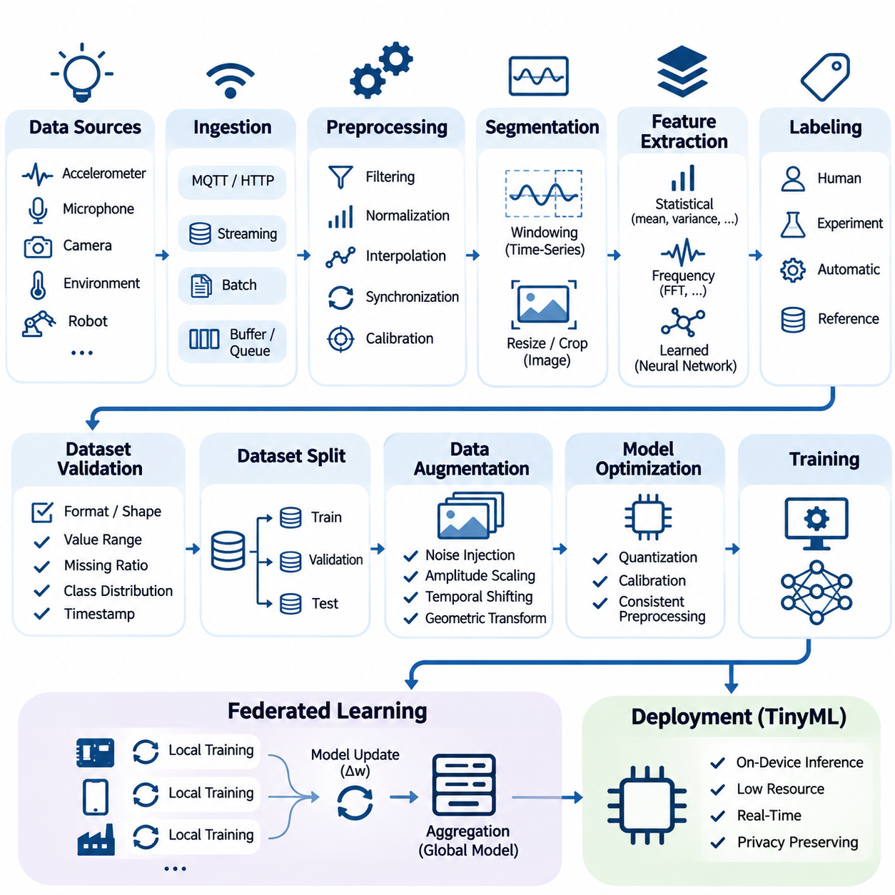
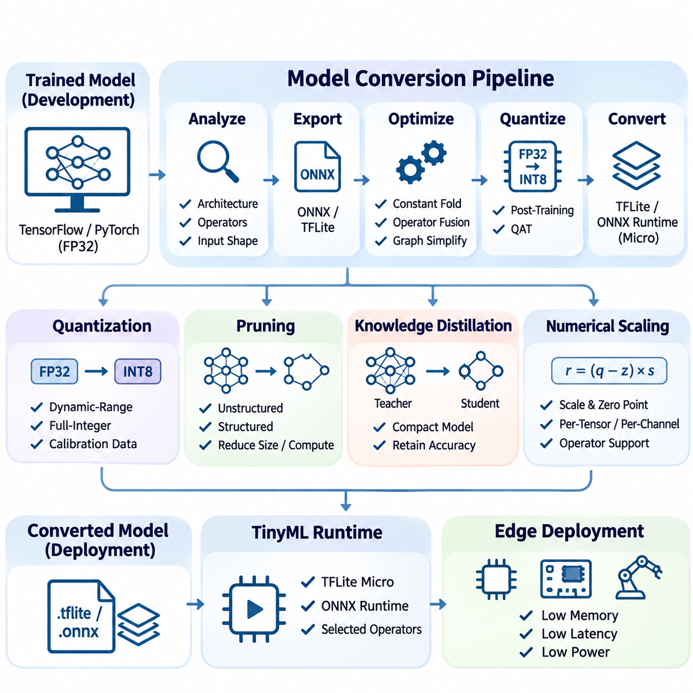
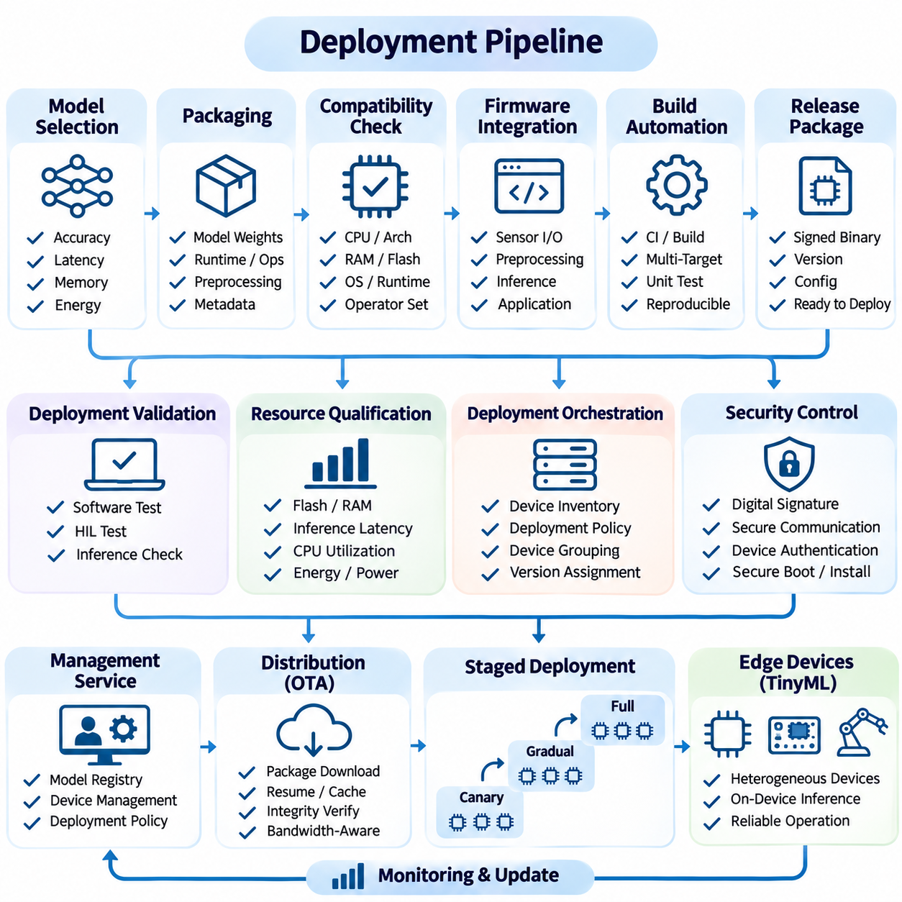
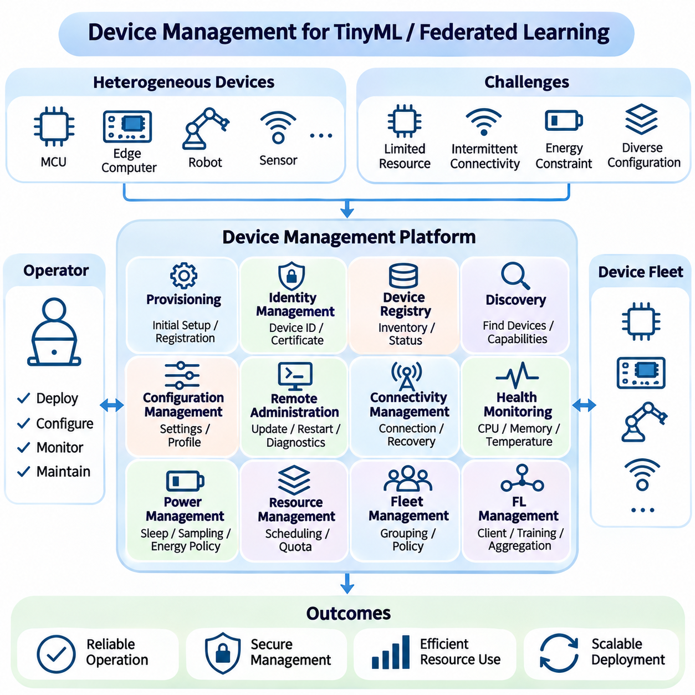
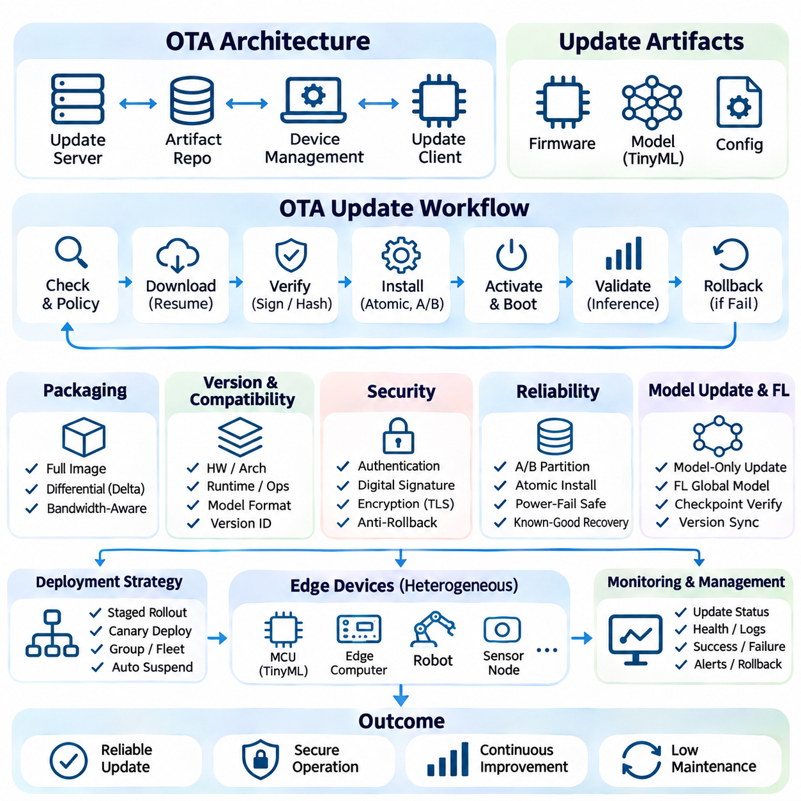
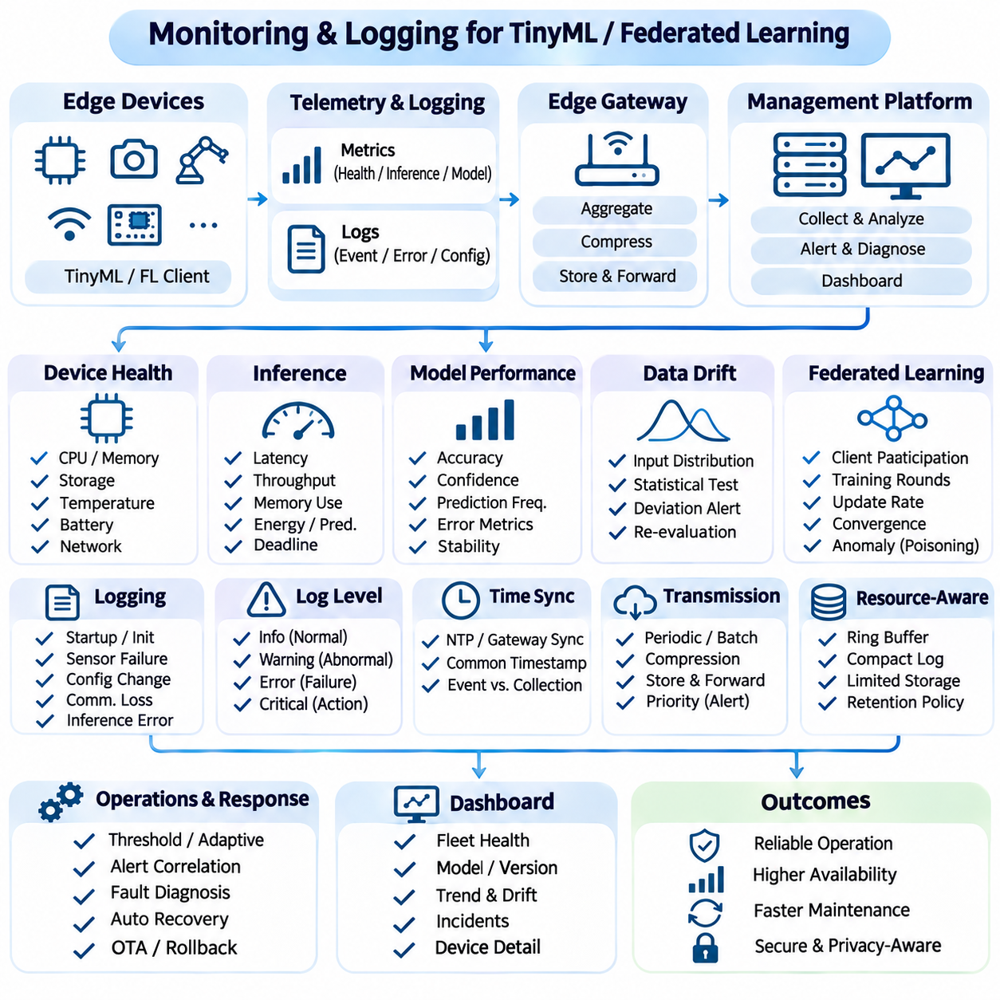
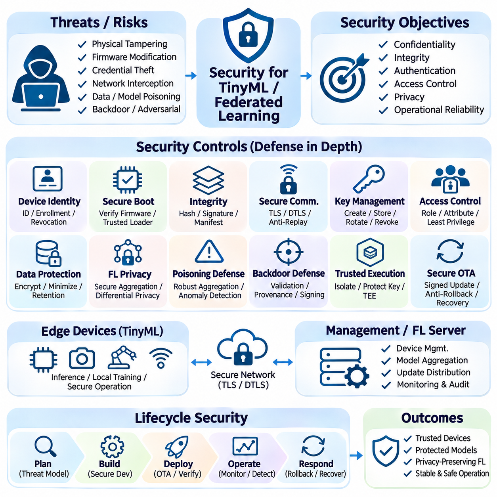

**Volume 40.** **TinyML and Federated Learning**


# 07. Engineering and Deployment

## 07.01 Data Pipeline [w/Code]

{width="7.268055555555556in" height="7.268055555555556in"}

A data pipeline for TinyML and federated learning provides the engineering foundation for transforming raw information into reliable datasets suitable for training, validation, and deployment. Unlike conventional cloud-based machine learning, these systems must accommodate limited memory, computational capacity, energy availability, and network connectivity. Effective pipeline design therefore balances data quality, processing efficiency, privacy, and operational reliability across heterogeneous devices.

The pipeline begins with data acquisition from embedded sensors, mobile devices, industrial controllers, and distributed edge systems. Typical sources include accelerometers, microphones, cameras, environmental sensors, and robotic telemetry. Each source produces information with different sampling frequencies, formats, and quality characteristics. Acquisition mechanisms must preserve timestamps, sensor identifiers, calibration metadata, and contextual information needed for subsequent processing.

Data ingestion establishes a consistent interface between physical devices and downstream processing components. Streaming architectures handle continuously generated measurements, while batch pipelines process previously recorded observations. Lightweight communication protocols such as MQTT and HTTP can transport data when connectivity permits. Local buffering and persistent queues help prevent information loss during network interruptions, particularly in intermittently connected embedded environments.

Raw sensor measurements frequently contain noise, missing values, inconsistent sampling intervals, and hardware-dependent distortions. Preprocessing operations address these problems through filtering, normalization, interpolation, synchronization, and calibration. For TinyML applications, preprocessing must remain compatible with device capabilities. Computationally expensive transformations may be performed during offline training, while lightweight equivalents execute during real-time inference.

Signal segmentation converts continuous measurements into structured samples suitable for machine learning. Time-series applications commonly employ fixed-length windows with configurable overlap, while image pipelines use resizing, cropping, and color normalization. Window duration influences temporal resolution, prediction latency, and memory consumption. Selecting appropriate segmentation parameters requires considering the physical characteristics of the observed process and the intended inference frequency.

Feature extraction transforms acquired observations into representations that emphasize relevant patterns while reducing unnecessary information. Statistical features such as mean, variance, energy, and frequency-domain coefficients can support compact models. Alternatively, neural networks may learn representations directly from minimally processed signals. The choice depends on computational constraints, available training data, expected accuracy, and the cost of reproducing preprocessing operations on embedded hardware.

Data labeling establishes the relationship between observations and target predictions. Labels may originate from human annotation, controlled experiments, automated instrumentation, or validated reference systems. In distributed environments, inconsistent labeling conventions can introduce substantial model errors. A well-designed pipeline maintains explicit class definitions, annotation guidelines, confidence indicators, and traceability between original measurements and their associated labels.

Dataset validation verifies that collected information satisfies predefined structural and statistical requirements. Validation checks may include expected tensor dimensions, acceptable numerical ranges, missing-value ratios, class distributions, and timestamp consistency. Automated validation prevents corrupted or incompatible samples from entering training workflows. Quality reports also reveal systematic differences between devices, operating conditions, and acquisition environments.

Training, validation, and test datasets must be separated carefully to obtain meaningful performance estimates. Randomly splitting overlapping sensor windows can produce data leakage because adjacent samples often share substantial information. Device-level, session-level, subject-level, or chronological partitioning may provide more realistic evaluation conditions. The selected strategy should reflect how the deployed model will encounter previously unseen environments and observations.

Data augmentation improves model robustness by introducing controlled variations into training samples. Sensor applications may employ noise injection, amplitude scaling, temporal shifting, or geometric transformations. However, augmentation must preserve the physical meaning and target label of each observation. Unrealistic transformations can damage model reliability, particularly when deployed systems operate under strict safety or accuracy requirements.

TinyML pipelines must account for the relationship between preprocessing and model optimization. Quantized models often require carefully calibrated input ranges, consistent normalization constants, and representative calibration datasets. Differences between training-time preprocessing and embedded inference can cause significant accuracy degradation. Maintaining identical transformation definitions across development and deployment environments reduces numerical inconsistencies and improves reproducibility.

Federated learning introduces a distributed data architecture in which training information remains primarily on participating devices or within local organizational environments. Instead of transmitting raw datasets to a central server, clients perform local training and communicate model updates. This architecture reduces the need for centralized data collection but introduces additional challenges involving heterogeneous data distributions, inconsistent device capabilities, and communication availability.

Non-independent and identically distributed data represents a fundamental challenge in federated pipelines. Individual clients may observe different classes, operating conditions, sampling frequencies, and dataset sizes. These differences can bias local optimization and slow global convergence. Effective pipeline engineering therefore includes client-level distribution analysis, standardized preprocessing, dataset quality assessment, and mechanisms for detecting substantial statistical divergence.

Federated data preparation must preserve local privacy boundaries while supporting consistent model training. Each participating client should apply compatible feature transformations, label mappings, and validation rules. Local dataset manifests can record sample counts, schema versions, and processing configurations without exposing sensitive observations. Aggregated quality indicators may help coordinators identify unreliable participants, provided that reporting mechanisms respect established privacy requirements.

Privacy-preserving processing requires more than keeping raw data on local devices. Intermediate features, diagnostic logs, and model updates may reveal information about underlying training samples. Data minimization, access controls, encryption, and appropriate retention policies should therefore be incorporated throughout the pipeline. Differential privacy and secure aggregation can provide additional protections when their assumptions, implementation requirements, and performance tradeoffs are properly evaluated.

Resource-aware pipeline scheduling coordinates preprocessing, training, and communication with available device capacity. Embedded clients may postpone computationally intensive operations until sufficient energy, memory, or processing resources become available. Streaming buffers and bounded queues prevent uncontrolled memory growth. Adaptive scheduling can prioritize essential inference workloads while allocating remaining resources to background learning and data preparation.

Reliable pipeline implementation benefits from modular software components with clearly defined input and output contracts. Acquisition, validation, transformation, partitioning, and serialization should remain independently testable. Configuration files can describe sampling rates, window sizes, normalization parameters, and dataset locations. This separation simplifies debugging, supports hardware migration, and enables consistent processing across development workstations and embedded targets.

Python-based implementations commonly use NumPy for numerical transformations, pandas for structured records, and framework-specific dataset interfaces for training. Embedded implementations may reproduce selected operations using C, C++, or optimized signal-processing libraries. Numerical equivalence should be tested using shared reference inputs and defined tolerances. Automated tests can compare preprocessing outputs across platforms before converted models are deployed.

Data serialization determines how efficiently samples move between processing stages and storage systems. Compact binary formats can reduce storage overhead and parsing costs compared with verbose textual representations. Schema definitions should specify data types, dimensions, byte ordering, and metadata requirements. Versioned serialization contracts prevent silent incompatibilities when sensor firmware, preprocessing algorithms, or machine learning frameworks change.

Reproducibility requires explicit tracking of dataset versions, processing parameters, random seeds, software dependencies, and transformation histories. Each trained model should reference the precise data configuration used during development. Content hashes and immutable dataset manifests help detect unintended modifications. In federated environments, reproducibility additionally requires recording client participation policies, local training configurations, and aggregation settings.

Pipeline monitoring evaluates both information quality and operational behavior. Useful measurements include ingestion throughput, processing latency, rejected-sample counts, memory consumption, energy usage, and communication overhead. Statistical monitoring can identify changes in sensor distributions or unexpected class frequencies. These indicators support early detection of data drift, device degradation, and processing failures before they significantly affect model performance.

Fault tolerance is especially important when distributed devices operate without continuous supervision. Pipelines should recover from interrupted acquisition, incomplete files, corrupted records, and temporary communication failures. Checkpointing, transactional writes, bounded retry policies, and integrity verification reduce the risk of inconsistent datasets. Recovery procedures must also prevent duplicated samples and preserve the chronological ordering required by time-dependent learning tasks.

An industrial TinyML example may collect vibration measurements from multiple machines, preprocess signals locally, and generate compact windows for anomaly detection. Each device can maintain a private training dataset while participating in federated model improvement. Local quality checks reject invalid measurements, and standardized transformations maintain compatibility across machines. Central coordination then focuses on model aggregation and operational monitoring rather than raw-data collection.

Robotic systems introduce additional requirements because perception and control measurements often depend on precise temporal relationships. Camera frames, inertial measurements, encoder readings, and control commands must be synchronized before generating training examples. Calibration records and operating-state metadata provide essential context. Pipeline designs should also distinguish between real-time inference data paths and asynchronous training paths to avoid interference with time-critical control functions.

A production-ready data pipeline ultimately connects reliable acquisition, consistent preprocessing, privacy-aware distributed learning, and resource-efficient embedded execution. Its effectiveness depends on measurable data quality, reproducible transformations, robust failure handling, and compatibility with downstream model conversion and deployment. Treating data engineering as a continuous operational process enables TinyML and federated learning systems to remain dependable as devices, environments, and learning requirements evolve.

TinyML과 연합학습(Federated Learning)을 위한 데이터 파이프라인(Data Pipeline)은 원시 정보(Raw Information)를 학습(Training), 검증(Validation), 배포(Deployment)에 적합한 신뢰성 높은 데이터셋(Dataset)으로 변환하는 엔지니어링 기반을 제공한다. 기존의 클라우드 기반 머신러닝(Cloud-Based Machine Learning)과 달리 이러한 시스템은 제한된 메모리(Memory), 연산 용량(Compute Capacity), 에너지 가용성(Energy Availability), 네트워크 연결성(Network Connectivity)을 고려해야 한다. 따라서 효과적인 파이프라인 설계(Pipeline Design)는 이기종 장치(Heterogeneous Devices) 전반에서 데이터 품질(Data Quality), 처리 효율성(Processing Efficiency), 개인정보 보호(Privacy), 운영 신뢰성(Operational Reliability)의 균형을 유지해야 한다.

파이프라인은 임베디드 센서(Embedded Sensor), 모바일 장치(Mobile Device), 산업용 제어기(Industrial Controller), 분산 엣지 시스템(Distributed Edge System)에서 데이터를 수집하는 과정으로 시작된다. 대표적인 데이터 소스(Data Source)에는 가속도계(Accelerometer), 마이크로폰(Microphone), 카메라(Camera), 환경 센서(Environmental Sensor), 로봇 원격 측정 데이터(Robotic Telemetry)가 포함된다. 각 데이터 소스는 서로 다른 샘플링 주파수(Sampling Frequency), 데이터 형식(Data Format), 품질 특성(Quality Characteristics)을 가진다. 데이터 수집 메커니즘(Data Acquisition Mechanism)은 후속 처리에 필요한 타임스탬프(Timestamp), 센서 식별자(Sensor Identifier), 보정 메타데이터(Calibration Metadata), 상황 정보(Contextual Information)를 보존해야 한다.

데이터 수집 및 입력 처리(Data Ingestion)는 물리적 장치(Physical Device)와 후속 처리 구성요소(Downstream Processing Component) 사이에 일관된 인터페이스(Interface)를 구축한다. 스트리밍 아키텍처(Streaming Architecture)는 지속적으로 생성되는 측정 데이터를 처리하며, 배치 파이프라인(Batch Pipeline)은 이전에 기록된 관측 데이터를 처리한다. MQTT와 HTTP 같은 경량 통신 프로토콜(Lightweight Communication Protocol)은 연결이 가능한 환경에서 데이터를 전송할 수 있다. 로컬 버퍼링(Local Buffering)과 영속적 큐(Persistent Queue)는 네트워크 중단(Network Interruption) 중 발생할 수 있는 정보 손실을 방지하며, 특히 간헐적으로 연결되는 임베디드 환경(Embedded Environment)에서 중요하다.

원시 센서 측정값(Raw Sensor Measurements)에는 잡음(Noise), 결측값(Missing Values), 불규칙한 샘플링 간격(Inconsistent Sampling Intervals), 하드웨어 의존적 왜곡(Hardware-Dependent Distortions)이 자주 포함된다. 전처리(Preprocessing)는 필터링(Filtering), 정규화(Normalization), 보간(Interpolation), 동기화(Synchronization), 보정(Calibration)을 통해 이러한 문제를 해결한다. TinyML 응용에서는 전처리 과정이 장치의 처리 능력(Device Capabilities)에 적합해야 한다. 계산 비용이 높은 변환(Computationally Expensive Transformations)은 오프라인 학습(Offline Training)에서 수행하고, 경량화된 처리 과정은 실시간 추론(Real-Time Inference)에서 실행할 수 있다.

신호 분할(Signal Segmentation)은 연속적인 측정값을 머신러닝에 적합한 구조화된 샘플(Structured Samples)로 변환한다. 시계열 응용(Time-Series Applications)에서는 일반적으로 겹침 구간(Overlap)을 설정할 수 있는 고정 길이 윈도우(Fixed-Length Window)를 사용하며, 이미지 파이프라인(Image Pipeline)에서는 크기 조정(Resizing), 자르기(Cropping), 색상 정규화(Color Normalization)를 적용한다. 윈도우 길이(Window Duration)는 시간 해상도(Temporal Resolution), 예측 지연시간(Prediction Latency), 메모리 소비량(Memory Consumption)에 영향을 미친다. 적절한 분할 매개변수(Segmentation Parameters)를 선택하려면 관측 대상의 물리적 특성과 목표 추론 주기(Inference Frequency)를 함께 고려해야 한다.

특징 추출(Feature Extraction)은 수집된 관측값을 중요한 패턴을 강조하면서 불필요한 정보를 줄이는 표현(Representation)으로 변환한다. 평균(Mean), 분산(Variance), 에너지(Energy), 주파수 영역 계수(Frequency-Domain Coefficients)와 같은 통계적 특징(Statistical Features)은 경량 모델(Compact Model)을 지원할 수 있다. 반면 신경망(Neural Network)은 최소한으로 처리된 신호에서 직접 표현을 학습할 수 있다. 이러한 방법의 선택은 연산 제약(Computational Constraints), 사용 가능한 학습 데이터(Training Data), 목표 정확도(Target Accuracy), 임베디드 하드웨어(Embedded Hardware)에서 전처리를 재현하는 비용에 따라 결정된다.

데이터 레이블링(Data Labeling)은 관측 데이터와 목표 예측(Target Prediction) 사이의 관계를 정의한다. 레이블(Label)은 사람에 의한 주석 작업(Human Annotation), 통제된 실험(Controlled Experiments), 자동화된 계측(Automated Instrumentation), 검증된 참조 시스템(Validated Reference Systems)에서 생성될 수 있다. 분산 환경(Distributed Environment)에서는 일관되지 않은 레이블링 규칙(Labeling Conventions)이 상당한 모델 오류(Model Errors)를 발생시킬 수 있다. 따라서 체계적인 파이프라인은 명확한 클래스 정의(Class Definitions), 주석 지침(Annotation Guidelines), 신뢰도 지표(Confidence Indicators), 원본 측정값과 레이블 사이의 추적성(Traceability)을 유지해야 한다.

데이터셋 검증(Dataset Validation)은 수집된 정보가 사전에 정의된 구조적 및 통계적 요구사항(Structural and Statistical Requirements)을 충족하는지 확인한다. 검증 항목에는 텐서 차원(Tensor Dimensions), 허용 가능한 수치 범위(Numerical Ranges), 결측값 비율(Missing-Value Ratios), 클래스 분포(Class Distributions), 타임스탬프 일관성(Timestamp Consistency)이 포함될 수 있다. 자동화된 검증(Automated Validation)은 손상되거나 호환되지 않는 샘플이 학습 과정에 유입되는 것을 방지한다. 품질 보고서(Quality Report)는 장치, 운영 조건, 데이터 수집 환경 사이의 체계적인 차이도 식별할 수 있다.

학습 데이터셋(Training Dataset), 검증 데이터셋(Validation Dataset), 테스트 데이터셋(Test Dataset)은 의미 있는 성능 평가(Performance Evaluation)를 위해 신중하게 분리해야 한다. 서로 겹치는 센서 윈도우(Sensor Windows)를 무작위로 분할하면 인접 샘플이 상당한 정보를 공유하기 때문에 데이터 누출(Data Leakage)이 발생할 수 있다. 장치 단위(Device-Level), 세션 단위(Session-Level), 대상자 단위(Subject-Level), 시간순 분할(Chronological Partitioning)은 보다 현실적인 평가 조건을 제공할 수 있다. 선택한 분할 전략(Partitioning Strategy)은 배포된 모델이 이전에 경험하지 못한 환경과 관측값을 처리하는 방식을 반영해야 한다.

데이터 증강(Data Augmentation)은 학습 샘플에 통제된 변형(Controlled Variations)을 도입하여 모델 강건성(Model Robustness)을 향상시킨다. 센서 응용에서는 잡음 주입(Noise Injection), 진폭 스케일링(Amplitude Scaling), 시간 이동(Temporal Shifting), 기하학적 변환(Geometric Transformations)을 사용할 수 있다. 그러나 데이터 증강은 각 관측값의 물리적 의미(Physical Meaning)와 목표 레이블(Target Label)을 보존해야 한다. 비현실적인 변환(Unrealistic Transformations)은 특히 엄격한 안전성(Safety) 또는 정확도(Accuracy) 요구사항이 적용되는 배포 시스템에서 모델 신뢰성(Model Reliability)을 저하시킬 수 있다.

TinyML 파이프라인은 전처리(Preprocessing)와 모델 최적화(Model Optimization) 사이의 관계를 고려해야 한다. 양자화 모델(Quantized Model)은 신중하게 보정된 입력 범위(Input Ranges), 일관된 정규화 상수(Normalization Constants), 대표성 있는 보정 데이터셋(Representative Calibration Dataset)을 필요로 하는 경우가 많다. 학습 단계의 전처리와 임베디드 추론(Embedded Inference) 사이의 차이는 상당한 정확도 저하(Accuracy Degradation)를 유발할 수 있다. 개발 환경(Development Environment)과 배포 환경(Deployment Environment)에서 동일한 변환 정의(Transformation Definitions)를 유지하면 수치적 불일치(Numerical Inconsistencies)를 줄이고 재현성(Reproducibility)을 향상시킬 수 있다.

연합학습(Federated Learning)은 학습 정보가 주로 참여 장치(Participating Devices) 또는 로컬 조직 환경(Local Organizational Environments)에 유지되는 분산 데이터 아키텍처(Distributed Data Architecture)를 도입한다. 원시 데이터셋(Raw Dataset)을 중앙 서버(Central Server)로 전송하는 대신 클라이언트(Client)가 로컬 학습(Local Training)을 수행하고 모델 업데이트(Model Updates)를 전달한다. 이러한 아키텍처는 중앙 집중식 데이터 수집(Centralized Data Collection)의 필요성을 줄이지만, 이질적인 데이터 분포(Heterogeneous Data Distributions), 장치 성능 차이, 통신 가용성(Communication Availability)과 관련된 추가적인 문제를 발생시킨다.

독립 동일 분포가 아닌 데이터(Non-Independent and Identically Distributed Data, Non-IID Data)는 연합학습 파이프라인의 근본적인 과제이다. 개별 클라이언트는 서로 다른 클래스(Class), 운영 조건(Operating Conditions), 샘플링 주파수(Sampling Frequencies), 데이터셋 크기(Dataset Sizes)를 관측할 수 있다. 이러한 차이는 로컬 최적화(Local Optimization)에 편향(Bias)을 발생시키고 전역 수렴(Global Convergence)을 지연시킬 수 있다. 따라서 효과적인 파이프라인 엔지니어링(Pipeline Engineering)에는 클라이언트별 분포 분석(Client-Level Distribution Analysis), 표준화된 전처리(Standardized Preprocessing), 데이터셋 품질 평가(Dataset Quality Assessment), 통계적 분포 차이(Statistical Divergence)를 탐지하는 메커니즘이 포함된다.

연합 데이터 준비(Federated Data Preparation)는 일관된 모델 학습(Model Training)을 지원하면서 로컬 개인정보 보호 경계(Local Privacy Boundaries)를 유지해야 한다. 각 참여 클라이언트는 호환 가능한 특징 변환(Feature Transformations), 레이블 매핑(Label Mappings), 검증 규칙(Validation Rules)을 적용해야 한다. 로컬 데이터셋 명세서(Local Dataset Manifest)는 민감한 관측값을 노출하지 않고 샘플 수(Sample Counts), 스키마 버전(Schema Versions), 처리 구성(Processing Configurations)을 기록할 수 있다. 집계된 품질 지표(Aggregated Quality Indicators)는 보고 메커니즘이 개인정보 보호 요구사항을 준수한다는 전제에서 조정 서버(Coordinator)가 신뢰성이 낮은 참여자를 식별하는 데 도움을 줄 수 있다.

개인정보 보호형 처리(Privacy-Preserving Processing)는 단순히 원시 데이터를 로컬 장치에 보관하는 것 이상의 보호 조치를 요구한다. 중간 특징(Intermediate Features), 진단 로그(Diagnostic Logs), 모델 업데이트(Model Updates)는 기초 학습 샘플(Underlying Training Samples)에 관한 정보를 노출할 수 있다. 따라서 데이터 최소화(Data Minimization), 접근 제어(Access Controls), 암호화(Encryption), 적절한 보존 정책(Retention Policies)을 파이프라인 전반에 통합해야 한다. 차등 개인정보 보호(Differential Privacy)와 보안 집계(Secure Aggregation)는 관련 가정, 구현 요구사항, 성능 절충 관계(Performance Tradeoffs)를 적절하게 평가한 경우 추가적인 보호 기능을 제공할 수 있다.

자원 인식형 파이프라인 스케줄링(Resource-Aware Pipeline Scheduling)은 전처리, 학습, 통신을 사용 가능한 장치 자원(Device Resources)에 맞추어 조정한다. 임베디드 클라이언트(Embedded Client)는 충분한 에너지, 메모리 또는 연산 자원이 확보될 때까지 계산 집약적 작업(Computationally Intensive Operations)을 연기할 수 있다. 스트리밍 버퍼(Streaming Buffers)와 크기가 제한된 큐(Bounded Queues)는 제어되지 않는 메모리 증가를 방지한다. 적응형 스케줄링(Adaptive Scheduling)은 필수 추론 작업(Essential Inference Workloads)에 우선순위를 부여하고 남은 자원을 백그라운드 학습(Background Learning)과 데이터 준비(Data Preparation)에 할당할 수 있다.

신뢰성 높은 파이프라인 구현(Pipeline Implementation)을 위해서는 명확하게 정의된 입력 및 출력 계약(Input and Output Contracts)을 가진 모듈형 소프트웨어 구성요소(Modular Software Components)가 유리하다. 데이터 수집(Acquisition), 검증(Validation), 변환(Transformation), 분할(Partitioning), 직렬화(Serialization)는 각각 독립적으로 테스트할 수 있어야 한다. 구성 파일(Configuration Files)은 샘플링 속도(Sampling Rates), 윈도우 크기(Window Sizes), 정규화 매개변수(Normalization Parameters), 데이터셋 위치(Dataset Locations)를 정의할 수 있다. 이러한 분리는 디버깅(Debugging)을 단순화하고 하드웨어 이전(Hardware Migration)을 지원하며 개발 워크스테이션과 임베디드 대상 장치 사이의 일관된 처리를 가능하게 한다.

파이썬 기반 구현(Python-Based Implementation)에서는 일반적으로 수치 변환(Numerical Transformations)에 NumPy, 구조화된 레코드(Structured Records)에 pandas, 학습에 프레임워크별 데이터셋 인터페이스(Framework-Specific Dataset Interfaces)를 사용한다. 임베디드 구현(Embedded Implementation)은 C, C++ 또는 최적화된 신호 처리 라이브러리(Optimized Signal-Processing Libraries)를 사용하여 일부 연산을 재현할 수 있다. 수치적 동등성(Numerical Equivalence)은 공통 참조 입력(Shared Reference Inputs)과 정의된 허용 오차(Defined Tolerances)를 이용해 검증해야 한다. 자동화된 테스트(Automated Tests)는 변환된 모델(Converted Models)을 배포하기 전에 플랫폼 간 전처리 결과를 비교할 수 있다.

데이터 직렬화(Data Serialization)는 샘플이 처리 단계와 저장 시스템(Storage Systems) 사이를 얼마나 효율적으로 이동하는지 결정한다. 압축된 이진 형식(Compact Binary Formats)은 장황한 텍스트 표현(Verbose Textual Representations)에 비해 저장 공간 부담(Storage Overhead)과 파싱 비용(Parsing Costs)을 줄일 수 있다. 스키마 정의(Schema Definitions)는 데이터 유형(Data Types), 차원(Dimensions), 바이트 순서(Byte Ordering), 메타데이터 요구사항(Metadata Requirements)을 명시해야 한다. 버전 관리된 직렬화 계약(Versioned Serialization Contracts)은 센서 펌웨어(Sensor Firmware), 전처리 알고리즘(Preprocessing Algorithms), 머신러닝 프레임워크(Machine Learning Frameworks)가 변경될 때 발생할 수 있는 감지하기 어려운 비호환성(Incompatibilities)을 방지한다.

재현성(Reproducibility)을 확보하려면 데이터셋 버전(Dataset Versions), 처리 매개변수(Processing Parameters), 난수 시드(Random Seeds), 소프트웨어 의존성(Software Dependencies), 변환 이력(Transformation Histories)을 명시적으로 추적해야 한다. 각 학습 모델(Trained Model)은 개발 과정에서 사용한 정확한 데이터 구성(Data Configuration)을 참조해야 한다. 콘텐츠 해시(Content Hashes)와 불변 데이터셋 명세서(Immutable Dataset Manifests)는 의도하지 않은 변경을 탐지하는 데 도움을 준다. 연합학습 환경에서는 클라이언트 참여 정책(Client Participation Policies), 로컬 학습 구성(Local Training Configurations), 집계 설정(Aggregation Settings)도 기록해야 한다.

파이프라인 모니터링(Pipeline Monitoring)은 정보 품질(Information Quality)과 운영 동작(Operational Behavior)을 모두 평가한다. 유용한 측정 지표에는 데이터 입력 처리량(Ingestion Throughput), 처리 지연시간(Processing Latency), 거부된 샘플 수(Rejected-Sample Counts), 메모리 사용량(Memory Consumption), 에너지 사용량(Energy Usage), 통신 오버헤드(Communication Overhead)가 포함된다. 통계적 모니터링(Statistical Monitoring)은 센서 분포(Sensor Distributions)의 변화나 예상하지 못한 클래스 빈도(Class Frequencies)를 식별할 수 있다. 이러한 지표는 데이터 드리프트(Data Drift), 장치 성능 저하(Device Degradation), 처리 실패(Processing Failures)가 모델 성능에 큰 영향을 미치기 전에 조기에 탐지하도록 지원한다.

내결함성(Fault Tolerance)은 분산 장치(Distributed Devices)가 지속적인 감독 없이 작동하는 환경에서 특히 중요하다. 파이프라인은 중단된 데이터 수집(Interrupted Acquisition), 불완전한 파일(Incomplete Files), 손상된 레코드(Corrupted Records), 일시적인 통신 장애(Temporary Communication Failures)에서 복구할 수 있어야 한다. 체크포인팅(Checkpointing), 트랜잭션 기반 쓰기(Transactional Writes), 제한된 재시도 정책(Bounded Retry Policies), 무결성 검증(Integrity Verification)은 일관되지 않은 데이터셋이 발생할 위험을 줄인다. 복구 절차(Recovery Procedures)는 중복 샘플(Duplicated Samples)을 방지하고 시간 의존적 학습(Time-Dependent Learning)에 필요한 시간순 정렬(Chronological Ordering)도 보존해야 한다.

산업용 TinyML(Industrial TinyML)의 사례로 여러 기계에서 진동 측정값(Vibration Measurements)을 수집하고, 로컬에서 신호를 전처리한 뒤, 이상 탐지(Anomaly Detection)를 위한 경량 윈도우(Compact Windows)를 생성하는 시스템을 고려할 수 있다. 각 장치는 비공개 학습 데이터셋(Private Training Dataset)을 유지하면서 연합 모델 개선(Federated Model Improvement)에 참여할 수 있다. 로컬 품질 검사(Local Quality Checks)는 유효하지 않은 측정값을 제거하며, 표준화된 변환(Standardized Transformations)은 기계 간 호환성을 유지한다. 중앙 조정(Central Coordination)은 원시 데이터 수집보다 모델 집계(Model Aggregation)와 운영 모니터링(Operational Monitoring)에 집중한다.

로봇 시스템(Robotic Systems)은 인식 및 제어 측정값(Perception and Control Measurements)이 정밀한 시간적 관계(Temporal Relationships)에 의존하는 경우가 많으므로 추가적인 요구사항을 가진다. 카메라 프레임(Camera Frames), 관성 측정값(Inertial Measurements), 엔코더 측정값(Encoder Readings), 제어 명령(Control Commands)은 학습 샘플을 생성하기 전에 동기화해야 한다. 보정 기록(Calibration Records)과 운영 상태 메타데이터(Operating-State Metadata)는 필수적인 상황 정보를 제공한다. 또한 파이프라인 설계는 시간 제약이 엄격한 제어 기능(Time-Critical Control Functions)에 대한 간섭을 방지하기 위해 실시간 추론 데이터 경로(Real-Time Inference Data Paths)와 비동기 학습 경로(Asynchronous Training Paths)를 구분해야 한다.

실제 운영 환경에 배포할 수 있는 데이터 파이프라인(Production-Ready Data Pipeline)은 궁극적으로 신뢰성 높은 데이터 수집(Reliable Acquisition), 일관된 전처리(Consistent Preprocessing), 개인정보 보호를 고려한 분산학습(Privacy-Aware Distributed Learning), 자원 효율적인 임베디드 실행(Resource-Efficient Embedded Execution)을 연결한다. 그 효과는 측정 가능한 데이터 품질(Measurable Data Quality), 재현 가능한 변환(Reproducible Transformations), 강건한 장애 처리(Robust Failure Handling), 후속 모델 변환(Model Conversion) 및 배포(Deployment)와의 호환성(Compatibility)에 달려 있다. 데이터 엔지니어링(Data Engineering)을 지속적인 운영 프로세스(Continuous Operational Process)로 관리하면 장치, 환경, 학습 요구사항이 변화하더라도 TinyML과 연합학습 시스템의 신뢰성을 유지할 수 있다.

## 07.02 Model Conversion [w/Code]

{width="7.268055555555556in" height="7.268055555555556in"}

Model conversion transforms trained machine learning models into representations compatible with embedded processors, microcontrollers, and distributed edge devices. Conventional training frameworks typically produce models optimized for development environments rather than resource-constrained hardware. Conversion bridges this gap by adapting computational graphs, numerical representations, and operator implementations while preserving predictive behavior. Its effectiveness determines whether a model can execute reliably within practical memory, latency, and energy limits.

The conversion process begins with an examination of the original model architecture, input specifications, and computational requirements. Engineers identify supported layers, tensor dimensions, activation functions, and dependencies on framework-specific operations. Static input shapes and predictable execution paths are particularly valuable for embedded deployment. Unsupported operators, dynamic control flow, and excessive intermediate tensors may require architectural modifications before conversion can proceed successfully.

Model export creates an intermediate representation that separates the learned parameters from the original training environment. Formats such as ONNX provide a standardized description of computational graphs, operators, and tensor relationships. TensorFlow models can be converted into TensorFlow Lite representations, while PyTorch models may use supported export pathways. The selected format must remain compatible with the target runtime, operator set, hardware architecture, and intended optimization techniques.

Computational graph optimization reduces unnecessary operations and simplifies execution dependencies. Constant folding evaluates expressions whose inputs are known during conversion, eliminating redundant runtime calculations. Operator fusion combines compatible operations, such as convolution and activation, into more efficient execution units. Graph simplification can reduce memory transfers and intermediate allocations, although optimization must preserve numerical correctness and supported execution semantics.

Quantization is one of the most important conversion techniques for TinyML deployment. It replaces high-precision numerical representations with lower-precision alternatives, commonly converting 32-bit floating-point weights and activations into 8-bit integers. This transformation can substantially reduce model storage requirements and improve inference efficiency on compatible processors. However, the actual performance improvement depends on hardware instructions, runtime implementations, and quantization overhead.

Post-training quantization applies numerical compression after model training without requiring complete retraining. Dynamic-range quantization primarily reduces weight precision, while full-integer quantization targets both weights and activations. Representative calibration datasets are necessary when activation ranges must be estimated. These datasets should reflect realistic operating conditions because inaccurate calibration can cause saturation, excessive rounding errors, and reduced prediction accuracy.

Quantization-aware training incorporates simulated quantization effects into the optimization process before final conversion. Fake-quantization operations approximate the numerical behavior of reduced-precision inference while allowing gradient-based learning. This approach can recover accuracy when post-training quantization introduces unacceptable degradation. Nevertheless, quantization-aware training increases development complexity and requires consistency between simulated arithmetic and the actual target runtime.

Numerical scaling determines how floating-point values are represented using integer arithmetic. Quantized tensors commonly use scale factors and zero points to map integer values into approximate real-number ranges. Per-tensor quantization applies shared parameters across an entire tensor, while per-channel quantization allows different scales for individual channels. The appropriate configuration depends on operator support, numerical sensitivity, and the computational characteristics of the target device.

Model pruning can complement conversion by removing parameters or structures that contribute relatively little to predictive performance. Unstructured pruning introduces sparse weight patterns, whereas structured pruning removes entire channels, filters, or computational blocks. Sparse representations reduce storage only when supported by suitable encoding and execution mechanisms. Structured pruning is often easier to exploit on conventional embedded hardware because it directly reduces tensor dimensions and arithmetic operations.

Knowledge distillation provides another route toward deployment-compatible models. A compact student network learns to approximate the predictions or internal representations of a larger teacher model. The student architecture can be designed specifically for microcontroller memory limits and supported operator libraries. Distillation is generally performed before conversion, enabling subsequent quantization and graph optimization to operate on an already efficient model.

TensorFlow Lite conversion typically produces a compact FlatBuffer representation containing the computational graph, weights, and associated metadata. TensorFlow Lite for Microcontrollers executes supported models using lightweight interpreters designed for embedded environments. Developers must verify that required operators are available in the selected runtime configuration. Operator registration can be restricted to necessary kernels, reducing firmware size and avoiding unnecessary dependencies.

ONNX-based conversion supports interoperability across compatible frameworks and inference runtimes. Exported models require validation of operator versions, tensor shapes, and numerical behavior. ONNX Runtime can execute models on supported edge platforms, while specialized embedded toolchains may accept selected ONNX graphs. Compatibility should never be assumed solely from the file format because individual runtimes support different operators, data types, and optimization capabilities.

Memory planning is a critical stage of model conversion for microcontrollers. In addition to persistent model weights, inference requires temporary activation buffers, operator scratch space, and runtime metadata. Tensor lifetime analysis allows memory regions to be reused when intermediate values are no longer needed. Static memory allocation reduces fragmentation and unpredictable allocation delays, which is especially important in deterministic embedded applications.

Embedded runtimes frequently organize temporary memory into a tensor arena allocated before inference begins. The arena must accommodate intermediate tensors and execution-specific working buffers. Insufficient allocation causes initialization or inference failures, while excessive allocation wastes scarce memory resources. Engineers should measure actual memory consumption on the target hardware rather than relying exclusively on model file size or theoretical parameter counts.

Hardware-specific optimization adapts converted models to available processor instructions and accelerator capabilities. ARM Cortex-M devices may benefit from CMSIS-NN kernels, while processors with digital signal processing extensions can accelerate selected arithmetic operations. Dedicated neural processing units may require proprietary compilation or graph partitioning. Effective conversion therefore involves matching model operators, tensor layouts, and numerical precision to supported hardware execution paths.

Operator compatibility often determines whether an otherwise accurate model can be deployed. Certain activation functions, normalization layers, attention mechanisms, and tensor manipulation operations may not have efficient embedded implementations. Conversion tools may reject unsupported operators or preserve them as custom operations. Engineers must evaluate whether replacing, approximating, or implementing these operations is preferable to selecting a different model architecture.

Input preprocessing must remain consistent throughout conversion and deployment. Normalization constants, sensor calibration parameters, image channel ordering, and tensor layouts must match the original training configuration. Quantized input tensors additionally require correct integer scaling and zero-point handling. Even when conversion preserves the computational graph, mismatched preprocessing can produce substantial prediction errors that are incorrectly attributed to quantization.

Conversion validation compares outputs from the original model and its deployment representation using identical test inputs. Numerical comparisons can measure absolute error, relative error, and differences in predicted class probabilities. Task-level evaluation should also examine classification accuracy, detection performance, or regression error. Small tensor-level deviations may be acceptable when application behavior remains stable, but safety-critical systems require stricter validation criteria.

Representative testing should cover normal operating conditions, boundary cases, and challenging input distributions. For sensor models, these conditions may include noise, changing temperatures, unusual motion patterns, and calibration differences. Testing only a small collection of convenient samples can conceal conversion-induced failures. A reliable validation process uses independent evaluation datasets and records performance differences across meaningful operating scenarios.

Inference benchmarking measures the practical consequences of conversion on the intended hardware. Important metrics include model storage size, peak RAM consumption, execution latency, throughput, and energy per inference. Measurements should account for preprocessing, runtime initialization, and memory allocation when these operations affect deployment requirements. Hardware measurements are more reliable than theoretical operation counts because kernel efficiency and memory access patterns strongly influence execution performance.

Federated learning introduces additional conversion considerations because participating devices may use different processor architectures and runtime capabilities. A shared global model must remain compatible with the local training and inference environments of participating clients. Some systems maintain higher-precision training representations while distributing optimized inference models. Conversion policies must preserve model identity, parameter compatibility, and the intended relationship between local updates and global aggregation.

On-device learning further complicates conversion because inference-only representations may not support gradient computation or parameter updates. Training-capable runtimes require additional operators, gradient storage, and optimizer state. Quantized inference models may therefore coexist with separate trainable representations. Engineers should distinguish between models intended exclusively for inference and models designed for local adaptation before selecting conversion formats and optimization strategies.

Automated conversion pipelines improve reproducibility by integrating export, optimization, quantization, validation, and packaging into controlled workflows. Configuration files can specify input dimensions, representative datasets, target runtimes, and precision requirements. Continuous integration systems may reject converted models that exceed memory budgets or violate accuracy thresholds. Versioned artifacts and conversion logs provide traceability between source checkpoints and deployed binaries.

A reliable model conversion workflow ultimately balances predictive accuracy with executable efficiency and hardware compatibility. Successful conversion requires more than producing a smaller model file; it demands verified numerical behavior, supported operators, predictable memory usage, and measured performance on actual devices. By integrating conversion into the broader engineering lifecycle, TinyML and federated learning systems can deploy optimized models consistently across heterogeneous embedded environments.

모델 변환(Model Conversion)은 학습된 머신러닝 모델(Machine Learning Model)을 임베디드 프로세서(Embedded Processor), 마이크로컨트롤러(Microcontroller), 분산 엣지 장치(Distributed Edge Device)와 호환되는 표현(Representation)으로 변환하는 과정이다. 기존 학습 프레임워크(Training Framework)는 일반적으로 자원이 제한된 하드웨어(Resource-Constrained Hardware)보다 개발 환경(Development Environment)에 최적화된 모델을 생성한다. 모델 변환은 예측 동작(Predictive Behavior)을 유지하면서 연산 그래프(Computational Graph), 수치 표현(Numerical Representation), 연산자 구현(Operator Implementation)을 조정하여 이러한 차이를 해결한다. 변환의 효과는 모델이 실제 메모리(Memory), 지연시간(Latency), 에너지(Energy) 제약 내에서 안정적으로 실행될 수 있는지를 결정한다.

변환 과정은 원본 모델 아키텍처(Model Architecture), 입력 사양(Input Specifications), 연산 요구사항(Computational Requirements)을 분석하는 것으로 시작된다. 엔지니어는 지원되는 계층(Layers), 텐서 차원(Tensor Dimensions), 활성화 함수(Activation Functions), 프레임워크별 연산(Framework-Specific Operations)에 대한 의존성을 식별한다. 정적 입력 형상(Static Input Shapes)과 예측 가능한 실행 경로(Predictable Execution Paths)는 임베디드 배포(Embedded Deployment)에서 특히 중요하다. 지원되지 않는 연산자(Unsupported Operators), 동적 제어 흐름(Dynamic Control Flow), 과도한 중간 텐서(Intermediate Tensors)는 성공적인 변환을 위해 사전에 아키텍처 수정(Architectural Modification)이 필요할 수 있다.

모델 내보내기(Model Export)는 학습된 매개변수(Learned Parameters)를 원래 학습 환경(Training Environment)으로부터 분리하는 중간 표현(Intermediate Representation)을 생성한다. ONNX와 같은 형식은 연산 그래프(Computational Graph), 연산자(Operators), 텐서 관계(Tensor Relationships)에 대한 표준화된 설명을 제공한다. TensorFlow 모델은 TensorFlow Lite 표현으로 변환할 수 있으며, PyTorch 모델은 지원되는 내보내기 경로(Export Pathways)를 사용할 수 있다. 선택한 형식은 대상 런타임(Target Runtime), 연산자 집합(Operator Set), 하드웨어 아키텍처(Hardware Architecture), 적용하려는 최적화 기법(Optimization Techniques)과 호환되어야 한다.

연산 그래프 최적화(Computational Graph Optimization)는 불필요한 연산을 제거하고 실행 의존성(Execution Dependencies)을 단순화한다. 상수 접기(Constant Folding)는 변환 과정에서 입력값이 이미 알려진 표현식을 계산하여 실행 시 중복 연산(Redundant Runtime Calculations)을 제거한다. 연산자 융합(Operator Fusion)은 합성곱(Convolution)과 활성화(Activation)처럼 호환 가능한 연산을 더욱 효율적인 실행 단위(Execution Unit)로 결합한다. 그래프 단순화(Graph Simplification)는 메모리 전송(Memory Transfers)과 중간 메모리 할당(Intermediate Allocations)을 줄일 수 있지만, 수치적 정확성(Numerical Correctness)과 지원되는 실행 의미론(Execution Semantics)을 유지해야 한다.

양자화(Quantization)는 TinyML 배포에서 가장 중요한 모델 변환 기법 중 하나이다. 양자화는 높은 정밀도의 수치 표현(High-Precision Numerical Representations)을 낮은 정밀도의 표현(Lower-Precision Representations)으로 대체하며, 일반적으로 32비트 부동소수점(Floating-Point) 가중치(Weights)와 활성화값(Activations)을 8비트 정수(Integers)로 변환한다. 이러한 변환은 모델 저장 공간(Model Storage Requirements)을 크게 줄이고 호환 가능한 프로세서에서 추론 효율성(Inference Efficiency)을 향상시킬 수 있다. 그러나 실제 성능 향상은 하드웨어 명령어(Hardware Instructions), 런타임 구현(Runtime Implementations), 양자화 오버헤드(Quantization Overhead)에 따라 달라진다.

학습 후 양자화(Post-Training Quantization)는 전체 재학습(Complete Retraining) 없이 모델 학습이 완료된 후 수치 압축(Numerical Compression)을 적용한다. 동적 범위 양자화(Dynamic-Range Quantization)는 주로 가중치 정밀도(Weight Precision)를 낮추며, 완전 정수 양자화(Full-Integer Quantization)는 가중치와 활성화값 모두를 대상으로 한다. 활성화 범위(Activation Ranges)를 추정해야 하는 경우 대표성 있는 보정 데이터셋(Representative Calibration Dataset)이 필요하다. 부정확한 보정(Inaccurate Calibration)은 포화(Saturation), 과도한 반올림 오차(Rounding Errors), 예측 정확도(Prediction Accuracy) 저하를 유발할 수 있으므로 보정 데이터셋은 실제 운영 조건(Operating Conditions)을 반영해야 한다.

양자화 인식 학습(Quantization-Aware Training)은 최종 변환 전에 최적화 과정(Optimization Process)에 양자화 효과(Quantization Effects)를 모사하여 반영한다. 가짜 양자화 연산(Fake-Quantization Operations)은 경사 기반 학습(Gradient-Based Learning)을 허용하면서 저정밀도 추론(Reduced-Precision Inference)의 수치적 동작을 근사한다. 이 방법은 학습 후 양자화로 인해 허용할 수 없는 정확도 저하(Accuracy Degradation)가 발생하는 경우 정확도를 회복하는 데 도움이 될 수 있다. 그러나 양자화 인식 학습은 개발 복잡도(Development Complexity)를 증가시키며, 모사된 산술 연산(Simulated Arithmetic)과 실제 대상 런타임(Target Runtime) 사이의 일관성을 요구한다.

수치 스케일링(Numerical Scaling)은 부동소수점 값(Floating-Point Values)을 정수 연산(Integer Arithmetic)으로 표현하는 방식을 결정한다. 양자화된 텐서(Quantized Tensors)는 일반적으로 스케일 계수(Scale Factors)와 영점(Zero Points)을 사용하여 정수값을 근사적인 실수 범위(Real-Number Ranges)에 대응시킨다. 텐서 단위 양자화(Per-Tensor Quantization)는 전체 텐서에 공통 매개변수를 적용하는 반면, 채널 단위 양자화(Per-Channel Quantization)는 개별 채널마다 서로 다른 스케일을 허용한다. 적절한 구성은 연산자 지원(Operator Support), 수치적 민감도(Numerical Sensitivity), 대상 장치(Target Device)의 연산 특성에 따라 결정된다.

모델 가지치기(Model Pruning)는 예측 성능(Predictive Performance)에 대한 기여도가 상대적으로 낮은 매개변수나 구조를 제거하여 모델 변환을 보완할 수 있다. 비구조적 가지치기(Unstructured Pruning)는 희소 가중치 패턴(Sparse Weight Patterns)을 생성하는 반면, 구조적 가지치기(Structured Pruning)는 전체 채널(Channels), 필터(Filters), 연산 블록(Computational Blocks)을 제거한다. 희소 표현(Sparse Representations)은 적절한 인코딩(Encoding)과 실행 메커니즘(Execution Mechanisms)이 지원되는 경우에만 저장 공간을 줄일 수 있다. 구조적 가지치기는 텐서 차원(Tensor Dimensions)과 산술 연산(Arithmetic Operations)을 직접 줄이므로 일반적인 임베디드 하드웨어에서 활용하기가 더 쉬운 경우가 많다.

지식 증류(Knowledge Distillation)는 배포 가능한 모델(Deployment-Compatible Model)을 생성하는 또 다른 방법이다. 경량 학생 네트워크(Compact Student Network)는 더 큰 교사 모델(Teacher Model)의 예측 결과(Predictions) 또는 내부 표현(Internal Representations)을 근사하도록 학습한다. 학생 아키텍처(Student Architecture)는 마이크로컨트롤러 메모리 제한(Microcontroller Memory Limits)과 지원되는 연산자 라이브러리(Operator Libraries)에 맞추어 설계할 수 있다. 지식 증류는 일반적으로 모델 변환 전에 수행되며, 이후 양자화(Quantization)와 그래프 최적화(Graph Optimization)가 이미 효율적으로 구성된 모델에 적용되도록 한다.

TensorFlow Lite 변환은 일반적으로 연산 그래프(Computational Graph), 가중치(Weights), 관련 메타데이터(Metadata)를 포함하는 경량 FlatBuffer 표현을 생성한다. 마이크로컨트롤러용 TensorFlow Lite(TensorFlow Lite for Microcontrollers)는 임베디드 환경에 맞게 설계된 경량 인터프리터(Lightweight Interpreter)를 사용하여 지원되는 모델을 실행한다. 개발자는 선택한 런타임 구성(Runtime Configuration)에서 필요한 연산자(Required Operators)를 사용할 수 있는지 확인해야 한다. 연산자 등록(Operator Registration)을 필수 커널(Necessary Kernels)로 제한하면 펌웨어 크기(Firmware Size)를 줄이고 불필요한 의존성(Unnecessary Dependencies)을 방지할 수 있다.

ONNX 기반 변환(ONNX-Based Conversion)은 호환 가능한 프레임워크(Frameworks)와 추론 런타임(Inference Runtimes) 사이의 상호운용성(Interoperability)을 지원한다. 내보낸 모델(Exported Models)은 연산자 버전(Operator Versions), 텐서 형상(Tensor Shapes), 수치적 동작(Numerical Behavior)에 대한 검증이 필요하다. ONNX Runtime은 지원되는 엣지 플랫폼(Edge Platforms)에서 모델을 실행할 수 있으며, 특수 임베디드 도구 체인(Specialized Embedded Toolchains)은 일부 ONNX 그래프를 입력으로 사용할 수 있다. 개별 런타임은 서로 다른 연산자, 데이터 유형(Data Types), 최적화 기능(Optimization Capabilities)을 지원하므로 파일 형식만으로 호환성을 가정해서는 안 된다.

메모리 계획(Memory Planning)은 마이크로컨트롤러 모델 변환에서 핵심적인 단계이다. 영구적으로 저장되는 모델 가중치(Persistent Model Weights) 외에도 추론에는 임시 활성화 버퍼(Temporary Activation Buffers), 연산자 작업 공간(Operator Scratch Space), 런타임 메타데이터(Runtime Metadata)가 필요하다. 텐서 수명 분석(Tensor Lifetime Analysis)을 통해 중간값(Intermediate Values)이 더 이상 필요하지 않을 때 메모리 영역을 재사용할 수 있다. 정적 메모리 할당(Static Memory Allocation)은 메모리 단편화(Memory Fragmentation)와 예측하기 어려운 할당 지연(Allocation Delays)을 줄이며, 결정론적 임베디드 응용(Deterministic Embedded Applications)에서 특히 중요하다.

임베디드 런타임(Embedded Runtime)은 추론 실행 전에 할당되는 텐서 아레나(Tensor Arena)에 임시 메모리를 구성하는 경우가 많다. 텐서 아레나는 중간 텐서(Intermediate Tensors)와 실행에 필요한 작업 버퍼(Working Buffers)를 수용할 수 있어야 한다. 할당량이 부족하면 초기화(Initialization) 또는 추론(Inference)이 실패하며, 과도한 할당은 제한된 메모리 자원을 낭비한다. 따라서 엔지니어는 모델 파일 크기(Model File Size)나 이론적인 매개변수 수(Parameter Counts)에만 의존하지 않고 실제 대상 하드웨어(Target Hardware)에서 메모리 사용량을 측정해야 한다.

하드웨어별 최적화(Hardware-Specific Optimization)는 변환된 모델을 사용 가능한 프로세서 명령어(Processor Instructions)와 가속기 기능(Accelerator Capabilities)에 맞게 조정한다. ARM Cortex-M 장치는 CMSIS-NN 커널(Kernels)을 활용할 수 있으며, 디지털 신호 처리 확장(Digital Signal Processing Extensions)을 지원하는 프로세서는 일부 산술 연산을 가속할 수 있다. 전용 신경망 처리 장치(Neural Processing Unit, NPU)는 독점 컴파일( Proprietary Compilation) 또는 그래프 분할(Graph Partitioning)이 필요할 수 있다. 따라서 효과적인 변환을 위해서는 모델 연산자(Model Operators), 텐서 배치(Tensor Layouts), 수치 정밀도(Numerical Precision)를 지원되는 하드웨어 실행 경로(Hardware Execution Paths)에 맞추어야 한다.

연산자 호환성(Operator Compatibility)은 정확도가 높은 모델이라도 실제 배포 가능 여부를 결정하는 중요한 요소이다. 일부 활성화 함수(Activation Functions), 정규화 계층(Normalization Layers), 어텐션 메커니즘(Attention Mechanisms), 텐서 조작 연산(Tensor Manipulation Operations)은 효율적인 임베디드 구현(Embedded Implementations)을 제공하지 않을 수 있다. 변환 도구(Conversion Tools)는 지원되지 않는 연산자를 거부하거나 사용자 정의 연산(Custom Operations)으로 유지할 수 있다. 엔지니어는 이러한 연산을 대체(Replacement), 근사(Approximation), 직접 구현(Implementation)하는 것이 다른 모델 아키텍처를 선택하는 것보다 적절한지 평가해야 한다.

입력 전처리(Input Preprocessing)는 모델 변환과 배포 전 과정에서 일관되게 유지되어야 한다. 정규화 상수(Normalization Constants), 센서 보정 매개변수(Sensor Calibration Parameters), 이미지 채널 순서(Image Channel Ordering), 텐서 배치(Tensor Layouts)는 원래 학습 구성(Training Configuration)과 일치해야 한다. 양자화된 입력 텐서(Quantized Input Tensors)는 정확한 정수 스케일링(Integer Scaling)과 영점 처리(Zero-Point Handling)도 필요하다. 모델 변환이 연산 그래프를 보존하더라도 전처리가 일치하지 않으면 상당한 예측 오류(Prediction Errors)가 발생할 수 있으며, 이러한 오류가 양자화 문제로 잘못 해석될 수 있다.

변환 검증(Conversion Validation)은 동일한 테스트 입력(Test Inputs)을 사용하여 원본 모델(Original Model)과 배포용 표현(Deployment Representation)의 출력을 비교한다. 수치 비교(Numerical Comparison)는 절대 오차(Absolute Error), 상대 오차(Relative Error), 예측 클래스 확률(Predicted Class Probabilities)의 차이를 측정할 수 있다. 작업 수준 평가(Task-Level Evaluation)에서는 분류 정확도(Classification Accuracy), 객체 탐지 성능(Detection Performance), 회귀 오차(Regression Error)도 검토해야 한다. 응용 동작(Application Behavior)이 안정적으로 유지된다면 작은 텐서 수준 편차(Tensor-Level Deviations)는 허용될 수 있지만, 안전 필수 시스템(Safety-Critical Systems)에는 더욱 엄격한 검증 기준(Validation Criteria)이 필요하다.

대표성 있는 테스트(Representative Testing)는 정상 운영 조건(Normal Operating Conditions), 경계 사례(Boundary Cases), 까다로운 입력 분포(Challenging Input Distributions)를 포함해야 한다. 센서 모델(Sensor Models)의 경우 잡음(Noise), 온도 변화(Changing Temperatures), 비정상적인 움직임 패턴(Unusual Motion Patterns), 보정 차이(Calibration Differences)가 이러한 조건에 해당할 수 있다. 편리하게 선택한 소수의 샘플만 테스트하면 변환으로 인한 오류(Conversion-Induced Failures)를 발견하지 못할 수 있다. 신뢰성 높은 검증 과정(Validation Process)은 독립적인 평가 데이터셋(Independent Evaluation Datasets)을 사용하고 의미 있는 운영 시나리오(Operating Scenarios)별 성능 차이를 기록한다.

추론 벤치마킹(Inference Benchmarking)은 변환이 대상 하드웨어(Intended Hardware)에 미치는 실제 영향을 측정한다. 중요한 지표에는 모델 저장 크기(Model Storage Size), 최대 RAM 사용량(Peak RAM Consumption), 실행 지연시간(Execution Latency), 처리량(Throughput), 추론당 에너지(Energy per Inference)가 포함된다. 이러한 작업이 배포 요구사항에 영향을 미치는 경우 전처리(Preprocessing), 런타임 초기화(Runtime Initialization), 메모리 할당(Memory Allocation)도 측정에 포함해야 한다. 커널 효율성(Kernel Efficiency)과 메모리 접근 패턴(Memory Access Patterns)이 실행 성능에 큰 영향을 미치므로 실제 하드웨어 측정값이 이론적인 연산 횟수(Theoretical Operation Counts)보다 신뢰성이 높다.

연합학습(Federated Learning)은 참여 장치(Participating Devices)가 서로 다른 프로세서 아키텍처(Processor Architectures)와 런타임 기능(Runtime Capabilities)을 사용할 수 있기 때문에 추가적인 모델 변환 고려사항을 발생시킨다. 공유 전역 모델(Shared Global Model)은 참여 클라이언트(Participating Clients)의 로컬 학습(Local Training) 및 추론 환경(Inference Environments)과 호환되어야 한다. 일부 시스템은 고정밀도 학습 표현(Higher-Precision Training Representations)을 유지하면서 최적화된 추론 모델(Optimized Inference Models)을 배포한다. 변환 정책(Conversion Policies)은 모델 동일성(Model Identity), 매개변수 호환성(Parameter Compatibility), 로컬 업데이트(Local Updates)와 전역 집계(Global Aggregation) 사이의 의도된 관계를 보존해야 한다.

온디바이스 학습(On-Device Learning)은 추론 전용 표현(Inference-Only Representations)이 기울기 계산(Gradient Computation)이나 매개변수 업데이트(Parameter Updates)를 지원하지 않을 수 있으므로 모델 변환을 더욱 복잡하게 만든다. 학습 가능한 런타임(Training-Capable Runtimes)에는 추가 연산자(Additional Operators), 기울기 저장 공간(Gradient Storage), 옵티마이저 상태(Optimizer State)가 필요하다. 따라서 양자화된 추론 모델(Quantized Inference Models)은 별도의 학습 가능한 표현(Trainable Representations)과 함께 존재할 수 있다. 엔지니어는 변환 형식(Conversion Formats)과 최적화 전략(Optimization Strategies)을 선택하기 전에 추론 전용 모델과 로컬 적응(Local Adaptation)을 위해 설계된 모델을 구분해야 한다.

자동화된 변환 파이프라인(Automated Conversion Pipelines)은 모델 내보내기(Export), 최적화(Optimization), 양자화(Quantization), 검증(Validation), 패키징(Packaging)을 통제된 워크플로(Controlled Workflows)에 통합하여 재현성(Reproducibility)을 향상시킨다. 구성 파일(Configuration Files)은 입력 차원(Input Dimensions), 대표 데이터셋(Representative Datasets), 대상 런타임(Target Runtimes), 정밀도 요구사항(Precision Requirements)을 지정할 수 있다. 지속적 통합 시스템(Continuous Integration Systems)은 메모리 예산(Memory Budgets)을 초과하거나 정확도 임계값(Accuracy Thresholds)을 위반하는 변환 모델을 거부할 수 있다. 버전 관리된 산출물(Versioned Artifacts)과 변환 로그(Conversion Logs)는 원본 체크포인트(Source Checkpoints)와 배포된 바이너리(Deployed Binaries) 사이의 추적성(Traceability)을 제공한다.

신뢰성 높은 모델 변환 워크플로(Model Conversion Workflow)는 궁극적으로 예측 정확도(Predictive Accuracy), 실행 효율성(Executable Efficiency), 하드웨어 호환성(Hardware Compatibility) 사이의 균형을 유지해야 한다. 성공적인 변환은 단순히 모델 파일 크기를 줄이는 것 이상을 요구하며, 검증된 수치적 동작(Verified Numerical Behavior), 지원되는 연산자(Supported Operators), 예측 가능한 메모리 사용량(Predictable Memory Usage), 실제 장치에서 측정된 성능(Measured Performance)을 확보해야 한다. 모델 변환을 전체 엔지니어링 생명주기(Engineering Lifecycle)에 통합하면 TinyML과 연합학습 시스템은 이기종 임베디드 환경(Heterogeneous Embedded Environments) 전반에 최적화된 모델을 일관되게 배포할 수 있다.

## 07.03 Deployment Pipeline [w/Code]

{width="7.268055555555556in" height="7.268055555555556in"}

A deployment pipeline provides a controlled process for transferring validated machine learning models from development environments to operational edge devices. In TinyML and federated learning systems, deployment must accommodate heterogeneous processors, restricted memory, intermittent connectivity, and strict energy budgets. The pipeline integrates model packaging, compatibility verification, firmware preparation, distribution, installation, and runtime validation to ensure reliable operation across distributed hardware.

Deployment begins with selecting a model artifact that satisfies predefined accuracy, latency, memory, and energy requirements. The artifact should originate from a reproducible training and conversion process with documented dependencies and evaluation results. Model registries maintain version identifiers, configuration metadata, and compatibility information. These records establish traceability between source datasets, training checkpoints, converted representations, and deployed device configurations.

Artifact packaging combines the converted model with the components required for execution. Depending on the target platform, packages may contain model weights, operator libraries, preprocessing parameters, runtime configurations, and application metadata. Microcontroller deployments often embed model arrays directly into firmware, while more capable edge computers may load models from external storage. Package structure must remain compatible with available memory, storage, and boot mechanisms.

Target compatibility verification determines whether a model can execute correctly on the intended hardware and software environment. Relevant characteristics include processor architecture, instruction extensions, available RAM, flash capacity, operating system, and inference runtime version. Hardware accelerators may introduce additional requirements involving compiler versions and supported operators. Automated compatibility checks reduce the risk of distributing artifacts that cannot initialize or execute on deployed devices.

Firmware integration connects the converted model to sensor interfaces, preprocessing routines, inference execution, and application logic. Embedded implementations commonly use C or C++ with lightweight inference libraries such as TensorFlow Lite Micro. The application must allocate memory, initialize required operators, configure sensor acquisition, and invoke inference at appropriate intervals. Integration testing verifies that model execution does not interfere with essential device functions.

Build automation transforms source code and model artifacts into reproducible deployment packages. Continuous integration systems can compile firmware for multiple target architectures, execute unit tests, and validate package metadata. Build configurations should specify compiler versions, optimization flags, linked libraries, and hardware-specific parameters. Reproducible builds improve debugging and help ensure that tested binaries correspond exactly to distributed releases.

Deployment validation includes both software-level testing and hardware-in-the-loop evaluation. Software tests verify preprocessing consistency, operator compatibility, and expected inference outputs. Hardware-in-the-loop tests execute the application on representative devices connected to simulated or physical sensors. These tests reveal timing problems, memory limitations, and hardware interactions that may remain undetected in desktop development environments.

Resource qualification confirms that the deployed application operates within device constraints. Measurements should include firmware storage requirements, peak RAM usage, inference latency, processor utilization, and energy consumption. Real-time systems must also evaluate scheduling behavior and worst-case execution time. Resource margins are necessary because communication, logging, and other application components compete with inference workloads for limited hardware capacity.

Deployment orchestration coordinates the distribution of validated packages across device populations. A central management service may maintain device inventories, deployment policies, and software version assignments. Devices can be grouped according to processor type, geographic region, application function, or operational criticality. Group-based deployment enables targeted releases and prevents incompatible updates from reaching unsupported hardware configurations.

Network conditions strongly influence deployment strategies in distributed edge environments. Devices with reliable connectivity may retrieve packages directly from management servers, while intermittently connected systems require resumable downloads and local caching. Package integrity verification detects incomplete or corrupted transfers. Bandwidth-aware scheduling can reduce communication costs and avoid disrupting operational data streams during deployment.

Security controls protect the deployment process against unauthorized modifications and malicious software distribution. Cryptographic signatures authenticate firmware and model packages, while secure communication channels protect transfer integrity and confidentiality. Device authentication prevents untrusted endpoints from accessing deployment services. Secure boot and verified installation mechanisms can extend trust from package delivery into the device execution environment.

Staged deployment reduces operational risk by introducing new releases to limited device populations before broader distribution. Canary deployments initially target representative devices and monitor their behavior under real workloads. Successful releases can gradually expand to additional groups, while detected failures trigger deployment suspension. This approach is particularly valuable when hardware diversity and environmental variation make laboratory testing insufficient.

Rollback mechanisms restore previously validated software when new deployments introduce unacceptable behavior. Devices may retain a known-good firmware image or maintain separate installation partitions. Recovery procedures should preserve essential configuration data and prevent repeated installation failures. Rollback decisions can depend on initialization errors, inference failures, resource violations, or operational health indicators collected after deployment.

Runtime initialization verifies that deployed models can load successfully and execute required operations. The application should confirm model compatibility, allocate working memory, initialize sensor interfaces, and perform diagnostic inference when appropriate. Initialization failures must produce actionable error information without compromising device stability. Systems with strict availability requirements may activate a safe fallback mode when inference functionality becomes unavailable.

Operational monitoring provides continuous evidence that deployed models satisfy their intended performance requirements. Relevant indicators include inference latency, prediction confidence, memory utilization, energy consumption, and device availability. Monitoring should also identify changes in input distributions and unexpected application behavior. Lightweight telemetry mechanisms are necessary because excessive logging and communication can undermine the efficiency of resource-constrained systems.

Federated learning introduces deployment requirements related to global model synchronization and client participation. A coordination service distributes approved model versions to eligible devices before local training rounds begin. Clients must verify parameter compatibility, training configuration, and available resources. Version mismatches can invalidate aggregation results, making explicit model identifiers and participation rules essential for reliable distributed learning.

Federated deployment pipelines may manage separate artifacts for inference and local training. Inference packages prioritize compact representations and efficient execution, while training packages may require higher-precision parameters, gradient operations, and optimizer state. The deployment system must distinguish these capabilities and prevent training tasks from being assigned to unsupported devices. Consistent model lineage links local updates to their corresponding global checkpoints.

On-device learning requires additional controls because model parameters can change after initial deployment. Local adaptation procedures should operate within predefined memory, energy, and performance limits. Updated models require validation before replacing active inference versions. Checkpointing and recovery mechanisms protect against interrupted training, corrupted parameters, and unexpected degradation caused by unsuitable local observations.

Deployment configuration management separates device-specific settings from model binaries whenever practical. Configuration parameters may define sampling frequencies, inference intervals, communication endpoints, and operational thresholds. Version-controlled configurations simplify environment-specific adjustments without requiring unnecessary model recompilation. Compatibility checks must ensure that configuration changes remain consistent with model input requirements and application behavior.

A practical TinyML deployment may involve distributing a quantized vibration-classification model to industrial monitoring nodes. The pipeline compiles firmware containing the model, verifies memory requirements, and tests inference against reference signals. A limited device group receives the initial release before broader installation. Operational telemetry then confirms that classification latency, energy consumption, and sensor processing remain within established limits.

Robotic deployments require additional attention to real-time execution and operational safety. Perception models may share processors with localization, navigation, communication, and control software. Deployment testing must verify scheduling priorities and ensure that inference workloads do not violate critical timing requirements. Model failures should be isolated from safety functions, and validated fallback behavior should remain available when perception services become unreliable.

Continuous deployment practices connect model development with operational feedback and controlled release management. Automated pipelines can reject artifacts that fail accuracy tests, exceed resource budgets, or violate security policies. Successful builds proceed through compatibility checks, hardware validation, staged distribution, and post-deployment monitoring. This structured process reduces manual errors and supports consistent model updates across heterogeneous embedded platforms.

A reliable deployment pipeline ultimately transforms optimized machine learning models into maintainable operational systems. Its success depends on reproducible artifacts, verified hardware compatibility, secure distribution, resource-aware execution, and effective recovery mechanisms. By combining automated engineering workflows with continuous operational validation, TinyML and federated learning deployments can remain scalable, dependable, and adaptable throughout their lifecycle.

배포 파이프라인(Deployment Pipeline)은 검증된 머신러닝 모델(Machine Learning Model)을 개발 환경(Development Environment)에서 실제 운영 중인 엣지 장치(Edge Device)로 이전하기 위한 통제된 프로세스(Controlled Process)를 제공한다. TinyML과 연합학습(Federated Learning) 시스템에서는 이기종 프로세서(Heterogeneous Processors), 제한된 메모리(Restricted Memory), 간헐적인 연결성(Intermittent Connectivity), 엄격한 에너지 예산(Energy Budgets)을 고려해야 한다. 배포 파이프라인은 모델 패키징(Model Packaging), 호환성 검증(Compatibility Verification), 펌웨어 준비(Firmware Preparation), 배포(Distribution), 설치(Installation), 런타임 검증(Runtime Validation)을 통합하여 분산 하드웨어 전반에서 신뢰성 높은 운영을 보장한다.

배포는 사전에 정의된 정확도(Accuracy), 지연시간(Latency), 메모리(Memory), 에너지(Energy) 요구사항을 충족하는 모델 산출물(Model Artifact)을 선택하는 것으로 시작된다. 해당 산출물은 의존성(Dependencies)과 평가 결과(Evaluation Results)가 문서화된 재현 가능한 학습 및 변환 프로세스(Reproducible Training and Conversion Process)에서 생성되어야 한다. 모델 레지스트리(Model Registry)는 버전 식별자(Version Identifiers), 구성 메타데이터(Configuration Metadata), 호환성 정보(Compatibility Information)를 관리한다. 이러한 기록은 원본 데이터셋(Source Datasets), 학습 체크포인트(Training Checkpoints), 변환된 표현(Converted Representations), 배포된 장치 구성(Deployed Device Configurations) 사이의 추적성(Traceability)을 확립한다.

산출물 패키징(Artifact Packaging)은 변환된 모델(Converted Model)과 실행에 필요한 구성요소를 결합한다. 대상 플랫폼(Target Platform)에 따라 패키지에는 모델 가중치(Model Weights), 연산자 라이브러리(Operator Libraries), 전처리 매개변수(Preprocessing Parameters), 런타임 구성(Runtime Configurations), 응용 메타데이터(Application Metadata)가 포함될 수 있다. 마이크로컨트롤러 배포(Microcontroller Deployment)에서는 모델 배열(Model Arrays)을 펌웨어(Firmware)에 직접 포함하는 경우가 많으며, 성능이 높은 엣지 컴퓨터(Edge Computer)는 외부 저장장치(External Storage)에서 모델을 불러올 수 있다. 패키지 구조(Package Structure)는 사용 가능한 메모리, 저장 공간, 부팅 메커니즘(Boot Mechanisms)과 호환되어야 한다.

대상 호환성 검증(Target Compatibility Verification)은 모델이 의도된 하드웨어 및 소프트웨어 환경(Hardware and Software Environment)에서 올바르게 실행될 수 있는지 판단한다. 관련 특성에는 프로세서 아키텍처(Processor Architecture), 명령어 확장(Instruction Extensions), 사용 가능한 RAM, 플래시 용량(Flash Capacity), 운영체제(Operating System), 추론 런타임 버전(Inference Runtime Version)이 포함된다. 하드웨어 가속기(Hardware Accelerators)는 컴파일러 버전(Compiler Versions)과 지원 연산자(Supported Operators)에 관한 추가 요구사항을 발생시킬 수 있다. 자동화된 호환성 검사(Automated Compatibility Checks)는 실행할 수 없는 산출물이 배포 장치에 전달되는 위험을 줄인다.

펌웨어 통합(Firmware Integration)은 변환된 모델을 센서 인터페이스(Sensor Interfaces), 전처리 루틴(Preprocessing Routines), 추론 실행(Inference Execution), 응용 로직(Application Logic)에 연결한다. 임베디드 구현(Embedded Implementation)은 일반적으로 C 또는 C++와 TensorFlow Lite Micro 같은 경량 추론 라이브러리(Lightweight Inference Libraries)를 사용한다. 응용 프로그램(Application)은 메모리를 할당하고, 필요한 연산자(Required Operators)를 초기화하며, 센서 데이터 수집(Sensor Acquisition)을 구성하고, 적절한 주기로 추론을 실행해야 한다. 통합 테스트(Integration Testing)는 모델 실행이 장치의 필수 기능(Essential Device Functions)을 방해하지 않는지 검증한다.

빌드 자동화(Build Automation)는 소스 코드(Source Code)와 모델 산출물(Model Artifacts)을 재현 가능한 배포 패키지(Reproducible Deployment Packages)로 변환한다. 지속적 통합 시스템(Continuous Integration Systems)은 여러 대상 아키텍처(Target Architectures)에 대한 펌웨어를 컴파일하고, 단위 테스트(Unit Tests)를 실행하며, 패키지 메타데이터(Package Metadata)를 검증할 수 있다. 빌드 구성(Build Configurations)은 컴파일러 버전(Compiler Versions), 최적화 플래그(Optimization Flags), 연결된 라이브러리(Linked Libraries), 하드웨어별 매개변수(Hardware-Specific Parameters)를 명시해야 한다. 재현 가능한 빌드(Reproducible Builds)는 디버깅(Debugging)을 개선하고 테스트된 바이너리(Tested Binaries)가 실제 배포 릴리스(Distributed Releases)와 정확히 일치하도록 지원한다.

배포 검증(Deployment Validation)에는 소프트웨어 수준 테스트(Software-Level Testing)와 하드웨어 인 더 루프 평가(Hardware-in-the-Loop Evaluation)가 모두 포함된다. 소프트웨어 테스트(Software Tests)는 전처리 일관성(Preprocessing Consistency), 연산자 호환성(Operator Compatibility), 예상 추론 출력(Expected Inference Outputs)을 검증한다. 하드웨어 인 더 루프 테스트(Hardware-in-the-Loop Tests)는 시뮬레이션 센서(Simulated Sensors) 또는 실제 센서(Physical Sensors)에 연결된 대표 장치(Representative Devices)에서 응용 프로그램을 실행한다. 이러한 테스트는 데스크톱 개발 환경(Desktop Development Environment)에서 발견되지 않을 수 있는 타이밍 문제(Timing Problems), 메모리 제한(Memory Limitations), 하드웨어 상호작용(Hardware Interactions)을 식별한다.

자원 적합성 검증(Resource Qualification)은 배포된 응용 프로그램이 장치 제약(Device Constraints) 내에서 작동하는지 확인한다. 측정 항목에는 펌웨어 저장 공간 요구사항(Firmware Storage Requirements), 최대 RAM 사용량(Peak RAM Usage), 추론 지연시간(Inference Latency), 프로세서 사용률(Processor Utilization), 에너지 소비량(Energy Consumption)이 포함되어야 한다. 실시간 시스템(Real-Time Systems)은 스케줄링 동작(Scheduling Behavior)과 최악 실행시간(Worst-Case Execution Time)도 평가해야 한다. 통신(Communication), 로깅(Logging), 기타 응용 구성요소(Application Components)가 제한된 하드웨어 자원을 놓고 추론 작업(Inference Workloads)과 경쟁하므로 충분한 자원 여유(Resource Margins)가 필요하다.

배포 오케스트레이션(Deployment Orchestration)은 여러 장치 집단(Device Populations)에 검증된 패키지를 배포하는 과정을 조정한다. 중앙 관리 서비스(Central Management Service)는 장치 인벤토리(Device Inventories), 배포 정책(Deployment Policies), 소프트웨어 버전 할당(Software Version Assignments)을 관리할 수 있다. 장치는 프로세서 유형(Processor Type), 지리적 영역(Geographic Region), 응용 기능(Application Function), 운영 중요도(Operational Criticality)에 따라 그룹화할 수 있다. 그룹 기반 배포(Group-Based Deployment)는 대상별 릴리스(Targeted Releases)를 가능하게 하고, 호환되지 않는 업데이트(Incompatible Updates)가 지원되지 않는 하드웨어 구성(Unsupported Hardware Configurations)에 전달되는 것을 방지한다.

네트워크 조건(Network Conditions)은 분산 엣지 환경(Distributed Edge Environments)의 배포 전략(Deployment Strategies)에 큰 영향을 미친다. 안정적인 연결성을 가진 장치는 관리 서버(Management Servers)에서 직접 패키지를 가져올 수 있지만, 간헐적으로 연결되는 시스템(Intermittently Connected Systems)은 재개 가능한 다운로드(Resumable Downloads)와 로컬 캐싱(Local Caching)이 필요하다. 패키지 무결성 검증(Package Integrity Verification)은 불완전하거나 손상된 전송(Incomplete or Corrupted Transfers)을 탐지한다. 대역폭 인식형 스케줄링(Bandwidth-Aware Scheduling)은 통신 비용(Communication Costs)을 줄이고 배포 중 운영 데이터 스트림(Operational Data Streams)의 중단을 방지할 수 있다.

보안 제어(Security Controls)는 무단 수정(Unauthorized Modifications)과 악성 소프트웨어 배포(Malicious Software Distribution)로부터 배포 프로세스를 보호한다. 암호학적 서명(Cryptographic Signatures)은 펌웨어 및 모델 패키지(Firmware and Model Packages)의 진위를 검증하며, 보안 통신 채널(Secure Communication Channels)은 전송 무결성(Transfer Integrity)과 기밀성(Confidentiality)을 보호한다. 장치 인증(Device Authentication)은 신뢰할 수 없는 엔드포인트(Untrusted Endpoints)가 배포 서비스(Deployment Services)에 접근하는 것을 방지한다. 보안 부팅(Secure Boot)과 검증된 설치 메커니즘(Verified Installation Mechanisms)은 패키지 전달 과정에서 확보한 신뢰를 장치 실행 환경(Device Execution Environment)까지 확장할 수 있다.

단계적 배포(Staged Deployment)는 새로운 릴리스(New Releases)를 전체 장치에 배포하기 전에 제한된 장치 집단(Limited Device Populations)에 먼저 적용하여 운영 위험(Operational Risk)을 줄인다. 카나리 배포(Canary Deployment)는 초기 단계에서 대표 장치(Representative Devices)를 대상으로 실제 작업 부하(Real Workloads)에서의 동작을 모니터링한다. 성공적인 릴리스는 추가 그룹으로 점진적으로 확대할 수 있으며, 오류가 탐지되면 배포를 중단한다. 이러한 접근법은 하드웨어 다양성(Hardware Diversity)과 환경 변화(Environmental Variation)로 인해 실험실 테스트(Laboratory Testing)만으로 충분하지 않은 경우 특히 유용하다.

롤백 메커니즘(Rollback Mechanisms)은 새로운 배포가 허용할 수 없는 동작(Unacceptable Behavior)을 유발할 때 이전에 검증된 소프트웨어(Previously Validated Software)를 복원한다. 장치는 정상 동작이 확인된 펌웨어 이미지(Known-Good Firmware Image)를 유지하거나 별도의 설치 파티션(Installation Partitions)을 관리할 수 있다. 복구 절차(Recovery Procedures)는 필수 구성 데이터(Essential Configuration Data)를 보존하고 반복적인 설치 실패(Repeated Installation Failures)를 방지해야 한다. 롤백 결정(Rollback Decisions)은 초기화 오류(Initialization Errors), 추론 실패(Inference Failures), 자원 제약 위반(Resource Violations), 배포 후 수집된 운영 상태 지표(Operational Health Indicators)에 따라 이루어질 수 있다.

런타임 초기화(Runtime Initialization)는 배포된 모델이 성공적으로 로드되고 필요한 연산을 실행할 수 있는지 검증한다. 응용 프로그램은 모델 호환성(Model Compatibility)을 확인하고, 작업 메모리(Working Memory)를 할당하며, 센서 인터페이스(Sensor Interfaces)를 초기화하고, 필요한 경우 진단 추론(Diagnostic Inference)을 수행해야 한다. 초기화 실패(Initialization Failures)는 장치 안정성(Device Stability)을 저해하지 않으면서 문제 해결에 유용한 오류 정보(Actionable Error Information)를 제공해야 한다. 엄격한 가용성 요구사항(Availability Requirements)을 가진 시스템은 추론 기능을 사용할 수 없을 때 안전한 대체 모드(Safe Fallback Mode)를 활성화할 수 있다.

운영 모니터링(Operational Monitoring)은 배포된 모델이 의도된 성능 요구사항(Performance Requirements)을 충족하는지 지속적으로 확인할 수 있는 근거를 제공한다. 관련 지표에는 추론 지연시간(Inference Latency), 예측 신뢰도(Prediction Confidence), 메모리 사용률(Memory Utilization), 에너지 소비량(Energy Consumption), 장치 가용성(Device Availability)이 포함된다. 모니터링은 입력 분포(Input Distributions)의 변화와 예상하지 못한 응용 동작(Unexpected Application Behavior)도 식별해야 한다. 과도한 로깅(Logging)과 통신은 자원이 제한된 시스템(Resource-Constrained Systems)의 효율성을 저하시킬 수 있으므로 경량 원격 측정 메커니즘(Lightweight Telemetry Mechanisms)이 필요하다.

연합학습(Federated Learning)은 전역 모델 동기화(Global Model Synchronization)와 클라이언트 참여(Client Participation)에 관련된 추가 배포 요구사항을 도입한다. 조정 서비스(Coordination Service)는 로컬 학습 라운드(Local Training Rounds)가 시작되기 전에 승인된 모델 버전(Approved Model Versions)을 적격 장치(Eligible Devices)에 배포한다. 클라이언트(Clients)는 매개변수 호환성(Parameter Compatibility), 학습 구성(Training Configuration), 사용 가능한 자원(Available Resources)을 검증해야 한다. 버전 불일치(Version Mismatches)는 집계 결과(Aggregation Results)를 무효화할 수 있으므로 명시적인 모델 식별자(Model Identifiers)와 참여 규칙(Participation Rules)이 신뢰성 높은 분산학습(Distributed Learning)에 필수적이다.

연합 배포 파이프라인(Federated Deployment Pipelines)은 추론(Inference)과 로컬 학습(Local Training)을 위한 별도의 산출물(Artifacts)을 관리할 수 있다. 추론 패키지(Inference Packages)는 경량 표현(Compact Representations)과 효율적인 실행(Efficient Execution)을 우선시하는 반면, 학습 패키지(Training Packages)는 더 높은 정밀도의 매개변수(Higher-Precision Parameters), 기울기 연산(Gradient Operations), 옵티마이저 상태(Optimizer State)를 필요로 할 수 있다. 배포 시스템은 이러한 기능을 구분하고 지원되지 않는 장치에 학습 작업(Training Tasks)이 할당되지 않도록 해야 한다. 일관된 모델 계보(Model Lineage)는 로컬 업데이트(Local Updates)를 해당 전역 체크포인트(Global Checkpoints)에 연결한다.

온디바이스 학습(On-Device Learning)은 초기 배포 이후에도 모델 매개변수(Model Parameters)가 변경될 수 있으므로 추가적인 제어가 필요하다. 로컬 적응 절차(Local Adaptation Procedures)는 사전에 정의된 메모리(Memory), 에너지(Energy), 성능(Performance) 제한 내에서 실행되어야 한다. 업데이트된 모델(Updated Models)은 활성 추론 버전(Active Inference Versions)을 대체하기 전에 검증을 거쳐야 한다. 체크포인팅(Checkpointing)과 복구 메커니즘(Recovery Mechanisms)은 중단된 학습(Interrupted Training), 손상된 매개변수(Corrupted Parameters), 부적절한 로컬 관측값(Unsuitable Local Observations)으로 인한 예상하지 못한 성능 저하(Unexpected Degradation)를 방지한다.

배포 구성 관리(Deployment Configuration Management)는 가능한 경우 장치별 설정(Device-Specific Settings)을 모델 바이너리(Model Binaries)와 분리한다. 구성 매개변수(Configuration Parameters)는 샘플링 주파수(Sampling Frequencies), 추론 주기(Inference Intervals), 통신 엔드포인트(Communication Endpoints), 운영 임계값(Operational Thresholds)을 정의할 수 있다. 버전 관리된 구성(Version-Controlled Configurations)은 불필요한 모델 재컴파일(Model Recompilation) 없이 환경별 조정(Environment-Specific Adjustments)을 단순화한다. 호환성 검사(Compatibility Checks)는 구성 변경(Configuration Changes)이 모델 입력 요구사항(Model Input Requirements) 및 응용 동작(Application Behavior)과 일관성을 유지하는지 확인해야 한다.

실용적인 TinyML 배포 사례로 산업용 모니터링 노드(Industrial Monitoring Nodes)에 양자화된 진동 분류 모델(Quantized Vibration-Classification Model)을 배포하는 시스템을 고려할 수 있다. 파이프라인은 모델이 포함된 펌웨어를 컴파일하고, 메모리 요구사항(Memory Requirements)을 검증하며, 참조 신호(Reference Signals)를 사용하여 추론을 테스트한다. 초기 릴리스(Initial Release)는 전체 설치 전에 제한된 장치 그룹(Limited Device Group)에 적용된다. 이후 운영 원격 측정(Operational Telemetry)을 통해 분류 지연시간(Classification Latency), 에너지 소비량(Energy Consumption), 센서 처리(Sensor Processing)가 설정된 제한 범위 내에서 유지되는지 확인한다.

로봇 배포(Robotic Deployments)는 실시간 실행(Real-Time Execution)과 운영 안전성(Operational Safety)에 추가적인 주의가 필요하다. 인식 모델(Perception Models)은 위치 추정(Localization), 내비게이션(Navigation), 통신(Communication), 제어 소프트웨어(Control Software)와 프로세서를 공유할 수 있다. 배포 테스트(Deployment Testing)는 스케줄링 우선순위(Scheduling Priorities)를 검증하고 추론 작업(Inference Workloads)이 중요한 시간 제약(Critical Timing Requirements)을 위반하지 않도록 해야 한다. 모델 실패(Model Failures)는 안전 기능(Safety Functions)과 격리되어야 하며, 인식 서비스(Perception Services)의 신뢰성이 저하되는 경우에도 검증된 대체 동작(Validated Fallback Behavior)을 사용할 수 있어야 한다.

지속적 배포(Continuous Deployment) 방식은 모델 개발(Model Development)을 운영 피드백(Operational Feedback) 및 통제된 릴리스 관리(Controlled Release Management)와 연결한다. 자동화된 파이프라인(Automated Pipelines)은 정확도 테스트(Accuracy Tests)에 실패하거나 자원 예산(Resource Budgets)을 초과하거나 보안 정책(Security Policies)을 위반하는 산출물을 거부할 수 있다. 검증을 통과한 빌드(Successful Builds)는 호환성 검사(Compatibility Checks), 하드웨어 검증(Hardware Validation), 단계적 배포(Staged Distribution), 배포 후 모니터링(Post-Deployment Monitoring)을 거친다. 이러한 구조화된 프로세스(Structured Process)는 수작업 오류(Manual Errors)를 줄이고 이기종 임베디드 플랫폼(Heterogeneous Embedded Platforms) 전반에서 일관된 모델 업데이트(Model Updates)를 지원한다.

신뢰성 높은 배포 파이프라인(Reliable Deployment Pipeline)은 궁극적으로 최적화된 머신러닝 모델(Optimized Machine Learning Models)을 유지보수 가능한 운영 시스템(Maintainable Operational Systems)으로 전환한다. 성공 여부는 재현 가능한 산출물(Reproducible Artifacts), 검증된 하드웨어 호환성(Verified Hardware Compatibility), 안전한 배포(Secure Distribution), 자원 인식형 실행(Resource-Aware Execution), 효과적인 복구 메커니즘(Effective Recovery Mechanisms)에 달려 있다. 자동화된 엔지니어링 워크플로(Automated Engineering Workflows)와 지속적인 운영 검증(Continuous Operational Validation)을 결합하면 TinyML 및 연합학습 배포 시스템은 전체 생명주기(Lifecycle) 동안 확장성(Scalability), 신뢰성(Dependability), 적응성(Adaptability)을 유지할 수 있다.

## 07.04 Device Management

{width="7.268055555555556in" height="7.268055555555556in"}

Device management provides the operational foundation for controlling, monitoring, and maintaining distributed hardware throughout its lifecycle. In TinyML and federated learning environments, devices differ in processing capacity, memory, energy availability, connectivity, and software configurations. Effective management coordinates these heterogeneous resources while ensuring reliable inference, secure communication, consistent configuration, and controlled participation in distributed learning.

Device provisioning establishes the initial configuration required for secure and reliable operation. Provisioning procedures assign unique identifiers, register hardware capabilities, install trusted software, and configure communication parameters. Each device should receive appropriate authentication credentials and deployment policies before joining an operational network. Automated provisioning reduces configuration errors and supports scalable installation across large device populations.

Device identity management maintains a trustworthy relationship between physical hardware and its registered digital representation. Unique device identifiers may be associated with hardware serial numbers, cryptographic certificates, and organizational ownership records. Identity verification prevents unauthorized devices from participating in management operations or federated training. Credential rotation and revocation mechanisms help preserve security when devices are replaced, compromised, or retired.

A centralized device registry maintains structured information about deployed hardware and its operational state. Registry records may include processor architecture, memory capacity, firmware version, model version, connectivity characteristics, and deployment location. Accurate inventories enable compatibility checks, targeted updates, and resource-aware scheduling. Registry synchronization is necessary when devices frequently disconnect or change their operating configurations.

Device discovery enables management services to identify available nodes and determine their supported capabilities. Discovery mechanisms may rely on network announcements, authenticated registration, or predefined infrastructure records. In constrained environments, discovery traffic should remain lightweight to minimize communication and energy overhead. Capability information allows orchestration services to assign inference, monitoring, or training tasks only to suitable devices.

Configuration management ensures that distributed devices operate according to approved parameters and application requirements. Configurations may define sensor sampling rates, inference intervals, communication endpoints, logging levels, and power-management policies. Version-controlled configuration profiles simplify maintenance across hardware groups. Validation rules prevent incompatible settings from disrupting model execution or violating operational constraints.

Remote device administration supports maintenance without requiring continuous physical access to deployed hardware. Management functions may include configuration updates, service restarts, diagnostic requests, and controlled software installation. Remote commands should be authenticated, authorized, and recorded for auditing. Devices must reject unsupported or unsafe operations, particularly when administrative actions could interfere with critical control functions.

Connectivity management addresses the variable network conditions encountered by mobile, industrial, and geographically distributed devices. Management systems should detect connection loss, monitor communication quality, and support automatic reconnection. Local buffering allows devices to preserve essential operational information during temporary outages. Recovery procedures should restore synchronization without duplicating commands or overwhelming limited network bandwidth.

Device health monitoring evaluates hardware and software conditions that influence operational reliability. Common indicators include processor utilization, memory consumption, storage availability, temperature, battery state, communication errors, and service availability. Monitoring thresholds can identify abnormal behavior before complete failure occurs. Lightweight telemetry collection is especially important for microcontrollers and battery-powered devices with limited resources.

Power management coordinates device operation with available energy resources and application priorities. Battery-powered TinyML nodes may use sleep modes, adaptive sampling, and scheduled communication to extend operational lifetime. Federated learning clients can postpone local training when battery capacity is insufficient. Energy-aware policies should preserve essential inference functions while allocating remaining resources to maintenance, diagnostics, and background learning.

Resource management prevents competing workloads from exceeding device capabilities. Inference, preprocessing, communication, logging, and local training may share limited processor and memory resources. Scheduling policies should prioritize latency-sensitive operations and restrict background tasks when necessary. Resource quotas and admission checks can prevent memory exhaustion, excessive processor contention, and unpredictable application performance.

Fleet management organizes large device populations into manageable operational groups. Devices may be classified according to hardware platform, geographic region, application purpose, software version, or operational criticality. Group-based policies support targeted configuration changes and coordinated maintenance. Fleet-level dashboards can summarize deployment coverage, health conditions, and version consistency without requiring detailed inspection of every individual device.

Federated learning introduces additional requirements for managing client eligibility and training participation. Coordinators must determine which devices possess compatible model versions, sufficient computational resources, and suitable local datasets. Client selection may consider connectivity, battery capacity, training availability, and statistical diversity. Participation policies should avoid repeatedly overloading the same devices or systematically excluding underrepresented environments.

Client lifecycle management coordinates registration, availability assessment, training assignment, update submission, and temporary suspension. Devices may join or leave federated learning rounds because of network changes, operational demands, or resource limitations. Management systems should tolerate partial participation and distinguish expected disconnections from actual failures. Reliable state tracking helps prevent stale model updates from entering aggregation processes.

Model version management ensures that devices execute approved models and participate in compatible training procedures. Device records should associate deployed models with conversion settings, runtime dependencies, and corresponding global checkpoints. Version mismatches can produce inconsistent predictions or invalid federated updates. Explicit compatibility policies allow management services to identify outdated clients and coordinate controlled model replacement.

Security management protects devices against unauthorized access, malicious configuration changes, and compromised software. Secure boot, encrypted communication, access control, and signed firmware provide complementary protection mechanisms. Security policies should follow least-privilege principles and limit administrative permissions according to operational responsibilities. Continuous security assessment helps identify outdated credentials, vulnerable components, and abnormal device behavior.

Device attestation provides evidence that participating hardware is running an approved software configuration. Depending on hardware capabilities, attestation may use protected keys, secure elements, or trusted execution environments. Management services can evaluate attestation results before granting access to sensitive operations. However, constrained devices may require simplified trust mechanisms when advanced hardware security features are unavailable.

Fault management detects, classifies, and responds to device failures during normal operation. Faults may involve sensor malfunction, memory exhaustion, software crashes, overheating, or communication instability. Automated recovery can restart isolated services, restore validated configurations, or activate fallback operating modes. Persistent failures should trigger maintenance notifications and preserve diagnostic evidence for subsequent investigation.

Lifecycle maintenance includes installation, calibration, routine inspection, component replacement, and eventual device retirement. Calibration records help maintain consistent sensor measurements across heterogeneous hardware. Maintenance schedules may depend on operating hours, environmental exposure, and observed health indicators. Retirement procedures should revoke credentials, remove management permissions, and securely erase sensitive information when supported by the device.

Operational observability combines metrics, logs, events, and diagnostic information to explain device behavior. Time synchronization and consistent event identifiers improve correlation between local incidents and central management records. Telemetry policies should balance diagnostic value against storage, communication, and privacy costs. Aggregated fleet statistics can reveal recurring failures or performance degradation associated with particular hardware or firmware versions.

Industrial TinyML deployments illustrate the importance of coordinated device management. Vibration-monitoring nodes may operate across machines with different duty cycles, temperatures, and network conditions. A management platform can track calibration status, inference health, firmware versions, and energy consumption. Devices requiring maintenance can be isolated from model training while continuing essential monitoring when safe operation remains possible.

Robotic systems require device management policies that respect real-time control and operational safety. Autonomous platforms may contain multiple computing modules responsible for perception, localization, navigation, and communication. Management commands must not unexpectedly interrupt time-critical processes. Health monitoring should distinguish degraded AI services from safety-related failures, allowing validated fallback procedures to maintain controlled operation.

A mature device management architecture integrates provisioning, identity, configuration, monitoring, security, and lifecycle maintenance into a unified operational framework. Its effectiveness depends on accurate device inventories, predictable resource allocation, reliable recovery, and controlled federated participation. By treating hardware management as a continuous engineering discipline, TinyML and distributed learning systems can remain secure, scalable, and dependable as device populations evolve.

장치 관리(Device Management)는 분산 하드웨어(Distributed Hardware)의 전체 생명주기(Lifecycle)에 걸쳐 제어(Control), 모니터링(Monitoring), 유지보수(Maintenance)를 수행하기 위한 운영 기반(Operational Foundation)을 제공한다. TinyML과 연합학습(Federated Learning) 환경에서는 장치마다 처리 능력(Processing Capacity), 메모리(Memory), 에너지 가용성(Energy Availability), 연결성(Connectivity), 소프트웨어 구성(Software Configurations)이 다르다. 효과적인 장치 관리는 이러한 이기종 자원(Heterogeneous Resources)을 조정하면서 신뢰성 높은 추론(Reliable Inference), 보안 통신(Secure Communication), 일관된 구성(Consistent Configuration), 통제된 분산학습 참여(Controlled Participation in Distributed Learning)를 보장한다.

장치 프로비저닝(Device Provisioning)은 안전하고 신뢰성 높은 운영에 필요한 초기 구성(Initial Configuration)을 설정한다. 프로비저닝 절차(Provisioning Procedures)는 고유 식별자(Unique Identifiers)를 할당하고, 하드웨어 기능(Hardware Capabilities)을 등록하며, 신뢰할 수 있는 소프트웨어(Trusted Software)를 설치하고, 통신 매개변수(Communication Parameters)를 구성한다. 각 장치는 운영 네트워크(Operational Network)에 참여하기 전에 적절한 인증 자격 증명(Authentication Credentials)과 배포 정책(Deployment Policies)을 부여받아야 한다. 자동화된 프로비저닝(Automated Provisioning)은 구성 오류(Configuration Errors)를 줄이고 대규모 장치 집단(Device Populations)에 대한 확장 가능한 설치를 지원한다.

장치 식별 관리(Device Identity Management)는 물리적 하드웨어(Physical Hardware)와 등록된 디지털 표현(Digital Representation) 사이의 신뢰할 수 있는 관계를 유지한다. 고유 장치 식별자(Unique Device Identifiers)는 하드웨어 일련번호(Hardware Serial Numbers), 암호학적 인증서(Cryptographic Certificates), 조직 소유권 기록(Organizational Ownership Records)과 연결될 수 있다. 식별 검증(Identity Verification)은 승인되지 않은 장치가 관리 작업(Management Operations)이나 연합학습(Federated Training)에 참여하는 것을 방지한다. 자격 증명 교체(Credential Rotation)와 폐기(Revocation) 메커니즘은 장치가 교체되거나 침해되거나 운영에서 제외될 때 보안을 유지하는 데 도움이 된다.

중앙 집중식 장치 레지스트리(Centralized Device Registry)는 배포된 하드웨어와 운영 상태(Operational State)에 관한 구조화된 정보(Structured Information)를 관리한다. 레지스트리 기록(Registry Records)에는 프로세서 아키텍처(Processor Architecture), 메모리 용량(Memory Capacity), 펌웨어 버전(Firmware Version), 모델 버전(Model Version), 연결 특성(Connectivity Characteristics), 배포 위치(Deployment Location)가 포함될 수 있다. 정확한 장치 목록(Accurate Inventories)은 호환성 검사(Compatibility Checks), 대상별 업데이트(Targeted Updates), 자원 인식형 스케줄링(Resource-Aware Scheduling)을 가능하게 한다. 장치가 자주 연결을 끊거나 운영 구성을 변경하는 경우 레지스트리 동기화(Registry Synchronization)가 필요하다.

장치 검색(Device Discovery)은 관리 서비스(Management Services)가 사용 가능한 노드(Available Nodes)를 식별하고 지원 기능(Supported Capabilities)을 확인하도록 한다. 검색 메커니즘(Discovery Mechanisms)은 네트워크 알림(Network Announcements), 인증된 등록(Authenticated Registration), 사전 정의된 인프라 기록(Predefined Infrastructure Records)을 활용할 수 있다. 자원이 제한된 환경(Constrained Environments)에서는 통신 및 에너지 오버헤드(Communication and Energy Overhead)를 최소화하기 위해 검색 트래픽(Discovery Traffic)을 경량화해야 한다. 기능 정보(Capability Information)를 활용하면 오케스트레이션 서비스(Orchestration Services)가 적합한 장치에만 추론(Inference), 모니터링(Monitoring), 학습(Training) 작업을 할당할 수 있다.

구성 관리(Configuration Management)는 분산 장치가 승인된 매개변수(Approved Parameters)와 응용 요구사항(Application Requirements)에 따라 작동하도록 보장한다. 구성에는 센서 샘플링 속도(Sensor Sampling Rates), 추론 주기(Inference Intervals), 통신 엔드포인트(Communication Endpoints), 로깅 수준(Logging Levels), 전력 관리 정책(Power-Management Policies)이 정의될 수 있다. 버전 관리된 구성 프로파일(Version-Controlled Configuration Profiles)은 하드웨어 그룹(Hardware Groups) 전반의 유지보수를 단순화한다. 검증 규칙(Validation Rules)은 호환되지 않는 설정(Incompatible Settings)이 모델 실행(Model Execution)을 방해하거나 운영 제약(Operational Constraints)을 위반하는 것을 방지한다.

원격 장치 관리(Remote Device Administration)는 배포된 하드웨어에 지속적으로 물리적 접근(Physical Access)을 하지 않고도 유지보수를 수행할 수 있도록 지원한다. 관리 기능(Management Functions)에는 구성 업데이트(Configuration Updates), 서비스 재시작(Service Restarts), 진단 요청(Diagnostic Requests), 통제된 소프트웨어 설치(Controlled Software Installation)가 포함될 수 있다. 원격 명령(Remote Commands)은 인증(Authentication), 권한 부여(Authorization), 감사 기록(Auditing)을 거쳐야 한다. 특히 관리 작업이 중요한 제어 기능(Critical Control Functions)을 방해할 수 있는 경우 장치는 지원되지 않거나 안전하지 않은 작업(Unsafe Operations)을 거부해야 한다.

연결성 관리(Connectivity Management)는 모바일 장치(Mobile Devices), 산업용 장치(Industrial Devices), 지리적으로 분산된 장치(Geographically Distributed Devices)에서 발생하는 가변적인 네트워크 조건(Network Conditions)을 처리한다. 관리 시스템(Management Systems)은 연결 손실(Connection Loss)을 탐지하고, 통신 품질(Communication Quality)을 모니터링하며, 자동 재연결(Automatic Reconnection)을 지원해야 한다. 로컬 버퍼링(Local Buffering)은 일시적인 통신 장애(Temporary Outages) 동안 필수 운영 정보(Essential Operational Information)를 보존한다. 복구 절차(Recovery Procedures)는 명령 중복(Command Duplication)이나 제한된 네트워크 대역폭(Network Bandwidth)의 과부하 없이 동기화(Synchronization)를 복원해야 한다.

장치 상태 모니터링(Device Health Monitoring)은 운영 신뢰성(Operational Reliability)에 영향을 미치는 하드웨어 및 소프트웨어 상태(Hardware and Software Conditions)를 평가한다. 일반적인 지표에는 프로세서 사용률(Processor Utilization), 메모리 소비량(Memory Consumption), 저장 공간 가용성(Storage Availability), 온도(Temperature), 배터리 상태(Battery State), 통신 오류(Communication Errors), 서비스 가용성(Service Availability)이 포함된다. 모니터링 임계값(Monitoring Thresholds)은 완전한 장애(Complete Failure)가 발생하기 전에 비정상 동작(Abnormal Behavior)을 식별할 수 있다. 경량 원격 측정 수집(Lightweight Telemetry Collection)은 자원이 제한된 마이크로컨트롤러(Microcontrollers)와 배터리 구동 장치(Battery-Powered Devices)에서 특히 중요하다.

전력 관리(Power Management)는 사용 가능한 에너지 자원(Energy Resources)과 응용 우선순위(Application Priorities)에 맞추어 장치 운영을 조정한다. 배터리 구동 TinyML 노드(Battery-Powered TinyML Nodes)는 절전 모드(Sleep Modes), 적응형 샘플링(Adaptive Sampling), 예약된 통신(Scheduled Communication)을 사용하여 운영 수명(Operational Lifetime)을 연장할 수 있다. 연합학습 클라이언트(Federated Learning Clients)는 배터리 용량(Battery Capacity)이 부족한 경우 로컬 학습(Local Training)을 연기할 수 있다. 에너지 인식형 정책(Energy-Aware Policies)은 필수 추론 기능(Essential Inference Functions)을 유지하면서 남은 자원을 유지보수, 진단(Diagnostics), 백그라운드 학습(Background Learning)에 할당해야 한다.

자원 관리(Resource Management)는 서로 경쟁하는 작업 부하(Competing Workloads)가 장치의 처리 능력을 초과하지 않도록 한다. 추론(Inference), 전처리(Preprocessing), 통신(Communication), 로깅(Logging), 로컬 학습(Local Training)은 제한된 프로세서 및 메모리 자원을 공유할 수 있다. 스케줄링 정책(Scheduling Policies)은 지연시간에 민감한 작업(Latency-Sensitive Operations)에 우선순위를 부여하고 필요한 경우 백그라운드 작업(Background Tasks)을 제한해야 한다. 자원 할당량(Resource Quotas)과 작업 수용 검사(Admission Checks)는 메모리 고갈(Memory Exhaustion), 과도한 프로세서 경합(Processor Contention), 예측하기 어려운 응용 성능(Application Performance)을 방지할 수 있다.

장치군 관리(Fleet Management)는 대규모 장치 집단(Large Device Populations)을 관리 가능한 운영 그룹(Operational Groups)으로 구성한다. 장치는 하드웨어 플랫폼(Hardware Platform), 지리적 영역(Geographic Region), 응용 목적(Application Purpose), 소프트웨어 버전(Software Version), 운영 중요도(Operational Criticality)에 따라 분류할 수 있다. 그룹 기반 정책(Group-Based Policies)은 대상별 구성 변경(Targeted Configuration Changes)과 조정된 유지보수(Coordinated Maintenance)를 지원한다. 장치군 수준 대시보드(Fleet-Level Dashboards)는 모든 개별 장치를 상세히 검사하지 않고도 배포 범위(Deployment Coverage), 상태 조건(Health Conditions), 버전 일관성(Version Consistency)을 요약할 수 있다.

연합학습(Federated Learning)은 클라이언트 적격성(Client Eligibility)과 학습 참여(Training Participation)를 관리하기 위한 추가 요구사항을 도입한다. 조정 서버(Coordinators)는 어떤 장치가 호환 가능한 모델 버전(Compatible Model Versions), 충분한 연산 자원(Computational Resources), 적절한 로컬 데이터셋(Local Datasets)을 보유하고 있는지 판단해야 한다. 클라이언트 선택(Client Selection)은 연결성(Connectivity), 배터리 용량(Battery Capacity), 학습 가능 상태(Training Availability), 통계적 다양성(Statistical Diversity)을 고려할 수 있다. 참여 정책(Participation Policies)은 동일한 장치에 반복적으로 과도한 부하를 부여하거나 대표성이 낮은 환경(Underrepresented Environments)을 체계적으로 배제하지 않아야 한다.

클라이언트 생명주기 관리(Client Lifecycle Management)는 등록(Registration), 가용성 평가(Availability Assessment), 학습 할당(Training Assignment), 업데이트 제출(Update Submission), 일시 중단(Temporary Suspension)을 조정한다. 장치는 네트워크 변화(Network Changes), 운영 요구(Operational Demands), 자원 제한(Resource Limitations)으로 인해 연합학습 라운드(Federated Learning Rounds)에 참여하거나 이탈할 수 있다. 관리 시스템은 부분 참여(Partial Participation)를 허용하고 예상된 연결 해제(Expected Disconnections)와 실제 장애(Actual Failures)를 구분해야 한다. 신뢰성 높은 상태 추적(State Tracking)은 오래된 모델 업데이트(Stale Model Updates)가 집계 과정(Aggregation Processes)에 포함되는 것을 방지하는 데 도움이 된다.

모델 버전 관리(Model Version Management)는 장치가 승인된 모델(Approved Models)을 실행하고 호환 가능한 학습 절차(Compatible Training Procedures)에 참여하도록 보장한다. 장치 기록(Device Records)은 배포된 모델을 변환 설정(Conversion Settings), 런타임 의존성(Runtime Dependencies), 해당 전역 체크포인트(Global Checkpoints)와 연결해야 한다. 버전 불일치(Version Mismatches)는 일관되지 않은 예측(Inconsistent Predictions)이나 유효하지 않은 연합 업데이트(Invalid Federated Updates)를 발생시킬 수 있다. 명시적인 호환성 정책(Compatibility Policies)을 통해 관리 서비스는 오래된 클라이언트(Outdated Clients)를 식별하고 통제된 모델 교체(Controlled Model Replacement)를 조정할 수 있다.

보안 관리(Security Management)는 무단 접근(Unauthorized Access), 악의적인 구성 변경(Malicious Configuration Changes), 침해된 소프트웨어(Compromised Software)로부터 장치를 보호한다. 보안 부팅(Secure Boot), 암호화된 통신(Encrypted Communication), 접근 제어(Access Control), 서명된 펌웨어(Signed Firmware)는 상호 보완적인 보호 메커니즘(Protection Mechanisms)을 제공한다. 보안 정책(Security Policies)은 최소 권한 원칙(Least-Privilege Principles)을 따르고 운영 책임(Operational Responsibilities)에 따라 관리 권한(Administrative Permissions)을 제한해야 한다. 지속적인 보안 평가(Continuous Security Assessment)는 오래된 자격 증명(Outdated Credentials), 취약한 구성요소(Vulnerable Components), 비정상적인 장치 동작(Abnormal Device Behavior)을 식별하는 데 도움이 된다.

장치 증명(Device Attestation)은 참여 하드웨어가 승인된 소프트웨어 구성(Approved Software Configuration)을 실행하고 있다는 증거를 제공한다. 하드웨어 기능(Hardware Capabilities)에 따라 증명에는 보호된 키(Protected Keys), 보안 요소(Secure Elements), 신뢰 실행 환경(Trusted Execution Environments)이 사용될 수 있다. 관리 서비스(Management Services)는 민감한 작업(Sensitive Operations)에 대한 접근을 허용하기 전에 증명 결과(Attestation Results)를 평가할 수 있다. 그러나 고급 하드웨어 보안 기능(Advanced Hardware Security Features)을 사용할 수 없는 자원 제한 장치(Constrained Devices)에서는 단순화된 신뢰 메커니즘(Simplified Trust Mechanisms)이 필요할 수 있다.

장애 관리(Fault Management)는 정상 운영 중 발생하는 장치 장애(Device Failures)를 탐지(Detection), 분류(Classification), 대응(Response)하는 과정이다. 장애에는 센서 오작동(Sensor Malfunction), 메모리 고갈(Memory Exhaustion), 소프트웨어 충돌(Software Crashes), 과열(Overheating), 통신 불안정(Communication Instability)이 포함될 수 있다. 자동 복구(Automated Recovery)는 격리된 서비스(Isolated Services)를 재시작하거나 검증된 구성(Validated Configurations)을 복원하거나 대체 운영 모드(Fallback Operating Modes)를 활성화할 수 있다. 지속적인 장애(Persistent Failures)는 유지보수 알림(Maintenance Notifications)을 발생시키고 후속 조사(Subsequent Investigation)를 위한 진단 증거(Diagnostic Evidence)를 보존해야 한다.

생명주기 유지보수(Lifecycle Maintenance)에는 설치(Installation), 보정(Calibration), 정기 점검(Routine Inspection), 구성요소 교체(Component Replacement), 최종 장치 폐기(Device Retirement)가 포함된다. 보정 기록(Calibration Records)은 이기종 하드웨어(Heterogeneous Hardware) 전반에서 일관된 센서 측정값(Sensor Measurements)을 유지하는 데 도움이 된다. 유지보수 일정(Maintenance Schedules)은 운영 시간(Operating Hours), 환경 노출(Environmental Exposure), 관측된 상태 지표(Observed Health Indicators)에 따라 결정될 수 있다. 장치 폐기 절차(Retirement Procedures)는 자격 증명(Credentials)을 폐기하고 관리 권한(Management Permissions)을 제거하며, 장치가 지원하는 경우 민감한 정보(Sensitive Information)를 안전하게 삭제해야 한다.

운영 관측성(Operational Observability)은 메트릭(Metrics), 로그(Logs), 이벤트(Events), 진단 정보(Diagnostic Information)를 결합하여 장치 동작(Device Behavior)을 설명한다. 시간 동기화(Time Synchronization)와 일관된 이벤트 식별자(Consistent Event Identifiers)는 로컬 사고(Local Incidents)와 중앙 관리 기록(Central Management Records) 사이의 상관관계 분석(Correlation)을 개선한다. 원격 측정 정책(Telemetry Policies)은 진단 가치(Diagnostic Value)와 저장 공간(Storage), 통신(Communication), 개인정보 보호 비용(Privacy Costs) 사이의 균형을 유지해야 한다. 집계된 장치군 통계(Aggregated Fleet Statistics)는 특정 하드웨어 또는 펌웨어 버전(Hardware or Firmware Versions)과 관련된 반복 장애(Recurring Failures)나 성능 저하(Performance Degradation)를 식별할 수 있다.

산업용 TinyML 배포(Industrial TinyML Deployments)는 조정된 장치 관리(Coordinated Device Management)의 중요성을 보여준다. 진동 모니터링 노드(Vibration-Monitoring Nodes)는 서로 다른 가동 주기(Duty Cycles), 온도(Temperatures), 네트워크 조건(Network Conditions)을 가진 기계에서 작동할 수 있다. 관리 플랫폼(Management Platform)은 보정 상태(Calibration Status), 추론 상태(Inference Health), 펌웨어 버전(Firmware Versions), 에너지 소비량(Energy Consumption)을 추적할 수 있다. 유지보수가 필요한 장치는 모델 학습(Model Training)에서 제외하면서도 안전한 운영이 가능한 경우 필수 모니터링(Essential Monitoring)을 계속 수행하도록 할 수 있다.

로봇 시스템(Robotic Systems)은 실시간 제어(Real-Time Control)와 운영 안전성(Operational Safety)을 존중하는 장치 관리 정책(Device Management Policies)이 필요하다. 자율 플랫폼(Autonomous Platforms)은 인식(Perception), 위치 추정(Localization), 내비게이션(Navigation), 통신(Communication)을 담당하는 여러 컴퓨팅 모듈(Computing Modules)을 포함할 수 있다. 관리 명령(Management Commands)은 시간 제약이 엄격한 프로세스(Time-Critical Processes)를 예기치 않게 중단해서는 안 된다. 상태 모니터링(Health Monitoring)은 성능이 저하된 AI 서비스(Degraded AI Services)와 안전 관련 장애(Safety-Related Failures)를 구분해야 하며, 검증된 대체 절차(Validated Fallback Procedures)를 통해 통제된 운영(Controlled Operation)을 유지할 수 있어야 한다.

성숙한 장치 관리 아키텍처(Mature Device Management Architecture)는 프로비저닝(Provisioning), 식별 관리(Identity Management), 구성 관리(Configuration Management), 모니터링(Monitoring), 보안(Security), 생명주기 유지보수(Lifecycle Maintenance)를 통합된 운영 프레임워크(Unified Operational Framework)로 결합한다. 그 효과는 정확한 장치 목록(Accurate Device Inventories), 예측 가능한 자원 할당(Predictable Resource Allocation), 신뢰성 높은 복구(Reliable Recovery), 통제된 연합학습 참여(Controlled Federated Participation)에 달려 있다. 하드웨어 관리(Hardware Management)를 지속적인 엔지니어링 분야(Continuous Engineering Discipline)로 다루면 TinyML과 분산학습(Distributed Learning) 시스템은 장치 집단이 변화하더라도 보안성(Security), 확장성(Scalability), 신뢰성(Dependability)을 유지할 수 있다.

## 07.05 OTA Updates

{width="7.268055555555556in" height="7.268055555555556in"}

Over-the-air updates provide a mechanism for remotely distributing firmware, machine learning models, and configuration changes to deployed devices. In TinyML and federated learning systems, OTA capabilities reduce maintenance costs and enable continuous improvements without physical access. However, limited memory, intermittent connectivity, energy constraints, and hardware diversity require carefully controlled update procedures that preserve operational reliability.

An OTA architecture typically includes an update server, artifact repository, device management service, and embedded update client. The server maintains approved releases and distribution policies, while devices periodically check for compatible updates. Update manifests describe package versions, hardware requirements, dependencies, and integrity information. Clear separation between release management and installation logic improves maintainability and reduces deployment errors.

Update packaging determines how firmware and model artifacts are transferred and installed. Full-image updates replace complete software components, while differential updates transmit only changes between versions. Delta packages can reduce bandwidth consumption but require additional processing and reliable reconstruction mechanisms. Package selection depends on available flash memory, communication costs, processor capabilities, and recovery requirements.

Version management ensures that updates remain compatible with device hardware and installed software. Each package should identify supported processor architectures, firmware interfaces, model formats, and runtime dependencies. Compatibility rules prevent unsupported models from reaching devices with insufficient resources or outdated inference libraries. Explicit version identifiers also support auditing, rollback, and coordinated fleet maintenance.

Secure update delivery requires authentication, integrity verification, and protection against unauthorized modification. Digital signatures allow devices to verify that packages originate from trusted publishers. Cryptographic hashes detect accidental corruption, while encrypted communication protects data during transmission. Signature verification should occur before installation, and signing keys must be protected through appropriate lifecycle management.

Secure boot complements OTA protection by verifying executable software before device startup. A trusted bootloader can reject unauthorized firmware and prevent execution of modified images. Anti-rollback mechanisms may restrict installation of older vulnerable releases, although recovery policies must remain compatible with these restrictions. Hardware-backed trust anchors strengthen protection when supported by the target microcontroller.

Reliable downloading is essential for devices operating over unstable wireless networks. Update clients should support resumable transfers, bounded retries, and integrity checks for downloaded segments. Local caching prevents repeated transmission after temporary interruptions. Download scheduling can consider network quality, bandwidth availability, and operational priorities to avoid interfering with essential inference or communication tasks.

Flash memory organization strongly influences OTA implementation on microcontrollers. Dual-bank or A/B partition schemes retain an active firmware image while writing a new version into an inactive region. After verification, the bootloader switches to the updated image. Single-bank devices may require external storage or specialized recovery procedures, increasing the importance of power-failure protection during installation.

Atomic installation prevents partially written updates from becoming active. Update clients should verify package completeness, available storage, and compatibility before modifying executable regions. Transactional metadata and boot confirmation flags help distinguish successful installation from interrupted operations. If power fails during installation, recovery logic should restore a known-good state rather than attempting to execute incomplete firmware.

Rollback mechanisms provide a controlled response when updated software fails initialization or operational checks. Devices can retain a previously validated image and restore it after unsuccessful boot attempts. Rollback triggers may include watchdog resets, inference initialization failures, or persistent application crashes. Recovery procedures should preserve essential configuration data and report failure information when connectivity becomes available.

TinyML model updates may be distributed independently from firmware when the runtime supports external model loading. This separation reduces update size and allows faster iteration of trained models. However, model packages must remain compatible with preprocessing routines, tensor dimensions, and supported operators. A model update should never activate until integrity, compatibility, and basic inference checks have succeeded.

Federated learning creates additional OTA requirements because global models evolve through repeated aggregation rounds. Coordinators may distribute updated global parameters to participating clients before subsequent training sessions. Devices must verify model identity and checkpoint compatibility before accepting new parameters. Version-aware synchronization prevents stale clients from submitting incompatible updates or corrupting aggregation workflows.

On-device learning introduces potential conflicts between centrally distributed updates and locally adapted models. An OTA policy must define whether local parameters are preserved, merged, archived, or replaced. Blindly overwriting locally trained weights may discard valuable adaptation, while retaining incompatible parameters can destabilize inference. Explicit model lineage and compatibility checks are necessary before applying centrally distributed replacements.

Staged rollout strategies reduce the risk of widespread failures. Canary deployments initially target a small representative group of devices, allowing engineers to observe installation success, inference behavior, and resource consumption. Subsequent deployment waves expand coverage when acceptance criteria are satisfied. Automated suspension policies can stop distribution when failure rates or performance regressions exceed established thresholds.

Update scheduling must account for device energy availability and operational constraints. Battery-powered nodes may postpone downloads or installation until sufficient charge is available. Industrial equipment may require scheduled maintenance windows, while robotic platforms should avoid updates during active navigation or control tasks. Safety-critical functions must remain protected from interruptions caused by update activities.

OTA monitoring tracks the complete update lifecycle, including availability checks, downloads, verification, installation, activation, and recovery. Useful indicators include deployment coverage, transfer failures, installation duration, rollback frequency, and post-update device health. Centralized reporting supports fleet-level diagnosis, while local event records preserve information during communication outages. Monitoring overhead must remain proportional to device capabilities.

Testing OTA systems requires more than validating successful installation. Fault-injection experiments should simulate interrupted downloads, corrupted packages, insufficient memory, network disconnections, and power loss during flashing. Hardware-in-the-loop testing can verify bootloader recovery and rollback behavior on representative devices. Repeated testing across firmware versions helps identify compatibility failures before production distribution.

Configuration updates may use lightweight OTA mechanisms without replacing complete firmware images. Parameters such as sampling intervals, inference thresholds, logging policies, and communication endpoints can be delivered through authenticated configuration packages. Schema validation prevents invalid settings from disrupting device operation. Configuration changes should support version tracking and restoration of previously approved values.

A practical industrial TinyML deployment may update vibration-monitoring models across hundreds of sensor nodes. The management service first identifies compatible devices and distributes signed model packages to a limited group. Devices validate package integrity, test inference against reference inputs, and activate the new model. Operational monitoring then determines whether the update should expand to the remaining fleet.

Robotic OTA deployments require additional coordination because computing modules may depend on compatible software interfaces. Perception, localization, navigation, and control components should follow validated dependency rules. Updates must not interrupt active safety functions or introduce untested timing behavior. Coordinated activation and recovery procedures help maintain consistent system operation when multiple modules require changes.

An effective OTA update system combines secure distribution, hardware compatibility, fault-tolerant installation, controlled rollout, and continuous monitoring. Its reliability depends on protecting device trust, preserving recoverable software states, and validating operational behavior after activation. Integrating OTA management with TinyML deployment and federated learning workflows enables distributed AI systems to evolve safely without requiring frequent physical maintenance.

무선 원격 업데이트(Over-the-Air Updates, OTA)는 배포된 장치에 펌웨어(Firmware), 머신러닝 모델(Machine Learning Models), 구성 변경(Configuration Changes)을 원격으로 배포하는 메커니즘을 제공한다. TinyML과 연합학습(Federated Learning) 시스템에서 OTA 기능은 유지보수 비용(Maintenance Costs)을 줄이고 물리적 접근(Physical Access) 없이 지속적인 개선(Continuous Improvements)을 가능하게 한다. 그러나 제한된 메모리(Limited Memory), 간헐적인 연결성(Intermittent Connectivity), 에너지 제약(Energy Constraints), 하드웨어 다양성(Hardware Diversity)으로 인해 운영 신뢰성(Operational Reliability)을 유지하는 신중하게 통제된 업데이트 절차(Update Procedures)가 필요하다.

OTA 아키텍처(OTA Architecture)는 일반적으로 업데이트 서버(Update Server), 산출물 저장소(Artifact Repository), 장치 관리 서비스(Device Management Service), 임베디드 업데이트 클라이언트(Embedded Update Client)로 구성된다. 서버는 승인된 릴리스(Approved Releases)와 배포 정책(Distribution Policies)을 관리하며, 장치는 호환 가능한 업데이트(Compatible Updates)가 있는지 주기적으로 확인한다. 업데이트 명세서(Update Manifests)는 패키지 버전(Package Versions), 하드웨어 요구사항(Hardware Requirements), 의존성(Dependencies), 무결성 정보(Integrity Information)를 기술한다. 릴리스 관리(Release Management)와 설치 로직(Installation Logic)을 명확하게 분리하면 유지보수성(Maintainability)이 향상되고 배포 오류(Deployment Errors)가 감소한다.

업데이트 패키징(Update Packaging)은 펌웨어와 모델 산출물(Model Artifacts)이 전송되고 설치되는 방식을 결정한다. 전체 이미지 업데이트(Full-Image Updates)는 완전한 소프트웨어 구성요소(Software Components)를 교체하는 반면, 차등 업데이트(Differential Updates)는 버전 사이에서 변경된 부분만 전송한다. 델타 패키지(Delta Packages)는 대역폭 소비량(Bandwidth Consumption)을 줄일 수 있지만 추가적인 처리(Processing)와 신뢰성 높은 재구성 메커니즘(Reconstruction Mechanisms)이 필요하다. 패키지 선택(Package Selection)은 사용 가능한 플래시 메모리(Flash Memory), 통신 비용(Communication Costs), 프로세서 성능(Processor Capabilities), 복구 요구사항(Recovery Requirements)에 따라 결정된다.

버전 관리(Version Management)는 업데이트가 장치 하드웨어(Device Hardware) 및 설치된 소프트웨어(Installed Software)와 호환되도록 보장한다. 각 패키지는 지원되는 프로세서 아키텍처(Processor Architectures), 펌웨어 인터페이스(Firmware Interfaces), 모델 형식(Model Formats), 런타임 의존성(Runtime Dependencies)을 명시해야 한다. 호환성 규칙(Compatibility Rules)은 지원되지 않는 모델이 자원이 부족하거나 오래된 추론 라이브러리(Inference Libraries)를 사용하는 장치에 전달되는 것을 방지한다. 명시적인 버전 식별자(Version Identifiers)는 감사(Auditing), 롤백(Rollback), 조정된 장치군 유지보수(Coordinated Fleet Maintenance)도 지원한다.

안전한 업데이트 전달(Secure Update Delivery)에는 인증(Authentication), 무결성 검증(Integrity Verification), 무단 수정(Unauthorized Modification)에 대한 보호가 필요하다. 디지털 서명(Digital Signatures)을 통해 장치는 패키지가 신뢰할 수 있는 배포자(Trusted Publishers)로부터 생성되었는지 확인할 수 있다. 암호학적 해시(Cryptographic Hashes)는 우발적인 데이터 손상(Accidental Corruption)을 탐지하며, 암호화된 통신(Encrypted Communication)은 전송 중 데이터를 보호한다. 서명 검증(Signature Verification)은 설치 전에 수행해야 하며, 서명 키(Signing Keys)는 적절한 생명주기 관리(Lifecycle Management)를 통해 보호해야 한다.

보안 부팅(Secure Boot)은 장치 시작 전에 실행 가능한 소프트웨어(Executable Software)를 검증함으로써 OTA 보호 기능을 보완한다. 신뢰할 수 있는 부트로더(Trusted Bootloader)는 승인되지 않은 펌웨어(Unauthorized Firmware)를 거부하고 수정된 이미지(Modified Images)의 실행을 방지할 수 있다. 롤백 방지 메커니즘(Anti-Rollback Mechanisms)은 오래되고 취약한 릴리스(Vulnerable Releases)의 설치를 제한할 수 있지만, 복구 정책(Recovery Policies)은 이러한 제한과 호환되어야 한다. 하드웨어 기반 신뢰 앵커(Hardware-Backed Trust Anchors)는 대상 마이크로컨트롤러(Target Microcontroller)가 지원하는 경우 보호 수준을 강화한다.

신뢰성 높은 다운로드(Reliable Downloading)는 불안정한 무선 네트워크(Unstable Wireless Networks)에서 작동하는 장치에 필수적이다. 업데이트 클라이언트(Update Clients)는 재개 가능한 전송(Resumable Transfers), 제한된 재시도(Bounded Retries), 다운로드된 데이터 구간(Downloaded Segments)에 대한 무결성 검사(Integrity Checks)를 지원해야 한다. 로컬 캐싱(Local Caching)은 일시적인 중단 이후 반복적인 데이터 전송(Repeated Transmission)을 방지한다. 다운로드 스케줄링(Download Scheduling)은 필수 추론(Inference)이나 통신 작업(Communication Tasks)을 방해하지 않도록 네트워크 품질(Network Quality), 대역폭 가용성(Bandwidth Availability), 운영 우선순위(Operational Priorities)를 고려할 수 있다.

플래시 메모리 구성(Flash Memory Organization)은 마이크로컨트롤러의 OTA 구현(OTA Implementation)에 큰 영향을 미친다. 이중 뱅크(Dual-Bank) 또는 A/B 파티션 방식(A/B Partition Schemes)은 활성 펌웨어 이미지(Active Firmware Image)를 유지하면서 비활성 영역(Inactive Region)에 새로운 버전을 기록한다. 검증이 완료되면 부트로더(Bootloader)가 업데이트된 이미지(Updated Image)로 전환한다. 단일 뱅크 장치(Single-Bank Devices)는 외부 저장장치(External Storage) 또는 특수 복구 절차(Specialized Recovery Procedures)가 필요할 수 있으므로 설치 중 전원 장애 보호(Power-Failure Protection)가 더욱 중요해진다.

원자적 설치(Atomic Installation)는 부분적으로 기록된 업데이트(Partially Written Updates)가 활성화되는 것을 방지한다. 업데이트 클라이언트는 실행 영역(Executable Regions)을 수정하기 전에 패키지 완전성(Package Completeness), 사용 가능한 저장 공간(Available Storage), 호환성(Compatibility)을 검증해야 한다. 트랜잭션 메타데이터(Transactional Metadata)와 부팅 확인 플래그(Boot Confirmation Flags)는 성공적인 설치(Successful Installation)와 중단된 작업(Interrupted Operations)을 구분하는 데 도움이 된다. 설치 중 전원이 차단되면 복구 로직(Recovery Logic)은 불완전한 펌웨어를 실행하려고 시도하지 않고 정상 동작이 확인된 상태(Known-Good State)를 복원해야 한다.

롤백 메커니즘(Rollback Mechanisms)은 업데이트된 소프트웨어가 초기화(Initialization) 또는 운영 검사(Operational Checks)에 실패할 때 통제된 대응 방법을 제공한다. 장치는 이전에 검증된 이미지(Previously Validated Image)를 보관하고 부팅 시도가 실패한 후 이를 복원할 수 있다. 롤백 트리거(Rollback Triggers)에는 워치독 리셋(Watchdog Resets), 추론 초기화 실패(Inference Initialization Failures), 지속적인 응용 프로그램 충돌(Persistent Application Crashes)이 포함될 수 있다. 복구 절차(Recovery Procedures)는 필수 구성 데이터(Essential Configuration Data)를 보존하고 연결이 복원되면 장애 정보(Failure Information)를 보고해야 한다.

TinyML 모델 업데이트(TinyML Model Updates)는 런타임(Runtime)이 외부 모델 로딩(External Model Loading)을 지원하는 경우 펌웨어와 독립적으로 배포할 수 있다. 이러한 분리는 업데이트 크기(Update Size)를 줄이고 학습된 모델(Trained Models)의 개선 주기를 단축한다. 그러나 모델 패키지(Model Packages)는 전처리 루틴(Preprocessing Routines), 텐서 차원(Tensor Dimensions), 지원 연산자(Supported Operators)와 호환되어야 한다. 모델 업데이트는 무결성(Integrity), 호환성(Compatibility), 기본 추론 검사(Basic Inference Checks)를 모두 통과하기 전까지 활성화되어서는 안 된다.

연합학습(Federated Learning)은 반복적인 집계 라운드(Aggregation Rounds)를 통해 전역 모델(Global Models)이 발전하므로 추가적인 OTA 요구사항을 발생시킨다. 조정 서버(Coordinators)는 다음 학습 세션(Training Sessions)이 시작되기 전에 업데이트된 전역 매개변수(Global Parameters)를 참여 클라이언트(Participating Clients)에 배포할 수 있다. 장치는 새로운 매개변수를 수락하기 전에 모델 식별성(Model Identity)과 체크포인트 호환성(Checkpoint Compatibility)을 검증해야 한다. 버전 인식형 동기화(Version-Aware Synchronization)는 오래된 클라이언트(Stale Clients)가 호환되지 않는 업데이트(Incompatible Updates)를 제출하거나 집계 워크플로(Aggregation Workflows)를 손상시키는 것을 방지한다.

온디바이스 학습(On-Device Learning)은 중앙에서 배포된 업데이트(Centrally Distributed Updates)와 로컬에서 적응된 모델(Locally Adapted Models) 사이에 잠재적인 충돌을 발생시킨다. OTA 정책(OTA Policy)은 로컬 매개변수(Local Parameters)를 보존(Preservation), 병합(Merging), 보관(Archiving), 교체(Replacement)할 것인지 정의해야 한다. 로컬에서 학습된 가중치(Locally Trained Weights)를 무조건 덮어쓰면 중요한 적응 결과(Adaptation Results)가 손실될 수 있으며, 호환되지 않는 매개변수를 유지하면 추론(Inference)이 불안정해질 수 있다. 따라서 중앙에서 배포된 모델로 교체하기 전에 명시적인 모델 계보(Model Lineage)와 호환성 검사(Compatibility Checks)가 필요하다.

단계적 배포 전략(Staged Rollout Strategies)은 광범위한 장애(Widespread Failures)의 위험을 줄인다. 카나리 배포(Canary Deployments)는 초기 단계에서 소규모 대표 장치 그룹(Representative Device Group)을 대상으로 설치 성공 여부(Installation Success), 추론 동작(Inference Behavior), 자원 소비량(Resource Consumption)을 관찰한다. 이후 배포 단계(Deployment Waves)는 승인 기준(Acceptance Criteria)이 충족되면 적용 범위를 확대한다. 자동 중단 정책(Automated Suspension Policies)은 장애율(Failure Rates)이나 성능 회귀(Performance Regressions)가 설정된 임계값(Established Thresholds)을 초과할 때 배포를 중단할 수 있다.

업데이트 스케줄링(Update Scheduling)은 장치의 에너지 가용성(Energy Availability)과 운영 제약(Operational Constraints)을 고려해야 한다. 배터리 구동 노드(Battery-Powered Nodes)는 충분한 충전량(Charge)이 확보될 때까지 다운로드 또는 설치를 연기할 수 있다. 산업용 장비(Industrial Equipment)는 예약된 유지보수 시간(Maintenance Windows)이 필요할 수 있으며, 로봇 플랫폼(Robotic Platforms)은 활성 내비게이션(Active Navigation)이나 제어 작업(Control Tasks) 중 업데이트를 피해야 한다. 안전 필수 기능(Safety-Critical Functions)은 업데이트 작업(Update Activities)으로 인한 중단으로부터 보호되어야 한다.

OTA 모니터링(OTA Monitoring)은 업데이트 확인(Availability Checks), 다운로드(Downloads), 검증(Verification), 설치(Installation), 활성화(Activation), 복구(Recovery)를 포함하는 전체 업데이트 생명주기(Update Lifecycle)를 추적한다. 유용한 지표에는 배포 적용 범위(Deployment Coverage), 전송 실패(Transfer Failures), 설치 소요시간(Installation Duration), 롤백 빈도(Rollback Frequency), 업데이트 후 장치 상태(Post-Update Device Health)가 포함된다. 중앙 집중식 보고(Centralized Reporting)는 장치군 수준의 진단(Fleet-Level Diagnosis)을 지원하며, 로컬 이벤트 기록(Local Event Records)은 통신 장애 중에도 정보를 보존한다. 모니터링 오버헤드(Monitoring Overhead)는 장치 성능(Device Capabilities)에 비례하여 관리해야 한다.

OTA 시스템 테스트(OTA System Testing)는 성공적인 설치를 검증하는 것 이상의 작업을 요구한다. 결함 주입 실험(Fault-Injection Experiments)은 중단된 다운로드(Interrupted Downloads), 손상된 패키지(Corrupted Packages), 부족한 메모리(Insufficient Memory), 네트워크 연결 해제(Network Disconnections), 플래시 기록 중 전원 손실(Power Loss During Flashing)을 모사해야 한다. 하드웨어 인 더 루프 테스트(Hardware-in-the-Loop Testing)는 대표 장치에서 부트로더 복구(Bootloader Recovery)와 롤백 동작(Rollback Behavior)을 검증할 수 있다. 여러 펌웨어 버전(Firmware Versions)에 걸친 반복 테스트(Repeated Testing)는 실제 운영 배포(Production Distribution) 전에 호환성 장애(Compatibility Failures)를 식별하는 데 도움이 된다.

구성 업데이트(Configuration Updates)는 전체 펌웨어 이미지(Complete Firmware Images)를 교체하지 않고도 경량 OTA 메커니즘(Lightweight OTA Mechanisms)을 사용할 수 있다. 샘플링 주기(Sampling Intervals), 추론 임계값(Inference Thresholds), 로깅 정책(Logging Policies), 통신 엔드포인트(Communication Endpoints)와 같은 매개변수는 인증된 구성 패키지(Authenticated Configuration Packages)를 통해 전달할 수 있다. 스키마 검증(Schema Validation)은 유효하지 않은 설정(Invalid Settings)이 장치 운영(Device Operation)을 방해하는 것을 방지한다. 구성 변경(Configuration Changes)은 버전 추적(Version Tracking)과 이전에 승인된 값(Previously Approved Values)의 복원을 지원해야 한다.

실용적인 산업용 TinyML 배포(Industrial TinyML Deployment)에서는 수백 개의 센서 노드(Sensor Nodes)에 걸쳐 진동 모니터링 모델(Vibration-Monitoring Models)을 업데이트할 수 있다. 관리 서비스(Management Service)는 먼저 호환 가능한 장치(Compatible Devices)를 식별하고 제한된 그룹에 서명된 모델 패키지(Signed Model Packages)를 배포한다. 장치는 패키지 무결성(Package Integrity)을 검증하고 참조 입력(Reference Inputs)에 대한 추론을 테스트한 후 새로운 모델을 활성화한다. 이후 운영 모니터링(Operational Monitoring)을 통해 나머지 장치군(Remaining Fleet)으로 업데이트를 확대할지 결정한다.

로봇 OTA 배포(Robotic OTA Deployments)는 컴퓨팅 모듈(Computing Modules)이 호환 가능한 소프트웨어 인터페이스(Software Interfaces)에 의존할 수 있으므로 추가적인 조정이 필요하다. 인식(Perception), 위치 추정(Localization), 내비게이션(Navigation), 제어(Control) 구성요소는 검증된 의존성 규칙(Validated Dependency Rules)을 따라야 한다. 업데이트는 활성 안전 기능(Active Safety Functions)을 중단하거나 검증되지 않은 타이밍 동작(Untested Timing Behavior)을 도입해서는 안 된다. 조정된 활성화(Coordinated Activation)와 복구 절차(Recovery Procedures)는 여러 모듈의 변경이 필요한 경우에도 일관된 시스템 운영(Consistent System Operation)을 유지하는 데 도움이 된다.

효과적인 OTA 업데이트 시스템(Effective OTA Update System)은 안전한 배포(Secure Distribution), 하드웨어 호환성(Hardware Compatibility), 내결함성 설치(Fault-Tolerant Installation), 통제된 단계적 배포(Controlled Rollout), 지속적인 모니터링(Continuous Monitoring)을 결합한다. 시스템의 신뢰성(Reliability)은 장치 신뢰 체계(Device Trust)를 보호하고, 복구 가능한 소프트웨어 상태(Recoverable Software States)를 유지하며, 활성화 이후 운영 동작(Operational Behavior)을 검증하는 데 달려 있다. OTA 관리(OTA Management)를 TinyML 배포(TinyML Deployment) 및 연합학습 워크플로(Federated Learning Workflows)와 통합하면 분산 AI 시스템(Distributed AI Systems)은 빈번한 물리적 유지보수(Physical Maintenance) 없이도 안전하게 발전할 수 있다.

## 07.06 Monitoring and Logging

{width="7.268055555555556in" height="7.268055555555556in"}

Monitoring and logging provide continuous visibility into the behavior, performance, and reliability of TinyML and federated learning systems. Unlike centralized AI infrastructure, distributed edge environments operate with limited memory, processing power, energy, and network connectivity. Effective observability must therefore capture essential operational information without disrupting inference or local training. Monitoring identifies abnormal conditions, while logging preserves evidence for diagnosis and recovery.

A monitoring architecture typically combines device-level measurements, application metrics, event records, and centralized analysis services. Embedded devices collect information locally and transmit selected summaries when connectivity becomes available. Edge gateways may aggregate telemetry from multiple sensors before forwarding it to management platforms. This hierarchical approach reduces communication overhead while preserving sufficient information to evaluate system health and identify recurring operational problems.

Device health monitoring focuses on hardware conditions that influence application stability. Important measurements include processor utilization, available memory, storage capacity, temperature, battery voltage, and communication quality. Threshold-based alerts can identify overheating, memory exhaustion, or declining power availability. Monitoring intervals should reflect device capabilities and operational criticality because excessive sampling can increase energy consumption and processor contention.

Inference monitoring evaluates whether deployed models satisfy their expected computational requirements. Typical metrics include inference latency, execution frequency, peak memory consumption, processor utilization, and energy per prediction. Real-time applications should track deadline violations and latency variability rather than relying exclusively on average execution time. These measurements reveal performance degradation caused by competing workloads, firmware changes, or unexpected operating conditions.

Model performance monitoring examines the quality and consistency of predictions after deployment. Classification systems may track confidence distributions, prediction frequencies, and uncertain outputs. Regression applications can monitor prediction ranges and temporal stability. When verified ground-truth labels become available, actual accuracy and error metrics can be calculated. Without reliable labels, statistical indicators should be treated as indirect evidence rather than definitive measures of model quality.

Data drift monitoring detects changes in input characteristics relative to established reference distributions. Sensor measurements may shift because of environmental changes, equipment aging, calibration errors, or altered operating conditions. Statistical tests and lightweight distribution summaries can identify unusual deviations. However, drift does not necessarily indicate reduced predictive accuracy, so detected changes should trigger further evaluation rather than automatic model replacement.

Logging records discrete events that explain system behavior and support troubleshooting. Useful events include device startup, model initialization, sensor failures, configuration changes, communication interruptions, and inference errors. Structured logs should contain timestamps, event identifiers, severity levels, component names, and relevant diagnostic information. Consistent schemas simplify automated analysis and correlation across heterogeneous devices and software versions.

Log severity classification helps prioritize operational responses and control storage consumption. Informational records describe normal activity, warnings indicate potentially abnormal conditions, and errors identify failed operations. Critical events may require immediate intervention or activation of recovery procedures. Logging policies should avoid excessive detail during normal operation while preserving sufficient context when unexpected failures occur.

Resource-constrained devices require efficient local logging mechanisms. Fixed-size ring buffers can retain recent events without allowing uncontrolled memory growth. Compact binary records reduce storage and transmission requirements compared with verbose text messages. Persistent storage should be used selectively because repeated flash writes can increase energy consumption and contribute to memory wear. Important diagnostic records may require protected retention across device restarts.

Time synchronization is essential for correlating events across distributed devices. Network Time Protocol or gateway-based synchronization can establish approximate common timestamps when connectivity permits. Devices without reliable clocks may record monotonic counters and local elapsed time. Monitoring systems should distinguish event occurrence time from collection time to avoid incorrect causal interpretations. Clock uncertainty becomes particularly important when analyzing robotic sensor streams or federated training rounds.

Telemetry transmission must accommodate intermittent connectivity and constrained communication bandwidth. Devices may aggregate measurements, compress records, and transmit information periodically instead of continuously. Store-and-forward mechanisms preserve selected events during network outages. Bounded queues and retention policies prevent telemetry accumulation from exhausting local resources. Critical alerts may receive transmission priority when network conditions permit.

Federated learning monitoring introduces additional metrics related to client participation and distributed optimization. Coordinators may track eligible clients, selected participants, completed training rounds, update submission rates, and communication failures. Aggregated training statistics can indicate convergence behavior and participation imbalance. Monitoring should distinguish unavailable clients from failed training operations because these conditions require different recovery and scheduling responses.

Non-IID data distributions complicate interpretation of federated learning metrics. Individual clients may exhibit different losses, class distributions, and operating conditions even when the global model performs adequately. Aggregate statistics can conceal poor performance within underrepresented device groups. Evaluation should therefore consider distributional diversity and participation coverage while avoiding unnecessary disclosure of sensitive client information.

Privacy-aware logging limits the exposure of personal information, raw sensor observations, and confidential training data. Diagnostic records should contain only information necessary for operational analysis. Access controls, encryption, retention limits, and audit trails protect collected telemetry. Model updates and intermediate training statistics may also reveal sensitive information, making data minimization important throughout federated monitoring infrastructure.

Security monitoring identifies suspicious behavior affecting device integrity or distributed learning operations. Relevant events include repeated authentication failures, unauthorized configuration attempts, invalid software signatures, and unexpected communication patterns. Federated systems may additionally monitor anomalous model updates using appropriately designed validation procedures. Detection mechanisms should account for legitimate client diversity to avoid treating ordinary statistical variation as malicious activity.

Alert management converts monitoring results into actionable operational responses. Static thresholds are suitable for clearly defined hardware limits, while adaptive thresholds may accommodate changing workloads and environmental conditions. Alert correlation can group related symptoms into a single incident. Hysteresis and rate limiting reduce repeated notifications caused by temporary fluctuations. Escalation policies should reflect the severity and operational consequences of detected conditions.

Fault diagnosis combines metrics, event histories, configuration records, and software version information. A sudden increase in inference latency may result from processor contention, thermal throttling, or an inefficient model update. Correlating these measurements helps distinguish root causes from secondary symptoms. Diagnostic workflows should preserve relevant evidence before automated recovery procedures restart services or replace software components.

Monitoring can support automated recovery when predefined conditions indicate operational failure. Watchdog mechanisms may restart unresponsive applications, while device managers can restore validated configurations or activate fallback inference models. Recovery actions should be bounded to prevent repeated restart cycles. Safety-related functions require independently validated responses, particularly when AI components interact with physical actuators or time-critical control systems.

OTA update monitoring verifies whether newly deployed firmware and models operate as intended. Deployment systems should compare installation success, initialization failures, inference latency, memory consumption, and device health before and after updates. Canary groups provide early evidence of potential regressions. Automated rollback policies may use established acceptance thresholds, but decisions should consider measurement uncertainty and the operational consequences of reverting software.

Operational dashboards summarize system behavior for engineers and administrators. Fleet-level views can display device availability, firmware distribution, model versions, resource utilization, and active incidents. Detailed device views support investigation of individual failures. Historical trends reveal gradual degradation that may not trigger immediate alerts. Dashboard design should prioritize meaningful indicators rather than presenting excessive measurements without operational context.

Industrial TinyML applications illustrate how monitoring connects model behavior with equipment conditions. Vibration-monitoring nodes may report sensor quality, inference latency, anomaly frequencies, and device temperature. Changes in vibration distributions can indicate equipment deterioration or sensor calibration problems. Maintenance decisions should combine model predictions with independent operational evidence rather than treating every anomaly score as confirmed mechanical failure.

Robotic systems require monitoring that respects real-time execution and safety constraints. Perception latency, sensor synchronization, localization quality, and communication delays can influence autonomous behavior. Logging operations must not block critical control loops or create unpredictable execution delays. Separate monitoring of AI services and safety mechanisms helps identify degraded perception while preserving independently implemented protective functions.

A production monitoring strategy integrates telemetry collection, structured logging, statistical evaluation, alerting, and incident analysis into a continuous operational process. Its effectiveness depends on reliable measurements, controlled resource consumption, privacy protection, and traceable recovery actions. By linking device health with model behavior and federated learning performance, monitoring and logging enable distributed AI systems to remain dependable throughout deployment and maintenance.

모니터링 및 로깅(Monitoring and Logging)은 TinyML과 연합학습(Federated Learning) 시스템의 동작(Behavior), 성능(Performance), 신뢰성(Reliability)을 지속적으로 관찰할 수 있는 가시성(Visibility)을 제공한다. 중앙 집중식 AI 인프라(Centralized AI Infrastructure)와 달리 분산 엣지 환경(Distributed Edge Environments)은 제한된 메모리(Memory), 처리 능력(Processing Power), 에너지(Energy), 네트워크 연결성(Network Connectivity)으로 운영된다. 따라서 효과적인 관측성(Observability)은 추론(Inference)이나 로컬 학습(Local Training)을 방해하지 않으면서 필수 운영 정보(Essential Operational Information)를 수집해야 한다. 모니터링은 비정상적인 상태(Abnormal Conditions)를 식별하고, 로깅은 진단(Diagnosis)과 복구(Recovery)를 위한 증거를 보존한다.

모니터링 아키텍처(Monitoring Architecture)는 일반적으로 장치 수준 측정값(Device-Level Measurements), 응용 프로그램 지표(Application Metrics), 이벤트 기록(Event Records), 중앙 집중식 분석 서비스(Centralized Analysis Services)를 결합한다. 임베디드 장치(Embedded Devices)는 정보를 로컬에서 수집하고 연결이 가능해지면 선택된 요약 정보(Selected Summaries)를 전송한다. 엣지 게이트웨이(Edge Gateways)는 여러 센서의 원격 측정 데이터(Telemetry)를 집계한 후 관리 플랫폼(Management Platforms)으로 전달할 수 있다. 이러한 계층적 접근법(Hierarchical Approach)은 통신 오버헤드(Communication Overhead)를 줄이면서 시스템 상태(System Health)를 평가하고 반복적인 운영 문제(Recurring Operational Problems)를 식별하는 데 충분한 정보를 유지한다.

장치 상태 모니터링(Device Health Monitoring)은 응용 프로그램 안정성(Application Stability)에 영향을 미치는 하드웨어 상태(Hardware Conditions)에 중점을 둔다. 중요한 측정 항목에는 프로세서 사용률(Processor Utilization), 사용 가능한 메모리(Available Memory), 저장 용량(Storage Capacity), 온도(Temperature), 배터리 전압(Battery Voltage), 통신 품질(Communication Quality)이 포함된다. 임계값 기반 경고(Threshold-Based Alerts)는 과열(Overheating), 메모리 고갈(Memory Exhaustion), 전력 가용성 저하(Declining Power Availability)를 식별할 수 있다. 과도한 샘플링(Excessive Sampling)은 에너지 소비(Energy Consumption)와 프로세서 경합(Processor Contention)을 증가시킬 수 있으므로 모니터링 주기(Monitoring Intervals)는 장치 성능(Device Capabilities)과 운영 중요도(Operational Criticality)를 반영해야 한다.

추론 모니터링(Inference Monitoring)은 배포된 모델(Deployed Models)이 예상된 연산 요구사항(Computational Requirements)을 충족하는지 평가한다. 대표적인 지표에는 추론 지연시간(Inference Latency), 실행 빈도(Execution Frequency), 최대 메모리 사용량(Peak Memory Consumption), 프로세서 사용률(Processor Utilization), 예측당 에너지(Energy per Prediction)가 포함된다. 실시간 응용(Real-Time Applications)은 평균 실행시간(Average Execution Time)에만 의존하지 않고 마감시간 위반(Deadline Violations)과 지연시간 변동성(Latency Variability)을 추적해야 한다. 이러한 측정값은 경쟁 작업 부하(Competing Workloads), 펌웨어 변경(Firmware Changes), 예상하지 못한 운영 조건(Unexpected Operating Conditions)으로 인한 성능 저하(Performance Degradation)를 식별한다.

모델 성능 모니터링(Model Performance Monitoring)은 배포 이후 예측(Predictions)의 품질과 일관성을 평가한다. 분류 시스템(Classification Systems)은 신뢰도 분포(Confidence Distributions), 예측 빈도(Prediction Frequencies), 불확실한 출력(Uncertain Outputs)을 추적할 수 있다. 회귀 응용(Regression Applications)은 예측 범위(Prediction Ranges)와 시간적 안정성(Temporal Stability)을 모니터링할 수 있다. 검증된 정답 레이블(Ground-Truth Labels)이 확보되면 실제 정확도(Accuracy)와 오류 지표(Error Metrics)를 계산할 수 있다. 신뢰할 수 있는 레이블이 없는 경우 통계적 지표(Statistical Indicators)는 모델 품질(Model Quality)의 확정적인 측정값이 아니라 간접적인 증거(Indirect Evidence)로 취급해야 한다.

데이터 드리프트 모니터링(Data Drift Monitoring)은 설정된 참조 분포(Reference Distributions)와 비교하여 입력 특성(Input Characteristics)의 변화를 탐지한다. 센서 측정값(Sensor Measurements)은 환경 변화(Environmental Changes), 장비 노후화(Equipment Aging), 보정 오류(Calibration Errors), 운영 조건 변화(Altered Operating Conditions)로 인해 이동할 수 있다. 통계적 검정(Statistical Tests)과 경량 분포 요약(Lightweight Distribution Summaries)은 비정상적인 편차(Unusual Deviations)를 식별할 수 있다. 그러나 드리프트가 반드시 예측 정확도(Predictive Accuracy) 저하를 의미하는 것은 아니므로, 탐지된 변화는 자동적인 모델 교체(Model Replacement)가 아니라 추가 평가(Further Evaluation)를 유도해야 한다.

로깅(Logging)은 시스템 동작(System Behavior)을 설명하고 문제 해결(Troubleshooting)을 지원하는 개별 이벤트(Discrete Events)를 기록한다. 유용한 이벤트에는 장치 시작(Device Startup), 모델 초기화(Model Initialization), 센서 장애(Sensor Failures), 구성 변경(Configuration Changes), 통신 중단(Communication Interruptions), 추론 오류(Inference Errors)가 포함된다. 구조화된 로그(Structured Logs)에는 타임스탬프(Timestamps), 이벤트 식별자(Event Identifiers), 심각도 수준(Severity Levels), 구성요소 이름(Component Names), 관련 진단 정보(Diagnostic Information)가 포함되어야 한다. 일관된 스키마(Consistent Schemas)는 이기종 장치(Heterogeneous Devices)와 소프트웨어 버전(Software Versions) 전반에서 자동화된 분석(Automated Analysis)과 상관관계 분석(Correlation)을 단순화한다.

로그 심각도 분류(Log Severity Classification)는 운영 대응(Operational Responses)의 우선순위를 결정하고 저장 공간 소비(Storage Consumption)를 제어하는 데 도움이 된다. 정보성 기록(Informational Records)은 정상 활동(Normal Activity)을 설명하고, 경고(Warning)는 잠재적인 비정상 상태(Potentially Abnormal Conditions)를 나타내며, 오류(Error)는 실패한 작업(Failed Operations)을 식별한다. 치명적 이벤트(Critical Events)는 즉각적인 개입(Immediate Intervention)이나 복구 절차(Recovery Procedures)의 활성화가 필요할 수 있다. 로깅 정책(Logging Policies)은 정상 운영 중 과도한 세부 기록을 피하면서 예상하지 못한 장애가 발생했을 때 충분한 상황 정보(Context)를 보존해야 한다.

자원 제한 장치(Resource-Constrained Devices)에는 효율적인 로컬 로깅 메커니즘(Efficient Local Logging Mechanisms)이 필요하다. 고정 크기 링 버퍼(Fixed-Size Ring Buffers)는 메모리 사용량이 통제되지 않은 상태로 증가하는 것을 방지하면서 최근 이벤트(Recent Events)를 보존할 수 있다. 경량 이진 레코드(Compact Binary Records)는 장황한 텍스트 메시지(Verbose Text Messages)에 비해 저장 및 전송 요구사항(Storage and Transmission Requirements)을 줄인다. 반복적인 플래시 쓰기(Repeated Flash Writes)는 에너지 소비를 증가시키고 메모리 마모(Memory Wear)를 유발할 수 있으므로 영구 저장장치(Persistent Storage)는 선택적으로 사용해야 한다. 중요한 진단 기록(Diagnostic Records)은 장치 재시작(Device Restarts) 이후에도 보호된 상태로 유지해야 할 수 있다.

시간 동기화(Time Synchronization)는 분산 장치(Distributed Devices) 사이의 이벤트를 연관시키는 데 필수적이다. 네트워크 시간 프로토콜(Network Time Protocol, NTP)이나 게이트웨이 기반 동기화(Gateway-Based Synchronization)는 연결이 가능한 경우 대략적으로 공통된 타임스탬프(Common Timestamps)를 설정할 수 있다. 신뢰할 수 있는 시계(Reliable Clocks)가 없는 장치는 단조 증가 카운터(Monotonic Counters)와 로컬 경과 시간(Local Elapsed Time)을 기록할 수 있다. 모니터링 시스템은 잘못된 인과관계 해석(Incorrect Causal Interpretations)을 방지하기 위해 이벤트 발생 시간(Event Occurrence Time)과 수집 시간(Collection Time)을 구분해야 한다. 시계 불확실성(Clock Uncertainty)은 로봇 센서 스트림(Robotic Sensor Streams)이나 연합학습 라운드(Federated Training Rounds)를 분석할 때 특히 중요하다.

원격 측정 전송(Telemetry Transmission)은 간헐적인 연결성(Intermittent Connectivity)과 제한된 통신 대역폭(Constrained Communication Bandwidth)을 수용해야 한다. 장치는 측정값을 집계(Aggregation)하고 기록을 압축(Compression)하며, 정보를 지속적으로 전송하는 대신 주기적으로 전달할 수 있다. 저장 후 전달 메커니즘(Store-and-Forward Mechanisms)은 네트워크 장애(Network Outages) 동안 선택된 이벤트를 보존한다. 크기가 제한된 큐(Bounded Queues)와 보존 정책(Retention Policies)은 원격 측정 데이터의 누적이 로컬 자원을 고갈시키는 것을 방지한다. 네트워크 조건이 허용되는 경우 중요한 경고(Critical Alerts)에 전송 우선순위(Transmission Priority)를 부여할 수 있다.

연합학습 모니터링(Federated Learning Monitoring)은 클라이언트 참여(Client Participation)와 분산 최적화(Distributed Optimization)에 관련된 추가 지표를 도입한다. 조정 서버(Coordinators)는 적격 클라이언트(Eligible Clients), 선택된 참여자(Selected Participants), 완료된 학습 라운드(Completed Training Rounds), 업데이트 제출률(Update Submission Rates), 통신 실패(Communication Failures)를 추적할 수 있다. 집계된 학습 통계(Aggregated Training Statistics)는 수렴 동작(Convergence Behavior)과 참여 불균형(Participation Imbalance)을 나타낼 수 있다. 모니터링은 사용 불가능한 클라이언트(Unavailable Clients)와 학습 작업 실패(Failed Training Operations)를 구분해야 하는데, 이러한 상황은 서로 다른 복구 및 스케줄링 대응(Recovery and Scheduling Responses)을 요구하기 때문이다.

비독립 동일 분포 데이터(Non-Independent and Identically Distributed Data, Non-IID Data)는 연합학습 지표(Federated Learning Metrics)의 해석을 복잡하게 만든다. 전역 모델(Global Model)이 적절하게 작동하더라도 개별 클라이언트(Individual Clients)는 서로 다른 손실값(Losses), 클래스 분포(Class Distributions), 운영 조건(Operating Conditions)을 보일 수 있다. 집계 통계(Aggregate Statistics)는 대표성이 낮은 장치 그룹(Underrepresented Device Groups)의 성능 저하(Poor Performance)를 감출 수 있다. 따라서 평가(Evaluation)는 민감한 클라이언트 정보(Sensitive Client Information)의 불필요한 노출을 피하면서 분포 다양성(Distributional Diversity)과 참여 범위(Participation Coverage)를 고려해야 한다.

개인정보 보호 인식형 로깅(Privacy-Aware Logging)은 개인정보(Personal Information), 원시 센서 관측값(Raw Sensor Observations), 기밀 학습 데이터(Confidential Training Data)의 노출을 제한한다. 진단 기록(Diagnostic Records)에는 운영 분석(Operational Analysis)에 필요한 정보만 포함되어야 한다. 접근 제어(Access Controls), 암호화(Encryption), 보존 기간 제한(Retention Limits), 감사 추적(Audit Trails)은 수집된 원격 측정 데이터(Collected Telemetry)를 보호한다. 모델 업데이트(Model Updates)와 중간 학습 통계(Intermediate Training Statistics)도 민감한 정보를 노출할 수 있으므로 연합 모니터링 인프라(Federated Monitoring Infrastructure) 전반에서 데이터 최소화(Data Minimization)가 중요하다.

보안 모니터링(Security Monitoring)은 장치 무결성(Device Integrity)이나 분산학습 운영(Distributed Learning Operations)에 영향을 미치는 의심스러운 동작(Suspicious Behavior)을 식별한다. 관련 이벤트에는 반복적인 인증 실패(Repeated Authentication Failures), 승인되지 않은 구성 변경 시도(Unauthorized Configuration Attempts), 유효하지 않은 소프트웨어 서명(Invalid Software Signatures), 예상하지 못한 통신 패턴(Unexpected Communication Patterns)이 포함된다. 연합 시스템(Federated Systems)은 적절하게 설계된 검증 절차(Validation Procedures)를 사용하여 비정상적인 모델 업데이트(Anomalous Model Updates)를 추가로 모니터링할 수 있다. 탐지 메커니즘(Detection Mechanisms)은 정상적인 통계적 변동(Ordinary Statistical Variation)을 악의적인 활동(Malicious Activity)으로 잘못 판단하지 않도록 합법적인 클라이언트 다양성(Legitimate Client Diversity)을 고려해야 한다.

경고 관리(Alert Management)는 모니터링 결과(Monitoring Results)를 실행 가능한 운영 대응(Actionable Operational Responses)으로 변환한다. 정적 임계값(Static Thresholds)은 명확하게 정의된 하드웨어 제한(Hardware Limits)에 적합하며, 적응형 임계값(Adaptive Thresholds)은 변화하는 작업 부하(Changing Workloads)와 환경 조건(Environmental Conditions)을 수용할 수 있다. 경고 상관관계 분석(Alert Correlation)은 관련된 증상(Related Symptoms)을 하나의 사고(Incident)로 그룹화할 수 있다. 히스테리시스(Hysteresis)와 빈도 제한(Rate Limiting)은 일시적인 변동(Temporary Fluctuations)으로 인한 반복 알림(Repeated Notifications)을 줄인다. 에스컬레이션 정책(Escalation Policies)은 탐지된 상태의 심각도(Severity)와 운영상 결과(Operational Consequences)를 반영해야 한다.

장애 진단(Fault Diagnosis)은 메트릭(Metrics), 이벤트 이력(Event Histories), 구성 기록(Configuration Records), 소프트웨어 버전 정보(Software Version Information)를 결합한다. 추론 지연시간(Inference Latency)의 갑작스러운 증가는 프로세서 경합(Processor Contention), 열 스로틀링(Thermal Throttling), 비효율적인 모델 업데이트(Inefficient Model Update)로 인해 발생할 수 있다. 이러한 측정값의 상관관계를 분석하면 근본 원인(Root Causes)과 이차적인 증상(Secondary Symptoms)을 구분하는 데 도움이 된다. 진단 워크플로(Diagnostic Workflows)는 자동 복구 절차(Automated Recovery Procedures)가 서비스를 재시작하거나 소프트웨어 구성요소를 교체하기 전에 관련 증거(Relevant Evidence)를 보존해야 한다.

모니터링은 사전에 정의된 조건(Predefined Conditions)이 운영 장애(Operational Failure)를 나타낼 때 자동 복구(Automated Recovery)를 지원할 수 있다. 워치독 메커니즘(Watchdog Mechanisms)은 응답하지 않는 응용 프로그램(Unresponsive Applications)을 재시작할 수 있으며, 장치 관리자(Device Managers)는 검증된 구성(Validated Configurations)을 복원하거나 대체 추론 모델(Fallback Inference Models)을 활성화할 수 있다. 복구 작업(Recovery Actions)은 반복적인 재시작 주기(Repeated Restart Cycles)를 방지하도록 제한되어야 한다. 특히 AI 구성요소(AI Components)가 물리적 액추에이터(Physical Actuators)나 시간 제약이 엄격한 제어 시스템(Time-Critical Control Systems)과 상호작용하는 경우 안전 관련 기능(Safety-Related Functions)에는 독립적으로 검증된 대응(Independently Validated Responses)이 필요하다.

무선 원격 업데이트 모니터링(Over-the-Air Update Monitoring, OTA Monitoring)은 새로 배포된 펌웨어(Firmware)와 모델(Models)이 의도한 대로 작동하는지 검증한다. 배포 시스템(Deployment Systems)은 업데이트 전후의 설치 성공 여부(Installation Success), 초기화 실패(Initialization Failures), 추론 지연시간(Inference Latency), 메모리 소비량(Memory Consumption), 장치 상태(Device Health)를 비교해야 한다. 카나리 그룹(Canary Groups)은 잠재적인 성능 회귀(Potential Regressions)에 대한 초기 증거를 제공한다. 자동 롤백 정책(Automated Rollback Policies)은 설정된 승인 임계값(Established Acceptance Thresholds)을 사용할 수 있지만, 의사결정에서는 측정 불확실성(Measurement Uncertainty)과 소프트웨어 복원(Reverting Software)에 따른 운영상 결과를 고려해야 한다.

운영 대시보드(Operational Dashboards)는 엔지니어와 관리자를 위해 시스템 동작(System Behavior)을 요약한다. 장치군 수준 보기(Fleet-Level Views)는 장치 가용성(Device Availability), 펌웨어 분포(Firmware Distribution), 모델 버전(Model Versions), 자원 사용률(Resource Utilization), 활성 사고(Active Incidents)를 표시할 수 있다. 상세 장치 보기(Detailed Device Views)는 개별 장애(Individual Failures)에 대한 조사를 지원한다. 과거 추세(Historical Trends)는 즉각적인 경고를 발생시키지 않을 수 있는 점진적인 성능 저하(Gradual Degradation)를 드러낸다. 대시보드 설계(Dashboard Design)는 운영상 맥락(Operational Context) 없이 과도한 측정값을 제시하기보다 의미 있는 지표(Meaningful Indicators)를 우선해야 한다.

산업용 TinyML 응용(Industrial TinyML Applications)은 모니터링이 모델 동작(Model Behavior)을 장비 상태(Equipment Conditions)와 어떻게 연결하는지 보여준다. 진동 모니터링 노드(Vibration-Monitoring Nodes)는 센서 품질(Sensor Quality), 추론 지연시간(Inference Latency), 이상 발생 빈도(Anomaly Frequencies), 장치 온도(Device Temperature)를 보고할 수 있다. 진동 분포(Vibration Distributions)의 변화는 장비 열화(Equipment Deterioration) 또는 센서 보정 문제(Sensor Calibration Problems)를 나타낼 수 있다. 유지보수 의사결정(Maintenance Decisions)은 모든 이상 점수(Anomaly Score)를 확인된 기계적 고장(Confirmed Mechanical Failure)으로 취급하지 않고 모델 예측(Model Predictions)과 독립적인 운영 증거(Independent Operational Evidence)를 결합해야 한다.

로봇 시스템(Robotic Systems)에는 실시간 실행(Real-Time Execution)과 안전 제약(Safety Constraints)을 존중하는 모니터링이 필요하다. 인식 지연시간(Perception Latency), 센서 동기화(Sensor Synchronization), 위치 추정 품질(Localization Quality), 통신 지연(Communication Delays)은 자율 동작(Autonomous Behavior)에 영향을 미칠 수 있다. 로깅 작업(Logging Operations)은 중요한 제어 루프(Critical Control Loops)를 차단하거나 예측하기 어려운 실행 지연(Unpredictable Execution Delays)을 발생시켜서는 안 된다. AI 서비스(AI Services)와 안전 메커니즘(Safety Mechanisms)을 분리하여 모니터링하면 독립적으로 구현된 보호 기능(Independently Implemented Protective Functions)을 유지하면서 성능이 저하된 인식 기능(Degraded Perception)을 식별하는 데 도움이 된다.

실제 운영 환경을 위한 모니터링 전략(Production Monitoring Strategy)은 원격 측정 수집(Telemetry Collection), 구조화된 로깅(Structured Logging), 통계적 평가(Statistical Evaluation), 경고(Alerting), 사고 분석(Incident Analysis)을 지속적인 운영 프로세스(Continuous Operational Process)로 통합한다. 그 효과는 신뢰성 높은 측정(Reliable Measurements), 통제된 자원 소비(Controlled Resource Consumption), 개인정보 보호(Privacy Protection), 추적 가능한 복구 작업(Traceable Recovery Actions)에 달려 있다. 장치 상태(Device Health)를 모델 동작(Model Behavior) 및 연합학습 성능(Federated Learning Performance)과 연결함으로써 모니터링과 로깅은 분산 AI 시스템(Distributed AI Systems)이 배포 및 유지보수 전 과정에서 신뢰성(Dependability)을 유지하도록 지원한다.

## 07.07 Security

{width="7.268055555555556in" height="7.268055555555556in"}

Security is a fundamental requirement for TinyML and federated learning systems operating across distributed edge devices. These environments expose hardware, software, communication channels, and machine learning models to diverse threats. Limited processing power and memory complicate the adoption of conventional security mechanisms. Effective protection must therefore combine lightweight cryptography, trusted execution, secure management, and continuous risk assessment.

Threat modeling identifies potential attackers, vulnerable components, and consequences of security failures. Edge devices may face physical tampering, firmware modification, credential theft, network interception, and malicious model updates. Federated learning introduces additional risks associated with untrusted clients and manipulated training contributions. Security architecture should prioritize threats according to exposure, operational impact, and available defensive resources.

Device identity establishes a trusted relationship between physical hardware and management infrastructure. Unique cryptographic credentials allow servers to authenticate devices before accepting telemetry, configuration requests, or training updates. Hardware-protected keys provide stronger resistance against credential extraction when supported. Enrollment procedures must verify device ownership, while revocation mechanisms prevent compromised or retired devices from retaining network access.

Secure boot protects device initialization by verifying firmware authenticity before execution. A trusted bootloader validates digital signatures or approved measurements against established trust anchors. Unauthorized software should be rejected before accessing protected services or sensitive data. The boot process must also consider recovery images and bootloader updates, since an insecure recovery path can undermine otherwise strong firmware protection.

Firmware and model integrity must remain protected throughout storage, distribution, and execution. Cryptographic hashes detect unintended modification, while digital signatures authenticate approved software publishers. Signed manifests can bind model artifacts to firmware dependencies and compatible hardware versions. Integrity verification should occur before activation and whenever stored artifacts may have been modified by untrusted processes.

Secure communication protects information exchanged between devices, gateways, and management servers. Authenticated encryption prevents unauthorized parties from reading or modifying transmitted messages. Protocols such as TLS or DTLS may be appropriate depending on transport characteristics and device capabilities. Replay protection, certificate validation, and secure session establishment are necessary to prevent attackers from reusing captured messages or impersonating legitimate participants.

Cryptographic key management governs the creation, storage, distribution, rotation, and revocation of security credentials. Keys should never be embedded identically across an entire device fleet when individual credentials are feasible. Secure elements or protected execution environments can reduce exposure of private keys. Recovery procedures must address expired certificates and compromised credentials without introducing insecure administrative bypasses.

Access control limits operations according to authenticated identities and assigned responsibilities. Device administrators, deployment services, monitoring systems, and federated learning coordinators should receive only the permissions required for their functions. Role-based or attribute-based policies can restrict sensitive operations. Least-privilege enforcement reduces the consequences of compromised accounts and prevents unauthorized configuration or model replacement.

Data protection requires careful handling of sensor measurements, local datasets, model parameters, and operational logs. Encryption at rest can protect stored information when hardware resources permit. Data minimization reduces exposure by collecting and retaining only necessary records. Secure deletion, retention policies, and access auditing support responsible lifecycle management, although complete erasure may be difficult on some embedded storage technologies.

Federated learning reduces routine transfer of raw training data but does not automatically guarantee privacy. Shared gradients and model updates can reveal information about local examples under certain conditions. Secure aggregation can conceal individual contributions from the coordinating server while preserving aggregate computations. Differential privacy may further limit information leakage, although its noise and privacy budget can affect model utility.

Malicious federated clients may attempt data poisoning or model poisoning to manipulate the global model. Attackers can submit altered training examples, fabricated gradients, or strategically constructed parameter updates. Robust aggregation and anomaly detection may reduce some attacks but cannot guarantee protection against all adversarial strategies. Defensive evaluation should consider client heterogeneity, attacker coordination, and possible degradation of legitimate model performance.

Backdoor attacks introduce hidden behaviors that activate under specific input conditions while preserving apparently normal performance elsewhere. Such attacks may originate from compromised training datasets, malicious clients, or unauthorized model replacements. Validation should include representative operating conditions and targeted security testing. Provenance tracking and signed model artifacts help establish accountability but cannot independently prove that learned behavior is safe.

Adversarial inputs may exploit weaknesses in deployed perception models without modifying their parameters. Carefully crafted sensor patterns, visual markings, or manipulated measurements can influence predictions. Defensive approaches include input validation, robustness testing, sensor redundancy, and uncertainty monitoring. Safety-critical applications should not depend exclusively on machine learning confidence scores when determining whether physical actions are permissible.

Trusted execution environments can isolate sensitive computations and credentials from less trusted software components. Depending on hardware support, protected execution may secure key operations, model loading, or selected aggregation procedures. However, isolation mechanisms introduce implementation complexity and may remain vulnerable to side-channel attacks. Their benefits must be evaluated against memory limitations, performance overhead, and actual hardware security guarantees.

Secure OTA updates provide controlled mechanisms for repairing vulnerabilities and replacing compromised software. Update packages should be authenticated, checked for compatibility, and installed through fault-tolerant procedures. Anti-rollback policies can prevent installation of known vulnerable releases. Recovery mechanisms must preserve operational availability without permitting attackers to bypass signature verification or restore prohibited firmware versions.

Runtime security monitoring identifies suspicious activity after deployment. Relevant indicators include repeated authentication failures, unexpected firmware measurements, unusual network traffic, and unauthorized configuration attempts. Federated systems may additionally inspect abnormal training contributions and participation patterns. Monitoring must balance detection sensitivity with false positives, resource consumption, and the privacy of legitimate device activity.

Physical security is especially important for unattended edge devices deployed in factories, vehicles, and remote environments. Attackers with physical access may probe debugging interfaces, extract flash contents, or manipulate sensors. Production configurations should disable unnecessary diagnostic interfaces and protect sensitive storage. Tamper-resistant enclosures and hardware security features can raise attack costs, although physical compromise cannot always be prevented.

Supply chain security extends protection to hardware components, firmware dependencies, machine learning frameworks, and external model artifacts. Vulnerabilities may enter through third-party libraries, development tools, or counterfeit components. Software bills of materials and reproducible build procedures improve traceability. Dependency scanning, supplier assessment, and artifact verification help reduce exposure before devices enter production environments.

Security testing should examine the complete device lifecycle rather than isolated software components. Penetration testing, protocol fuzzing, firmware analysis, and fault-injection experiments can reveal implementation weaknesses. Federated learning evaluations should include simulated malicious clients and privacy leakage assessments. Tests must reflect realistic hardware limitations and deployment conditions to produce meaningful assurance evidence.

Incident response procedures define how organizations identify, contain, investigate, and recover from security breaches. Compromised devices may require credential revocation, network isolation, firmware restoration, or physical replacement. Preserved diagnostic records support forensic investigation and identification of affected software versions. Recovery plans should also address continuity of essential inference and safety-related functions during containment.

Industrial TinyML systems illustrate the relationship between cybersecurity and operational reliability. A compromised vibration-monitoring node could produce misleading equipment assessments or transmit manipulated learning updates. Device authentication, signed firmware, protected telemetry, and federated contribution validation provide complementary defenses. Maintenance personnel should distinguish suspected cyberattacks from ordinary sensor failures before initiating corrective actions.

Robotic systems require security controls that account for physical consequences. Compromised perception, navigation, or communication components may influence motion planning and actuator commands. Security architecture should separate noncritical AI services from independently validated safety functions. Authenticated commands, network segmentation, and controlled recovery procedures help reduce the possibility that a software compromise produces unsafe physical behavior.

A comprehensive security strategy integrates device trust, secure communication, protected data handling, federated learning defenses, update integrity, and continuous monitoring. No individual mechanism eliminates every threat, making defense in depth essential. Security requirements must evolve alongside hardware capabilities, deployment scale, and attacker techniques. Sustained protection depends on measurable controls, tested recovery procedures, and consistent governance across the distributed AI lifecycle.

보안(Security)은 분산 엣지 장치(Distributed Edge Devices) 전반에서 운영되는 TinyML 및 연합학습(Federated Learning) 시스템의 기본 요구사항(Fundamental Requirement)이다. 이러한 환경에서는 하드웨어(Hardware), 소프트웨어(Software), 통신 채널(Communication Channels), 머신러닝 모델(Machine Learning Models)이 다양한 위협(Threats)에 노출된다. 제한된 처리 능력(Processing Power)과 메모리(Memory)는 기존 보안 메커니즘(Conventional Security Mechanisms)의 도입을 어렵게 만든다. 따라서 효과적인 보호(Effective Protection)를 위해서는 경량 암호화(Lightweight Cryptography), 신뢰 실행(Trusted Execution), 안전한 관리(Secure Management), 지속적인 위험 평가(Continuous Risk Assessment)를 결합해야 한다.

위협 모델링(Threat Modeling)은 잠재적인 공격자(Potential Attackers), 취약한 구성요소(Vulnerable Components), 보안 장애(Security Failures)의 결과를 식별한다. 엣지 장치(Edge Devices)는 물리적 변조(Physical Tampering), 펌웨어 수정(Firmware Modification), 자격 증명 탈취(Credential Theft), 네트워크 가로채기(Network Interception), 악의적인 모델 업데이트(Malicious Model Updates)에 직면할 수 있다. 연합학습(Federated Learning)은 신뢰할 수 없는 클라이언트(Untrusted Clients)와 조작된 학습 기여(Manipulated Training Contributions)에 관련된 추가 위험을 도입한다. 보안 아키텍처(Security Architecture)는 위협 노출 수준(Exposure), 운영상 영향(Operational Impact), 사용 가능한 방어 자원(Available Defensive Resources)에 따라 위협의 우선순위를 결정해야 한다.

장치 식별(Device Identity)은 물리적 하드웨어(Physical Hardware)와 관리 인프라(Management Infrastructure) 사이의 신뢰할 수 있는 관계를 구축한다. 고유한 암호학적 자격 증명(Unique Cryptographic Credentials)을 통해 서버는 원격 측정 데이터(Telemetry), 구성 요청(Configuration Requests), 학습 업데이트(Training Updates)를 수락하기 전에 장치를 인증할 수 있다. 하드웨어로 보호되는 키(Hardware-Protected Keys)는 지원되는 경우 자격 증명 추출(Credential Extraction)에 대한 저항성을 강화한다. 등록 절차(Enrollment Procedures)는 장치 소유권(Device Ownership)을 검증해야 하며, 자격 증명 폐기 메커니즘(Revocation Mechanisms)은 침해되거나 폐기된 장치가 네트워크 접근 권한(Network Access)을 유지하지 못하도록 해야 한다.

보안 부팅(Secure Boot)은 실행 전에 펌웨어 진위성(Firmware Authenticity)을 검증하여 장치 초기화(Device Initialization)를 보호한다. 신뢰할 수 있는 부트로더(Trusted Bootloader)는 설정된 신뢰 앵커(Trust Anchors)를 기준으로 디지털 서명(Digital Signatures)이나 승인된 측정값(Approved Measurements)을 검증한다. 승인되지 않은 소프트웨어(Unauthorized Software)는 보호된 서비스(Protected Services)나 민감한 데이터(Sensitive Data)에 접근하기 전에 거부되어야 한다. 부팅 과정(Boot Process)은 복구 이미지(Recovery Images)와 부트로더 업데이트(Bootloader Updates)도 고려해야 하는데, 안전하지 않은 복구 경로(Insecure Recovery Path)는 강력한 펌웨어 보호(Firmware Protection)를 무력화할 수 있기 때문이다.

펌웨어 및 모델 무결성(Firmware and Model Integrity)은 저장(Storage), 배포(Distribution), 실행(Execution)의 전 과정에서 보호되어야 한다. 암호학적 해시(Cryptographic Hashes)는 의도하지 않은 수정(Unintended Modification)을 탐지하며, 디지털 서명(Digital Signatures)은 승인된 소프트웨어 배포자(Approved Software Publishers)를 인증한다. 서명된 명세서(Signed Manifests)는 모델 산출물(Model Artifacts)을 펌웨어 의존성(Firmware Dependencies) 및 호환 가능한 하드웨어 버전(Compatible Hardware Versions)과 연결할 수 있다. 무결성 검증(Integrity Verification)은 활성화 전에 수행해야 하며, 신뢰할 수 없는 프로세스(Untrusted Processes)가 저장된 산출물을 수정했을 가능성이 있는 경우에도 수행해야 한다.

보안 통신(Secure Communication)은 장치(Devices), 게이트웨이(Gateways), 관리 서버(Management Servers) 사이에서 교환되는 정보를 보호한다. 인증된 암호화(Authenticated Encryption)는 승인되지 않은 당사자(Unauthorized Parties)가 전송 메시지(Transmitted Messages)를 읽거나 수정하는 것을 방지한다. 전송 특성(Transport Characteristics)과 장치 성능(Device Capabilities)에 따라 TLS 또는 DTLS와 같은 프로토콜(Protocols)이 적합할 수 있다. 재전송 공격 방지(Replay Protection), 인증서 검증(Certificate Validation), 안전한 세션 설정(Secure Session Establishment)은 공격자가 캡처한 메시지(Captured Messages)를 재사용하거나 정상 참여자(Legitimate Participants)를 사칭하는 것을 방지하는 데 필요하다.

암호화 키 관리(Cryptographic Key Management)는 보안 자격 증명(Security Credentials)의 생성(Creation), 저장(Storage), 배포(Distribution), 교체(Rotation), 폐기(Revocation)를 관리한다. 개별 자격 증명(Individual Credentials)을 사용할 수 있는 경우 전체 장치군(Device Fleet)에 동일한 키(Keys)를 내장해서는 안 된다. 보안 요소(Secure Elements)나 보호된 실행 환경(Protected Execution Environments)은 개인 키(Private Keys)의 노출을 줄일 수 있다. 복구 절차(Recovery Procedures)는 안전하지 않은 관리 우회 경로(Insecure Administrative Bypasses)를 도입하지 않으면서 만료된 인증서(Expired Certificates)와 침해된 자격 증명(Compromised Credentials)을 처리해야 한다.

접근 제어(Access Control)는 인증된 식별 정보(Authenticated Identities)와 할당된 책임(Assigned Responsibilities)에 따라 작업을 제한한다. 장치 관리자(Device Administrators), 배포 서비스(Deployment Services), 모니터링 시스템(Monitoring Systems), 연합학습 조정 서버(Federated Learning Coordinators)는 각 기능에 필요한 권한(Permissions)만 부여받아야 한다. 역할 기반 정책(Role-Based Policies)이나 속성 기반 정책(Attribute-Based Policies)은 민감한 작업(Sensitive Operations)을 제한할 수 있다. 최소 권한 적용(Least-Privilege Enforcement)은 계정 침해(Compromised Accounts)의 영향을 줄이고 승인되지 않은 구성 변경(Unauthorized Configuration)이나 모델 교체(Model Replacement)를 방지한다.

데이터 보호(Data Protection)는 센서 측정값(Sensor Measurements), 로컬 데이터셋(Local Datasets), 모델 매개변수(Model Parameters), 운영 로그(Operational Logs)를 신중하게 처리할 것을 요구한다. 저장 데이터 암호화(Encryption at Rest)는 하드웨어 자원(Hardware Resources)이 허용하는 경우 저장된 정보를 보호할 수 있다. 데이터 최소화(Data Minimization)는 필요한 기록만 수집하고 보존함으로써 노출 위험을 줄인다. 안전한 삭제(Secure Deletion), 보존 정책(Retention Policies), 접근 감사(Access Auditing)는 책임 있는 생명주기 관리(Lifecycle Management)를 지원하지만, 일부 임베디드 저장 기술(Embedded Storage Technologies)에서는 완전한 삭제(Complete Erasure)가 어려울 수 있다.

연합학습(Federated Learning)은 원시 학습 데이터(Raw Training Data)의 일상적인 전송을 줄이지만 개인정보 보호(Privacy)를 자동으로 보장하지는 않는다. 공유된 기울기(Shared Gradients)와 모델 업데이트(Model Updates)는 특정 조건에서 로컬 학습 사례(Local Examples)에 관한 정보를 노출할 수 있다. 보안 집계(Secure Aggregation)는 집계 연산(Aggregate Computations)을 유지하면서 조정 서버(Coordinating Server)가 개별 기여(Individual Contributions)를 확인하지 못하도록 할 수 있다. 차등 개인정보 보호(Differential Privacy)는 정보 유출(Information Leakage)을 추가로 제한할 수 있지만, 적용되는 잡음(Noise)과 개인정보 보호 예산(Privacy Budget)은 모델 유용성(Model Utility)에 영향을 미칠 수 있다.

악의적인 연합학습 클라이언트(Malicious Federated Clients)는 전역 모델(Global Model)을 조작하기 위해 데이터 포이즈닝(Data Poisoning)이나 모델 포이즈닝(Model Poisoning)을 시도할 수 있다. 공격자는 변경된 학습 사례(Altered Training Examples), 조작된 기울기(Fabricated Gradients), 전략적으로 구성된 매개변수 업데이트(Strategically Constructed Parameter Updates)를 제출할 수 있다. 강건한 집계(Robust Aggregation)와 이상 탐지(Anomaly Detection)는 일부 공격을 완화할 수 있지만 모든 적대적 전략(Adversarial Strategies)에 대한 보호를 보장하지는 않는다. 방어 평가(Defensive Evaluation)는 클라이언트 이질성(Client Heterogeneity), 공격자 간 공조(Attacker Coordination), 정상적인 모델 성능(Legitimate Model Performance)의 잠재적 저하를 고려해야 한다.

백도어 공격(Backdoor Attacks)은 다른 상황에서는 겉보기에 정상적인 성능을 유지하면서 특정 입력 조건(Specific Input Conditions)에서 활성화되는 숨겨진 동작(Hidden Behaviors)을 도입한다. 이러한 공격은 침해된 학습 데이터셋(Compromised Training Datasets), 악의적인 클라이언트(Malicious Clients), 승인되지 않은 모델 교체(Unauthorized Model Replacements)에서 비롯될 수 있다. 검증(Validation)에는 대표적인 운영 조건(Representative Operating Conditions)과 표적 보안 테스트(Targeted Security Testing)가 포함되어야 한다. 출처 추적(Provenance Tracking)과 서명된 모델 산출물(Signed Model Artifacts)은 책임 추적성(Accountability)을 확보하는 데 도움이 되지만, 학습된 동작(Learned Behavior)이 안전하다는 사실을 독립적으로 증명하지는 못한다.

적대적 입력(Adversarial Inputs)은 모델 매개변수(Model Parameters)를 수정하지 않고도 배포된 인식 모델(Deployed Perception Models)의 취약점을 악용할 수 있다. 정교하게 제작된 센서 패턴(Sensor Patterns), 시각적 표시(Visual Markings), 조작된 측정값(Manipulated Measurements)은 예측(Predictions)에 영향을 미칠 수 있다. 방어 접근법(Defensive Approaches)에는 입력 검증(Input Validation), 강건성 테스트(Robustness Testing), 센서 중복성(Sensor Redundancy), 불확실성 모니터링(Uncertainty Monitoring)이 포함된다. 안전 필수 응용(Safety-Critical Applications)은 물리적 동작(Physical Actions)의 허용 여부를 결정할 때 머신러닝 신뢰도 점수(Machine Learning Confidence Scores)에만 의존해서는 안 된다.

신뢰 실행 환경(Trusted Execution Environments, TEE)은 민감한 연산(Sensitive Computations)과 자격 증명(Credentials)을 신뢰 수준이 낮은 소프트웨어 구성요소(Less Trusted Software Components)로부터 격리할 수 있다. 하드웨어 지원(Hardware Support)에 따라 보호된 실행(Protected Execution)은 키 연산(Key Operations), 모델 로딩(Model Loading), 일부 집계 절차(Selected Aggregation Procedures)를 보호할 수 있다. 그러나 격리 메커니즘(Isolation Mechanisms)은 구현 복잡성(Implementation Complexity)을 증가시키며 부채널 공격(Side-Channel Attacks)에 여전히 취약할 수 있다. 이러한 기술의 이점은 메모리 제한(Memory Limitations), 성능 오버헤드(Performance Overhead), 실제 하드웨어 보안 보장(Hardware Security Guarantees)을 고려하여 평가해야 한다.

보안 무선 원격 업데이트(Secure Over-the-Air Updates, Secure OTA Updates)는 취약점(Vulnerabilities)을 수정하고 침해된 소프트웨어(Compromised Software)를 교체하기 위한 통제된 메커니즘을 제공한다. 업데이트 패키지(Update Packages)는 인증(Authentication), 호환성 검사(Compatibility Checks), 내결함성 설치 절차(Fault-Tolerant Installation Procedures)를 거쳐야 한다. 롤백 방지 정책(Anti-Rollback Policies)은 알려진 취약한 릴리스(Known Vulnerable Releases)의 설치를 방지할 수 있다. 복구 메커니즘(Recovery Mechanisms)은 공격자가 서명 검증(Signature Verification)을 우회하거나 금지된 펌웨어 버전(Prohibited Firmware Versions)을 복원하지 못하도록 하면서 운영 가용성(Operational Availability)을 유지해야 한다.

런타임 보안 모니터링(Runtime Security Monitoring)은 배포 이후 의심스러운 활동(Suspicious Activity)을 식별한다. 관련 지표에는 반복적인 인증 실패(Repeated Authentication Failures), 예상하지 못한 펌웨어 측정값(Unexpected Firmware Measurements), 비정상적인 네트워크 트래픽(Unusual Network Traffic), 승인되지 않은 구성 변경 시도(Unauthorized Configuration Attempts)가 포함된다. 연합 시스템(Federated Systems)은 비정상적인 학습 기여(Abnormal Training Contributions)와 참여 패턴(Participation Patterns)을 추가로 검사할 수 있다. 모니터링은 탐지 민감도(Detection Sensitivity), 오탐(False Positives), 자원 소비(Resource Consumption), 정상적인 장치 활동(Legitimate Device Activity)의 개인정보 보호 사이에서 균형을 유지해야 한다.

물리적 보안(Physical Security)은 공장(Factories), 차량(Vehicles), 원격 환경(Remote Environments)에 배포된 무인 엣지 장치(Unattended Edge Devices)에서 특히 중요하다. 물리적으로 접근할 수 있는 공격자는 디버깅 인터페이스(Debugging Interfaces)를 탐색하거나 플래시 메모리 내용(Flash Contents)을 추출하거나 센서(Sensors)를 조작할 수 있다. 운영 환경 구성(Production Configurations)에서는 불필요한 진단 인터페이스(Diagnostic Interfaces)를 비활성화하고 민감한 저장 공간(Sensitive Storage)을 보호해야 한다. 변조 방지 외함(Tamper-Resistant Enclosures)과 하드웨어 보안 기능(Hardware Security Features)은 공격 비용(Attack Costs)을 높일 수 있지만 물리적 침해(Physical Compromise)를 항상 방지할 수 있는 것은 아니다.

공급망 보안(Supply Chain Security)은 하드웨어 구성요소(Hardware Components), 펌웨어 의존성(Firmware Dependencies), 머신러닝 프레임워크(Machine Learning Frameworks), 외부 모델 산출물(External Model Artifacts)까지 보호 범위를 확장한다. 취약점(Vulnerabilities)은 서드파티 라이브러리(Third-Party Libraries), 개발 도구(Development Tools), 위조 구성요소(Counterfeit Components)를 통해 유입될 수 있다. 소프트웨어 자재 명세서(Software Bills of Materials, SBOM)와 재현 가능한 빌드 절차(Reproducible Build Procedures)는 추적성(Traceability)을 향상시킨다. 의존성 검사(Dependency Scanning), 공급업체 평가(Supplier Assessment), 산출물 검증(Artifact Verification)은 장치가 실제 운영 환경(Production Environments)에 투입되기 전에 위험 노출을 줄이는 데 도움이 된다.

보안 테스트(Security Testing)는 개별 소프트웨어 구성요소(Isolated Software Components)가 아니라 전체 장치 생명주기(Complete Device Lifecycle)를 검토해야 한다. 침투 테스트(Penetration Testing), 프로토콜 퍼징(Protocol Fuzzing), 펌웨어 분석(Firmware Analysis), 결함 주입 실험(Fault-Injection Experiments)은 구현상의 취약점(Implementation Weaknesses)을 발견할 수 있다. 연합학습 평가(Federated Learning Evaluations)에는 모의 악성 클라이언트(Simulated Malicious Clients)와 개인정보 유출 평가(Privacy Leakage Assessments)가 포함되어야 한다. 테스트는 의미 있는 보증 증거(Meaningful Assurance Evidence)를 생성하기 위해 현실적인 하드웨어 제한(Hardware Limitations)과 배포 조건(Deployment Conditions)을 반영해야 한다.

보안 사고 대응 절차(Incident Response Procedures)는 조직이 보안 침해(Security Breaches)를 식별(Identify), 격리(Contain), 조사(Investigate), 복구(Recover)하는 방법을 정의한다. 침해된 장치(Compromised Devices)는 자격 증명 폐기(Credential Revocation), 네트워크 격리(Network Isolation), 펌웨어 복원(Firmware Restoration), 물리적 교체(Physical Replacement)가 필요할 수 있다. 보존된 진단 기록(Preserved Diagnostic Records)은 포렌식 조사(Forensic Investigation)와 영향을 받은 소프트웨어 버전(Affected Software Versions)의 식별을 지원한다. 복구 계획(Recovery Plans)은 사고 격리(Containment) 중에도 필수 추론(Essential Inference)과 안전 관련 기능(Safety-Related Functions)의 연속성을 유지하는 방안을 포함해야 한다.

산업용 TinyML 시스템(Industrial TinyML Systems)은 사이버보안(Cybersecurity)과 운영 신뢰성(Operational Reliability) 사이의 관계를 보여준다. 침해된 진동 모니터링 노드(Compromised Vibration-Monitoring Node)는 잘못된 장비 평가(Misleading Equipment Assessments)를 생성하거나 조작된 학습 업데이트(Manipulated Learning Updates)를 전송할 수 있다. 장치 인증(Device Authentication), 서명된 펌웨어(Signed Firmware), 보호된 원격 측정 데이터(Protected Telemetry), 연합학습 기여 검증(Federated Contribution Validation)은 상호 보완적인 방어 수단(Complementary Defenses)을 제공한다. 유지보수 담당자(Maintenance Personnel)는 시정 조치(Corrective Actions)를 시작하기 전에 의심되는 사이버공격(Suspected Cyberattacks)과 일반적인 센서 장애(Ordinary Sensor Failures)를 구분해야 한다.

로봇 시스템(Robotic Systems)은 물리적 결과(Physical Consequences)를 고려하는 보안 제어(Security Controls)가 필요하다. 침해된 인식(Perception), 내비게이션(Navigation), 통신(Communication) 구성요소는 동작 계획(Motion Planning)과 액추에이터 명령(Actuator Commands)에 영향을 미칠 수 있다. 보안 아키텍처(Security Architecture)는 비핵심 AI 서비스(Noncritical AI Services)를 독립적으로 검증된 안전 기능(Independently Validated Safety Functions)과 분리해야 한다. 인증된 명령(Authenticated Commands), 네트워크 분할(Network Segmentation), 통제된 복구 절차(Controlled Recovery Procedures)는 소프트웨어 침해(Software Compromise)가 안전하지 않은 물리적 동작(Unsafe Physical Behavior)을 발생시킬 가능성을 줄이는 데 도움이 된다.

포괄적인 보안 전략(Comprehensive Security Strategy)은 장치 신뢰(Device Trust), 보안 통신(Secure Communication), 보호된 데이터 처리(Protected Data Handling), 연합학습 방어(Federated Learning Defenses), 업데이트 무결성(Update Integrity), 지속적인 모니터링(Continuous Monitoring)을 통합한다. 어떠한 단일 메커니즘(Individual Mechanism)도 모든 위협을 제거할 수 없으므로 심층 방어(Defense in Depth)가 필수적이다. 보안 요구사항(Security Requirements)은 하드웨어 성능(Hardware Capabilities), 배포 규모(Deployment Scale), 공격자 기술(Attacker Techniques)의 변화에 따라 발전해야 한다. 지속적인 보호(Sustained Protection)는 측정 가능한 통제 수단(Measurable Controls), 검증된 복구 절차(Tested Recovery Procedures), 분산 AI 생명주기(Distributed AI Lifecycle) 전반의 일관된 거버넌스(Consistent Governance)에 달려 있다.
