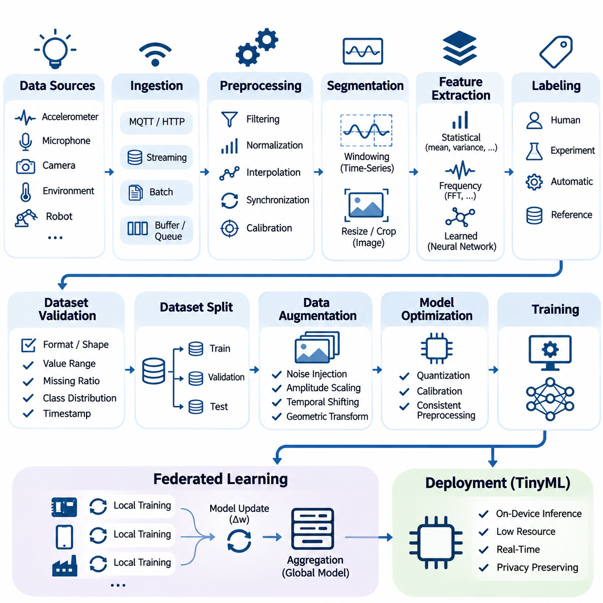
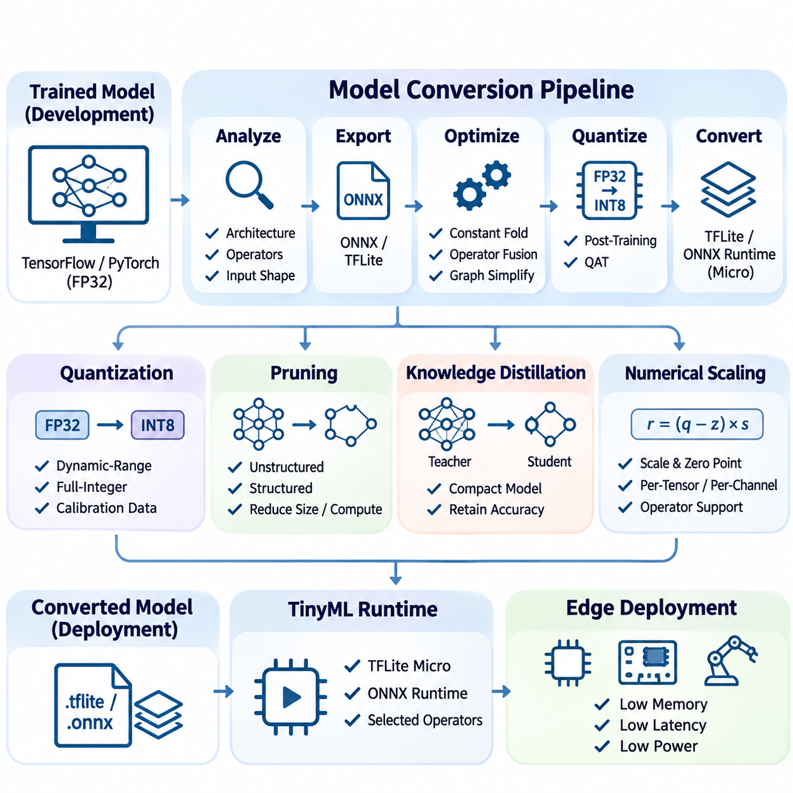
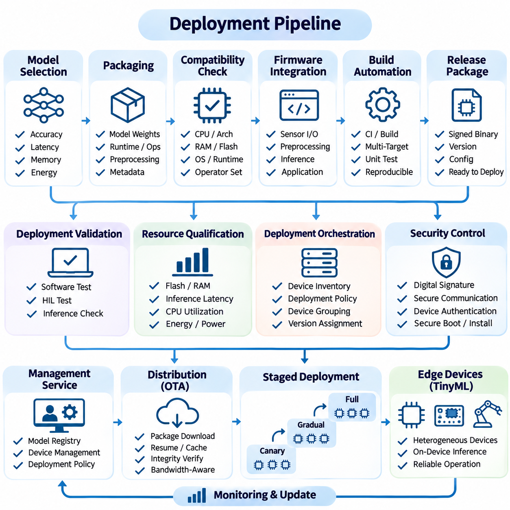
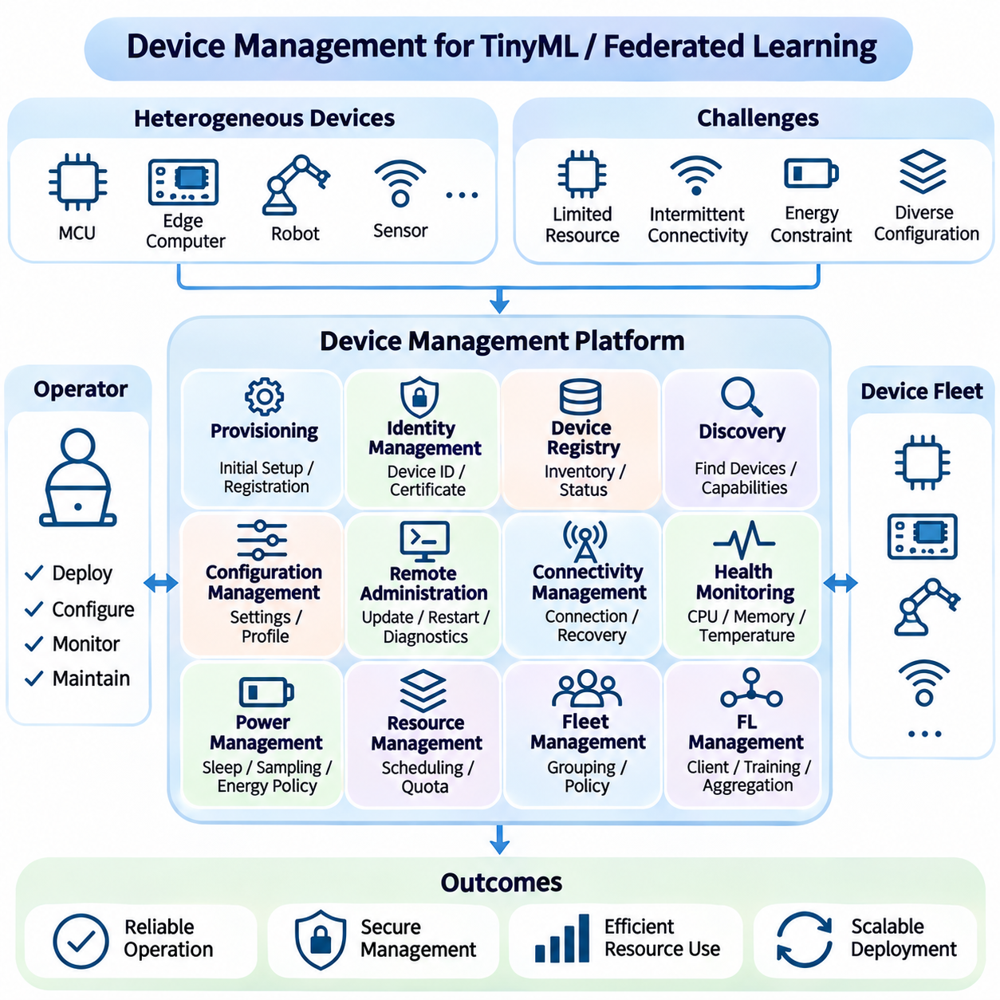
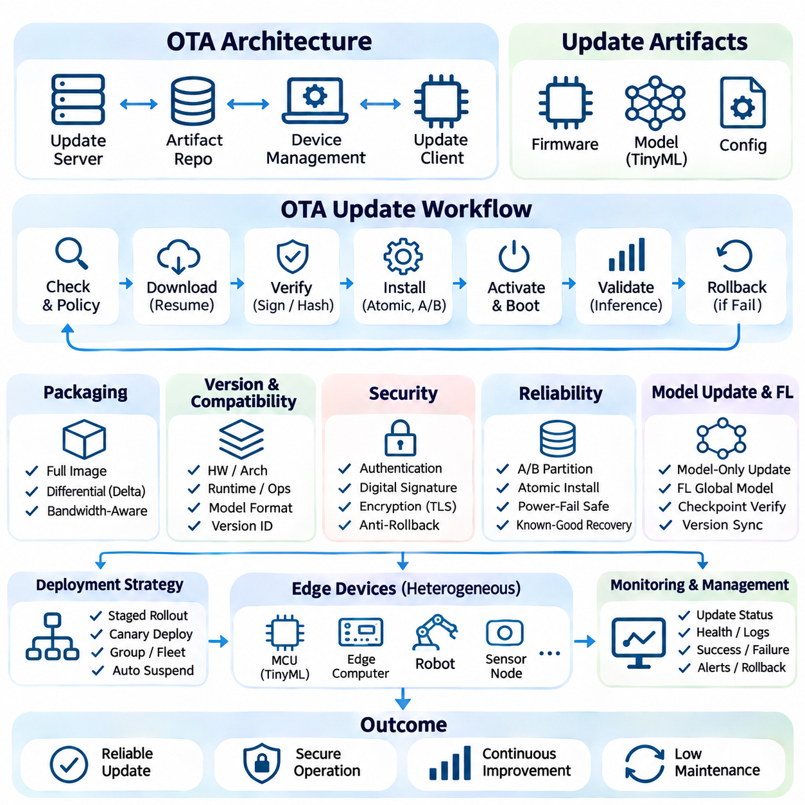
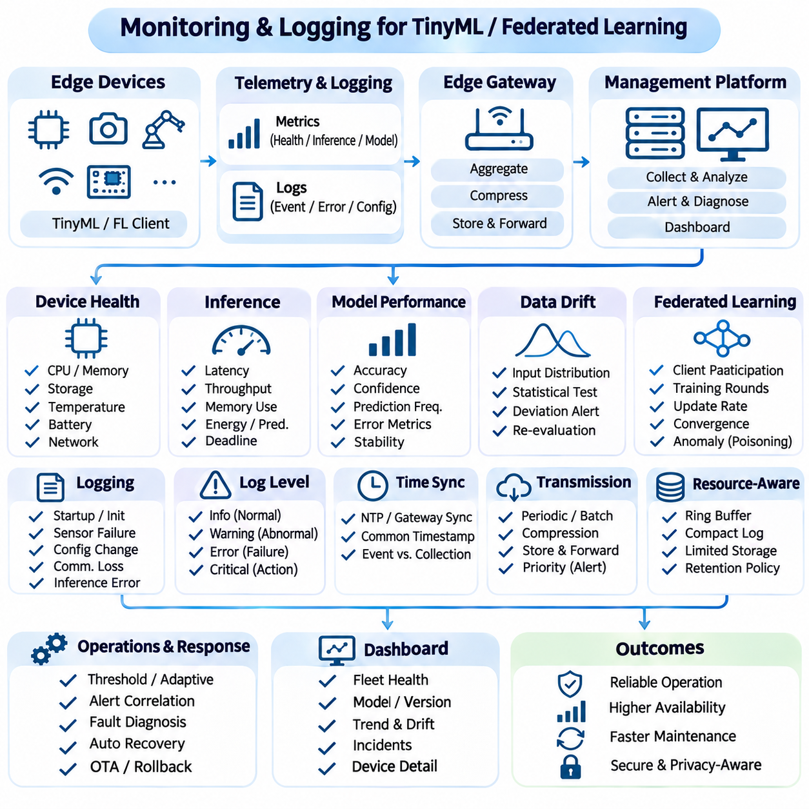
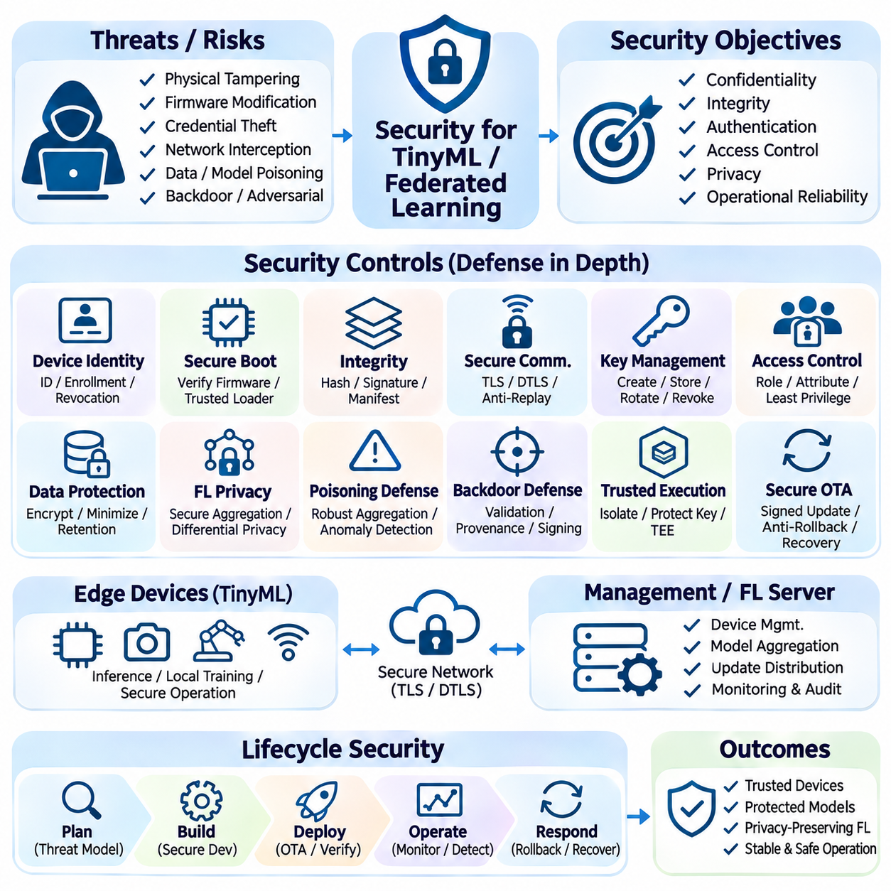

**Volume 40.** **TinyML and Federated Learning**

# 07. Engineering and Deployment

## 07.01 Data Pipeline [w/Code]

{width="7.268055555555556in" height="7.268055555555556in"}

A data pipeline for TinyML and federated learning provides the engineering foundation for transforming raw information into reliable datasets suitable for training, validation, and deployment. Unlike conventional cloud-based machine learning, these systems must accommodate limited memory, computational capacity, energy availability, and network connectivity. Effective pipeline design therefore balances data quality, processing efficiency, privacy, and operational reliability across heterogeneous devices.

The pipeline begins with data acquisition from embedded sensors, mobile devices, industrial controllers, and distributed edge systems. Typical sources include accelerometers, microphones, cameras, environmental sensors, and robotic telemetry. Each source produces information with different sampling frequencies, formats, and quality characteristics. Acquisition mechanisms must preserve timestamps, sensor identifiers, calibration metadata, and contextual information needed for subsequent processing.

Data ingestion establishes a consistent interface between physical devices and downstream processing components. Streaming architectures handle continuously generated measurements, while batch pipelines process previously recorded observations. Lightweight communication protocols such as MQTT and HTTP can transport data when connectivity permits. Local buffering and persistent queues help prevent information loss during network interruptions, particularly in intermittently connected embedded environments.

Raw sensor measurements frequently contain noise, missing values, inconsistent sampling intervals, and hardware-dependent distortions. Preprocessing operations address these problems through filtering, normalization, interpolation, synchronization, and calibration. For TinyML applications, preprocessing must remain compatible with device capabilities. Computationally expensive transformations may be performed during offline training, while lightweight equivalents execute during real-time inference.

Signal segmentation converts continuous measurements into structured samples suitable for machine learning. Time-series applications commonly employ fixed-length windows with configurable overlap, while image pipelines use resizing, cropping, and color normalization. Window duration influences temporal resolution, prediction latency, and memory consumption. Selecting appropriate segmentation parameters requires considering the physical characteristics of the observed process and the intended inference frequency.

Feature extraction transforms acquired observations into representations that emphasize relevant patterns while reducing unnecessary information. Statistical features such as mean, variance, energy, and frequency-domain coefficients can support compact models. Alternatively, neural networks may learn representations directly from minimally processed signals. The choice depends on computational constraints, available training data, expected accuracy, and the cost of reproducing preprocessing operations on embedded hardware.

Data labeling establishes the relationship between observations and target predictions. Labels may originate from human annotation, controlled experiments, automated instrumentation, or validated reference systems. In distributed environments, inconsistent labeling conventions can introduce substantial model errors. A well-designed pipeline maintains explicit class definitions, annotation guidelines, confidence indicators, and traceability between original measurements and their associated labels.

Dataset validation verifies that collected information satisfies predefined structural and statistical requirements. Validation checks may include expected tensor dimensions, acceptable numerical ranges, missing-value ratios, class distributions, and timestamp consistency. Automated validation prevents corrupted or incompatible samples from entering training workflows. Quality reports also reveal systematic differences between devices, operating conditions, and acquisition environments.

Training, validation, and test datasets must be separated carefully to obtain meaningful performance estimates. Randomly splitting overlapping sensor windows can produce data leakage because adjacent samples often share substantial information. Device-level, session-level, subject-level, or chronological partitioning may provide more realistic evaluation conditions. The selected strategy should reflect how the deployed model will encounter previously unseen environments and observations.

Data augmentation improves model robustness by introducing controlled variations into training samples. Sensor applications may employ noise injection, amplitude scaling, temporal shifting, or geometric transformations. However, augmentation must preserve the physical meaning and target label of each observation. Unrealistic transformations can damage model reliability, particularly when deployed systems operate under strict safety or accuracy requirements.

TinyML pipelines must account for the relationship between preprocessing and model optimization. Quantized models often require carefully calibrated input ranges, consistent normalization constants, and representative calibration datasets. Differences between training-time preprocessing and embedded inference can cause significant accuracy degradation. Maintaining identical transformation definitions across development and deployment environments reduces numerical inconsistencies and improves reproducibility.

Federated learning introduces a distributed data architecture in which training information remains primarily on participating devices or within local organizational environments. Instead of transmitting raw datasets to a central server, clients perform local training and communicate model updates. This architecture reduces the need for centralized data collection but introduces additional challenges involving heterogeneous data distributions, inconsistent device capabilities, and communication availability.

Non-independent and identically distributed data represents a fundamental challenge in federated pipelines. Individual clients may observe different classes, operating conditions, sampling frequencies, and dataset sizes. These differences can bias local optimization and slow global convergence. Effective pipeline engineering therefore includes client-level distribution analysis, standardized preprocessing, dataset quality assessment, and mechanisms for detecting substantial statistical divergence.

Federated data preparation must preserve local privacy boundaries while supporting consistent model training. Each participating client should apply compatible feature transformations, label mappings, and validation rules. Local dataset manifests can record sample counts, schema versions, and processing configurations without exposing sensitive observations. Aggregated quality indicators may help coordinators identify unreliable participants, provided that reporting mechanisms respect established privacy requirements.

Privacy-preserving processing requires more than keeping raw data on local devices. Intermediate features, diagnostic logs, and model updates may reveal information about underlying training samples. Data minimization, access controls, encryption, and appropriate retention policies should therefore be incorporated throughout the pipeline. Differential privacy and secure aggregation can provide additional protections when their assumptions, implementation requirements, and performance tradeoffs are properly evaluated.

Resource-aware pipeline scheduling coordinates preprocessing, training, and communication with available device capacity. Embedded clients may postpone computationally intensive operations until sufficient energy, memory, or processing resources become available. Streaming buffers and bounded queues prevent uncontrolled memory growth. Adaptive scheduling can prioritize essential inference workloads while allocating remaining resources to background learning and data preparation.

Reliable pipeline implementation benefits from modular software components with clearly defined input and output contracts. Acquisition, validation, transformation, partitioning, and serialization should remain independently testable. Configuration files can describe sampling rates, window sizes, normalization parameters, and dataset locations. This separation simplifies debugging, supports hardware migration, and enables consistent processing across development workstations and embedded targets.

Python-based implementations commonly use NumPy for numerical transformations, pandas for structured records, and framework-specific dataset interfaces for training. Embedded implementations may reproduce selected operations using C, C++, or optimized signal-processing libraries. Numerical equivalence should be tested using shared reference inputs and defined tolerances. Automated tests can compare preprocessing outputs across platforms before converted models are deployed.

Data serialization determines how efficiently samples move between processing stages and storage systems. Compact binary formats can reduce storage overhead and parsing costs compared with verbose textual representations. Schema definitions should specify data types, dimensions, byte ordering, and metadata requirements. Versioned serialization contracts prevent silent incompatibilities when sensor firmware, preprocessing algorithms, or machine learning frameworks change.

Reproducibility requires explicit tracking of dataset versions, processing parameters, random seeds, software dependencies, and transformation histories. Each trained model should reference the precise data configuration used during development. Content hashes and immutable dataset manifests help detect unintended modifications. In federated environments, reproducibility additionally requires recording client participation policies, local training configurations, and aggregation settings.

Pipeline monitoring evaluates both information quality and operational behavior. Useful measurements include ingestion throughput, processing latency, rejected-sample counts, memory consumption, energy usage, and communication overhead. Statistical monitoring can identify changes in sensor distributions or unexpected class frequencies. These indicators support early detection of data drift, device degradation, and processing failures before they significantly affect model performance.

Fault tolerance is especially important when distributed devices operate without continuous supervision. Pipelines should recover from interrupted acquisition, incomplete files, corrupted records, and temporary communication failures. Checkpointing, transactional writes, bounded retry policies, and integrity verification reduce the risk of inconsistent datasets. Recovery procedures must also prevent duplicated samples and preserve the chronological ordering required by time-dependent learning tasks.

An industrial TinyML example may collect vibration measurements from multiple machines, preprocess signals locally, and generate compact windows for anomaly detection. Each device can maintain a private training dataset while participating in federated model improvement. Local quality checks reject invalid measurements, and standardized transformations maintain compatibility across machines. Central coordination then focuses on model aggregation and operational monitoring rather than raw-data collection.

Robotic systems introduce additional requirements because perception and control measurements often depend on precise temporal relationships. Camera frames, inertial measurements, encoder readings, and control commands must be synchronized before generating training examples. Calibration records and operating-state metadata provide essential context. Pipeline designs should also distinguish between real-time inference data paths and asynchronous training paths to avoid interference with time-critical control functions.

A production-ready data pipeline ultimately connects reliable acquisition, consistent preprocessing, privacy-aware distributed learning, and resource-efficient embedded execution. Its effectiveness depends on measurable data quality, reproducible transformations, robust failure handling, and compatibility with downstream model conversion and deployment. Treating data engineering as a continuous operational process enables TinyML and federated learning systems to remain dependable as devices, environments, and learning requirements evolve.

## 07.02 Model Conversion [w/Code]

{width="7.268055555555556in" height="7.268055555555556in"}

Model conversion transforms trained machine learning models into representations compatible with embedded processors, microcontrollers, and distributed edge devices. Conventional training frameworks typically produce models optimized for development environments rather than resource-constrained hardware. Conversion bridges this gap by adapting computational graphs, numerical representations, and operator implementations while preserving predictive behavior. Its effectiveness determines whether a model can execute reliably within practical memory, latency, and energy limits.

The conversion process begins with an examination of the original model architecture, input specifications, and computational requirements. Engineers identify supported layers, tensor dimensions, activation functions, and dependencies on framework-specific operations. Static input shapes and predictable execution paths are particularly valuable for embedded deployment. Unsupported operators, dynamic control flow, and excessive intermediate tensors may require architectural modifications before conversion can proceed successfully.

Model export creates an intermediate representation that separates the learned parameters from the original training environment. Formats such as ONNX provide a standardized description of computational graphs, operators, and tensor relationships. TensorFlow models can be converted into TensorFlow Lite representations, while PyTorch models may use supported export pathways. The selected format must remain compatible with the target runtime, operator set, hardware architecture, and intended optimization techniques.

Computational graph optimization reduces unnecessary operations and simplifies execution dependencies. Constant folding evaluates expressions whose inputs are known during conversion, eliminating redundant runtime calculations. Operator fusion combines compatible operations, such as convolution and activation, into more efficient execution units. Graph simplification can reduce memory transfers and intermediate allocations, although optimization must preserve numerical correctness and supported execution semantics.

Quantization is one of the most important conversion techniques for TinyML deployment. It replaces high-precision numerical representations with lower-precision alternatives, commonly converting 32-bit floating-point weights and activations into 8-bit integers. This transformation can substantially reduce model storage requirements and improve inference efficiency on compatible processors. However, the actual performance improvement depends on hardware instructions, runtime implementations, and quantization overhead.

Post-training quantization applies numerical compression after model training without requiring complete retraining. Dynamic-range quantization primarily reduces weight precision, while full-integer quantization targets both weights and activations. Representative calibration datasets are necessary when activation ranges must be estimated. These datasets should reflect realistic operating conditions because inaccurate calibration can cause saturation, excessive rounding errors, and reduced prediction accuracy.

Quantization-aware training incorporates simulated quantization effects into the optimization process before final conversion. Fake-quantization operations approximate the numerical behavior of reduced-precision inference while allowing gradient-based learning. This approach can recover accuracy when post-training quantization introduces unacceptable degradation. Nevertheless, quantization-aware training increases development complexity and requires consistency between simulated arithmetic and the actual target runtime.

Numerical scaling determines how floating-point values are represented using integer arithmetic. Quantized tensors commonly use scale factors and zero points to map integer values into approximate real-number ranges. Per-tensor quantization applies shared parameters across an entire tensor, while per-channel quantization allows different scales for individual channels. The appropriate configuration depends on operator support, numerical sensitivity, and the computational characteristics of the target device.

Model pruning can complement conversion by removing parameters or structures that contribute relatively little to predictive performance. Unstructured pruning introduces sparse weight patterns, whereas structured pruning removes entire channels, filters, or computational blocks. Sparse representations reduce storage only when supported by suitable encoding and execution mechanisms. Structured pruning is often easier to exploit on conventional embedded hardware because it directly reduces tensor dimensions and arithmetic operations.

Knowledge distillation provides another route toward deployment-compatible models. A compact student network learns to approximate the predictions or internal representations of a larger teacher model. The student architecture can be designed specifically for microcontroller memory limits and supported operator libraries. Distillation is generally performed before conversion, enabling subsequent quantization and graph optimization to operate on an already efficient model.

TensorFlow Lite conversion typically produces a compact FlatBuffer representation containing the computational graph, weights, and associated metadata. TensorFlow Lite for Microcontrollers executes supported models using lightweight interpreters designed for embedded environments. Developers must verify that required operators are available in the selected runtime configuration. Operator registration can be restricted to necessary kernels, reducing firmware size and avoiding unnecessary dependencies.

ONNX-based conversion supports interoperability across compatible frameworks and inference runtimes. Exported models require validation of operator versions, tensor shapes, and numerical behavior. ONNX Runtime can execute models on supported edge platforms, while specialized embedded toolchains may accept selected ONNX graphs. Compatibility should never be assumed solely from the file format because individual runtimes support different operators, data types, and optimization capabilities.

Memory planning is a critical stage of model conversion for microcontrollers. In addition to persistent model weights, inference requires temporary activation buffers, operator scratch space, and runtime metadata. Tensor lifetime analysis allows memory regions to be reused when intermediate values are no longer needed. Static memory allocation reduces fragmentation and unpredictable allocation delays, which is especially important in deterministic embedded applications.

Embedded runtimes frequently organize temporary memory into a tensor arena allocated before inference begins. The arena must accommodate intermediate tensors and execution-specific working buffers. Insufficient allocation causes initialization or inference failures, while excessive allocation wastes scarce memory resources. Engineers should measure actual memory consumption on the target hardware rather than relying exclusively on model file size or theoretical parameter counts.

Hardware-specific optimization adapts converted models to available processor instructions and accelerator capabilities. ARM Cortex-M devices may benefit from CMSIS-NN kernels, while processors with digital signal processing extensions can accelerate selected arithmetic operations. Dedicated neural processing units may require proprietary compilation or graph partitioning. Effective conversion therefore involves matching model operators, tensor layouts, and numerical precision to supported hardware execution paths.

Operator compatibility often determines whether an otherwise accurate model can be deployed. Certain activation functions, normalization layers, attention mechanisms, and tensor manipulation operations may not have efficient embedded implementations. Conversion tools may reject unsupported operators or preserve them as custom operations. Engineers must evaluate whether replacing, approximating, or implementing these operations is preferable to selecting a different model architecture.

Input preprocessing must remain consistent throughout conversion and deployment. Normalization constants, sensor calibration parameters, image channel ordering, and tensor layouts must match the original training configuration. Quantized input tensors additionally require correct integer scaling and zero-point handling. Even when conversion preserves the computational graph, mismatched preprocessing can produce substantial prediction errors that are incorrectly attributed to quantization.

Conversion validation compares outputs from the original model and its deployment representation using identical test inputs. Numerical comparisons can measure absolute error, relative error, and differences in predicted class probabilities. Task-level evaluation should also examine classification accuracy, detection performance, or regression error. Small tensor-level deviations may be acceptable when application behavior remains stable, but safety-critical systems require stricter validation criteria.

Representative testing should cover normal operating conditions, boundary cases, and challenging input distributions. For sensor models, these conditions may include noise, changing temperatures, unusual motion patterns, and calibration differences. Testing only a small collection of convenient samples can conceal conversion-induced failures. A reliable validation process uses independent evaluation datasets and records performance differences across meaningful operating scenarios.

Inference benchmarking measures the practical consequences of conversion on the intended hardware. Important metrics include model storage size, peak RAM consumption, execution latency, throughput, and energy per inference. Measurements should account for preprocessing, runtime initialization, and memory allocation when these operations affect deployment requirements. Hardware measurements are more reliable than theoretical operation counts because kernel efficiency and memory access patterns strongly influence execution performance.

Federated learning introduces additional conversion considerations because participating devices may use different processor architectures and runtime capabilities. A shared global model must remain compatible with the local training and inference environments of participating clients. Some systems maintain higher-precision training representations while distributing optimized inference models. Conversion policies must preserve model identity, parameter compatibility, and the intended relationship between local updates and global aggregation.

On-device learning further complicates conversion because inference-only representations may not support gradient computation or parameter updates. Training-capable runtimes require additional operators, gradient storage, and optimizer state. Quantized inference models may therefore coexist with separate trainable representations. Engineers should distinguish between models intended exclusively for inference and models designed for local adaptation before selecting conversion formats and optimization strategies.

Automated conversion pipelines improve reproducibility by integrating export, optimization, quantization, validation, and packaging into controlled workflows. Configuration files can specify input dimensions, representative datasets, target runtimes, and precision requirements. Continuous integration systems may reject converted models that exceed memory budgets or violate accuracy thresholds. Versioned artifacts and conversion logs provide traceability between source checkpoints and deployed binaries.

A reliable model conversion workflow ultimately balances predictive accuracy with executable efficiency and hardware compatibility. Successful conversion requires more than producing a smaller model file; it demands verified numerical behavior, supported operators, predictable memory usage, and measured performance on actual devices. By integrating conversion into the broader engineering lifecycle, TinyML and federated learning systems can deploy optimized models consistently across heterogeneous embedded environments.

## 07.03 Deployment Pipeline [w/Code]

{width="7.268055555555556in" height="7.268055555555556in"}

A deployment pipeline provides a controlled process for transferring validated machine learning models from development environments to operational edge devices. In TinyML and federated learning systems, deployment must accommodate heterogeneous processors, restricted memory, intermittent connectivity, and strict energy budgets. The pipeline integrates model packaging, compatibility verification, firmware preparation, distribution, installation, and runtime validation to ensure reliable operation across distributed hardware.

Deployment begins with selecting a model artifact that satisfies predefined accuracy, latency, memory, and energy requirements. The artifact should originate from a reproducible training and conversion process with documented dependencies and evaluation results. Model registries maintain version identifiers, configuration metadata, and compatibility information. These records establish traceability between source datasets, training checkpoints, converted representations, and deployed device configurations.

Artifact packaging combines the converted model with the components required for execution. Depending on the target platform, packages may contain model weights, operator libraries, preprocessing parameters, runtime configurations, and application metadata. Microcontroller deployments often embed model arrays directly into firmware, while more capable edge computers may load models from external storage. Package structure must remain compatible with available memory, storage, and boot mechanisms.

Target compatibility verification determines whether a model can execute correctly on the intended hardware and software environment. Relevant characteristics include processor architecture, instruction extensions, available RAM, flash capacity, operating system, and inference runtime version. Hardware accelerators may introduce additional requirements involving compiler versions and supported operators. Automated compatibility checks reduce the risk of distributing artifacts that cannot initialize or execute on deployed devices.

Firmware integration connects the converted model to sensor interfaces, preprocessing routines, inference execution, and application logic. Embedded implementations commonly use C or C++ with lightweight inference libraries such as TensorFlow Lite Micro. The application must allocate memory, initialize required operators, configure sensor acquisition, and invoke inference at appropriate intervals. Integration testing verifies that model execution does not interfere with essential device functions.

Build automation transforms source code and model artifacts into reproducible deployment packages. Continuous integration systems can compile firmware for multiple target architectures, execute unit tests, and validate package metadata. Build configurations should specify compiler versions, optimization flags, linked libraries, and hardware-specific parameters. Reproducible builds improve debugging and help ensure that tested binaries correspond exactly to distributed releases.

Deployment validation includes both software-level testing and hardware-in-the-loop evaluation. Software tests verify preprocessing consistency, operator compatibility, and expected inference outputs. Hardware-in-the-loop tests execute the application on representative devices connected to simulated or physical sensors. These tests reveal timing problems, memory limitations, and hardware interactions that may remain undetected in desktop development environments.

Resource qualification confirms that the deployed application operates within device constraints. Measurements should include firmware storage requirements, peak RAM usage, inference latency, processor utilization, and energy consumption. Real-time systems must also evaluate scheduling behavior and worst-case execution time. Resource margins are necessary because communication, logging, and other application components compete with inference workloads for limited hardware capacity.

Deployment orchestration coordinates the distribution of validated packages across device populations. A central management service may maintain device inventories, deployment policies, and software version assignments. Devices can be grouped according to processor type, geographic region, application function, or operational criticality. Group-based deployment enables targeted releases and prevents incompatible updates from reaching unsupported hardware configurations.

Network conditions strongly influence deployment strategies in distributed edge environments. Devices with reliable connectivity may retrieve packages directly from management servers, while intermittently connected systems require resumable downloads and local caching. Package integrity verification detects incomplete or corrupted transfers. Bandwidth-aware scheduling can reduce communication costs and avoid disrupting operational data streams during deployment.

Security controls protect the deployment process against unauthorized modifications and malicious software distribution. Cryptographic signatures authenticate firmware and model packages, while secure communication channels protect transfer integrity and confidentiality. Device authentication prevents untrusted endpoints from accessing deployment services. Secure boot and verified installation mechanisms can extend trust from package delivery into the device execution environment.

Staged deployment reduces operational risk by introducing new releases to limited device populations before broader distribution. Canary deployments initially target representative devices and monitor their behavior under real workloads. Successful releases can gradually expand to additional groups, while detected failures trigger deployment suspension. This approach is particularly valuable when hardware diversity and environmental variation make laboratory testing insufficient.

Rollback mechanisms restore previously validated software when new deployments introduce unacceptable behavior. Devices may retain a known-good firmware image or maintain separate installation partitions. Recovery procedures should preserve essential configuration data and prevent repeated installation failures. Rollback decisions can depend on initialization errors, inference failures, resource violations, or operational health indicators collected after deployment.

Runtime initialization verifies that deployed models can load successfully and execute required operations. The application should confirm model compatibility, allocate working memory, initialize sensor interfaces, and perform diagnostic inference when appropriate. Initialization failures must produce actionable error information without compromising device stability. Systems with strict availability requirements may activate a safe fallback mode when inference functionality becomes unavailable.

Operational monitoring provides continuous evidence that deployed models satisfy their intended performance requirements. Relevant indicators include inference latency, prediction confidence, memory utilization, energy consumption, and device availability. Monitoring should also identify changes in input distributions and unexpected application behavior. Lightweight telemetry mechanisms are necessary because excessive logging and communication can undermine the efficiency of resource-constrained systems.

Federated learning introduces deployment requirements related to global model synchronization and client participation. A coordination service distributes approved model versions to eligible devices before local training rounds begin. Clients must verify parameter compatibility, training configuration, and available resources. Version mismatches can invalidate aggregation results, making explicit model identifiers and participation rules essential for reliable distributed learning.

Federated deployment pipelines may manage separate artifacts for inference and local training. Inference packages prioritize compact representations and efficient execution, while training packages may require higher-precision parameters, gradient operations, and optimizer state. The deployment system must distinguish these capabilities and prevent training tasks from being assigned to unsupported devices. Consistent model lineage links local updates to their corresponding global checkpoints.

On-device learning requires additional controls because model parameters can change after initial deployment. Local adaptation procedures should operate within predefined memory, energy, and performance limits. Updated models require validation before replacing active inference versions. Checkpointing and recovery mechanisms protect against interrupted training, corrupted parameters, and unexpected degradation caused by unsuitable local observations.

Deployment configuration management separates device-specific settings from model binaries whenever practical. Configuration parameters may define sampling frequencies, inference intervals, communication endpoints, and operational thresholds. Version-controlled configurations simplify environment-specific adjustments without requiring unnecessary model recompilation. Compatibility checks must ensure that configuration changes remain consistent with model input requirements and application behavior.

A practical TinyML deployment may involve distributing a quantized vibration-classification model to industrial monitoring nodes. The pipeline compiles firmware containing the model, verifies memory requirements, and tests inference against reference signals. A limited device group receives the initial release before broader installation. Operational telemetry then confirms that classification latency, energy consumption, and sensor processing remain within established limits.

Robotic deployments require additional attention to real-time execution and operational safety. Perception models may share processors with localization, navigation, communication, and control software. Deployment testing must verify scheduling priorities and ensure that inference workloads do not violate critical timing requirements. Model failures should be isolated from safety functions, and validated fallback behavior should remain available when perception services become unreliable.

Continuous deployment practices connect model development with operational feedback and controlled release management. Automated pipelines can reject artifacts that fail accuracy tests, exceed resource budgets, or violate security policies. Successful builds proceed through compatibility checks, hardware validation, staged distribution, and post-deployment monitoring. This structured process reduces manual errors and supports consistent model updates across heterogeneous embedded platforms.

A reliable deployment pipeline ultimately transforms optimized machine learning models into maintainable operational systems. Its success depends on reproducible artifacts, verified hardware compatibility, secure distribution, resource-aware execution, and effective recovery mechanisms. By combining automated engineering workflows with continuous operational validation, TinyML and federated learning deployments can remain scalable, dependable, and adaptable throughout their lifecycle.

## 07.04 Device Management

{width="7.268055555555556in" height="7.268055555555556in"}

Device management provides the operational foundation for controlling, monitoring, and maintaining distributed hardware throughout its lifecycle. In TinyML and federated learning environments, devices differ in processing capacity, memory, energy availability, connectivity, and software configurations. Effective management coordinates these heterogeneous resources while ensuring reliable inference, secure communication, consistent configuration, and controlled participation in distributed learning.

Device provisioning establishes the initial configuration required for secure and reliable operation. Provisioning procedures assign unique identifiers, register hardware capabilities, install trusted software, and configure communication parameters. Each device should receive appropriate authentication credentials and deployment policies before joining an operational network. Automated provisioning reduces configuration errors and supports scalable installation across large device populations.

Device identity management maintains a trustworthy relationship between physical hardware and its registered digital representation. Unique device identifiers may be associated with hardware serial numbers, cryptographic certificates, and organizational ownership records. Identity verification prevents unauthorized devices from participating in management operations or federated training. Credential rotation and revocation mechanisms help preserve security when devices are replaced, compromised, or retired.

A centralized device registry maintains structured information about deployed hardware and its operational state. Registry records may include processor architecture, memory capacity, firmware version, model version, connectivity characteristics, and deployment location. Accurate inventories enable compatibility checks, targeted updates, and resource-aware scheduling. Registry synchronization is necessary when devices frequently disconnect or change their operating configurations.

Device discovery enables management services to identify available nodes and determine their supported capabilities. Discovery mechanisms may rely on network announcements, authenticated registration, or predefined infrastructure records. In constrained environments, discovery traffic should remain lightweight to minimize communication and energy overhead. Capability information allows orchestration services to assign inference, monitoring, or training tasks only to suitable devices.

Configuration management ensures that distributed devices operate according to approved parameters and application requirements. Configurations may define sensor sampling rates, inference intervals, communication endpoints, logging levels, and power-management policies. Version-controlled configuration profiles simplify maintenance across hardware groups. Validation rules prevent incompatible settings from disrupting model execution or violating operational constraints.

Remote device administration supports maintenance without requiring continuous physical access to deployed hardware. Management functions may include configuration updates, service restarts, diagnostic requests, and controlled software installation. Remote commands should be authenticated, authorized, and recorded for auditing. Devices must reject unsupported or unsafe operations, particularly when administrative actions could interfere with critical control functions.

Connectivity management addresses the variable network conditions encountered by mobile, industrial, and geographically distributed devices. Management systems should detect connection loss, monitor communication quality, and support automatic reconnection. Local buffering allows devices to preserve essential operational information during temporary outages. Recovery procedures should restore synchronization without duplicating commands or overwhelming limited network bandwidth.

Device health monitoring evaluates hardware and software conditions that influence operational reliability. Common indicators include processor utilization, memory consumption, storage availability, temperature, battery state, communication errors, and service availability. Monitoring thresholds can identify abnormal behavior before complete failure occurs. Lightweight telemetry collection is especially important for microcontrollers and battery-powered devices with limited resources.

Power management coordinates device operation with available energy resources and application priorities. Battery-powered TinyML nodes may use sleep modes, adaptive sampling, and scheduled communication to extend operational lifetime. Federated learning clients can postpone local training when battery capacity is insufficient. Energy-aware policies should preserve essential inference functions while allocating remaining resources to maintenance, diagnostics, and background learning.

Resource management prevents competing workloads from exceeding device capabilities. Inference, preprocessing, communication, logging, and local training may share limited processor and memory resources. Scheduling policies should prioritize latency-sensitive operations and restrict background tasks when necessary. Resource quotas and admission checks can prevent memory exhaustion, excessive processor contention, and unpredictable application performance.

Fleet management organizes large device populations into manageable operational groups. Devices may be classified according to hardware platform, geographic region, application purpose, software version, or operational criticality. Group-based policies support targeted configuration changes and coordinated maintenance. Fleet-level dashboards can summarize deployment coverage, health conditions, and version consistency without requiring detailed inspection of every individual device.

Federated learning introduces additional requirements for managing client eligibility and training participation. Coordinators must determine which devices possess compatible model versions, sufficient computational resources, and suitable local datasets. Client selection may consider connectivity, battery capacity, training availability, and statistical diversity. Participation policies should avoid repeatedly overloading the same devices or systematically excluding underrepresented environments.

Client lifecycle management coordinates registration, availability assessment, training assignment, update submission, and temporary suspension. Devices may join or leave federated learning rounds because of network changes, operational demands, or resource limitations. Management systems should tolerate partial participation and distinguish expected disconnections from actual failures. Reliable state tracking helps prevent stale model updates from entering aggregation processes.

Model version management ensures that devices execute approved models and participate in compatible training procedures. Device records should associate deployed models with conversion settings, runtime dependencies, and corresponding global checkpoints. Version mismatches can produce inconsistent predictions or invalid federated updates. Explicit compatibility policies allow management services to identify outdated clients and coordinate controlled model replacement.

Security management protects devices against unauthorized access, malicious configuration changes, and compromised software. Secure boot, encrypted communication, access control, and signed firmware provide complementary protection mechanisms. Security policies should follow least-privilege principles and limit administrative permissions according to operational responsibilities. Continuous security assessment helps identify outdated credentials, vulnerable components, and abnormal device behavior.

Device attestation provides evidence that participating hardware is running an approved software configuration. Depending on hardware capabilities, attestation may use protected keys, secure elements, or trusted execution environments. Management services can evaluate attestation results before granting access to sensitive operations. However, constrained devices may require simplified trust mechanisms when advanced hardware security features are unavailable.

Fault management detects, classifies, and responds to device failures during normal operation. Faults may involve sensor malfunction, memory exhaustion, software crashes, overheating, or communication instability. Automated recovery can restart isolated services, restore validated configurations, or activate fallback operating modes. Persistent failures should trigger maintenance notifications and preserve diagnostic evidence for subsequent investigation.

Lifecycle maintenance includes installation, calibration, routine inspection, component replacement, and eventual device retirement. Calibration records help maintain consistent sensor measurements across heterogeneous hardware. Maintenance schedules may depend on operating hours, environmental exposure, and observed health indicators. Retirement procedures should revoke credentials, remove management permissions, and securely erase sensitive information when supported by the device.

Operational observability combines metrics, logs, events, and diagnostic information to explain device behavior. Time synchronization and consistent event identifiers improve correlation between local incidents and central management records. Telemetry policies should balance diagnostic value against storage, communication, and privacy costs. Aggregated fleet statistics can reveal recurring failures or performance degradation associated with particular hardware or firmware versions.

Industrial TinyML deployments illustrate the importance of coordinated device management. Vibration-monitoring nodes may operate across machines with different duty cycles, temperatures, and network conditions. A management platform can track calibration status, inference health, firmware versions, and energy consumption. Devices requiring maintenance can be isolated from model training while continuing essential monitoring when safe operation remains possible.

Robotic systems require device management policies that respect real-time control and operational safety. Autonomous platforms may contain multiple computing modules responsible for perception, localization, navigation, and communication. Management commands must not unexpectedly interrupt time-critical processes. Health monitoring should distinguish degraded AI services from safety-related failures, allowing validated fallback procedures to maintain controlled operation.

A mature device management architecture integrates provisioning, identity, configuration, monitoring, security, and lifecycle maintenance into a unified operational framework. Its effectiveness depends on accurate device inventories, predictable resource allocation, reliable recovery, and controlled federated participation. By treating hardware management as a continuous engineering discipline, TinyML and distributed learning systems can remain secure, scalable, and dependable as device populations evolve.

## 07.05 OTA Updates

{width="7.268055555555556in" height="7.268055555555556in"}

Over-the-air updates provide a mechanism for remotely distributing firmware, machine learning models, and configuration changes to deployed devices. In TinyML and federated learning systems, OTA capabilities reduce maintenance costs and enable continuous improvements without physical access. However, limited memory, intermittent connectivity, energy constraints, and hardware diversity require carefully controlled update procedures that preserve operational reliability.

An OTA architecture typically includes an update server, artifact repository, device management service, and embedded update client. The server maintains approved releases and distribution policies, while devices periodically check for compatible updates. Update manifests describe package versions, hardware requirements, dependencies, and integrity information. Clear separation between release management and installation logic improves maintainability and reduces deployment errors.

Update packaging determines how firmware and model artifacts are transferred and installed. Full-image updates replace complete software components, while differential updates transmit only changes between versions. Delta packages can reduce bandwidth consumption but require additional processing and reliable reconstruction mechanisms. Package selection depends on available flash memory, communication costs, processor capabilities, and recovery requirements.

Version management ensures that updates remain compatible with device hardware and installed software. Each package should identify supported processor architectures, firmware interfaces, model formats, and runtime dependencies. Compatibility rules prevent unsupported models from reaching devices with insufficient resources or outdated inference libraries. Explicit version identifiers also support auditing, rollback, and coordinated fleet maintenance.

Secure update delivery requires authentication, integrity verification, and protection against unauthorized modification. Digital signatures allow devices to verify that packages originate from trusted publishers. Cryptographic hashes detect accidental corruption, while encrypted communication protects data during transmission. Signature verification should occur before installation, and signing keys must be protected through appropriate lifecycle management.

Secure boot complements OTA protection by verifying executable software before device startup. A trusted bootloader can reject unauthorized firmware and prevent execution of modified images. Anti-rollback mechanisms may restrict installation of older vulnerable releases, although recovery policies must remain compatible with these restrictions. Hardware-backed trust anchors strengthen protection when supported by the target microcontroller.

Reliable downloading is essential for devices operating over unstable wireless networks. Update clients should support resumable transfers, bounded retries, and integrity checks for downloaded segments. Local caching prevents repeated transmission after temporary interruptions. Download scheduling can consider network quality, bandwidth availability, and operational priorities to avoid interfering with essential inference or communication tasks.

Flash memory organization strongly influences OTA implementation on microcontrollers. Dual-bank or A/B partition schemes retain an active firmware image while writing a new version into an inactive region. After verification, the bootloader switches to the updated image. Single-bank devices may require external storage or specialized recovery procedures, increasing the importance of power-failure protection during installation.

Atomic installation prevents partially written updates from becoming active. Update clients should verify package completeness, available storage, and compatibility before modifying executable regions. Transactional metadata and boot confirmation flags help distinguish successful installation from interrupted operations. If power fails during installation, recovery logic should restore a known-good state rather than attempting to execute incomplete firmware.

Rollback mechanisms provide a controlled response when updated software fails initialization or operational checks. Devices can retain a previously validated image and restore it after unsuccessful boot attempts. Rollback triggers may include watchdog resets, inference initialization failures, or persistent application crashes. Recovery procedures should preserve essential configuration data and report failure information when connectivity becomes available.

TinyML model updates may be distributed independently from firmware when the runtime supports external model loading. This separation reduces update size and allows faster iteration of trained models. However, model packages must remain compatible with preprocessing routines, tensor dimensions, and supported operators. A model update should never activate until integrity, compatibility, and basic inference checks have succeeded.

Federated learning creates additional OTA requirements because global models evolve through repeated aggregation rounds. Coordinators may distribute updated global parameters to participating clients before subsequent training sessions. Devices must verify model identity and checkpoint compatibility before accepting new parameters. Version-aware synchronization prevents stale clients from submitting incompatible updates or corrupting aggregation workflows.

On-device learning introduces potential conflicts between centrally distributed updates and locally adapted models. An OTA policy must define whether local parameters are preserved, merged, archived, or replaced. Blindly overwriting locally trained weights may discard valuable adaptation, while retaining incompatible parameters can destabilize inference. Explicit model lineage and compatibility checks are necessary before applying centrally distributed replacements.

Staged rollout strategies reduce the risk of widespread failures. Canary deployments initially target a small representative group of devices, allowing engineers to observe installation success, inference behavior, and resource consumption. Subsequent deployment waves expand coverage when acceptance criteria are satisfied. Automated suspension policies can stop distribution when failure rates or performance regressions exceed established thresholds.

Update scheduling must account for device energy availability and operational constraints. Battery-powered nodes may postpone downloads or installation until sufficient charge is available. Industrial equipment may require scheduled maintenance windows, while robotic platforms should avoid updates during active navigation or control tasks. Safety-critical functions must remain protected from interruptions caused by update activities.

OTA monitoring tracks the complete update lifecycle, including availability checks, downloads, verification, installation, activation, and recovery. Useful indicators include deployment coverage, transfer failures, installation duration, rollback frequency, and post-update device health. Centralized reporting supports fleet-level diagnosis, while local event records preserve information during communication outages. Monitoring overhead must remain proportional to device capabilities.

Testing OTA systems requires more than validating successful installation. Fault-injection experiments should simulate interrupted downloads, corrupted packages, insufficient memory, network disconnections, and power loss during flashing. Hardware-in-the-loop testing can verify bootloader recovery and rollback behavior on representative devices. Repeated testing across firmware versions helps identify compatibility failures before production distribution.

Configuration updates may use lightweight OTA mechanisms without replacing complete firmware images. Parameters such as sampling intervals, inference thresholds, logging policies, and communication endpoints can be delivered through authenticated configuration packages. Schema validation prevents invalid settings from disrupting device operation. Configuration changes should support version tracking and restoration of previously approved values.

A practical industrial TinyML deployment may update vibration-monitoring models across hundreds of sensor nodes. The management service first identifies compatible devices and distributes signed model packages to a limited group. Devices validate package integrity, test inference against reference inputs, and activate the new model. Operational monitoring then determines whether the update should expand to the remaining fleet.

Robotic OTA deployments require additional coordination because computing modules may depend on compatible software interfaces. Perception, localization, navigation, and control components should follow validated dependency rules. Updates must not interrupt active safety functions or introduce untested timing behavior. Coordinated activation and recovery procedures help maintain consistent system operation when multiple modules require changes.

An effective OTA update system combines secure distribution, hardware compatibility, fault-tolerant installation, controlled rollout, and continuous monitoring. Its reliability depends on protecting device trust, preserving recoverable software states, and validating operational behavior after activation. Integrating OTA management with TinyML deployment and federated learning workflows enables distributed AI systems to evolve safely without requiring frequent physical maintenance.

## 07.06 Monitoring and Logging

{width="7.268055555555556in" height="7.268055555555556in"}

Monitoring and logging provide continuous visibility into the behavior, performance, and reliability of TinyML and federated learning systems. Unlike centralized AI infrastructure, distributed edge environments operate with limited memory, processing power, energy, and network connectivity. Effective observability must therefore capture essential operational information without disrupting inference or local training. Monitoring identifies abnormal conditions, while logging preserves evidence for diagnosis and recovery.

A monitoring architecture typically combines device-level measurements, application metrics, event records, and centralized analysis services. Embedded devices collect information locally and transmit selected summaries when connectivity becomes available. Edge gateways may aggregate telemetry from multiple sensors before forwarding it to management platforms. This hierarchical approach reduces communication overhead while preserving sufficient information to evaluate system health and identify recurring operational problems.

Device health monitoring focuses on hardware conditions that influence application stability. Important measurements include processor utilization, available memory, storage capacity, temperature, battery voltage, and communication quality. Threshold-based alerts can identify overheating, memory exhaustion, or declining power availability. Monitoring intervals should reflect device capabilities and operational criticality because excessive sampling can increase energy consumption and processor contention.

Inference monitoring evaluates whether deployed models satisfy their expected computational requirements. Typical metrics include inference latency, execution frequency, peak memory consumption, processor utilization, and energy per prediction. Real-time applications should track deadline violations and latency variability rather than relying exclusively on average execution time. These measurements reveal performance degradation caused by competing workloads, firmware changes, or unexpected operating conditions.

Model performance monitoring examines the quality and consistency of predictions after deployment. Classification systems may track confidence distributions, prediction frequencies, and uncertain outputs. Regression applications can monitor prediction ranges and temporal stability. When verified ground-truth labels become available, actual accuracy and error metrics can be calculated. Without reliable labels, statistical indicators should be treated as indirect evidence rather than definitive measures of model quality.

Data drift monitoring detects changes in input characteristics relative to established reference distributions. Sensor measurements may shift because of environmental changes, equipment aging, calibration errors, or altered operating conditions. Statistical tests and lightweight distribution summaries can identify unusual deviations. However, drift does not necessarily indicate reduced predictive accuracy, so detected changes should trigger further evaluation rather than automatic model replacement.

Logging records discrete events that explain system behavior and support troubleshooting. Useful events include device startup, model initialization, sensor failures, configuration changes, communication interruptions, and inference errors. Structured logs should contain timestamps, event identifiers, severity levels, component names, and relevant diagnostic information. Consistent schemas simplify automated analysis and correlation across heterogeneous devices and software versions.

Log severity classification helps prioritize operational responses and control storage consumption. Informational records describe normal activity, warnings indicate potentially abnormal conditions, and errors identify failed operations. Critical events may require immediate intervention or activation of recovery procedures. Logging policies should avoid excessive detail during normal operation while preserving sufficient context when unexpected failures occur.

Resource-constrained devices require efficient local logging mechanisms. Fixed-size ring buffers can retain recent events without allowing uncontrolled memory growth. Compact binary records reduce storage and transmission requirements compared with verbose text messages. Persistent storage should be used selectively because repeated flash writes can increase energy consumption and contribute to memory wear. Important diagnostic records may require protected retention across device restarts.

Time synchronization is essential for correlating events across distributed devices. Network Time Protocol or gateway-based synchronization can establish approximate common timestamps when connectivity permits. Devices without reliable clocks may record monotonic counters and local elapsed time. Monitoring systems should distinguish event occurrence time from collection time to avoid incorrect causal interpretations. Clock uncertainty becomes particularly important when analyzing robotic sensor streams or federated training rounds.

Telemetry transmission must accommodate intermittent connectivity and constrained communication bandwidth. Devices may aggregate measurements, compress records, and transmit information periodically instead of continuously. Store-and-forward mechanisms preserve selected events during network outages. Bounded queues and retention policies prevent telemetry accumulation from exhausting local resources. Critical alerts may receive transmission priority when network conditions permit.

Federated learning monitoring introduces additional metrics related to client participation and distributed optimization. Coordinators may track eligible clients, selected participants, completed training rounds, update submission rates, and communication failures. Aggregated training statistics can indicate convergence behavior and participation imbalance. Monitoring should distinguish unavailable clients from failed training operations because these conditions require different recovery and scheduling responses.

Non-IID data distributions complicate interpretation of federated learning metrics. Individual clients may exhibit different losses, class distributions, and operating conditions even when the global model performs adequately. Aggregate statistics can conceal poor performance within underrepresented device groups. Evaluation should therefore consider distributional diversity and participation coverage while avoiding unnecessary disclosure of sensitive client information.

Privacy-aware logging limits the exposure of personal information, raw sensor observations, and confidential training data. Diagnostic records should contain only information necessary for operational analysis. Access controls, encryption, retention limits, and audit trails protect collected telemetry. Model updates and intermediate training statistics may also reveal sensitive information, making data minimization important throughout federated monitoring infrastructure.

Security monitoring identifies suspicious behavior affecting device integrity or distributed learning operations. Relevant events include repeated authentication failures, unauthorized configuration attempts, invalid software signatures, and unexpected communication patterns. Federated systems may additionally monitor anomalous model updates using appropriately designed validation procedures. Detection mechanisms should account for legitimate client diversity to avoid treating ordinary statistical variation as malicious activity.

Alert management converts monitoring results into actionable operational responses. Static thresholds are suitable for clearly defined hardware limits, while adaptive thresholds may accommodate changing workloads and environmental conditions. Alert correlation can group related symptoms into a single incident. Hysteresis and rate limiting reduce repeated notifications caused by temporary fluctuations. Escalation policies should reflect the severity and operational consequences of detected conditions.

Fault diagnosis combines metrics, event histories, configuration records, and software version information. A sudden increase in inference latency may result from processor contention, thermal throttling, or an inefficient model update. Correlating these measurements helps distinguish root causes from secondary symptoms. Diagnostic workflows should preserve relevant evidence before automated recovery procedures restart services or replace software components.

Monitoring can support automated recovery when predefined conditions indicate operational failure. Watchdog mechanisms may restart unresponsive applications, while device managers can restore validated configurations or activate fallback inference models. Recovery actions should be bounded to prevent repeated restart cycles. Safety-related functions require independently validated responses, particularly when AI components interact with physical actuators or time-critical control systems.

OTA update monitoring verifies whether newly deployed firmware and models operate as intended. Deployment systems should compare installation success, initialization failures, inference latency, memory consumption, and device health before and after updates. Canary groups provide early evidence of potential regressions. Automated rollback policies may use established acceptance thresholds, but decisions should consider measurement uncertainty and the operational consequences of reverting software.

Operational dashboards summarize system behavior for engineers and administrators. Fleet-level views can display device availability, firmware distribution, model versions, resource utilization, and active incidents. Detailed device views support investigation of individual failures. Historical trends reveal gradual degradation that may not trigger immediate alerts. Dashboard design should prioritize meaningful indicators rather than presenting excessive measurements without operational context.

Industrial TinyML applications illustrate how monitoring connects model behavior with equipment conditions. Vibration-monitoring nodes may report sensor quality, inference latency, anomaly frequencies, and device temperature. Changes in vibration distributions can indicate equipment deterioration or sensor calibration problems. Maintenance decisions should combine model predictions with independent operational evidence rather than treating every anomaly score as confirmed mechanical failure.

Robotic systems require monitoring that respects real-time execution and safety constraints. Perception latency, sensor synchronization, localization quality, and communication delays can influence autonomous behavior. Logging operations must not block critical control loops or create unpredictable execution delays. Separate monitoring of AI services and safety mechanisms helps identify degraded perception while preserving independently implemented protective functions.

A production monitoring strategy integrates telemetry collection, structured logging, statistical evaluation, alerting, and incident analysis into a continuous operational process. Its effectiveness depends on reliable measurements, controlled resource consumption, privacy protection, and traceable recovery actions. By linking device health with model behavior and federated learning performance, monitoring and logging enable distributed AI systems to remain dependable throughout deployment and maintenance.

## 07.07 Security

{width="7.268055555555556in" height="7.268055555555556in"}

Security is a fundamental requirement for TinyML and federated learning systems operating across distributed edge devices. These environments expose hardware, software, communication channels, and machine learning models to diverse threats. Limited processing power and memory complicate the adoption of conventional security mechanisms. Effective protection must therefore combine lightweight cryptography, trusted execution, secure management, and continuous risk assessment.

Threat modeling identifies potential attackers, vulnerable components, and consequences of security failures. Edge devices may face physical tampering, firmware modification, credential theft, network interception, and malicious model updates. Federated learning introduces additional risks associated with untrusted clients and manipulated training contributions. Security architecture should prioritize threats according to exposure, operational impact, and available defensive resources.

Device identity establishes a trusted relationship between physical hardware and management infrastructure. Unique cryptographic credentials allow servers to authenticate devices before accepting telemetry, configuration requests, or training updates. Hardware-protected keys provide stronger resistance against credential extraction when supported. Enrollment procedures must verify device ownership, while revocation mechanisms prevent compromised or retired devices from retaining network access.

Secure boot protects device initialization by verifying firmware authenticity before execution. A trusted bootloader validates digital signatures or approved measurements against established trust anchors. Unauthorized software should be rejected before accessing protected services or sensitive data. The boot process must also consider recovery images and bootloader updates, since an insecure recovery path can undermine otherwise strong firmware protection.

Firmware and model integrity must remain protected throughout storage, distribution, and execution. Cryptographic hashes detect unintended modification, while digital signatures authenticate approved software publishers. Signed manifests can bind model artifacts to firmware dependencies and compatible hardware versions. Integrity verification should occur before activation and whenever stored artifacts may have been modified by untrusted processes.

Secure communication protects information exchanged between devices, gateways, and management servers. Authenticated encryption prevents unauthorized parties from reading or modifying transmitted messages. Protocols such as TLS or DTLS may be appropriate depending on transport characteristics and device capabilities. Replay protection, certificate validation, and secure session establishment are necessary to prevent attackers from reusing captured messages or impersonating legitimate participants.

Cryptographic key management governs the creation, storage, distribution, rotation, and revocation of security credentials. Keys should never be embedded identically across an entire device fleet when individual credentials are feasible. Secure elements or protected execution environments can reduce exposure of private keys. Recovery procedures must address expired certificates and compromised credentials without introducing insecure administrative bypasses.

Access control limits operations according to authenticated identities and assigned responsibilities. Device administrators, deployment services, monitoring systems, and federated learning coordinators should receive only the permissions required for their functions. Role-based or attribute-based policies can restrict sensitive operations. Least-privilege enforcement reduces the consequences of compromised accounts and prevents unauthorized configuration or model replacement.

Data protection requires careful handling of sensor measurements, local datasets, model parameters, and operational logs. Encryption at rest can protect stored information when hardware resources permit. Data minimization reduces exposure by collecting and retaining only necessary records. Secure deletion, retention policies, and access auditing support responsible lifecycle management, although complete erasure may be difficult on some embedded storage technologies.

Federated learning reduces routine transfer of raw training data but does not automatically guarantee privacy. Shared gradients and model updates can reveal information about local examples under certain conditions. Secure aggregation can conceal individual contributions from the coordinating server while preserving aggregate computations. Differential privacy may further limit information leakage, although its noise and privacy budget can affect model utility.

Malicious federated clients may attempt data poisoning or model poisoning to manipulate the global model. Attackers can submit altered training examples, fabricated gradients, or strategically constructed parameter updates. Robust aggregation and anomaly detection may reduce some attacks but cannot guarantee protection against all adversarial strategies. Defensive evaluation should consider client heterogeneity, attacker coordination, and possible degradation of legitimate model performance.

Backdoor attacks introduce hidden behaviors that activate under specific input conditions while preserving apparently normal performance elsewhere. Such attacks may originate from compromised training datasets, malicious clients, or unauthorized model replacements. Validation should include representative operating conditions and targeted security testing. Provenance tracking and signed model artifacts help establish accountability but cannot independently prove that learned behavior is safe.

Adversarial inputs may exploit weaknesses in deployed perception models without modifying their parameters. Carefully crafted sensor patterns, visual markings, or manipulated measurements can influence predictions. Defensive approaches include input validation, robustness testing, sensor redundancy, and uncertainty monitoring. Safety-critical applications should not depend exclusively on machine learning confidence scores when determining whether physical actions are permissible.

Trusted execution environments can isolate sensitive computations and credentials from less trusted software components. Depending on hardware support, protected execution may secure key operations, model loading, or selected aggregation procedures. However, isolation mechanisms introduce implementation complexity and may remain vulnerable to side-channel attacks. Their benefits must be evaluated against memory limitations, performance overhead, and actual hardware security guarantees.

Secure OTA updates provide controlled mechanisms for repairing vulnerabilities and replacing compromised software. Update packages should be authenticated, checked for compatibility, and installed through fault-tolerant procedures. Anti-rollback policies can prevent installation of known vulnerable releases. Recovery mechanisms must preserve operational availability without permitting attackers to bypass signature verification or restore prohibited firmware versions.

Runtime security monitoring identifies suspicious activity after deployment. Relevant indicators include repeated authentication failures, unexpected firmware measurements, unusual network traffic, and unauthorized configuration attempts. Federated systems may additionally inspect abnormal training contributions and participation patterns. Monitoring must balance detection sensitivity with false positives, resource consumption, and the privacy of legitimate device activity.

Physical security is especially important for unattended edge devices deployed in factories, vehicles, and remote environments. Attackers with physical access may probe debugging interfaces, extract flash contents, or manipulate sensors. Production configurations should disable unnecessary diagnostic interfaces and protect sensitive storage. Tamper-resistant enclosures and hardware security features can raise attack costs, although physical compromise cannot always be prevented.

Supply chain security extends protection to hardware components, firmware dependencies, machine learning frameworks, and external model artifacts. Vulnerabilities may enter through third-party libraries, development tools, or counterfeit components. Software bills of materials and reproducible build procedures improve traceability. Dependency scanning, supplier assessment, and artifact verification help reduce exposure before devices enter production environments.

Security testing should examine the complete device lifecycle rather than isolated software components. Penetration testing, protocol fuzzing, firmware analysis, and fault-injection experiments can reveal implementation weaknesses. Federated learning evaluations should include simulated malicious clients and privacy leakage assessments. Tests must reflect realistic hardware limitations and deployment conditions to produce meaningful assurance evidence.

Incident response procedures define how organizations identify, contain, investigate, and recover from security breaches. Compromised devices may require credential revocation, network isolation, firmware restoration, or physical replacement. Preserved diagnostic records support forensic investigation and identification of affected software versions. Recovery plans should also address continuity of essential inference and safety-related functions during containment.

Industrial TinyML systems illustrate the relationship between cybersecurity and operational reliability. A compromised vibration-monitoring node could produce misleading equipment assessments or transmit manipulated learning updates. Device authentication, signed firmware, protected telemetry, and federated contribution validation provide complementary defenses. Maintenance personnel should distinguish suspected cyberattacks from ordinary sensor failures before initiating corrective actions.

Robotic systems require security controls that account for physical consequences. Compromised perception, navigation, or communication components may influence motion planning and actuator commands. Security architecture should separate noncritical AI services from independently validated safety functions. Authenticated commands, network segmentation, and controlled recovery procedures help reduce the possibility that a software compromise produces unsafe physical behavior.

A comprehensive security strategy integrates device trust, secure communication, protected data handling, federated learning defenses, update integrity, and continuous monitoring. No individual mechanism eliminates every threat, making defense in depth essential. Security requirements must evolve alongside hardware capabilities, deployment scale, and attacker techniques. Sustained protection depends on measurable controls, tested recovery procedures, and consistent governance across the distributed AI lifecycle.
