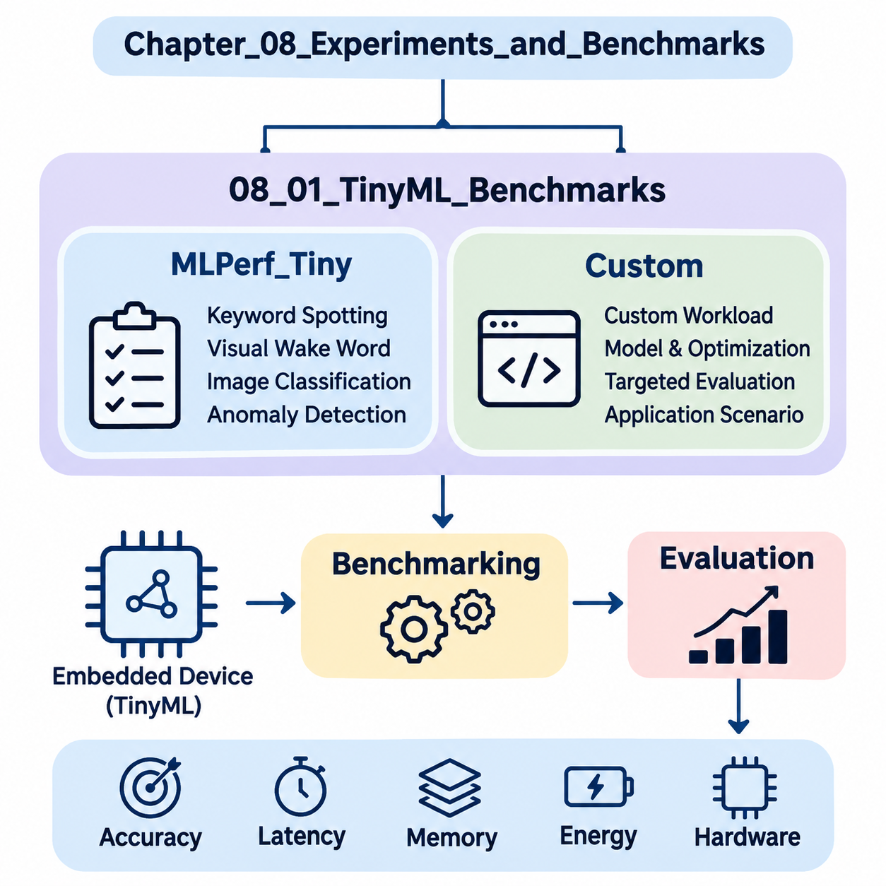
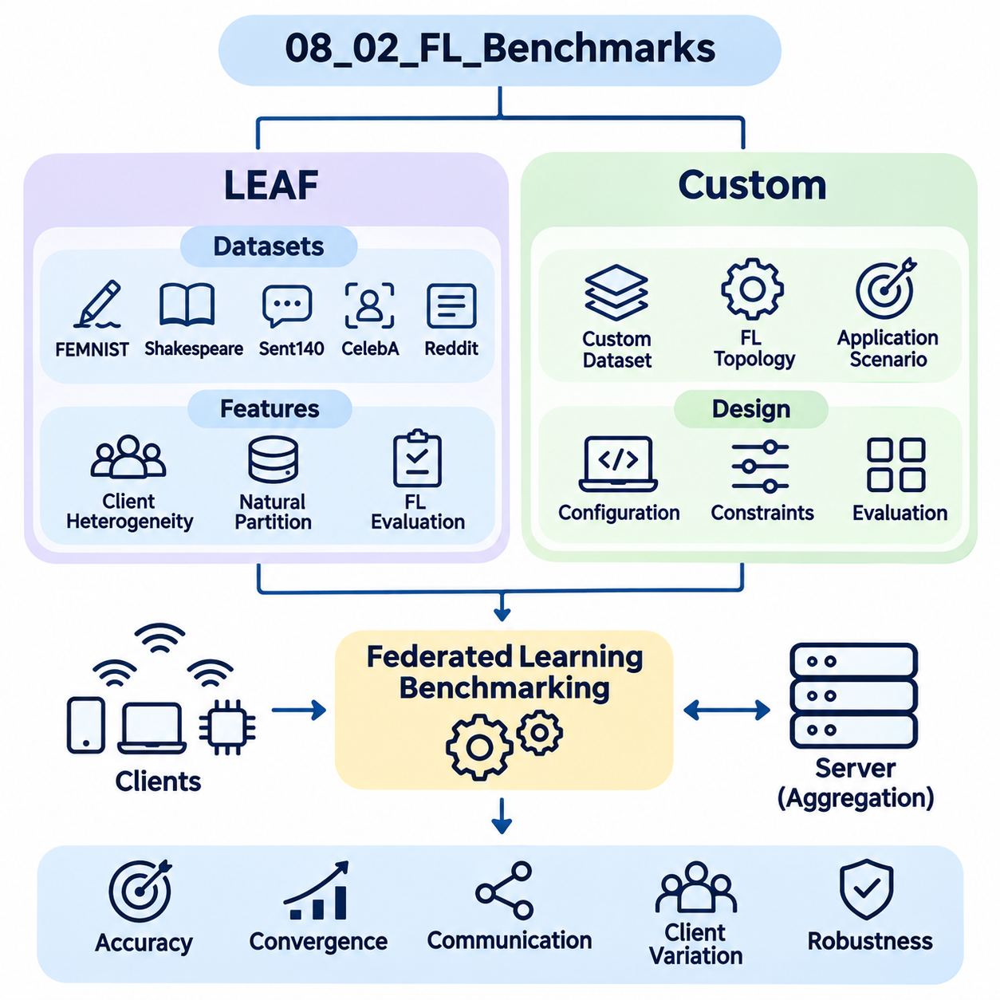
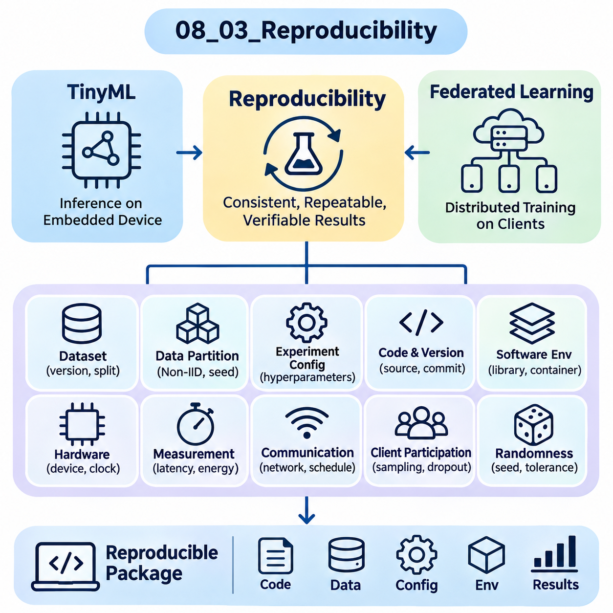
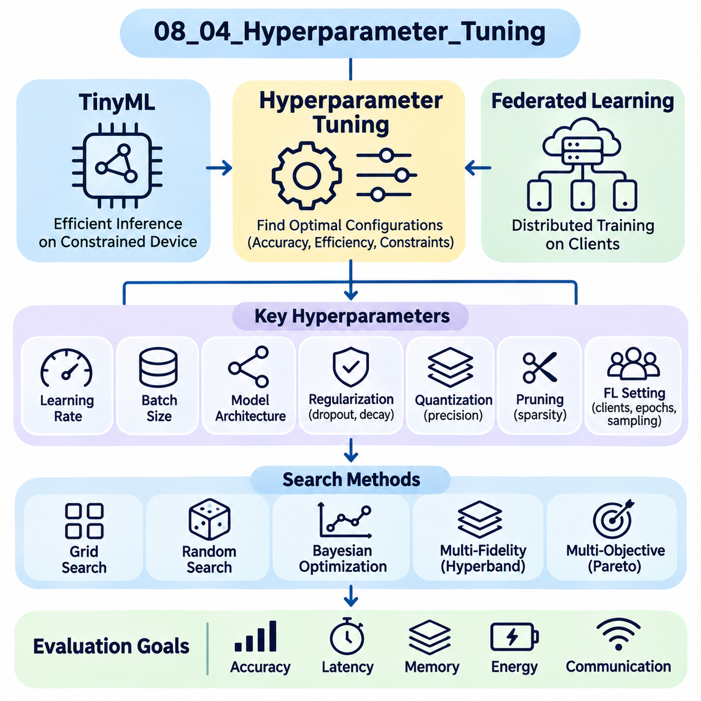
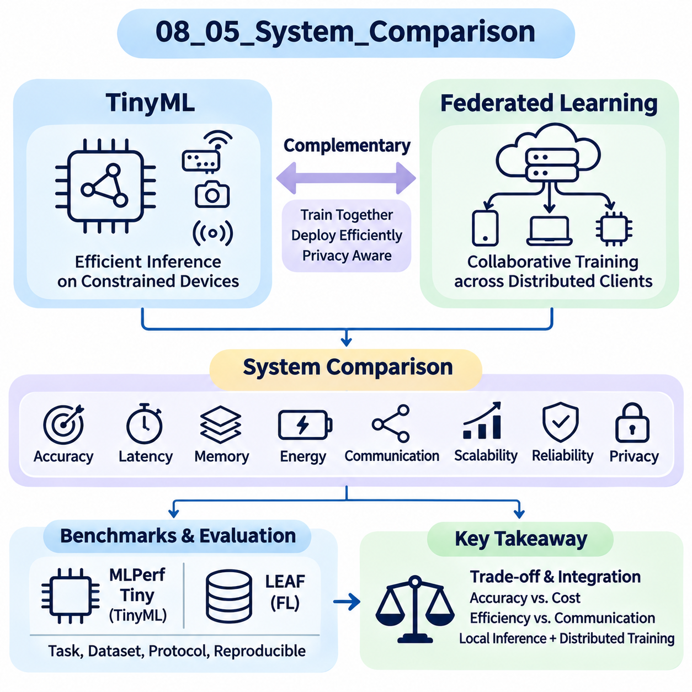

**Volume 40.** **TinyML and Federated Learning**


# 08. Experiments and Benchmarks

## 08.01 TinyML Benchmarks

{width="7.268055555555556in" height="7.268055555555556in"}

Tiny Machine Learning (TinyML) benchmarking evaluates the performance of machine learning models deployed on resource-constrained embedded devices. Unlike conventional AI benchmarks, TinyML evaluation must consider predictive accuracy, inference latency, memory consumption, energy efficiency, and hardware limitations simultaneously. These measurements determine whether a model can operate reliably within the computational and power constraints of microcontrollers and edge devices.

Benchmarking provides a standardized foundation for comparing model architectures, optimization techniques, inference frameworks, and hardware platforms. A model achieving high classification accuracy on a workstation may perform poorly on an embedded processor because of limited SRAM, flash storage, or computational throughput. Consequently, TinyML benchmarks emphasize measurements obtained from actual deployment environments rather than relying exclusively on theoretical operation counts.

MLPerf Tiny is a standardized benchmarking suite developed within the MLCommons ecosystem to evaluate machine learning inference on extremely resource-constrained devices. It provides reference workloads, evaluation procedures, and measurement conventions that support comparisons across embedded hardware platforms. Its primary objective is to establish reproducible performance measurements while preserving defined task-quality requirements and consistent execution conditions.

The MLPerf Tiny benchmark suite includes representative workloads involving keyword spotting, visual wake words, image classification, and anomaly detection. These workloads represent practical applications of embedded intelligence, including voice activation, low-resolution visual recognition, environmental monitoring, and industrial equipment diagnostics. Each workload exercises different computational patterns, memory-access characteristics, and inference requirements.

Keyword spotting benchmarks evaluate the ability of compact neural networks to recognize predefined speech commands from short audio segments. Typical implementations transform audio signals into spectral representations before applying convolutional or similarly efficient neural architectures. Benchmark measurements examine classification quality, inference latency, memory requirements, and energy consumption under controlled input and execution conditions.

Visual wake word benchmarks evaluate lightweight image recognition models designed to detect the presence of a person within an image. These workloads are relevant to battery-powered cameras, occupancy sensors, and intelligent monitoring devices. Evaluation considers the relationship between recognition accuracy and computational cost, particularly when image preprocessing, neural inference, and memory transfers compete for limited embedded resources.

Image classification benchmarks assess compact neural networks operating on small visual inputs. Representative architectures may include depthwise separable convolutional networks and quantized convolutional models. Their performance depends on arithmetic precision, tensor layout, memory allocation, and processor instruction support. Benchmark results help identify architectures that balance classification accuracy with limited computational resources.

Anomaly detection benchmarks examine whether embedded models can distinguish normal operating conditions from unusual sensor patterns. Applications include predictive maintenance, equipment monitoring, and industrial fault detection. Models may process audio or other sensor-derived features to estimate abnormality scores. Evaluation requires consistent definitions of normal behavior, anomalous samples, decision thresholds, and task-specific quality metrics.

MLPerf Tiny measurements distinguish inference latency from energy consumption because these properties describe different aspects of system performance. Latency represents the elapsed time required to execute an inference operation, while energy measures the electrical work consumed during execution. A processor completing inference quickly may consume substantial instantaneous power, whereas a slower implementation may require more total energy because of prolonged execution.

Memory utilization is another essential evaluation dimension, although memory reporting must be distinguished from the official scoring rules of a particular benchmark version. Flash memory generally stores executable code, model parameters, and persistent constants, while SRAM supports intermediate tensors, activation buffers, and runtime state. Memory profiling identifies whether a model fits within hardware limits and reveals opportunities for reducing peak allocation.

Quantization significantly influences TinyML benchmark performance by reducing numerical precision and storage requirements. Integer representations, particularly eight-bit quantization, can decrease model size and improve inference efficiency on compatible processors. However, performance improvements depend on hardware acceleration and optimized kernels. Benchmarking must therefore evaluate both numerical degradation and actual device-level execution rather than assuming quantization always improves performance.

Pruning and knowledge distillation provide additional optimization strategies that can be evaluated through standardized workloads. Pruning removes selected parameters or structures, while distillation transfers learned behavior from a larger teacher model into a smaller student model. Their effectiveness should be measured through accuracy, memory consumption, latency, and energy. Unstructured sparsity may offer limited runtime benefits when embedded inference libraries lack sparse computation support.

Hardware comparisons require careful consideration of processor architecture, operating frequency, memory hierarchy, and available acceleration instructions. ARM Cortex-M microcontrollers, RISC-V processors, and specialized embedded accelerators may execute identical neural networks with substantially different performance characteristics. Comparisons become meaningful only when model configurations, measurement boundaries, compiler settings, and benchmark rules are documented consistently.

Custom TinyML benchmarks complement standardized suites by evaluating application-specific workloads that may not be represented in MLPerf Tiny. Industrial robotics, wearable healthcare devices, environmental sensing systems, and autonomous edge platforms often require specialized evaluation procedures. These benchmarks incorporate realistic sensor characteristics, operating conditions, timing constraints, and reliability requirements that reflect the intended deployment environment.

Designing a custom benchmark begins with defining the target application and measurable performance objectives. For example, an embedded vibration-monitoring system may require anomaly detection within a fixed processing interval while maintaining low average energy consumption. A mobile robot may prioritize predictable inference latency and sensor-processing throughput. These requirements determine appropriate datasets, hardware configurations, and evaluation metrics.

Dataset selection strongly influences benchmark validity. Public datasets provide reproducible reference conditions, whereas application-specific datasets capture operational characteristics that generic benchmarks may overlook. Representative data should include realistic sensor noise, environmental variation, class imbalance, and difficult operating conditions. Separate training, validation, and testing partitions help prevent information leakage and support credible estimates of generalization performance.

Custom benchmarking must define precise timing boundaries to distinguish model execution from complete application processing. Model-only latency measures neural network inference, whereas end-to-end latency may include sensor acquisition, preprocessing, inference, postprocessing, and communication. Both measurements are valuable, but they answer different engineering questions. Explicit measurement boundaries prevent misleading comparisons between implementations.

Energy benchmarking requires appropriate measurement instrumentation and a clearly defined execution interval. External power analyzers or calibrated current-monitoring systems can capture electrical behavior during inference and idle periods. Energy per inference can be calculated by integrating power over the measured interval. For intermittently active devices, average power should additionally account for sleep states, wake-up overhead, and application duty cycles.

Real-time TinyML systems require more than favorable average latency. Robotics controllers, wearable monitoring devices, and industrial safety-related applications may impose deadlines that must be satisfied consistently. Custom benchmarks should therefore examine latency distributions, worst-observed execution times, deadline-miss rates, and scheduling interference. Such measurements reveal operational risks that average inference latency alone cannot identify.

Thermal behavior and operating frequency can also affect benchmark stability. Sustained inference may increase device temperature, alter power consumption, or trigger frequency adjustments on supported platforms. Measurements conducted immediately after startup may differ from those obtained during extended operation. Long-duration benchmark sessions help characterize performance stability and identify conditions under which computational or energy efficiency deteriorates.

Benchmark reproducibility depends on controlling software and hardware configurations. Model versions, compiler options, inference libraries, firmware revisions, processor frequencies, and measurement instruments should be recorded alongside experimental results. Repeated trials and statistical summaries help distinguish genuine performance differences from measurement variability. This documentation supports independent verification and reliable comparisons across development iterations.

A practical evaluation workflow combines standardized MLPerf Tiny measurements with application-specific custom benchmarks. Standardized results establish comparable reference performance, while custom experiments determine whether a system satisfies deployment requirements. Together, these approaches support evidence-based decisions concerning model architecture, hardware selection, optimization techniques, and embedded software design.

The ultimate purpose of TinyML benchmarking is not simply to identify the fastest neural network or the device with the lowest energy consumption. It is to determine which combination of model, inference framework, and hardware delivers sufficient predictive quality within realistic resource constraints. A comprehensive benchmark methodology transforms isolated performance measurements into engineering evidence for reliable, efficient, and scalable embedded intelligence.

초소형 머신러닝(Tiny Machine Learning, TinyML) 벤치마킹(Benchmarking)은 자원이 제한된 임베디드 장치(Embedded Device)에 배포된 머신러닝(Machine Learning) 모델의 성능을 평가하는 과정이다. 기존 인공지능(AI) 벤치마크와 달리 TinyML 평가는 예측 정확도(Predictive Accuracy), 추론 지연시간(Inference Latency), 메모리 사용량(Memory Consumption), 에너지 효율성(Energy Efficiency), 하드웨어 제약(Hardware Constraints)을 동시에 고려해야 한다. 이러한 측정은 모델이 마이크로컨트롤러(Microcontroller)와 엣지 장치(Edge Device)의 연산 및 전력 제약 내에서 안정적으로 동작할 수 있는지를 판단하는 기준이 된다.

벤치마킹은 모델 아키텍처(Model Architecture), 최적화 기법(Optimization Techniques), 추론 프레임워크(Inference Framework), 하드웨어 플랫폼(Hardware Platform)을 비교하기 위한 표준화된 기반을 제공한다. 워크스테이션(Workstation)에서 높은 분류 정확도(Classification Accuracy)를 달성한 모델이라도 제한된 정적 랜덤 접근 메모리(SRAM), 플래시 저장공간(Flash Storage), 연산 처리량(Computational Throughput)으로 인해 임베디드 프로세서(Embedded Processor)에서는 성능이 저하될 수 있다. 따라서 TinyML 벤치마크는 이론적인 연산량보다 실제 배포 환경에서 측정한 성능을 중요하게 평가한다.

MLPerf Tiny는 극도로 제한된 자원을 가진 장치에서 머신러닝 추론 성능을 평가하기 위해 MLCommons 생태계에서 개발한 표준화된 벤치마크 모음(Benchmark Suite)이다. 이 벤치마크는 참조 워크로드(Reference Workload), 평가 절차(Evaluation Procedure), 측정 규약(Measurement Convention)을 제공하여 다양한 임베디드 하드웨어 플랫폼 간 비교를 지원한다. 주요 목적은 정의된 작업 품질 요구사항(Task Quality Requirements)과 일관된 실행 조건을 유지하면서 재현 가능한 성능 측정(Reproducible Performance Measurement)을 확립하는 것이다.

MLPerf Tiny 벤치마크 모음에는 키워드 인식(Keyword Spotting), 시각적 웨이크 워드(Visual Wake Words), 이미지 분류(Image Classification), 이상 탐지(Anomaly Detection)와 관련된 대표적인 워크로드가 포함된다. 이러한 워크로드는 음성 활성화(Voice Activation), 저해상도 시각 인식(Low-Resolution Visual Recognition), 환경 모니터링(Environmental Monitoring), 산업 장비 진단(Industrial Equipment Diagnostics)과 같은 실제 임베디드 지능(Embedded Intelligence) 응용을 나타낸다. 각 워크로드는 서로 다른 연산 패턴, 메모리 접근 특성, 추론 요구사항을 평가한다.

키워드 인식 벤치마크(Keyword Spotting Benchmark)는 소형 신경망(Compact Neural Network)이 짧은 오디오 구간(Audio Segment)에서 미리 정의된 음성 명령을 인식하는 능력을 평가한다. 일반적인 구현에서는 오디오 신호(Audio Signal)를 스펙트럼 표현(Spectral Representation)으로 변환한 후 합성곱 신경망(Convolutional Neural Network) 또는 유사한 고효율 신경망 구조를 적용한다. 벤치마크 측정은 통제된 입력 및 실행 조건에서 분류 품질, 추론 지연시간, 메모리 요구량, 에너지 소비량을 분석한다.

시각적 웨이크 워드 벤치마크(Visual Wake Word Benchmark)는 이미지 내 사람의 존재 여부를 탐지하도록 설계된 경량 이미지 인식 모델(Lightweight Image Recognition Model)을 평가한다. 이러한 워크로드는 배터리 구동 카메라(Battery-Powered Camera), 재실 감지 센서(Occupancy Sensor), 지능형 모니터링 장치(Intelligent Monitoring Device)에 적합하다. 평가는 특히 이미지 전처리(Image Preprocessing), 신경망 추론(Neural Inference), 메모리 전송(Memory Transfer)이 제한된 임베디드 자원을 공유하는 상황에서 인식 정확도와 연산 비용의 관계를 고려한다.

이미지 분류 벤치마크(Image Classification Benchmark)는 작은 시각 입력(Visual Input)을 처리하는 소형 신경망을 평가한다. 대표적인 아키텍처에는 깊이별 분리 합성곱 신경망(Depthwise Separable Convolutional Network)과 양자화된 합성곱 모델(Quantized Convolutional Model)이 포함될 수 있다. 성능은 산술 정밀도(Arithmetic Precision), 텐서 배치(Tensor Layout), 메모리 할당(Memory Allocation), 프로세서 명령어 지원(Processor Instruction Support)에 따라 달라진다. 벤치마크 결과는 분류 정확도와 제한된 연산 자원 사이의 균형을 유지하는 아키텍처를 식별하는 데 활용된다.

이상 탐지 벤치마크(Anomaly Detection Benchmark)는 임베디드 모델이 정상 작동 조건과 비정상적인 센서 패턴을 구별할 수 있는지를 평가한다. 주요 응용에는 예지보전(Predictive Maintenance), 장비 모니터링(Equipment Monitoring), 산업 고장 탐지(Industrial Fault Detection)가 포함된다. 모델은 오디오 또는 기타 센서 기반 특징(Sensor-Derived Features)을 처리하여 이상 점수(Anomaly Score)를 산출할 수 있다. 평가에는 정상 동작, 이상 샘플, 판정 임계값(Decision Threshold), 작업별 품질 지표(Task-Specific Quality Metrics)에 대한 일관된 정의가 필요하다.

MLPerf Tiny 측정에서는 추론 지연시간(Inference Latency)과 에너지 소비량(Energy Consumption)을 구분한다. 두 지표가 시스템 성능의 서로 다른 측면을 설명하기 때문이다. 지연시간은 추론 연산을 수행하는 데 필요한 경과 시간을 의미하며, 에너지는 실행 중 소비된 전기적 일(Electrical Work)을 나타낸다. 추론을 빠르게 완료하는 프로세서는 순간 전력(Instantaneous Power)을 많이 소비할 수 있지만, 느린 구현은 실행시간이 길어져 총에너지 소비량이 더 커질 수도 있다.

메모리 활용도(Memory Utilization) 역시 중요한 평가 항목이지만, 메모리 보고 방식은 특정 벤치마크 버전의 공식 점수 산정 규칙(Official Scoring Rules)과 구분해야 한다. 플래시 메모리(Flash Memory)는 일반적으로 실행 코드, 모델 매개변수(Model Parameters), 영구 상수(Persistent Constants)를 저장하며, SRAM은 중간 텐서(Intermediate Tensor), 활성화 버퍼(Activation Buffer), 런타임 상태(Runtime State)를 지원한다. 메모리 프로파일링(Memory Profiling)은 모델이 하드웨어 한계 내에 수용되는지를 확인하고 최대 메모리 할당량(Peak Memory Allocation)을 줄일 기회를 식별한다.

양자화(Quantization)는 수치 정밀도(Numerical Precision)와 저장 요구량을 줄여 TinyML 벤치마크 성능에 상당한 영향을 미친다. 특히 8비트 양자화(Eight-Bit Quantization)와 같은 정수 표현(Integer Representation)은 호환되는 프로세서에서 모델 크기를 줄이고 추론 효율을 개선할 수 있다. 그러나 성능 향상은 하드웨어 가속(Hardware Acceleration)과 최적화된 커널(Optimized Kernel)에 따라 달라진다. 따라서 벤치마킹에서는 양자화가 항상 성능을 개선한다고 가정하지 않고 수치적 성능 저하(Numerical Degradation)와 실제 장치 수준의 실행 성능을 함께 평가해야 한다.

가지치기(Pruning)와 지식 증류(Knowledge Distillation)는 표준화된 워크로드를 통해 평가할 수 있는 추가적인 최적화 전략이다. 가지치기는 선택된 매개변수나 구조를 제거하고, 지식 증류는 대규모 교사 모델(Teacher Model)의 학습된 동작을 소규모 학생 모델(Student Model)로 전달한다. 이러한 기법의 효과는 정확도, 메모리 소비량, 지연시간, 에너지를 통해 측정해야 한다. 임베디드 추론 라이브러리(Embedded Inference Library)가 희소 연산(Sparse Computation)을 지원하지 않는 경우 비구조적 희소성(Unstructured Sparsity)은 실행시간 개선 효과가 제한적일 수 있다.

하드웨어 비교(Hardware Comparison)에서는 프로세서 아키텍처(Processor Architecture), 동작 주파수(Operating Frequency), 메모리 계층 구조(Memory Hierarchy), 사용 가능한 가속 명령어(Acceleration Instructions)를 신중하게 고려해야 한다. ARM Cortex-M 마이크로컨트롤러, RISC-V 프로세서, 특수 임베디드 가속기(Specialized Embedded Accelerator)는 동일한 신경망을 실행하더라도 성능 특성이 크게 다를 수 있다. 모델 구성, 측정 범위, 컴파일러 설정(Compiler Settings), 벤치마크 규칙이 일관되게 문서화되어야 의미 있는 비교가 가능하다.

사용자 정의 TinyML 벤치마크(Custom TinyML Benchmark)는 MLPerf Tiny에서 다루지 않는 응용별 워크로드(Application-Specific Workload)를 평가함으로써 표준화된 벤치마크를 보완한다. 산업용 로봇(Industrial Robotics), 웨어러블 헬스케어 장치(Wearable Healthcare Device), 환경 감지 시스템(Environmental Sensing System), 자율 엣지 플랫폼(Autonomous Edge Platform)은 특수한 평가 절차를 요구하는 경우가 많다. 이러한 벤치마크는 실제 센서 특성, 작동 조건, 시간 제약, 신뢰성 요구사항을 반영한다.

사용자 정의 벤치마크 설계(Custom Benchmark Design)는 대상 응용과 측정 가능한 성능 목표(Performance Objectives)를 정의하는 것에서 시작한다. 예를 들어 임베디드 진동 모니터링 시스템(Embedded Vibration Monitoring System)은 낮은 평균 에너지 소비량을 유지하면서 정해진 처리시간 내에 이상을 탐지해야 할 수 있다. 모바일 로봇(Mobile Robot)은 예측 가능한 추론 지연시간과 센서 처리량(Sensor Processing Throughput)을 우선시할 수 있다. 이러한 요구사항은 적절한 데이터셋(Dataset), 하드웨어 구성, 평가 지표의 선택 기준이 된다.

데이터셋 선택(Dataset Selection)은 벤치마크의 타당성(Benchmark Validity)에 큰 영향을 미친다. 공개 데이터셋(Public Dataset)은 재현 가능한 참조 조건을 제공하는 반면, 응용별 데이터셋(Application-Specific Dataset)은 일반적인 벤치마크가 반영하지 못하는 운영 특성을 포착한다. 대표성 있는 데이터에는 실제 센서 잡음(Sensor Noise), 환경 변화(Environmental Variation), 클래스 불균형(Class Imbalance), 까다로운 작동 조건이 포함되어야 한다. 학습, 검증, 테스트 데이터의 분리는 정보 누출(Information Leakage)을 방지하고 일반화 성능(Generalization Performance)의 신뢰성 있는 추정을 지원한다.

사용자 정의 벤치마킹(Custom Benchmarking)에서는 모델 실행과 전체 응용 처리 과정을 구분하기 위해 정확한 시간 측정 경계(Timing Boundaries)를 정의해야 한다. 모델 단독 지연시간(Model-Only Latency)은 신경망 추론을 측정하지만, 종단 간 지연시간(End-to-End Latency)은 센서 데이터 획득(Sensor Acquisition), 전처리, 추론, 후처리(Postprocessing), 통신(Communication)을 포함할 수 있다. 두 측정값 모두 중요하지만 서로 다른 공학적 질문에 답한다. 측정 경계를 명확히 정의하면 구현 방식 간 잘못된 비교를 방지할 수 있다.

에너지 벤치마킹(Energy Benchmarking)에는 적절한 측정 장비(Measurement Instrumentation)와 명확하게 정의된 실행 구간(Execution Interval)이 필요하다. 외부 전력 분석기(External Power Analyzer) 또는 보정된 전류 모니터링 시스템(Calibrated Current-Monitoring System)은 추론 및 유휴 상태(Idle State)에서 전기적 동작을 측정할 수 있다. 추론당 에너지(Energy per Inference)는 측정 구간에 걸쳐 전력을 적분하여 계산할 수 있다. 간헐적으로 동작하는 장치에서는 평균 전력(Average Power)을 평가할 때 절전 상태(Sleep State), 기상 오버헤드(Wake-Up Overhead), 응용 듀티 사이클(Application Duty Cycle)도 고려해야 한다.

실시간 TinyML 시스템(Real-Time TinyML System)은 우수한 평균 지연시간 이상의 성능을 요구한다. 로봇 제어기(Robotics Controller), 웨어러블 모니터링 장치, 산업 안전 관련 응용(Industrial Safety-Related Application)은 지속적으로 충족해야 하는 실행 마감시간(Deadline)을 가질 수 있다. 따라서 사용자 정의 벤치마크에서는 지연시간 분포(Latency Distribution), 관측된 최악 실행시간(Worst-Observed Execution Time), 마감시간 미준수율(Deadline-Miss Rate), 스케줄링 간섭(Scheduling Interference)을 분석해야 한다. 이러한 측정은 평균 추론 지연시간만으로 식별할 수 없는 운영 위험을 드러낸다.

열적 동작(Thermal Behavior)과 동작 주파수(Operating Frequency) 역시 벤치마크 안정성(Benchmark Stability)에 영향을 줄 수 있다. 지속적인 추론은 장치 온도를 높이고 전력 소비량을 변화시키거나 지원되는 플랫폼에서 주파수 조정(Frequency Adjustment)을 유발할 수 있다. 시스템 시작 직후 수행한 측정은 장시간 작동 중 얻은 결과와 다를 수 있다. 장시간 벤치마크 세션(Long-Duration Benchmark Session)은 성능 안정성을 특성화하고 연산 효율이나 에너지 효율이 저하되는 조건을 식별하는 데 도움이 된다.

벤치마크 재현성(Benchmark Reproducibility)은 소프트웨어 및 하드웨어 구성(Software and Hardware Configuration)을 통제하는 데 달려 있다. 모델 버전(Model Version), 컴파일러 옵션(Compiler Options), 추론 라이브러리, 펌웨어 개정판(Firmware Revision), 프로세서 주파수, 측정 장비는 실험 결과와 함께 기록해야 한다. 반복 실험(Repeated Trials)과 통계적 요약(Statistical Summary)은 실제 성능 차이와 측정 변동성(Measurement Variability)을 구분하는 데 도움이 된다. 이러한 문서화는 독립적인 검증(Independent Verification)과 개발 단계 간 신뢰성 있는 비교를 지원한다.

실용적인 평가 워크플로(Practical Evaluation Workflow)는 표준화된 MLPerf Tiny 측정과 응용별 사용자 정의 벤치마크를 결합한다. 표준화된 결과는 비교 가능한 참조 성능(Reference Performance)을 제공하고, 사용자 정의 실험은 시스템이 실제 배포 요구사항(Deployment Requirements)을 충족하는지 판단한다. 이러한 접근법을 함께 활용하면 모델 아키텍처, 하드웨어 선택(Hardware Selection), 최적화 기법, 임베디드 소프트웨어 설계(Embedded Software Design)에 관한 근거 기반 의사결정(Evidence-Based Decision Making)을 지원할 수 있다.

TinyML 벤치마킹의 궁극적인 목적은 단순히 가장 빠른 신경망이나 에너지 소비량이 가장 낮은 장치를 식별하는 것이 아니다. 실제 자원 제약(Realistic Resource Constraints) 내에서 충분한 예측 품질(Predictive Quality)을 제공하는 모델, 추론 프레임워크, 하드웨어의 조합을 결정하는 것이다. 포괄적인 벤치마크 방법론(Comprehensive Benchmark Methodology)은 개별 성능 측정값을 신뢰성 있고 효율적이며 확장 가능한 임베디드 지능(Embedded Intelligence)을 구현하기 위한 공학적 근거(Engineering Evidence)로 전환한다.

## 08.02 FL Benchmarks

{width="7.268055555555556in" height="7.268055555555556in"}

Federated Learning (FL) benchmarking evaluates the effectiveness of machine learning systems that train collaboratively across distributed clients without transferring raw training data to a central server. Unlike conventional centralized learning benchmarks, FL evaluation must consider model accuracy, communication overhead, statistical heterogeneity, client availability, and computational constraints. These factors determine whether collaborative training remains efficient and reliable under realistic distributed conditions.

A comprehensive FL benchmark measures both algorithmic performance and system-level efficiency. Model convergence alone cannot describe the practical effectiveness of federated training because communication delays, uneven data distributions, and device participation significantly influence execution. Benchmarking therefore combines predictive quality with training duration, communication volume, client resource consumption, and robustness against heterogeneous operating environments.

LEAF, introduced as a benchmarking framework for federated settings, provides datasets and evaluation utilities designed to represent realistic decentralized learning conditions. Its name refers to a benchmark framework for learning in federated settings. LEAF emphasizes naturally partitioned datasets, where individual clients possess different quantities and distributions of training examples, enabling researchers to investigate challenges that conventional centralized datasets often conceal.

The LEAF framework includes federated datasets derived from handwriting recognition, language modeling, image classification, and recommendation-related tasks. Representative datasets include FEMNIST, Shakespeare, Sent140, CelebA, and Reddit. These datasets exhibit different forms of client heterogeneity, including variations in sample quantity, label distribution, vocabulary usage, and participation characteristics. Their diversity supports comparisons across multiple federated learning scenarios.

FEMNIST extends the familiar handwritten character recognition setting by organizing examples according to individual writers. Each writer represents a potential federated client with a distinctive handwriting style and sample distribution. This natural partitioning introduces non-independent and identically distributed data, commonly called Non-IID data. Benchmark experiments can investigate how local training behavior and aggregation strategies respond to differences between client datasets.

The Shakespeare dataset represents a federated language modeling workload in which textual sequences are partitioned according to speaking roles. Each role functions as a client possessing a distinctive linguistic distribution. Models trained on these partitions encounter differences in vocabulary, sentence structure, and available training examples. This setting helps evaluate federated optimization under heterogeneous sequence prediction workloads.

Sent140 provides sentiment classification data derived from social media messages, with user-based partitions representing decentralized clients. Individual users may contribute different numbers of messages and exhibit distinct linguistic patterns. Federated evaluation on this dataset examines classification performance under uneven client participation and nonuniform text distributions. Preprocessing choices and vocabulary construction must remain consistent to support reproducible comparisons.

CelebA supports federated image classification experiments using facial attribute information associated with different identities. Client partitions can represent individual identities, creating variations in image characteristics and available examples. Such experiments investigate how federated models generalize across visually heterogeneous clients. Evaluation must also consider privacy implications, dataset permissions, and the distinction between experimental partitioning and actual deployment environments.

The Reddit dataset supports language modeling experiments using text associated with different users or communities, depending on the selected preprocessing configuration. Federated partitions can exhibit substantial differences in vocabulary, sequence length, and sample availability. These characteristics make the dataset useful for studying client imbalance and communication-intensive language models. Dataset versions and preprocessing procedures should be documented carefully.

LEAF benchmarking commonly evaluates federated optimization methods such as Federated Averaging (FedAvg), which aggregates locally updated model parameters into a shared global model. Clients perform local training before transmitting updates for server aggregation. Experimental variables include the number of local epochs, client sampling fraction, batch size, and learning rate. Their interactions influence convergence speed, communication efficiency, and model stability.

Statistical heterogeneity is a central challenge in LEAF experiments because clients rarely possess identical data distributions. Differences in class frequencies, feature characteristics, and sample quantities can produce conflicting local optimization directions. Benchmarking should therefore examine both aggregate model accuracy and client-level performance variation. A model with strong global accuracy may still perform poorly for clients representing uncommon data distributions.

Communication efficiency represents another essential evaluation dimension. Federated systems repeatedly exchange model parameters or updates between participating clients and aggregation servers. Benchmark measurements may include transmitted bytes, communication rounds, upload frequency, and cumulative network traffic. These metrics reveal whether an algorithm reduces communication requirements without sacrificing predictive performance or imposing excessive computational burdens on individual devices.

Client selection strategies influence benchmark outcomes by determining which participants contribute to each training round. Uniform random sampling provides a common reference, while availability-aware or resource-aware strategies reflect operational constraints. Different selection policies may alter convergence, fairness, and computational efficiency. Meaningful comparisons require consistent participation assumptions and explicit reporting of the client sampling process.

System heterogeneity arises when participating devices differ in processor capability, memory capacity, battery availability, and network connectivity. Although dataset-based benchmarks emphasize statistical differences, practical federated systems must also address variable execution times and intermittent participation. Custom evaluation environments can simulate these conditions by assigning different computation speeds, communication delays, and availability schedules to individual clients.

Custom FL benchmarks extend standardized datasets and evaluation procedures toward application-specific requirements. Mobile devices, healthcare institutions, industrial sensors, and autonomous robots often generate data with characteristics not fully represented by established research benchmarks. Custom benchmarking allows researchers to incorporate realistic client populations, domain-specific data distributions, operational constraints, and deployment architectures into experimental evaluation.

Designing a custom benchmark begins with defining the federation topology and learning objective. A centralized server-client architecture may coordinate model aggregation, while decentralized federated learning distributes coordination among participating nodes. The benchmark should specify the number of clients, aggregation frequency, communication protocol, local training workload, and expected participation behavior. These parameters establish the experimental conditions needed for meaningful comparisons.

Custom datasets should preserve realistic differences between clients rather than relying exclusively on random data partitions. Industrial equipment may produce sensor measurements influenced by machine type, operating environment, and maintenance history. Healthcare institutions may exhibit differences in patient populations and acquisition procedures. Such variations create realistic Non-IID conditions and allow researchers to investigate whether federated algorithms generalize across participating organizations or devices.

Synthetic partitioning provides a controlled alternative when naturally federated datasets are unavailable. Researchers can generate heterogeneous client distributions using label-skew, quantity-skew, or feature-skew partitioning strategies. Dirichlet-based label allocation is frequently used to adjust the degree of class imbalance between clients. However, synthetic heterogeneity should be distinguished from naturally occurring differences because its statistical assumptions may not reflect operational environments.

Custom benchmark evaluation should include convergence behavior, predictive accuracy, communication cost, and computational efficiency. Convergence can be measured against communication rounds, elapsed training time, or cumulative transmitted data. Reporting multiple convergence perspectives prevents algorithms from appearing efficient merely because they perform more local computation. Client-level accuracy distributions additionally reveal whether optimization improvements benefit the federation broadly or only dominant participants.

Robustness testing examines how federated systems respond to unreliable participation and imperfect communication. Experimental scenarios may introduce client dropout, delayed updates, temporary disconnections, and variable network bandwidth. These conditions influence aggregation timing and the freshness of model updates. Benchmark results should distinguish algorithmic robustness from assumptions imposed by the simulator or communication infrastructure.

Privacy and security evaluation can complement performance benchmarking when federated learning incorporates secure aggregation, differential privacy, or other protective mechanisms. Such mechanisms may increase computation, communication, or model error while reducing selected information disclosure risks. Custom benchmarks should quantify these tradeoffs and document their threat models. Federated learning alone does not guarantee privacy against malicious participants or inference attacks.

Reproducibility requires consistent datasets, model architectures, optimization settings, and client sampling procedures. Random seeds, software versions, aggregation algorithms, and simulated network conditions should be recorded. Repeated experiments help characterize variability caused by stochastic optimization and changing participation patterns. Reporting averages alongside dispersion measures provides stronger evidence than relying on a single favorable experimental run.

A practical FL benchmarking strategy combines LEAF datasets with custom application-oriented evaluations. LEAF provides established federated workloads and naturally heterogeneous client partitions, while custom benchmarks examine deployment-specific constraints and system behavior. Together, these approaches support comparisons of federated optimization methods, communication strategies, client selection policies, and privacy-preserving mechanisms.

The ultimate objective of federated learning benchmarking is to determine whether distributed collaborative training delivers useful predictive performance under realistic statistical, computational, and communication constraints. Reliable evaluation must consider the experiences of individual clients as well as the global model. By integrating standardized datasets with carefully designed custom experiments, FL benchmarking provides engineering evidence for scalable, efficient, and trustworthy decentralized intelligence.

연합학습(Federated Learning, FL) 벤치마킹(Benchmarking)은 원시 학습 데이터(Raw Training Data)를 중앙 서버(Central Server)로 전송하지 않고 분산된 클라이언트(Distributed Clients)가 협력하여 학습하는 머신러닝 시스템(Machine Learning System)의 효과를 평가한다. 기존의 중앙집중식 학습(Centralized Learning) 벤치마크와 달리 연합학습 평가는 모델 정확도(Model Accuracy), 통신 오버헤드(Communication Overhead), 통계적 이질성(Statistical Heterogeneity), 클라이언트 가용성(Client Availability), 연산 제약(Computational Constraints)을 고려해야 한다. 이러한 요소는 실제 분산 환경에서 협력 학습이 효율적이고 안정적으로 유지될 수 있는지를 결정한다.

포괄적인 연합학습 벤치마크(Comprehensive FL Benchmark)는 알고리즘 성능(Algorithmic Performance)과 시스템 수준 효율성(System-Level Efficiency)을 모두 측정한다. 통신 지연(Communication Delay), 불균등한 데이터 분포(Uneven Data Distribution), 장치 참여(Device Participation)가 실행에 상당한 영향을 미치기 때문에 모델 수렴(Model Convergence)만으로는 연합학습의 실질적인 효과를 설명할 수 없다. 따라서 벤치마킹은 예측 품질(Predictive Quality)과 학습시간(Training Duration), 통신량(Communication Volume), 클라이언트 자원 소비(Client Resource Consumption), 이질적인 운영 환경에 대한 강건성(Robustness)을 함께 평가한다.

LEAF는 연합학습 환경(Federated Settings)을 위한 벤치마킹 프레임워크(Benchmarking Framework)로 도입되었으며, 실제 분산 학습 조건을 표현하도록 설계된 데이터셋(Datasets)과 평가 유틸리티(Evaluation Utilities)를 제공한다. LEAF라는 명칭은 연합학습 환경에서의 학습을 위한 벤치마크 프레임워크를 의미한다. LEAF는 개별 클라이언트가 서로 다른 수량과 분포의 학습 샘플(Training Examples)을 보유하는 자연 분할 데이터셋(Naturally Partitioned Datasets)을 강조하며, 이를 통해 기존 중앙집중식 데이터셋이 드러내지 못하는 문제를 연구할 수 있도록 지원한다.

LEAF 프레임워크(LEAF Framework)에는 필기 인식(Handwriting Recognition), 언어 모델링(Language Modeling), 이미지 분류(Image Classification), 추천 관련 작업(Recommendation-Related Tasks)에서 파생된 연합학습 데이터셋이 포함된다. 대표적인 데이터셋으로는 FEMNIST, Shakespeare, Sent140, CelebA, Reddit이 있다. 이러한 데이터셋은 샘플 수량(Sample Quantity), 레이블 분포(Label Distribution), 어휘 사용(Vocabulary Usage), 참여 특성(Participation Characteristics)의 차이를 포함하여 다양한 형태의 클라이언트 이질성(Client Heterogeneity)을 나타낸다. 이러한 다양성은 여러 연합학습 시나리오 간 비교를 지원한다.

FEMNIST는 개별 필기 작성자(Individual Writers)를 기준으로 샘플을 구성하여 기존의 필기 문자 인식(Handwritten Character Recognition) 환경을 확장한다. 각 작성자는 고유한 필기 스타일(Handwriting Style)과 샘플 분포(Sample Distribution)를 가진 잠재적인 연합학습 클라이언트를 나타낸다. 이러한 자연 분할(Natural Partitioning)은 비독립·동일분포(Non-Independent and Identically Distributed, Non-IID) 데이터를 형성한다. 벤치마크 실험에서는 클라이언트 데이터셋 간 차이에 따라 로컬 학습(Local Training) 동작과 집계 전략(Aggregation Strategies)이 어떻게 반응하는지 분석할 수 있다.

Shakespeare 데이터셋은 텍스트 시퀀스(Textual Sequences)를 발화 역할(Speaking Roles)에 따라 분할하는 연합 언어 모델링(Federated Language Modeling) 워크로드를 나타낸다. 각 역할은 고유한 언어 분포(Linguistic Distribution)를 가진 클라이언트로 기능한다. 이러한 분할에서 학습하는 모델은 어휘(Vocabulary), 문장 구조(Sentence Structure), 사용 가능한 학습 샘플의 차이를 경험한다. 이 환경은 이질적인 시퀀스 예측(Sequence Prediction) 워크로드에서 연합 최적화(Federated Optimization)의 성능을 평가하는 데 도움이 된다.

Sent140은 소셜 미디어 메시지(Social Media Messages)에서 파생된 감성 분류(Sentiment Classification) 데이터를 제공하며, 사용자 기반 분할(User-Based Partitions)은 분산된 클라이언트를 나타낸다. 개별 사용자는 서로 다른 수의 메시지를 제공하고 고유한 언어 패턴(Linguistic Patterns)을 보일 수 있다. 이 데이터셋을 활용한 연합학습 평가는 불균등한 클라이언트 참여와 비균일한 텍스트 분포(Nonuniform Text Distributions)에서 분류 성능을 분석한다. 재현 가능한 비교를 위해 전처리(Preprocessing) 방식과 어휘 구성(Vocabulary Construction)을 일관되게 유지해야 한다.

CelebA는 서로 다른 인물의 신원(Identities)과 연관된 얼굴 속성 정보(Facial Attribute Information)를 사용하여 연합 이미지 분류(Federated Image Classification) 실험을 지원한다. 클라이언트 분할(Client Partitions)은 개별 인물을 나타낼 수 있으며, 이미지 특성(Image Characteristics)과 사용 가능한 샘플에 차이를 발생시킨다. 이러한 실험은 연합학습 모델이 시각적으로 이질적인 클라이언트 전반에서 얼마나 잘 일반화(Generalization)되는지 분석한다. 평가에서는 개인정보 보호(Privacy), 데이터셋 사용 권한(Dataset Permissions), 실험적 분할과 실제 배포 환경의 차이도 고려해야 한다.

Reddit 데이터셋은 선택한 전처리 구성(Preprocessing Configuration)에 따라 서로 다른 사용자 또는 커뮤니티와 연관된 텍스트를 활용하여 언어 모델링 실험을 지원한다. 연합학습 데이터 분할은 어휘, 시퀀스 길이(Sequence Length), 샘플 가용성(Sample Availability)에서 상당한 차이를 나타낼 수 있다. 이러한 특성은 클라이언트 불균형(Client Imbalance)과 통신 집약적 언어 모델(Communication-Intensive Language Models)을 연구하는 데 유용하다. 데이터셋 버전(Dataset Versions)과 전처리 절차를 신중하게 문서화해야 한다.

LEAF 벤치마킹에서는 일반적으로 로컬에서 갱신된 모델 매개변수(Model Parameters)를 공유 전역 모델(Global Model)로 집계하는 연합 평균(Federated Averaging, FedAvg)과 같은 연합 최적화 방법을 평가한다. 클라이언트는 서버 집계(Server Aggregation)를 위해 모델 업데이트를 전송하기 전에 로컬 학습을 수행한다. 실험 변수에는 로컬 에폭(Local Epochs) 수, 클라이언트 샘플링 비율(Client Sampling Fraction), 배치 크기(Batch Size), 학습률(Learning Rate)이 포함된다. 이러한 변수 간 상호작용은 수렴 속도(Convergence Speed), 통신 효율성(Communication Efficiency), 모델 안정성(Model Stability)에 영향을 미친다.

통계적 이질성(Statistical Heterogeneity)은 클라이언트가 동일한 데이터 분포를 보유하는 경우가 드물기 때문에 LEAF 실험에서 핵심적인 문제이다. 클래스 빈도(Class Frequencies), 특징 특성(Feature Characteristics), 샘플 수량의 차이는 서로 충돌하는 로컬 최적화 방향(Local Optimization Directions)을 발생시킬 수 있다. 따라서 벤치마킹에서는 전체 모델 정확도(Aggregate Model Accuracy)와 클라이언트 수준 성능 편차(Client-Level Performance Variation)를 모두 분석해야 한다. 높은 전역 정확도(Global Accuracy)를 가진 모델이라도 드문 데이터 분포를 가진 클라이언트에서는 성능이 낮을 수 있다.

통신 효율성(Communication Efficiency)은 또 다른 핵심 평가 요소이다. 연합학습 시스템은 참여 클라이언트와 집계 서버(Aggregation Server) 사이에서 모델 매개변수 또는 업데이트를 반복적으로 교환한다. 벤치마크 측정에는 전송 바이트 수(Transmitted Bytes), 통신 라운드(Communication Rounds), 업로드 빈도(Upload Frequency), 누적 네트워크 트래픽(Cumulative Network Traffic)이 포함될 수 있다. 이러한 지표는 알고리즘이 예측 성능을 유지하면서 개별 장치에 과도한 연산 부담을 주지 않고 통신 요구량을 줄이는지 보여준다.

클라이언트 선택 전략(Client Selection Strategies)은 각 학습 라운드(Training Round)에 어떤 참여자가 기여하는지를 결정함으로써 벤치마크 결과에 영향을 미친다. 균등 무작위 샘플링(Uniform Random Sampling)은 일반적인 기준을 제공하며, 가용성 인식(Availability-Aware) 또는 자원 인식(Resource-Aware) 전략은 운영상의 제약을 반영한다. 선택 정책(Selection Policies)의 차이는 수렴, 공정성(Fairness), 연산 효율성에 영향을 줄 수 있다. 의미 있는 비교를 위해서는 일관된 참여 가정(Participation Assumptions)과 명시적인 클라이언트 샘플링 절차가 필요하다.

시스템 이질성(System Heterogeneity)은 참여 장치들이 프로세서 성능(Processor Capability), 메모리 용량(Memory Capacity), 배터리 가용성(Battery Availability), 네트워크 연결성(Network Connectivity)에서 차이를 보일 때 발생한다. 데이터셋 기반 벤치마크는 통계적 차이를 강조하지만, 실제 연합학습 시스템은 가변적인 실행시간(Variable Execution Times)과 간헐적인 참여(Intermittent Participation)도 처리해야 한다. 사용자 정의 평가 환경(Custom Evaluation Environment)은 개별 클라이언트에 서로 다른 연산 속도, 통신 지연, 가용성 일정을 부여하여 이러한 조건을 시뮬레이션할 수 있다.

사용자 정의 연합학습 벤치마크(Custom FL Benchmarks)는 표준화된 데이터셋과 평가 절차를 응용별 요구사항(Application-Specific Requirements)으로 확장한다. 모바일 장치(Mobile Devices), 의료기관(Healthcare Institutions), 산업용 센서(Industrial Sensors), 자율 로봇(Autonomous Robots)은 기존 연구용 벤치마크에서 충분히 표현되지 않는 특성의 데이터를 생성하는 경우가 많다. 사용자 정의 벤치마킹은 실제 클라이언트 집단(Client Populations), 도메인별 데이터 분포(Domain-Specific Data Distributions), 운영 제약, 배포 아키텍처(Deployment Architectures)를 실험 평가에 반영할 수 있도록 한다.

사용자 정의 벤치마크 설계(Custom Benchmark Design)는 연합학습 토폴로지(Federation Topology)와 학습 목표(Learning Objective)를 정의하는 것에서 시작한다. 중앙집중식 서버-클라이언트 아키텍처(Server-Client Architecture)는 모델 집계를 조정할 수 있으며, 탈중앙화 연합학습(Decentralized Federated Learning)은 참여 노드(Participating Nodes) 사이에 조정 기능을 분산한다. 벤치마크에서는 클라이언트 수, 집계 빈도(Aggregation Frequency), 통신 프로토콜(Communication Protocol), 로컬 학습 워크로드(Local Training Workload), 예상 참여 동작을 명시해야 한다. 이러한 매개변수는 의미 있는 비교에 필요한 실험 조건을 설정한다.

사용자 정의 데이터셋(Custom Datasets)은 무작위 데이터 분할(Random Data Partitions)에만 의존하지 않고 클라이언트 간 실제 차이를 보존해야 한다. 산업 장비는 기계 유형(Machine Type), 운영 환경(Operating Environment), 유지보수 이력(Maintenance History)에 영향을 받는 센서 측정값을 생성할 수 있다. 의료기관은 환자 집단(Patient Populations)과 데이터 획득 절차(Acquisition Procedures)에서 차이를 보일 수 있다. 이러한 변화는 현실적인 Non-IID 조건을 형성하며, 연합학습 알고리즘이 참여 조직이나 장치 전반에서 일반화되는지를 연구할 수 있도록 한다.

자연적으로 연합된 데이터셋(Naturally Federated Datasets)을 사용할 수 없는 경우 합성 분할(Synthetic Partitioning)은 통제된 대안을 제공한다. 연구자는 레이블 편향(Label Skew), 수량 편향(Quantity Skew), 특징 편향(Feature Skew) 분할 전략을 사용하여 이질적인 클라이언트 분포를 생성할 수 있다. 디리클레 분포 기반 레이블 할당(Dirichlet-Based Label Allocation)은 클라이언트 간 클래스 불균형 정도를 조정하는 데 자주 사용된다. 그러나 합성 이질성(Synthetic Heterogeneity)의 통계적 가정이 실제 운영 환경을 반영하지 못할 수 있으므로 자연적으로 발생하는 차이와 구분해야 한다.

사용자 정의 벤치마크 평가(Custom Benchmark Evaluation)에는 수렴 동작(Convergence Behavior), 예측 정확도(Predictive Accuracy), 통신 비용(Communication Cost), 연산 효율성(Computational Efficiency)이 포함되어야 한다. 수렴은 통신 라운드, 경과 학습시간(Elapsed Training Time), 누적 전송 데이터(Cumulative Transmitted Data)를 기준으로 측정할 수 있다. 여러 수렴 관점을 보고하면 단순히 더 많은 로컬 연산을 수행하는 알고리즘이 효율적으로 보이는 문제를 방지할 수 있다. 클라이언트 수준 정확도 분포(Client-Level Accuracy Distributions)는 최적화 개선이 전체 연합학습 참여자에게 이익을 제공하는지, 아니면 지배적인 참여자에게만 유리한지를 보여준다.

강건성 시험(Robustness Testing)은 연합학습 시스템이 불안정한 참여와 불완전한 통신에 어떻게 대응하는지를 분석한다. 실험 시나리오(Experimental Scenarios)에는 클라이언트 이탈(Client Dropout), 지연된 업데이트(Delayed Updates), 일시적인 연결 해제(Temporary Disconnections), 가변 네트워크 대역폭(Variable Network Bandwidth)이 포함될 수 있다. 이러한 조건은 집계 시점(Aggregation Timing)과 모델 업데이트의 최신성(Update Freshness)에 영향을 미친다. 벤치마크 결과에서는 알고리즘 자체의 강건성과 시뮬레이터(Simulator) 또는 통신 인프라(Communication Infrastructure)에 적용된 가정을 구분해야 한다.

연합학습에 보안 집계(Secure Aggregation), 차등 개인정보 보호(Differential Privacy), 기타 보호 메커니즘(Protective Mechanisms)이 포함되는 경우 개인정보 보호 및 보안 평가(Privacy and Security Evaluation)는 성능 벤치마킹을 보완할 수 있다. 이러한 메커니즘은 특정 정보 노출 위험(Information Disclosure Risks)을 줄이는 대신 연산량, 통신량, 모델 오차(Model Error)를 증가시킬 수 있다. 사용자 정의 벤치마크는 이러한 상충관계(Tradeoffs)를 정량화하고 위협 모델(Threat Models)을 문서화해야 한다. 연합학습 자체만으로는 악의적인 참여자(Malicious Participants)나 추론 공격(Inference Attacks)에 대한 개인정보 보호가 보장되지 않는다.

재현성(Reproducibility)을 확보하려면 일관된 데이터셋, 모델 아키텍처(Model Architectures), 최적화 설정(Optimization Settings), 클라이언트 샘플링 절차(Client Sampling Procedures)가 필요하다. 난수 시드(Random Seeds), 소프트웨어 버전(Software Versions), 집계 알고리즘(Aggregation Algorithms), 시뮬레이션된 네트워크 조건(Simulated Network Conditions)을 기록해야 한다. 반복 실험(Repeated Experiments)은 확률적 최적화(Stochastic Optimization)와 변화하는 참여 패턴(Participation Patterns)으로 인한 변동성을 특성화하는 데 도움이 된다. 평균값과 함께 산포도 지표(Dispersion Measures)를 보고하면 단일 실험의 유리한 결과에만 의존하는 것보다 강력한 근거를 제공할 수 있다.

실용적인 연합학습 벤치마킹 전략(Practical FL Benchmarking Strategy)은 LEAF 데이터셋과 사용자 정의 응용 중심 평가(Custom Application-Oriented Evaluations)를 결합한다. LEAF는 확립된 연합학습 워크로드와 자연적으로 이질적인 클라이언트 분할을 제공하며, 사용자 정의 벤치마크는 배포별 제약(Deployment-Specific Constraints)과 시스템 동작(System Behavior)을 분석한다. 이러한 접근법을 결합하면 연합 최적화 방법(Federated Optimization Methods), 통신 전략(Communication Strategies), 클라이언트 선택 정책(Client Selection Policies), 개인정보 보호 메커니즘(Privacy-Preserving Mechanisms)을 비교할 수 있다.

연합학습 벤치마킹의 궁극적인 목적은 분산 협력 학습(Distributed Collaborative Training)이 현실적인 통계적, 연산적, 통신적 제약 아래에서 유용한 예측 성능을 제공하는지를 판단하는 것이다. 신뢰할 수 있는 평가(Reliable Evaluation)는 전역 모델(Global Model)뿐만 아니라 개별 클라이언트의 성능과 경험도 고려해야 한다. 표준화된 데이터셋과 신중하게 설계된 사용자 정의 실험을 통합함으로써 연합학습 벤치마킹은 확장 가능하고 효율적이며 신뢰할 수 있는 탈중앙화 지능(Decentralized Intelligence)을 위한 공학적 근거(Engineering Evidence)를 제공한다.

## 08.03 Reproducibility [w/Code]

{width="7.268055555555556in" height="7.268055555555556in"}

Reproducibility is a fundamental requirement for evaluating TinyML and Federated Learning systems because experimental results must remain consistent across repeated executions, hardware platforms, and software environments. Reliable reproduction allows researchers to distinguish genuine algorithmic improvements from accidental variations. In distributed and resource-constrained environments, reproducibility requires careful control of data, computation, communication, and measurement procedures.

Reproducibility differs from repeatability and replicability in important ways. Repeatability generally refers to obtaining consistent results under the same experimental conditions, while reproducibility involves independently obtaining comparable findings using documented methods. Replicability may involve evaluating the same scientific claim through an independently implemented experiment. Terminology varies across research communities, making explicit definitions essential when reporting experimental results.

TinyML experiments introduce reproducibility challenges because inference performance depends on hardware architecture, processor frequency, memory hierarchy, and embedded software configuration. Identical neural network models may exhibit different latency and energy consumption across microcontrollers. Benchmark documentation must therefore identify the exact device, firmware revision, compiler version, optimization flags, inference runtime, and operating conditions used during evaluation.

Federated Learning introduces additional uncertainty through distributed client participation, heterogeneous datasets, and stochastic optimization. Different client sampling sequences can produce substantially different convergence trajectories even when model architectures remain unchanged. Reproducible experiments must specify the federation topology, aggregation algorithm, client selection strategy, local training configuration, and communication assumptions alongside the model and dataset definitions.

Dataset reproducibility begins with preserving the exact data sources, versions, and preprocessing procedures. Training, validation, and testing partitions should remain fixed when comparing algorithms. In federated experiments, client-specific partitions are equally important because changes in data distribution can alter convergence and fairness. Dataset manifests, partition identifiers, integrity checksums, and preprocessing configuration files provide verifiable records of experimental inputs.

Non-IID data partitioning requires particular attention because synthetic heterogeneity can be generated through stochastic procedures. Dirichlet-based label allocation, quantity-skew sampling, and feature-skew transformations may produce different client distributions across executions. Recording partition parameters and random seeds is necessary but may not guarantee identical partitions across library versions. Persisting the generated client assignments provides stronger reproducibility.

Randomness affects model initialization, minibatch ordering, data augmentation, dropout, and client selection. Experiments should establish controlled random seeds for relevant software libraries and execution components. However, deterministic seeds alone cannot guarantee identical results when hardware kernels, parallel scheduling, or asynchronous execution introduce nondeterminism. Reproducibility protocols must therefore identify unavoidable variability and establish acceptable numerical tolerances.

Software environment management helps prevent experimental differences caused by changing dependencies. Python versions, machine learning frameworks, numerical libraries, compiler toolchains, and embedded inference runtimes should be recorded explicitly. Dependency lockfiles and container images can preserve software configurations for server-based experiments. Embedded targets additionally require firmware binaries, board support packages, and cross-compilation settings to reconstruct the execution environment.

Hardware configuration is especially important for TinyML benchmarking because small architectural differences can significantly affect performance. Processor clock frequency, cache availability, accelerator configuration, and memory placement influence inference latency. Energy measurements also depend on supply voltage, peripheral activity, and power-management settings. Reproducible evaluation requires these conditions to remain controlled or to be reported as experimental variables.

Measurement reproducibility requires clearly defined timing boundaries and instrumentation procedures. Model-only inference latency should be distinguished from end-to-end application latency, which may include sensor acquisition and preprocessing. Energy measurements should identify the sampling frequency, measurement interval, instrument calibration, and treatment of idle power. Without consistent measurement boundaries, comparisons may reflect instrumentation differences rather than actual model performance.

Federated experiments must document communication behavior because network conditions influence training efficiency. Communication latency, bandwidth limits, packet loss, and client disconnections may change the duration and outcome of training. Simulation-based studies should record network models and scheduling policies. Real-world deployments should capture observed communication statistics and recognize that uncontrolled network variability may prevent exact timing reproduction.

Client participation is another source of variability in federated benchmarking. Devices may become unavailable because of connectivity interruptions, battery limitations, or competing workloads. Experiments should specify participation probabilities, dropout policies, timeout thresholds, and aggregation requirements. Replaying recorded participation traces can improve comparability, while evaluating multiple participation scenarios helps determine whether conclusions remain valid under realistic operational uncertainty.

Experiment configuration management provides a structured method for preserving all relevant settings. Configuration files can describe datasets, model architectures, optimization parameters, client populations, hardware targets, and evaluation procedures. Each experimental run should reference an immutable configuration snapshot and a unique identifier. This approach reduces ambiguity when comparing results obtained through different model revisions or deployment configurations.

Version control systems support reproducibility by preserving source code, configuration changes, and experiment documentation. A reproducible result should reference the exact source revision used for training and evaluation. Model checkpoints, compiled binaries, dataset manifests, and measurement logs should be associated with that revision. Large artifacts may require external storage, but their locations and integrity hashes should remain traceable through experiment metadata.

Automated experiment pipelines reduce human error by executing preparation, training, deployment, evaluation, and reporting through consistent procedures. Continuous integration systems can validate software compatibility and execute selected regression tests. Hardware-in-the-loop testing extends automation to physical embedded devices. Although automation cannot eliminate every environmental difference, it improves procedural consistency and makes failures easier to investigate.

Statistical reproducibility requires repeated experiments rather than relying on a single favorable result. Multiple random seeds, client sampling sequences, and representative operating conditions should be evaluated. Results can be summarized using means, standard deviations, confidence intervals, or distributional statistics. The number of repetitions should reflect expected variability, and uncertainty estimates should be interpreted according to the experimental design.

Model accuracy alone is insufficient for reproducibility analysis because system-level metrics may vary independently. TinyML experiments should examine accuracy, inference latency, memory consumption, and energy efficiency. Federated experiments should additionally evaluate convergence, communication volume, client-level performance, and training duration. Reporting these measurements together reveals whether apparent improvements remain consistent across algorithmic and operational dimensions.

Reproducibility also requires distinguishing deterministic execution from statistically consistent behavior. Exact numerical agreement may be achievable under tightly controlled software and hardware conditions, but distributed training frequently produces small numerical differences. A practical validation protocol can define acceptable deviations for accuracy, convergence, latency, and energy. These tolerances should be justified rather than selected after observing experimental outcomes.

Privacy-preserving federated learning introduces additional reproducibility challenges because differential privacy and secure aggregation may involve randomized mechanisms or protected information. Experiments should document privacy parameters, noise-generation procedures, aggregation protocols, and threat assumptions. Reproducibility must not require disclosure of sensitive client records or secret cryptographic material. Synthetic datasets and controlled test configurations can support verification without compromising operational privacy.

A complete reproducibility package should provide sufficient information to reconstruct the experiment and evaluate its conclusions. Essential materials include source revisions, dependency specifications, dataset preparation procedures, model configurations, execution commands, evaluation protocols, and recorded results. When physical hardware or private datasets cannot be distributed, documented substitutes and explicit limitations help independent researchers assess the strength of the evidence.

The ultimate purpose of reproducibility is to transform experimental observations into dependable engineering knowledge. For TinyML, it supports reliable comparisons of embedded models, optimization techniques, and hardware platforms. For Federated Learning, it enables meaningful evaluation of distributed optimization under heterogeneous conditions. Systematic documentation, controlled execution, and statistical validation establish the foundation for trustworthy benchmark results and sustainable AI system development.

재현성(Reproducibility)은 초소형 머신러닝(Tiny Machine Learning, TinyML)과 연합학습(Federated Learning) 시스템을 평가하기 위한 기본 요구사항이다. 실험 결과는 반복 실행, 하드웨어 플랫폼(Hardware Platform), 소프트웨어 환경(Software Environment)이 달라지더라도 일관성을 유지해야 하기 때문이다. 신뢰할 수 있는 재현은 연구자가 실제 알고리즘 개선(Algorithmic Improvement)과 우연한 변동(Accidental Variation)을 구분할 수 있도록 한다. 분산 환경(Distributed Environment)과 자원 제약 환경(Resource-Constrained Environment)에서는 데이터, 연산, 통신, 측정 절차를 신중하게 통제해야 재현성을 확보할 수 있다.

재현성(Reproducibility)은 반복성(Repeatability) 및 재현 실험을 통한 검증(Replicability)과 중요한 차이가 있다. 반복성은 일반적으로 동일한 실험 조건에서 일관된 결과를 얻는 것을 의미하며, 재현성은 문서화된 방법을 사용하여 독립적으로 비교 가능한 결과를 얻는 것을 의미한다. 재현 실험을 통한 검증은 독립적으로 구현한 실험을 통해 동일한 과학적 주장(Scientific Claim)을 평가하는 과정을 포함할 수 있다. 이러한 용어의 정의는 연구 분야에 따라 달라질 수 있으므로 실험 결과를 보고할 때 명확한 정의가 필요하다.

TinyML 실험에서는 추론 성능(Inference Performance)이 하드웨어 아키텍처(Hardware Architecture), 프로세서 주파수(Processor Frequency), 메모리 계층 구조(Memory Hierarchy), 임베디드 소프트웨어 구성(Embedded Software Configuration)에 따라 달라지므로 재현성 확보에 어려움이 발생한다. 동일한 신경망 모델(Neural Network Model)이라도 마이크로컨트롤러(Microcontroller)에 따라 지연시간(Latency)과 에너지 소비량(Energy Consumption)이 달라질 수 있다. 따라서 벤치마크 문서에는 평가에 사용한 장치, 펌웨어 개정판(Firmware Revision), 컴파일러 버전(Compiler Version), 최적화 플래그(Optimization Flags), 추론 런타임(Inference Runtime), 작동 조건을 정확히 명시해야 한다.

연합학습은 분산된 클라이언트 참여(Distributed Client Participation), 이질적인 데이터셋(Heterogeneous Datasets), 확률적 최적화(Stochastic Optimization)로 인해 추가적인 불확실성을 발생시킨다. 모델 아키텍처가 동일하더라도 클라이언트 샘플링 순서(Client Sampling Sequence)가 달라지면 수렴 궤적(Convergence Trajectory)이 크게 달라질 수 있다. 재현 가능한 실험을 위해서는 모델과 데이터셋 정의뿐만 아니라 연합학습 토폴로지(Federation Topology), 집계 알고리즘(Aggregation Algorithm), 클라이언트 선택 전략(Client Selection Strategy), 로컬 학습 구성(Local Training Configuration), 통신 가정(Communication Assumptions)을 명시해야 한다.

데이터셋 재현성(Dataset Reproducibility)은 정확한 데이터 출처(Data Sources), 버전(Versions), 전처리 절차(Preprocessing Procedures)를 보존하는 것에서 시작한다. 알고리즘을 비교할 때는 학습, 검증, 테스트 데이터 분할(Training, Validation, and Testing Partitions)을 고정해야 한다. 연합학습 실험에서는 데이터 분포의 변화가 수렴과 공정성(Fairness)에 영향을 줄 수 있으므로 클라이언트별 데이터 분할(Client-Specific Partitions)도 중요하다. 데이터셋 명세 파일(Dataset Manifests), 분할 식별자(Partition Identifiers), 무결성 체크섬(Integrity Checksums), 전처리 설정 파일(Preprocessing Configuration Files)은 실험 입력에 대한 검증 가능한 기록을 제공한다.

비독립·동일분포(Non-Independent and Identically Distributed, Non-IID) 데이터 분할은 합성 이질성(Synthetic Heterogeneity)이 확률적 절차(Stochastic Procedures)를 통해 생성될 수 있으므로 특별한 주의가 필요하다. 디리클레 분포 기반 레이블 할당(Dirichlet-Based Label Allocation), 수량 편향 샘플링(Quantity-Skew Sampling), 특징 편향 변환(Feature-Skew Transformations)은 실행마다 서로 다른 클라이언트 분포를 생성할 수 있다. 분할 매개변수(Partition Parameters)와 난수 시드(Random Seeds)를 기록하는 것은 필요하지만, 라이브러리 버전이 달라지면 동일한 분할이 보장되지 않을 수 있다. 생성된 클라이언트 할당 정보(Client Assignments)를 영구 저장하면 더 높은 재현성을 확보할 수 있다.

무작위성(Randomness)은 모델 초기화(Model Initialization), 미니배치 순서(Minibatch Ordering), 데이터 증강(Data Augmentation), 드롭아웃(Dropout), 클라이언트 선택(Client Selection)에 영향을 미친다. 실험에서는 관련 소프트웨어 라이브러리와 실행 구성요소(Execution Components)에 대해 통제된 난수 시드를 설정해야 한다. 그러나 하드웨어 커널(Hardware Kernels), 병렬 스케줄링(Parallel Scheduling), 비동기 실행(Asynchronous Execution)이 비결정성(Nondeterminism)을 유발하는 경우 난수 시드만으로 동일한 결과를 보장할 수 없다. 따라서 재현성 프로토콜(Reproducibility Protocol)은 피할 수 없는 변동성을 식별하고 허용 가능한 수치 오차 범위(Numerical Tolerances)를 설정해야 한다.

소프트웨어 환경 관리(Software Environment Management)는 의존성(Dependencies) 변경으로 발생하는 실험 차이를 방지하는 데 도움이 된다. Python 버전, 머신러닝 프레임워크(Machine Learning Frameworks), 수치 연산 라이브러리(Numerical Libraries), 컴파일러 도구 체인(Compiler Toolchains), 임베디드 추론 런타임(Embedded Inference Runtimes)을 명시적으로 기록해야 한다. 의존성 잠금 파일(Dependency Lockfiles)과 컨테이너 이미지(Container Images)는 서버 기반 실험의 소프트웨어 구성을 보존할 수 있다. 임베디드 대상 장치(Embedded Targets)에서는 실행 환경을 재구성하기 위해 펌웨어 바이너리(Firmware Binaries), 보드 지원 패키지(Board Support Packages), 교차 컴파일 설정(Cross-Compilation Settings)도 필요하다.

하드웨어 구성(Hardware Configuration)은 작은 아키텍처 차이도 성능에 상당한 영향을 미칠 수 있으므로 TinyML 벤치마킹에서 특히 중요하다. 프로세서 클록 주파수(Processor Clock Frequency), 캐시 가용성(Cache Availability), 가속기 구성(Accelerator Configuration), 메모리 배치(Memory Placement)는 추론 지연시간에 영향을 미친다. 에너지 측정(Energy Measurement)은 공급 전압(Supply Voltage), 주변장치 동작(Peripheral Activity), 전력 관리 설정(Power-Management Settings)에 따라서도 달라진다. 재현 가능한 평가를 위해서는 이러한 조건을 통제하거나 실험 변수(Experimental Variables)로 보고해야 한다.

측정 재현성(Measurement Reproducibility)을 확보하려면 시간 측정 경계(Timing Boundaries)와 계측 절차(Instrumentation Procedures)를 명확하게 정의해야 한다. 모델 단독 추론 지연시간(Model-Only Inference Latency)은 센서 데이터 획득(Sensor Acquisition)과 전처리(Preprocessing)를 포함할 수 있는 종단 간 응용 지연시간(End-to-End Application Latency)과 구분해야 한다. 에너지 측정에서는 샘플링 주파수(Sampling Frequency), 측정 구간(Measurement Interval), 계측기 교정(Instrument Calibration), 유휴 전력(Idle Power)의 처리 방법을 명시해야 한다. 측정 경계가 일관되지 않으면 비교 결과가 실제 모델 성능보다 계측 방식의 차이를 반영할 수 있다.

연합학습 실험에서는 네트워크 조건이 학습 효율성(Training Efficiency)에 영향을 미치므로 통신 동작(Communication Behavior)을 문서화해야 한다. 통신 지연(Communication Latency), 대역폭 제한(Bandwidth Limits), 패킷 손실(Packet Loss), 클라이언트 연결 해제(Client Disconnections)는 학습시간과 결과를 변화시킬 수 있다. 시뮬레이션 기반 연구(Simulation-Based Studies)에서는 네트워크 모델(Network Models)과 스케줄링 정책(Scheduling Policies)을 기록해야 한다. 실제 배포(Real-World Deployment)에서는 관측된 통신 통계(Communication Statistics)를 수집하고 통제되지 않은 네트워크 변동성으로 인해 정확한 시간 재현이 어려울 수 있음을 인식해야 한다.

클라이언트 참여(Client Participation)는 연합학습 벤치마킹에서 또 다른 변동성의 원인이다. 장치는 연결 중단(Connectivity Interruptions), 배터리 제한(Battery Limitations), 경쟁 작업 부하(Competing Workloads)로 인해 사용 불가능한 상태가 될 수 있다. 실험에서는 참여 확률(Participation Probabilities), 이탈 정책(Dropout Policies), 시간 초과 임계값(Timeout Thresholds), 집계 요구사항(Aggregation Requirements)을 명시해야 한다. 기록된 참여 추적 데이터(Participation Traces)를 재실행하면 비교 가능성을 높일 수 있으며, 다양한 참여 시나리오를 평가하면 실제 운영 불확실성 아래에서도 결론이 유효한지 판단할 수 있다.

실험 구성 관리(Experiment Configuration Management)는 모든 관련 설정을 보존하기 위한 구조화된 방법을 제공한다. 설정 파일(Configuration Files)은 데이터셋, 모델 아키텍처(Model Architectures), 최적화 매개변수(Optimization Parameters), 클라이언트 집단(Client Populations), 하드웨어 대상(Hardware Targets), 평가 절차(Evaluation Procedures)를 기술할 수 있다. 각 실험 실행(Experimental Run)은 변경 불가능한 구성 스냅샷(Immutable Configuration Snapshot)과 고유 식별자(Unique Identifier)를 참조해야 한다. 이러한 접근법은 서로 다른 모델 개정판(Model Revisions)이나 배포 구성(Deployment Configurations)에서 얻은 결과를 비교할 때 발생하는 모호성을 줄인다.

버전 관리 시스템(Version Control Systems)은 소스 코드(Source Code), 구성 변경(Configuration Changes), 실험 문서(Experiment Documentation)를 보존하여 재현성을 지원한다. 재현 가능한 결과는 학습과 평가에 사용한 정확한 소스 개정판(Source Revision)을 참조해야 한다. 모델 체크포인트(Model Checkpoints), 컴파일된 바이너리(Compiled Binaries), 데이터셋 명세 파일(Dataset Manifests), 측정 로그(Measurement Logs)는 해당 개정판과 연결되어야 한다. 대용량 산출물(Large Artifacts)은 외부 저장소(External Storage)가 필요할 수 있지만, 위치와 무결성 해시(Integrity Hashes)는 실험 메타데이터(Experiment Metadata)를 통해 추적 가능해야 한다.

자동화된 실험 파이프라인(Automated Experiment Pipelines)은 준비, 학습, 배포, 평가, 보고 과정을 일관된 절차로 실행하여 인적 오류(Human Error)를 줄인다. 지속적 통합(Continuous Integration, CI) 시스템은 소프트웨어 호환성(Software Compatibility)을 검증하고 선택된 회귀 테스트(Regression Tests)를 실행할 수 있다. 하드웨어 연동 시험(Hardware-in-the-Loop Testing)은 자동화를 실제 임베디드 장치로 확장한다. 자동화가 모든 환경적 차이를 제거할 수는 없지만, 절차적 일관성(Procedural Consistency)을 개선하고 오류 원인을 더 쉽게 조사할 수 있도록 한다.

통계적 재현성(Statistical Reproducibility)을 확보하려면 단일 실험의 유리한 결과에 의존하지 않고 반복 실험(Repeated Experiments)을 수행해야 한다. 여러 난수 시드(Random Seeds), 클라이언트 샘플링 순서(Client Sampling Sequences), 대표적인 작동 조건(Representative Operating Conditions)을 평가해야 한다. 결과는 평균(Mean), 표준편차(Standard Deviation), 신뢰구간(Confidence Interval), 분포 통계(Distributional Statistics)를 사용하여 요약할 수 있다. 반복 횟수(Number of Repetitions)는 예상 변동성을 반영해야 하며, 불확실성 추정치(Uncertainty Estimates)는 실험 설계(Experimental Design)에 따라 해석해야 한다.

시스템 수준 지표(System-Level Metrics)는 모델 정확도(Model Accuracy)와 독립적으로 달라질 수 있으므로 모델 정확도만으로는 재현성을 충분히 분석할 수 없다. TinyML 실험에서는 정확도, 추론 지연시간(Inference Latency), 메모리 소비량(Memory Consumption), 에너지 효율성(Energy Efficiency)을 분석해야 한다. 연합학습 실험에서는 수렴(Convergence), 통신량(Communication Volume), 클라이언트 수준 성능(Client-Level Performance), 학습시간(Training Duration)을 추가로 평가해야 한다. 이러한 측정값을 함께 보고하면 알고리즘과 운영 측면 전반에서 성능 개선이 일관되게 유지되는지를 확인할 수 있다.

재현성은 결정론적 실행(Deterministic Execution)과 통계적으로 일관된 동작(Statistically Consistent Behavior)을 구분할 필요가 있다. 엄격하게 통제된 소프트웨어 및 하드웨어 조건에서는 정확한 수치 일치(Exact Numerical Agreement)가 가능할 수 있지만, 분산 학습(Distributed Training)에서는 작은 수치 차이가 자주 발생한다. 실용적인 검증 프로토콜(Validation Protocol)은 정확도, 수렴, 지연시간, 에너지에 대해 허용 가능한 편차(Acceptable Deviations)를 정의할 수 있다. 이러한 허용 오차(Tolerances)는 실험 결과를 관찰한 후 임의로 선택하는 것이 아니라 사전에 타당한 근거를 바탕으로 설정해야 한다.

개인정보 보호 연합학습(Privacy-Preserving Federated Learning)은 차등 개인정보 보호(Differential Privacy)와 보안 집계(Secure Aggregation)가 무작위 메커니즘(Randomized Mechanisms)이나 보호 대상 정보(Protected Information)를 포함할 수 있으므로 추가적인 재현성 문제를 발생시킨다. 실험에서는 개인정보 보호 매개변수(Privacy Parameters), 잡음 생성 절차(Noise-Generation Procedures), 집계 프로토콜(Aggregation Protocols), 위협 가정(Threat Assumptions)을 문서화해야 한다. 재현성을 확보하기 위해 민감한 클라이언트 기록(Sensitive Client Records)이나 비밀 암호화 자료(Secret Cryptographic Material)를 공개해서는 안 된다. 합성 데이터셋(Synthetic Datasets)과 통제된 테스트 구성(Controlled Test Configurations)은 운영상의 개인정보를 침해하지 않으면서 검증을 지원할 수 있다.

완전한 재현성 패키지(Reproducibility Package)는 실험을 재구성하고 결론을 평가할 수 있는 충분한 정보를 제공해야 한다. 필수 자료에는 소스 개정판(Source Revisions), 의존성 명세(Dependency Specifications), 데이터셋 준비 절차(Dataset Preparation Procedures), 모델 구성(Model Configurations), 실행 명령(Execution Commands), 평가 프로토콜(Evaluation Protocols), 기록된 결과(Recorded Results)가 포함된다. 실제 하드웨어나 비공개 데이터셋(Private Datasets)을 배포할 수 없는 경우에는 문서화된 대체 수단(Documented Substitutes)과 명시적인 한계(Limitations)를 제공하여 독립적인 연구자가 근거의 신뢰성을 평가할 수 있도록 해야 한다.

재현성의 궁극적인 목적은 실험적 관찰(Experimental Observations)을 신뢰할 수 있는 공학적 지식(Dependable Engineering Knowledge)으로 전환하는 것이다. TinyML에서는 임베디드 모델(Embedded Models), 최적화 기법(Optimization Techniques), 하드웨어 플랫폼(Hardware Platforms)을 신뢰성 있게 비교하도록 지원한다. 연합학습에서는 이질적인 조건(Heterogeneous Conditions)에서 분산 최적화(Distributed Optimization)를 의미 있게 평가할 수 있도록 한다. 체계적인 문서화(Systematic Documentation), 통제된 실행(Controlled Execution), 통계적 검증(Statistical Validation)은 신뢰할 수 있는 벤치마크 결과(Trustworthy Benchmark Results)와 지속 가능한 인공지능 시스템 개발(Sustainable AI System Development)의 기반을 확립한다.

## 08.04 Hyperparameter Tuning [w/Code]

{width="7.268055555555556in" height="7.268055555555556in"}

Hyperparameter tuning is a fundamental process for optimizing TinyML and Federated Learning systems because model performance depends on configuration choices that are not directly learned from training data. Learning rates, batch sizes, model dimensions, and regularization settings influence accuracy, convergence, and computational efficiency. In resource-constrained and distributed environments, tuning must also consider memory limits, energy consumption, communication overhead, and execution stability.

Unlike conventional machine learning, TinyML optimization requires hyperparameters to satisfy strict hardware constraints. A model configuration that improves accuracy may exceed available SRAM, flash storage, or acceptable inference latency. Hyperparameter tuning therefore becomes a constrained optimization problem in which predictive quality must be balanced against deployment feasibility. Hardware limitations should be incorporated into the search process rather than evaluated only after training.

Federated Learning introduces additional hyperparameters associated with distributed optimization and client coordination. The number of participating clients, local training epochs, aggregation frequency, and client sampling fraction influence convergence behavior and communication efficiency. These parameters interact with learning rates and data heterogeneity, making federated tuning more complex than centralized optimization. Effective configurations must remain robust across changing client populations.

Learning rate selection strongly influences optimization stability and convergence speed. Excessively large learning rates may cause oscillation or divergence, while excessively small values increase training duration. Learning rate schedules, warm-up procedures, and adaptive optimizers can improve convergence under suitable conditions. In federated systems, client-side and server-side learning rates may require separate tuning because local updates and global aggregation operate at different scales.

Batch size determines how many training examples contribute to each optimization update. Larger batches may improve computational throughput but increase memory requirements, while smaller batches reduce memory consumption and introduce greater gradient variability. TinyML training experiments must consider accelerator memory during development and deployment memory during inference. Federated Learning additionally requires attention to differences in local dataset sizes across clients.

Model architecture hyperparameters include network depth, layer width, kernel size, channel count, and activation functions. These choices influence representational capacity, parameter count, and computational complexity. TinyML applications often favor compact architectures with predictable memory usage and efficient operator support. Architecture tuning should consider actual embedded inference kernels because theoretical operation counts do not always predict execution latency.

Regularization hyperparameters control model complexity and generalization behavior. Weight decay, dropout probability, data augmentation intensity, and early stopping criteria can reduce overfitting. However, their effectiveness depends on dataset size, class imbalance, and model capacity. In federated environments, regularization may also influence how well the global model generalizes across clients with different data distributions.

Quantization introduces additional tuning decisions involving numerical precision, calibration procedures, and quantization-aware training. Eight-bit integer representations can reduce memory requirements and improve inference efficiency on supported hardware. Calibration dataset selection and activation scaling affect numerical accuracy. Quantization parameters should be evaluated together with model architecture because sensitivity to reduced precision varies across layers and operators.

Pruning and sparsity optimization require selecting pruning ratios, target layers, and retraining schedules. Aggressive pruning may reduce model size while degrading predictive accuracy or destabilizing optimization. Structured pruning can provide practical speed improvements when supported by embedded kernels. Hyperparameter searches should measure actual memory consumption and inference latency rather than assuming that reduced parameter counts automatically produce proportional runtime benefits.

Federated Averaging introduces important tuning parameters through local computation and global aggregation. Increasing local epochs can reduce communication frequency but may amplify client drift when data distributions differ. Increasing client participation can stabilize aggregated updates while increasing communication demand. Optimal configurations depend on the relationship between statistical heterogeneity, network capacity, and available client computation.

Client selection and participation policies create another tuning dimension. Sampling fractions, minimum participation thresholds, timeout settings, and resource-aware scheduling affect training progress. A configuration optimized for continuously available clients may perform poorly when devices frequently disconnect. Evaluation should therefore consider multiple participation scenarios and measure both aggregate accuracy and client-level performance variation.

Non-IID data distributions complicate hyperparameter optimization because a configuration that performs well on one client population may generalize poorly to another. Label imbalance, feature differences, and unequal sample quantities alter local optimization behavior. Tuning procedures should use representative federated validation partitions and avoid selecting parameters solely from centralized validation results that conceal client heterogeneity.

Grid search systematically evaluates combinations of predefined hyperparameter values. Its structured coverage makes experiments straightforward to interpret, but computational cost grows rapidly with the number of parameters. Random search samples configurations from specified distributions and often explores high-dimensional spaces more efficiently. Both approaches require clearly defined search ranges, evaluation budgets, and reproducible sampling procedures.

Bayesian optimization provides a more adaptive approach by constructing a surrogate model of the relationship between hyperparameters and observed performance. Acquisition functions guide subsequent evaluations toward promising or uncertain configurations. This approach can reduce expensive training trials, although surrogate modeling becomes challenging with noisy federated outcomes and discrete hardware constraints. Repeated evaluations may be necessary to estimate configuration quality reliably.

Multi-fidelity optimization reduces search cost by evaluating candidate configurations with different computational budgets. Early experiments may use fewer training epochs, smaller datasets, or reduced client populations before allocating additional resources to promising candidates. Successive halving and Hyperband are examples of resource allocation strategies. However, low-budget evaluations must remain sufficiently representative of final deployment conditions.

Multi-objective optimization is particularly important for TinyML because accuracy, latency, memory consumption, and energy efficiency cannot always be reduced to a single meaningful score. Pareto optimization identifies configurations for which improving one objective requires sacrificing another. Deployment constraints can eliminate infeasible candidates before ranking feasible alternatives. This approach supports transparent engineering decisions rather than optimizing accuracy alone.

Federated Learning also benefits from multi-objective tuning because convergence speed, communication volume, fairness, and privacy may conflict. Increasing local computation can reduce communication rounds while increasing energy consumption or client drift. Privacy-preserving mechanisms may introduce additional noise and computational overhead. Hyperparameter selection should reflect the operational priorities and constraints of the intended federation.

Experimental design must prevent information leakage between tuning and final evaluation. Hyperparameters should be selected using validation data, while test datasets remain reserved for independent performance assessment. In federated experiments, validation procedures should preserve relevant client-level distributions. Repeatedly adjusting configurations based on test results produces optimistic estimates and weakens the credibility of benchmark comparisons.

Automated tuning pipelines improve consistency by managing configuration generation, training execution, evaluation, and result storage. Each trial should record random seeds, software versions, dataset partitions, hardware configurations, and measured objectives. Failed trials caused by memory exhaustion or communication timeouts should remain documented. These records distinguish infeasible configurations from algorithms that merely achieve lower predictive accuracy.

Statistical uncertainty must be considered when comparing candidate configurations. Stochastic initialization, client sampling, and nondeterministic execution can produce substantial variation between runs. Promising configurations should be reevaluated using multiple seeds and representative operating conditions. Confidence intervals or dispersion statistics help determine whether apparent improvements exceed normal experimental variability.

A practical tuning workflow begins with defining deployment requirements and selecting a manageable search space. Coarse exploration identifies influential parameters, while targeted refinement investigates promising regions. TinyML candidates should undergo hardware-level validation, and federated candidates should be tested under realistic client participation and communication conditions. Final configurations should be selected using consistent evaluation criteria and reproducible evidence.

The ultimate objective of hyperparameter tuning is not to discover a universally optimal configuration but to identify reliable operating points for specific learning tasks and deployment environments. TinyML requires configurations that deliver sufficient predictive accuracy within embedded resource limits, while Federated Learning requires stable collaborative optimization across heterogeneous clients. Systematic search, multi-objective evaluation, and reproducible validation transform tuning into an engineering discipline.

하이퍼파라미터 튜닝(Hyperparameter Tuning)은 초소형 머신러닝(Tiny Machine Learning, TinyML)과 연합학습(Federated Learning) 시스템을 최적화하기 위한 핵심 과정이다. 모델 성능은 학습 데이터에서 직접 학습되지 않는 설정값에 따라 달라지기 때문이다. 학습률(Learning Rate), 배치 크기(Batch Size), 모델 차원(Model Dimensions), 정규화 설정(Regularization Settings)은 정확도(Accuracy), 수렴(Convergence), 연산 효율성(Computational Efficiency)에 영향을 미친다. 자원 제약 환경(Resource-Constrained Environment)과 분산 환경(Distributed Environment)에서는 메모리 한계(Memory Limits), 에너지 소비량(Energy Consumption), 통신 오버헤드(Communication Overhead), 실행 안정성(Execution Stability)도 함께 고려해야 한다.

기존 머신러닝(Conventional Machine Learning)과 달리 TinyML 최적화에서는 하이퍼파라미터가 엄격한 하드웨어 제약(Hardware Constraints)을 충족해야 한다. 정확도를 개선하는 모델 구성(Model Configuration)이라도 사용 가능한 정적 랜덤 접근 메모리(SRAM), 플래시 저장공간(Flash Storage), 허용 가능한 추론 지연시간(Inference Latency)을 초과할 수 있다. 따라서 하이퍼파라미터 튜닝은 예측 품질(Predictive Quality)과 배포 가능성(Deployment Feasibility) 사이의 균형을 유지해야 하는 제약 최적화 문제(Constrained Optimization Problem)가 된다. 하드웨어 한계는 학습 이후에만 평가하는 것이 아니라 탐색 과정(Search Process)에 포함해야 한다.

연합학습은 분산 최적화(Distributed Optimization)와 클라이언트 조정(Client Coordination)에 관련된 추가적인 하이퍼파라미터를 도입한다. 참여 클라이언트 수(Number of Participating Clients), 로컬 학습 에폭(Local Training Epochs), 집계 빈도(Aggregation Frequency), 클라이언트 샘플링 비율(Client Sampling Fraction)은 수렴 동작(Convergence Behavior)과 통신 효율성(Communication Efficiency)에 영향을 미친다. 이러한 매개변수는 학습률과 데이터 이질성(Data Heterogeneity)과 상호작용하므로 연합학습 튜닝은 중앙집중식 최적화(Centralized Optimization)보다 복잡하다. 효과적인 구성은 변화하는 클라이언트 집단(Client Populations)에서도 강건성(Robustness)을 유지해야 한다.

학습률 선택(Learning Rate Selection)은 최적화 안정성(Optimization Stability)과 수렴 속도(Convergence Speed)에 큰 영향을 미친다. 학습률이 지나치게 크면 진동(Oscillation)이나 발산(Divergence)이 발생할 수 있으며, 지나치게 작으면 학습시간(Training Duration)이 증가한다. 학습률 스케줄(Learning Rate Schedules), 워밍업 절차(Warm-Up Procedures), 적응형 최적화 알고리즘(Adaptive Optimizers)은 적절한 조건에서 수렴을 개선할 수 있다. 연합학습에서는 로컬 업데이트(Local Updates)와 전역 집계(Global Aggregation)가 서로 다른 규모로 작동하므로 클라이언트 측 학습률(Client-Side Learning Rate)과 서버 측 학습률(Server-Side Learning Rate)을 별도로 조정해야 할 수 있다.

배치 크기(Batch Size)는 각 최적화 업데이트(Optimization Update)에 기여하는 학습 샘플(Training Examples)의 수를 결정한다. 큰 배치는 연산 처리량(Computational Throughput)을 개선할 수 있지만 메모리 요구량(Memory Requirements)을 증가시키며, 작은 배치는 메모리 소비량을 줄이는 대신 기울기 변동성(Gradient Variability)을 증가시킨다. TinyML 학습 실험에서는 개발 중 가속기 메모리(Accelerator Memory)와 추론 시 배포 메모리(Deployment Memory)를 함께 고려해야 한다. 연합학습에서는 클라이언트 간 로컬 데이터셋 크기(Local Dataset Sizes)의 차이도 중요하다.

모델 아키텍처 하이퍼파라미터(Model Architecture Hyperparameters)에는 네트워크 깊이(Network Depth), 계층 너비(Layer Width), 커널 크기(Kernel Size), 채널 수(Channel Count), 활성화 함수(Activation Functions)가 포함된다. 이러한 선택은 표현 능력(Representational Capacity), 매개변수 수(Parameter Count), 연산 복잡도(Computational Complexity)에 영향을 미친다. TinyML 응용에서는 예측 가능한 메모리 사용량과 효율적인 연산자 지원(Operator Support)을 갖춘 소형 아키텍처(Compact Architectures)를 선호하는 경우가 많다. 이론적 연산량(Theoretical Operation Counts)이 실제 실행 지연시간을 항상 예측하지는 못하므로 아키텍처 튜닝에서는 임베디드 추론 커널(Embedded Inference Kernels)을 고려해야 한다.

정규화 하이퍼파라미터(Regularization Hyperparameters)는 모델 복잡도(Model Complexity)와 일반화 동작(Generalization Behavior)을 제어한다. 가중치 감쇠(Weight Decay), 드롭아웃 확률(Dropout Probability), 데이터 증강 강도(Data Augmentation Intensity), 조기 종료 기준(Early Stopping Criteria)은 과적합(Overfitting)을 줄일 수 있다. 그러나 효과는 데이터셋 크기(Dataset Size), 클래스 불균형(Class Imbalance), 모델 용량(Model Capacity)에 따라 달라진다. 연합학습 환경에서는 정규화가 서로 다른 데이터 분포를 가진 클라이언트 전반에서 전역 모델(Global Model)의 일반화 성능에 영향을 미칠 수 있다.

양자화(Quantization)는 수치 정밀도(Numerical Precision), 보정 절차(Calibration Procedures), 양자화 인식 학습(Quantization-Aware Training)과 관련된 추가적인 튜닝 결정을 요구한다. 8비트 정수 표현(Eight-Bit Integer Representations)은 지원되는 하드웨어에서 메모리 요구량을 줄이고 추론 효율성(Inference Efficiency)을 개선할 수 있다. 보정 데이터셋 선택(Calibration Dataset Selection)과 활성화 스케일링(Activation Scaling)은 수치 정확도(Numerical Accuracy)에 영향을 미친다. 정밀도 감소에 대한 민감도(Sensitivity to Reduced Precision)는 계층과 연산자에 따라 다르므로 양자화 매개변수(Quantization Parameters)는 모델 아키텍처와 함께 평가해야 한다.

가지치기(Pruning)와 희소성 최적화(Sparsity Optimization)에서는 가지치기 비율(Pruning Ratios), 대상 계층(Target Layers), 재학습 일정(Retraining Schedules)을 선택해야 한다. 과도한 가지치기는 모델 크기(Model Size)를 줄이는 동시에 예측 정확도를 저하시키거나 최적화를 불안정하게 만들 수 있다. 구조적 가지치기(Structured Pruning)는 임베디드 커널이 지원하는 경우 실제 실행 속도 개선을 제공할 수 있다. 하이퍼파라미터 탐색에서는 매개변수 수가 감소하면 실행시간도 비례하여 줄어든다고 가정하지 않고 실제 메모리 소비량과 추론 지연시간을 측정해야 한다.

연합 평균(Federated Averaging, FedAvg)은 로컬 연산(Local Computation)과 전역 집계(Global Aggregation)를 통해 중요한 튜닝 매개변수를 도입한다. 로컬 에폭(Local Epochs)을 늘리면 통신 빈도(Communication Frequency)를 줄일 수 있지만 데이터 분포가 서로 다른 경우 클라이언트 드리프트(Client Drift)가 증가할 수 있다. 클라이언트 참여(Client Participation)를 확대하면 집계된 업데이트(Aggregated Updates)를 안정화할 수 있지만 통신 요구량이 증가한다. 최적의 구성은 통계적 이질성(Statistical Heterogeneity), 네트워크 용량(Network Capacity), 사용 가능한 클라이언트 연산 자원(Client Computation)의 관계에 따라 달라진다.

클라이언트 선택(Client Selection)과 참여 정책(Participation Policies)은 또 다른 튜닝 차원을 형성한다. 샘플링 비율(Sampling Fractions), 최소 참여 임계값(Minimum Participation Thresholds), 시간 초과 설정(Timeout Settings), 자원 인식 스케줄링(Resource-Aware Scheduling)은 학습 진행에 영향을 미친다. 지속적으로 사용 가능한 클라이언트에 최적화된 구성은 장치 연결이 자주 끊기는 환경에서 성능이 저하될 수 있다. 따라서 평가는 여러 참여 시나리오(Participation Scenarios)를 고려하고 전체 정확도(Aggregate Accuracy)와 클라이언트 수준 성능 편차(Client-Level Performance Variation)를 모두 측정해야 한다.

비독립·동일분포(Non-Independent and Identically Distributed, Non-IID) 데이터 분포는 특정 클라이언트 집단에서 우수한 구성이 다른 집단에서는 일반화 성능이 낮을 수 있으므로 하이퍼파라미터 최적화를 복잡하게 만든다. 레이블 불균형(Label Imbalance), 특징 차이(Feature Differences), 불균등한 샘플 수량(Unequal Sample Quantities)은 로컬 최적화 동작(Local Optimization Behavior)을 변화시킨다. 튜닝 절차에서는 대표성 있는 연합 검증 분할(Federated Validation Partitions)을 사용해야 하며, 클라이언트 이질성을 숨기는 중앙집중식 검증 결과(Centralized Validation Results)에만 의존하여 매개변수를 선택해서는 안 된다.

격자 탐색(Grid Search)은 미리 정의된 하이퍼파라미터 값의 조합을 체계적으로 평가한다. 구조화된 탐색 범위(Structured Coverage)는 실험 결과를 쉽게 해석할 수 있도록 하지만 매개변수 수가 증가하면 연산 비용(Computational Cost)이 급격히 증가한다. 무작위 탐색(Random Search)은 지정된 분포(Specified Distributions)에서 구성을 샘플링하며, 고차원 탐색 공간(High-Dimensional Search Spaces)을 더 효율적으로 탐색하는 경우가 많다. 두 접근법 모두 명확하게 정의된 탐색 범위(Search Ranges), 평가 예산(Evaluation Budgets), 재현 가능한 샘플링 절차(Reproducible Sampling Procedures)가 필요하다.

베이지안 최적화(Bayesian Optimization)는 하이퍼파라미터와 관측된 성능 사이의 관계를 나타내는 대리 모델(Surrogate Model)을 구성하여 보다 적응적인 탐색을 수행한다. 획득 함수(Acquisition Functions)는 이후 평가를 유망하거나 불확실성이 높은 구성으로 유도한다. 이러한 접근법은 비용이 높은 학습 실험(Training Trials)의 수를 줄일 수 있지만, 잡음이 많은 연합학습 결과(Noisy Federated Outcomes)와 이산적인 하드웨어 제약(Discrete Hardware Constraints)이 존재하면 대리 모델링이 어려워진다. 구성의 품질(Configuration Quality)을 신뢰성 있게 추정하려면 반복 평가가 필요할 수 있다.

다중 충실도 최적화(Multi-Fidelity Optimization)는 서로 다른 연산 예산(Computational Budgets)으로 후보 구성을 평가하여 탐색 비용을 줄인다. 초기 실험에서는 적은 학습 에폭(Training Epochs), 작은 데이터셋, 축소된 클라이언트 집단을 사용한 후 유망한 후보에 추가 자원을 할당할 수 있다. 연속 반감(Successive Halving)과 하이퍼밴드(Hyperband)는 이러한 자원 할당 전략(Resource Allocation Strategies)의 예이다. 그러나 낮은 예산의 평가(Low-Budget Evaluations)도 최종 배포 조건(Final Deployment Conditions)을 충분히 대표해야 한다.

다목적 최적화(Multi-Objective Optimization)는 정확도, 지연시간, 메모리 소비량, 에너지 효율성을 항상 하나의 의미 있는 점수로 통합할 수 없으므로 TinyML에서 특히 중요하다. 파레토 최적화(Pareto Optimization)는 한 목표를 개선하려면 다른 목표를 희생해야 하는 구성들을 식별한다. 배포 제약(Deployment Constraints)을 사용하면 실행 불가능한 후보(Infeasible Candidates)를 제거한 후 실행 가능한 대안(Feasible Alternatives)의 순위를 평가할 수 있다. 이러한 접근법은 정확도만 최적화하는 대신 투명한 공학적 의사결정(Engineering Decisions)을 지원한다.

연합학습에서도 수렴 속도(Convergence Speed), 통신량(Communication Volume), 공정성(Fairness), 개인정보 보호(Privacy)가 서로 충돌할 수 있으므로 다목적 튜닝(Multi-Objective Tuning)이 유용하다. 로컬 연산을 증가시키면 통신 라운드(Communication Rounds)를 줄일 수 있지만 에너지 소비량이나 클라이언트 드리프트가 증가할 수 있다. 개인정보 보호 메커니즘(Privacy-Preserving Mechanisms)은 추가적인 잡음(Noise)과 연산 오버헤드(Computational Overhead)를 발생시킬 수 있다. 하이퍼파라미터 선택은 대상 연합학습 환경의 운영 우선순위(Operational Priorities)와 제약을 반영해야 한다.

실험 설계(Experimental Design)에서는 튜닝과 최종 평가 사이의 정보 누출(Information Leakage)을 방지해야 한다. 하이퍼파라미터는 검증 데이터(Validation Data)를 사용하여 선택하고, 테스트 데이터셋(Test Datasets)은 독립적인 성능 평가(Independent Performance Assessment)를 위해 보존해야 한다. 연합학습 실험에서는 검증 절차(Validation Procedures)가 관련된 클라이언트 수준 분포(Client-Level Distributions)를 유지해야 한다. 테스트 결과를 바탕으로 구성을 반복적으로 조정하면 지나치게 낙관적인 성능 추정(Optimistic Performance Estimates)이 발생하고 벤치마크 비교의 신뢰성이 약화된다.

자동화된 튜닝 파이프라인(Automated Tuning Pipelines)은 구성 생성(Configuration Generation), 학습 실행(Training Execution), 평가(Evaluation), 결과 저장(Result Storage)을 관리하여 일관성을 개선한다. 각 실험 시행(Trial)은 난수 시드(Random Seeds), 소프트웨어 버전(Software Versions), 데이터셋 분할(Dataset Partitions), 하드웨어 구성(Hardware Configurations), 측정된 목표값(Measured Objectives)을 기록해야 한다. 메모리 부족(Memory Exhaustion)이나 통신 시간 초과(Communication Timeouts)로 실패한 실험도 문서화해야 한다. 이러한 기록은 실행 불가능한 구성과 단순히 예측 정확도가 낮은 알고리즘을 구분하는 데 도움이 된다.

후보 구성(Candidate Configurations)을 비교할 때는 통계적 불확실성(Statistical Uncertainty)을 고려해야 한다. 확률적 초기화(Stochastic Initialization), 클라이언트 샘플링(Client Sampling), 비결정론적 실행(Nondeterministic Execution)은 실행 간 상당한 변동을 발생시킬 수 있다. 유망한 구성은 여러 난수 시드와 대표적인 작동 조건(Representative Operating Conditions)을 사용하여 재평가해야 한다. 신뢰구간(Confidence Intervals)이나 산포 통계(Dispersion Statistics)는 관측된 개선이 일반적인 실험 변동성(Experimental Variability)을 초과하는지 판단하는 데 도움이 된다.

실용적인 튜닝 워크플로(Practical Tuning Workflow)는 배포 요구사항(Deployment Requirements)을 정의하고 관리 가능한 탐색 공간(Search Space)을 선택하는 것에서 시작한다. 거친 탐색(Coarse Exploration)은 영향력이 큰 매개변수를 식별하고, 집중적인 정밀 탐색(Targeted Refinement)은 유망한 영역을 조사한다. TinyML 후보는 하드웨어 수준 검증(Hardware-Level Validation)을 거쳐야 하며, 연합학습 후보는 현실적인 클라이언트 참여와 통신 조건에서 테스트해야 한다. 최종 구성은 일관된 평가 기준(Evaluation Criteria)과 재현 가능한 근거(Reproducible Evidence)를 바탕으로 선택해야 한다.

하이퍼파라미터 튜닝의 궁극적인 목적은 모든 환경에 적용할 수 있는 보편적인 최적 구성(Universally Optimal Configuration)을 발견하는 것이 아니라 특정 학습 작업(Learning Tasks)과 배포 환경(Deployment Environments)에 적합한 신뢰성 있는 운영점(Operating Points)을 식별하는 것이다. TinyML은 임베디드 자원 한계(Embedded Resource Limits) 내에서 충분한 예측 정확도를 제공하는 구성이 필요하며, 연합학습은 이질적인 클라이언트 전반에서 안정적인 협력 최적화(Collaborative Optimization)를 요구한다. 체계적인 탐색(Systematic Search), 다목적 평가(Multi-Objective Evaluation), 재현 가능한 검증(Reproducible Validation)은 하이퍼파라미터 튜닝을 체계적인 공학 분야(Engineering Discipline)로 발전시킨다.

## 08.05 System Comparison

{width="7.268055555555556in" height="7.268055555555556in"}

System comparison provides a structured method for evaluating TinyML and Federated Learning architectures under consistent experimental conditions. Although both approaches support intelligence beyond centralized cloud computing, they address different operational requirements. TinyML emphasizes efficient inference on constrained devices, while Federated Learning coordinates collaborative model training across distributed participants without routinely transferring raw datasets.

Meaningful comparison requires a common evaluation framework that distinguishes predictive performance from operational efficiency. Accuracy, latency, memory consumption, energy requirements, communication overhead, and scalability represent important dimensions. However, these metrics have different meanings across TinyML and Federated Learning. Comparisons should therefore evaluate complete system capabilities rather than treating isolated benchmark scores as universally interchangeable.

TinyML systems typically execute compact neural networks on microcontrollers, embedded processors, or specialized low-power accelerators. Their effectiveness depends on whether inference workloads satisfy strict memory, timing, and power constraints. Benchmarking examines model size, peak SRAM utilization, inference latency, and energy per prediction. These measurements establish whether continuous or intermittent intelligent processing is feasible on a target device.

Federated Learning systems distribute model training across clients that maintain local datasets. Their performance depends on optimization convergence, client participation, aggregation behavior, and network characteristics. Evaluation considers global model accuracy, communication rounds, transmitted data volume, and training duration. Client-level performance must also be examined because heterogeneous data distributions can produce unequal learning outcomes.

The distinction between inference and training is essential when comparing these approaches. TinyML primarily describes deployment-efficient machine learning, whereas Federated Learning describes a distributed training methodology. A federated model may ultimately be deployed using TinyML techniques, and a TinyML device may participate in federated training if its resources permit. Consequently, the approaches are complementary rather than inherently competing architectures.

Standardized benchmarks establish reference conditions for system evaluation. MLPerf Tiny provides representative embedded inference workloads, while LEAF offers federated datasets and evaluation utilities. Their results cannot be directly ranked because they measure different activities and constraints. Instead, each benchmark contributes evidence about a specific system layer, allowing researchers to construct a broader assessment of distributed intelligence.

Predictive quality should be compared using consistent task definitions, datasets, and evaluation metrics. Classification accuracy, precision, recall, and task-specific error rates may be appropriate depending on the application. Federated evaluations should additionally report client-level variation and performance on underrepresented populations. TinyML evaluations should assess whether compression or quantization changes predictive behavior after deployment.

Latency comparisons require carefully defined measurement boundaries. TinyML inference latency measures the time required to produce a prediction, while federated training latency may describe local computation, aggregation delays, or complete training rounds. End-to-end application latency can include sensing, preprocessing, communication, and decision execution. Reporting these quantities separately prevents misleading conclusions about responsiveness.

Energy efficiency is particularly important when evaluating battery-powered devices. TinyML measurements commonly focus on energy per inference, idle power, and duty-cycle behavior. Federated Learning introduces energy costs from local training, wireless communication, and repeated synchronization. A combined system must account for both inference and training energy, especially when learning updates occur on devices with limited battery capacity.

Memory requirements reveal important architectural differences. TinyML deployment is often constrained by flash storage, SRAM, and intermediate tensor buffers. Federated clients may additionally require optimizer states, gradients, and training activations. These requirements can substantially exceed inference-only memory consumption. System comparison should distinguish persistent model storage, peak runtime memory, and temporary training allocations.

Communication cost represents another major differentiator. Standalone TinyML inference can operate without continuous network connectivity, reducing dependence on remote infrastructure. Federated Learning generally requires periodic exchanges of model updates or related information. Communication efficiency should be evaluated through transmitted bytes, synchronization frequency, bandwidth requirements, and the effect of unreliable connections on training progress.

Scalability has different interpretations across the two approaches. TinyML scalability may concern deploying the same model across thousands of inexpensive devices while maintaining acceptable performance and management overhead. Federated scalability involves coordinating growing client populations, aggregation workloads, and communication demands. Evaluation should identify whether bottlenecks arise from individual device limitations or distributed coordination mechanisms.

Reliability testing should reflect realistic operational disturbances. TinyML systems may encounter sensor noise, thermal variation, memory pressure, and unstable power conditions. Federated systems must additionally tolerate client dropout, delayed updates, and heterogeneous network availability. Comparative experiments should measure performance degradation, recovery behavior, and consistency under disturbances rather than relying exclusively on ideal operating conditions.

Privacy and security requirements also influence system selection. Local TinyML inference can reduce the need to transmit sensor observations, but local processing alone does not guarantee confidentiality or device security. Federated Learning reduces routine central collection of raw training data, yet model updates may still expose information. Secure aggregation, differential privacy, authentication, and protected storage introduce safeguards with measurable operational costs.

Hardware and software compatibility affect deployment feasibility. TinyML implementations depend on supported operators, compiler optimization, inference runtimes, and processor instruction sets. Federated Learning requires compatible training frameworks, aggregation protocols, and client management infrastructure. Combined deployments must reconcile these requirements, particularly when inference hardware lacks sufficient memory or computational capability for local model updates.

Economic comparison should consider total cost of ownership rather than hardware purchase prices alone. TinyML deployments may reduce cloud inference expenses but introduce device maintenance, firmware management, and fleet monitoring costs. Federated Learning can reduce centralized data transfer requirements while increasing coordination and local training expenses. Evaluation should include development effort, infrastructure costs, energy use, and operational support.

Experimental fairness requires comparable datasets, clearly defined workloads, and consistent measurement procedures. When systems perform different functions, direct numerical comparisons should be replaced by application-level evaluations. A common application scenario can measure whether each architecture satisfies accuracy, responsiveness, privacy, and resource requirements. This avoids treating differences in experimental objectives as evidence of architectural superiority.

Hybrid architectures combine embedded inference with distributed model improvement. Devices may execute quantized models locally while periodically contributing selected training updates to a federated process. Updated global models can subsequently be optimized and redeployed to embedded targets. Such systems require additional evaluation of model compatibility, update frequency, communication cost, deployment safety, and performance changes between versions.

Reproducibility strengthens system comparisons by ensuring that observed differences reflect genuine architectural characteristics. Experiments should document model versions, datasets, hardware configurations, compiler settings, client sampling procedures, and network assumptions. Repeated trials and statistical summaries help quantify uncertainty. Standardized measurement boundaries make results easier to verify and compare across platforms.

Multi-objective evaluation provides a practical method for interpreting competing system requirements. Improvements in accuracy may increase memory usage, latency, energy consumption, or communication cost. Pareto analysis identifies feasible configurations that balance these objectives without assuming a universal weighting scheme. Application-specific constraints determine which tradeoffs are acceptable for a particular deployment.

The ultimate purpose of system comparison is to identify architectures that deliver dependable intelligence under realistic deployment constraints. TinyML provides a foundation for efficient local inference, while Federated Learning enables collaborative training across distributed data owners. Evaluating their individual strengths, limitations, and integration opportunities supports evidence-based decisions for scalable, resource-efficient, and privacy-conscious intelligent systems.

시스템 비교(System Comparison)는 일관된 실험 조건(Experimental Conditions)에서 초소형 머신러닝(Tiny Machine Learning, TinyML)과 연합학습(Federated Learning) 아키텍처를 평가하기 위한 구조화된 방법을 제공한다. 두 접근법 모두 중앙집중식 클라우드 컴퓨팅(Centralized Cloud Computing)을 넘어서는 지능형 처리(Intelligent Processing)를 지원하지만, 서로 다른 운영 요구사항(Operational Requirements)을 해결한다. TinyML은 자원이 제한된 장치에서 효율적인 추론(Inference)을 강조하는 반면, 연합학습은 원시 데이터셋(Raw Datasets)을 일상적으로 전송하지 않고 분산된 참여자 간 협력 모델 학습(Collaborative Model Training)을 조정한다.

의미 있는 비교를 위해서는 예측 성능(Predictive Performance)과 운영 효율성(Operational Efficiency)을 구분하는 공통 평가 프레임워크(Common Evaluation Framework)가 필요하다. 정확도(Accuracy), 지연시간(Latency), 메모리 소비량(Memory Consumption), 에너지 요구량(Energy Requirements), 통신 오버헤드(Communication Overhead), 확장성(Scalability)은 중요한 평가 차원이다. 그러나 이러한 지표는 TinyML과 연합학습에서 서로 다른 의미를 가진다. 따라서 개별 벤치마크 점수(Benchmark Scores)를 보편적으로 교환 가능한 지표로 취급하기보다 전체 시스템 역량(System Capabilities)을 평가해야 한다.

TinyML 시스템은 일반적으로 마이크로컨트롤러(Microcontroller), 임베디드 프로세서(Embedded Processor), 특수 저전력 가속기(Specialized Low-Power Accelerator)에서 소형 신경망(Compact Neural Network)을 실행한다. 시스템의 효과는 추론 워크로드(Inference Workload)가 엄격한 메모리, 시간, 전력 제약을 충족하는지에 따라 결정된다. 벤치마킹(Benchmarking)은 모델 크기(Model Size), 최대 SRAM 활용률(Peak SRAM Utilization), 추론 지연시간(Inference Latency), 예측당 에너지(Energy per Prediction)를 분석한다. 이러한 측정은 대상 장치에서 연속적 또는 간헐적인 지능형 처리가 가능한지를 판단하는 기준이 된다.

연합학습 시스템은 로컬 데이터셋(Local Datasets)을 유지하는 클라이언트(Clients) 사이에 모델 학습(Model Training)을 분산한다. 성능은 최적화 수렴(Optimization Convergence), 클라이언트 참여(Client Participation), 집계 동작(Aggregation Behavior), 네트워크 특성(Network Characteristics)에 따라 달라진다. 평가에서는 전역 모델 정확도(Global Model Accuracy), 통신 라운드(Communication Rounds), 전송 데이터량(Transmitted Data Volume), 학습시간(Training Duration)을 고려한다. 이질적인 데이터 분포(Heterogeneous Data Distributions)가 불균등한 학습 결과를 발생시킬 수 있으므로 클라이언트 수준 성능(Client-Level Performance)도 분석해야 한다.

두 접근법을 비교할 때는 추론(Inference)과 학습(Training)의 차이를 이해하는 것이 중요하다. TinyML은 주로 배포 효율적인 머신러닝(Deployment-Efficient Machine Learning)을 설명하는 반면, 연합학습은 분산 학습 방법론(Distributed Training Methodology)을 의미한다. 연합학습 모델은 최종적으로 TinyML 기법을 사용하여 배포될 수 있으며, TinyML 장치도 자원이 허용하는 경우 연합학습에 참여할 수 있다. 따라서 두 접근법은 본질적으로 경쟁하는 아키텍처가 아니라 상호보완적인 기술(Complementary Technologies)이다.

표준화된 벤치마크(Standardized Benchmarks)는 시스템 평가를 위한 참조 조건(Reference Conditions)을 확립한다. MLPerf Tiny는 대표적인 임베디드 추론 워크로드(Embedded Inference Workloads)를 제공하며, LEAF는 연합학습 데이터셋(Federated Datasets)과 평가 유틸리티(Evaluation Utilities)를 제공한다. 두 벤치마크는 서로 다른 활동과 제약을 측정하므로 결과를 직접 순위화할 수 없다. 대신 각 벤치마크는 특정 시스템 계층(System Layer)에 관한 근거를 제공하여 연구자가 분산 지능(Distributed Intelligence)을 더욱 폭넓게 평가할 수 있도록 한다.

예측 품질(Predictive Quality)은 일관된 작업 정의(Task Definitions), 데이터셋(Datasets), 평가 지표(Evaluation Metrics)를 사용하여 비교해야 한다. 응용에 따라 분류 정확도(Classification Accuracy), 정밀도(Precision), 재현율(Recall), 작업별 오류율(Task-Specific Error Rates)이 적절할 수 있다. 연합학습 평가에서는 클라이언트 수준 편차(Client-Level Variation)와 과소대표 집단(Underrepresented Populations)에 대한 성능도 보고해야 한다. TinyML 평가에서는 압축(Compression)이나 양자화(Quantization)가 배포 이후 예측 동작(Predictive Behavior)을 변화시키는지 분석해야 한다.

지연시간 비교(Latency Comparison)에서는 측정 경계(Measurement Boundaries)를 신중하게 정의해야 한다. TinyML 추론 지연시간은 예측 결과를 생성하는 데 필요한 시간을 측정하지만, 연합학습 지연시간은 로컬 연산(Local Computation), 집계 지연(Aggregation Delays), 전체 학습 라운드(Training Rounds)를 의미할 수 있다. 종단 간 응용 지연시간(End-to-End Application Latency)에는 감지(Sensing), 전처리(Preprocessing), 통신(Communication), 의사결정 실행(Decision Execution)이 포함될 수 있다. 이러한 측정값을 구분하여 보고하면 응답성(Responsiveness)에 관한 잘못된 결론을 방지할 수 있다.

에너지 효율성(Energy Efficiency)은 배터리 구동 장치(Battery-Powered Devices)를 평가할 때 특히 중요하다. TinyML 측정은 일반적으로 추론당 에너지(Energy per Inference), 유휴 전력(Idle Power), 듀티 사이클 동작(Duty-Cycle Behavior)에 초점을 맞춘다. 연합학습은 로컬 학습(Local Training), 무선 통신(Wireless Communication), 반복적인 동기화(Repeated Synchronization)로 인한 에너지 비용을 추가한다. 결합된 시스템(Combined System)은 추론과 학습에 필요한 에너지를 모두 고려해야 하며, 특히 배터리 용량이 제한된 장치에서 학습 업데이트(Learning Updates)가 수행되는 경우 더욱 중요하다.

메모리 요구사항(Memory Requirements)은 중요한 아키텍처 차이를 보여준다. TinyML 배포는 일반적으로 플래시 저장공간(Flash Storage), SRAM, 중간 텐서 버퍼(Intermediate Tensor Buffers)에 의해 제한된다. 연합학습 클라이언트는 추가적으로 최적화기 상태(Optimizer States), 기울기(Gradients), 학습 활성화값(Training Activations)을 필요로 할 수 있다. 이러한 요구사항은 추론 전용 메모리 소비량(Inference-Only Memory Consumption)을 상당히 초과할 수 있다. 시스템 비교에서는 영구 모델 저장공간(Persistent Model Storage), 최대 실행 메모리(Peak Runtime Memory), 임시 학습 메모리 할당(Temporary Training Allocations)을 구분해야 한다.

통신 비용(Communication Cost)은 두 접근법을 구분하는 또 다른 주요 요소이다. 독립형 TinyML 추론(Standalone TinyML Inference)은 지속적인 네트워크 연결 없이 작동할 수 있으므로 원격 인프라(Remote Infrastructure)에 대한 의존성을 줄인다. 연합학습은 일반적으로 모델 업데이트(Model Updates) 또는 관련 정보의 주기적인 교환을 요구한다. 통신 효율성(Communication Efficiency)은 전송 바이트 수(Transmitted Bytes), 동기화 빈도(Synchronization Frequency), 대역폭 요구사항(Bandwidth Requirements), 불안정한 연결이 학습 진행에 미치는 영향을 통해 평가해야 한다.

확장성(Scalability)은 두 접근법에서 서로 다른 의미를 가진다. TinyML의 확장성은 수천 대의 저비용 장치에 동일한 모델을 배포하면서 허용 가능한 성능과 관리 오버헤드(Management Overhead)를 유지하는 문제와 관련될 수 있다. 연합학습의 확장성은 증가하는 클라이언트 집단(Client Populations), 집계 워크로드(Aggregation Workloads), 통신 요구량을 조정하는 능력과 관련된다. 평가에서는 병목현상(Bottlenecks)이 개별 장치의 한계에서 발생하는지, 아니면 분산 조정 메커니즘(Distributed Coordination Mechanisms)에서 발생하는지를 식별해야 한다.

신뢰성 시험(Reliability Testing)은 현실적인 운영 장애(Operational Disturbances)를 반영해야 한다. TinyML 시스템은 센서 잡음(Sensor Noise), 열적 변화(Thermal Variation), 메모리 압박(Memory Pressure), 불안정한 전원 조건(Unstable Power Conditions)에 직면할 수 있다. 연합학습 시스템은 추가적으로 클라이언트 이탈(Client Dropout), 지연된 업데이트(Delayed Updates), 이질적인 네트워크 가용성(Heterogeneous Network Availability)을 견뎌야 한다. 비교 실험에서는 이상적인 작동 조건에만 의존하지 않고 장애 상황에서 성능 저하(Performance Degradation), 복구 동작(Recovery Behavior), 일관성(Consistency)을 측정해야 한다.

개인정보 보호(Privacy)와 보안(Security) 요구사항도 시스템 선택에 영향을 미친다. 로컬 TinyML 추론(Local TinyML Inference)은 센서 관측값(Sensor Observations)을 전송할 필요성을 줄일 수 있지만, 로컬 처리만으로 기밀성(Confidentiality)이나 장치 보안(Device Security)이 보장되지는 않는다. 연합학습은 원시 학습 데이터(Raw Training Data)의 일상적인 중앙 수집을 줄이지만 모델 업데이트를 통해 정보가 노출될 가능성은 여전히 존재한다. 보안 집계(Secure Aggregation), 차등 개인정보 보호(Differential Privacy), 인증(Authentication), 보호된 저장공간(Protected Storage)은 측정 가능한 운영 비용을 수반하는 보호 수단이다.

하드웨어 및 소프트웨어 호환성(Hardware and Software Compatibility)은 배포 가능성(Deployment Feasibility)에 영향을 미친다. TinyML 구현은 지원되는 연산자(Supported Operators), 컴파일러 최적화(Compiler Optimization), 추론 런타임(Inference Runtimes), 프로세서 명령어 집합(Processor Instruction Sets)에 의존한다. 연합학습은 호환 가능한 학습 프레임워크(Training Frameworks), 집계 프로토콜(Aggregation Protocols), 클라이언트 관리 인프라(Client Management Infrastructure)를 필요로 한다. 결합 배포(Combined Deployments)에서는 이러한 요구사항을 조화시켜야 하며, 특히 추론 하드웨어가 로컬 모델 업데이트에 충분한 메모리나 연산 능력을 제공하지 못하는 경우가 중요하다.

경제성 비교(Economic Comparison)에서는 하드웨어 구매 가격만이 아니라 총소유비용(Total Cost of Ownership, TCO)을 고려해야 한다. TinyML 배포는 클라우드 추론 비용(Cloud Inference Expenses)을 줄일 수 있지만 장치 유지보수(Device Maintenance), 펌웨어 관리(Firmware Management), 장치군 모니터링(Fleet Monitoring) 비용을 발생시킬 수 있다. 연합학습은 중앙집중식 데이터 전송 요구량을 줄이는 대신 조정 및 로컬 학습 비용을 증가시킬 수 있다. 평가에는 개발 노력(Development Effort), 인프라 비용(Infrastructure Costs), 에너지 사용량(Energy Use), 운영 지원(Operational Support)을 포함해야 한다.

실험의 공정성(Experimental Fairness)을 확보하려면 비교 가능한 데이터셋, 명확하게 정의된 워크로드, 일관된 측정 절차(Measurement Procedures)가 필요하다. 시스템이 서로 다른 기능을 수행하는 경우 직접적인 수치 비교(Direct Numerical Comparisons)를 응용 수준 평가(Application-Level Evaluations)로 대체해야 한다. 공통 응용 시나리오(Common Application Scenario)를 통해 각 아키텍처가 정확도, 응답성, 개인정보 보호, 자원 요구사항을 충족하는지 측정할 수 있다. 이러한 접근법은 실험 목표(Experimental Objectives)의 차이를 아키텍처 우수성(Architectural Superiority)의 근거로 잘못 해석하는 것을 방지한다.

하이브리드 아키텍처(Hybrid Architectures)는 임베디드 추론(Embedded Inference)과 분산 모델 개선(Distributed Model Improvement)을 결합한다. 장치는 양자화된 모델(Quantized Models)을 로컬에서 실행하면서 선택된 학습 업데이트(Training Updates)를 연합학습 과정에 주기적으로 제공할 수 있다. 이후 갱신된 전역 모델(Updated Global Models)은 최적화되어 임베디드 대상 장치(Embedded Targets)에 다시 배포될 수 있다. 이러한 시스템에서는 모델 호환성(Model Compatibility), 업데이트 빈도(Update Frequency), 통신 비용, 배포 안전성(Deployment Safety), 버전 간 성능 변화(Performance Changes Between Versions)를 추가로 평가해야 한다.

재현성(Reproducibility)은 관측된 차이가 실제 아키텍처 특성(Architectural Characteristics)을 반영하도록 하여 시스템 비교의 신뢰성을 높인다. 실험에서는 모델 버전(Model Versions), 데이터셋, 하드웨어 구성(Hardware Configurations), 컴파일러 설정(Compiler Settings), 클라이언트 샘플링 절차(Client Sampling Procedures), 네트워크 가정(Network Assumptions)을 문서화해야 한다. 반복 실험(Repeated Trials)과 통계적 요약(Statistical Summaries)은 불확실성(Uncertainty)을 정량화하는 데 도움이 된다. 표준화된 측정 경계(Standardized Measurement Boundaries)는 플랫폼 간 결과를 검증하고 비교하기 쉽게 만든다.

다목적 평가(Multi-Objective Evaluation)는 상충하는 시스템 요구사항을 해석하기 위한 실용적인 방법을 제공한다. 정확도를 개선하면 메모리 사용량, 지연시간, 에너지 소비량, 통신 비용이 증가할 수 있다. 파레토 분석(Pareto Analysis)은 보편적인 가중치 체계(Universal Weighting Scheme)를 가정하지 않고 이러한 목표의 균형을 유지하는 실행 가능한 구성(Feasible Configurations)을 식별한다. 응용별 제약(Application-Specific Constraints)은 특정 배포 환경에서 어떤 상충관계(Tradeoffs)가 허용 가능한지를 결정한다.

시스템 비교의 궁극적인 목적은 현실적인 배포 제약(Realistic Deployment Constraints) 아래에서 신뢰할 수 있는 지능형 기능(Dependable Intelligence)을 제공하는 아키텍처를 식별하는 것이다. TinyML은 효율적인 로컬 추론(Efficient Local Inference)을 위한 기반을 제공하며, 연합학습은 분산된 데이터 소유자(Distributed Data Owners) 간 협력 학습(Collaborative Training)을 가능하게 한다. 각 접근법의 강점(Strengths), 한계(Limitations), 통합 가능성(Integration Opportunities)을 평가하면 확장 가능하고 자원 효율적이며 개인정보 보호를 고려한 지능형 시스템(Intelligent Systems)을 위한 근거 기반 의사결정(Evidence-Based Decision Making)을 지원할 수 있다.
