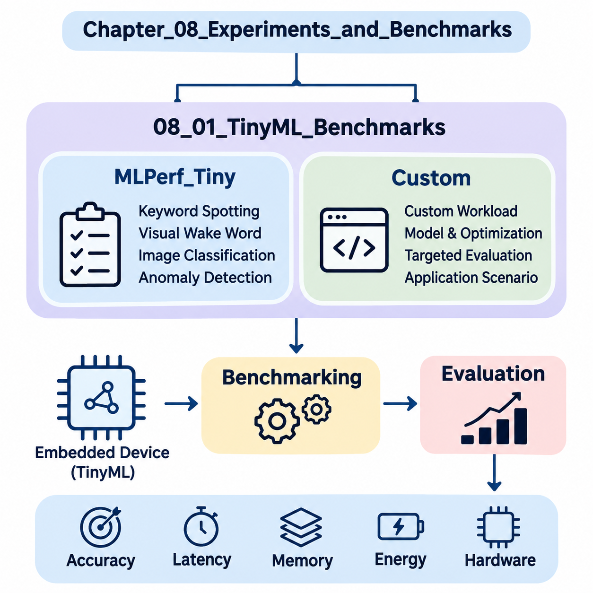
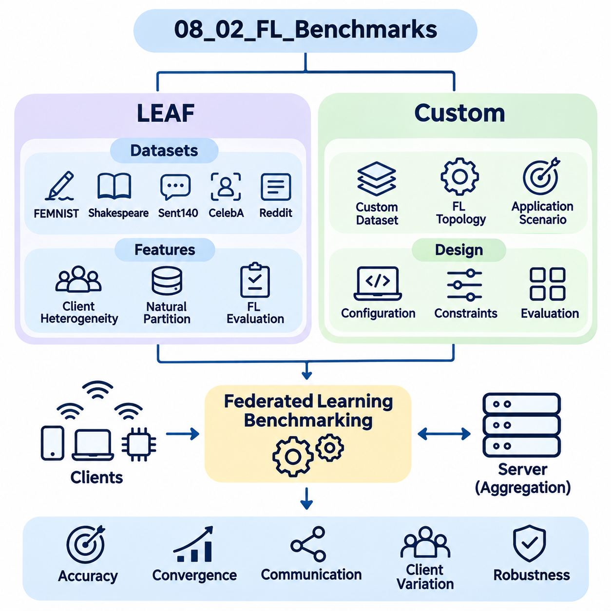
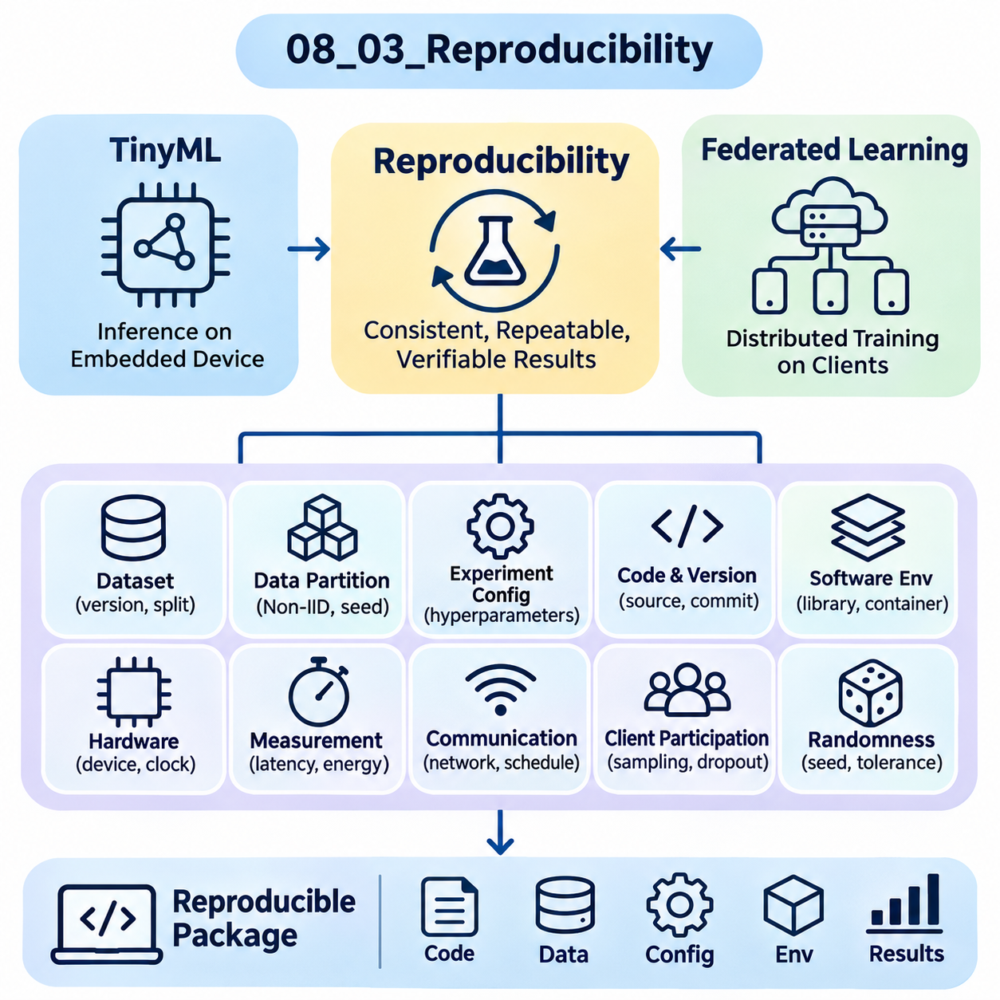
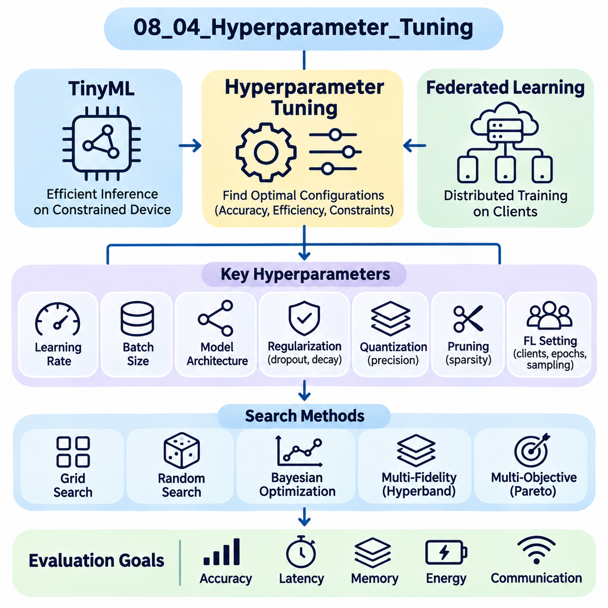
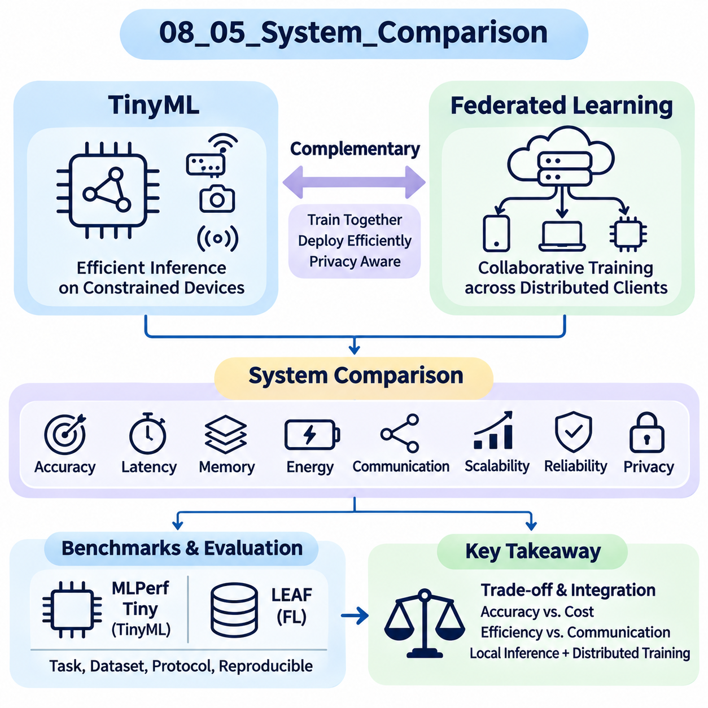

**Volume 40.** **TinyML and Federated Learning**

# 08. Experiments and Benchmarks

## 08.01 TinyML Benchmarks

{width="7.268055555555556in" height="7.268055555555556in"}

Tiny Machine Learning (TinyML) benchmarking evaluates the performance of machine learning models deployed on resource-constrained embedded devices. Unlike conventional AI benchmarks, TinyML evaluation must consider predictive accuracy, inference latency, memory consumption, energy efficiency, and hardware limitations simultaneously. These measurements determine whether a model can operate reliably within the computational and power constraints of microcontrollers and edge devices.

Benchmarking provides a standardized foundation for comparing model architectures, optimization techniques, inference frameworks, and hardware platforms. A model achieving high classification accuracy on a workstation may perform poorly on an embedded processor because of limited SRAM, flash storage, or computational throughput. Consequently, TinyML benchmarks emphasize measurements obtained from actual deployment environments rather than relying exclusively on theoretical operation counts.

MLPerf Tiny is a standardized benchmarking suite developed within the MLCommons ecosystem to evaluate machine learning inference on extremely resource-constrained devices. It provides reference workloads, evaluation procedures, and measurement conventions that support comparisons across embedded hardware platforms. Its primary objective is to establish reproducible performance measurements while preserving defined task-quality requirements and consistent execution conditions.

The MLPerf Tiny benchmark suite includes representative workloads involving keyword spotting, visual wake words, image classification, and anomaly detection. These workloads represent practical applications of embedded intelligence, including voice activation, low-resolution visual recognition, environmental monitoring, and industrial equipment diagnostics. Each workload exercises different computational patterns, memory-access characteristics, and inference requirements.

Keyword spotting benchmarks evaluate the ability of compact neural networks to recognize predefined speech commands from short audio segments. Typical implementations transform audio signals into spectral representations before applying convolutional or similarly efficient neural architectures. Benchmark measurements examine classification quality, inference latency, memory requirements, and energy consumption under controlled input and execution conditions.

Visual wake word benchmarks evaluate lightweight image recognition models designed to detect the presence of a person within an image. These workloads are relevant to battery-powered cameras, occupancy sensors, and intelligent monitoring devices. Evaluation considers the relationship between recognition accuracy and computational cost, particularly when image preprocessing, neural inference, and memory transfers compete for limited embedded resources.

Image classification benchmarks assess compact neural networks operating on small visual inputs. Representative architectures may include depthwise separable convolutional networks and quantized convolutional models. Their performance depends on arithmetic precision, tensor layout, memory allocation, and processor instruction support. Benchmark results help identify architectures that balance classification accuracy with limited computational resources.

Anomaly detection benchmarks examine whether embedded models can distinguish normal operating conditions from unusual sensor patterns. Applications include predictive maintenance, equipment monitoring, and industrial fault detection. Models may process audio or other sensor-derived features to estimate abnormality scores. Evaluation requires consistent definitions of normal behavior, anomalous samples, decision thresholds, and task-specific quality metrics.

MLPerf Tiny measurements distinguish inference latency from energy consumption because these properties describe different aspects of system performance. Latency represents the elapsed time required to execute an inference operation, while energy measures the electrical work consumed during execution. A processor completing inference quickly may consume substantial instantaneous power, whereas a slower implementation may require more total energy because of prolonged execution.

Memory utilization is another essential evaluation dimension, although memory reporting must be distinguished from the official scoring rules of a particular benchmark version. Flash memory generally stores executable code, model parameters, and persistent constants, while SRAM supports intermediate tensors, activation buffers, and runtime state. Memory profiling identifies whether a model fits within hardware limits and reveals opportunities for reducing peak allocation.

Quantization significantly influences TinyML benchmark performance by reducing numerical precision and storage requirements. Integer representations, particularly eight-bit quantization, can decrease model size and improve inference efficiency on compatible processors. However, performance improvements depend on hardware acceleration and optimized kernels. Benchmarking must therefore evaluate both numerical degradation and actual device-level execution rather than assuming quantization always improves performance.

Pruning and knowledge distillation provide additional optimization strategies that can be evaluated through standardized workloads. Pruning removes selected parameters or structures, while distillation transfers learned behavior from a larger teacher model into a smaller student model. Their effectiveness should be measured through accuracy, memory consumption, latency, and energy. Unstructured sparsity may offer limited runtime benefits when embedded inference libraries lack sparse computation support.

Hardware comparisons require careful consideration of processor architecture, operating frequency, memory hierarchy, and available acceleration instructions. ARM Cortex-M microcontrollers, RISC-V processors, and specialized embedded accelerators may execute identical neural networks with substantially different performance characteristics. Comparisons become meaningful only when model configurations, measurement boundaries, compiler settings, and benchmark rules are documented consistently.

Custom TinyML benchmarks complement standardized suites by evaluating application-specific workloads that may not be represented in MLPerf Tiny. Industrial robotics, wearable healthcare devices, environmental sensing systems, and autonomous edge platforms often require specialized evaluation procedures. These benchmarks incorporate realistic sensor characteristics, operating conditions, timing constraints, and reliability requirements that reflect the intended deployment environment.

Designing a custom benchmark begins with defining the target application and measurable performance objectives. For example, an embedded vibration-monitoring system may require anomaly detection within a fixed processing interval while maintaining low average energy consumption. A mobile robot may prioritize predictable inference latency and sensor-processing throughput. These requirements determine appropriate datasets, hardware configurations, and evaluation metrics.

Dataset selection strongly influences benchmark validity. Public datasets provide reproducible reference conditions, whereas application-specific datasets capture operational characteristics that generic benchmarks may overlook. Representative data should include realistic sensor noise, environmental variation, class imbalance, and difficult operating conditions. Separate training, validation, and testing partitions help prevent information leakage and support credible estimates of generalization performance.

Custom benchmarking must define precise timing boundaries to distinguish model execution from complete application processing. Model-only latency measures neural network inference, whereas end-to-end latency may include sensor acquisition, preprocessing, inference, postprocessing, and communication. Both measurements are valuable, but they answer different engineering questions. Explicit measurement boundaries prevent misleading comparisons between implementations.

Energy benchmarking requires appropriate measurement instrumentation and a clearly defined execution interval. External power analyzers or calibrated current-monitoring systems can capture electrical behavior during inference and idle periods. Energy per inference can be calculated by integrating power over the measured interval. For intermittently active devices, average power should additionally account for sleep states, wake-up overhead, and application duty cycles.

Real-time TinyML systems require more than favorable average latency. Robotics controllers, wearable monitoring devices, and industrial safety-related applications may impose deadlines that must be satisfied consistently. Custom benchmarks should therefore examine latency distributions, worst-observed execution times, deadline-miss rates, and scheduling interference. Such measurements reveal operational risks that average inference latency alone cannot identify.

Thermal behavior and operating frequency can also affect benchmark stability. Sustained inference may increase device temperature, alter power consumption, or trigger frequency adjustments on supported platforms. Measurements conducted immediately after startup may differ from those obtained during extended operation. Long-duration benchmark sessions help characterize performance stability and identify conditions under which computational or energy efficiency deteriorates.

Benchmark reproducibility depends on controlling software and hardware configurations. Model versions, compiler options, inference libraries, firmware revisions, processor frequencies, and measurement instruments should be recorded alongside experimental results. Repeated trials and statistical summaries help distinguish genuine performance differences from measurement variability. This documentation supports independent verification and reliable comparisons across development iterations.

A practical evaluation workflow combines standardized MLPerf Tiny measurements with application-specific custom benchmarks. Standardized results establish comparable reference performance, while custom experiments determine whether a system satisfies deployment requirements. Together, these approaches support evidence-based decisions concerning model architecture, hardware selection, optimization techniques, and embedded software design.

The ultimate purpose of TinyML benchmarking is not simply to identify the fastest neural network or the device with the lowest energy consumption. It is to determine which combination of model, inference framework, and hardware delivers sufficient predictive quality within realistic resource constraints. A comprehensive benchmark methodology transforms isolated performance measurements into engineering evidence for reliable, efficient, and scalable embedded intelligence.

## 08.02 FL Benchmarks

{width="7.268055555555556in" height="7.268055555555556in"}

Federated Learning (FL) benchmarking evaluates the effectiveness of machine learning systems that train collaboratively across distributed clients without transferring raw training data to a central server. Unlike conventional centralized learning benchmarks, FL evaluation must consider model accuracy, communication overhead, statistical heterogeneity, client availability, and computational constraints. These factors determine whether collaborative training remains efficient and reliable under realistic distributed conditions.

A comprehensive FL benchmark measures both algorithmic performance and system-level efficiency. Model convergence alone cannot describe the practical effectiveness of federated training because communication delays, uneven data distributions, and device participation significantly influence execution. Benchmarking therefore combines predictive quality with training duration, communication volume, client resource consumption, and robustness against heterogeneous operating environments.

LEAF, introduced as a benchmarking framework for federated settings, provides datasets and evaluation utilities designed to represent realistic decentralized learning conditions. Its name refers to a benchmark framework for learning in federated settings. LEAF emphasizes naturally partitioned datasets, where individual clients possess different quantities and distributions of training examples, enabling researchers to investigate challenges that conventional centralized datasets often conceal.

The LEAF framework includes federated datasets derived from handwriting recognition, language modeling, image classification, and recommendation-related tasks. Representative datasets include FEMNIST, Shakespeare, Sent140, CelebA, and Reddit. These datasets exhibit different forms of client heterogeneity, including variations in sample quantity, label distribution, vocabulary usage, and participation characteristics. Their diversity supports comparisons across multiple federated learning scenarios.

FEMNIST extends the familiar handwritten character recognition setting by organizing examples according to individual writers. Each writer represents a potential federated client with a distinctive handwriting style and sample distribution. This natural partitioning introduces non-independent and identically distributed data, commonly called Non-IID data. Benchmark experiments can investigate how local training behavior and aggregation strategies respond to differences between client datasets.

The Shakespeare dataset represents a federated language modeling workload in which textual sequences are partitioned according to speaking roles. Each role functions as a client possessing a distinctive linguistic distribution. Models trained on these partitions encounter differences in vocabulary, sentence structure, and available training examples. This setting helps evaluate federated optimization under heterogeneous sequence prediction workloads.

Sent140 provides sentiment classification data derived from social media messages, with user-based partitions representing decentralized clients. Individual users may contribute different numbers of messages and exhibit distinct linguistic patterns. Federated evaluation on this dataset examines classification performance under uneven client participation and nonuniform text distributions. Preprocessing choices and vocabulary construction must remain consistent to support reproducible comparisons.

CelebA supports federated image classification experiments using facial attribute information associated with different identities. Client partitions can represent individual identities, creating variations in image characteristics and available examples. Such experiments investigate how federated models generalize across visually heterogeneous clients. Evaluation must also consider privacy implications, dataset permissions, and the distinction between experimental partitioning and actual deployment environments.

The Reddit dataset supports language modeling experiments using text associated with different users or communities, depending on the selected preprocessing configuration. Federated partitions can exhibit substantial differences in vocabulary, sequence length, and sample availability. These characteristics make the dataset useful for studying client imbalance and communication-intensive language models. Dataset versions and preprocessing procedures should be documented carefully.

LEAF benchmarking commonly evaluates federated optimization methods such as Federated Averaging (FedAvg), which aggregates locally updated model parameters into a shared global model. Clients perform local training before transmitting updates for server aggregation. Experimental variables include the number of local epochs, client sampling fraction, batch size, and learning rate. Their interactions influence convergence speed, communication efficiency, and model stability.

Statistical heterogeneity is a central challenge in LEAF experiments because clients rarely possess identical data distributions. Differences in class frequencies, feature characteristics, and sample quantities can produce conflicting local optimization directions. Benchmarking should therefore examine both aggregate model accuracy and client-level performance variation. A model with strong global accuracy may still perform poorly for clients representing uncommon data distributions.

Communication efficiency represents another essential evaluation dimension. Federated systems repeatedly exchange model parameters or updates between participating clients and aggregation servers. Benchmark measurements may include transmitted bytes, communication rounds, upload frequency, and cumulative network traffic. These metrics reveal whether an algorithm reduces communication requirements without sacrificing predictive performance or imposing excessive computational burdens on individual devices.

Client selection strategies influence benchmark outcomes by determining which participants contribute to each training round. Uniform random sampling provides a common reference, while availability-aware or resource-aware strategies reflect operational constraints. Different selection policies may alter convergence, fairness, and computational efficiency. Meaningful comparisons require consistent participation assumptions and explicit reporting of the client sampling process.

System heterogeneity arises when participating devices differ in processor capability, memory capacity, battery availability, and network connectivity. Although dataset-based benchmarks emphasize statistical differences, practical federated systems must also address variable execution times and intermittent participation. Custom evaluation environments can simulate these conditions by assigning different computation speeds, communication delays, and availability schedules to individual clients.

Custom FL benchmarks extend standardized datasets and evaluation procedures toward application-specific requirements. Mobile devices, healthcare institutions, industrial sensors, and autonomous robots often generate data with characteristics not fully represented by established research benchmarks. Custom benchmarking allows researchers to incorporate realistic client populations, domain-specific data distributions, operational constraints, and deployment architectures into experimental evaluation.

Designing a custom benchmark begins with defining the federation topology and learning objective. A centralized server-client architecture may coordinate model aggregation, while decentralized federated learning distributes coordination among participating nodes. The benchmark should specify the number of clients, aggregation frequency, communication protocol, local training workload, and expected participation behavior. These parameters establish the experimental conditions needed for meaningful comparisons.

Custom datasets should preserve realistic differences between clients rather than relying exclusively on random data partitions. Industrial equipment may produce sensor measurements influenced by machine type, operating environment, and maintenance history. Healthcare institutions may exhibit differences in patient populations and acquisition procedures. Such variations create realistic Non-IID conditions and allow researchers to investigate whether federated algorithms generalize across participating organizations or devices.

Synthetic partitioning provides a controlled alternative when naturally federated datasets are unavailable. Researchers can generate heterogeneous client distributions using label-skew, quantity-skew, or feature-skew partitioning strategies. Dirichlet-based label allocation is frequently used to adjust the degree of class imbalance between clients. However, synthetic heterogeneity should be distinguished from naturally occurring differences because its statistical assumptions may not reflect operational environments.

Custom benchmark evaluation should include convergence behavior, predictive accuracy, communication cost, and computational efficiency. Convergence can be measured against communication rounds, elapsed training time, or cumulative transmitted data. Reporting multiple convergence perspectives prevents algorithms from appearing efficient merely because they perform more local computation. Client-level accuracy distributions additionally reveal whether optimization improvements benefit the federation broadly or only dominant participants.

Robustness testing examines how federated systems respond to unreliable participation and imperfect communication. Experimental scenarios may introduce client dropout, delayed updates, temporary disconnections, and variable network bandwidth. These conditions influence aggregation timing and the freshness of model updates. Benchmark results should distinguish algorithmic robustness from assumptions imposed by the simulator or communication infrastructure.

Privacy and security evaluation can complement performance benchmarking when federated learning incorporates secure aggregation, differential privacy, or other protective mechanisms. Such mechanisms may increase computation, communication, or model error while reducing selected information disclosure risks. Custom benchmarks should quantify these tradeoffs and document their threat models. Federated learning alone does not guarantee privacy against malicious participants or inference attacks.

Reproducibility requires consistent datasets, model architectures, optimization settings, and client sampling procedures. Random seeds, software versions, aggregation algorithms, and simulated network conditions should be recorded. Repeated experiments help characterize variability caused by stochastic optimization and changing participation patterns. Reporting averages alongside dispersion measures provides stronger evidence than relying on a single favorable experimental run.

A practical FL benchmarking strategy combines LEAF datasets with custom application-oriented evaluations. LEAF provides established federated workloads and naturally heterogeneous client partitions, while custom benchmarks examine deployment-specific constraints and system behavior. Together, these approaches support comparisons of federated optimization methods, communication strategies, client selection policies, and privacy-preserving mechanisms.

The ultimate objective of federated learning benchmarking is to determine whether distributed collaborative training delivers useful predictive performance under realistic statistical, computational, and communication constraints. Reliable evaluation must consider the experiences of individual clients as well as the global model. By integrating standardized datasets with carefully designed custom experiments, FL benchmarking provides engineering evidence for scalable, efficient, and trustworthy decentralized intelligence.

## 08.03 Reproducibility [w/Code]

{width="7.268055555555556in" height="7.268055555555556in"}

Reproducibility is a fundamental requirement for evaluating TinyML and Federated Learning systems because experimental results must remain consistent across repeated executions, hardware platforms, and software environments. Reliable reproduction allows researchers to distinguish genuine algorithmic improvements from accidental variations. In distributed and resource-constrained environments, reproducibility requires careful control of data, computation, communication, and measurement procedures.

Reproducibility differs from repeatability and replicability in important ways. Repeatability generally refers to obtaining consistent results under the same experimental conditions, while reproducibility involves independently obtaining comparable findings using documented methods. Replicability may involve evaluating the same scientific claim through an independently implemented experiment. Terminology varies across research communities, making explicit definitions essential when reporting experimental results.

TinyML experiments introduce reproducibility challenges because inference performance depends on hardware architecture, processor frequency, memory hierarchy, and embedded software configuration. Identical neural network models may exhibit different latency and energy consumption across microcontrollers. Benchmark documentation must therefore identify the exact device, firmware revision, compiler version, optimization flags, inference runtime, and operating conditions used during evaluation.

Federated Learning introduces additional uncertainty through distributed client participation, heterogeneous datasets, and stochastic optimization. Different client sampling sequences can produce substantially different convergence trajectories even when model architectures remain unchanged. Reproducible experiments must specify the federation topology, aggregation algorithm, client selection strategy, local training configuration, and communication assumptions alongside the model and dataset definitions.

Dataset reproducibility begins with preserving the exact data sources, versions, and preprocessing procedures. Training, validation, and testing partitions should remain fixed when comparing algorithms. In federated experiments, client-specific partitions are equally important because changes in data distribution can alter convergence and fairness. Dataset manifests, partition identifiers, integrity checksums, and preprocessing configuration files provide verifiable records of experimental inputs.

Non-IID data partitioning requires particular attention because synthetic heterogeneity can be generated through stochastic procedures. Dirichlet-based label allocation, quantity-skew sampling, and feature-skew transformations may produce different client distributions across executions. Recording partition parameters and random seeds is necessary but may not guarantee identical partitions across library versions. Persisting the generated client assignments provides stronger reproducibility.

Randomness affects model initialization, minibatch ordering, data augmentation, dropout, and client selection. Experiments should establish controlled random seeds for relevant software libraries and execution components. However, deterministic seeds alone cannot guarantee identical results when hardware kernels, parallel scheduling, or asynchronous execution introduce nondeterminism. Reproducibility protocols must therefore identify unavoidable variability and establish acceptable numerical tolerances.

Software environment management helps prevent experimental differences caused by changing dependencies. Python versions, machine learning frameworks, numerical libraries, compiler toolchains, and embedded inference runtimes should be recorded explicitly. Dependency lockfiles and container images can preserve software configurations for server-based experiments. Embedded targets additionally require firmware binaries, board support packages, and cross-compilation settings to reconstruct the execution environment.

Hardware configuration is especially important for TinyML benchmarking because small architectural differences can significantly affect performance. Processor clock frequency, cache availability, accelerator configuration, and memory placement influence inference latency. Energy measurements also depend on supply voltage, peripheral activity, and power-management settings. Reproducible evaluation requires these conditions to remain controlled or to be reported as experimental variables.

Measurement reproducibility requires clearly defined timing boundaries and instrumentation procedures. Model-only inference latency should be distinguished from end-to-end application latency, which may include sensor acquisition and preprocessing. Energy measurements should identify the sampling frequency, measurement interval, instrument calibration, and treatment of idle power. Without consistent measurement boundaries, comparisons may reflect instrumentation differences rather than actual model performance.

Federated experiments must document communication behavior because network conditions influence training efficiency. Communication latency, bandwidth limits, packet loss, and client disconnections may change the duration and outcome of training. Simulation-based studies should record network models and scheduling policies. Real-world deployments should capture observed communication statistics and recognize that uncontrolled network variability may prevent exact timing reproduction.

Client participation is another source of variability in federated benchmarking. Devices may become unavailable because of connectivity interruptions, battery limitations, or competing workloads. Experiments should specify participation probabilities, dropout policies, timeout thresholds, and aggregation requirements. Replaying recorded participation traces can improve comparability, while evaluating multiple participation scenarios helps determine whether conclusions remain valid under realistic operational uncertainty.

Experiment configuration management provides a structured method for preserving all relevant settings. Configuration files can describe datasets, model architectures, optimization parameters, client populations, hardware targets, and evaluation procedures. Each experimental run should reference an immutable configuration snapshot and a unique identifier. This approach reduces ambiguity when comparing results obtained through different model revisions or deployment configurations.

Version control systems support reproducibility by preserving source code, configuration changes, and experiment documentation. A reproducible result should reference the exact source revision used for training and evaluation. Model checkpoints, compiled binaries, dataset manifests, and measurement logs should be associated with that revision. Large artifacts may require external storage, but their locations and integrity hashes should remain traceable through experiment metadata.

Automated experiment pipelines reduce human error by executing preparation, training, deployment, evaluation, and reporting through consistent procedures. Continuous integration systems can validate software compatibility and execute selected regression tests. Hardware-in-the-loop testing extends automation to physical embedded devices. Although automation cannot eliminate every environmental difference, it improves procedural consistency and makes failures easier to investigate.

Statistical reproducibility requires repeated experiments rather than relying on a single favorable result. Multiple random seeds, client sampling sequences, and representative operating conditions should be evaluated. Results can be summarized using means, standard deviations, confidence intervals, or distributional statistics. The number of repetitions should reflect expected variability, and uncertainty estimates should be interpreted according to the experimental design.

Model accuracy alone is insufficient for reproducibility analysis because system-level metrics may vary independently. TinyML experiments should examine accuracy, inference latency, memory consumption, and energy efficiency. Federated experiments should additionally evaluate convergence, communication volume, client-level performance, and training duration. Reporting these measurements together reveals whether apparent improvements remain consistent across algorithmic and operational dimensions.

Reproducibility also requires distinguishing deterministic execution from statistically consistent behavior. Exact numerical agreement may be achievable under tightly controlled software and hardware conditions, but distributed training frequently produces small numerical differences. A practical validation protocol can define acceptable deviations for accuracy, convergence, latency, and energy. These tolerances should be justified rather than selected after observing experimental outcomes.

Privacy-preserving federated learning introduces additional reproducibility challenges because differential privacy and secure aggregation may involve randomized mechanisms or protected information. Experiments should document privacy parameters, noise-generation procedures, aggregation protocols, and threat assumptions. Reproducibility must not require disclosure of sensitive client records or secret cryptographic material. Synthetic datasets and controlled test configurations can support verification without compromising operational privacy.

A complete reproducibility package should provide sufficient information to reconstruct the experiment and evaluate its conclusions. Essential materials include source revisions, dependency specifications, dataset preparation procedures, model configurations, execution commands, evaluation protocols, and recorded results. When physical hardware or private datasets cannot be distributed, documented substitutes and explicit limitations help independent researchers assess the strength of the evidence.

The ultimate purpose of reproducibility is to transform experimental observations into dependable engineering knowledge. For TinyML, it supports reliable comparisons of embedded models, optimization techniques, and hardware platforms. For Federated Learning, it enables meaningful evaluation of distributed optimization under heterogeneous conditions. Systematic documentation, controlled execution, and statistical validation establish the foundation for trustworthy benchmark results and sustainable AI system development.

## 08.04 Hyperparameter Tuning [w/Code]

{width="7.268055555555556in" height="7.268055555555556in"}

Hyperparameter tuning is a fundamental process for optimizing TinyML and Federated Learning systems because model performance depends on configuration choices that are not directly learned from training data. Learning rates, batch sizes, model dimensions, and regularization settings influence accuracy, convergence, and computational efficiency. In resource-constrained and distributed environments, tuning must also consider memory limits, energy consumption, communication overhead, and execution stability.

Unlike conventional machine learning, TinyML optimization requires hyperparameters to satisfy strict hardware constraints. A model configuration that improves accuracy may exceed available SRAM, flash storage, or acceptable inference latency. Hyperparameter tuning therefore becomes a constrained optimization problem in which predictive quality must be balanced against deployment feasibility. Hardware limitations should be incorporated into the search process rather than evaluated only after training.

Federated Learning introduces additional hyperparameters associated with distributed optimization and client coordination. The number of participating clients, local training epochs, aggregation frequency, and client sampling fraction influence convergence behavior and communication efficiency. These parameters interact with learning rates and data heterogeneity, making federated tuning more complex than centralized optimization. Effective configurations must remain robust across changing client populations.

Learning rate selection strongly influences optimization stability and convergence speed. Excessively large learning rates may cause oscillation or divergence, while excessively small values increase training duration. Learning rate schedules, warm-up procedures, and adaptive optimizers can improve convergence under suitable conditions. In federated systems, client-side and server-side learning rates may require separate tuning because local updates and global aggregation operate at different scales.

Batch size determines how many training examples contribute to each optimization update. Larger batches may improve computational throughput but increase memory requirements, while smaller batches reduce memory consumption and introduce greater gradient variability. TinyML training experiments must consider accelerator memory during development and deployment memory during inference. Federated Learning additionally requires attention to differences in local dataset sizes across clients.

Model architecture hyperparameters include network depth, layer width, kernel size, channel count, and activation functions. These choices influence representational capacity, parameter count, and computational complexity. TinyML applications often favor compact architectures with predictable memory usage and efficient operator support. Architecture tuning should consider actual embedded inference kernels because theoretical operation counts do not always predict execution latency.

Regularization hyperparameters control model complexity and generalization behavior. Weight decay, dropout probability, data augmentation intensity, and early stopping criteria can reduce overfitting. However, their effectiveness depends on dataset size, class imbalance, and model capacity. In federated environments, regularization may also influence how well the global model generalizes across clients with different data distributions.

Quantization introduces additional tuning decisions involving numerical precision, calibration procedures, and quantization-aware training. Eight-bit integer representations can reduce memory requirements and improve inference efficiency on supported hardware. Calibration dataset selection and activation scaling affect numerical accuracy. Quantization parameters should be evaluated together with model architecture because sensitivity to reduced precision varies across layers and operators.

Pruning and sparsity optimization require selecting pruning ratios, target layers, and retraining schedules. Aggressive pruning may reduce model size while degrading predictive accuracy or destabilizing optimization. Structured pruning can provide practical speed improvements when supported by embedded kernels. Hyperparameter searches should measure actual memory consumption and inference latency rather than assuming that reduced parameter counts automatically produce proportional runtime benefits.

Federated Averaging introduces important tuning parameters through local computation and global aggregation. Increasing local epochs can reduce communication frequency but may amplify client drift when data distributions differ. Increasing client participation can stabilize aggregated updates while increasing communication demand. Optimal configurations depend on the relationship between statistical heterogeneity, network capacity, and available client computation.

Client selection and participation policies create another tuning dimension. Sampling fractions, minimum participation thresholds, timeout settings, and resource-aware scheduling affect training progress. A configuration optimized for continuously available clients may perform poorly when devices frequently disconnect. Evaluation should therefore consider multiple participation scenarios and measure both aggregate accuracy and client-level performance variation.

Non-IID data distributions complicate hyperparameter optimization because a configuration that performs well on one client population may generalize poorly to another. Label imbalance, feature differences, and unequal sample quantities alter local optimization behavior. Tuning procedures should use representative federated validation partitions and avoid selecting parameters solely from centralized validation results that conceal client heterogeneity.

Grid search systematically evaluates combinations of predefined hyperparameter values. Its structured coverage makes experiments straightforward to interpret, but computational cost grows rapidly with the number of parameters. Random search samples configurations from specified distributions and often explores high-dimensional spaces more efficiently. Both approaches require clearly defined search ranges, evaluation budgets, and reproducible sampling procedures.

Bayesian optimization provides a more adaptive approach by constructing a surrogate model of the relationship between hyperparameters and observed performance. Acquisition functions guide subsequent evaluations toward promising or uncertain configurations. This approach can reduce expensive training trials, although surrogate modeling becomes challenging with noisy federated outcomes and discrete hardware constraints. Repeated evaluations may be necessary to estimate configuration quality reliably.

Multi-fidelity optimization reduces search cost by evaluating candidate configurations with different computational budgets. Early experiments may use fewer training epochs, smaller datasets, or reduced client populations before allocating additional resources to promising candidates. Successive halving and Hyperband are examples of resource allocation strategies. However, low-budget evaluations must remain sufficiently representative of final deployment conditions.

Multi-objective optimization is particularly important for TinyML because accuracy, latency, memory consumption, and energy efficiency cannot always be reduced to a single meaningful score. Pareto optimization identifies configurations for which improving one objective requires sacrificing another. Deployment constraints can eliminate infeasible candidates before ranking feasible alternatives. This approach supports transparent engineering decisions rather than optimizing accuracy alone.

Federated Learning also benefits from multi-objective tuning because convergence speed, communication volume, fairness, and privacy may conflict. Increasing local computation can reduce communication rounds while increasing energy consumption or client drift. Privacy-preserving mechanisms may introduce additional noise and computational overhead. Hyperparameter selection should reflect the operational priorities and constraints of the intended federation.

Experimental design must prevent information leakage between tuning and final evaluation. Hyperparameters should be selected using validation data, while test datasets remain reserved for independent performance assessment. In federated experiments, validation procedures should preserve relevant client-level distributions. Repeatedly adjusting configurations based on test results produces optimistic estimates and weakens the credibility of benchmark comparisons.

Automated tuning pipelines improve consistency by managing configuration generation, training execution, evaluation, and result storage. Each trial should record random seeds, software versions, dataset partitions, hardware configurations, and measured objectives. Failed trials caused by memory exhaustion or communication timeouts should remain documented. These records distinguish infeasible configurations from algorithms that merely achieve lower predictive accuracy.

Statistical uncertainty must be considered when comparing candidate configurations. Stochastic initialization, client sampling, and nondeterministic execution can produce substantial variation between runs. Promising configurations should be reevaluated using multiple seeds and representative operating conditions. Confidence intervals or dispersion statistics help determine whether apparent improvements exceed normal experimental variability.

A practical tuning workflow begins with defining deployment requirements and selecting a manageable search space. Coarse exploration identifies influential parameters, while targeted refinement investigates promising regions. TinyML candidates should undergo hardware-level validation, and federated candidates should be tested under realistic client participation and communication conditions. Final configurations should be selected using consistent evaluation criteria and reproducible evidence.

The ultimate objective of hyperparameter tuning is not to discover a universally optimal configuration but to identify reliable operating points for specific learning tasks and deployment environments. TinyML requires configurations that deliver sufficient predictive accuracy within embedded resource limits, while Federated Learning requires stable collaborative optimization across heterogeneous clients. Systematic search, multi-objective evaluation, and reproducible validation transform tuning into an engineering discipline.

## 08.05 System Comparison

{width="7.268055555555556in" height="7.268055555555556in"}

System comparison provides a structured method for evaluating TinyML and Federated Learning architectures under consistent experimental conditions. Although both approaches support intelligence beyond centralized cloud computing, they address different operational requirements. TinyML emphasizes efficient inference on constrained devices, while Federated Learning coordinates collaborative model training across distributed participants without routinely transferring raw datasets.

Meaningful comparison requires a common evaluation framework that distinguishes predictive performance from operational efficiency. Accuracy, latency, memory consumption, energy requirements, communication overhead, and scalability represent important dimensions. However, these metrics have different meanings across TinyML and Federated Learning. Comparisons should therefore evaluate complete system capabilities rather than treating isolated benchmark scores as universally interchangeable.

TinyML systems typically execute compact neural networks on microcontrollers, embedded processors, or specialized low-power accelerators. Their effectiveness depends on whether inference workloads satisfy strict memory, timing, and power constraints. Benchmarking examines model size, peak SRAM utilization, inference latency, and energy per prediction. These measurements establish whether continuous or intermittent intelligent processing is feasible on a target device.

Federated Learning systems distribute model training across clients that maintain local datasets. Their performance depends on optimization convergence, client participation, aggregation behavior, and network characteristics. Evaluation considers global model accuracy, communication rounds, transmitted data volume, and training duration. Client-level performance must also be examined because heterogeneous data distributions can produce unequal learning outcomes.

The distinction between inference and training is essential when comparing these approaches. TinyML primarily describes deployment-efficient machine learning, whereas Federated Learning describes a distributed training methodology. A federated model may ultimately be deployed using TinyML techniques, and a TinyML device may participate in federated training if its resources permit. Consequently, the approaches are complementary rather than inherently competing architectures.

Standardized benchmarks establish reference conditions for system evaluation. MLPerf Tiny provides representative embedded inference workloads, while LEAF offers federated datasets and evaluation utilities. Their results cannot be directly ranked because they measure different activities and constraints. Instead, each benchmark contributes evidence about a specific system layer, allowing researchers to construct a broader assessment of distributed intelligence.

Predictive quality should be compared using consistent task definitions, datasets, and evaluation metrics. Classification accuracy, precision, recall, and task-specific error rates may be appropriate depending on the application. Federated evaluations should additionally report client-level variation and performance on underrepresented populations. TinyML evaluations should assess whether compression or quantization changes predictive behavior after deployment.

Latency comparisons require carefully defined measurement boundaries. TinyML inference latency measures the time required to produce a prediction, while federated training latency may describe local computation, aggregation delays, or complete training rounds. End-to-end application latency can include sensing, preprocessing, communication, and decision execution. Reporting these quantities separately prevents misleading conclusions about responsiveness.

Energy efficiency is particularly important when evaluating battery-powered devices. TinyML measurements commonly focus on energy per inference, idle power, and duty-cycle behavior. Federated Learning introduces energy costs from local training, wireless communication, and repeated synchronization. A combined system must account for both inference and training energy, especially when learning updates occur on devices with limited battery capacity.

Memory requirements reveal important architectural differences. TinyML deployment is often constrained by flash storage, SRAM, and intermediate tensor buffers. Federated clients may additionally require optimizer states, gradients, and training activations. These requirements can substantially exceed inference-only memory consumption. System comparison should distinguish persistent model storage, peak runtime memory, and temporary training allocations.

Communication cost represents another major differentiator. Standalone TinyML inference can operate without continuous network connectivity, reducing dependence on remote infrastructure. Federated Learning generally requires periodic exchanges of model updates or related information. Communication efficiency should be evaluated through transmitted bytes, synchronization frequency, bandwidth requirements, and the effect of unreliable connections on training progress.

Scalability has different interpretations across the two approaches. TinyML scalability may concern deploying the same model across thousands of inexpensive devices while maintaining acceptable performance and management overhead. Federated scalability involves coordinating growing client populations, aggregation workloads, and communication demands. Evaluation should identify whether bottlenecks arise from individual device limitations or distributed coordination mechanisms.

Reliability testing should reflect realistic operational disturbances. TinyML systems may encounter sensor noise, thermal variation, memory pressure, and unstable power conditions. Federated systems must additionally tolerate client dropout, delayed updates, and heterogeneous network availability. Comparative experiments should measure performance degradation, recovery behavior, and consistency under disturbances rather than relying exclusively on ideal operating conditions.

Privacy and security requirements also influence system selection. Local TinyML inference can reduce the need to transmit sensor observations, but local processing alone does not guarantee confidentiality or device security. Federated Learning reduces routine central collection of raw training data, yet model updates may still expose information. Secure aggregation, differential privacy, authentication, and protected storage introduce safeguards with measurable operational costs.

Hardware and software compatibility affect deployment feasibility. TinyML implementations depend on supported operators, compiler optimization, inference runtimes, and processor instruction sets. Federated Learning requires compatible training frameworks, aggregation protocols, and client management infrastructure. Combined deployments must reconcile these requirements, particularly when inference hardware lacks sufficient memory or computational capability for local model updates.

Economic comparison should consider total cost of ownership rather than hardware purchase prices alone. TinyML deployments may reduce cloud inference expenses but introduce device maintenance, firmware management, and fleet monitoring costs. Federated Learning can reduce centralized data transfer requirements while increasing coordination and local training expenses. Evaluation should include development effort, infrastructure costs, energy use, and operational support.

Experimental fairness requires comparable datasets, clearly defined workloads, and consistent measurement procedures. When systems perform different functions, direct numerical comparisons should be replaced by application-level evaluations. A common application scenario can measure whether each architecture satisfies accuracy, responsiveness, privacy, and resource requirements. This avoids treating differences in experimental objectives as evidence of architectural superiority.

Hybrid architectures combine embedded inference with distributed model improvement. Devices may execute quantized models locally while periodically contributing selected training updates to a federated process. Updated global models can subsequently be optimized and redeployed to embedded targets. Such systems require additional evaluation of model compatibility, update frequency, communication cost, deployment safety, and performance changes between versions.

Reproducibility strengthens system comparisons by ensuring that observed differences reflect genuine architectural characteristics. Experiments should document model versions, datasets, hardware configurations, compiler settings, client sampling procedures, and network assumptions. Repeated trials and statistical summaries help quantify uncertainty. Standardized measurement boundaries make results easier to verify and compare across platforms.

Multi-objective evaluation provides a practical method for interpreting competing system requirements. Improvements in accuracy may increase memory usage, latency, energy consumption, or communication cost. Pareto analysis identifies feasible configurations that balance these objectives without assuming a universal weighting scheme. Application-specific constraints determine which tradeoffs are acceptable for a particular deployment.

The ultimate purpose of system comparison is to identify architectures that deliver dependable intelligence under realistic deployment constraints. TinyML provides a foundation for efficient local inference, while Federated Learning enables collaborative training across distributed data owners. Evaluating their individual strengths, limitations, and integration opportunities supports evidence-based decisions for scalable, resource-efficient, and privacy-conscious intelligent systems.
